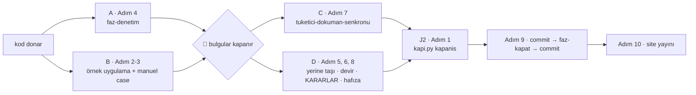

# Faz Tamamlama Protokolü

Bu skill, bir fazın kodu bittiğinde çalıştırılır. Amacı tek bir şeydir: **sonraki oturumun doğru bilgiyle ve ucuz başlaması.**

Tracon fazlar hâlinde ve çoğu zaman **ayrı sohbetlerde** geliştirilir. Dokümanlar gerçeği yansıtmıyorsa sonraki oturum yanlış API'ye göre kod yazar: plan `AgentRunResponse` diyordu, gerçek tip `AgentResponse` idi.

Bu dosya **her fazda** geçen adımları taşır. Koşula bağlı ayrıntı `references/` altındadır ve yalnız tetik doğunca açılır.

---

## Kademe — hafif mi tam mı?

Faz dokümanının `> **Kademe:**` satırı söyler (`faz-planlama` belirler, 2026-10-17):

| Adım | Hafif | Tam |
|---|---|---|
| 2 · Örnek uygulama | Yalnız çalışma anı kodu (`src/` altında `.cs`/`.ts`/`.tsx`) değiştiyse | Her zaman |
| 3 · Manuel case | Yalnız 👤 gerektiren davranış; gerisi otomatik test | [Ek](references/manuel-case.md) |
| 6 · Devir | Yalnız planlanmış bir sonraki faz varsa, kısa | Devir teslim kalitesi |
| Geri kalan her adım | Aynen | Aynen |

**Bağımsız denetim (Adım 4) iki kademede de aynen koşar** — kalitenin motoru odur.
`faz-kapat` kademeyi diff'e karşı denetler: kademe `hafif` iken migration,
`PublicAPI.*.txt`'den silinen satır ya da hedef framework değişikliği varsa
kapanış durur. Güvenlik/kiracı sınırı ve geri dönüşü pahalı karar yargısı
denetçidedir (`faz-denetim` 3.9).

---

## Kulvar sırası (Faz 92)

Adımlar **seri değil kulvarlıdır**:



**Denetim sonucuna bağlı her iş `J1`'i bekler**: 🔴 bir bulgu kodu, dolayısıyla
dokümanı, siteyi ve manuel case'i de değiştirebilir. `B` beklemez — örnek
uygulama koşumu denetimin **girdisidir**. `A` ve `C` **taze bağlamlı ayrı
agent**'lardır. 🚨 Alt agent mekanizması olmayan ortamda kulvarlar seri koşar;
**denetimin bağımsızlığı paralellikten önce gelir.**

---

## Adım 1 — Doğrulama kapıları

Dördü de sıfır uyarı vermelidir. Bir tanesi bile kırmızıysa faz **bitmemiştir**.

```bash
python3 scripts/kapi.py kapanis --taban <faz öncesi commit>
```

Tam anlatı (komut yüzeyi, sıra, `secret` ve ortam kuralları):
[`.agents/ortak/kapilar.md`](../../ortak/kapilar.md). Senkronizasyon kopyası ve
`secret` taraması AYRICA koşulmaz: `kapanis` üretimden hemen sonra
`python3 scripts/kapi.py tarama` koşar ve ilk kırmızıda durur. Üretilen
dosyaları da `kapanis` yeniden yazar; koşumdan sonra değişenleri commit et.
Vaka kayıtları: [`references/gerekce.md`](references/gerekce.md).

**Koşullu ekler — yalnız tetik doğunca aç:**

| Tetik | Ek |
|---|---|
| Yeni bir `src/<Paket>/` projesi | [`references/yeni-paket.md`](references/yeni-paket.md) |
| `src/Tracon.Testing.Contracts.Xunit/` altında sözleşme değişti | [`references/yayin-provasi.md`](references/yayin-provasi.md) — kapı **yetmez**, yayın provası koşar |
| Ekran metni eklendi ya da değişti | [`references/arayuz-ceviri.md`](references/arayuz-ceviri.md) |

---

## Adım 2 — Örnek uygulamayı gerçekten çalıştır

Hafif kademede yalnız çalışma anı kodu değiştiyse. Birim testi geçmesi yetmez:
`samples/Tracon.Api` ayağa kalkmalı ve fazın vaat ettiği davranışı göstermelidir.

```bash
cd samples/Tracon.Api
dotnet run --no-build -c Release --urls http://localhost:5081
# başka bir terminalde: fazın DoD bölümündeki curl komutlarını çalıştır
```

Sonucu DoD'ye **gerçek çıktı olarak** yaz; "çalışıyor" yetmez. 🚨 Bu adım
testlerin yakalamadığını yakalar — Faz 6'da iki hata yalnız burada çıktı ve
ikisi de 383 testten geçmişti. Varsayılan **dışı** bir yapılandırmayla da koş:
`Tracon__Observability__SuccessSampleRatio=1 dotnet run --no-build -c Release`.

---

## Adım 3 — Manuel kabul case'leri

Tam kademede [`references/manuel-case.md`](references/manuel-case.md)'yi uygula.
Hafif kademede yalnız 👤 gerektiren davranış case olur (aynı ek, aynı biçim);
`curl`/HTTP ile koşulabilen her şey otomatik testtir. Case eklersen
`docs/manuel-test/00-INDEKS.md`'deki sayıyı güncelle — kapı sayar.

---

## Adım 4 — Bağımsız denetim

Kodu yazan göz kendi kör noktasını göremez. `faz-denetim` skill'ini uygula:
taze bağlamlı bir denetçi yalnız DoD + `git diff` okur ve üç seviyede bulgu
üretir. **🔴 bulgular kapanmadan faz bitmez**; kapandıktan sonra Adım 1 **yeniden
koşar**. 🟡 bulgular kapanır ya da gerekçesi kapanış commit mesajına yazılır;
🟢 bulgular `docs/ADAYLAR.md`'ye F-NN olarak gider.

> Claude Code'da denetçi `faz-denetcisi` tipiyle çağrılır ve yazma araçları
> araç kümesinde **yoktur**. Alt agent tipi olmayan bir ortamda denetim ayrı
> bir sohbette koşar ve salt-okunurluk **oradan gelmez** (Faz 167).

---

## Adım 5 — Kalıcı bilgiyi yerine taşı

Faz dokümanı kapanışta **silinir** (Adım 9, `faz-kapat`); yalnız
[`FAZ-DEFTERI`](../../../docs/FAZ-DEFTERI.md) satırı kalır. Kapanışta dokümana
gerçekleşen public API, dosya listesi ya da test listesi **yazılmaz** — kod ve
diff onları taşır. Dokümanda yalnız `faz-kapat`'ın okuduğu dört şey düzeltilir:

- [ ] **Durum**: `✅ Tamamlandı (YYYY-AA-GG)`
- [ ] **Kademe**: `hafif` ya da `tam` — `faz-kapat` satır yoksa durur
- [ ] **DoD**: her kutu `[x]`; tutulmayan madde gerekçesiyle düz metne iner — `faz-kapat` işaretsiz kutuda durur
- [ ] **Süreç Ölçümü**: beş metriğin **hepsi** dolu (eşik **167**; `ölçülmedi` geçerlidir). Üçü yazılı bilgiden türer (sapmalar → plan revizyonu · denetim triyajı → 🔴 dağılımı · sonraki `kusur-giderme` → kapanış sonrası kusur); "düzeltme turu" ve "üretilen regresyon" **elle sayılır**

Geri kalan her kalıcı bilgi **yerine** gider:

| Ne | Nereye |
|---|---|
| Plandan sapma · kategori dışı karar · 🟡 gerekçesi | Kapanış commit mesajı (Adım 9) |
| Dört kategoriden biri | `docs/KARARLAR.md` (Adım 8) |
| Denetim bulgusu 🟢 | `docs/ADAYLAR.md` (F-NN) |
| Keşfedilen tuzak / codepath | `docs/hafiza/<alan>.md` — **`MEMORY.md`'ye değil** |
| Alandan bağımsız, tekrar bedel ödeten ders | `MEMORY.md` "Her Oturumda Geçerli" (nadir) |
| Devir: yarım iş, açık uç, sözleşme | Sonraki fazın dokümanı (Adım 6); yoksa `ADAYLAR.md` |

> Plan ile gerçek arasındaki farkı **gizleme**. Fark, sonraki oturumun en değerli bilgisidir.

---

## Adım 6 — Devir

Bu fazın dokümanı silindiği için devrin **tek** yeri sonraki fazın dokümanıdır:
`docs/(NN+1)-*.md` içindeki `## Önceki Fazdan Devir` bölümü. Sonraki faz henüz
planlanmadıysa yarım iş `ADAYLAR.md`'ye gider.

**Hafif kademe:** yalnız gerçekten devreden şeyi birkaç satırla yaz.

**Tam kademe** — sonraki faz ayrı bir sohbette yapılacaksa doküman **tek başına
yeterli** olmalıdır:

- [ ] **"Bu faza başlarken"** listesi: hangi dosyalar hangi sırayla okunmalı
- [ ] **Devraldığı sözleşmeler**: bu fazda tamamlanan arayüzlerin birebir imzaları
- [ ] **Davranış sözleşmeleri**: mevcut testlerin doğruladığı kurallar
- [ ] **Bilinen tuzaklar** (🚨 ile işaretle)
- [ ] Hazırlanmış ama henüz kullanılmamış altyapı (paket sürümü, csproj girdisi, MSBuild özelliği)

---

## Adım 7 — Yatay dokümanlar

> 🚨 **Dosyaları baştan sona okuyup yeniden yazma.** Her satır ait olduğu yere
> yazılır; sıcak dokümana yığmak yasaktır.

| Ne değişti | Nereye |
|---|---|
| **Bugünkü** mimari (veri modeli, çalıştırma yolu, güvenlik sınırı) | `docs/MIMARI.md` — ilgili bölümü **düzelt**, altına ekleme |
| MAF genişleme noktası kullanıldı | `docs/MAF-GENISLEME-NOKTALARI.md` |
| "Faz N sonunda …" anlatısı · pakete ne eklendiği | `docs/arsiv/FAZ-GECMISI.md` · `docs/arsiv/PAKET-FAZ-GECMISI.md` — **`MIMARI.md`'ye değil** |
| Kalıcı bir çalışma kuralı | `AGENTS.md` veya ilgili skill |
| **Kullanıcıya dönük davranış, public tip, HTTP ucu, yeni paket** | [`tuketici-dokuman-senkronu`](../tuketici-dokuman-senkronu/SKILL.md) — yüzey eşleme, kalite sözleşmesi ve dört kapı oradadır |

`docs/` Türkçe geliştirme günlüğüdür; `docs-site/` İngilizce **ürün
dokümantasyonudur**. Site, `///` XML dokümanı, paket `README.md`'leri ve sevk
edilen agent haritası ayrı ayrı bayatlar. Faz hiçbir tüketici yüzeyine
dokunmadıysa senkron skill'i koşmaz; gerekçe kapanış commit mesajına yazılır.

```bash
python3 scripts/dokuman-bakim.py                                           # üret + denetle
python3 scripts/dokuman-bakim.py --site-denetle --taban <faz öncesi commit> # site senkronu
```

İkinci komut, faz kullanıcıya dönük bir yüzeye dokunup site hiç değişmediyse 1
döner; site gerçekten değişmiyorsa `--site-gerekce-yazildi` ile geç. **Çıkış
kodu 0 olmalıdır.** Bütçe aşıldıysa içerik silinmez — birikimli kısım
`docs/arsiv/`'e veya `docs/hafiza/`'ya taşınır. Kaldırdığın bir tipin adı
kaldı mı: `grep -rn "<KaldirilanTip>" docs/ README.md src/`.

---

## Adım 8 — Karar defterine yaz

`docs/KARARLAR.md`'ye yalnız AGENTS.md **kabul kuralına** giren karar yazılır:
public API/uyumluluk · güvenlik veya kiracı sınırı · kalıcı veri/migration ·
geri dönüşü pahalı sistem kararı. Bölüm 1 reddedilen işlerdir (numarasız);
Bölüm 2 kalıcı tercihlerdir:

```
| **K-0NN — <karar>** *(kategori: <değer>)* | YYYY-AA-GG | <gerekçe: hangi kanıt, ölçüm veya kısıt> | <yeniden açılma koşulu> |
```

Değer: `public-api` · `güvenlik` · `kalıcı-veri` · `geri-dönüşü-pahalı`; birden
çoksa virgülle ayır — başka sözcük kapıdan geçmez. Etiket başlığı kapatan
`**`'den sonra gelir.

**Dört kategoriye girmeyen kayıt `K-*` olmaz** — kullanıcı kararı da dahil:

| Kayıt nerede doğdu | Nereye yazılır |
|---|---|
| Faz içinde | Çalışırken faz dokümanının `## Bu Fazda Verilen Kararlar` bölümü; kapanışta commit mesajına taşınır |
| Faz dışında (`kusur-giderme`, tek düzeltme) | Commit mesajı; tuzak varsa `docs/hafiza/<alan>.md` |
| Manuel kabul koşumunda | Koşumun kaydı (`docs/manuel-test/kosumlar/<tarih>/`) |

Analyzer bastırması da aynı kurala uyar (ör. ön sürüm MAF API'si `MAAI001` →
uyumluluk → `K-*`). Gerekçesiz karar yazma; ölçüm varsa sayıyı yaz; kullanıcı
kararını `(kullanıcı kararı)` ile işaretle.

---

## Adım 9 — Commit ve fazı kapat

Kullanıcı istemedikçe commit **etme**. İstediğinde kapanış iki commit'tir:

```bash
git status --short && git diff --stat
git commit …                                              # 1 — fazın işi + dokümanın son hâli
python3 scripts/dokuman-bakim.py faz-kapat <NN> --kuru    # defter satırını önce GÖR
python3 scripts/dokuman-bakim.py faz-kapat <NN>           # sil + defter + bağlantılar + YOL-HARITASI
git commit -m "docs(phase-<NN>): close" …                 # 2 — gövde: sapmalar ve kategori dışı kararlar
```

`faz-kapat` temiz ağaç ister ve işaretçiyi `HEAD`'e yazar; bu yüzden birinci
commit ondan önce gelir. Durum, kademe, DoD ya da süreç ölçümü eksikse ve hafif
kademede tam faz tetiği varsa **durur**. Gelen bağlantıları düz metne (`Faz NN`),
düz yol referanslarını `Faz NN`/`Phase NN`'e çevirir ve tek bir yeni kırık
bağlantı üretirse her şeyi geri alır. Elle silme — bağlantılar kırılır.

**Ana dalda çalışmak serbesttir** (kullanıcı kararı, 2026-08-23); geri alması
pahalı veya deneysel iş için yine de dal aç.

---

## Adım 10 — Siteyi yayınla

Tetik: `docs-site/`, `///` XML dokümanı, `capabilities.md` ya da OpenAPI belgesi
değişti. **Site kendiliğinden güncellenmez** →
[`references/site-yayini.md`](references/site-yayini.md).

---

## Kapanış kontrolü

> 1. Sonraki faz, `faz-baslangic`'in sabit okuma kümesiyle (AGENTS.md +
>    MEMORY.md + faz dokümanı) doğru başlayabilir mi? (Hafif: aynı oturumda
>    devam ediyorsan soru düşer.)
> 2. Sıcak yol dokümanları bu fazda **büyüdü mü**? (`scripts/dokuman-bakim.py`)
> 3. Denetimin **🔴 bulgusu kaldı mı**? Kaldıysa faz bitmemiştir.
> 4. Vaat edilen davranışı bir kullanıcı yayınlanan siteden **ve** yerel
>    referans dosyasından öğrenebilir mi? (site sayfası · `<example>` taşıyan
>    XML dokümanı · `capabilities.md` satırı)
> 5. Tetik doğduysa site **yayınlandı mı**? Yeşil kapı yayın değildir.

1'e cevap "hayır" ise eksik bilgiyi **sonraki fazın dokümanına** yaz. 2'ye cevap
"evet" ise eklediğin şey bugünkü mimari mi, geçmiş mi? Geçmişse `docs/arsiv/`'e
taşı. Amaç sonraki oturumun **doğru ve ucuz** başlamasıdır.
