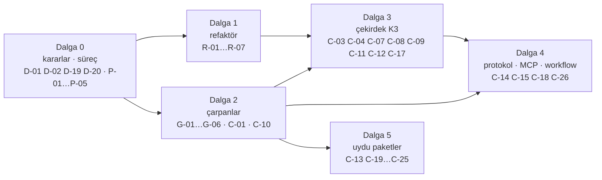

# MAF 1.25.0 — Yetenek Matrisi, Tracon Kapsaması ve Strateji

> **Ölçüm:** 2026-10-18 · **Sürüm:** `Microsoft.Agents.AI` **1.25.0** (NuGet hattında en yeni; 2026-10-18'de yeniden doğrulandı) · MEAI 10.11.0 · MCP 2.2.0 · VectorData 10.10.0. Tracon pin'i aynıdır (Faz 214).
> **Önceki sürüm:** 2026-10-17. Bu sürüm onun yerine geçer. Önceki sürümün hataları §0'dadır.
> **Kitle:** Tracon bakımcısı ve faz planlayan oturumlar. Bu belge **plan girdisidir**, karar defteri değildir. Kararlar `K-*`'e, adaylar `ADAYLAR.md`'ye yalnız `aday-kesfi` ve `faz-planlama` ile girer.
> **Yöntem özeti:** 40/40 MAF paketi `MetadataLoadContext` ile okundu (1.166 tip, iç içe tipler ve üyeler dahil). Tracon tarafında 2.326 `.cs` dosyası jeton indeksine çevrildi. MAF 1.16.0 (Tracon'un ilk pin'i) ile karşılaştırıldı. Ayrıntı §12.

**Özet:** 143 yetenek satırı — ✅ 43 · 🟡 14 · ❌ 85 · ⛔ 1. MAF'ın 1.064 üst düzey public tipinin 231'i `src/`'de anılır (%22). En büyük bulgular: (1) değerlendirilmemiş her kalem MAF 1.16'da zaten vardı — takip açığı sürüm farkında değil, **başlangıç yüzeyindedir**; (2) her MAF özelliği için bir kaçış yolu vardır, ama yol **kayıplıdır** (fabrika agent'ı 12 model halkasını, BYOK'u, egress'i ve maliyeti kaybeder) ve **belgesizdir**; (3) 13 paralel uygulamanın 3'ü hata, 1'i borçtur.

---

## 0. Güvenilirlik denetimi — önceki sürümde ne yanlıştı

| # | Önceki iddia | Ölçüm (2026-10-18) | Düzeltme |
|---|---|---|---|
| 1 | "40 paketin 32'si okundu; 8'i okunmadı" | 40/40 okundu: altı eski hat paketi ayrı probe ile, `Workflows.Generators` analyzer DLL'i, `ProjectTemplates` şablon | §4, §5.15 |
| 2 | "`ChatClientAgentRunOptions` ✅" | `src/`'de 0 kullanım. `TraconRunOptions : AgentRunOptions` | ❌ (§5.1) |
| 3 | "`AsAIFunction` ❌ — kendi kodu (`ChildAgentInvoker`)" | `ChildAgentInvoker` MAF'ın `BackgroundAgentsProvider`'ını sarar. `AsAIFunction` ayrı bir çağrı modudur. Paralel kod yok | kapsama açığı, kendi kodu değil |
| 4 | "Background responses ❌ — K-778" | K-778 Durable Task kararıdır. Asıl engel K-030 (`store=false`) | §5.1, D-09 |
| 5 | "`FunctionEvaluator` ✅", "`Delegate` loop evaluator ✅" | ikisi de yalnız testte (`src/` 0) | 🟡 |
| 6 | "❌ `ReflectingExecutor`, `[MessageHandler]` … aday" | `ReflectingExecutor`, `IMessageHandler`, `[StreamsMessage]`, `[YieldsMessage]`, `HandoffsWorkflowBuilder` 1.25'te `[Obsolete]` | ⛔ aday değil |
| 7 | "❌ `AddFanOutEdge`, `AddSwitch`, alt workflow … yok" | Tracon çağırmaz, ama tüketici `AddWorkflow(name, Func<IServiceProvider, Workflow>)` ile hepsini Tracon altında koşar | yeni "kapsama" sütunu ayırır (K1) |
| 8 | Satırlar tip odaklıydı | Önemli üyeler eksikti: mesaj enjeksiyonu, agent düzeyi tool middleware, hosted tool içerik kaydı, atıflar, MCP elicitation/sampling, `ChatToolMode`, `ChatOptions` alanları | eksik üyeler satır oldu; satırlar yetenek düzeyinde yeniden gruplandı |
| 9 | K-036 notu: "Chat Completions için public yazıcı yoktur" | MEAI.OpenAI `AsOpenAIChatCompletion` · `AsOpenAIStreamingChatCompletionUpdatesAsync` ve MAF.OpenAI `AgentResponse.AsOpenAIChatCompletion` vardır (OPENAI001) | R-03 |
| 10 | "Kayıt yok" satırları tarihsizdi | 1.16 yüzeyiyle karşılaştırıldı: değerlendirilmemiş kalemlerin hepsi 1.16.0'da vardı | §1.2 |
| 11 | — (yakalanmadı) | `MIMARI.md:252` ve K-019 "MAF köprüsü (öncelik 10)" der. Kodda yok: `AgentSourcePriority` yalnız `Code = 0`, `Database = 100` | R-07, D-06 |

---

## 1. Kısa cevaplar

### 1.1 Tüketiciye sunabileceğimiz imkânları sunmuyor muyuz?

Evet. Ölçülen en büyük açıklar (her biri §5'te bir satırdır):

1. **Çalışan run'a mesaj eklenemez.** MAF `MessageInjectingChatClient` · `EnableMessageInjection` (1.16'dan beri) kullanılmaz.
2. **Hosted tool'lar yok.** Code interpreter, file search, hosted MCP, image generation tanımda açılamaz. Açık olan tek hosted tool (web search) bile run kaydına girmez ve ücreti sayılmaz.
3. **MCP istemcisi eksik.** Elicitation, sampling, roots ve task istemcisi yok. Elicitation isteyen bir MCP sunucusu Tracon altında çalışmaz.
4. **Tüketici MAF'ı bildirimsel agent'a takamaz.** Kendi `AIContextProvider`'ı, agent middleware'i veya bir MAF seçeneği yalnız fabrika agent'ıyla gelir. O yol 12 model halkasını, BYOK'u, egress'i ve maliyeti kaybeder (§7.1).
5. **Protokol ve entegrasyon yok.** AG-UI, A2A istemcisi, Purview, MAF YAML agent'ı, Foundry, Copilot Studio — hiçbiri yok.
6. **Ses yalnız ElevenLabs.** MEAI'nin `ISpeechToTextClient`/`ITextToSpeechClient` sağlayıcıları (OpenAI dahil) bağlanamaz.

Oran (tip düzeyi, ad çakışmaları hariç): `Microsoft.Agents.AI` 63/125 · `Abstractions` 17/28 · `Workflows` 38/132 · MEAI 49/230 · MCP Core 45/218. Uzantı sınıfları adla anılmadığı için az sayılır; üye düzeyi §5'tedir.

### 1.2 MAF'ı iyi takip edemedik mi?

İki ayrı sonuç var:

- **Sürüm farkı iyi izlendi.** 1.16 → 1.25 arasında eklenen 16 çekirdek tipin hepsi `MAF-GENISLEME-NOKTALARI.md` sürüm tablosundadır. Her birinin bir hükmü vardır.
- **Başlangıç yüzeyi hiç envanterlenmedi.** Değerlendirilmemiş 59 satırın 56'sı (`✗`) MAF 1.16 döneminde, yani Tracon'un ilk gününde vardı (1.16-dönemi 21 paket ayrıca okunarak ölçüldü). Yalnız 3'ü (`✗⁺`) sonra geldi. 1.16'da var olup hiç değerlendirilmeyenler: `MessageInjectingChatClient`, `AIAgentBuilder` ve agent düzeyi tool middleware, `AgentRunContext`, `ChatToolMode`, `CitationAnnotation`, `ErrorContent`, hosted tool'lar, `ISpeechToTextClient`/`ITextToSpeechClient`, `IRealtimeClient`, `IConversationSplitter`, workflow OTel, `SwitchBuilder`, alt workflow, `AIAgentHostOptions`, A2A istemcisi, AG-UI, Purview, YAML agent, `Tools.Shell`, MCP skill ve task istemcisi, MCP elicitation/sampling/roots, Chat Completions dönüştürücüsü. Yetenekler faz faz, ihtiyaç anında keşfedildi. Hiçbir tur "MAF'ın tamamı nedir" sorusunu sormadı.
- **Referans dışı paketler görünmezdi.** 40 paketin 31'i referanssızdır; 16'sı bugün de "değerlendirilmedi" durumundadır. `dotnet package search` `--prerelease` olmadan ön sürümü göstermez; bu yüzden `Microsoft.Agents.AI.Mcp` beş ay "yok" sanıldı. Envanter betiği 2026-10-17'de geldi.

Süreç düzeltmesi §10'dadır.

### 1.3 Tüketiciler Tracon'u kısıtlayıcı bulup bırakır mı?

Risk gerçektir ve ölçülebilir. Bugün her MAF özelliği için bir kaçış yolu vardır: fabrika agent'ı, kod workflow'u, DI kaydı. Ama yol:

- **Kayıplıdır.** Fabrika agent'ı run kaydını, span'i ve onay kurallarını alır. Model halkalarını (bütçe, devre, fallback, önbellek, guard), kiracı anahtarını, egress politikasını ve maliyeti kaybeder (§7.1). Kod workflow'u MAF grafiğinin tamamını koşar; ama tanınmayan olaylar (Magentic plan, alt workflow hatası, tüketicinin kendi olayı) yalnız log'a yazılır.
- **Belgesizdir.** docs-site fabrika agent'ı için yalnız "decorators still apply" der (`concepts/agents.md:156-158`). Kaybı yazmaz.

MAF bilen bir tüketici "Tracon'a girince MAF'ın X özelliğini ya da Tracon'un Y halkasını kaybediyorum" sonucuna kısa sürede ulaşır. Bu riski en ucuz kapatan iş kaçış kapısını ürünleştirmektir (Dalga 2, §7).

### 1.4 "Aynı işi kendimiz yazdıysak hata yapmışızdır" — katılıyor muyum?

**Kısmen.** Ölçülen 13 paralel uygulama dört sınıfa ayrılır (tam liste §6):

| Sınıf | Anlamı | Sayı | Örnek | Hüküm |
|---|---|---|---|---|
| **Hata** | MAF/MEAI'de vardı, değerlendirilmedi; Tracon'un ek ihtiyacı yok ya da taşınabilir | 3 | ses arayüzleri, Chat Completions yazıcısı, skill zinciri | Refaktör |
| **Borç** | Tracon önce yazdı, MAF sonra getirdi | 1 | `FallbackChatClient` (Faz 62) ↔ MEAI 10.9 `FailoverChatClient` | Ölç, türet |
| **Haklı** | MAF tipi Tracon sınırını (kiracı, run ağacı, bütçe, AOT, kayıt) taşımaz | 8 | `TraconRunContext`, `AgentDecoratorPipeline`, OpenAI Responses uçları, iş kuyruğu, `IVectorSearchStore`, canlı ses | Koru; MAF tipini içte kullan ya da köprüle |
| **Ürün farkı** | Tracon'un kendi ürünü; MAF'ın eşi başka iş yapar | 1 satır (4 eş) | `AgentDefinition` ↔ MAF YAML, konsol ↔ DevUI | Koru; MAF'ınkini **ek** olarak aç |

"Hata" kelimesini yalnız ilk sınıf için kullanırım. Diğerleri bilinçli takastır. Ama takasın gerekçesi yazılı ve yeniden ölçülebilir olmalıdır. **Bugün 13'ün 7'sinde gerekçe yazılı değil ya da yanlış; 2'sinde kısmen yazılı.**

"Amerika'yı yeniden keşfetmeyelim" ilkesine katılırım ve onu şu sıraya çeviririm (İlke 1): **MAF tipini kullan → yetmiyorsa türet → o da yetmiyorsa sarmala → en son yaz.** Yazdıysan nedenini kayda koy ve her MAF sürümünde yeniden ölç. Tracon'un en iyi örnekleri bu sırayı izler: `TraconResponseCachingChatClient` MEAI'nin `DistributedCachingChatClient`'ından türer; `SqlChatHistoryProvider` MAF'ın `ChatHistoryProvider`'ını uygular.

---

## 2. Hedef, ilkeler ve kapsama merdiveni

**Hedef:** "MAF'ın her özelliği Tracon altında çalışsın, yönetilsin ve kaydedilsin."

### 2.1 Kapsama merdiveni

| Seviye | Ad | Ölçüt |
|---|---|---|
| **K0** | Erişilemez | Tüketici özelliği Tracon altında kullanamaz, ya da kullanınca Tracon'un run kaydı veya kiracı sınırı devre dışı kalır |
| **K1** | Çalışır | Tüketici kodla kullanır (fabrika agent, kod workflow'u, DI, `IAgentDecorator`). Agent düzeyinde run kaydı tutulur. Halka kaybı olabilir (§7.1) |
| **K2** | Kaydedilir | Özelliğin kendi olayı, kullanımı ve maliyeti run kaydına ve span'e girer. Kiracı sınırı uygulanır |
| **K3** | Yönetilir | Özellik veri ile açılır (tanım, HTTP API, konsol). Doğrulanır, sürümlenir, rol ve denetim izi altındadır |

Her yetenek K3'ü hedeflemez. Kural (İlke 2): **kod tanımlar, veri seçer.** Yürütülebilir şey (tool, context provider, middleware, sandbox) yalnız kodda kaydedilir. Tanım onu **adla** seçer. Bu, "tool'lar yalnız kodda tanımlanır" güvenlik sınırının genellemesidir ve onu gevşetmez.

### 2.2 İlkeler

| # | İlke | Kanıt / gerekçe |
|---|---|---|
| İ1 | **MAF önce:** kullan → türet → sarmala → yaz | §1.4 |
| İ2 | **Kod tanımlar, veri seçer:** ad-tabanlı uzantı kaydı | `ToolNames` ve `AddLoopEvaluator(kind, …)` bugün bu desendir |
| İ3 | **Tanınmayan kaybolmaz:** Tracon tanımadığı MAF içeriğini veya olayını düşürmez; genel olay olarak kaydeder | bugün düşürür: `RunRecordingAgent.Persistence.cs:239` `default: break`, `WorkflowEventMapper.cs:103` |
| İ4 | **Ağırlık paketin yerini belirler, varlığını değil:** +N paket, AOT dışı, ön sürüm veya native bağımlılık → uydu paket | K-129, K-212, K-342'nin ortak gerekçesi ağırlıktır; üçü de "çekirdeğe girmez" sorusuna cevap verir, "tüketiciye sunulmaz" sorusuna değil |
| İ5 | **Deneysel tip public imzaya girmez, içte kullanılabilir:** tüketici MEAI/MAF'ın kendi DI uzantısıyla kaydeder, Tracon DI'dan okur | Tracon `IImageGenerator`'ı (MEAI001) bugün böyle kullanır; public API'de yok |
| İ6 | **Proxy ile barındır:** MAF'ın bir `AIAgent` isteyen her barındırma API'si Tracon kataloğuna lazy proxy ile bağlanır. Protokol MAF'ın, yönetim Tracon'un | `ExternalAgentProxy` A2A için bunu bugün yapar |
| İ7 | **Her ret yeniden ölçülebilir:** ret kaydı ölçülebilir bir yeniden açılma koşulu taşır; bu matris her MAF sürümünde koşulu yeniden ölçer | K-212 "ağırlık düşerse" der ama eşik vermez |

---

## 3. Okuma anahtarı

| Sütun | Değerler |
|---|---|
| Durum | ✅ `src/` çağırır, türetir veya yapılandırır · 🟡 kısmen (alt küme, yalnız varsayılan, yalnız okunur, yalnız test) · ❌ `src/` çağırmaz · ⛔ MAF'ta `[Obsolete]`, aday değil |
| Neden kullanmıyoruz | kanıt: `K-…` karar · `F-…` aday · "Değerlendirilmedi" (kayıt yok) |
| Kendi kodu | `—` paralel kod yok · `Hata` · `Borç` · `Haklı` · `Ürün` (§1.4) |
| Takip | `✓` geçerli karar/ölçüm kaydı var · `~` kayıt var ama bayat veya yanlış · `✗` kayıt yok; yetenek MAF 1.16 döneminde (Tracon'un ilk pin'i) vardı — ölçüldü · `✗⁺` kayıt yok; yetenek 1.16'dan sonra geldi |
| Tüketici etkisi · kapsama | `K1→K3` = bugün → hedef · `—` hedef yok |
| Not | `R-` refaktör (§6) · `G-` kaçış kapısı (§7) · `C-` kapsama (§8) · `D-` karar (§9) · `Koru` |

---

## 4. Paket envanteri (40/40, 2026-10-18)

"Ek paket": `net10.0` boş proje, `Microsoft.Agents.AI` + `Workflows` tabanı (18 paket) üzerine yalnız o paket eklenince gelen geçişli paket sayısı. AspNetCore paketlerinde sayı üst sınırdır (§12).

| Paket | Sürüm | Olgunluk | Tracon | Ek paket | Hüküm |
|---|---|---|---|---|---|
| `Microsoft.Agents.AI` | 1.25.0 | GA | ✅ | — | Koru |
| `.Abstractions` | 1.25.0 | GA | ✅ | — | Koru |
| `.Harness` | 1.25.0 | GA | ✅ | — | Koru |
| `.OpenAI` | 1.25.0 | GA | ✅ | — | R-03 |
| `.Workflows` | 1.25.0 | GA | ✅ | — | C-18 |
| `.Hosting.OpenAI` | 1.25.0-alpha | alpha | ✅ (K-008) | — | Koru (K-036) |
| `.Hosting.A2A` | 1.25.0-preview | preview | ✅ (K-008) | — | C-15 |
| `.Hosting` | 1.25.0-preview | preview | 🟡 referans var, tip çağrısı yok | — | D-06 |
| `.Hosting.AspNetCore` | 1.25.0-preview | preview | 🟡 referans var, tip çağrısı yok | — | C-15 |
| `.Anthropic` | 1.25.0 | GA | ❌ | +2 | Koru: yalnız `AsAIAgent` kısayolu |
| `.GitHub.Copilot` | 1.25.0 | GA | ❌ | +2 | C-19 |
| `.Workflows.Declarative` | 1.25.0 | GA | ❌ (K-129) | +17 | D-03 |
| `.Workflows.Declarative.Mcp` | 1.25.0 | GA | ❌ (K-129) | — | D-03 |
| `.Workflows.Generators` | 1.25.0 | GA | ❌ | analyzer | Rehberde not |
| `.Declarative` | 1.25.0-rc1 | rc | ❌ | +16 | C-21 |
| `.Purview` | 1.25.0-rc1 | rc | ❌ | +17 | C-20 |
| `.A2A` | 1.25.0-preview | preview | ❌ | +2 | C-19 |
| `.Hosting.A2A.AspNetCore` | 1.25.0-preview | preview | ❌ | ≤ +30 | C-15 |
| `.Hosting.AGUI.AspNetCore` | 1.25.0-preview | preview | ❌ | ≤ +28 | C-15 |
| `.Hosting.AzureStorage` | 1.25.0-preview | preview | ❌ | ≤ +37 | Koru |
| `.AzureAI.Persistent` | 1.25.0-preview | preview | ❌ (K-212) | — | C-19 |
| `.Foundry` | 1.25.0-preview | preview | ❌ (K-212) | +22 | D-08 |
| `.Foundry.Hosting` | 1.25.0-preview | preview | ❌ (K-212) | — | C-19 |
| `.Workflows.Declarative.Foundry` | 1.25.0-preview | preview | ❌ (K-129, K-212) | — | D-03 |
| `.CopilotStudio` | 1.25.0-preview | preview | ❌ | +13 | C-19 |
| `.CosmosNoSql` | 1.25.0-preview | preview | ❌ | +23 | Koru |
| `.DevUI` | 1.25.0-preview | preview | ❌ | ≤ +31 | Koru |
| `.Hyperlight` | 1.25.0-preview | preview | ❌ (F-169) | +3, native win-x64/linux-x64 | D-07 |
| `.LocalCodeAct` | 1.25.0-preview | preview | ❌ (F-169) | +1 | Ret (sandbox yok) |
| `.Tools.Shell` | 1.25.0-preview | preview | ❌ | +1 | C-13 |
| `.AgentHooks` | 1.25.0-alpha | alpha | ❌ (F-141) | +2 | Koru |
| `.Mcp` | 1.25.0-alpha | alpha | ❌ | +9 | C-14 |
| `.Valkey` | 1.25.0-alpha | alpha | ❌ | +2 | Koru |
| `.AGUI` | 1.13.0-preview | eski hat | ❌ | — | C-15 kapsamı dışında (istemci) |
| `.DurableTask` | 1.16.0-preview | eski hat | ❌ (K-778) | — | Koru; MAF hattı 1.16'da kaldı |
| `.Hosting.AzureFunctions` | 1.16.0-preview | eski hat | ❌ (K-778) | — | Koru |
| `.AzureAI` | 1.0.0-rc5 | eski hat | ❌ (K-212) | — | `.Foundry` öncülü; kullanılmaz |
| `.Workflows.Declarative.AzureAI` | 1.0.0-rc5 | eski hat | ❌ | — | `.Foundry` öncülü; kullanılmaz |
| `.FoundryMemory` | 1.0.0-preview.260330.1 | eski hat | ❌ | — | `.Foundry` içine taşındı |
| `.ProjectTemplates` | 1.13.0-preview | eski hat | ❌ | şablon | `Tracon.Templates` var |

Katman paketleri: `Microsoft.Extensions.AI` (+`.Abstractions`, `.OpenAI`, `.Evaluation`, `.Evaluation.Quality`) 10.11.0 · `ModelContextProtocol.Core`, `.AspNetCore`, `.Extensions.Tasks` 2.2.0 · `Microsoft.Extensions.VectorData.Abstractions` 10.10.0.

---

## 5. Yetenek matrisi

### 5.1 Agent çekirdeği
*Microsoft.Agents.AI.Abstractions · Microsoft.Agents.AI*

| | Yetenek (MAF) | Tracon bugün | Neden kullanmıyoruz | Kendi kodu | Takip | Tüketici etkisi · kapsama | Not |
|---|---|---|---|---|---|---|---|
| ✅ | `AIAgent` · `RunAsync`/`RunStreamingAsync` · `AgentResponse(Update)` | her katman | — | — | ✓ | K3 | Koru |
| ✅ | `ChatClientAgent` + `ChatClientAgentOptions` (Id, Name, ChatOptions, ChatHistoryProvider, AIContextProviders) | düz agent (`AgentDefinitionCompiler.Agents.cs:21-62`) | — | — | ✓ | K3 | Koru |
| ✅ | `DelegatingAIAgent` | dört decorator + `ChildAgentInvoker` | — | — | ✓ | K3 | Koru |
| ✅ | `AgentRunOptions` türetme | `TraconRunOptions` | — | — | ✓ | K3 | Koru |
| ✅ | `AgentSession` · `StateBag` · Create/Serialize/Deserialize | `AgentSessionManager` | — | — | ✓ | K3 | Koru |
| ✅ | `AgentSessionStore` · `AgentSessionStoreKey` (MAAI001) | internal köprü | — | — | ✓ K-1016 | K3 | Koru |
| 🟡 | `AIAgentBuilder`: `Use(agent)`, `Use(runFunc, streamingFunc)`, `Use(sharedFunc)` · `AsBuilder` | `AgentDecoratorPipeline` (73 satır): `IAgentDecorator` + `Order` | Değerlendirilmedi | Haklı: sıra, descriptor ve hata normalizasyonu ekler; MAF builder'ı içte kullanabilirdi | ✗ | K1: tüketici MAF'ın lambda middleware'ini takamaz, sınıf yazmak zorunda | R-04 |
| ❌ | Agent düzeyi tool middleware: `AIAgentBuilder.Use(Func<AIAgent, FunctionInvocationContext, next, ct, …>)` | yok; tool başına `DelegatingAIFunction` halkaları | Değerlendirilmedi | — | ✗ | K1→K3: "her tool çağrısından önce/sonra" kodu yazılamaz; yalnız `IToolAuthorizationHandler` | C-01 |
| 🟡 | Yapılandırılmış çıktı: `ChatOptions.ResponseFormat` ✔ · `RunAsync<T>`/`AgentResponse<T>` ✘ | şema veriden; onarım turu `StructuredResponseValidatingAgent` | `T` derleme anı tipidir; bildirimsel tanım bilemez | Ürün: onarım MAF'ta yok | ✓ | K1: kod tüketicisi katalog agent'ında `RunAsync<T>` çağırabilir (ölçülmedi) | G-05 rehber + test |
| ❌ | `ChatClientAgentRunOptions` (run başına `ChatOptions`, `ChatClientFactory`) | **önceki sürüm ✅ diyordu; `src/` 0.** `/v1/responses` MAF'ın ürettiği seçenek nesnesini geçirir | Değerlendirilmedi | — | ~ | K1→K3: native run ucu run başına model ayarı almaz (ölçülmedi) | C-03 |
| ❌ | `AIAgent.AsAIFunction` (agent = senkron tool) | alt agent `BackgroundAgentsProvider` ile (start · wait · read) | Değerlendirilmedi | — (önceki sürüm "kendi kodu" diyordu; yanlış) | ✗ | K1→K3: tek çağrılık alt agent üç tool turu harcar | C-04 |
| ❌ | `AIAgent.AsIChatClient(agent, session, …)` (MAAI001, 1.16'dan sonra geldi, 1.25'te genişledi) | yok | talep yok | — | ✗⁺ | K1: agent'ı `IChatClient` bekleyen yere (yargıç, başka framework) verme | C-04 (düşük) |
| ❌ | `EnableMessageInjection` · `MessageInjectingChatClient` (`EnqueueMessagesAsync`, `GetPendingMessagesAsync`) · `UseMessageInjection` | yok | Değerlendirilmedi | — | ✗ | **K0→K3:** çalışan run'a kullanıcı mesajı eklenemez (steering); uzun ve kodlama run'larında büyük açık | C-07 |
| ❌ | `RequirePerServiceCallChatHistoryPersistence` · `Clear/Warn/ThrowOnChatHistoryProviderConflict` · `UseProvidedChatClientAsIs` | MAF varsayılanı | Değerlendirilmedi | — | ✗ | K1: tool döngüsünün ortasında çökmede ara geçmiş kaybolabilir (ölçülmedi) | C-08 (önce probe) |
| ❌ | `ChatClientAgentOptions.AllowConcurrentInvocation` | `FunctionInvokingChatClient`'a bağlı | K-553 | — | ✓ | K3 (eşi var) | Koru |
| ❌ | `EnableInvocableFunctionBypassing` (MAAI001) · `DisableApproval*` · MEAI `UseInvocableFunctionBypassing`/`UseApproval*` | bilerek kapalı | kayıt ve yetki zinciri her çağrıyı görmeli | — | ✓ | — | Koru (ret) |
| ❌ | `AgentRunContext` · `AIAgent.CurrentRunContext` | `TraconRunContext` (AsyncLocal, ağaç kapsamı) | Değerlendirilmedi | Haklı: MAF bağlamı run kimliği ve bütçe taşımaz; alt agent `options = null` ile çağrılır (ölçüldü) | ✗ | K1: MAF-yerli kod Tracon run kimliğini göremez | R-05 |
| ❌ | Background responses: `AllowBackgroundResponses` · `ContinuationToken` · MEAI `ResponseContinuationToken` | `Prefer: respond-async` iş kuyruğu | K-030 (`store=false`); OpenAI arka plan modu sunucu tarafı saklama ister (belgeye göre; Tracon'da ölçülmedi). Önceki sürüm K-778 diyordu; yanlış | Haklı: kuyruk aynı ihtiyacı işçi tarafında karşılar | ~ | K0→K2: saatler süren "deep research" çağrısı işçiyi meşgul eder | D-09 · C-25 |
| ❌ | `AgentRequestMessageSourceAttribution`/`Type` · `WithAgentRequestMessageSource` | yalnız JSON bağlamında tip kaydı | Değerlendirilmedi | — | ✗ | K2 açığı: girdinin kaynağı (geçmiş, provider, dış) kayıtta ayrılmaz | C-10 |
| ❌ | `LoggingAgent` · `UseLogging` | yalnız testte | run kaydı daha zengin | — | ✗ | K1 (decorator olarak takılır) | Koru |
| ❌ | `FeatureUsage` · `AIAgentMetadata` | — | MAF'ın kendi telemetri işareti | — | ✓ | — | Koru |
| ❌ | `IsolationKeyScopedAgentSessionStore` · `AgentIsolationKeyProvider` · `ClaimsIdentityAgentIsolationKeyProvider` · `DelegatingAgentSessionStore` · `InMemory/NoopAgentSessionStore` | kiracı `ITenantContext` | kiracı modeli daha geniş (rol, denetim) | Haklı | ✓ | K1 | MAF barındırma uçlarına proxy ile bağlanırken kiracı köprüsü (C-15) |
| ❌ | `AdditionalPropertiesExtensions` · `AgentAbstractionsJsonUtilities` · `AgentSessionExtensions.{Set,TryGet}InMemoryChatHistory` | — | yardımcı | — | ✗ | — | Gerek yok |

### 5.2 Geçmiş, bellek, bağlam
*Microsoft.Agents.AI · .Compaction*

| | Yetenek (MAF) | Tracon bugün | Neden kullanmıyoruz | Kendi kodu | Takip | Tüketici etkisi · kapsama | Not |
|---|---|---|---|---|---|---|---|
| ✅ | `ChatHistoryProvider` türetme + `ProviderSessionState<T>` | PostgreSQL, SQL Server, SQLite | — | — | ✓ | K3 | Koru |
| ✅ | `InMemoryChatHistoryProvider` (+Options) | varsayılan | — | — | ✓ | K3 | Koru |
| ✅ | `AIContextProvider` türetme | `McpResourceContextProvider` | — | — | ✓ | K3 | Koru |
| ❌ | `MessageAIContextProvider` · `AIAgentBuilder.UseAIContextProviders` · MEAI `UseAIContextProviders` | tüketici kendi provider'ını tanıma bağlayamaz | Değerlendirilmedi | — | ✗ | **K1→K3:** Hyperlight, shell ortamı, Foundry hafızası, kendi provider'ı — hepsi yalnız fabrika ile | C-01 |
| 🟡 | `TextSearchProvider` | açık; seçenekler varsayılan | `SearchTime = OnDemandFunctionCalling`, `CitationsPrompt`, `ContextFormatter`, `RecentMessageMemoryLimit` değerlendirilmedi | — | ✗ | K3 kısmen: "model isteyince ara" modu ve atıf istemi yok | C-08 |
| ✅ | `FileMemoryProvider` + `AgentFileStore` | SQL, kiracı önekli | — | — | ✓ K-110 K-114 | K3 | Koru |
| ✅ | `TodoProvider` | açık; `TodoListMessageBuilder`, `SuppressTodoListMessage` atanmaz | — | — | ✓ | K3 | Koru |
| 🟡 | `CompactionProvider` + 6 strateji + 3 tetik (`TokensExceed`, `MessagesExceed`, `TurnsExceed`) | açık | açılmayan: `ContextWindowCompactionStrategy` eşikleri (`ToolEvictionThreshold`, `TruncationThreshold`, `InputBudgetTokens`), `ToolCallFormatter`, tetikler `GroupsExceed`/`HasToolCalls`/`TokensBelow`/`All`/`Any` | — | ✗ | K3 kısmen | C-08 |
| ❌ | `ChatReducerCompactionStrategy` · MEAI `IChatReducer`/`SummarizingChatReducer`/`MessageCountingChatReducer`/`ReducingChatClient` | compaction aynı işi yapar | MAF'ın güncel yolu compaction | — | ✓ | — | Koru |
| 🟡 | `AgentModeProvider` + `AgentModeProviderOptions` (`Modes`, `DefaultMode`) | yalnız harness varsayılanı; mod tanımlanamaz; düz agent'ta yok | Değerlendirilmedi | — | ✗ | K1→K3: plan/uygula gibi modlar yok | C-08 |
| ❌ | `ChatHistoryMemoryProvider` (+Options, Scope, `SearchBehavior`) | yok. `IVectorSearchStore` + `search_knowledge` bilgi tabanıdır, konuşma hafızası değil | K-105, K-342: MEVD filtresi `Expression<>` → AOT. 10.10'da aynı (ölçüldü) | Haklı (AOT); farklı iş | ✓ | K0→K3: uzun dönem konuşma hafızası yok | D-05 · C-24 |
| ❌ | `FileAccessProvider` (ls, grep, read, write, replace) + `FileSystemAgentFileStore` | kapalı | K-062: dosya sistemi riski | — | ✓ | K0→K3: kodlama agent'ının dosya araçları yok | D-04 · C-13 |
| ❌ | `CosmosChatHistoryProvider` · `ValkeyChatHistoryProvider` | Tracon SQL store'u | kendi store'u var | Haklı | ✓ | K1: DI'da `ChatHistoryProvider` değiştirilebilir; konsol geçmiş görünümünü etkiler (ölçülmedi) | Koru; rehberde sınır |
| ❌ | `FoundryMemoryProvider` (MAAI001) | yok | K-212 | — | ✓ | K0→K2 | C-19 |

### 5.3 Skill'ler
*Microsoft.Agents.AI · Microsoft.Agents.AI.Mcp (alpha)*

| | Yetenek (MAF) | Tracon bugün | Neden kullanmıyoruz | Kendi kodu | Takip | Tüketici etkisi · kapsama | Not |
|---|---|---|---|---|---|---|---|
| 🟡 | `AgentSkillsProvider` (+Options) | açık; `DisableLoad/ReadResource/RunScriptApproval`, `SkillsInstructionPrompt`, `IncludeDetailedErrors` atanmaz | Değerlendirilmedi | — | ✗ | K3 kısmen: skill onay anahtarları yönetilemez | C-08 |
| ✅ | `AgentFileSkill` · `AgentFileSkillsSource` · `AgentFileSkillScript` + Tracon kapıları (`SandboxedSkillScriptRunner`) | açık | — | Ürün: MAF script'i kendisi koşmaz | ✓ | K3 | Koru |
| ✅ | `AgentInlineSkill` | DB tanımından | — | — | ✓ | K3 | Koru |
| ✅ | Aggregating · Caching · Deduplicating · Filtering kaynakları | açık | — | — | ✓ | K3 | Koru |
| ❌ | `AgentSkillsProviderBuilder` | zincir elle kurulur | Değerlendirilmedi | Hata (küçük): builder aynı zinciri kurar | ✗ | — | R-06 |
| ❌ | `AgentClassSkill<T>` · `[AgentSkillResource]` · `[AgentSkillScript]` | yok; `AddSkill` yalnız `AgentSkillDefinition` alır | "skill = veri" | — | ✗ | K0→K3: kodda sınıf skill'i yazan tüketici onu veremez | C-09 |
| ❌ | `AgentInMemorySkillsSource` · `DelegatingAgentSkillsSource` | — | Tracon kaynağı var | — | ✗ | — | Koru |
| ❌ | `UseMcpSkills` + `AgentMcpSkillsSourceOptions` (alpha) | yok | paket beş ay "yok" sanıldı | — | ✗ | K0→K3: MCP sunucusundan skill dağıtımı | C-14 |

### 5.4 Tool, onay, kod çalıştırma
*Microsoft.Extensions.AI · Microsoft.Agents.AI · Tools.Shell · Hyperlight · LocalCodeAct*

| | Yetenek (MAF) | Tracon bugün | Neden kullanmıyoruz | Kendi kodu | Takip | Tüketici etkisi · kapsama | Not |
|---|---|---|---|---|---|---|---|
| ✅ | `AIFunctionFactory` · `AddTool`/`AddToolsFrom` | açık | — | — | ✓ | K3 | Koru |
| ✅ | `ApprovalRequiredAIFunction` · `ToolApprovalRequestContent`/`ResponseContent` | açık | — | — | ✓ | K3 | Koru |
| ✅ | `ToolApprovalAgent` + `AutoApprovalRules` | decorator (Order 20) | — | — | ✓ | K3 | Koru |
| ❌ | `ToolApprovalAgentOptions.MaxAutoApprovalIterations` | onay döngüsü Tracon'un | K-541 | — | ✓ | — | Koru |
| ❌ | `AlwaysApproveToolApprovalResponseContent` · `CreateAlwaysApproveTool(WithArguments)Response` | kalıcı `ToolApprovalRule` deposu | Değerlendirilmedi | Haklı (kalıcı, denetimli); köprü yok | ✗ | K1: MAF-yerli istemci "hep onayla" gönderirse kural yazılmaz | C-11 |
| 🟡 | `FunctionInvokingChatClient` | `AllowConcurrentInvocation`, `MaximumIterationsPerRequest` | açılmayan: `MaximumConsecutiveErrorsPerRequest`, `TerminateOnUnknownCalls`, `IncludeDetailedErrors`, `AdditionalTools`, `FunctionInvoker` — değerlendirilmedi | — | ✗ | K0→K3: halka Tracon'un, tüketici yapılandıramaz | C-03 |
| ✅ | MCP tool'ları `McpClientTool : AIFunction` | açık | — | — | ✓ | K3 | Koru |
| 🟡 | `HostedWebSearchTool` | yalnız harness `EnableWebSearch` (K-892) | — | — | ✓ | K3, ama **K2 açığı**: çağrı run kaydına girmez, ücreti sayılmaz | C-12 |
| ❌ | `HostedCodeInterpreterTool` · `HostedFileSearchTool` · `HostedImageGenerationTool` · `HostedMcpServerTool` (+`ApprovalMode`) · `HostedToolSearchTool` (MEAI001) | yok | Değerlendirilmedi | — | ✗ | K0→K3: sağlayıcının yerleşik tool'ları kullanılamaz | C-12 |
| ❌ | Hosted tool içerikleri: `CodeInterpreter`/`WebSearch`/`McpServer`/`ImageGeneration` `ToolCall/ResultContent` | kayıt `switch`'i yalnız `FunctionCall/Result`'ı işler; gerisi `default: break` (`RunRecordingAgent.Persistence.cs:231-240`) | Değerlendirilmedi | — | ✗ | K2 açığı: kayıt ve maliyet | C-10 · C-12 |
| ❌ | `Tools.Shell`: `DockerShellExecutor` · `LocalShellExecutor` · `ShellPolicy` · `ShellEnvironmentProvider` | skill script'i için `ISkillScriptExecutor` (yer tüketicinin) | ön sürüm, kayıt yok | Ürün: Tracon "çalışır mı"yı, MAF "nerede"yi verir; çakışmaz | ✗ | K0→K2: kodlama agent'ı için shell tool'u yok; Docker yürütücüsü script'lere de yer olabilir | C-13; `LocalShellExecutor` ret |
| ❌ | CodeAct: `HyperlightCodeActProvider` (win-x64, linux-x64) · `LocalCodeActProvider` (yerel Python) | yok | F-169 (RID; 0.6.0'da ölçüldü) | — | ✓ | K0→K2 | D-07 |

### 5.5 Harness ve döngü
*Microsoft.Agents.AI.Harness · Microsoft.Agents.AI*

| | Yetenek (MAF) | Tracon bugün | Neden kullanmıyoruz | Kendi kodu | Takip | Tüketici etkisi · kapsama | Not |
|---|---|---|---|---|---|---|---|
| ✅ | `HarnessAgent` · `AsHarnessAgent` | tek dosya | — | — | ✓ K-020 | K3 | Koru |
| ✅ | `HarnessAgentOptions` atananlar: talimat, pencere ve çıktı sınırı, iterasyon, compaction, dosya belleği, todo, skill, web search, mod anahtarı, `DisableToolAutoApproval`, `OpenTelemetrySourceName`, `AIContextProviders`, `BackgroundAgents`, `LoopEvaluators`/`LoopAgentOptions` | `AgentDefinitionCompiler.Agents.cs:233-412` | — | — | ✓ | K3 | Koru |
| ❌ | `HarnessAgentOptions` atanmayanlar: `FileAccessStore`/`FileAccessProviderOptions` · `AgentModeProviderOptions` · `ToolApprovalAgentOptions` · `DisableApproval*` · `DisableOpenTelemetry` | — | K-062 (dosya); diğerleri değerlendirilmedi | — | ~ | K0/K1 | D-04 · C-08 |
| ✅ | `BackgroundAgentsProvider` + `WaitTimeout` | alt agent (K-097, Faz 144) | `Instructions`, `AgentListBuilder`, `ReleaseSessionAsync`, `GetIncompleteTasks` kullanılmaz | — | ✓ | K3 | Koru |
| ✅ | `LoopAgent` + `LoopAgentOptions` (`MaxIterations`, `FreshContextPerIteration`, `NonStreamingReturnsLastResponseOnly`) | açık | `ExcludeOnBehalfOfMessages`, `OnBehalfOfAuthorName`, `SessionCreatedCallback` atanmaz | — | ✓ K-704 | K3 | Koru |
| ✅ | `LoopEvaluator`'lar: CompletionMarker, TodoCompletion, BackgroundTaskCompletion, AIJudge | açık; `DelegateLoopEvaluator` yalnız testte | — | — | ✓ | K3 | Koru |
| ❌ | `HarnessAgent.RunCoreAsync` override | dıştan `DelegatingAIAgent` | her agent tipinde aynı çalışır | — | ✓ | — | Koru |
| ❌ | `RoutePersistingRoutingChatClient` (MAAI001) | yok | F-179'un ön koşulları Tracon'da | — | ✓ | — | Koru |
| ❌ | `FunctionInvocationContextExtensions.WrapWithPendingMiddleware` (MAAI001, 1.25) | yok | sürüm tablosu "kullanılmıyor" | — | ✓ | — | C-01 ile birlikte bak |

### 5.6 Değerlendirme
*Microsoft.Agents.AI · Microsoft.Extensions.AI.Evaluation*

| | Yetenek (MAF) | Tracon bugün | Neden kullanmıyoruz | Kendi kodu | Takip | Tüketici etkisi · kapsama | Not |
|---|---|---|---|---|---|---|---|
| ✅ | `IAgentEvaluator` · `LocalEvaluator` · `EvalCheck`/`EvalChecks` · `EvalItem` · `ToolCalledMode` | eval işi | — | — | ✓ | K3 | Koru |
| 🟡 | `FunctionEvaluator` · `AgentEvaluationResults` | yalnız testte (önceki sürüm ✅ diyordu) | — | — | ~ | — | Koru |
| ✅ | MEAI `IEvaluator` · `EvaluationResult` · `*Metric` (`EvaluatorRunJudge` köprüsü) | açık | — | — | ✓ Faz 155 | K3: tüketici her MEAI evaluator'ını kaydeder | Koru (İ5'in iyi örneği) |
| ❌ | `agent.EvaluateAsync(...)` · `Run.EvaluateAsync` (workflow) | Tracon agent'ı kendi run yolundan koşar | değerlendirme run'ı kayıttan geçmeli | Haklı | ✗ | K1; workflow değerlendirmesinin varlığı ölçülmedi | C-17 |
| ❌ | `IConversationSplitter` · `ConversationSplitters.Full/LastTurn` · `EvalItem.Split`/`PerTurnItems` · `ExpectedToolCall` | yok | Değerlendirilmedi | — | ✗ | K0→K3: çok turlu konuşma tur tur değerlendirilemez; beklenen tool argümanı denetlenemez | C-17 |
| ❌ | `Evaluation.Quality` kataloğu | sevk edilen pakette yok | K-727 | — | ✓ | K1: tüketici kaydeder | Koru; rehbere örnek |
| ❌ | `FoundryEvals` (20+ evaluator) | yok | K-212 | — | ✓ | K0→K2 | C-19 |

### 5.7 Gözlemlenebilirlik
*Microsoft.Agents.AI · Microsoft.Extensions.AI · Workflows*

| | Yetenek (MAF) | Tracon bugün | Neden kullanmıyoruz | Kendi kodu | Takip | Tüketici etkisi · kapsama | Not |
|---|---|---|---|---|---|---|---|
| ✅ | `OpenTelemetryAgent` (+`EnableSensitiveData`) | decorator (Order 10) | — | — | ✓ | K2 | Koru |
| ✅ | `UseOpenTelemetry` (chat) | `ModelProviderRegistry.cs:467` | — | — | ✓ | K2 | Koru |
| ✅ | `HarnessAgentOptions.OpenTelemetrySourceName` | açık | — | — | ✓ | K2 | Koru |
| ❌ | Workflow `WithOpenTelemetry` · `WorkflowTelemetryOptions` | yok | Değerlendirilmedi | — | ✗ | K2 açığı: executor, kenar ve mesaj span'leri Tracon span deposuna girmez | C-10 |
| ❌ | MEAI OTel halkaları: embedding, görsel, ses, hosted file (`OpenTelemetryEmbeddingGenerator`, `OpenTelemetryImageGenerator` …) | yok | Değerlendirilmedi | — | ✗ | K2 açığı: `search_knowledge` embedding çağrısında span ve kullanım raporu görülmedi (grep; doğrulanmalı) | C-10 |
| ❌ | MEAI `UseLogging` · `LoggingChatClient` | yok | run kaydı yeter | — | ✗ | K1 | Koru |

### 5.8 Workflows
*Microsoft.Agents.AI.Workflows · .Declarative*

Kod workflow'u (`AddWorkflow(name, Func<IServiceProvider, Workflow>)`) MAF grafiğinin **tamamını** Tracon'un `WorkflowRunner`'ı altında koşar. Bu yüzden aşağıdaki ❌ satırların çoğu K1'dir: Tracon çağırmaz, tüketici kullanır.

| | Yetenek (MAF) | Tracon bugün | Neden kullanmıyoruz | Kendi kodu | Takip | Tüketici etkisi · kapsama | Not |
|---|---|---|---|---|---|---|---|
| ✅ | `WorkflowBuilder` (`AddEdge`, `BindExecutor`, `WithOutputFrom`, `WithName`, `Build`) · `Executor` · `FunctionExecutor` · `ExecutorBinding` | bildirimsel derleyici + kod workflow'u | — | — | ✓ | K3 | Koru |
| ✅ | `AgentWorkflowBuilder`: Sequential · Concurrent · Handoff (`WithHandoffs`, `WithHandoffInstructions`, `WithAutonomousMode`) · GroupChat (`RoundRobin`) · Magentic (`RequirePlanSignoff`, `WithMaxRounds`) | bildirimsel desenler | — | — | ✓ | K3 | Koru |
| ✅ | Yürütme: `InProcessExecution.RunStreamingAsync`/`ResumeStreamingAsync` · `StreamingRun` (`WatchStreamAsync`, `TrySendMessageAsync(TurnToken)`, `SendResponseAsync`) | `WorkflowRunner` | — | — | ✓ | K3 | Koru |
| ✅ | Checkpoint: `CheckpointManager.CreateJson` + `ICheckpointStore<JsonElement>` | `TraconCheckpointStore` | — | — | ✓ | K3 | Koru |
| ✅ | HITL: `RequestPort` · `ExternalRequest/Response` · `RequestInfoEvent` · `MagenticPlanReviewRequest` | açık | — | — | ✓ | K3 | Koru |
| ✅ | Görselleştirme: `WorkflowVisualizer.ToMermaidString` · `Workflow.Reflect*` | `WorkflowGraphReader` | — | — | ✓ | K3 | Koru (`ToDotString` gerek yok) |
| 🟡 | Olaylar: 12 tip eşlenir (Started, Output, Error, Warning, SuperStep ×2, Executor ×3, RequestInfo, AgentResponse(Update)) | eşlenmeyen olay `_ => Unknown` → yalnız uyarı logu (`WorkflowEventMapper.cs:103`, `WorkflowRunner.cs:1488`) | Değerlendirilmedi | — | ✗ | **K2 açığı:** `MagenticPlanCreated`/`ProgressLedgerUpdated`/`Replanned`, `SubworkflowError`/`Warning`, tüketicinin kendi `WorkflowEvent`'i kaybolur | C-10 |
| ❌ | Graf topolojisi: `AddFanOutEdge` (+atayıcı) · `AddFanInBarrierEdge` · `AddSwitch`/`SwitchBuilder` · `AddChain` · `ForwardMessage`/`ForwardExcept` · `AddExternalCall` · koşullu `AddEdge<T>` | Tracon çağırmaz; kod workflow'unda tüketici kullanır | bildirimsel düğüm tipi yok | — | ✗ | K1→K3 | C-18 |
| ❌ | Alt workflow: `ConfigureSubWorkflow` · `SubworkflowBinding` | kod workflow'unda K1 | aynı | — | ✗ | K1→K3; alt workflow olayları K2 açığı | C-18 |
| ❌ | Paylaşılan durum: `IWorkflowContext.QueueStateUpdateAsync`/`ReadStateAsync`/`ReadOrInitStateAsync`/`QueueClearScopeAsync` · `StatefulExecutor<…>` · `IResettableExecutor` · `ScopeKey` | yalnız örnekte (`ReviewAndReviseWorkflow.cs:91`) | kod işidir | — | ✗ | K1→K2: durum checkpoint'te, kayıtta görünmez | C-18 (düşük) |
| ❌ | Kaynak üretimli handler: `[MessageHandler]` · `[SendsMessage]` · `[YieldsOutput]` · `ProtocolBuilder` · `Workflows.Generators` (analyzer) | yok | tüketici paketi kendisi ekler | — | ✗ | K1 | G-05 rehberde örnek |
| ❌ | Orkestrasyon ayarları: Handoff `WithHandoff(from, to, reason)`/`EnableReturnToPrevious`/`WithTerminationCondition`/`WithToolCallFilteringBehavior` · Magentic `WithMaxStalls`/`WithMaxResets`/`WithPromptOverrides`/`WithResponseLanguage` (MAAI001) · Concurrent `WithAggregator` · Sequential `WithChainOnlyAgentResponses` · özel `GroupChatManager` | bildirimsel desende yok; kodda K1 | Değerlendirilmedi | — | ✗ | K1→K3 | C-18 |
| ❌ | Çıktı etiketleri: `OutputTag` · `WithIntermediateOutputFrom` · `Futures.EnableAgentResponseOutputTaggingAndFiltering` · `StreamingAggregators` · `AggregatingExecutor` | yok | Değerlendirilmedi | — | ✗ | K1→K2: ara çıktı nihai çıktıdan ayrılmaz | C-18 |
| ❌ | `AIAgentHostOptions` (`InterceptUserInputRequests`, `InterceptUnterminatedFunctionCalls`, `ReassignOtherAgentsAsUsers`, `Emit*`) · `ChatProtocolExecutor`/`ChatForwardingExecutor` | `Emit*` yalnız test ve örnekte | Değerlendirilmedi | — | ✗ | K1→K3: workflow içindeki agent'ın tool onayının workflow isteğine (HITL) dönüşmesi ölçülmedi | C-18 |
| 🟡 | `AIAgentBinding` | yalnız okunur | giriş dışında agent'ı çağırmıyor (ölçüldü) | — | ✓ | — | Koru |
| ❌ | `Workflow.AsAIAgent` · `WithCheckpointing(agent)` | yok | ölçüldü: `WithCheckpointing` sessiz passthrough | — | ✓ | K0→K3: workflow'u agent gibi sunmak (katalog, `/v1`, A2A, alt agent) | C-18: Tracon runner sarmalı, `AsAIAgent` doğrudan değil |
| ❌ | Yürütme ortamı: `OpenStreamingAsync` · `RunAsync`/`ResumeAsync` (akışsız) · `Lockstep`/`Concurrent`/`OffThread` | tek yol: akışlı varsayılan ortam | Değerlendirilmedi | — | ✗ | K0: kod workflow'unda bile ortam seçilemez | C-18 (düşük) |
| ❌ | Hazır checkpoint store'ları (`FileSystemJson`, `Cosmos`, `FoundryJson`) · `CheckpointManager.CreateInMemory` · `WorkflowSessionCheckpointRecovery`/`WorkflowAgentMetadata` (MAAI001) | Tracon store | kiracı, saklama, kayıt | Haklı | ✓ | — | Koru |
| ❌ | `Workflows.Declarative` (+`.Mcp`, `.Foundry`; eski `.AzureAI`): YAML + Power Fx | yok | K-129: bugün +17 paket (taban 18 → 35, ölçüldü); `ResponseAgentProvider` şartı sürüyor (paket XML'i: *"not based on the Response API is currently not supported"*) | Ürün: `WorkflowDefinition` (JSON düğüm) | ✓ | K0→K2 | D-03 · C-21 |
| ⛔ | `ReflectingExecutor` · `IMessageHandler` · `[StreamsMessage]` · `[YieldsMessage]` · `HandoffsWorkflowBuilder` | — | 1.25'te `[Obsolete]` | — | ✓ | — | Aday değil |

### 5.9 Hosting ve protokoller
*Hosting · Hosting.OpenAI · Hosting.A2A · AGUI · DevUI · DurableTask · AzureFunctions*

| | Yetenek (MAF) | Tracon bugün | Neden kullanmıyoruz | Kendi kodu | Takip | Tüketici etkisi · kapsama | Not |
|---|---|---|---|---|---|---|---|
| ✅ | `OpenAIResponses` (`ToAgentRunRequest`, `WriteResponse`, `WriteResponseStreamAsync`, `CreateResponseId`, `GetSessionStoreId`) · `OpenAIResponsesRunRequest` | yalnız `Tracon.AspNetCore` (K-008) | — | — | ✓ | K3 | Koru |
| ❌ | `MapOpenAIResponses` · `MapOpenAIConversations` · `OpenAIResponsesMapOptions` | Tracon uçları | K-036: depo arayüzleri `internal` (1.25'te yeniden ölçüldü, `OpenAIResponsesEndpoints.cs:26`) | Haklı | ✓ | K3 | Koru; her sürümde yeniden ölç |
| ❌ | `MapOpenAIChatCompletions` · `OpenAIChatCompletionsMapOptions` · MEAI.OpenAI `AsOpenAIChatCompletion`/`AsOpenAIStreamingChatCompletionUpdatesAsync` · MAF.OpenAI `AgentResponse.AsOpenAIChatCompletion` (OPENAI001) | JSON elle yazılır (`OpenAIChatCompletionsEndpoints.cs`, 579 satır, kendi record'ları) | K-036 notu "public yazıcı yok" der; dönüştürücüler var — eksik ölçüm | **Hata** (tel biçimi elle bakımda) | ~ | K3 (uç var) | R-03 |
| ✅ | A2A sunucu: `AddA2AServer` + `AgentRunMode.ReturnMessage` · `ExternalAgentProxy` | `Tracon.AspNetCore` | — | — | ✓ K-103 | K3 | Koru; İ6'nın kanıtı |
| ❌ | A2A `ReturnTask`/`ReturnTaskWhen` · `A2ARunDecisionContext` · `IsolationKeyScopedTaskStore` | yok | K-103: görev = askıya alınmış run | — | ✓ | K0 | protokoller arası HITL ile (C-15) |
| ❌ | `Hosting.A2A.AspNetCore`: `MapA2AJsonRpc` · `MapA2AHttpJson` | A2A SDK'nın `MapA2A`'sı | Değerlendirilmedi | — | ✗ | K3 (eşi var) | C-15: HTTP+JSON bağlaması farkını ölç |
| ❌ | Hosting DI: `AddAIAgent` · `AddWorkflow` · `IHostedAgentBuilder` (`WithAITool(s)`, `WithSessionStore`) · `AIHostAgent` · `HostedWorkflowState` | yok. K-019 ve `MIMARI.md:252` "MAF köprüsü (öncelik 10)" der; **kodda yok** | reddedilen iş: "Katalog `AddAIAgent` kayıtlarını okumadı" (Hosting ön sürüm → `Tracon.Core` bağlanamaz) | — | ~ | K0: `builder.AddAIAgent(...)` yazan tüketicinin agent'ı katalogda görünmez | D-06 · C-26 |
| ❌ | A2A istemci: `A2AAgent` · `A2AClient/AgentCard.AsAIAgent` · `A2ACardResolver.GetAIAgentAsync` | yok | kayıt yok (F-485 sunucu tarafıdır) | — | ✗ | K1 (fabrika)→K3 | C-19 |
| ❌ | AG-UI: `MapAGUIServer(pattern, AIAgent)` · `AddAGUIServer` · eski hat `AGUIChatClient` (1.13) | yok | Değerlendirilmedi | — | ✗ | K0→K3: CopilotKit gibi AG-UI ön yüzleri bağlanamaz | C-15 (proxy) |
| ❌ | DevUI (`MapDevUI`, `AddDevUI`) | Tracon konsolu | `MIMARI.md:35` | Ürün | ✓ | K0 | Koru; isteğe bağlı geliştirme ucu (düşük) |
| ❌ | Durable Task (1.16 hattı, 25 tip) · Azure Functions (1.16, 7 tip) | iş kuyruğu Tracon'un | K-778; MAF hattı 1.16'da kaldı (ölçüldü) | Haklı | ✓ | K0 | Koru |
| ❌ | `Hosting.AzureStorage` (Blob session store) | Tracon store | talep yok | Haklı | ✗⁺ | K1 | Koru |
| ❌ | `Foundry.Hosting` (`AgentFrameworkResponseHandler`, toolbox, `FoundryResponses`, session store'ları) | yok | K-212 | — | ✓ | K0 | C-19 (Foundry'de barındırılmak ayrı hedef) |

### 5.10 Sağlayıcılar ve uzak agent'lar
*Microsoft.Agents.AI.OpenAI · .Anthropic · .Foundry · .GitHub.Copilot · .CopilotStudio · .AzureAI.Persistent*

| | Yetenek (MAF) | Tracon bugün | Neden kullanmıyoruz | Kendi kodu | Takip | Tüketici etkisi · kapsama | Not |
|---|---|---|---|---|---|---|---|
| ✅ | OpenAI: `AsIChatClient` (Chat, Responses) · `AsIChatClientWithStoredOutputDisabled` | `Tracon.OpenAI` | — | — | ✓ K-030 | K3 | Koru |
| ❌ | MAF.OpenAI kısayolları: `AsAIAgent` · `AIAgentWithOpenAIExtensions.RunAsync/RunStreamingAsync` · `AgentResponse.AsOpenAIResponse` | yok | Tracon agent'ı kendi derler | — | ✗ | — | R-03 dönüştürücüyü değerlendirir |
| 🟡 | Azure OpenAI | düz `OpenAI` istemcisi + `/openai/v1/` | K-1020 | — | ✓ | K3 | Koru |
| 🟡 | Anthropic | Anthropic SDK'nın `IChatClient`'ı; `Agents.AI.Anthropic` (GA) yalnız `AsAIAgent` + `DefaultMaxTokens` taşır (2 tip, ölçüldü) | paket değer katmaz | — | ✗ | K3 | Koru; envantere `karar` satırı yaz |
| ❌ | Foundry: `FoundryChatClient` · `FoundryAgent` · `AIProjectClient.AsAIAgent` · `FoundryAITool` (17 hosted tool) · `HostedMcpToolboxAITool` · `ClientHeaders` | yok | K-212: ağırlık (bugün +22, taban 18 → 40), doğrulanamazlık, uzak agent sınırı | — | ✓ | K0→K3 (model) / K2 (agent) | D-08 · C-19 |
| ❌ | Azure AI Persistent Agents (`PersistentAgentsClient.AsAIAgent`) | yok | K-212 ailesi | — | ✓ | K0→K2 | C-19 |
| ❌ | GitHub Copilot: `GitHubCopilotAgent` · `CopilotClient.AsAIAgent` (GA) | yok | keşifte anıldı, karar yok. `CopilotClient` yerel çalışma zamanı başlatır (`StartAsync`, `WorkingDirectory`, `RuntimePort` — imzadan okunur) | — | ✗ | K1→K2 | C-19; K-058 sınıfı süreç riski |
| ❌ | Copilot Studio: `CopilotStudioAgent` | yok | kayıt yok | — | ✗ | K1→K2 | C-19 |

### 5.11 Kurumsal ve uyum
*Purview · AgentHooks*

| | Yetenek (MAF) | Tracon bugün | Neden kullanmıyoruz | Kendi kodu | Takip | Tüketici etkisi · kapsama | Not |
|---|---|---|---|---|---|---|---|
| ❌ | Purview: `PurviewAgentMiddleware` (`Func<AIAgent, AIAgent>`) · `PurviewChatMiddleware` · `WithPurview` · `PurviewSettings` (rc) | yok | Değerlendirilmedi; +17 paket (ölçüldü) | Ürün: `IContentGuard` başka iş yapar (Purview, M365 DLP ve denetim servisidir) | ✗ | K1 (decorator olarak takılır)→K3 | C-20 |
| ❌ | AgentHooks (alpha) | yok | F-141: enforcement sözleşmesi yok, `FunctionInvokingChatClient`'lı istemciyi reddeder, native FFI | — | ✓ | K0 | Koru; her sürümde yeniden ölç |

### 5.12 Bildirimsel agent
*Microsoft.Agents.AI.Declarative (rc)*

| | Yetenek (MAF) | Tracon bugün | Neden kullanmıyoruz | Kendi kodu | Takip | Tüketici etkisi · kapsama | Not |
|---|---|---|---|---|---|---|---|
| ❌ | `PromptAgentFactory` · `ChatClientPromptAgentFactory` · `AggregatorPromptAgentFactory` · `CreateFromYamlAsync` · `PromptAgentExtensions.GetChatOptionsAsync` | yok | Değerlendirilmedi (K-129 yalnız workflow'u anar); +16 paket (Power Fx) | Ürün: `AgentDefinition` (JSON, DB, sürüm, doğrulama) | ✗ | K0→K3: MAF ve Foundry YAML agent'ı içe/dışa aktarılamaz | C-21: fabrikayı değil modeli (`GptComponentMetadata`) oku |

### 5.13 Microsoft.Extensions.AI temeli

| | Yetenek (MEAI) | Tracon bugün | Neden kullanmıyoruz | Kendi kodu | Takip | Tüketici etkisi · kapsama | Not |
|---|---|---|---|---|---|---|---|
| ✅ | `IChatClient` · `ChatOptions` · temel içerikler (Text, Data, Uri, FunctionCall/Result, Usage, TextReasoning, HostedFile) · `ChatResponseFormat` · `ReasoningOptions` | her katman | — | — | ✓ | K3 | Koru |
| 🟡 | `ChatOptions` alanları | `Instructions`, `ModelId`, `Temperature`, `TopP`, `MaxOutputTokens`, `Tools`, `Reasoning.Effort`, `ResponseFormat` | açılmayan: `TopK`, `Seed`, `FrequencyPenalty`, `PresencePenalty`, `StopSequences`, `AllowMultipleToolCalls`, `ToolMode`, `Reasoning.Output` — değerlendirilmedi | — | ✗ | K3 kısmen; `ProviderSettings` ham yol olarak kalır | C-03 |
| ✅ | `DelegatingChatClient` halkaları (12) · `DistributedCachingChatClient` türetme | `ModelProviderRegistry` | — | — | ✓ | K3 | Koru (türetme İ1'in iyi örneği) |
| ✅ | `IEmbeddingGenerator` · `IImageGenerator` (MEAI001, yalnız içte) | açık | — | — | ✓ | K3 | Koru (İ5'in kanıtı) |
| ❌ | `ISpeechToTextClient` · `ITextToSpeechClient` (+Options, builder, OTel/Logging halkaları, OpenAI `AsISpeechToTextClient`/`AsITextToSpeechClient`) (MEAI001) | kendi public `ISpeechTranscriber`/`ISpeechSynthesizer` + ElevenLabs | **kayıt yok**; MEAI 10.8.0'da (ilk pin) vardı | **Hata** | ✗ | K0: MEAI ses sağlayıcısı (OpenAI dahil) bağlanamaz | R-01 |
| ❌ | `IRealtimeClient` · `IRealtimeClientSession` · `FunctionInvokingRealtimeClient` · `OpenAIRealtimeClient` (MEAI001) | canlı ses: OpenAI WebRTC SDP aktarımı (`OpenAILiveProvider`) | K-222 Seçenek A; `IRealtimeClient` hiç anılmaz | Haklı: aktarım farkı (tarayıcı-sağlayıcı WebRTC ↔ sunucu oturumu) — okumaya dayanır | ✗ | K0→K2: sunucu köprülü gerçek zamanlı mod yok | C-22 |
| ❌ | `IHostedFileClient` (+OpenAI `AsIHostedFileClient`) (MEAI001) | ekler satır içi (`AttachmentResolvingChatClient`) | Değerlendirilmedi | — | ✗ | K0→K2: büyük dosya her turda yeniden gönderilir | C-23 |
| ❌ | `FailoverChatClient` · `OrderedFailoverChatClient` · `RoutingChatClient` · `SemanticRoutingChatClient` (MEAI001, 10.9) | `FallbackChatClient` (925 satır, Faz 62) | sürüm tablosu: "değiştirmek karar işidir" | **Borç** | ✓ | K3 (davranış var) | R-02 |
| ❌ | `ImageGeneratingChatClient` (MEAI001) · `HostedImageGenerationTool` | `GenerateImageTool` (AIFunction + `IImageGenerator` + kullanım raporu) | kayıt yok | Haklı (kullanım ve maliyet raporu) | ✗ | K3 | Koru; gerekçeyi yaz |
| ❌ | Atıf ve hata içerikleri: `CitationAnnotation` · `TextSpanAnnotatedRegion` · `ErrorContent` · `InputRequestContent`/`InputResponseContent` | kayıt `default: break` | Değerlendirilmedi | — | ✗ | K2 açığı: sağlayıcı atıfları ve hata içerikleri kayıtta yok | C-10 |
| ❌ | `ChatClientBuilder` halkaları (`UseLogging`, `UseDistributedCache`, `ConfigureOptions`, `UseChatReducer`) · `GetResponseAsync<T>` | yok | halka zinciri Tracon'un | — | ✗ | K0: tüketici kendi halkasını zincire koyamaz (fabrika hariç) | C-01 (adlı halka yuvası) |
| ❌ | `AIJsonSchemaCreateOptions` · `AIJsonSchemaTransformOptions` | yok | ADAYLAR'da strict şema kalemi var (`StrictKey`) | — | ~ | K3 kısmen | mevcut adayla birleştir |

### 5.14 MCP SDK ve MAF.Mcp
*ModelContextProtocol.Core · .AspNetCore · .Extensions.Tasks · Microsoft.Agents.AI.Mcp (alpha)*

| | Yetenek | Tracon bugün | Neden kullanmıyoruz | Kendi kodu | Takip | Tüketici etkisi · kapsama | Not |
|---|---|---|---|---|---|---|---|
| ✅ | İstemci: `HttpClientTransport` · OAuth (`ClientOAuthOptions`) | `Tracon.Mcp` | — | — | ✓ | K3 | Koru |
| ✅ | İstemci: tools · prompts · resources · kaynak aboneliği | açık | — | — | ✓ | K3 | Koru |
| ✅ | Sunucu: `AddMcpServer` · `WithHttpTransport` · `MapMcp` · tool handler'ları · Tasks (`IMcpTaskStore`, `WithTasks`) | `Tracon.AspNetCore` | — | — | ✓ Faz 117 | K3 | Koru |
| ❌ | `StdioClientTransport` | yok | K-058: arayüzden süreç başlatmak K2 sınırını bozar | — | ✓ | K0 | D-10: yalnız kodda kayıtlı stdio sunucusu |
| ❌ | İstemci yetenekleri: Elicitation · Sampling · Roots · Logging · Progress · Completions | yok | Değerlendirilmedi | — | ✗ | **K0→K3:** elicitation isteyen sunucu çalışmaz; sampling isteyen sunucu Tracon modelini kullanamaz | C-14 |
| ❌ | Sunucu: prompts/resources sunma · `[McpServerTool]` | yok | Değerlendirilmedi | — | ✗ | K0→K3: Tracon skill ve prompt'ları MCP prompt'u olarak yayınlanamaz | C-14 (düşük) |
| ❌ | OAuth: `DynamicClientRegistration` · `IdentityAssertionGrant` | yok | Değerlendirilmedi | — | ✗⁺ | K0→K3 | C-14 |
| ❌ | MAF.Mcp: `ListAgentToolsWithTasksAsync` + `McpTaskOptions` (uzun süren MCP tool'u, istemci tarafı; 1.16'da `ListAgentToolsWithTaskSupportAsync` adıyla) | yok | paket "yok" sanıldı | — | ✗ | K0→K2 | C-14 |

### 5.15 Eski hat paketleri (ilk kez okundu)

| Paket | Tipler (ölçüldü) | Hüküm |
|---|---|---|
| `AGUI` 1.13 | `AGUIChatClient` | AG-UI istemcisidir; C-15 sunucu tarafını kapsar |
| `DurableTask` 1.16 | 25 tip: `DurableAIAgent`, `DurableAgentContext`, `AsDurableAgentProxy`, `ConfigureDurableAgents`/`Workflows`, `IWorkflowClient` | K-778 Koru; hat 1.25'e gelmedi |
| `Hosting.AzureFunctions` 1.16 | 7 tip: `HttpTriggerOptions`, `McpToolTriggerOptions` | K-778 Koru |
| `AzureAI` 1.0.0-rc5 | 4 tip (eski `FoundryAgent`, `FoundryAITool`) | `.Foundry` 1.25'in öncülü; kullanılmaz |
| `Workflows.Declarative.AzureAI` rc5 | `AzureAgentProvider` | `.Workflows.Declarative.Foundry`'ye taşındı |
| `FoundryMemory` preview | 3 tip | `.Foundry.FoundryMemoryProvider`'a taşındı |
| `ProjectTemplates` 1.13 | şablon | `Tracon.Templates` var |
| `Workflows.Generators` 1.25 | analyzer (`analyzers/dotnet/cs`) | tüketici ekler; G-05 rehberine not |

---

## 6. Dalga 1 — refaktör: paralel uygulamalar

| # | Tracon kodu | MAF/MEAI eşi | Sınıf | Gerekçe yazılı mı | Kırıcı mı | Öneri | Ölçüm şartı |
|---|---|---|---|---|---|---|---|
| **R-01** | `ISpeechTranscriber`/`ISpeechSynthesizer` (`Tracon.Abstractions/Voice`), `Tracon.Voice` (3.061 satır) | `ISpeechToTextClient`/`ITextToSpeechClient` (MEAI001) | Hata | Hayır | Evet (public) | Ses yolu MEAI arayüzlerini **DI'dan** okur (İ5). ElevenLabs bu arayüzleri uygular. Tracon'a özgü olanlar (ses listesi, diyalog, karakter sınırı, kiracı kimliği) ek arayüzde kalır | MEAI `*Metadata.ProviderName`, `AdditionalProperties`, `RawRepresentationFactory` kiracı kimliğini ve sağlayıcı adını taşıyor mu — probe |
| **R-02** | `FallbackChatClient` (925 satır) | `OrderedFailoverChatClient` · `FailoverChatClient.OnRoutingUpdateAsync` (MEAI001) | Borç | Evet (sürüm tablosu) | Hayır (internal) | `OrderedFailoverChatClient`'tan türet; atıf ve devre `OnRoutingUpdateAsync`'te | akış başladıktan sonra hata (`OutputCommitted`), devre/egress/BYOK sırası, yeniden deneme sınıflandırıcısı — mevcut testler + eşdeğerlik probe'u |
| **R-03** | Chat Completions JSON (579 satır, kendi record'ları) | `ChatResponse.AsOpenAIChatCompletion` · `AsOpenAIStreamingChatCompletionUpdatesAsync` (MEAI.OpenAI) · `AgentResponse.AsOpenAIChatCompletion` (MAF.OpenAI) — OPENAI001 | Hata | Yanlış (K-036 notu) | Hayır (tel biçimi aynı kalmalı) | dönüştürücü + `ModelReaderWriter`; K-992 `finish_reason` eşlemesi ve `openai` SDK uyum testleri korunur | AOT ve tel baytı karşılaştırması |
| **R-04** | `AgentDecoratorPipeline` (73 satır) | `AIAgentBuilder` | Haklı | Hayır | Hayır (ekleyici) | içte `AIAgentBuilder.Use`; MAF lambda middleware girişi C-01'in parçasıdır | — |
| **R-05** | `TraconRunContext` | `AIAgent.CurrentRunContext` | Haklı | Hayır | Hayır | run kimliğini `AgentRunOptions.AdditionalProperties`'e de yaz; MAF-yerli kod okur | — |
| **R-06** | elle skill kaynağı zinciri | `AgentSkillsProviderBuilder` | Hata (küçük) | Hayır | Hayır | builder'a geç; C-14'teki `UseMcpSkills` için ön koşul | — |
| **R-07** | `MIMARI.md:252`, K-019: "MAF köprüsü (öncelik 10)" | — | doküman kayması | — | — | D-06 kararına göre ya köprü gelir ya metin düzelir | — |
| — | OpenAI Responses/Conversations uçları | `MapOpenAI*` | Haklı | Evet (K-036) | — | Koru; her sürümde `internal` depoyu yeniden ölç | — |
| — | iş kuyruğu | DurableTask · background responses | Haklı | Evet (K-778, K-030) | — | Koru | — |
| — | `IVectorSearchStore` | `VectorStore` + `ChatHistoryMemoryProvider` | Haklı (AOT) | Evet (K-342) | — | Koru; konuşma hafızası uydu pakette (C-24) | — |
| — | canlı ses (WebRTC aktarımı) | `IRealtimeClient` | Haklı (aktarım) | Kısmen (K-222) | — | Koru; B modu ek (C-22) | — |
| — | `GenerateImageTool` | `ImageGeneratingChatClient` | Haklı (kullanım raporu) | Hayır | — | Koru; gerekçeyi K-kaydına yaz | — |
| — | `ToolApprovalRule` deposu | `AlwaysApproveToolApprovalResponseContent` | Haklı | Hayır | — | Koru + köprü (C-11) | — |
| — | `AgentDefinition` · `WorkflowDefinition` · konsol · `IContentGuard` | MAF YAML agent · Workflows.Declarative · DevUI · Purview | Ürün | Kısmen (K-129, `MIMARI.md:35`) | — | Koru; MAF'ınkini ek olarak aç (C-20, C-21) | — |

**Freeze ile ilişki.** R-01 public API'yi kırar; `1.0.0-rc.1` dondurulmadan önce yapılmalıdır. UR-012 kırıcı kalemlere izin verir. R-02, R-03, R-06 internal'dır ve her zaman yapılabilir. R-04 ve R-05 ekleyicidir; Dalga 2 ile birlikte gider.

---

## 7. Dalga 2 — kaçış kapısını ürünleştir

### 7.1 Fabrika agent'ı: neyi alır, neyi kaybeder (ölçüldü)

`AddAgent(name, Func<IServiceProvider, AIAgent> factory)` → `CodeAgentSource.ResolveAsync` fabrikayı **her çözümlemede** çağırır ve dönen agent'ı derlemeden geçirmez. Katalog yine dört decorator'ı uygular.

| Halka | Derlenmiş tanım | Fabrika agent'ı | Bugün geri kazanma yolu | Kalan açık |
|---|---|---|---|---|
| Run satırı, olaylar, tool çağrı kaydı (içerikten), token (`AgentResponse.Usage`), iptal, webhook, hata sınıfı, girdi kaydı ve replay | ✅ | ✅ `RunRecordingAgent` (Order 0) | — | — |
| `invoke_agent` span | ✅ | ✅ Order 10 | — | — |
| Kalıcı otomatik onay kuralları | ✅ | ✅ Order 20 | — | — |
| Oturum, `/v1/*`, A2A/MCP yayını, alt agent olarak çağrılma | ✅ | ✅ | — | — |
| **Model halkaları (12):** hata etiketleme · eşzamanlılık sınırı · içerik guard'ı · tool döngüsü (`AllowConcurrentToolCalls`, iterasyon sınırı) · ağaç bütçesi · yanıt önbelleği · `chat` span · ek çözme · devre kesici · fallback · bitiş sebebi algılama · hata normalizasyonu | ✅ (`ModelProviderRegistry.cs:338-519`) | ❌ | `IModelProviderRegistry.CreateChatClient(binding)` | — |
| Kiracı anahtarı (BYOK) + egress politikası | ✅ `CreateChatClientAsync` | ❌ | **yok:** fabrika senkrondur; senkron `CreateChatClient` BYOK ve egress uygulamaz (`IModelProviderRegistry.cs:26-34`) | G-02 |
| Maliyet, model kırılımı, maliyet kotası | ✅ | ❌ descriptor'da model yok (`RunRecordingAgentDecorator.cs:136-143`) | **yok** | G-02 |
| Tool zinciri (yetki, doğrulama, zaman aşımı, kırpma, onay işareti, scope) | ✅ | ❌ (tüketicinin kendi `AIFunction`'ı) | `IToolRegistry.TryGet(name, out tool)` | — |
| SQL geçmişi (`conversation_items`) | ✅ | ❌ geçmiş yalnız oturum `StateBag`'inde (konsol ve `/v1/conversations` görünümü ölçülmedi) | DI'dan `ChatHistoryProvider` | ölç |
| Kiracı önekli dosya belleği ve metin araması | ✅ | ❌ | **yok:** `TenantPrefixingAgentFileStore` `internal`; DI'daki `AgentFileStore` öneksizdir → **kiracılar arası sızıntı riski** | G-01 |
| Skill + script kapıları · MCP tool/kaynak · compaction (+kayıt olayı) · loop kaydı · çağıran olarak alt agent ağaç bütçesi | ✅ | ❌ | **yok** (hepsi `internal` derleyici adımı) | G-01 |
| Parametreli talimat · kültür · paylaşılan talimat · sürüm, deney, geri alma · kaydetme anı doğrulaması · konsoldan düzenleme | ✅ | ❌ | yok (kod agent'ının doğası) | — |

**Sonuç.** Fabrika agent'ı bugün "kayıtlı ama yönetimsiz" bir agent'tır. Bir tüketici MAF'ın tek bir seçeneği (ör. `EnableMessageInjection`) için fabrikaya geçerse 12 model halkasını, BYOK'u, egress'i ve maliyeti kaybeder. §1.3'teki riskin kaynağı budur.

### 7.2 Ürün işleri

| Kimlik | İş | Neden önce | Not |
|---|---|---|---|
| **G-01** | **Derleme kancası — "tanım + MAF seçenekleri".** Derleyici bütün halkaları kurar; sonra koddaki kanca `ChatClientAgentOptions`/`HarnessAgentOptions`'ı `AsAIAgent`'tan önce değiştirir (provider ekler, middleware takar, MAF seçeneği açar). Kod agent'ında adla: `ConfigureAgent("coder", (ctx, options) => …)`. DB agent'ında C-01'in adlı uzantısıyla | **En yüksek çarpan:** MAF'ın her yeni seçeneği Tracon modeli değişmeden "tam halkalı K1" olur | K2 sınırı korunur (kod tanımlar, veri seçer). Deneysel MAF tipi kancanın parametresinde görünür → D-01 |
| **G-02** | Fabrika agent'ını tamamla: async overload `AddAgent(name, Func<AgentFactoryContext, CancellationToken, ValueTask<AIAgent>>)` (BYOK + egress için `CreateChatClientAsync`); model beyanı (`AgentFactoryOptions.Model`) → maliyet; yedek olarak `ChatClientMetadata`'dan çıkarım (yalnız sağlayıcı adı eşleşirse) | iki halka bugün **hiçbir yolla** geri kazanılamaz | ekleyici public API |
| **G-03** | Proxy agent'ı public yap: katalog adından lazy `AIAgent` (bugün `ExternalAgentProxy` `internal`) | İ6: tüketici Tracon agent'ını MAF'ın herhangi bir barındırma API'sine verir (AG-UI, DevUI, Durable, Purview) | C-15'in ön koşulu |
| **G-04** | Kayıt genellemesi (İ3) | yeni MAF tipi otomatik K2 olur | C-10 ile aynı iş |
| **G-05** | docs-site rehberi (§7.3) | risk belgesizlikten de doğar | G-01…G-03'ten **önce** "bugünkü durum" sürümüyle yayınlanabilir |
| **G-06** | Tanılama: fabrika agent'ının `IChatClient`'ı registry'den gelmiyorsa başlangıçta uyarı; `capabilities.md` "Factory agents" satırının sınır hücresi kaybı söyler | tüketici kaybı kendisi fark etmez | algılama yöntemi ölçülmeli |

### 7.3 docs-site rehber notu — "Use any MAF feature under Tracon"

**İş tanımı (gelecek faz):** docs-site'a MAF'ın herhangi bir özelliğini Tracon altında kullanma rehberi eklenir. Rehber fabrika agent'ının kaybettiği halkaları ve `IModelProviderRegistry.CreateChatClient` ile nasıl geri kazanıldığını yazar. Site İngilizcedir; aşağıdaki iskelet İngilizce başlık taşır.

- **Konum:** `docs-site/src/content/docs/guides/any-maf-feature.md`; `docs-site/src/sidebar.mjs` Guides altında, "Write your own agent decorator" yanında. `capabilities.md:39` ("Factory agents" satırı) ve `concepts/agents.md:156-158` bu sayfaya bağlanır.
- **Kitle:** MAF'ı bilen ve Tracon'un onu kısıtladığından şüphelenen .NET geliştiricisi.
- **Bölümler:**
  1. *The coverage ladder* — K0–K3 (unavailable · runs · recorded · managed).
  2. *Pick the lightest door* — (a) MEAI/MAF DI kayıtları Tracon'un okuduğu yerde (görsel, embedding, evaluator; R-01'den sonra ses) · (b) adlı uzantılar (C-01'den sonra) · (c) derleme kancası (G-01'den sonra) · (d) fabrika agent'ı · (e) kod workflow'u `AddWorkflow(name, factory)` · (f) MAF barındırma API'leri için proxy agent (G-03'ten sonra).
  3. *Factory agents: what you keep, what you lose* — §7.1 tablosunun İngilizcesi.
  4. *Win the links back* — aşağıdaki örnek.
  5. *What you cannot win back today* — BYOK/egress, maliyet, kiracı önekli dosya deposu, skill/compaction/MCP kaydı; her biri ilgili fazın bağlantısıyla. Dürüst liste; "yakında" yazılmaz.
  6. *Code workflows* — `WorkflowBuilder`'ın her özelliği koşar; tanınmayan olaylar loglanır, kaydedilmez (C-10'a kadar). `Workflows.Generators` analyzer'ının eklenişi.
  7. *Checklist* — fabrika agent'ı yazmadan önce beş soru.
- **Örnek (rehbere girmeden önce derlenip koşularak doğrulanır):**

```csharp
builder.AddTracon()
    .UseOpenAI(builder.Configuration.GetSection(OpenAIProviderOptions.SectionName))
    .AddAgent("order-assistant", services =>
    {
        // The registry builds the 12 model rings: budget, circuit breaker,
        // fallback, cache, content guards, and the 'chat' span.
        // This synchronous overload applies no tenant key (BYOK) and no egress policy.
        var chatClient = services.GetRequiredService<IModelProviderRegistry>()
            .CreateChatClient(new ModelBinding { Provider = "openai", Model = "<model>" });

        // The registry returns the wrapped tool: authorization, validation,
        // timeout, truncation, and approval stay on.
        services.GetRequiredService<IToolRegistry>().TryGet("search_orders", out var searchOrders);

        return chatClient.AsAIAgent(new ChatClientAgentOptions
        {
            Name = "order-assistant",
            ChatOptions = new ChatOptions { Instructions = "...", Tools = [searchOrders!] },
            // Tracon's history store, so the console and /v1/conversations see the turns.
            ChatHistoryProvider = services.GetService<ChatHistoryProvider>(),
            // Any MAF provider or option is now yours.
            AIContextProviders = [new TodoProvider(new TodoProviderOptions())],
        });
    });
```

- **Örneğin söylemesi gereken sınırlar:** run maliyeti hesaplanmaz (G-02'ye kadar); `AgentFileStore`'u DI'dan doğrudan alma (öneksizdir); fabrika her run'da çağrılır.
- **Kapanış kuralı:** sayfa `tuketici-dokuman-senkronu` ile kapanır; örnek `samples/` altında derlenen bir projede yaşar, sayfa ondan alıntılar.

---

## 8. Dalga 3–5 — kapsama işleri

`C-` kimlikleri yerel plan kimliğidir. Her biri `aday-kesfi` turunda F-numarası alır, `faz-planlama` ile faza döner. Büyük kalemler birden çok faza bölünür.

| Kimlik | Kapsam (MAF tipleri) | Hedef | Paket yeri | Ön koşul | Not |
|---|---|---|---|---|---|
| **C-01** | **Ad-tabanlı MAF uzantı kaydı (İ2):** `AddContextProvider(name, factory)`, `AddAgentMiddleware(name, …)` (agent + tool middleware, `AIAgentBuilder`), `AddChatClientRing(name, slot, factory)` (döngü içi/dışı yuva), MAF seçenek yapılandırıcısı; `AgentDefinition` adları seçer, doğrulayıcı bilinmeyen adı reddeder | K3 (seçim) | Core | G-01 ile tek tasarım; D-01 | MAF'ın her yeni `AIContextProvider`'ı (Hyperlight, shell ortamı, Foundry hafızası, `ChatHistoryMemoryProvider`) bu kapıdan girer |
| **C-03** | Model ve tool döngüsü ayarları: `ChatOptions` (`TopK`, `Seed`, penalty'ler, `StopSequences`, `AllowMultipleToolCalls`, `ToolMode`, `Reasoning.Output`) · FIC (`MaximumConsecutiveErrorsPerRequest`, `TerminateOnUnknownCalls`) · run başına `ChatOptions` üst yazımı | K3 | Abstractions + Core | — | sağlayıcı desteği K-034 desenini izler |
| **C-04** | Alt agent çağrı modu: `AsAIFunction` (senkron tool) · `AsIChatClient` | K3 | Core | — | `ChildAgentInvoker` iki modda da ağaç bütçesini uygular |
| **C-07** | Çalışan run'a mesaj (steering): `EnableMessageInjection` · `MessageInjectingChatClient` | K3 + K2 (olay) | Core + AspNetCore + UI | probe: Tracon halkalarıyla birlikte çalışıyor mu | kiracı, rol, denetim; kuyruklu run'da kira |
| **C-08** | Bellek, bağlam, skill seçenekleri: TextSearch (OnDemand, atıf istemi) · AgentMode (modlar) · compaction eşik ve tetikleri · todo · skill onay anahtarları · `RequirePerServiceCallChatHistoryPersistence` | K3 | Abstractions + Core | — | çoğu veri alanı |
| **C-09** | Kod tanımlı MAF skill: `AddSkill(AgentSkill)` (`AgentClassSkill<T>`) | K3 | Core | R-06 | script'ler yine Tracon kapılarından geçer |
| **C-10** | **Kayıt genellemesi (İ3):** tanınmayan workflow olayı ve içerik → `custom` olay · atıf · `ErrorContent` · mesaj kaynağı · hosted tool içerikleri · workflow OTel · embedding/ses span'leri | K2 | Core + Workflows | — | her yeni MAF sürümünü otomatik K2'ye yaklaştırır |
| **C-11** | "Hep onayla" köprüsü: `AlwaysApproveToolApprovalResponseContent` → `ToolApprovalRule` | K3 | Core | — | küçük |
| **C-12** | Hosted tool'lar: code interpreter, file search, image generation, hosted MCP, tool search; web search harness dışına; içerik kaydı + ücret raporu | K3 + K2 | Abstractions + Core | C-10; K-892'nin opt-in kuralı korunur | hosted MCP, Tracon'un MCP yönetimini atlar → ayrı onay modu gerekir |
| **C-13** | Kodlama agent'ı: `FileAccessProvider` (kiracı önekli store) · `DockerShellExecutor` (tool + `ISkillScriptExecutor`) · `ShellEnvironmentProvider` · Hyperlight CodeAct | K2 (+K3 seçim) | uydu paket | D-04 · D-07 · D-01 | onay zorunlu; `LocalShellExecutor` ve `LocalCodeAct` ret |
| **C-14** | MCP istemci yetenekleri: elicitation → Tracon HITL · sampling → `IModelProviderRegistry` (bütçeli, kayıtlı) · roots · progress/logging · task istemcisi (`ListAgentToolsWithTasksAsync`) · MCP skill'leri (`UseMcpSkills`) · DCR OAuth · kodla kayıtlı stdio · sunucuda prompts/resources | K3 | `Tracon.Mcp` (+`Agents.AI.Mcp` alpha) | R-06 · D-10 · D-01 | elicitation K-103'ü (alt agent onay isteyemez) etkiler; birlikte tasarla |
| **C-15** | Protokol yüzeyleri (İ6): AG-UI (`MapAGUIServer` + proxy) · MAF A2A AspNetCore uçları · A2A görev modu · MAF barındırma uçlarına kiracı köprüsü (`AgentIsolationKeyProvider` ↔ `ITenantContext`) | K3 | `Tracon.AspNetCore` (ön sürüm zaten burada, K-008) | G-03 | AG-UI paketi ön sürüm; ER-001 ile aynı sınıf |
| **C-17** | Değerlendirme: konuşma bölücü · tur başına değerlendirme · beklenen tool çağrısı · workflow değerlendirmesi (`Run.EvaluateAsync`) | K3 | Core + Workflows | — | — |
| **C-18** | Workflow kapsaması: bildirimsel düğümler (fan-out/in, switch, alt workflow, dış çağrı) · orkestrasyon ayarları (handoff, magentic, concurrent aggregator, sequential chain-only, özel group chat yöneticisi) · çıktı etiketleri · `AIAgentHostOptions` (agent onayı → workflow isteği) · workflow-as-agent · yürütme ortamı | K3 | `Tracon.Workflows` | C-10 | en büyük kalem; birkaç faza bölünür |
| **C-19** | Uzak agent sınıfı ve Foundry: A2A istemci · Copilot Studio · GitHub Copilot · Foundry agent/Persistent; Foundry model sağlayıcısı (`FoundryChatClient` → `IModelProvider`) · Foundry hafızası · Foundry eval | K2 (agent) · K3 (bağlantı ve model) | uydu paketler | D-08 · D-01 · D-19 | uzak agent'ın tool döngüsü Tracon dışındadır; sınır belgelenir, kayıt agent düzeyindedir |
| **C-20** | Purview: `PurviewAgentMiddleware` → `IAgentDecorator`; kiracı başına ayar | K3 | uydu `Tracon.Purview` | D-01 (rc) | küçük |
| **C-21** | Bildirimsel içe/dışa aktarma: MAF YAML agent (`GptComponentMetadata` → `AgentDefinition`) · Workflows.Declarative (Tracon `ResponseAgentProvider`) | K2/K3 | uydu paketler | D-03 | eşlenemeyen alan reddedilir, sessiz düşmez |
| **C-22** | Gerçek zamanlı ses B modu: `IRealtimeClient` + `FunctionInvokingRealtimeClient` (sunucu köprüsü), tool'lar Tracon zincirinden | K2 | `Tracon.Voice` veya sağlayıcı paketi | D-15 · D-01 | K-222'nin açık bıraktığı mod |
| **C-23** | Sağlayıcı dosya istemcisi: `IHostedFileClient` | K2 | Core (DI'dan okuma, İ5) | D-01 | düşük |
| **C-24** | Konuşma hafızası: `ChatHistoryMemoryProvider` + MEVD `VectorStore` | K3 | uydu paket (AOT dışı) | D-05 | kiracı kapsamı `ChatHistoryMemoryProviderScope` ile |
| **C-25** | Sağlayıcı arka plan yanıtı (`AllowBackgroundResponses`, `ContinuationToken`) | K2 | Core + `Tracon.OpenAI` | D-09 | önce probe |
| **C-26** | MAF Hosting köprüsü: `AddAIAgent` anahtarlı kayıtları → `IAgentSource` | K2 | `Tracon.AspNetCore` | D-06 | R-07 kayması burada kapanır |

### 8.1 Dalga sırası



**Neden bu sıra.** Dalga 1 kırıcıdır ve dondurmadan önce bitmelidir. Dalga 2 sonraki her dalgayı ucuzlatır: adlı uzantılar birçok C kalemini "yalnız kayıt" işine çevirir; kayıt genellemesi K2'yi kendiliğinden getirir. Dalga 5'in kalemleri bağımsızdır ve tüketici talebine göre sıralanır.

---

## 9. Yeniden açılan kararlar 👤

Kullanıcı yönergesi: "geçmişte reddedilen yeni MAF yeteneği ekleme kararları yeniden değerlendirmeye açılacaktır." Aşağıdaki her satır bugün yeniden ölçüldü ya da ölçülemeyen kısmı işaretlendi.

| Kimlik | Karar | Özgün gerekçe | Bugün ölçülen | Öneri |
|---|---|---|---|---|
| **D-01** | UR-005 + UR-013 (F-560): Tracon'un `[Experimental]` katmanı yok; deneysel upstream tip public imzaya girmez | tek kararlı katman | MAF yüzeyinin büyük kısmı MAAI001/MEAI001/OPENAI001 (harness, compaction, loop, session store, ses, realtime, failover, hosted file) | Çekirdekte kuralı **koru**. İ5 (DI'dan okuma) ve uydu paketlerin ön sürüm hattı (D-19) ile kapsamayı aç. Seçenekler: A koru · B Tracon `[Experimental]` katmanı · **C uydu paketler ön sürümde, çekirdek kararlı (öneri)** |
| **D-02** | UR-012: freeze öncesi yeni yetenek yok | kırılma penceresi | `rc.1` upstream'e bağlı ve tarihsiz (ER-001). UR-012'nin kendi yeniden açılma ölçütü ("upstream GA uzun süre gelmezse") karşılanıyor | Dalga 1'i hemen başlat. Ekleyici dalgalar için seçenekler: A koru · B ekleyici serbest · **C yalnız uydu paketlerde serbest; çekirdek ekleri 1.x minor'a (öneri)** |
| **D-19** | UR-002/K-602: tek sürüm hattı | basitlik | ön sürüm MAF paketine bağlı uydu paket kararlı çıkamaz (NU5104 — `Tracon.AspNetCore` ile aynı sınıf) | uydu paketlere ayrı ön sürüm hattı. Seçenekler: A tek hat (bütün aile bekler) · **B ayrı hat (öneri)** |
| **D-03** | K-129: `Workflows.Declarative` alınmadı | +19 paket; `ResponseAgentProvider` şartı | +17 (taban 18 → 35); şart sürüyor; paket GA oldu | **Aç:** uydu paket; Tracon `ResponseAgentProvider` uygulaması yazılır. Sıra düşük (C-18'den sonra) |
| **D-04** | K-062: harness dosya erişimi kapalı | dosya sistemi riski | MAF'ın `FileAccessStore`'u bir `AgentFileStore`'dur; Tracon'un SQL, kiracı önekli store'u var | **Aç:** kiracı önekli store ile; yazma araçları onaylı |
| **D-05** | K-105/K-342: vektör hafıza bağlanmadı | AOT (`Expression<>` filtre) | MEVD 10.10'da filtre hâlâ `Expression<>` | **Aç:** AOT dışı uydu paket (İ4) |
| **D-06** | Reddedilen iş "Katalog `AddAIAgent` kayıtlarını okumadı" + K-019 köprüsü | Hosting ön sürüm; `Tracon.Core` bağlanamaz | `Tracon.AspNetCore` Hosting'e zaten bağlıdır; MIMARI ve K-019 köprüyü var sayar, kod yok | **Aç:** köprü `Tracon.AspNetCore`'da (C-26). Açılmazsa MIMARI ve K-019 düzeltilir (R-07) |
| **D-07** | F-169: CodeAct eşikte | RID | Hyperlight: win-x64, linux-x64 (0.6.0). LocalCodeAct: yerel Python, sandbox yok | **Hyperlight koşullu aç** (uydu, platform listesi belgeli, onay zorunlu). **LocalCodeAct ret** |
| **D-08** | K-212: Foundry ertelendi | 37 paket, doğrulanamazlık, uzak agent | +22 (taban 18 → 40); diğer iki gerekçe sürüyor | **Aç:** uydu paket; sahte sunucuya karşı sözleşme testi + gerçek kaynakta manuel case (👤 Azure) |
| **D-09** | K-030 sınırında background responses | `store=false` | ölçülmedi | **Probe:** bağlama başına `store=true` istisnası ve K-030 hatasıyla çakışma |
| **D-10** | K-058: stdio MCP yok | arayüzden süreç başlatma | kodla kayıtlı sunucu K2'yi bozmaz (kod tanımlar) | **Koşullu aç:** yalnız kod kaydı; arayüzde salt okunur |
| D-11 | F-141: AgentHooks elendi | üç ölçülmüş gerekçe | 1.25 alpha'da yeniden ölçülmedi | Koru; her sürümde yeniden ölç |
| D-12 | K-036: OpenAI uçları Tracon'un | `internal` depo | 1.25'te yeniden ölçüldü, sürüyor | Koru; R-03 ayrıdır |
| D-13 | K-778: iş kuyruğu | — | MAF durable hattı 1.16'da kaldı | Koru |
| D-14 | K-727: Quality kataloğu sevk edilmez | bağımlılık grafiği | — | Koru; rehberde örnek |
| D-15 | K-222: ses Seçenek A | kayıt vaadi | `IRealtimeClient` + `FunctionInvokingRealtimeClient` var | A'yı koru; B'yi ek mod olarak planla (C-22) |
| D-16 | Reddedilen iş "MAF tipleri sarmalanmadı" | — | — | Koru; bu stratejinin temelidir |
| D-17 | K-553 | — | — | Koru |
| **D-20** | Doküman yeri | bu matris `claudedocs/`'ta | `docs/MAF-GENISLEME-NOKTALARI.md` Faz 13'te kalmış; iki kaynak kayar | Bu matrisi `docs/MAF-KAPSAMA.md` olarak taşı; ölçülen sütunlar betikle üretilsin (P-02); GENISLEME-NOKTALARI yalnız imza defteri kalsın |

---

## 10. MAF takip süreci

| Kimlik | Süreç işi | Gerekçe |
|---|---|---|
| P-01 | Başlangıç borcu bu matrisle kapandı: 1.25 yüzeyinin 40/40 paketi satıra bağlı | §1.2 |
| P-02 | Ölçülen sütunları betik üretsin (`scripts/maf-kapsama.py` önerisi): (1) `MetadataLoadContext` dökümü, (2) `src/`/`tests/`/`samples/` jeton indeksi, (3) önceki sürümle tip ve üye farkı, (4) mevcut `maf-paket-envanteri.py`. Yargı sütunları elle kalır | bu ölçüm elle iki saat sürdü; her sürümde tekrar edilmeli |
| P-03 | Kapı (ratchet): `✗` satır sayısı yalnız azalır. Yeni MAF tipi veya üyesi `✗⁺` satırı olarak girer ve sonraki `aday-kesfi` turunun girdisidir | takip açığı ölçülebilir olur |
| P-04 | Davranış izleme: her MAF sürümünde release notları ve `dotnet/agent-framework` örnek dizini okunur; "yeni yetenek" bulgusu matrise satır olur | reflection niyeti göstermez |
| P-05 | Ret kayıtları ölçülebilir yeniden açılma koşulu taşır; matris her sürümde koşulu ölçer (İ7). Bugün ölçülemeyen koşullar: K-212 ("ağırlık düşerse" — eşik yok), K-129 ("hazır `ResponseAgentProvider`" — yalnız Foundry'de var) | koşulsuz ret sonsuza kadar sürer |

---

## 11. Yan bulgular

1. `MIMARI.md:252` ve K-019 "MAF köprüsü (öncelik 10)" der; kodda yoktur (R-07, D-06).
2. Tracon'un `internal WorkflowCatalog`'u MAF Hosting'in `WorkflowCatalog` tipiyle aynı adı taşır. `MapOpenAIConversations` da hem Tracon seçeneği hem MAF uzantısıdır. Grep'e dayalı ölçümü yanıltırlar (bu turda elle ayıklandı).
3. Fabrika agent'ının run'ı maliyetsiz kaydedilir; docs-site bunu söylemez (§7.1).
4. Harness web search çağrısı run kaydında yoktur ve ücreti sayılmaz (§5.4).
5. Tanınmayan workflow olayları yalnız log'a yazılır (§5.8).
6. K-036'nın "Chat Completions için public yazıcı yok" notu eksik ölçümdür (R-03).
7. `Microsoft.Agents.AI.Anthropic` envanterde `degerlendirilmedi`dir; ölçüm: yalnız iki kısayol tipi. `karar` satırı yazılabilir.
8. `search_knowledge` embedding çağrısında kullanım ve span raporu görülmedi (grep). Doğrulanmalı.
9. Önceki matrisin hataları §0'dadır.

---

## 12. Yöntem ve sınırlar

- **MAF yüzeyi:** 40/40 paket. 1.25 hattının 32 paketi + MEAI 10.11 (`.Abstractions`, `.OpenAI`, `.Evaluation`, `.Evaluation.Quality`) + MCP 2.2 (`.Core`, `.AspNetCore`, `.Extensions.Tasks`) + VectorData 10.10 tek probe projesinde restore edildi. Derlemeler `System.Reflection.MetadataLoadContext` ile **yüklenmeden** okundu: iç içe tipler, üyeler, `[Experimental]` ve `[Obsolete]` öznitelikleri dahil. Eski hattın altı paketi ayrı probe'da okundu. `Workflows.Generators` analyzer DLL'i ve `ProjectTemplates` şablonu dosya olarak sayıldı. Toplam 1.166 tip (1.064 üst düzey).
- **Tracon teması:** `src/`, `tests/`, `samples/` altındaki 2.326 `.cs` dosyası yorumlar ayıklanarak tanımlayıcı jetonlarına bölündü. Her MAF tip ve üye adı jeton olarak arandı. Ad çakışmaları (`Run`, `RunStatus`, `Executor`, `State`, `WorkflowCatalog`, `MapOpenAIConversations`) elle ayıklandı. ✅ yalnız `src/` temasıdır.
- **"MAF'ta ne zamandan beri":** iki 1.16-dönemi dökümü: (1) MAF 1.16.0 çekirdeği + MEAI 10.8.0; (2) aynı dönemin 21 paketi (`OpenAI`, `Hosting`, `Hosting.OpenAI`, `A2A`, `Hosting.AGUI.AspNetCore`, `Hosting.A2A.AspNetCore`, `Purview`, `Declarative`, `Workflows.Declarative`, `GitHub.Copilot`, `CopilotStudio`, `Tools.Shell`, `Mcp`, `Foundry`, `DevUI`, MEAI.OpenAI 10.8.0, MEAI.Evaluation 10.8.0, MCP Core 2.0.0). Her `✗`/`✗⁺` satırının tipleri ve üyeleri bu dökümlerde arandı. `Hosting.AzureStorage` ve `AgentHooks`'un 1.16 sürümü yoktur.
- **Paket ağırlığı:** `net10.0` boş proje; `Microsoft.Agents.AI` + `Workflows` tabanı (18 paket) üzerine tek paket eklenip `project.assets.json`'daki paket sayısı. ASP.NET Core paketleri `FrameworkReference` olmadan sayıldı; AspNetCore paketlerinin sayısı üst sınırdır. K-129 ve K-212'nin eski sayıları başka tabandan ölçülmüştü; fark taban farkıdır.
- **Davranış ölçülmedi.** Reflection imza görür, davranış görmez. "ölçülmedi" ve "okumaya dayanır" işaretli her iddia faz planlamasında probe ile doğrulanır.
- **Kapsama seviyesi (K0–K3) yargıdır.** Kanıtı satırın "Tracon bugün" sütunundadır.
- **Deneysel tipler:** MAAI001/MEAI001/OPENAI001 işaretli tipler kullanımda sayıldı; public imzaya girişleri ayrı bir sorudur (D-01, F-560).
