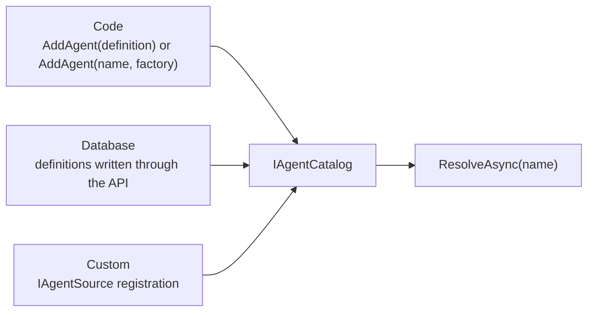
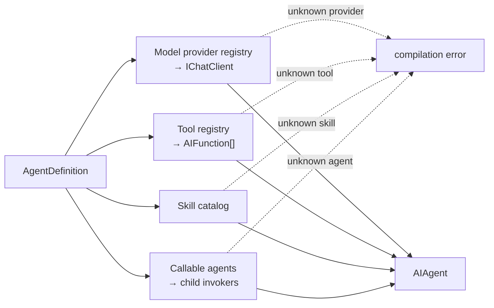
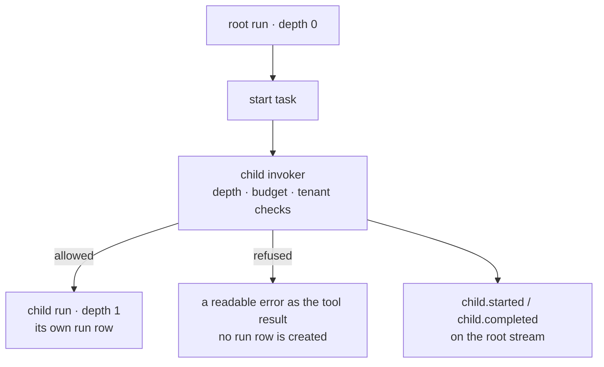

An agent definition is **data**: a name, a model binding, instructions, and the names of the
tools, skills, and other agents it may use. The compiler turns that data into a MAF
`AIAgent`.

```csharp
new AgentDefinition
{
    Name = "support",
    DisplayName = "Support Assistant",
    Instructions = "You are a support assistant. Answer briefly and clearly.",
    Model = new ModelBinding { Provider = "openai", Model = "…" },
    ToolNames = ["get_order_status"],
    SkillNames = ["refund-policy"],
    CallableAgentNames = ["billing"],
}
```

Because it is data, it can be edited without a deployment — and versioned, diffed,
rolled back, and A/B tested. That is the whole reason for the shape.

## Culture-keyed instructions

`InstructionsByCulture` maps a culture tag (`"en"`, `"tr"`) to its own instructions
text. `POST /api/agents/{name}/run` accepts an optional `culture` field; the compiler
resolves it in this order:

1. An exact match (`culture: "tr"` → the `"tr"` entry)
2. The requested culture's parent subtag (`"tr-TR"` → the `"tr"` entry)
3. `Instructions` — the default, used whenever nothing else matches

An unmatched culture never fails the run; it falls back to the default. The
`Accept-Language` HTTP header is not consulted — a browser header silently changing
the content sent to the model would be a surprise, so the culture is always an
explicit field on the request.

A compiled agent is cached per resolved culture: two runs of the same agent in
different cultures never share a compiled instance.

A queued run (`Prefer: respond-async`) uses the `culture` of the request that queued
it. The run record does not store the culture. A run that Tracon starts from an
earlier run therefore uses the default instructions. This applies to the
continuation after an approval decision, a replay, and an automatic continuation
after a crash. A [callable agent](#agents-calling-agents) also resolves without
the caller's culture.

## Parameters

`Parameters` declares named placeholders an agent's instructions may reference as
`{{name}}`:

```csharp
new AgentDefinition
{
    Instructions = "You help {{customer}}. Use a {{tone}} tone.",
    Parameters =
    [
        new AgentParameter { Name = "customer", Kind = AgentParameterKind.Text, Required = true },
        new AgentParameter { Name = "tone", Kind = AgentParameterKind.Text, DefaultValue = "formal" },
    ],
}
```

A run supplies values on the `parameters` field of `POST /api/agents/{name}/run` (and
`/estimate`, which checks the same values without calling a model). A required
parameter with no value and no `DefaultValue` stops the run before it starts, and
names the missing parameter; a value for a name the schema does not declare is
rejected too, not silently dropped. This holds for a definition saved through the
API and for one registered in code with `AddAgent`.

These ways to start a run carry values too:

- a **queued run** (`Prefer: respond-async`) takes the same `parameters` field, checks it
  the same way, and the worker checks it again against the version it runs
- a **batch or schedule** item can name its own values, see
  [Background work](/guides/background-work/#give-an-item-its-own-values)
- a **workflow step** receives the values its own schema declares from the workflow's
  run, see [Workflow parameters](/concepts/workflow-parameters/)

A run records the values it was bound with — the supplied ones with the defaults
applied — beside its input. A **replay**, an **automatic continuation** after a crash
and the resume after a **tool approval** all repeat a recorded run, so they bind the
same values instead of the defaults. A replay request can change some of them with its
own `parameters`; a name the replayed version does not declare is refused.

A run that recorded no values (input recording was off, or the run is older than
parameter recording) cannot be repeated when the agent declares parameters: running
it on the defaults would change the instructions. That refusal says so.

Every other entry point carries no values: the OpenAI-compatible endpoints, MCP, A2A,
an agent called by another agent, and voice. Those runs bind each parameter's
`DefaultValue`, and an agent with a required parameter that has no default does not
run there. Where a request enters, it is refused (`400` with `missingParameters`);
where there is no request to refuse, the run fails before any model call and names
the parameter. Such a run records no values, so it cannot be replayed.

This is **value substitution, not a template engine**. There is no expression,
condition, loop, or field access (`{{a.b}}`) — a template language is a security
surface once it is in a library, and every consumer eventually wants their own
dialect. Substitution is single-pass: a value that itself contains `{{name}}` is
inserted literally, never substituted again. A placeholder written as a full JSON
string value in the instructions (`"customer": "{{customer}}"`) has its value
JSON-escaped so the produced text stays valid JSON; anywhere else, the value is
inserted as-is.

Binding runs once per request, after culture resolution and before compilation, and
the compiled agent is never cached for that run — two runs with different parameter
values never share a compiled instance, the same rule culture resolution follows.
Kind (`Text`, `Number`, `Boolean`) only labels the value's expected shape for the
console's own input form; every value travels as a string.

An agent with an empty `Parameters` list is entirely unaffected by this feature —
`{{...}}` in its instructions stays plain, coincidental text, exactly as before this
feature existed.

## Shared instructions blocks

A shared instructions block is an ordinary `AgentDefinition` — there is no separate
type or table for it. Point another definition at it with `SharedInstructionsName`,
and its `Instructions` text is prepended to the referencing definition's own resolved
text at compile time:

```csharp
// The block: any definition works, even one nobody runs directly.
new AgentDefinition { Name = "house-rules", Instructions = "Always cite your source." }

// The reference:
new AgentDefinition { Name = "support", SharedInstructionsName = "house-rules", Instructions = "Answer billing questions." }
```

Because it is saved through the same store as any other definition, a block gets
versioning, tenancy, and the audit trail for free. A block cannot reference another
block — the reference is a single hop, checked and rejected at compile time, not a
cycle-detecting walk.

## Where agents come from

The catalog merges registered sources, in priority order:



`AddAgent(name, factory)` is a code registration too — the factory returns a MAF
`AIAgent` directly, built however you want, and the catalog still applies Tracon's
decorators (recording, telemetry, approval) when it resolves the agent. The factory
runs on every resolve, and its agent does not pass through the compiler. It keeps
the model rings (run budget, circuit breaker, fallback, response cache, content
guards, the `chat` span) only when it builds its chat client with
`IModelProviderRegistry.CreateChatClient`. That synchronous call applies no tenant
provider key and no egress policy, and the run records no model, so it has no cost.
An agent source that returns its own agent can apply all three: it builds the client
with `CreateChatClientAsync` and names the model in its `AgentDescriptor`.
If the chat client of a factory agent does not come from that registry, Tracon writes
one warning for the agent name. [Use any Microsoft Agent Framework
feature](/guides/any-maf-feature/) compares this door with the decorator and the custom
source.

An application can add an `IAgentSource` for definitions stored outside Tracon or
for agents owned by another runtime. Custom-source agents are visible in the console
but remain read-only in the management API. See [write your own agent
source](/guides/write-your-own-agent-source/) for the lifecycle, priority, tenancy,
and contract-test rules.

On a name clash the higher-priority source wins and the other is dropped from the
list. **Code wins.** That is why the API refuses to store a definition under a name a
code agent already uses: the stored definition would never resolve, and a silent
shadow is worse than a `409`.

A code-defined agent has no stored definition and no version history — its history is
your source history. The API reports that distinctly: `GET /api/agents/{name}` still
returns `200`, with `definition` set to `null` and `isEditable` set to `false`. The
console checks `isEditable` to decide whether to offer an edit form.

## Compiling a definition



Every name must resolve. An unknown tool, skill, extension, provider, or callable agent is a
compilation error, not a run-time surprise.

The same check runs on the **save** path, so a definition that could not run is
rejected when it is written. `POST /api/agents/validate` runs it without saving and
without calling any model — useful in CI. A validation failure there is not an HTTP
error: the response is `200` with a report, because "this definition is invalid" is an
answer, not a transport failure.

### What a harness agent turns on

A `HarnessSettings` value turns on Microsoft Agent Framework's harness: context
compaction, todo tracking and the agent mode provider. Three more harness
features stay off until the definition asks for each one:

| Feature | Turned on by | What it never does |
|---|---|---|
| Skills | `SkillNames`, and only the named skills | Read `SKILL.md` files from the server's working directory |
| File memory | `Memory.EnableFileMemory`, on the registered `AgentFileStore` | Write files under the server's working directory |
| Web search | `Harness.EnableWebSearch`, the provider's hosted search | Turn on because the harness has it |

A definition that turns a feature on and sets its `Disable*` switch is a
compilation error. Hosted web search runs at the model provider, which bills it,
and depends on the provider surface: OpenAI Chat Completions (`openai`) accepts it
only for search models and answers `400` otherwise, while `openai-responses`
offers it to every model.

`MaximumIterationsPerRequest` bounds the tool-call loop of one invocation, on a
fallback model too. At the limit the last model call offers no function tools,
so the model has to answer.

Compiled agents are cached by name, version, and a fingerprint of their dependencies,
so changing a skill, the tenant's egress policy, or an MCP server that serves one of
the agent's tools invalidates the agents that use it. The next run compiles again.

## Agent extensions

How do you set a Microsoft Agent Framework option that Tracon does not model, or add your
own `AIContextProvider`, on an agent that is stored as data? You register an agent
extension in code, and the definition selects it by name in `ExtensionNames`. Code defines,
data selects: the same boundary as tools.

```csharp
builder.AddTracon()
    .AddAgentExtension(
        "message-injection",
        context =>
        {
            if (context.ChatAgentOptions is { } options)
            {
                options.EnableMessageInjection = true;
            }
        },
        description: "Lets a caller inject a message into a running turn.");
```

The compiler runs the extensions a definition names, in the order the definition lists
them, after it has set every option the definition decides. It runs them when it compiles
the agent, not on every run. The compiled agent is cached for each tenant, agent name,
and definition, so the runs that follow share it; a run with parameter values, and an agent
of a tenant that holds its own provider key, is not cached and runs the extensions each time.
The agent keeps the model rings, the tenant's own provider key, the egress
policy, and cost, because it still goes through the compiler.

The compiler compares the options before and after each extension. The definition or a
tenant and security decision owns the tool chain, the tool approval settings, the
instructions and sampling settings, the chat history provider, file access, the
working-directory skill scan, file memory, web search, compaction, the loop, and the
sub-agent tree. An extension that changes one of them
fails the compilation with an error that names the extension and the option. The provider
list is append-only, and every other option is the extension's to set. The check covers the
options object only. It does not look inside a provider or a wrapper that an extension adds,
so register extension code that you trust, as you do for a tool.

Three rules complete the contract:

- **A name must resolve.** `POST /api/agents/validate` and a save refuse an unknown or a
  repeated name and report `extensionNames[i]`. Validation compiles the definition, so it
  runs the extensions it names.
- **Listing runs no code.** `GET /api/agent-extensions` returns the registered names and
  descriptions. The agent editor offers them as a list.
- **A provider can add tools, and they skip the tool chain.** A tool that an extension's
  provider adds is not authorized, approved, or timed by Tracon. A replay that plays tools
  back does not run extensions for this reason.

[Use any Microsoft Agent Framework feature](/guides/any-maf-feature/) compares this door
with the decorator, the factory agent, and the custom agent source.

## Versions

Every save appends a version rather than overwriting. Nothing rewrites history:

- `GET /api/agents/{name}/versions` — full snapshots, newest first, not deltas
- `GET /api/agents/{name}/versions/{a}/diff/{b}` — both snapshots, verbatim; the diff
  is computed by the client, because the server takes no position on presentation
- `POST /api/agents/{name}/rollback` — writes the old content as a **new** version

Rollback moving forward is the point: the rollback is itself auditable and can be
rolled back in turn.

Versions are also what make [experiments](/concepts/evaluation/) possible —
an A/B test splits traffic between two versions of the same agent, which is why a
code-defined agent cannot be experimented on. A [workflow step](/concepts/workflows/#pin-an-agent-step-to-a-version)
can pin one version of a stored agent, so a chain keeps running tested text while the
agent is edited; a code-defined agent has no version to pin.

## Agents calling agents

List other agents in `CallableAgentNames` and the compiler wraps each one in a child
invoker and hands them to MAF's background agents provider. The model starts a task,
waits, and reads the result.



Five rules hold across the tree:

- Every run in the tree shares one budget, so a tree cannot spend more than a single
  run was allowed
- Every run in the tree shares one trace id, and only the root owns the trace buffer
- A child runs in the **same tenant**; a tenant change refuses the call
- A child **cannot ask for approval** — a child run that tries fails
- A child call has a two-layer wait limit: a cooperative deadline that cancels a
  child reading its token, and a hard cutoff for one that does not. Past the hard
  cutoff the tree keeps going; the child keeps running in the background and its
  eventual result is discarded. (A workflow step is the exception: no model reads
  its answer, so a step past its limit fails the workflow — see
  [Workflows](/concepts/workflows/).) Set `SubAgentSettings` on the calling agent to
  override the installation-wide default:

  ```csharp
  new AgentDefinition
  {
      Name = "router",
      CallableAgentNames = ["researcher"],
      SubAgents = new SubAgentSettings
      {
          ChildDeadline = TimeSpan.FromSeconds(10),
          WaitTimeout = TimeSpan.FromSeconds(20),
      },
      // ...
  };
  ```

  A timed-out call writes a `ChildRunTimedOut` event to the root run's stream,
  naming which layer cut it.

  A sub-call the **provider** broke off is a different thing and is reported as
  one: no `ChildRunTimedOut` event is written, and the caller is told the model
  provider did not answer rather than that the sub-agent ran past its limit. So
  the wait-limit event counts wait limits only — if it moved, one of the two
  layers above really did fire.

The whole tree is readable with `GET /api/runs/{runId}/tree`, from any member.

A child resolves the callable agent's **current** version. This is deliberate: a
version or an [experiment](/concepts/evaluation/#experiments) arm applies to the agent
it was set on, not to the agents it calls. A workflow step resolves its agent's current
version the same way, unless the step pins one (see
[Pin an agent step to a version](/concepts/workflows/#pin-an-agent-step-to-a-version)).
A pin reaches only the step's own agent: the callable agents of that agent still run
their current version. A parent run pinned to version 1 can therefore call a child that
runs version 3. To compare a child agent's versions, run an experiment on that agent
directly.

## Run until the work is done

A single agent invocation answers once. `HarnessSettings.Loop` re-invokes the
agent until a declared stop criterion says the work is finished, and records
every iteration in the run:

```csharp
new AgentDefinition
{
    Name = "researcher",
    Harness = new HarnessSettings
    {
        Loop = new LoopSettings
        {
            Criteria = [new LoopCriterion { Kind = "completionMarker", Marker = "ALL DONE" }],
            MaxIterations = 5,
        },
    },
    // ...
};
```

The loop is off while `Loop` is null, which is the default.

A non-streaming run returns the **final iteration's answer**; its usage and cost
are the sum of every iteration. The native streaming run
(`POST /api/agents/{name}/run`) streams every iteration as it happens. Every
other surface that hands the answer to a program, or speaks it, gets the
**final iteration only**: a workflow step and the step after it, the
OpenAI-compatible streams, the A2A stream and both voice surfaces. On those
surfaces a loop agent's answer arrives in one piece when the loop ends. Either
way each iteration is recorded on the run as a `LoopIterationCompleted` event.

**`MaxIterations` is not `MaximumIterationsPerRequest`.** The two bound
different loops. `MaximumIterationsPerRequest` bounds the harness's *inner*
tool-calling loop inside one invocation. `MaxIterations` bounds the *outer*
loop that invokes the agent again after a criterion says the work is not
finished.

Four criterion kinds are built in, and each one takes data only:

| Kind | What stops the loop | Fields it reads |
|---|---|---|
| `completionMarker` | The answer contains a marker text | `marker` (required) |
| `todoCompletion` | The todo list has no open item left | `modes` |
| `aiJudge` | A judge model decides the work is finished | `judgeCriteria` (required), `judgeInstructions` |
| `backgroundTaskCompletion` | No background task is still running | — |

A criterion whose logic is code is registered in code and referenced by name,
the same boundary tools and eval checks live behind:

```csharp
// Microsoft Agent Framework marks the loop types for evaluation only, so
// naming one in your own code needs this suppression.
#pragma warning disable MAAI001
tracon.AddLoopEvaluator("hasCitations", new DelegateLoopEvaluator((context, ct) =>
    new ValueTask<LoopEvaluation>(
        context.LastResponse?.Text?.Contains("[1]", StringComparison.Ordinal) == true
            ? LoopEvaluation.Stop()
            : LoopEvaluation.Continue("Add a numbered citation for every claim."))));
#pragma warning restore MAAI001
```

A definition can then use `Kind = "hasCitations"`. A kind that is neither built
in nor registered is refused when the definition is saved, with `400`. It is
never ignored: a stop criterion that is silently dropped leaves a loop with no
stop criterion.

The overload with a last `description` argument sets the sentence the console
shows next to the kind. Every reader of `GET /api/loop-criteria` receives it, so
do not put a secret in it.

Four more rules are worth knowing before you turn the loop on:

- **Criteria are evaluated in order, and the first one that asks for another
  iteration wins.** The rest are not evaluated that iteration, so the loop stops
  only when every criterion is satisfied. Put the cheapest criterion first — an
  `aiJudge` placed after a `completionMarker` costs nothing on the iterations the
  marker already keeps going.
- **The iteration ceiling is never open.** An unset `MaxIterations` takes
  Tracon's own default of 10. A criterion that can never be satisfied then
  ends as a bounded run, not as an invoice.
- **`aiJudge` calls a model on every iteration it reaches.** It runs on the
  judge binding configured with `AddModelRunJudge(...)`, never on the agent's own
  model. Without that binding the definition does not compile. The judge reads
  each answer, so a tenant's egress policy applies to its provider; it keeps the
  setup-time key, not the tenant's own. Its tokens are part of the run's
  `usage`, cost and quota consumption, and they are priced at the judge model's
  own price — see [what a run carries](/concepts/runs/#what-a-run-carries).
- **By default the loop never fails the run.** A criterion that fails to
  evaluate stops the loop, the work already finished is returned, and the
  iteration event names the criterion. A loop that reaches its ceiling returns its
  last response too. The next section makes either case fail the run instead.

Each evaluated iteration writes a `LoopIterationCompleted` run event carrying
the iteration number, whether a criterion asked for another iteration, and which
one. The criterion's feedback text is not carried in the event.

The event marks an *evaluated* iteration, not a model turn. The turn that
reaches `MaxIterations` is never evaluated — there is nothing left to decide —
so a loop that ends at its ceiling writes one event fewer than it takes turns.
Its last event carries `ceilingReached`, which is how the run record tells "the
criterion was finally satisfied" apart from "we ran out of iterations".

### A criterion that needs your services

`LoopContext` carries no service provider. A criterion that needs one of your
services takes it from a factory:

```csharp
#pragma warning disable MAAI001
tracon.AddLoopEvaluator(
    "reviewed",
    services => new ReviewerCriterion(services.GetRequiredService<IAgentCatalog>()),
    description: "The reviewer agent approves the draft.");
#pragma warning restore MAAI001
```

The factory receives the application's root service provider. It runs once, on
the first compilation of an agent that names the kind, and its result serves
every agent, run and tenant from then on:

- **It does not run at startup.** At startup the agent catalog is still being
  built, so a factory that asks for `IAgentCatalog` could not get it. A
  duplicate kind or a kind that shadows a built-in one is still refused before
  any factory runs.
- **A factory that throws is not cached.** The compilation fails with
  `TraconCompilationException`, which names the kind and the exception type; a
  save returns `400`. The exception's own message goes to the host log only. The
  next compilation calls the factory again.
- **Take singletons only.** The provider is the root one: a scoped service would
  outlive its scope.
- **Read the tenant when you evaluate, not in the factory.** The factory runs
  for whichever tenant compiles the agent first. Read
  `ITenantContext.TenantId` inside `EvaluateAsync`; it is the tenant of the run
  being evaluated, also inside a workflow step.

**A reviewer agent as the criterion.** The `AddLoopEvaluator` factory overload's
XML example shows a criterion that does what `aiJudge` cannot: it computes a
check in code before the reviewer reads the draft, asks a reviewer agent from
the catalog, and reads the reviewer's own JSON verdict. It keeps the round
number for one loop run in `LoopContext.AdditionalProperties`, and it reads the
draft from the last message of `LoopContext.LastResponse`: a harness turn can
write a plan or an earlier version first, and `LastResponse.Text` joins every
message of the turn. The sample application's `DraftReviewCriterion` goes
further: it reads the last *assistant* message and also keeps the previous
round's findings for the next round. The reviewer runs as a child of the run being
evaluated when the criterion passes `TraconRunOptions` built from
`TraconRunContext.Current` (`ParentRunId`, `RootRunId`, `Depth + 1`, `Budget`).
The child run then appears under the evaluated run, and its tokens are its own
run's usage, not the evaluated run's. Its tokens also count against the shared
tree budget. Two limits a sub-agent call checks for you are the criterion's to
check: the tree's depth limit, and `Budget.TryReserveRun()` for the run count.
See `DraftReviewCriterion` in the sample application for the whole class.

### List, edit, and validate a loop

`GET /api/loop-criteria` lists the kinds a definition can name: the four
built-in kinds first, then the kinds registered in code, each with its
description. It also returns the judge model an `aiJudge` criterion calls
(`provider` and `model` only), or `null` when the host bound none. Listing runs
no factory. It needs the Reader role and, for an API key, the `AgentsRead` scope.
The [console](/ui/#agents) builds its Loop panel from this list.

`POST /api/agents/validate` reports every loop problem at once, each with its
own code and the path of the field. Saving a definition with a loop problem
returns `400` with every message:

| Code | Path | Meaning |
|---|---|---|
| `loop_criteria_empty` | `harness.loop.criteria` | The loop has no criterion |
| `loop_max_iterations_invalid` | `harness.loop.maxIterations` | The ceiling is zero or negative |
| `loop_outcome_invalid` | `harness.loop.onExhausted` or `.onCriterionError` | The value is not a `LoopOutcome` member |
| `loop_criterion_kind_missing` | `harness.loop.criteria[i].kind` | The kind is empty |
| `loop_criterion_unknown` | `harness.loop.criteria[i].kind` | The kind is neither built in nor registered |
| `loop_marker_missing` | `harness.loop.criteria[i].marker` | A `completionMarker` has no marker |
| `loop_judge_criteria_missing` | `harness.loop.criteria[i].judgeCriteria`, or `.judgeCriteria[j]` for a blank entry | An `aiJudge` has no criterion, or one of its criteria is blank |
| `loop_judge_unconfigured` | `harness.loop.criteria[i].kind` | An `aiJudge` on a host with no judge model |
| `loop_judge_unavailable` | `harness.loop.criteria[i].kind` | The judge model cannot be built: its provider is not registered, or the caller's egress policy forbids it |

A kind registered in code counts as known whether or not its factory has run.
A factory that fails reports as `compilation_error`, naming the kind.

### Fail the run when the loop is not satisfied

A loop that runs out of iterations returns the last response as a success. In a
workflow, the next node then receives a response no criterion accepted — a
draft the judge never approved goes on to text-to-speech. Two settings choose
what happens instead, each `ReturnLastResponse` (the default) or `FailRun`:

| Setting | Applies when | With `FailRun` |
|---|---|---|
| `OnExhausted` | The ceiling is reached and a criterion still asks for another iteration | The run fails with error type `loop_unsatisfied`, class `LoopUnsatisfied` |
| `OnCriterionError` | A criterion throws while it is evaluated | The run fails with the criterion's own error, so an unreachable judge stays a provider error |

```csharp
Loop = new LoopSettings
{
    Criteria = [new LoopCriterion { Kind = "aiJudge", JudgeCriteria = ["Ready to publish"] }],
    MaxIterations = 3,
    OnExhausted = LoopOutcome.FailRun,
},
```

In JSON the values are names: `"onExhausted": "FailRun"`. An unknown name is
refused with `400` when the definition is saved.

What `FailRun` changes, besides the outcome:

- **The last iteration is evaluated.** By default the turn at the ceiling is
  not, because nothing is left to decide. Failing the run without evaluating it
  would refuse a last response that meets every criterion, so in this mode the
  criteria run once more after that turn. The agent still takes at most
  `MaxIterations` turns; the cost is one more evaluation, which for `aiJudge` is
  one more judge call. With `MaxIterations = 1` the single turn is evaluated too.
- **The events match the turns.** Every turn is evaluated, and the last event
  carries `ceilingReached` and `failsRun`. A criterion that throws under
  `OnCriterionError = FailRun` writes `failedCriterion` and `failsRun`.
- **A streaming client receives the last turn's text before the failure.** The
  decision is made after that turn has streamed: the client gets the text, then
  the error frame, and the run closes as `Failed`.
- **A failed run keeps its usage.** Its tokens and cost cover every turn the
  loop ran, so quotas and cost reports count the work.
- **A workflow stops at that agent.** Its run fails and the next node does not
  run. The agent's own run and the workflow's run both carry the
  `loop_unsatisfied` error type and the `LoopUnsatisfied` class.
- **Called from your own code, the agent throws.** `TraconLoopUnsatisfiedException`
  carries `AgentName`, `Iterations` and `UnsatisfiedCriterion`; its message never
  repeats what the model wrote. Match a run's `error.type` with
  `TraconLoopUnsatisfiedException.LoopUnsatisfiedErrorType`.

The run's own cancellation is never a criterion error: a cancelled run ends as
`Canceled` in both modes.

## Read next

- [Runs and recording](/concepts/runs/) — inspect recorded status, events, tokens, and recording limits.
- [Tools, skills, and MCP](/concepts/tools/) — choose code tools, instruction skills, or remote MCP integration.
