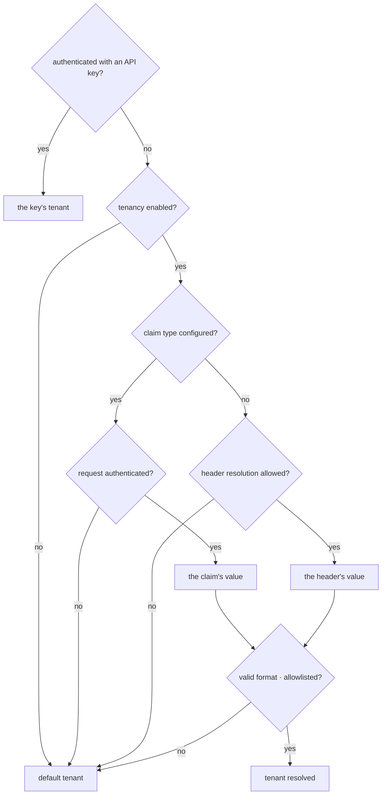
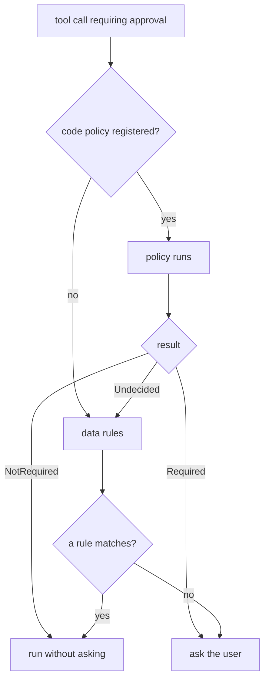

Governance is explicit and visible. Tenancy, quotas, rate limits, retention cleanup,
and content guards need configuration. Audit decorators and their default store are
registered by `AddTracon()`; authentication only changes which actor name they
can record.

## Multi-tenancy

Off by default. Turned on, the tenant is resolved in a fixed order:



Two rules are worth reading twice.

**An API key outranks everything.** A key *proves* a secret; a claim or a header only
*asserts* one. If a key and a header disagree, the request is refused with `403`
before it reaches any endpoint.

**If a claim type is configured, the header is never read.** Otherwise an
authenticated user could reach another tenant's data by adding a header. The header
path also has to be enabled explicitly — an HTTP header is not proof of identity.

### What a tenant identifier may be

A tenant identifier matches `^[a-zA-Z0-9_.-]+$` and is at most 64 characters. A
value that does not match is never resolved, and the request **falls to the
default tenant** — the allow-list does not catch it, because the allow-list
only sees values that passed the format check. Treat a malformed header as a
request that reaches the default tenant, not as one that is refused: if that
matters to you, reject it in front of Tracon.

**Letter case does not distinguish two tenants.** `acme`, `Acme` and `ACME` are
one tenant. Tracon reaches that by folding the *value* to invariant lower case
wherever a tenant enters the system — the resolved context, the allow-list on
both sides, the admin routes, and every store, on the write path and the query
path alike. `AmbientTenantScope.Normalize` is that rule, and a store you write
yourself must apply it too.

Folding the value, rather than comparing case-insensitively at query time, is
what makes the three storage providers agree. A plain `=` predicate then means
the same thing on PostgreSQL, SQLite and SQL Server whatever collation the
database was created with, the primary key keeps rejecting duplicates on all
three, and the index stays usable. Without it a deployment answers "same
tenant" or "different tenant" for the same pair depending on which layer is
asked: SQL Server's default collation is case-insensitive, PostgreSQL's and
SQLite's are not.

Two consequences are worth planning for:

- `Tracon:DefaultTenantId` is **rejected at startup** when it is not already
  lower case. Tracon does not fold it silently, because a value you wrote as
  `Acme` and then read back as `acme` in the audit trail gives you nothing to
  search for.
- Migrations **refuse to run** against a database that still holds a
  non-canonical `tenant_id`, and they name the tables. Tracon does not fold
  those rows for you: on a case-sensitive engine `Acme` and `acme` may be two
  real tenants, and merging two tenants cannot be undone. Decide per table
  whether the rows are one tenant or two, then start again.

Isolation is enforced by contract tests that check it in both directions, across the
in-memory store and all three SQL providers, with a coverage gate requiring every
public store method to be either tested or exempted with a documented reason.

Isolation lives in the application layer, and that is a deliberate choice. Every
query carries the resolved tenant; Tracon does not create database row level
security policies, and it does not assume your database has them. Two reasons: the
coverage gate above already makes an untested store method a build failure, and
SQLite has no row level security at all, so adding it would make the three
providers behave differently. You are free to add such policies in your own
database. If you do, keep the tenant that Tracon resolves and the tenant your
policy binds to the connection in agreement — they are two separate mechanisms.

Rate limits are not an isolation boundary. `Tracon:RateLimit` and the inbound
trigger limit count in the memory of one process, so a `Tenant` partition splits
that instance's own window per tenant rather than a window shared across the
deployment. What binds a tenant's total consumption is a quota, and quotas are
counted in the database.

### Attributing spend below the tenant

The tenant answers "whose data is this". Two further questions — which **user**
spent this, and which **job** it was spent on — are answered by
`IRunAttributionContext`, the sibling interface described in
[Runs](/concepts/runs/#who-ran-it-and-for-what).

The security property is the same one the tenant header has: the value is never
taken from the run request body. A `userId` field there would let any client
write spend against another user's name and forge the cost record outright, so
the body is not a source of attribution at all — the server resolves it from your
identity pipeline, and a `userId` sent in the body is ignored.

The recorded user id is an **opaque string**. Tracon does not resolve it,
does not validate it, and stores no personal detail of its own; what it
identifies is your application's decision.

:::caution
Erasure does **not** match on `runs.user_id`. `IDataSubjectResolver` is the only
thing that knows which subject a value belongs to — Tracon deliberately
holds no mapping — so a resolver must return those runs itself. Find them with
`GET /api/runs?userId={id}&includeChildren=true` and include their ids in the
scope's `RunIds`. Erasing a run row removes its `user_id` along with everything
else on it.
:::

### Below the tenant: session ownership

The tenant is the data boundary, and it is the only one Tracon draws by
default: inside a tenant, every `Reader` sees every session. Turning on
`Tracon:SessionOwnership` adds a second, narrower line under it — a session
records which user opened it, and the session list narrows to that user. It
governs sessions only, and it never crosses the tenant: the same person in two
tenants still has two independent data spaces.

Ownership is not retroactive, so rows written before you turned it on belong to
nobody. They fall out of every user's list immediately; `RefuseUnownedSessions`
refuses them outright once the conversations they hold no longer matter.

See [Sessions: session ownership](/concepts/sessions/#session-ownership) for the
behaviour and the migration notes, and
[Embedding](/guides/embedding/#6--run-and-session-authorization) for how it
composes with `IRunAuthorizationHandler`.

Every one of these handlers has a permissive built-in default, and a host that binds
nothing starts silently on it. Where that silence is unacceptable, declare the
binding required with
[`RequireCustomBinding<T>()`](/guides/embedding/#make-a-binding-required): the host
then refuses to start while Tracon's default is what resolves. It gates
composition, not the decision the handler goes on to make.

## Per-tenant provider credentials and egress

By default every tenant shares the model provider credential a `Use...()` call
registered at startup — one key, one bill, one usage pool. A tenant can instead bring
its own key (BYOK): its usage and its bill stay separate. A record for this binds a
tenant and a provider to the **name** of a configuration key, never to the key's
value — the value is read from `IConfiguration` only at call time and is never
written to a database, a log line, or an HTTP response. A tenant with no binding for
a provider keeps using the shared setup-time credential; nothing changes until an
administrator writes one, and a binding whose configuration key carries no value does
not fall back to the shared key silently — the run fails with a clear error, so a
misconfigured tenant is never billed against the wrong account.

An egress policy narrows which providers a tenant's agents may call at all. A tenant
with no saved policy is unrestricted; saving one is an additive restriction. Naming a
forbidden provider in an agent definition is rejected **at compile time** — before any
request reaches the network — and writing a credential binding for a forbidden
provider is rejected too, so the two surfaces cannot disagree.

The policy covers every model an agent calls, not only its own model: that model's
fallbacks, the model that summarizes the conversation during compaction, the
judge of an `aiJudge` loop criterion, and a
[provider-hosted live voice](/guides/voice/#tenant-policy-and-credentials) session. Each of them receives the tenant's data. The
summarizer is billed like the agent's own model: it uses the tenant's key when the
tenant has one for its provider. The loop judge is the host's one judge model, the
same one the run judge calls, and keeps the shared setup-time key.

Speech calls obey the same policy and the same bindings: text-to-speech,
speech-to-text and the voice list check the provider name the engine reports, before
any text or audio leaves the process. A tenant's own key reaches only an engine that
accepts one; for any other engine the call is refused rather than billed to the host.
See [tenant policy and credentials for speech](/guides/voice/#tenant-policy-and-credentials-for-speech).

Knowledge base embedding calls obey the policy too: an upload, a knowledge search and
the `search_knowledge` tool check the provider that `Tracon:Knowledge:EmbeddingProvider`
names. A tenant with a policy is refused when that provider is not named, and a tenant
with its own key for it is refused rather than billed to the host. See
[the knowledge guide](/guides/knowledge/#register-the-two-required-dependencies).

Every refusal, on every one of these paths, is the same exception,
`TraconTenantProviderRefusedException`: error type `tenant_provider_refused`, class
`TenantProviderRefused`, and a message that names the tenant and the kind of provider
(`model provider`, `image provider`, `speech provider`, `embedding provider`,
`live voice provider`). The image, speech and knowledge endpoints answer `403`. An
agent run that the refusal stops before it starts answers `400`, and the message also
names the agent. A workflow node retry and the job queue never repeat it: the next
attempt would be refused the same way.

A queued run that is refused before it starts is the exception: its record still
carries the .NET type name as its error type, so its class is `Unknown`.

A saved policy takes effect on the next run: an agent compiled under the earlier
policy is not reused, and a run already in progress is not stopped.

Both are managed under `/api/tenants/{tenantId}/providers` and
`/api/tenants/{tenantId}/egress`, guarded by the `SecurityAdmin` API key scope. A
tenant other than the caller's own also requires platform authority: the
`PlatformAdmin` scope, the static token, or the `TraconPolicies.PlatformAdmin`
policy. A binding names its key inside the tenant's own segment,
`Tracon:ProviderKeys:{tenant}:...`, so one tenant cannot bind another tenant's key.
See [Per-tenant credentials](/guides/model-providers/#per-tenant-credentials-byok)
for the full HTTP contract.

## The audit trail

Who changed what, when, and from what to what. Agent definitions, skills, MCP
servers, tenants, approval rules, API keys, quotas, retention policies, egress
policies, provider bindings, triggers, webhooks, and approval decisions all land in
it.

Skills are in that list for the same reason agent definitions are: a skill carries
the instructions the model is given **and** the scripts that run on your server, so
`skill.create`, `skill.update`, and `skill.delete` are governance changes, not
content edits.

Runs do **not** — the run history already holds the full record. The one exception is
a content guard's block decision, which is a governance decision rather than a run
detail and must stay traceable after retention deletes the run.

Most writes happen in store **decorators** rather than in endpoints, so no code path
can change one of those entities without an entry. The rest are written by the
endpoint itself, where the audited unit is the operation and not the row it touches —
branching a session, erasing a data subject, or rotating an API key.

The actor comes from your authentication. With none configured the actor is `null`,
and that is not hidden.

Before anything is written it passes a secret filter: any field whose name contains
`apiKey`, `authorization`, `password`, `secret`, or a singular `token` has its value
replaced with `***`. Plural `tokens` — count fields like `maxOutputTokens` — is
deliberately excluded.

```bash
curl 'http://localhost:5081/tracon/api/audit?action=agent.update'
curl 'http://localhost:5081/tracon/api/audit/quota:{id}'
```

### What is guaranteed to be written

Two different guarantees live in this system, and the difference decides what an
audit trail can be used to prove.

**Fail-closed — the operation does not happen unless the record does.** The entry is
written *before* the change is applied, and a write failure aborts the change:

| Operation | What a failed audit write refuses |
|---|---|
| An approval decision, [in band, out of band, or as the answer to a workflow request](#approvals) | The decision is not applied and the tool does not run |
| Granting or revoking a skill script | The grant is not changed |
| Running a skill script | The script does not run |
| Saving or deleting an inbound trigger | The trigger is not changed |
| An automatic canary rollback | The rollback is not applied |
| A data subject erasure | The erasure does not commit |
| An answer to a workflow's pending request that starts a run, [in either response mode](/concepts/workflow-answers/) | The answer is refused with `500`; no run starts and nothing is recorded |

**Best-effort — the operation continues and the record can be missing.** Every other
audit write takes this path: the failure is logged as a warning, and the call carries
on. Either way the failure increments `tracon.audit.write_failures`, tagged `refused`
or `swallowed` — see [what a failed audit write looks
like](/guides/observability/#what-a-failed-audit-write-looks-like), because a hole in
the audit trail is not something to find out about by reading logs.

Run recording is best-effort in the same way, and goes one step further — after the
first store failure, recording is switched off for the rest of that run. A single
transient error can therefore cost the remainder of that run's events, not just one
of them. It is counted the same way too: `tracon.run.recording_failures` rises once
for that run, tagged with the stage the record was lost at — see [what a lost run
record looks like](/guides/observability/#what-a-lost-run-record-looks-like). The same
sentence applies to a run as to the audit trail: a hole in the evidence is not
something to find out about by reading logs.

The rule behind the split is that observability must not take down product
functionality. The cost is the part to be honest about: an audit trail is evidence of
what was recorded, not proof of everything that happened. Where a missing record would
itself be the whole problem, the operation is fail-closed instead.

See [Runs and recording](/concepts/runs/) for what a run stores, and
[Observability and cost](/guides/observability/) for what a store failure looks like
in the logs.

### Tamper detection

Every entry carries a hash of its own content and the hash of the entry before it,
chained per tenant. `GET /api/audit/verify` walks the chain and reports one of three
outcomes:

| Status | Meaning |
|---|---|
| `Valid` | Every entry's hash matches its content and links to the one before it |
| `Broken` | An entry's stored hash no longer matches its content — it was altered after it was written |
| `Gap` | A link between two entries is missing — a row was deleted, or a write never completed |

`Broken` and `Gap` both name the first entry where the chain fails.

```bash
curl 'http://localhost:5081/tracon/api/audit/verify'
# {"status":"Valid","entriesChecked":42,"firstFailingEntryId":null}
```

:::note[Entries written before this feature ships have no hash]
They are excluded from the walk rather than misreported as tampered — a chain starts
at the first entry written after upgrading, not retroactively.
:::

## Approvals

Three shapes, matching how the run was started.

Every surface carries the **same** guarantee: a decision that cannot be written to the
audit trail is not applied, and the tool it approved does not run. See [what is
guaranteed to be written](#what-is-guaranteed-to-be-written).

**In-band.** A streaming run that hits a tool needing approval carries the request in
its stream and the decision in the next turn. The next turn needs the run's session: a
run started without a `sessionId` can never be answered, so it closes `Failed` with the
error type `approval_unanswerable` — `409` on a non-streaming run, an `error` event on a
stream. The same holds for every surface that cannot carry an answer back: Chat
Completions, an agent exposed over MCP or A2A, a batch item and an eval case.

The skill tools ask like any other tool. A definition can turn the approval off for
`load_skill` and `read_skill_resource` with `Skills.DisableReadApproval`, which is what an
agent needs on those surfaces; the definition has no setting for `run_skill_script`. The host refuses to expose an agent over
MCP or A2A while its skill read approval is on. [Approval of the skill
tools](/concepts/tools/#approval-of-the-skill-tools) has the details.

**The mailbox.** A queued run stops at `AwaitingApproval` and the request waits in
`GET /api/approvals/pending`, with the tool's recorded arguments for the approver to
read and an absolute expiry.

**In a workflow.** An agent in a workflow can ask too. The workflow waits and the request has
the form `ToolApproval`; the answer goes to
`POST /api/workflows/runs/{runId}/respond` with `approved`, an optional reason in `text`, and
optionally `remember`. The decision is recorded as `approval.decision`, like the other two, and
saved as a rule the same way. See [A tool that asks for
approval](/concepts/workflow-answers/#a-tool-that-asks-for-approval).

Deciding either way **resumes** the run — the model has to see a result or a refusal
and continue. And the decision opens a **new** run; the one that stopped is never
rewritten.

By default an approver sees the raw call: `{ "orderId": "ORD-1001" }`. Register
`IToolApprovalPresenter` to turn that into "Cancel order for Priya Shah" — implement
`PresentAsync`, reading whatever the call's arguments name, and return a
`ToolApprovalPresentation` (an entity type, id, name, and a free-form message; every
field is optional).

```csharp
public sealed class OrderApprovalPresenter(IServiceScopeFactory scopes) : IToolApprovalPresenter
{
    public async ValueTask<ToolApprovalPresentation?> PresentAsync(
        ToolApprovalContext context, CancellationToken cancellationToken = default)
    {
        if (context.GetString("orderId") is not { } orderId)
        {
            return null;
        }

        using var scope = scopes.CreateScope();
        var orders = scope.ServiceProvider.GetRequiredService<IOrderRepository>();
        var order = await orders.FindAsync(orderId, cancellationToken);

        return order is null ? null : new ToolApprovalPresentation
        {
            EntityType = "order",
            EntityId = orderId,
            EntityName = $"Order {orderId}",
            Message = $"Cancel order {orderId} for {order.CustomerName}.",
        };
    }
}

services.AddSingleton<IToolApprovalPresenter, OrderApprovalPresenter>();
```

Register it as a singleton and reach a scoped dependency, such as a `DbContext`,
through an injected `IServiceScopeFactory` — the same rule as
[the empty service provider mistake](/getting-started/tools/#the-rule-that-trips-people-up),
because this runs on the same tool-call path. Unlike authorization and validation, a
presenter is not a gate: it fails **open**. Not registered, resolves nothing, throws, or
runs past its timeout (`TraconToolOptions.ApprovalPresentationTimeout`, 2 seconds
by default) — the approval request publishes either way, with the raw arguments still
there. A presentation is decoration for a decision a human still has to make from the
real call, never a replacement for it.

The resolved presentation reaches every surface a pending request does: the mailbox
list, the single-request read, the `RunAwaitingInput` run event, and the console's own
approval card.

:::note[The audit entry is written before the decision is applied]
An approval decision that cannot be recorded is not applied at all. This is one of the
seven fail-closed operations listed in
[What is guaranteed to be written](#what-is-guaranteed-to-be-written); every other
audit write is best-effort and is swallowed on failure.
:::

Standing decisions are **approval rules** — a pre-approval for a tool. They do not
expire. `GET /api/approvals/rules` is the list to review periodically, because each
entry is a tool call that will never ask again.

A rule narrows its scope one of three ways: to one exact set of arguments (a hash,
written by the "don't ask again" flow above), to a set of argument **conditions** (for
example `amount <= 100`, written with `POST /api/approvals/rules`), or not at all —
matching every call of the tool. A rule carries a hash or conditions, never both.

Conditions are comparisons, never expressions: a dotted path into the arguments, one
operator from a closed set (`Equals`, `NotEquals`, `GreaterThan`,
`GreaterThanOrEqual`, `LessThan`, `LessThanOrEqual`, `In`, `NotIn`), and a value. All
of a rule's conditions must match — there is no `OR`; write two rules instead. A
condition fails closed: an unresolved path, a missing argument, or a type mismatch
(text `"100"` does not satisfy a numeric rule) all mean the call still asks for
approval.

A rule for a tool of an MCP server is also bound to that server's endpoint. When the
rule is written — by an administrator or by the "don't ask again" flow — Tracon
records a fingerprint of the endpoint the tool was discovered from (`sourceFingerprint`,
the SHA-256 of the address; never the address itself, which can carry a credential in
its query string). The rule approves the tool only while the server keeps that
endpoint. Pointing the server at another endpoint, or deleting it and adding it back
under the same name with another endpoint, makes its tools ask again; write a new
rule for the new endpoint. While a server's tools are not discovered (its last
refresh failed), its tools always ask, and `POST /api/approvals/rules` for one of them
answers `409` rather than store a rule bound to nothing. Rules stored before this field
existed carry no fingerprint, so after an upgrade each standing rule for an MCP tool
asks once more.

A rule is identified by its agent, its tool, its source fingerprint, and its hash or
condition set. The order of the conditions does not count, and neither does whitespace between the
elements of a list value: `region In ["eu", "us"]` and `region In ["eu","us"]` are
the same condition. Everything else is compared as written — `"new york"` and
`"newyork"` are two values.
`POST /api/approvals/rules` with a rule that already exists answers `409` and keeps
the stored one.



A **code-defined policy**, registered with
`builder.AddToolApprovalPolicy("refund_order", context => ...)`, runs before the data
rules and can override them in both directions. Code is a security boundary; the data
rules are writable from the UI and are not allowed to loosen a policy that says
`Required`. An unhandled exception in a policy is treated as `Required` and logged —
a broken policy never silently releases a tool from approval.

### Tool authorization

Approval and authorization answer different questions. Approval asks "is this call okay
this time" and stops to wait for a person; authorization asks "can this caller call this
tool at all" and answers instantly from `IToolAuthorizationHandler` — your own policy,
checked before approval and before the call's timeout even starts. A denied call does not
fail the run: the model gets the reason as an ordinary tool result and continues its
turn. See [Tools, skills, and MCP](/concepts/tools/#authorization-validation-and-timeout)
for the interface and an example.

## Quotas and rate limits

Two different mechanisms, deliberately not merged. Rate limits work at second and
minute scale in memory; quotas work at day and month scale in the database.

Neither refuses anything by default: rate limiting is off, and quotas are empty until
a rule exists. An agent with no matching rule is unlimited.

A rule sets any of three limits — runs, tokens, or cost — over a period, scoped to the
tenant or to one agent. Exceeding one returns `429` with which quota was hit and when
the counter resets.

You are told **before** the wall, not only at it. As the counter crosses each
percentage in `Quotas:ThresholdPercents` (`80` and `100` by default) Tracon posts
a [`quota.threshold`](#webhooks) webhook carrying the metric, the period, the limit,
the consumption, the threshold crossed, and when the counter resets. Each threshold
fires **once per period**, so a counter that keeps climbing past `80` does not
re-notify. To turn the notifications off, clear the list in code
(`Configure<TraconQuotaOptions>(o => o.ThresholdPercents.Clear())`); an empty list in
configuration keeps the default. An entry that is not a whole number from 1 to 100
stops the application at startup, and the error quotes it.

The threshold event is a notification, not a decision: it stops nothing, and `429`
remains the only thing that refuses a run.

A **cost** limit counts what a run spent, not only its tokens. The amount a run
writes into the counter is its token cost plus what its workflow function nodes and tools
[reported beyond tokens](/concepts/workflows/#report-what-a-node-spent-beyond-tokens), in the
currency set by `Tracon:Pricing:Currency`. An item that reported no amount, or one in
another currency, counts for nothing, because Tracon cannot add what it cannot price; the run
lists it as not added instead of reading it as free. An item whose quantity was estimated
does count, so a ceiling is not passed on a quantity nobody measured. A quota has no limit on
a unit such as characters or seconds: it limits runs, tokens and cost only.

Turning on `Quotas:PublishThresholdToRunStream` (off by default) also writes the
crossed threshold into the *triggering run's own* event stream — a `custom` frame
carrying `tracon.quota.threshold` before the run's terminal event, so a client
already watching that one run's SSE stream sees the warning without a separate
webhook subscription. When the same run's answer was also cut off, its
`tracon.output.truncated` frame comes first, in record order; if the run store cannot
be read back at that point, the stream still ends with `done` and the notice stays on
the run's recorded events. The frame's payload carries a `noticeId` (stable across a
reconnect, for dedup), the run and user the threshold belongs to, and the same
metric/period/limit/consumption fields the webhook carries. A threshold is claimed
for notification **once per period** durably — a restart or a second worker
process never re-announces one that already fired.

A call tree is one run and one counter. Every run in the tree adds its own tokens and
cost to the counter **when it ends**, under the root's tenant and name: a child agent
never opens a counter of its own, and adds no run. A child that is still running in the
background when its root ends is therefore counted when it ends, and so is the amount a
tool reports after its call timed out and its run closed (it reaches the counter only; the
run's recorded total stays as it was when the run closed). The notice is written to the
run whose entry crossed the threshold: usually the root, and a child when its entry is
the one that crosses it. A late tool amount that crosses a threshold is announced by the
`quota.threshold` webhook only, because the run's stream is closed. A child priced
in another currency than `Tracon:Pricing:Currency` adds its tokens and the amounts it
reported beyond tokens, not its token cost.

:::caution[Counters are approximate]
The check happens **before** a run starts; consumption is written **after** it
finishes. A run already in progress is never cut off during execution, so brief overshoot is
possible by design.
:::

This is a *different* budget from the one every root run's call tree carries
(`AgentGraph.MaxTotalTokens`/`MaxTotalCost`/`MaxDuration`, see [Reliable
runs](/guides/reliability/#bound-multi-agent-trees)): a quota is scoped to a tenant
or agent over a day or month and never interrupts a run in progress; the call-tree
budget is scoped to one run's tree and is checked between model turns, so it *does*
cut a long tool loop off mid-run.

## Retention

Recorded runs accumulate. A retention policy sets an age or row limit per target — run
events, tool calls, traces, jobs, webhook deliveries, eval results, checkpoints,
attachments, sessions, and more.

A database policy takes precedence. When none exists and retention is enabled in
configuration, Tracon falls back to its target defaults, including 30 days for
run events and 14 days for spans. With retention disabled, nothing is removed. A
policy with `enabled: false` is configured but paused.

When a policy has `archive: true`, cleanup first sends its batch to the registered
`IArchiveSink`. If no sink exists, no rows are deleted. This fail-safe trades storage
growth for protection from silent data loss. A column that
[content protection](#content-protection) encrypts reaches the sink as plaintext, as
it does in an export: the sink decides how the archive is stored, so encrypt it there
if it must stay encrypted at rest.

An archiving run deletes exactly the rows it sent to the sink, and only after the
sink returns. If the sink throws, nothing in that batch is deleted. A row that
changes between the read and the delete (for example, a session that is used again)
stays, and a later run archives it again, so your sink can receive the same row more
than once. If you write your own `IRetentionStore`, override `ArchiveBatchAsync`: its
default reads and deletes in two separate calls, which can delete a row that was never
archived. `RetentionStoreContract` in `Tracon.Testing.Contracts.Xunit` checks this.

The `sessions` target also deletes the conversation memory of each expired session,
when memory is set up. The batch is read first, the memory records of its sessions are
deleted tenant by tenant, and only then are the session rows deleted. If the store cannot
delete, the run fails with the rows still in place, and the next run reads the same sessions.

The `attachments` target deletes only **orphaned** attachments: those with no
session id, or whose session id has no owner in the same tenant. An owner is a
session, or a [workflow](/concepts/workflows/#checkpoints) run with that session id
that waits for input, has not finished, or finished after the cutoff. A workflow's
session id never gets a session row, so without the run rule an image a workflow
step made would go while the run still waits for a human.

With an `IAttachmentStorage` registered, the bytes live outside the database.
Retention deletes the bytes first and the row second. If the byte delete fails,
the row stays, a warning is logged, and the next run tries again — the row is the
only record of where the bytes are. See
[production storage](/guides/multimodal/#persistence-and-production-storage) for
what your storage's `DeleteAsync` must do.

No endpoint deletes synchronously. Preview first — it is the only way to see the size
of a deletion before it happens — then run, which queues a job.

```bash
curl 'http://localhost:5081/tracon/api/retention/preview'
curl -X POST 'http://localhost:5081/tracon/api/retention/run'
curl 'http://localhost:5081/tracon/api/retention/history'
```

The history of what was deleted is itself never cleaned up.

## Data subject rights

Retention removes data by **age**. Export and erasure remove it by **identity** — a
data subject's own sessions, runs, and conversations, on request (a GDPR-style
"right to erasure").

Tracon does not store personal identity itself: `sessions.id` is a value your own
application chose, and only your application knows which session, run, or
conversation belongs to which end user. You supply that mapping by registering an
`IDataSubjectResolver`:

```csharp
public sealed class MyResolver : IDataSubjectResolver
{
    public ValueTask<DataSubjectScope> ResolveAsync(
        string subjectId, string tenantId, CancellationToken cancellationToken = default)
        => new(new DataSubjectScope
        {
            SessionIds = LookUpSessionIds(subjectId),
            RunIds = LookUpRunIds(subjectId),
            ConversationIds = LookUpConversationIds(subjectId),
        });
}

builder.Services.AddSingleton<IDataSubjectResolver, MyResolver>();
```

Without a resolver registered, both endpoints return `409` — never a silent empty
result that could be misread as "already erased".

```bash
curl 'http://localhost:5081/tracon/api/data-subjects/user-42/export'
curl -X DELETE 'http://localhost:5081/tracon/api/data-subjects/user-42'
curl -X DELETE 'http://localhost:5081/tracon/api/data-subjects/user-42?dryRun=false'
```

:::caution[`dryRun` defaults to `true`]
A bare `DELETE` previews the row counts per target and deletes nothing.
`?dryRun=false` is required to actually erase.
:::

A real erasure answers `409` while one of the subject's runs is `Queued` or
`Running`: such a run writes its session and its workflow checkpoint as it goes, and
would write them back after the erasure. The problem lists the runs in
`activeRunIds`, and a preview lists them in `activeRunIds` of its result. Cancel
those runs and repeat the request. `force=true` erases anyway; it is meant for a run
row that a crashed process left `Running`, because a run that really runs can write
its rows again.

Erasure removes the session, run, conversation, attachment, score, voice-session, and
[workflow checkpoint](/concepts/workflows/#checkpoints) rows that belong to the
subject — including summarized conversation messages, which retention otherwise keeps
forever. Four copies of a run's text go with the run: an eval case promoted from it,
the stored response of an idempotent request that started it, the job of a queued run
and the batch item that started it. A batch job keeps its other items. Checkpoints are matched by the subject's session ids and run ids, and their
state can hold the subject's own messages. Erasure has no exemption for a run that
waits for input: retention keeps such a run's checkpoints so the request stays
answerable, but an erasure deletes the run itself, together with its checkpoints. It never touches the audit trail: an audit record
is "who did what", not the subject's own data, and stays intact and verifiable after
an erasure. The erasure itself **is** written there, with the row count per target; if
that write fails, the whole erasure rolls back.

If [conversation memory](/guides/context-and-memory/#remember-a-user-across-sessions)
is set up, the copy of the subject's sessions that your vector store keeps goes too. It is deleted
inside the erasure by the subject's session ids and the caller's tenant: after the rows are
deleted, before the audit write and the commit. The preview counts it under
`conversation_memory`, and the export lists it. If the store cannot delete, the erasure
rolls back and the request fails; repeat it when the store is back. Records the store
keeps for its own reasons, such as backups, are outside Tracon's reach.

Attachment bytes held in a registered `IAttachmentStorage` go too. They are deleted
inside the erasure: after the rows are deleted, before the audit write and the
commit. If a byte delete fails, the erasure rolls back and the request fails —
repeat it when the storage is back. If the audit write or the commit fails after the
bytes are gone, the rows stay and point at nothing; repeating the request finishes
the erasure. A preview (`dryRun`) never touches the bytes.

Export returns every matching row, keyed by target, as one JSON document.
A column that [content protection](#content-protection) encrypts is exported as
plaintext. Attachment file bytes are not included — only their metadata. A workflow checkpoint's
`state` is the framework's own serialized format: export returns it as the stored
JSON text (a string), the same way it returns session state.

## Content protection

`AddContentProtection(...)` encrypts session state, workflow checkpoints, chat
history, run inputs (the messages and the parameter values each in its own column) and
events, tool arguments/results, agent files, and attachments with AES-256-GCM
before they reach the database, and decrypts them transparently on read. Off by
default, like the content guards below — turning it on is a deliberate call, and
only new writes are protected: a row's own content, not configuration, decides
whether it needs decrypting. See
[at-rest content protection](/getting-started/security/#at-rest-content-protection)
for the key configuration and its limits.

## Content guards

An `IContentGuard` inspects content going to and coming from the model. Decisions are
`Allow`, `Mask`, or `Block`, and **the strictest decision wins**.

Off by default: with no guard registered the wrapper is never added and the measured
cost is zero.

The guard sits **inside** the tool-call loop, above the raw client. A tool result
re-enters the model on a second call, and a guard outside the loop would never see it.

Blocked content never reaches the provider network and does not trip the circuit
breaker. Recording stores the placeholder `[content_blocked]`, while the audit entry
records the guard, rule, and direction without the blocked text.

### Source-aware decisions

`ContentGuardContext` carries a `Source`: `UserMessage`, `ToolResult`, `Document`,
`ModelOutput`, or `SkillResource`. A user message and a tool result used to enter a
guard the same way — both are `Direction.Input` — even though the trust level is not
the same. A user can only poison their own session; a tool result can carry text a
different tenant's data wrote into a shared system, which is the most common
prompt-injection path. A guard reads `Source` to apply a stricter rule to
`ToolResult` than to `UserMessage`, or to skip a check that only makes sense for one
of them.

When `Source` is `ToolResult`, `ToolName` carries the tool's name if it can still be
resolved from the same message list — a many-turn conversation can drop the earlier
tool call from context, leaving `ToolName` `null` even though `Source` still reads
`ToolResult`. A security decision keys off `Source`, never off whether `ToolName`
happened to resolve.

`Source` defaults to `Unknown` for content a guard cannot classify. `Unknown` is
never a reason to relax a check — a guard should treat it at least as strictly as
its most sensitive known source. The built-in pattern guard does not read `Source`
at all: the same denied-term and PII patterns apply everywhere, including `Unknown`.

:::note[Masked content stays masked]
Input preview runs before the recording path. When a guard returns `Mask`, the model,
recorded input, and run events receive the masked value. Tracon does not retain a
hidden raw copy for later inspection.
:::

## Requiring a production decision

Nearly everything on this page is off by default, and that is deliberate: a first
run should surprise nobody. It is the wrong default for a production deployment,
which can reach production having never separated tenants, never decided who owns a
session and never registered a content guard — in silence.

`RequireProductionProfile()` refuses to start such a host:

```csharp
builder.AddTracon()
    .RequireProductionProfile(profile => profile
        .Accept(TraconProductionRisk.SingleTenant));
```

It **changes no setting**. It sets no value, chooses no policy and turns nothing on;
the only thing it does is turn a skipped decision into a startup failure. Six
decisions are asked about — tenant separation, session ownership, at-rest content
protection, content inspection, request rate limiting and retention — and each is
either answered by turning the feature on or accepted by name. Accepting is per
item, so each accepted risk is one reviewable line, and every accept is written to
the log at information level each time the host starts.

Content inspection shows why the gate reads registrations rather than flags: there
is no "inspection enabled" setting to read, so the question it asks is whether any
`IContentGuard` is registered at all.

`IProductionProfileCheck` is the seam behind it. More than one check may carry the
same risk and **the strictest answer wins**, which is how the HTTP package adds the
`UseTenancy(options => options.Enabled = false)` case the core cannot see — and how
you add a decision of your own.

Like `RequireCustomBinding<T>()`, this is a composition gate rather than a security
proof: it reports that a feature is switched on, never that the policy behind it is
right. The set of decisions is a versioned contract; see
[Compatibility](/reference/compatibility/#the-production-profile-is-a-versioned-contract).

## The document channel

`documents` on `POST /api/agents/{name}/run` attaches reference text to a run,
wrapped in a delimiter and marked apart from the agent's instructions:

```json
{
  "message": "Summarize the attached policy.",
  "documents": [{ "name": "policy.md", "content": "Refunds within 30 days." }]
}
```

:::caution[Not a security guarantee]
This is a **convention and an audit trail, not a security guarantee**. No provider
gives a hard promise that content wrapped this way is never treated as an
instruction — a capable-enough model can still be steered by content inside a
document. The value is in keeping the data channel visibly separate in the
transcript and in the run record, and in the boundary marker surviving content that
tries to imitate it: a document containing the literal delimiter has that occurrence
defanged, so it can never forge the end of the document and make the model treat
what follows as a new set of instructions.
:::

The run record keeps the document's **name and size**, in its own event — never the
content, which already lives with the rest of the run's recorded input, subject to
the same [content protection](#content-protection) and retention settings as
everything else.

When an input [content guard](#content-guards) masks part of a document, the record
still keeps a document, built from the masked text: its name as it reads after
masking, or `[masked document]` when the masked text no longer reads as one document.
The original name never reaches the record, because a masked value can sit in it.

## Webhooks

Subscribe to events and Tracon posts them to your endpoint.

| Event | Fires when |
|---|---|
| `run.completed` | A root run completed successfully — an agent run or a workflow run (`run.kind`) |
| `run.failed` | A root run ended in an error — an agent run or a workflow run (`run.kind`) |
| `approval.pending` | A tool call is awaiting approval |
| `workflow.request.pending` | A workflow run is waiting for human input — one event per request |
| `job.completed` | A queued job completed successfully |
| `job.failed` | A queued job ended in an error on its last attempt |
| `eval.completed` | An evaluation run reached its final status: completed, cancelled, or failed on its last attempt |
| `quota.threshold` | A quota counter crossed a percentage in `Quotas:ThresholdPercents` — once per period |
| `run.score.low` | The online-evaluation window's average score dropped below `OnlineEvaluation:LowScoreThreshold`, once the minimum sample count is met |
| `test.ping` | You sent a test delivery to verify the subscription |

A payload is a summary, never content. A root run's `run.*` event carries the call
tree's tokens and cost as the tree stands when the root closes: an agent root adds its
child agents to its own, and a workflow root (which has none of its own) sums its steps.
A child that ends after its root is not in it; the quota counter and `GET /api/runs/{runId}`
carry the exact total. Child runs publish nothing. `cost` is the token cost and the amount the tree
[reported beyond tokens](/concepts/workflows/#report-what-a-node-spent-beyond-tokens)
together; `nonTokenCost` is the reported part alone and is left out when nothing was
reported, so the token part is `cost - nonTokenCost`. `workflow.request.pending` carries the request id, the
run id and the workflow name — read the prompt and the form from
`GET /api/workflows/runs/{runId}/requests`. `job.*` carries the job id, its handler key
(`kind`), its target, its item counts and a display-safe error; a cancelled job publishes
nothing, and a webhook delivery job never publishes `job.*` (its own event would queue
another delivery). `eval.completed` carries the evaluation run id, the suite, the agent
and its version, the model, the case counts and the tokens.

The signature is `HMAC-SHA256(timestamp + "." + body, secret)`, with the timestamp
inside the signature so a replay cannot be reused. Your receiver decides the tolerance
window.

The secret is never stored: the subscription carries the **name** of the configuration
key it is read from. A receiver that wants its own credential header — `X-Api-Key`,
`Authorization` — gets it the same way: `headerConfigurationKeys` maps the header name
to a key under `Tracon:WebhookSecrets:`, and the value is read on every delivery. A
subscription whose key name sits outside its tenant has the delivery dropped. The
names of both header maps enter the audit trail; no header value does. Delivery goes through the job queue, so a `test` call reports
that it was queued, not how it went. The delivery history has one entry per event
carrying the latest status and attempt count — retries update that entry rather than
adding rows.

A delivery your receiver accepted with a `2xx` is not sent again because Tracon could
not record the result. Tracon tries the result writes again for a third of the job
lease; a write that still fails is logged with a reference, and the history entry
keeps its earlier status. A retry of the job that finds the entry already `Delivered`,
`Failed`, or `Dropped` sends nothing. Delivery is still at-least-once: a worker that
stops between the send and the record can send the same event twice, so deduplicate
on the `X-Tracon-Delivery` header, which carries the delivery id.

Address validation happens inside the socket connect callback, so the address
validated is the address connected to. See
[securing the endpoints](/getting-started/security/) for why.

## Read next

- [Securing the endpoints](/getting-started/security/) — bind endpoint authorization and tenant resolution to your host.
- [The HTTP API](/http-api/) — apply authentication, pagination, and error conventions to HTTP calls.
