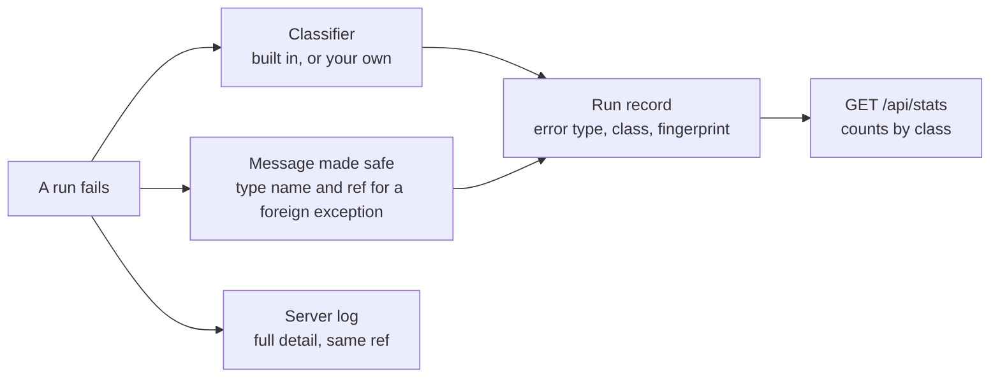

A failed run keeps what went wrong as data you can group and count, not only as a sentence. This page is
the part of [Runs and recording](/concepts/runs/) that explains the error class, the fingerprint, the text
that is safe to show and the two cases where an answer ends early without a failure.



## Errors are classified

A failed run carries an error class, not just a message: a provider outage, a content
filter, a blocked guard decision, a quota, a timeout, a rejected structured response, a
structured response cut off at the output limit (`OutputTruncated`, see
[Truncated output](#truncated-output)), a
harness loop that ran out of iterations unsatisfied (`LoopUnsatisfied`, see
[failing the run](/concepts/agents/#fail-the-run-when-the-loop-is-not-satisfied)), a
provider the tenant's rules refused before any call (`TenantProviderRefused`, error type
`tenant_provider_refused`: its egress policy does not allow the provider, or it has its
own credential for a provider that cannot use one). A provider that answered `429` is
`RateLimited`, also when the provider SDK's failure was masked as `upstream_error`.
Two of them are deliberately distinct — `ContentFiltered` means the *provider's*
filter cut the response, while `ContentBlocked` means *your* guard refused it. The
operator response differs: one is a provider setting, the other is your policy.

`GET /api/stats` aggregates the classes, so a rise in one bucket is visible before
anyone reports it.

A workflow run is classified the same way. Its `error.type` is the same stable
identity the failing step's own run records — `loop_unsatisfied`,
`child_run_timeout`, `run_budget_exceeded`, `tenant_quota_exceeded` — not the exception's .NET type name,
and its class is the step's class.

Both the class and the clustering fingerprint come from a classifier you can
replace or compose with your own rules — see
[Write your own error classifier](/guides/write-your-own-error-classifier/).

### Decide a retry from the failure, not from its text

A model call that fails throws `ProviderInvocationException`, a `TraconException` with
error type `upstream_error`. The built-in speech client and the image generators throw the same
type, so one `catch` covers every provider call. Four properties answer what a job or a pipeline
step asks: `Provider`, `StatusCode` (the HTTP status the provider answered with, `null` when the
failure carried none), `IsTransient` and `ProviderErrorCode`. A failure with no status is one of
three things: the provider answered nothing, it answered with a body the client could not read, or
the request was never sent. `IsTransient` tells the last from the other two.

`ProviderErrorCode` is the machine-readable code the provider put in its answer, and `null` when it
put none: a short token such as `insufficient_quota` or `content_policy_violation` (letters, digits,
`_`, `.` and `-`, at most 64 characters), never the provider's sentence. It tells a spent quota from a
rate limit when both are a `429`. It is read from the OpenAI and Azure OpenAI client library's
message, from the body the OpenAI image generator and the speech client read, from the status name
Gemini puts in its error body (`UNAVAILABLE`, `RESOURCE_EXHAUSTED`), and from nowhere else:
a provider that reports its code another way leaves it `null`. The vocabulary is each provider's own.

```csharp
async Task<bool> TryRunAsync(AIAgent agent, string message, CancellationToken cancellationToken)
{
    try
    {
        await agent.RunAsync(message, cancellationToken: cancellationToken);

        return true;
    }
    catch (ProviderInvocationException failure) when (failure.IsTransient)
    {
        // No answer, timeout, 429, 5xx or an unreadable answer: a later try can succeed. The caller schedules one.
        return false;
    }
    catch (ProviderInvocationException failure)
    {
        // 400, 401, 403, 404 and every other 4xx: the same call gets the same answer. Fail it.
        throw new InvalidOperationException($"The {failure.Provider} call was refused with {failure.StatusCode}.", failure);
    }
}
```

`IsTransient` is the decision the model fallback chain makes to move a call to the next
provider, so your retry and Tracon's do not disagree about which failure is worth another
try. No answer from the provider (a refused connection, a timeout), a `429`, a `5xx` and an
answer the client could not read (a `200` with an empty body, a body cut short or a page
that is not JSON, which a gateway or a dropped connection produces) are transient. Every
other `4xx` is not, and neither is a failure that happened before a request was sent. A
`401` or `403` is not transient: a key the provider refuses stays refused until it is
replaced.

Two stream shapes are not recognized as an unreadable answer: an OpenAI stream whose body is empty or not an event
stream ends with no update and no error, and a Google stream that ends inside a segment raises an error with no
line number; both keep their old answer.

Two differences from the chain are worth knowing. The chain asks a registered
`IProviderRetryClassifier` first; `IsTransient` does not. And a streamed call that already
delivered an update never moves to the next provider, though `IsTransient` can be `true`
for the failure that ended it.

`Message` is a fixed sentence with the provider, the fault type and the status; it does
not carry the provider's own words. `InnerException` and `ToString()` do, with the key of
the call replaced, so treat them as you would the raw exception: log material. The full
failure also goes to the server log under the same correlation id.

A run that the circuit breaker stopped throws `TraconProviderUnavailableException`
instead. Its `RetryAfter` says when a try can reach the provider again.

### Truncated output

A model that reaches its output token limit stops in the middle of its answer and
reports a `length` finish reason. Tracon reads that reason for every provider and
treats the two kinds of answer differently:

| The agent asks for | Outcome |
|---|---|
| A structured response (`Json` or `JsonSchema`) | The run fails with error type `output_truncated`, class `OutputTruncated`. A cut-off JSON document cannot be parsed. No repair turn runs, because it would hit the same limit; the `StructuredResponseRejected` event carries `repairSkippedTruncated: true` when a repair attempt was left |
| Plain text | The run completes with the partial answer and writes a `Custom` run event of type `tracon.output.truncated`. Its payload names the provider, the limit when the binding set one, and the `cause` — never the answer text |

Only the turn that ends the run decides. A tool call the model was still writing when
it hit the limit is an intermediate turn: the tool loop runs it and asks the model
again. The tokens of a failed truncated call still count in the run's usage, cost and
quota.

A client streaming the run learns about a cut-off plain-text answer before the stream
ends: the `tracon.output.truncated` event arrives as a `custom` frame right before
`done`, with the same data the run's events carry. Each recorded event is one frame, so
a harness loop whose iterations were cut sends more than one, and a tool turn cut in
the middle of the run sends none. A cut-off structured answer ends the stream with an
`error` frame instead. No event, and no frame, is written while run recording is off
(`Tracon:RunRecording:Enabled`).

The `update` frames also carry a `finishReason` field. It is the model's raw reason
for each model call — `tool_calls` on a tool turn, possibly reported more than once in
a loop — passed through from Microsoft Agent Framework, not a Tracon guarantee. Read
the `custom` frame to decide whether the answer is complete.

The fix is a higher `ModelBinding.MaxOutputTokens`. When the binding leaves it empty,
`POST /api/agents/validate` warns with `output_truncation_risk` if the provider's
default is below the catalog's `MaxOutputTokens` for the model.

A model can also stop because the conversation and its answer filled the model's
**context window**. A provider reports that with
`TraconFinishReasons.ContextWindowExceeded` (Anthropic's
`model_context_window_exceeded`), and the outcome is the same as above, with one
difference: the error message and the event's `cause` (`context_window` instead of
`output_limit`) name the window. A higher output limit does not help there; a shorter
conversation (context compaction) or a model with a larger window does.

A job does not run a cut-off structured answer again: the next attempt sends the same
limit (see [Delivery and failure behavior](/guides/background-work/#delivery-and-failure-behavior)).

An online-evaluation judge asks for a structured answer too. When its answer is cut
off, the judge fails with `judge_failed` and the job does not retry it: the next
attempt would send the same limit. Raise the `MaxOutputTokens` of the judge's own
binding.

### Filtered output

A provider's content filter can stop a model in the middle of an answer: Anthropic
reports a `refusal`, Gemini a safety block. Tracon reads every provider's report as
one finish reason, and the outcome depends on what the model had written in the turn that ended the run:

| The final turn had written | Outcome |
|---|---|
| Nothing | The run fails with error type `content_filtered`, class `ContentFiltered`. Nothing is left to keep. A tool call, or text, from an earlier turn of the tool loop does not count: a filter that leaves the final turn empty fails the run even after tool calls |
| Text | The run completes with the partial answer and writes a `Custom` run event of type `tracon.output.filtered`. Its payload names the provider — never the answer text. The provider's own word for the filter is not in it |

A structured response (`Json` or `JsonSchema`) a filter stopped after it wrote text
gets the event too. The structured-response validator, when it is on, still decides
whether that document is usable. As with truncation, only the turn that ends the run
decides, and the event keeps its payload when `RecordToolPayloads` is off.

A client streaming the run receives the event as a `custom` frame right before `done`,
the way it receives `tracon.output.truncated`, with the same data the run's events
carry. No event, and no frame, is written while run recording is off
(`Tracon:RunRecording:Enabled`). On `/v1/responses` the same answer is `incomplete`
with the reason `content_filter` (see [OpenAI-compatible API](/guides/openai-api/)).

### The error message is safe to display, not safe to debug from

`error.message` is deliberately shallow. When the failure is Tracon's own —
a content filter, a blocked guard, a quota — the message is the same stable text
you'd write in a UI. When the failure comes from somewhere else (a provider SDK,
a webhook target, an MCP connection), the message carries only the exception's
type name and a correlation id, for example `HttpRequestException failed. (ref:
7f3a9c21)`: a foreign exception's own text can carry a request detail, an internal
address, or a partial credential, and none of that belongs in a persisted field or
an HTTP response. The full detail, matched to the same correlation id, goes to
your server's own log — that is where you debug a specific failure from, not from
the run record.

This applies everywhere a run, job, or webhook delivery can fail: the
`error`/`error_message` field on a run, job, or webhook delivery, the error
body of the HTTP, SSE, and MCP endpoints, and the `payload` of a workflow's
`ExecutorFailed` event all follow the same rule. One failure carries one
correlation id: the workflow's `ExecutorFailed` event and its run row name the
same log entry.

A failure the queue itself produces — rather than a handler — carries a stable
code instead of prose. A job queued for a handler key nobody registered fails
with `tracon.job.unknown-handler-key`, and the key itself is written to the
log rather than to `errorMessage`, for the same reason a foreign exception's
text is: the key may have come from an untrusted source, and that field is read
back over HTTP. A job whose worker died and whose attempt limit is used up fails
with `tracon.job.attempts-exhausted`. A queued run whose turn finished but whose
session could not be saved fails with `tracon.job.session-save-failed`; the model
is not called again. One whose turn asked for approval but whose approval could not be
written fails with `tracon.job.approval-save-failed`, and its run closes `Failed`. Match
on the code, never on the sentence around it.

### A failed run still records what it spent

A run that fails, or is canceled, keeps the tokens the provider reported before it ended.
The run's `usage` and `cost`, and the tokens the tenant's quota counts, hold the total of
every model call the run made: the calls before the one that failed, a response a content
filter or the output limit turned into the error, and the usage of a stream that dropped after
it reported its usage. Before, such a run said it spent nothing although the provider had
billed the calls. A call that failed adds nothing, and a call is counted once however many layers
read its answer. When the provider reported no usage, `usage` is `null`, not `0`. See
[What a run carries](/concepts/runs/#what-a-run-carries) for how the cost is priced.

## Read next

- [Runs and recording](/concepts/runs/) — what gets written, and when.
- [Starting runs and who they belong to](/concepts/starting-runs/) — attribution, authorization, and the ways a run starts.
- [Governance](/concepts/governance/) — what is guaranteed to be written.
