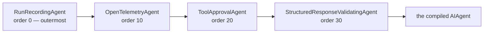
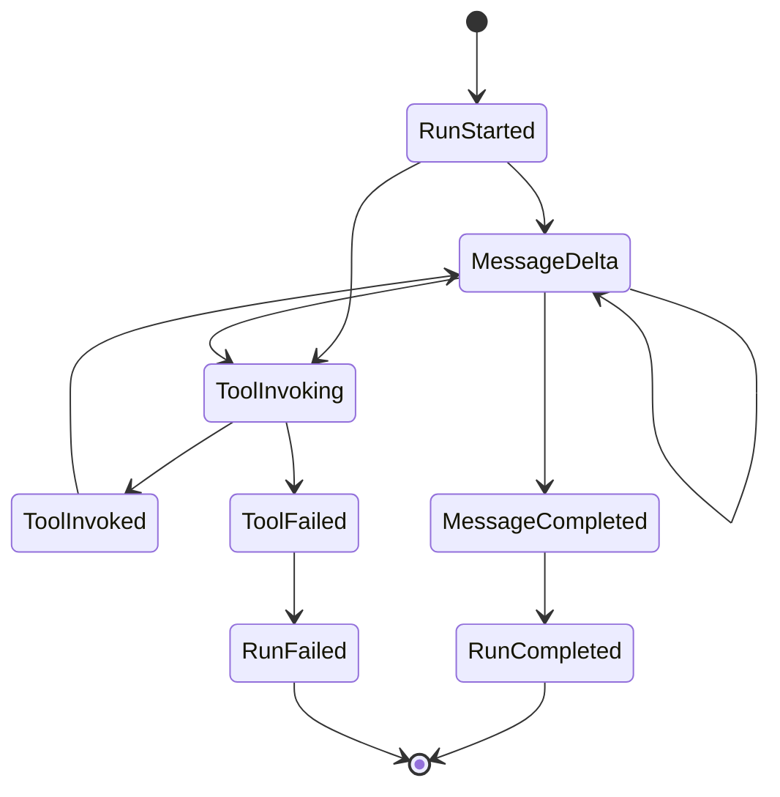

A **run** is one execution of an agent. Recording is on by default for agents resolved
through the Tracon catalog, whether the call came from HTTP, the console, a
workflow, an eval, or your code. You can disable it. A failed store write also leaves
the agent running, so recording is best-effort rather than an availability dependency —
and after the first store failure, recording stops for the rest of that run. Which
records carry a stronger guarantee than this one is set out in
[What is guaranteed to be written](/concepts/governance/#what-is-guaranteed-to-be-written).

## How recording happens

`IAgentCatalog.ResolveAsync` applies the registered decorators. The four built-in
decorators have this outer-to-inner order:



Recording is outermost among the built-in decorators, so its duration includes the
inner layers. Structured response validation is innermost and checks the final
agent response. Tool approval sits between validation and telemetry. A custom
`IAgentDecorator` can change the surrounding chain through its `Order`.

Decorators are plain `DelegatingAIAgent` wrappers rather than MAF middleware, because
middleware is per-agent and a harness agent adds its own inner decorators. An outer
wrapper behaves identically for every agent type.

:::note[Recording never breaks a run]
If the run store fails, the run continues and the error is logged. Observability does
not get to break function. The same rule holds for the audit trail — with one
deliberate exception, described in [governance](/concepts/governance/).
:::

## What a run carries

The summary — `GET /api/runs/{runId}` — has status, timings, token counts, error
class, and cost when pricing is configured. It does not carry the conversation.

`Queued` means the run has not started its work. A queued run (`Prefer: respond-async`)
waits for a worker, and a workflow run waits for a concurrency slot when
`MaxConcurrentRuns` or `MaxConcurrentRunsPerTenant` workflows are already going (see
[How many runs go at once](/guides/background-work/#limit-workflow-runs-per-tenant)). The record
reads `Running` once the run has what it waited for.

`modelProvider` names the provider that actually answered — the same provider
`modelId`'s model came from. `cost` is a **price snapshot**: it also carries the
unit price (per million tokens) that was applied for input, output, and any
prompt-cache read or write, computed once when the run ends. A later change to your
pricing catalog or configuration never rewrites a run's already-known cost —
`POST /api/stats/recalculate-costs` only fills in runs whose price was unknown
at the time, it never re-prices a run that already has one.

Prompt-cache tokens are counted **inside** `usage.inputTokens`, never beside it:
`cachedInputTokens` were served from the cache, and `cacheWriteInputTokens` and
`cacheWriteLongInputTokens` were written into it with the short and the long time to
live (Anthropic: five minutes and one hour, which it bills apart). The cost has a term
for each: `cachedInputCost` and `cacheWriteCost` are taken out of `inputCost` and billed
at their own rates, so a run's total is the sum of all four terms and never only the
first two. A counter the provider did not report is `null`, not `0`. A model with no
write rate keeps its written tokens in `inputCost`, as before the rate existed.

A run can spend tokens on more than one model: the context compaction
summarizer and the judge of an `aiJudge` loop criterion can run on models of
their own. Their tokens are in the run's `usage`, and the tenant's quota
consumes the same total. Each model's share is priced at that model's own price,
and `cost` is the sum of the shares. When the summarizer's or the judge's binding
falls back, its share is priced at the fallback model that answered, and
`modelId` still names the agent's model. Such a cost carries no unit price — the
three per-million fields are `null`, because one rate cannot describe a total
that several rates produced. A model with no price adds nothing to `cost`; its
tokens are not priced at the agent's rate. When no model of the run has a price,
`cost` is unknown, and a later recalculation prices all of the run's tokens at
the agent's model.

`cost` is the **token** cost. What a run spent that is not tokens — speech characters, render
seconds, minutes of audio that a workflow function node or a tool reported — is a total of
its own: `nonTokenCost` on the run summary, and `treeNonTokenCost` for the run and every
run below it, the run's own share already included, so the two are never added. Only an
amount in `Tracon:Pricing:Currency` adds; Tracon never converts one currency into another
and never adds a quantity across units. `nonTokenCost` is `null` when the run reported
nothing, which is not zero, and an `amount` of `null` beside a non-zero `unsummedItemCount`
means items were reported but none could be priced: unknown, not free. The
[budget, the tenant's quota and the `run.completed` webhook](/concepts/workflow-function-nodes/#report-what-a-node-spent-beyond-tokens)
count the reported amount beside the token cost. `GET /api/stats`, the dashboard and the
comparison of two runs show the token cost only.

A total over many runs never adds amounts in two currencies. When the runs behind it are
priced in more than one, the total keeps no amount and no currency, and `currencyCount` says
how many there are: `treeCost` and `treeNonTokenCost` on a run, the totals of
`GET /api/stats` (with every breakdown's cost, since a breakdown carries no currency of its
own), every point of `GET /api/stats/timeseries`, an experiment arm, and the judge cost of
the online evaluation window. Each run keeps its own `cost`. Letter case is not a second
currency. The tenant's quota and the root's `run.completed` webhook then count what a single
currency can say: the quota counts the root's own cost and the cost of every child run
priced in `Tracon:Pricing:Currency` (a child in another currency adds its tokens only),
and the webhook counts the root's own cost. The
built-in pricing prices every run in `Tracon:Pricing:Currency`, so more than one currency
comes from a custom `IRunPricingResolver` or from a currency setting changed over time. The
console shows *mixed currencies* where the number would be. `GET /api/runs/{runId}/usage` lists the items
a function node reported, and `GET /api/runs/{runId}/tools` carries a tool's measurement on its call.

`agentVersion` names the definition version a run used. The row of a workflow run records
the version of the workflow definition it was compiled from, and a resume or a response is
stamped with the version it ran, so a waiting run continues with the same definition (see
[Versions, rollback and pinning an agent step](/concepts/workflows/#versions-rollback-and-pinning-an-agent-step)).
An agent step pinned to a version records that version on its own row. The field is `null`
for a code-defined agent or workflow, and for a workflow row written before versions were
kept.

The conversation is the **event stream**, written with gapless sequence numbers by a
single writer:



One writer producing the numbers is what makes the live stream and a later replay
identical, and it is what lets a client resume with `Last-Event-ID` after a dropped
connection.

A run ends **once**, and which ending it gets is decided by what actually happened
rather than by the exception type that surfaced. `Canceled` means somebody asked
for the run to stop — the caller's request went away, or a cancel request reached
the run, on the process that owns it or from another instance (`RunRecord.CancelRequestedAt`
holds the time of a request that came through the run's row). A model call that simply never came back is
`Failed` with the `Timeout` error class, even though .NET reports an `HttpClient`
timeout as a `TaskCanceledException`. The distinction matters when you alert on
these: cancellations are user behaviour, timeouts are an outage.

A cancelled run is still a **recorded** run: the record and the events written
before the stop stay readable, and the ending is `Canceled` rather than a gap.
What cancellation does prevent is a half-written row after it. Every store
Tracon ships — and every store a contract suite passes — throws
`OperationCanceledException` from a call whose token was already cancelled and
writes nothing at all, so a cancelled run never leaves a partial record behind.
[Write your own store](/guides/write-your-own-store/#cancellation-the-one-promise-every-store-makes)
has the rule in full for a custom implementation.

```bash
curl -N http://localhost:5081/tracon/api/runs/{runId}/events
```

### Two SSE contracts, not one

This is a **different** stream from the one `POST /api/agents/{name}/run` returns, and
the two do not share a frame-name contract. Both report `Content-Type:
text/event-stream`, so the `event:` name is the only way to tell them apart:

| Stream | Frame names |
|---|---|
| `POST /api/agents/{name}/run` | `run` · `update` · `approvals` · `loop.iteration-completed` · `custom` · `done` · `error` — one per step of that single live call |
| `GET /api/runs/{runId}/events` | `run.started` · `message.delta` · `tool.invoking` · `tool.invoked` · `tool.failed` · `run.completed` · `run.failed` and one more per event type in the diagram above — the recorded, append-only log |

The workflow run stream has a third set (`run` · `event` · `done` · `error`), and the
OpenAI-compatible endpoints use the OpenAI wire format.

The live stream's `custom` frames are the one place the two contracts meet. Right
before `done`, the stream sends the run's own recorded notices from a fixed list —
`tracon.output.truncated` and `tracon.output.filtered` always, `tracon.quota.threshold`
when it is published to the run stream — and each frame's data is the same recorded
event `/events` serves, byte for byte. The [HTTP API](/http-api/#streaming) page lists the rules. The
`loop.iteration-completed` frame of an agent with a loop is the other: it has the name
and the data of the recorded `LoopIterationCompleted` event, and it arrives between two
iterations, not before `done`.

A client written against one contract will not decode the other; pick the endpoint
that matches what you are building — a live turn, or a run's full recorded history.

Tool calls are also written individually — name, arguments, result, duration, error —
so "which tool failed and with what input" is a query, not a log search. A call is
[recorded where it happens](#tool-calls-are-recorded-where-they-happen), so the row is
there when the run fails or is cancelled too.

A reasoning model's thinking is a separate event type, `ReasoningDelta`, never merged
into `MessageDelta`. It is off by default — reasoning output can run far longer than
the answer, and it can restate user input in a form the final answer never shows:

```csharp
services.Configure<TraconOptions>(options =>
    options.RunRecording.RecordReasoningDeltas = true);
```

With it off, a reasoning model still streams its thinking to the caller in real time —
this setting only controls whether it is **recorded**.

### Tool calls are recorded where they happen

A tool call that goes through the tool chain is noted in memory when it starts and when it
ends, inside the run. The chain holds the layers every such tool passes: the budget check,
the authorization handler, argument validation, the timeout, the approval and the output
limit. Code tools, MCP tools, the session workspace, the knowledge search and the
conversation memory search go through it. The run writes the rows when it closes. Nothing
is stored before that, so a process that stops while a run is open leaves no row for these
calls.

That keeps the trail when a run does not end well. A queued run, a run that continues an
answer, an agent step of a workflow and the non-streaming form of the `/v1/*` endpoints do
not stream, so they have no messages to read their calls from until the model answers. When
a run of that kind fails or is cancelled before then, it still has the row and the events of
every call that went through the chain. The budget refuses its next model call, the
provider is down, somebody cancels the run: the calls are there.

| What happened to the call | What `GET /api/runs/{runId}/tools` and the events show |
|---|---|
| It ended | One row with the result and the duration; a `tool.invoking` and a `tool.invoked` event |
| The tool failed, or the chain refused it (budget, validation, timeout) | One row with the error; a `tool.failed` event |
| The run was cancelled while it ran | One row with the error *The run ended before the tool result arrived.*; a `tool.invoking` event |

A call is one row, and its duration is measured whether the run streams or not. A call
that the chain denied for lack of permission is an ordinary result, not an error: the row
has `authorizationDenied` set and no error. A run that does not stream and fails or is
cancelled has no messages, so it writes the calls the chain noted. A run that answered keeps
the rows its messages hold; when it does not stream, each row takes its duration and its
time from what the chain noted. A call that the chain noted and the answer does not hold
gets no row of its own: a model link
ran it, the provider failed over, and the next link was answered from its result, so the
call is not listed twice. When a run fails or is cancelled, the events of its calls carry
the times the calls really ran.

Some tools are outside the chain, among them a hosted tool, an agent called as a tool and
the background agents, the framework's own `load_skill`, `read_skill_resource` and
`run_skill_script`, the file memory and to-do tools, the harness's `mode_*` tools and the
providers an agent extension adds. The messages of the answer are the only record of such a
call. A run that does not stream has a row for it when the run succeeds, with no duration,
and has none when the run fails.

### Writing your own event

The event types above are a closed set — the console maps every one of them to a
specific visual, and a client can rely on that never changing shape. `RunEventType.Custom`
is the one deliberate escape hatch: your own tool writes it directly, through the
writer your run already carries:

```csharp
[TraconTool("mark_preview_ready", "Marks an order's preview as ready to review.")]
public static async Task<string> MarkPreviewReady(string orderId)
{
    var writer = TraconRunContext.Current?.Writer;

    if (writer is not null)
    {
        await writer.AppendAsync(new RunEventDraft(RunEventType.Custom)
        {
            CustomType = "contoso.preview-ready",
            Payload = $$"""{"orderId":"{{orderId}}"}""",
        });
    }

    return $"Preview for order {orderId} is ready to review.";
}
```

`CustomType` names your event — 1-128 characters, lowercase ASCII letters,
digits, `.`, `_`, or `-`. It is required on a `Custom` event and rejected
(`ArgumentException`) on every other type: a caller who sets it on a built-in
event type gets told immediately, rather than having it silently dropped by
every store. The `tracon.` prefix is reserved, so a built-in
custom type can never collide with your own. Tracon writes these:
`tracon.quota.threshold` (the [quota threshold notice](/concepts/governance/#quotas-and-rate-limits)),
`tracon.output.truncated` (see [Truncated output](#truncated-output)),
`tracon.output.filtered` (see [Filtered output](#filtered-output)),
`tracon.content` and `tracon.workflow.event` (see
[Content and events the run has no type for](#content-and-events-the-run-has-no-type-for)),
`tracon.tool.input.declined` (a [server's request for input](/concepts/tools/#a-server-asks-the-user-for-input)
that Tracon answered with `decline`) and `tracon.agui.tools.ignored` (tools an
[AG-UI front end](/guides/ag-ui/#front-end-tools) declared that the agent does not carry).
`AppendAsync` rejects any value under that prefix, so a `Custom` event carrying it can
only have come from Tracon itself. `Payload` is yours too — Tracon makes no claim about
its shape and never reads it.

The console draws an unrecognized `CustomType` with a single generic card —
its own name as the title, `Payload` pretty-printed as the body — so a new
custom type never needs a console change to show up. When a built-in event
type already fits what happened, use that instead; `Custom` is for events
Tracon has no name for.

### Content and events the run has no type for

A model response carries more than text and tool calls, and a code workflow can raise
events of its own. Anything Tracon has no event type for is **recorded, not dropped**, as a
`Custom` event under a reserved type. Its `Text` is a short summary; its payload never
carries the content itself, only metadata and, where noted, one bounded text.

| `customType` | Written for | `Text` | Payload keys |
|---|---|---|---|
| `tracon.content` | A hosted tool call or result that no registered hosted tool owns (the harness's web search, image generation, hosted MCP) | `web_search call`, `web_search result` | `type` (`hosted_tool_call` or `hosted_tool_result`), `tool`, `callId` |
| `tracon.content` | An `ErrorContent` the provider returned inside a response | `error: <code>` | `type` (`error`), `errorCode`, `message` (cut at 2 048 characters) |
| `tracon.content` | Generated or attached data | `data: <media type>` | `type` (`data`), `mediaType`, `length` in bytes — never the bytes |
| `tracon.content` | A `UriContent` | `uri: <media type>` | `type` (`uri`), `mediaType` — never the address, because a signed URL can carry a credential |
| `tracon.content` | A hosted file or vector store | `hosted file`, `hosted vector store` | `type`, `id` |
| `tracon.content` | Any content type Tracon does not know yet | `unrecognized content: <type>` | `type` (`unrecognized`), `clrType` |
| `tracon.workflow.event` | A `WorkflowEvent` that is not one of the types the workflow stream already maps | The event's type name | `eventType` (full name), `executorId` when the event derives from `ExecutorEvent`, `data` (cut at 2 048 characters) |

Plain text and reasoning keep their own events (and their own options), tool calls and
results keep the tool events, and so does a call of a [hosted tool](/guides/hosted-tools/) that the host
registered: a `ToolInvoking` and a `ToolInvoked` event under the registered name, with the provider's call
identifier and no payload (its cost is on the tool invocation record), usage is part of the run's usage, and an approval request is
the run's pending request, so none of those writes a `tracon.content` event. A workflow
event's `data` is the text of a string or chat message, and only the type name of anything
else — never the object's `ToString()`.

Both types follow `RecordToolPayloads`: with it off the event and its `Text` stay and the
payload is `null`. Unlike the [quota and truncation notices](/http-api/#streaming),
`tracon.content` does not reach the live `POST /api/agents/{name}/run` stream; read it from
`GET /api/runs/{runId}/events`. A workflow run only ever writes `tracon.workflow.event`, and
its stream (`POST /api/workflows/{name}/run`) sends it as an `event` frame like every
other recorded event.

## Observing events beyond the store

Register an `IRunEventSink` to receive every event as it is written, in addition to
the store — a live dashboard, a message queue, a second archive:

```csharp
public sealed class QueueRunEventSink : IRunEventSink
{
    // Bounded and non-blocking: a full channel drops the oldest event rather
    // than holding up the run. Your own background reader drains it.
    private readonly Channel<RunEvent> _pending = Channel.CreateBounded<RunEvent>(
        new BoundedChannelOptions(1024) { FullMode = BoundedChannelFullMode.DropOldest });

    public ChannelReader<RunEvent> Pending => _pending.Reader;

    public ValueTask OnEventAsync(RunEvent runEvent, CancellationToken cancellationToken = default)
    {
        _pending.Writer.TryWrite(runEvent);

        return ValueTask.CompletedTask;
    }
}

services.AddSingleton<IRunEventSink, QueueRunEventSink>();
```

A sink runs on the hot path — Tracon awaits `OnEventAsync` directly and holds no
queue of its own in front of it, so the buffer above is yours to own. Queue and
return; do not publish to a message bus inline. One instance serves every concurrent
run, so it must be thread-safe. A sink that throws is disabled for the rest of that
run and logged; neither the store write nor any other registered sink is affected —
and that includes a sink whose own call times out with an `OperationCanceledException`
while the run itself is not cancelled. Register none and nothing changes.

Within one run, a sink receives events in sequence order, the same order the store
holds. A run writes from more than one place at once — concurrent tool calls, a child
run writing into its parent's stream, a workflow's steps — so Tracon numbers an event,
stores it and hands it to every sink as one step, and the next event waits for it. Two
consequences follow: a slow sink holds up that run's next event (another reason to
queue and return), and a sink must not append an event to the run it is observing —
directly, or by running work inline that writes into that run. Such an append would
wait for the event the sink is still handling, so it throws
`InvalidOperationException` instead, and the sink is disabled for the run.

## Who ran it, and for what

A run also records **who** it belongs to and **which job** it was made for. Both
answer questions the tenant cannot: a tenant tells you whose data this is, not
which of that tenant's users spent the money.

Neither value is ever read from the run request body. A `userId` field on
`POST /api/agents/{name}/run` would let any client write spend against another
user's name, so the body is not a source of attribution at all. The value comes
from `IRunAttributionContext`, which your application binds to its own identity
pipeline:

```csharp
public sealed class ClaimsRunAttributionContext(IHttpContextAccessor accessor)
    : IRunAttributionContext
{
    // Outside a request there is no HttpContext: read the ambient scope, which
    // is how a queued or scheduled run gets the identity it was queued with.
    public string? UserId => accessor.HttpContext is { } http
        ? http.User.FindFirst("sub")?.Value
        : AmbientRunAttributionScope.CurrentUserId;

    public IReadOnlyDictionary<string, string>? Labels => accessor.HttpContext is { } http
        ? http.Request.Headers.TryGetValue("X-Job", out var job)
            ? new Dictionary<string, string> { ["job"] = job.ToString() }
            : null
        : AmbientRunAttributionScope.CurrentLabels;
}

// Registered BEFORE AddTracon(); Tracon uses TryAdd, so yours wins.
builder.Services.AddSingleton<IRunAttributionContext, ClaimsRunAttributionContext>();
```

Register nothing and nothing changes: both columns stay `NULL` and no behaviour
differs. For work that runs outside a request — a queued job, a scheduled run, a
direct .NET call — use the ambient scope instead. The built-in context reads it; a
context of your own reads it only if it falls back to it, as the one above does:

```csharp
using (AmbientRunAttributionScope.Begin("user-42", labels: null))
{
    await agent.RunAsync("summarise this ticket");
}
```

The user id is an **opaque string**. Tracon neither resolves nor validates
what it means and stores no personal detail of its own — the same stance the
data-subject erasure flow takes, which covers this column too.

Labels are bounded on purpose: at most **8** per run, keys up to **64**
characters, values up to **256**. Breaking a limit **rejects the request with
400**; nothing is trimmed to fit, because a trimmed label set still reads as a
complete measurement to whoever queries the report later. Every endpoint that
starts a run applies the same check before the run starts: an agent run, a
workflow run, resume and respond, a replay, an inbound trigger, and the
OpenAI-compatible `/v1/chat/completions` and `/v1/responses` (which answer in
their own error shape).

A workflow run carries its attribution the way an agent run does: its row, the
`TraconRunContext.Current.UserId` and `Labels` every node and tool of the
workflow reads, and the run and user a `quota.threshold` webhook names.

A queued agent run (`Prefer: respond-async`) reads the user and the labels when
the request arrives, and both travel with the job, so the run's sub-agents and
tools see them on the worker. A run that resumes after an approval decision, or
that continues an interrupted run, runs under the user and labels of the run it
continues. On the worker, Tracon replays these values through
`AmbientRunAttributionScope`, which the built-in `IRunAttributionContext` reads.
A context you register yourself reads them only if it asks: when there is no
request, return `AmbientRunAttributionScope.CurrentUserId` and `CurrentLabels`.

A run an inbound trigger starts, and a workflow or agent batch queued through
`IJobDispatcher`, also carry the user and labels resolved when they were queued. A
schedule has no caller: its runs carry the attribution its payload names, or none
([schedule payloads](/guides/background-work/#attribute-the-runs-a-schedule-starts)).

:::caution
Labels and user ids are **query** dimensions, not **metric** dimensions. They
live in the `runs` table and are never added to `tracon.tokens` or
`tracon.run.cost` — promoting a free-form label set to a metric tag has no
upper bound on time-series cardinality.
:::

Both are filters on the run list and breakdowns in the summary:

```bash
curl "http://localhost:5081/tracon/api/runs?userId=user-42"
curl "http://localhost:5081/tracon/api/runs?label=team:payments"
curl "http://localhost:5081/tracon/api/stats" | jq '.byUser, .byLabel'
```

`byLabel` rows do **not** sum to `totalRuns`: a run carrying three labels appears
in three of them. A label set is not a partition of the runs.

## Who is allowed to start it

Attribution answers "who did this, for the cost report"; it does not by
itself stop anyone from starting a run. Tracon draws ownership at the
**tenant** level, so by default any caller with the `Operator` role in a
tenant can start any agent in that tenant, regardless of `UserId`.

Bind `IRunAuthorizationHandler` to enforce your own per-user rule. It is
called at every endpoint that starts a run — the agent run endpoint, the
workflow run endpoint, the inbound trigger accept endpoint, the
OpenAI-compatible `/v1/responses` and `/v1/chat/completions` endpoints, and
`POST /api/runs/{id}/replay` — **before** the quota check, so a denied call
never consumes the tenant's quota. The same method is asked again for every
access to an existing run's resources: reading it, canceling it, scoring it,
and reaching its attachments and approval requests. Which question is being
asked is on `request.Access`, and a resource question carries
`request.RunId`:

```csharp
public sealed class YourRunAuthorizationHandler(IYourOwnershipService ownership) : IRunAuthorizationHandler
{
    public async ValueTask<RunAuthorizationResult> AuthorizeRunAsync(
        RunAuthorizationRequest request, CancellationToken cancellationToken = default)
        => request.RunId is { } runId
            ? await ownership.OwnsRunAsync(request.TenantId, request.UserId, runId, cancellationToken)
                ? RunAuthorizationResult.Allow()
                : RunAuthorizationResult.Deny("This run belongs to a different user.")
            : await ownership.CanStartAsync(request.TenantId, request.UserId, request.AgentName, cancellationToken)
                ? RunAuthorizationResult.Allow()
                : RunAuthorizationResult.Deny("This user cannot run this agent.");

    public ValueTask<RunAuthorizationResult> AuthorizeSessionAsync(
        SessionAuthorizationRequest request, CancellationToken cancellationToken = default)
        => new(RunAuthorizationResult.Allow());
}

builder.Services.AddSingleton<IRunAuthorizationHandler, YourRunAuthorizationHandler>();
```

Register nothing and nothing changes: every run starts and every run stays
readable, exactly as before this binding existed. If the handler throws, the
call is denied (fail-closed), an `Error` line naming your handler type is
logged in the `Tracon.RunAuthorization` category, and a `403` says that the
check failed and can be retried. A denied single resource answers `404`, with a
body identical to a run that does not exist — a `403` there would confirm
the run exists; a denied list answers `403`. See
[Embedding: run and session authorization](/guides/embedding/#6--run-and-session-authorization)
for the full `RunAccess` table, the session half of the same contract (list,
read, delete, branch, voice), and the exact response shape each denial
produces.

### Starting a run from .NET with explicit identity

`TraconRunOptions` is the .NET-side counterpart of the run request. It is not a
configuration section: it is passed per call, and all but the last property answer
"which run is this, and where does it sit in a larger story".

| Property | What it sets |
|---|---|
| `RunId` | The identifier to record this run under. Supply your own when the caller already has one; otherwise Tracon generates it |
| `ParentRunId` · `RootRunId` · `Depth` | The run's place in a call tree. The child-agent invoker fills these in; set them yourself only when you drive a tree by hand |
| `AgentVersion` | The definition version this run used, when you resolved a specific one |
| `ExperimentId` | The experiment this run is a sample of, so results group correctly |
| `ReplayOfRunId` | The original run this one replays, which is what makes a comparison possible |
| `ContinuedFromRunId` | The interrupted run this one continues, set automatically — not something you set by hand |
| `SessionId` | The session at the root of the tree. It feeds the run scope, not the run row's own `session_id` |
| `Kind` · `Variant` · `Budget` | The run's kind, its experiment variant, and the shared budget a call tree draws from |
| `BeforePendingApprovalIsPublished` | A callback that runs immediately before a run closes as `AwaitingApproval`, on the streaming and the buffered path alike. Record the approval request here |

Leave every property unset for an ordinary run: Tracon then records a root run with
a generated id, and the values above are filled in by the components that own them.

The last one is a hook rather than an identity, and it exists because the status and the
request become visible at different moments. A run closes inside the agent call, so
without it the status is published first and
[`GET /api/approvals/pending`](/http-api/approvals/) answers an empty list for a run that
already says it is waiting. The callback receives the messages the run produced, and
anything it throws fails the run — an `AwaitingApproval` status whose request was never
recorded is unanswerable.

<span id="three-ways-to-start-a-run"></span>

## Ways to start a run

| | How | Response |
|---|---|---|
| **Streaming** | `POST /api/agents/{name}/run` | `text/event-stream`, one frame per event |
| **Deduplicated** | the same call with `Idempotency-Key` | a single JSON response — a replay cannot be reconstructed from a stream |
| **Queued** | the same call with `Prefer: respond-async` | `202 Accepted` and a `Location` header |
| **Triggered** | `POST /api/triggers/{tenantId}/{name}`, signed by an external system | `202 Accepted` and a `Location` header |

A queued run behaves the same once a worker picks it up. The difference shows at the
end: if a queued run needs a tool approval it closes as `AwaitingApproval` and the
request lands in the approval mailbox, whereas a streaming run carries the approval in
its next turn.

A triggered run is a queued run under the hood — same placeholder row, same worker —
started by a signed HTTP request instead of a management API caller. See
[Inbound triggers](/guides/inbound-triggers/).

A workflow is queued the same way: `POST /api/workflows/{name}/run`, and its resume
and respond endpoints, take `Prefer: respond-async` and answer `202 Accepted`. On
those three endpoints `Idempotency-Key` is accepted only together with the
preference, because their synchronous answer is a stream. See
[Queue a run instead of streaming it](/concepts/workflows/#queue-a-run-instead-of-streaming-it).

:::caution[A closed run is never rewritten]
A run that ended `AwaitingApproval` stays that way forever. Deciding the approval
opens a **new** run with the same session and a new run id. History is append-only,
so what you read a week later is what actually happened.
:::

A run can also stop for the user's input. When an MCP server asks for information in the
middle of a tool call and the caller can answer, the run closes `AwaitingInput` and
stays that way, for the same reason: the answer opens a **new** run in the same
session. See [A server asks the user for input](/concepts/tools/#a-server-asks-the-user-for-input).

The new run uses the agent version and the experiment arm of the run that asked for
approval. A version saved while the approval waited does not change the turn. A code
agent keeps no version history, so its new run uses the current definition.

## Errors are classified

A failed run carries an error class, not just a message: a provider outage, a content
filter, a blocked guard decision, a quota, a timeout, a rejected structured response, a
structured response cut off at the output limit (`OutputTruncated`, see
[Truncated output](#truncated-output)), a
harness loop that ran out of iterations unsatisfied (`LoopUnsatisfied`, see
[failing the run](/concepts/agents/#fail-the-run-when-the-loop-is-not-satisfied)), a
provider the tenant's rules refused before any call (`TenantProviderRefused`, error type
`tenant_provider_refused`: its egress policy does not allow the provider, or it has its
own credential for a provider that cannot use one). A provider that answered `429` is
`RateLimited`, also when the provider SDK's failure was masked as `upstream_error`.
Two of them are deliberately distinct — `ContentFiltered` means the *provider's*
filter cut the response, while `ContentBlocked` means *your* guard refused it. The
operator response differs: one is a provider setting, the other is your policy.

`GET /api/stats` aggregates the classes, so a rise in one bucket is visible before
anyone reports it.

A workflow run is classified the same way. Its `error.type` is the same stable
identity the failing step's own run records — `loop_unsatisfied`,
`child_run_timeout`, `run_budget_exceeded`, `tenant_quota_exceeded` — not the exception's .NET type name,
and its class is the step's class.

Both the class and the clustering fingerprint come from a classifier you can
replace or compose with your own rules — see
[Write your own error classifier](/guides/write-your-own-error-classifier/).

### Truncated output

A model that reaches its output token limit stops in the middle of its answer and
reports a `length` finish reason. Tracon reads that reason for every provider and
treats the two kinds of answer differently:

| The agent asks for | Outcome |
|---|---|
| A structured response (`Json` or `JsonSchema`) | The run fails with error type `output_truncated`, class `OutputTruncated`. A cut-off JSON document cannot be parsed. No repair turn runs, because it would hit the same limit; the `StructuredResponseRejected` event carries `repairSkippedTruncated: true` when a repair attempt was left |
| Plain text | The run completes with the partial answer and writes a `Custom` run event of type `tracon.output.truncated`. Its payload names the provider, the limit when the binding set one, and the `cause` — never the answer text |

Only the turn that ends the run decides. A tool call the model was still writing when
it hit the limit is an intermediate turn: the tool loop runs it and asks the model
again. The tokens of a failed truncated call still count in the run's usage, cost and
quota.

A client streaming the run learns about a cut-off plain-text answer before the stream
ends: the `tracon.output.truncated` event arrives as a `custom` frame right before
`done`, with the same data the run's events carry. Each recorded event is one frame, so
a harness loop whose iterations were cut sends more than one, and a tool turn cut in
the middle of the run sends none. A cut-off structured answer ends the stream with an
`error` frame instead. No event, and no frame, is written while run recording is off
(`Tracon:RunRecording:Enabled`).

The `update` frames also carry a `finishReason` field. It is the model's raw reason
for each model call — `tool_calls` on a tool turn, possibly reported more than once in
a loop — passed through from Microsoft Agent Framework, not a Tracon guarantee. Read
the `custom` frame to decide whether the answer is complete.

The fix is a higher `ModelBinding.MaxOutputTokens`. When the binding leaves it empty,
`POST /api/agents/validate` warns with `output_truncation_risk` if the provider's
default is below the catalog's `MaxOutputTokens` for the model.

A model can also stop because the conversation and its answer filled the model's
**context window**. A provider reports that with
`TraconFinishReasons.ContextWindowExceeded` (Anthropic's
`model_context_window_exceeded`), and the outcome is the same as above, with one
difference: the error message and the event's `cause` (`context_window` instead of
`output_limit`) name the window. A higher output limit does not help there; a shorter
conversation (context compaction) or a model with a larger window does.

A job does not run a cut-off structured answer again: the next attempt sends the same
limit (see [Delivery and failure behavior](/guides/background-work/#delivery-and-failure-behavior)).

An online-evaluation judge asks for a structured answer too. When its answer is cut
off, the judge fails with `judge_failed` and the job does not retry it: the next
attempt would send the same limit. Raise the `MaxOutputTokens` of the judge's own
binding.

### Filtered output

A provider's content filter can stop a model in the middle of an answer: Anthropic
reports a `refusal`, Gemini a safety block. Tracon reads every provider's report as
one finish reason, and the outcome depends on what the model had written:

| The model had written | Outcome |
|---|---|
| Nothing | The run fails with error type `content_filtered`, class `ContentFiltered`. Nothing is left to keep |
| Text | The run completes with the partial answer and writes a `Custom` run event of type `tracon.output.filtered`. Its payload names the provider — never the answer text. The provider's own word for the filter is not in it |

A structured response (`Json` or `JsonSchema`) a filter stopped after it wrote text
gets the event too. The structured-response validator, when it is on, still decides
whether that document is usable. As with truncation, only the turn that ends the run
decides, and the event keeps its payload when `RecordToolPayloads` is off.

A client streaming the run receives the event as a `custom` frame right before `done`,
the way it receives `tracon.output.truncated`, with the same data the run's events
carry. No event, and no frame, is written while run recording is off
(`Tracon:RunRecording:Enabled`). On `/v1/responses` the same answer is `incomplete`
with the reason `content_filter` (see [OpenAI-compatible API](/guides/openai-api/)).

### The error message is safe to display, not safe to debug from

`error.message` is deliberately shallow. When the failure is Tracon's own —
a content filter, a blocked guard, a quota — the message is the same stable text
you'd write in a UI. When the failure comes from somewhere else (a provider SDK,
a webhook target, an MCP connection), the message carries only the exception's
type name and a correlation id, for example `HttpRequestException failed. (ref:
7f3a9c21)`: a foreign exception's own text can carry a request detail, an internal
address, or a partial credential, and none of that belongs in a persisted field or
an HTTP response. The full detail, matched to the same correlation id, goes to
your server's own log — that is where you debug a specific failure from, not from
the run record.

This applies everywhere a run, job, or webhook delivery can fail: the
`error`/`error_message` field on a run, job, or webhook delivery, the error
body of the HTTP, SSE, and MCP endpoints, and the `payload` of a workflow's
`ExecutorFailed` event all follow the same rule. One failure carries one
correlation id: the workflow's `ExecutorFailed` event and its run row name the
same log entry.

A failure the queue itself produces — rather than a handler — carries a stable
code instead of prose. A job queued for a handler key nobody registered fails
with `tracon.job.unknown-handler-key`, and the key itself is written to the
log rather than to `errorMessage`, for the same reason a foreign exception's
text is: the key may have come from an untrusted source, and that field is read
back over HTTP. A job whose worker died and whose attempt limit is used up fails
with `tracon.job.attempts-exhausted`. A queued run whose turn finished but whose
session could not be saved fails with `tracon.job.session-save-failed`; the model
is not called again. One whose turn asked for approval but whose approval could not be
written fails with `tracon.job.approval-save-failed`, and its run closes `Failed`. Match
on the code, never on the sentence around it.

## Replay and comparison

- `GET /api/runs/{runId}/input` — the recorded input, when input recording is on
- `GET /api/runs/{a}/compare/{b}` — both summaries, verbatim; the client shows the
  comparison
- `POST /api/runs/{runId}/replay` — create a sessionless, single-turn replay. The
  default `ReplayTools` mode reuses recorded tool results; `NoTools` produces only
  the model response; `LiveTools` can repeat real side effects and therefore
  requires Admin. An agent carrying a [client-side tool](/guides/client-side-tools/)
  cannot be replayed in any mode — its call was never recorded on the server.
  A replay keeps the input and changes the conditions. Without `agentVersion` it
  runs the agent's **current** version, not the version the source run used. To
  repeat the source run's version, send its `agentVersion`. The console's
  "Today's version" option is this default. A replay also uses the default
  instructions, because the run record does not store the culture. It does bind
  the [parameter values](/concepts/agents/#parameters) the source run recorded;
  a `parameters` field in the replay request changes the names it gives and keeps
  the rest. A workflow run is not replayed — it continues from its checkpoints
- `POST /api/runs/{runId}/judge` — score a run with the registered judges, skipping
  the sampling decision, for calibration

See [Reliable runs](/guides/reliability/) for idempotency, cancellation,
reconciliation, replay constraints, and failure handling.

## Continuing an interrupted run

Replay is something you ask for, on a run you choose, sessionless. Continuation is
automatic: when reconciliation closes a run a process never finished, a session-bound
run can be picked up again in that same session, as a new run whose
`continuedFromRunId` points back at the interrupted one. The run tree shows the link,
so an operator sees "this run continued that one" rather than two unrelated rows.
Continuation is off by default and does not run every tool call again — see
[Continue an interrupted run automatically](/guides/reliability/#continue-an-interrupted-run-automatically)
for what gets replayed, what runs live, and which tools it refuses to continue.

A workflow run is continued by a different owner: the job that started it resumes
it from its latest checkpoint when it is leased again, if `ResumeInterruptedRuns` is
on (see [Resume an interrupted run automatically](/concepts/workflows/#resume-an-interrupted-run-automatically)).
The new run carries the same `continuedFromRunId` link. So does the run an operator starts with
`POST /api/workflows/runs/{runId}/resume`: it names the run it resumes. A run that answers a person's
request does not carry it; the answer names the run that waited in its own history. All of them
start their budget from what the runs before them spent (see
[the ceiling is the logical run's](/guides/reliability/#the-ceiling-of-a-workflow-is-the-logical-run)).

The link points back. To walk a chain forward, ask for the runs that continue a run,
then for those of the newest one returned:

```bash
curl "http://localhost:5081/tracon/api/runs?continuedFromRunId=01a1340e-ad31-75e4-b64b-e3d0a26ab0a1"
```

## Read next

- [Sessions and conversations](/concepts/sessions/) — retain conversation state and understand session lifetime.
- [Evaluation and experiments](/concepts/evaluation/) — compare agent versions using cases, judges, and experiments.
