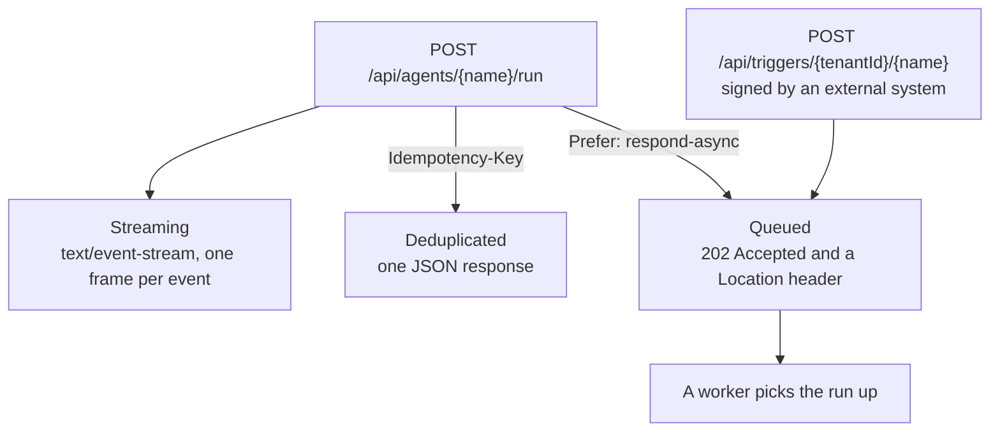

A run's record answers two questions the run itself cannot: **who it belongs to** and
**who was allowed to start it**. This page covers both, then the ways a run is started
from HTTP, a queue, a schedule and your own code. What a run writes once it has started
(events, tool calls, errors, replay) is on [Runs and recording](/concepts/runs/).

## Who ran it, and for what

A run also records **who** it belongs to and **which job** it was made for. Both
answer questions the tenant cannot: a tenant tells you whose data this is, not
which of that tenant's users spent the money.

Neither value is ever read from the run request body. A `userId` field on
`POST /api/agents/{name}/run` would let any client write spend against another
user's name, so the body is not a source of attribution at all. The value comes
from `IRunAttributionContext`, which your application binds to its own identity
pipeline:

```csharp
public sealed class ClaimsRunAttributionContext(IHttpContextAccessor accessor)
    : IRunAttributionContext
{
    // Outside a request there is no HttpContext: read the ambient scope, which
    // is how a queued or scheduled run gets the identity it was queued with.
    public string? UserId => accessor.HttpContext is { } http
        ? http.User.FindFirst("sub")?.Value
        : AmbientRunAttributionScope.CurrentUserId;

    public IReadOnlyDictionary<string, string>? Labels => accessor.HttpContext is { } http
        ? http.Request.Headers.TryGetValue("X-Job", out var job)
            ? new Dictionary<string, string> { ["job"] = job.ToString() }
            : null
        : AmbientRunAttributionScope.CurrentLabels;
}

// Registered BEFORE AddTracon(); Tracon uses TryAdd, so yours wins.
builder.Services.AddSingleton<IRunAttributionContext, ClaimsRunAttributionContext>();
```

Register nothing and nothing changes: both columns stay `NULL` and no behaviour
differs. For work that runs outside a request — a queued job, a scheduled run, a
direct .NET call — use the ambient scope instead. The built-in context reads it; a
context of your own reads it only if it falls back to it, as the one above does:

```csharp
using (AmbientRunAttributionScope.Begin("user-42", labels: null))
{
    await agent.RunAsync("summarise this ticket");
}
```

The user id is an **opaque string**. Tracon neither resolves nor validates
what it means and stores no personal detail of its own — the same stance the
data-subject erasure flow takes, which covers this column too.

Labels are bounded on purpose: at most **8** per run, keys up to **64**
characters, values up to **256**. Breaking a limit **rejects the request with
400**; nothing is trimmed to fit, because a trimmed label set still reads as a
complete measurement to whoever queries the report later. Every endpoint that
starts a run applies the same check before the run starts: an agent run, a
workflow run, resume and respond, a replay, an inbound trigger, and the
OpenAI-compatible `/v1/chat/completions` and `/v1/responses` (which answer in
their own error shape).

A workflow run carries its attribution the way an agent run does: its row, the
`TraconRunContext.Current.UserId` and `Labels` every node and tool of the
workflow reads, and the run and user a `quota.threshold` webhook names.

A queued agent run (`Prefer: respond-async`) reads the user and the labels when
the request arrives, and both travel with the job, so the run's sub-agents and
tools see them on the worker. A run that resumes after an approval decision, or
that continues an interrupted run, runs under the user and labels of the run it
continues. On the worker, Tracon replays these values through
`AmbientRunAttributionScope`, which the built-in `IRunAttributionContext` reads.
A context you register yourself reads them only if it asks: when there is no
request, return `AmbientRunAttributionScope.CurrentUserId` and `CurrentLabels`.

A run an inbound trigger starts, and a workflow or agent batch queued through
`IJobDispatcher`, also carry the user and labels resolved when they were queued. A
schedule has no caller: its runs carry the attribution its payload names, or none
([schedule payloads](/guides/background-work/#attribute-the-runs-a-schedule-starts)).

:::caution
Labels and user ids are **query** dimensions, not **metric** dimensions. They
live in the `runs` table and are never added to `tracon.tokens` or
`tracon.run.cost` — promoting a free-form label set to a metric tag has no
upper bound on time-series cardinality.
:::

Both are filters on the run list and breakdowns in the summary:

```bash
curl "http://localhost:5081/tracon/api/runs?userId=user-42"
curl "http://localhost:5081/tracon/api/runs?label=team:payments"
curl "http://localhost:5081/tracon/api/stats" | jq '.byUser, .byLabel'
```

`byLabel` rows do **not** sum to `totalRuns`: a run carrying three labels appears
in three of them. A label set is not a partition of the runs.

## Who is allowed to start it

Attribution answers "who did this, for the cost report"; it does not by
itself stop anyone from starting a run. Tracon draws ownership at the
**tenant** level, so by default any caller with the `Operator` role in a
tenant can start any agent in that tenant, regardless of `UserId`.

Bind `IRunAuthorizationHandler` to enforce your own per-user rule. It is
called at every endpoint that starts a run — the agent run endpoint, the
workflow run endpoint, the inbound trigger accept endpoint, the
OpenAI-compatible `/v1/responses` and `/v1/chat/completions` endpoints,
`POST /api/runs/{id}/replay`, and the two external protocols (every A2A message and
every MCP `tools/call` that names an exposed agent) — **before** the quota check, so
a denied call never consumes the tenant's quota. The same method is asked again for every
access to an existing run's resources: reading it, canceling it, scoring it,
and reaching its attachments and approval requests. Which question is being
asked is on `request.Access`, and a resource question carries
`request.RunId`:

```csharp
public sealed class YourRunAuthorizationHandler(IYourOwnershipService ownership) : IRunAuthorizationHandler
{
    public async ValueTask<RunAuthorizationResult> AuthorizeRunAsync(
        RunAuthorizationRequest request, CancellationToken cancellationToken = default)
        => request.RunId is { } runId
            ? await ownership.OwnsRunAsync(request.TenantId, request.UserId, runId, cancellationToken)
                ? RunAuthorizationResult.Allow()
                : RunAuthorizationResult.Deny("This run belongs to a different user.")
            : await ownership.CanStartAsync(request.TenantId, request.UserId, request.AgentName, cancellationToken)
                ? RunAuthorizationResult.Allow()
                : RunAuthorizationResult.Deny("This user cannot run this agent.");

    public ValueTask<RunAuthorizationResult> AuthorizeSessionAsync(
        SessionAuthorizationRequest request, CancellationToken cancellationToken = default)
        => new(RunAuthorizationResult.Allow());
}

builder.Services.AddSingleton<IRunAuthorizationHandler, YourRunAuthorizationHandler>();
```

Register nothing and nothing changes: every run starts and every run stays
readable, exactly as before this binding existed. If the handler throws, the
call is denied (fail-closed), an `Error` line naming your handler type is
logged in the `Tracon.RunAuthorization` category, and a `403` says that the
check failed and can be retried. A denied single resource answers `404`, with a
body identical to a run that does not exist — a `403` there would confirm
the run exists; a denied list answers `403`. See
[Embedding: run and session authorization](/guides/embedding/#6--run-and-session-authorization)
for the full `RunAccess` table, the session half of the same contract (list,
read, delete, branch, voice), and the exact response shape each denial
produces.

### Starting a run from .NET with explicit identity

`TraconRunOptions` is the .NET-side counterpart of the run request. It is not a
configuration section: it is passed per call, and most properties answer
"which run is this, and where does it sit in a larger story".

| Property | What it sets |
|---|---|
| `RunId` | The identifier to record this run under. Supply your own when the caller already has one; otherwise Tracon generates it |
| `AdditionalInstructions` | Instructions for this run only, appended to the agent's own on a new line. Use it with `RunId` when the code adds a rule and has to find the run record afterwards. It is trusted caller text: do not pass text an end user wrote. The run does not record it, so a replay, an automatic continuation and a resumed approval run without it |
| `ParentRunId` · `RootRunId` · `Depth` | The run's place in a call tree. The child-agent invoker fills these in; set them yourself only when you drive a tree by hand |
| `AgentVersion` | The definition version this run used, when you resolved a specific one |
| `ExperimentId` | The experiment this run is a sample of, so results group correctly |
| `ReplayOfRunId` | The original run this one replays, which is what makes a comparison possible |
| `ContinuedFromRunId` | The interrupted run this one continues, set automatically — not something you set by hand |
| `SessionId` | The session at the root of the tree. It feeds the run scope, not the run row's own `session_id` |
| `Kind` · `Variant` · `Budget` | The run's kind, its experiment variant, and the shared budget a call tree draws from |
| `BeforePendingApprovalIsPublished` | A callback that runs immediately before a run closes as `AwaitingApproval`, on the streaming and the buffered path alike. Record the approval request here |

Leave every property unset for an ordinary run: Tracon then records a root run with
a generated id, and the values above are filled in by the components that own them.

`BeforePendingApprovalIsPublished` is a hook rather than an identity, and it exists because the status and the
request become visible at different moments. A run closes inside the agent call, so
without it the status is published first and
[`GET /api/approvals/pending`](/http-api/approvals/) answers an empty list for a run that
already says it is waiting. The callback receives the messages the run produced, and
anything it throws fails the run — an `AwaitingApproval` status whose request was never
recorded is unanswerable.

<span id="three-ways-to-start-a-run"></span>

## Ways to start a run



| | How | Response |
|---|---|---|
| **Streaming** | `POST /api/agents/{name}/run` | `text/event-stream`, one frame per event |
| **Deduplicated** | the same call with `Idempotency-Key` | a single JSON response — a replay cannot be reconstructed from a stream |
| **Queued** | the same call with `Prefer: respond-async` | `202 Accepted` and a `Location` header |
| **Triggered** | `POST /api/triggers/{tenantId}/{name}`, signed by an external system | `202 Accepted` and a `Location` header |

A queued run behaves the same once a worker picks it up. The difference shows at the
end: if a queued run needs a tool approval it closes as `AwaitingApproval` and the
request lands in the approval mailbox, whereas a streaming run carries the approval in
its next turn.

A triggered run is a queued run under the hood — same placeholder row, same worker —
started by a signed HTTP request instead of a management API caller. See
[Inbound triggers](/guides/inbound-triggers/).

A workflow is queued the same way: `POST /api/workflows/{name}/run`, and its resume
and respond endpoints, take `Prefer: respond-async` and answer `202 Accepted`. On
those three endpoints `Idempotency-Key` is accepted only together with the
preference, because their synchronous answer is a stream. See
[Queue a run instead of streaming it](/concepts/workflows/#queue-a-run-instead-of-streaming-it).

:::caution[A closed run is never rewritten]
A run that ended `AwaitingApproval` stays that way forever. Deciding the approval
opens a **new** run with the same session and a new run id. History is append-only,
so what you read a week later is what actually happened.
:::

A run can also stop for the user's input. When an MCP server asks for information in the
middle of a tool call and the caller can answer, the run closes `AwaitingInput` and
stays that way, for the same reason: the answer opens a **new** run in the same
session. See [A server asks the user for input](/concepts/tools/#a-server-asks-the-user-for-input).

The new run uses the agent version and the experiment arm of the run that asked for
approval. A version saved while the approval waited does not change the turn. A code
agent keeps no version history, so its new run uses the current definition.

## Read next

- [Runs and recording](/concepts/runs/) — what a started run writes, and when.
- [Governance](/concepts/governance/) — tenants, roles, and what is guaranteed to be written.
- [Inbound triggers](/guides/inbound-triggers/) — start runs from a webhook or a message.
