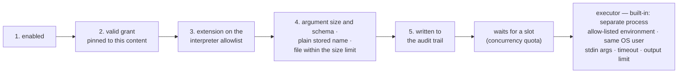
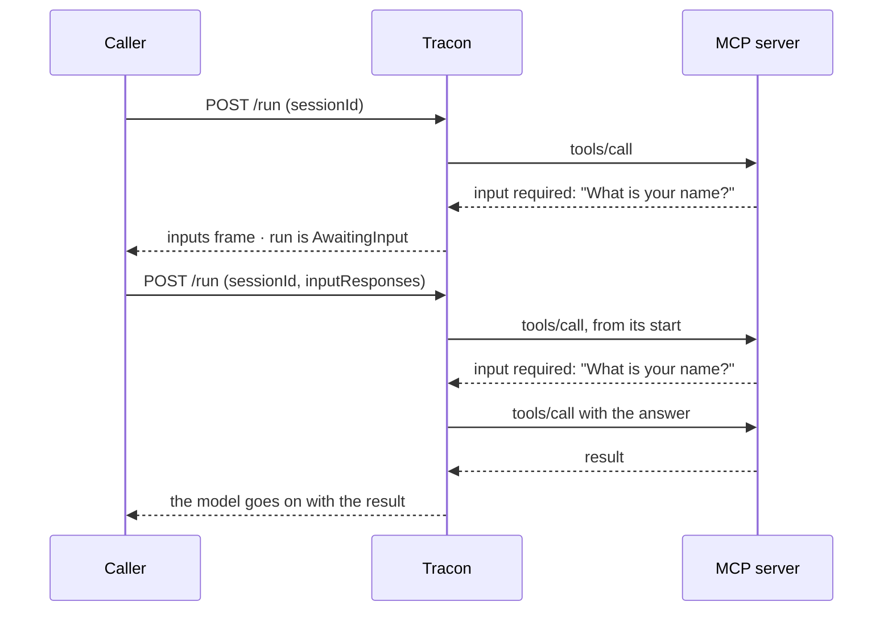

An agent gains capability in a few ways. They differ in where the code lives and who
is allowed to add it.

| | What it is | Where the code runs |
|---|---|---|
| **Tools** | Methods in your codebase | Your process |
| **Client-side tools** | A declaration in your codebase, no server-side body | The caller's process (typically a browser) |
| **Skills** | Markdown instructions plus resources | Nowhere — they are text |
| **MCP tools** | Tools published by a remote MCP server | Someone else's process |

## Tools

A tool is a method you wrote, registered at startup. See
[adding a tool](/getting-started/tools/) for the mechanics.

The rule that governs the whole design: **tools are defined in code only**. The
console lets a user *select* from registered tools; it never defines one. If it could,
anyone who reached the console could execute code on your server.

Wrapping for approval happens in the **registry**, not at the call site. The registry
is the single place where "an agent may only point at a registered tool" is enforced,
so no other code path can skip the wrapper.

### Who owns what

Six concerns belong to the registry and its pipeline, never to a tool body:

| Concern | Owned by |
|---|---|
| Authorization (can this caller call this tool at all) | `IToolAuthorizationHandler` in the pipeline |
| Approval (does a person need to say yes this time) | The registry's approval wrapper |
| Timeout | The registry's timeout wrapper |
| Output truncation | The registry's truncation wrapper |
| Tenant scoping | `TraconRunContext.Current` |
| Audit (what ran, with what result) | Run recording, driven from the registry |

A tool body reads `TraconRunContext.Current` when it needs the tenant, run, or
session — it never re-implements any of the other five; they already ran before the
body was ever invoked.

### Lifecycle and concurrency

The registry is a **startup snapshot**. It is built once, from every `AddTool*` call
made during startup, and never mutates afterward — there is no runtime `AddTool`. MCP
tools are the one deliberate exception: they are discovered from a remote server and
can appear or disappear as that server's own catalog changes, which is why MCP has its
own, separate dynamic model instead of sharing the code registry's snapshot guarantee.

Every tool instance is a **singleton**, shared by every tenant, every run, and every
thread that happens to call it. Keep no per-call state in an instance field — read
[the empty service provider rule](/getting-started/tools/#the-rule-that-trips-people-up)
for the related mistake of resolving a scoped dependency the same way. When a
dependency genuinely has to be fresh per call, register the tool with `AddScopedTool`
instead of `AddTool` — see
[scoped dependencies](/guides/write-your-own-tool/#scoped-dependencies).

Because a tool is shared, the same tool can already run **concurrently across
different runs** today, whether or not `ToolLoop.AllowConcurrentToolCalls` is set —
that setting only governs whether one run's own turn calls its several tools
one after another or at the same time. A tool body that keeps no mutable
instance state handles both cases for free.

### Authorization, validation, and timeout

Three more wrappers apply next to approval, in a fixed order: **authorization**
(outermost), **validation**, **timeout**, then **approval** (innermost), then the real
method. The same order applies whether the tool is code-defined or MCP-sourced — one
composition point builds both.

Authorization asks a different question than approval. Approval asks "is this call okay
this time" and stops to wait for a person. Authorization asks "can this caller call this
tool at all" and answers instantly from your own policy — implement
`IToolAuthorizationHandler` and register it; the default allows every call, so an
application that registers nothing keeps today's behavior exactly.

```csharp
public sealed class MyAuthorizationHandler : IToolAuthorizationHandler
{
    public ValueTask<ToolAuthorizationResult> AuthorizeAsync(
        ToolAuthorizationRequest request, CancellationToken cancellationToken = default)
        => request.RequiredPermission is "orders.cancel" && !CallerHasPermission(request)
            ? ValueTask.FromResult(ToolAuthorizationResult.Deny("You cannot cancel orders."))
            : ValueTask.FromResult(ToolAuthorizationResult.Allow());
}

services.AddSingleton<IToolAuthorizationHandler, MyAuthorizationHandler>();
```

A denied call does not fail the run: the model receives the reason text as an ordinary
tool result and continues its turn — the same way a search that finds nothing is not an
error. If your handler throws, the call is denied (fail-closed), never allowed.

The authorization layer asks two gates, in this order, and a call needs both. First the
tenant's [tool policy](/concepts/governance/#per-tenant-tool-policy), which an administrator
writes as data (which tool names and permissions the tenant holds); then your handler, which is
your code. A call the policy refuses never reaches your handler. A tenant with no policy passes
the first gate, so a host that saves none behaves as before.

The chain does not stop at tools you register. The `file_access_*` tools of a session workspace
and the two search tools Tracon adds itself, `search_knowledge` and the on-demand
`search_conversation_memory`, run through it too, so the handler, the validator, the timeout and
the budget check apply to them. The searches have the effect `External`, because the text of the
query leaves the process. [Which tools reach the handler](/guides/embedding/#which-tools-reach-the-tool-authorization-handler)
lists what is covered and what is not.

Validation asks a narrower question, right after authorization: "are these specific
arguments acceptable". Binding already rejects a type mismatch or a missing `required`
field — including a required member of a generated tool's **object** parameter
(a public record or class with a single public constructor, see [Write your own
tool](/guides/write-your-own-tool/)) — and register `IToolArgumentsValidator` for
anything binding does not catch: an extra field the schema does not declare, for
example, or a generated `minimum`/`maximum`/length/`pattern` constraint, which the
schema carries but binding never enforces on its own; a validator that wants to
enforce one reads `tool.JsonSchema`.
Unlike a denial, a **rejected** call is recorded as `ToolFailed`, not as an ordinary
result — see [argument validation](/guides/write-your-own-tool/#argument-validation)
for the full mechanism, including the fail-closed behavior on a throwing validator.

`[TraconTool]` also carries an effect class and a per-tool timeout:

```csharp
[TraconTool(
    "cancel_order",
    "Cancels an order.",
    RequiresApproval = true,
    Effect = ToolEffect.Destructive,
    RequiredPermission = "orders.cancel",
    TimeoutSeconds = 30)]
public static string CancelOrder(string orderId) => ...;
```

`Effect` (`Read`/`Write`/`Destructive`/`External`) is information, not a gate — the
console shows it as a badge, and the audit trail records it. By default the approval
card an operator sees carries only this raw call; register
[`IToolApprovalPresenter`](/concepts/governance/#approvals) to show a resolved entity
name instead. A call that outlives its
timeout does not fail the run either: the model sees a tool error and continues, the same
as a denial.

When the timeout elapses the body is handed a **cancelled token** — a token linked to the
caller's own, which this layer cancels. Cancellation is cooperative, so what happens next
depends on the body:

- **A body that reads its token** stops there and spends nothing more. Accept a
  `CancellationToken` parameter and pass it down to every call you make.
- **A body that never reads it** is not forcibly stopped and keeps running to completion,
  possibly with a real side effect, after the model has already moved on.

A call in that second group is still accounted for. When it finally settles successfully,
its result, its real duration and anything it reported through `TraconToolUsage.Report`
are written onto **that same call's record** — `lateCompletedAt` on the
`ToolInvocationRecord` says when, `timedOut` and `error` stay as they were because they
record what the *model* was told. This matters for a tool that spends money: image
generation that needs 35 seconds against a 30 second limit has produced and been billed
for a real image, and without this the charge would appear in no cost report at all. The
amount also reaches the tenant's quota counter, once, in `Tracon:Pricing:Currency` (the
run's own recorded total is not changed). No second record is written, so per-tool totals
still count one call.

The timeout applies to execution only, never to a pending approval, which can wait
indefinitely.

A tool body can also run **more than once for the same logical call**, on two different
timelines that are easy to conflate:

- **Within one turn:** Microsoft Agent Framework retries a throwing tool call up to
  `MaximumConsecutiveErrorsPerRequest` (3 by default) times before giving up and
  re-throwing to the caller. A tool that is not safe to call twice in a row needs its
  own idempotency guard, regardless of any Tracon setting.
- **Across an interrupted run:** `SafeToRepeat` (only read for `Destructive`/`External`
  tools) tells Tracon whether resuming a run that was cut off mid-call may repeat
  that call. It says nothing about the in-turn retries above.

The one case that does **not** repeat a completed call is a provider fallback: if a call
already finished before the primary provider failed, the fallback model asking the same
question again is answered from that result instead of running the tool's body a second
time — see [Fall back to a secondary provider](/guides/reliability/#fall-back-to-a-secondary-provider).

### Result representation and persistence

Whatever a tool returns, Tracon turns it into one **canonical text form** before
anything else — a content guard, the output limit — inspects it. `null`, `string`, and
`JsonElement` each have one stable text form; a primitive, `Guid`, or date value is
serialized the same, culture-independent way every time. A collection, record, or class
result is only canonicalized when the tool's generated declaration carries a consumer
`JsonSerializerContext` for it — code-defined tools using the `[TraconTool]`
attribute (see [Write your own tool](/guides/write-your-own-tool/)) require one for
any result type beyond a plain string or primitive. That context, not reflection, is
what turns it into JSON, which is also what keeps the guard AOT-safe. A raw CLR object
returned directly from a hand-written `AIFunction` with no such context attached is
**not** serialized by guessing: it is
treated as an unsupported result and replaced with a generic, secret-free failure text
rather than passed through unguarded or serialized with reflection. This closes a real
gap: inspecting a type name or a placeholder instead of the actual data would let a
guard approve content it never really looked at, and silently trusting an unknown
object would let it bypass the guard and the output limit entirely.

That same canonical text is what gets **persisted**: a tool's arguments and result are
written into the run's permanent record and streamed to the console over SSE. Neither
one is written into a telemetry span. A tool that would otherwise return a secret —
a connection string, an access token — must redact it before returning, because both
of those surfaces keep it in full. A tool exception is treated more carefully: only
Tracon's own exception types keep their message; everything else is replaced with
a generic `Tool failed with <ExceptionType>.` before it reaches the record or the
stream, and the original message goes only to your log.

### Output size limit

A tool's result is unbounded by default and goes straight into the model's context. Set
a byte limit — per tool, or once for every tool that does not set its own — and a
result over it is trimmed before the model ever sees it. The limit is measured against
the same canonical text form described above, for every result type it applies to —
a large complex object is bounded exactly like a large string, not skipped because it
is not one. A tool that answers with `AIContent` blocks rather than text — every MCP
tool does — is measured the same way, by the text its provider adapter sends. A result
that fits reaches the model with its blocks intact; one that does not is replaced by
the same envelope any other oversized result gets.

```csharp
services.AddSingleton(new TraconToolRegistration(
    AIFunctionFactory.Create(GetReport, "get_report", "Fetches a report."))
{
    MaxOutputBytes = 4096,
});

services.Configure<TraconOptions>(o => o.Tools.DefaultMaxOutputBytes = 4096);
```

No change is required to keep today's behavior: the default is unlimited, and a tool
that never sets a limit is never touched.

Bounding a tool's output inside its own body is always better — the tool knows its
data, this only counts bytes. Treat the limit as the last line of defense for the day
that bound is forgotten, not a substitute for it: a single runaway tool can otherwise
spend a tenant's whole token budget on one call.

A result over the limit is trimmed and wrapped in an envelope, so the trimmed text can
never break the JSON the model reads:

```json
{"truncated": true, "omittedBytes": 1830, "content": "..."}
```

`truncated` and `omittedBytes` are always present on a trimmed result — a silently
shortened answer would lead the model to a confident, wrong conclusion. A result that
already fits is returned exactly as the tool produced it, never wrapped.

### Concurrent tool calls

By default, when a model turn calls several independent tools at once, Tracon
runs them one after another. Set `ModelBinding.ToolLoop.AllowConcurrentToolCalls` to run them
at the same time instead — each call still gets its own authorization decision, its
own recorded result, and its own entry in the tool-usage metrics; none of that mixes
up between calls that happen to overlap.

Off by default: with no change, tool calls run one at a time exactly as they do
today. Turn it on only for tools whose bodies are safe to run concurrently with
themselves — a tool that shares mutable state across calls without its own
synchronization should not opt in. See
[Model providers](/guides/model-providers/#tool-call-loop) for where this
setting lives on `ModelBinding`, and for the other settings of the loop.

### Built-in image generation

When `Tracon:Images:Enabled` is true and a supported image provider is
registered, Tracon adds `generate_image` as an `External` tool. It accepts a
prompt and returns attachment ids, never base64 image data. Generation can spend money
and sends a prompt to an external provider, so the normal authorization, timeout, run
recording, and continuation rules apply. In particular, an interrupted run does not
automatically repeat an image-generation call.

See [Multimodal input and generated images](/guides/multimodal/) for registration,
storage, and price configuration.

### Report what a tool spent beyond tokens

A tool billed by something other than a token — speech by the character, a transcript by
the second, an image by the piece — reports that from its own body:

```csharp
_ = TraconToolUsage.Report(new ToolCallUsage
{
    Unit = ToolUsageUnits.Characters,
    Quantity = characters,
    Cost = price,
    Currency = "USD",
    Provider = "elevenlabs",
    Model = "eleven_multilingual_v2",
});
```

- **The measurement belongs to the call.** It is written onto the call's record
  (`GET /api/runs/{runId}/tools`) with its unit, quantity, amount, currency, whether the
  quantity was estimated, and the provider and model that did the work. A tool that
  reports twice in one call replaces its first report, so report the total at the end. The
  call returns `false` and does not throw when recording is off or the code is not inside a
  tool call; a call that reported and then never settled keeps what it reported. It also
  returns `false`, and attaches nothing, for a measurement the record cannot hold: an empty
  unit or one longer than 64 characters, a currency longer than 16, a provider longer than
  100, a model longer than 200, a quantity outside 0 to 9,999,999,999 or an amount outside
  0 to 1,000,000,000. These are the limits a function node's items have.
- **It also joins the run's non-token total, the moment the tool reports it.** The same
  rule as a [workflow function node's items](/concepts/workflow-function-nodes/#report-what-a-node-spent-beyond-tokens)
  applies: amounts in `Tracon:Pricing:Currency` add, a quantity is never added across units,
  and a call with no amount is listed and counted as not added — unknown, not free. The
  call-tree budget, the tenant's cost quota and the `run.completed` webhook therefore count a
  `speak` call the way they count a function node that spoke. A measurement that arrives
  after the run closed, from a call that outlived its timeout, stays on the call's record
  and does not change the run's total, but it is added to the tenant's quota counter once,
  because that money was spent.
- **It stops the next tool call.** Once the call tree's budget is spent, a tool call that has not
  started does not start: its result says why, and a streaming run records the call as failed. The call that
  crosses the ceiling runs to its end, so report the amount as soon as you know it. See [A spent
  budget stops a tool call from starting](/guides/reliability/#a-spent-budget-stops-a-tool-call-from-starting).
- **The built-in tools report it already.** `speak`, `transcribe` and `generate_image`
  fill `Provider` and `Model` as well as the measurement. Prices come from
  `Tracon:Pricing`; with none configured the amount stays unknown. `search_knowledge` reports
  the input tokens of its query embedding in the unit `tokens` with no amount: an embedding has
  no price in Tracon yet, so the call is listed and counted as not added.

## Hosted tools

`AddHostedTool(name, kind, factory)` registers a tool that the model provider runs inside the model call:
a web search, a code interpreter, or a file search. The registration is code, like every tool, and a
definition selects it by name in `ToolNames`. Tracon calls nothing, so no approval, permission, timeout, or
output limit applies; the data goes to the provider the model call already uses. The provider's API surface
decides which kinds run, each call is priced from configuration, and each call is a tool event under the
registered name. See [Hosted tools](/guides/hosted-tools/) for the registration rules, the provider table, and
the limits.

## Client-side tools

`AddClientTool(name, description, jsonSchema)` registers a tool the SAME way — the
declaration lives in code — but with no body at all. The model can still call it; the
server returns the pending call to the caller instead of running anything, and the
caller answers it on the next request. See
[Client-side tools and the embeddable widget](/guides/client-side-tools/)
for the full mechanism and the chat widget built on it.

## Skills

A skill is markdown with frontmatter, optionally carrying resources — reference text
the agent can pull in. Skills are tenant-scoped and editable from the console, because
they are *instructions*, not code.

A skill can also be registered in code with `AddSkill`. The code skill wins its name,
as a code-defined agent does: the console opens it read only, and the API refuses to
save a stored skill under that name (`409`), because such a copy would never run.

A skill can also live on disk, as a `SKILL.md` directory under a skill root
(`UseSkillScripts`, `SkillRoots`). An agent names it like any other skill. A name is
looked up in code first, then in the tenant's store, then under the skill roots, so a
disk skill is installation-wide like a code skill: whoever deploys the application
writes it, and every tenant may name it; a tenant's stored skill under the same name
shadows it for that tenant. An edit to its `SKILL.md`, or a script or resource added
or removed, reaches the next run of an agent that names it. The console's skill list
shows stored skills only, so name a disk skill through the API.

An agent lists skills by name. Deleting a skill an agent still names is a real break:
compiling that agent then fails with "the skill was not found" until the reference is
removed or the skill is recreated. Check which agents use a skill before deleting it.

### Approval of the skill tools

An agent that names skills gets three tools from Microsoft Agent Framework: `load_skill`,
`read_skill_resource` and `run_skill_script`. All three ask for approval by default. That is
a problem where nobody can answer: an agent exposed over A2A or MCP, a run with no `sessionId`,
a scheduled run. Its first `load_skill` call closes the run `Failed` with the error type
`approval_unanswerable`.

A definition can turn the approval off for the two tools that only read text:

```csharp
new AgentDefinition
{
    Name = "support",
    Model = new ModelBinding { Provider = "openai", Model = "gpt-5.4-mini" },
    SkillNames = ["house-style"],
    Skills = new SkillSettings { DisableReadApproval = true },
}
```

The same setting in the HTTP body of `POST /api/agents` and `PUT /api/agents/{name}`, and
in the console's skills section, is `"skills": { "disableReadApproval": true }`. A request is
the whole definition: a `PUT` that leaves `skills` out turns the approval on again.

| Tool | Default | With `DisableReadApproval` |
|---|---|---|
| `load_skill` | Asks | Runs |
| `read_skill_resource` | Asks | Runs |
| `run_skill_script` | Asks | **Asks** |

`run_skill_script` keeps its approval. It runs code, so the definition has no setting for it. A
standing approval rule that an administrator writes for `run_skill_script` can still approve the
call; a definition cannot. Where nobody can answer and no such rule exists, a model that calls it
ends the run at the call.

Skill text reaches the model as instructions. When the approval is off, no person reads that
text before the model does. Turn it off only for skills that a tenant administrator writes.
A workflow step treats a skill tool like any other tool: with the approval on, the step stops
and waits for a person to answer ([a tool that asks for
approval](/concepts/workflows/#a-tool-that-asks-for-approval)).

### Skill scripts — the strict exception

A skill may also carry **scripts**, and this is the second deliberate exception to the
code-only rule. Unlike MCP, the process runs **on this machine** by default; a host
that registers an `ISkillScriptExecutor` runs it where that executor runs it — see
[Write your own script executor](/guides/write-your-own-script-executor/).

It is off by default and can only be turned on in code, with a mandatory
acknowledgement flag, an interpreter allowlist that starts empty, and skill roots
given in code.

Every execution passes five gates in order, and if any is closed the executor is
never called. After the fifth gate the call waits for a free slot under the
concurrency quota; the quota delays a script, it never refuses one. The slot is held
until the executor returns, or until the timeout plus five seconds has passed:



A script file under a skill root passes the same `MaxScriptContentLength` as a
stored script. An empty file, a file larger than the limit, and anything that is not
a regular file — a FIFO, a link to a device — is refused from its metadata, before it
is opened.

:::danger[Gate five is an exception to an exception]
Everywhere else in Tracon an audit-trail write failure is swallowed, because
observability must not break function. Here it is not: a script execution that cannot
be written to the audit trail would be remote code execution with no record of it, so
the run is refused.
:::

Grants are visible and revocable at `GET /api/skill-script-grants`. A grant without a
script name covers every script in a skill; one with a name covers only that script.
Grants can expire.

A grant for a stored or code-defined skill **pins the content** it was given for. Read
`scripts[].contentHash` (one script) or `scriptSetHash` (every script) from
`GET /api/skills/{name}`, review what will run, and send the value as
`expectedContentHash`. A skill-wide grant pins the whole script set: adding, removing,
or changing any script stops every script in the skill until it is granted again. A
hash that no longer matches returns `409` — read the skill again. In a multi-tenant
host, granting a stored script also needs platform authority: a key with
`PlatformAdmin`, the static token, or the `Tracon.PlatformAdmin` policy. A script read
from disk is not pinned, so keep its directory read-only.

:::caution[Tracon does not sandbox]
It provides **no** filesystem jail, network restriction, memory or CPU quota, or
privilege dropping. With the built-in executor the process runs under the same
operating-system user as Tracon and can read what that user can read — on Linux, the
environment Tracon started with too, through `/proc`. In a multi-tenant host a granted
script can therefore reach every tenant's data; the [threat model](/reference/threat-model/)
lists this as an accepted risk. Isolation belongs to the hosting environment — a
container, cgroups, and an unprivileged user — or to an executor that runs scripts
somewhere else; Tracon cannot verify either. The acknowledgement flag exists so the
feature cannot be enabled without seeing this: with execution on and the flag off,
the application fails at **startup**, whichever executor is registered.
:::

## MCP servers

Registering a remote MCP server means accepting tool definitions from outside, which
is the first deliberate exception to the code-only rule. The process runs elsewhere;
Tracon is only a client. Five guards:

1. **`http` and `https` only — there is no stdio transport.** Starting a local process
   would break the rule outright.
2. **`RequiresApproval` defaults to true** for tools discovered this way. Switching it
   off waives approval for every tool of the server, which is the decision a standing
   approval rule makes for one tool. Called with an API key, the save then needs the
   `SecurityAdmin` scope as well as `AgentsAdmin`: for a new server, for a server that
   required approval, and for a server whose endpoint changes while approval stays off.
   A standing rule for one of these tools is bound to the server's endpoint the same way
   ([approval rules](/concepts/governance/)).
3. **A remote tool whose name collides with a code-registered tool is ignored.** Your
   code always wins; a remote server cannot shadow a local tool.
4. **The registration stores no credential.** It stores the *name* of the
   configuration key the value is read from at call time — for the `Authorization`
   header and for any other credential header alike, in `headerConfigurationKeys`.
5. **Every call is recorded** with the source server's name.

Prompts fetched from an MCP server are a **snapshot** an administrator copies into the
console — an agent never pulls one live. Resource access is limited to the URI set the
server itself advertises; accepting arbitrary URIs would be an SSRF tool.

OAuth tokens are held in memory per tenant and server and are **never written to the
database**.

### A server asks the user for input

An MCP server can stop a tool call to ask the user for something: a value the tool
lacks, or a confirmation. The protocol calls it *elicitation*. Tracon tells every
server it connects to that it can answer, with form fields only: it never opens an
address for a server. What the server gets depends on who can answer:

| The call runs in | What the server gets |
|---|---|
| A run you start with `POST /api/agents/{name}/run` and a `sessionId`, or over the [AG-UI endpoint](/guides/ag-ui/#approvals-and-requests-for-input) | The run stops and asks you. Your answer is the input of the next request |
| A run without a `sessionId` | `decline`: an answer has nowhere to go |
| An OpenAI-compatible call, an A2A task, an MCP tool call, a queued run | `decline`: these surfaces have no way to carry the answer |
| An agent called by another agent | `decline`: a sub-agent cannot wait in the middle of its parent's tree, the same rule as for [approvals](/concepts/governance/#approvals) |
| A request to open an address (`url` mode) | `decline` |

`decline` is a complete answer. The server decides what the tool does next, and
nothing is dropped without a word: a decline inside a run writes a
`tracon.tool.input.declined` run event that names the server, the tool and the reason.
A request that reaches the connection outside any run (an older server sends one that
way) has no run to hold an event; the application log records it instead.



The streaming response sends an `inputs` event right before `done`; a response with
`Idempotency-Key` carries the same list as `inputs` in its body. One entry per request:

```json
[{
  "requestId": "01a16896-7da7-74c9-93a1-3b404320e32c",
  "toolName": "crm_ask_name",
  "serverName": "crm",
  "message": "What is your name?",
  "requestedSchema": {
    "type": "object",
    "properties": { "name": { "type": "string", "minLength": 1 } },
    "required": ["name"]
  }
}]
```

`requestedSchema` is flat on purpose: text, numbers, integers, booleans, and single or
multiple choices. The run closes `AwaitingInput`. Answer in the next request of the
same session, by `requestId`:

```bash
curl -X POST https://your-host/tracon/api/agents/support/run \
  -H "Authorization: Bearer $API_KEY" \
  -H "Content-Type: application/json" \
  -d '{
    "sessionId": "s-123",
    "inputResponses": [
      { "requestId": "01a16896-7da7-74c9-93a1-3b404320e32c", "action": "Accept", "content": { "name": "Ada" } }
    ]
  }'
```

`action` is `Accept`, `Decline` or `Cancel`. Only `Accept` carries `content`. The
playground in the console shows the form and sends the answer for you.

Rules that follow from the mechanism:

- **The tool call runs again from its start.** Tracon cannot keep a call open while a
  person thinks, so the answer comes with a second call of the same tool and the
  same arguments. A server that asks first and acts after is safe. A server that acts
  before it asks repeats that action.
- **The replay asks no second approval.** The call was approved, or exempt, when it
  first ran.
- **An answer belongs to its question.** If the server asks something else the second
  time, it gets `decline`, not your old answer. A tool call stops for input at most
  once: a server that needs a second answer gets `decline` for it.
- **A wrong answer is refused before the run starts.** An unknown or repeated
  `requestId`, a field the server did not ask for, a required field left out, or a
  value of the wrong type answers `400`. A request that was already answered answers
  `409`. A request without a `sessionId` answers `400`. A run in a session that
  belongs to another user answers `403`, as every run does.
- **The values go to the server and nowhere else.** Tracon does not keep them in the
  session. The audit entry `tool_input.answer` names the request, the server, the
  tool, the action and the *names* of the fields, never a value. It is written before
  the call runs again; if it cannot be written, the answer is not applied
  ([what is guaranteed to be written](/concepts/governance/#what-is-guaranteed-to-be-written)).
- **An older server asks the older way.** A server that speaks only the earlier
  protocol sends a request of its own while the call runs. It cannot be suspended, so
  it gets `decline`.

## Knowledge

Separate from tools: documents are chunked, embedded, and searched by vector distance.
This needs PostgreSQL — the other providers answer `501` on those endpoints.

`POST /api/knowledge/{collection}/search` runs the same retrieval an agent performs,
which makes it the way to separate a retrieval problem from a prompt problem. If the
right chunk does not come back there, the agent was never going to see it.

## Read next

- [Governance](/concepts/governance/) — approvals, audit, and limits
- [Workflows](/concepts/workflows/) — coordinate multiple agents with checkpoints and human input.
