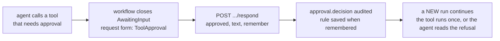

What happens when a person answers a workflow that waits for input, and what happens when
the same request gets a second answer? This page covers the two response modes, the audit
entry and the record every answer leaves, the cases where an answer can be given again, and
the answer to an agent's tool call that waits for approval.
How a workflow asks, and how an answer resumes it, is in
[Asking a human](/concepts/workflows/#asking-a-human).

## One answer per request

By default every answer opens a new run, so a second answer to the same request opens a
second branch — a double click or a retried call runs the steps after the request twice.
A workflow that must take one decision per request sets its **response mode** to
`SingleAnswer`: `responseMode` on `PUT /api/workflows/{name}`, the *One answer per
request* switch in the console's editor, or, for a workflow defined in code, the
`AddWorkflow` overload that takes `WorkflowRegistrationOptions`:

```csharp
builder.AddWorkflow(
    "publish-approval",
    services => BuildPublishApproval(services),
    options => options.ResponseMode = WorkflowResponseMode.SingleAnswer);
```

`WorkflowRegistrationOptions.Description` carries the catalog description and
`ResponseMode` the mode. A call that passes a literal `null` as the
third argument does not compile, because it fits both the description overload and this
one; leave the argument out instead.

A waiting run is answered under the mode of the definition version it recorded, so
changing the mode while a person decides does not change how that run is answered.

| The answer | `SingleAnswer` does |
|---|---|
| The first one | Starts the run, as in the default mode |
| The same answer again | Follows the run the first one started: the same SSE frames, read from the stored run, or the same `202` with `Prefer: respond-async`. No second run starts |
| A different answer | `409 Conflict`; the body names neither the run nor the other answer |
| The same answer after its run stopped before it took the answer | Starts the work again in a new run |

Two answers are the same when their `approved`, `text` and `data` are the same; the
checkpoint and the definition version they name do not count. "Stopped before it took the
answer" means the run failed or was cancelled before the workflow received the answer, or
after it with no checkpoint written, so nothing could resume from it. A queued answer whose
job is still waiting or running is followed, because the job's recovery owns that work. A
queued answer whose job was never written — the process stopped after the answer was
recorded and before the job was queued — is finished by a repeat of the same answer: the
repeat writes the job and follows the run, and two repeats at the same time write it once.

The run an answer starts has its row opened before the answer is recorded, so a recorded
answer always names a run that exists. Two answers that arrive in the same moment can
therefore both open a run before one of them claims the request. The other one closes its
own run as `Canceled` with the error type `request_already_answered` and no events. No
webhook, metric or run event sink fires for it, but it is still a run: `GET /api/runs`
lists it and `RunStatistics.CanceledRuns` counts it, so it is part of the error rate's
denominator.

:::caution[A crash in the middle of a streamed answer locks the request]
When a process stops while a streamed `SingleAnswer` run is going, that run stays
`Running`, and a repeat of the answer follows it forever. Only run reconciliation
(`Tracon:RunReconciliation:Enabled`, off by default) closes it: reconciliation closes a
`Running` run whose heartbeat stopped, and it reads no `Queued` run. Turn it on where a
one-answer request must stay answerable after a crash.
:::

## A tool that asks for approval

An agent in a workflow can call a tool that
[needs approval](/concepts/governance/#approvals). Where the pattern hosts the agent — a
stored `Sequential`, `Concurrent`, `Handoff`, `GroupChat` or `Magentic` workflow that lists `agentNames`,
and a code graph that binds the agent with `GetWorkflowAgent` — the workflow stops instead of
failing. The step's run
closes `AwaitingApproval`, the workflow run closes `AwaitingInput`, and the request has the
form `ToolApproval`. Its `prompt` names the tool and adds what your
[approval presenter](/concepts/governance/#approvals) says about the call; the arguments
are not copied into it.



Answer it on the same endpoint as any other request:

```bash
curl -X POST "$TRACON/api/workflows/runs/$RUN/respond" \
  -H "Content-Type: application/json" \
  -d '{"requestId": "'"$REQUEST"'", "approved": true, "text": "checked with the customer", "remember": true}'
```

| Field | Meaning |
|---|---|
| `approved` | Required. `true` runs the tool; `false` refuses it, and the agent reads the refusal |
| `text` | Optional reason. The agent reads it |
| `remember` | Optional. With `approved: true`, also saves a rule: this agent is not asked again for this tool |

A tool approval is answered **once**, whatever the workflow's response mode: in the default mode
every other answer opens a new run, but a second "approve" would run the tool a second time. The
same decision again follows the run the first one started, and a different one is `409`.

The answer carries a decision and nothing else. It cannot name a tool call, because the
call comes from the request the workflow recorded: a `data` value is refused with `400`, and
so is `remember` together with `approved: false`, or on a request of any other form. The
request's record keeps the tool's name, the agent's name and a SHA-256 of the arguments, never
the arguments; the hash lets a remembered rule bind to the exact call. The
decision is written to the audit trail as `approval.decision` before the workflow
continues, and an entry that cannot be written refuses the answer and leaves the
workflow waiting. A rule saved with `remember` is the same rule the run-request path saves,
for the agent that asked and the tool; a request that cannot name its agent (an agent
Tracon did not wrap) cannot be remembered.

The tool runs once, in the new run the answer opens, and it runs in whatever process takes
the answer: the call is in the checkpoint, so a restart in between loses nothing. With
`Concurrent`, two agents can ask at once: each approval is a request of its own, answered on
its own, and the run that carries the first answer waits on the second. A request nobody
answers runs out like any other ([Workflow requests and time
limits](/concepts/workflow-requests/#giving-a-request-a-time-limit)); the step that waited
closes `Failed` with the workflow.

An agent that a step's agent calls as a sub-agent still cannot ask: its approval is a tool
result the step's model reads, as in [Agents calling
agents](/concepts/agents/#agents-calling-agents).

## What every answer leaves behind, in either mode

An answer that starts a run is written in three steps, in this order: the audit entry,
the row of the run it starts, and the record. A store that fails at any step refuses the
answer with `500`, and the run does not start.

- **An audit entry, written first.** Every answer that starts a run is written as
  `workflow.respond` before its run row opens. When the entry cannot be written, the answer is
  refused with `500` and nothing runs — see [What is guaranteed to be
  written](/concepts/governance/#what-is-guaranteed-to-be-written). The entry carries the
  source run, the request id, the run the answer started and a SHA-256 of the answer, never
  the answer. The hash tells two answers apart; it does not hide one. An answer with few
  possible values, such as `approved: true`, can be found by hashing each candidate.
- **A record.** `GET /api/workflows/runs/{runId}/responses` lists the answers given to a
  run's requests: who answered, when, the run each answer started and its state. A record
  that cannot be written refuses the answer with `500`, and the run opened for it is closed
  `Failed` with the error type `answer_not_recorded`. Records live in the
  `workflow_responses` table and are removed only with their source run, by a data subject
  erasure. No retention target deletes runs, so the table grows with the run history.
- **A back-link.** The run an answer starts records `workflow.response-applied` as its
  second event, right after `run.started`, naming the run it answered and the request id,
  even with `RecordToolPayloads` off.

## Read next

- [Workflows](/concepts/workflows/#asking-a-human) — how a workflow asks and how an answer resumes it.
- [Governance](/concepts/governance/#what-is-guaranteed-to-be-written) — the other operations that refuse to proceed without their audit entry.
- [Runs and recording](/concepts/runs/) — reading the run an answer started and its events.
