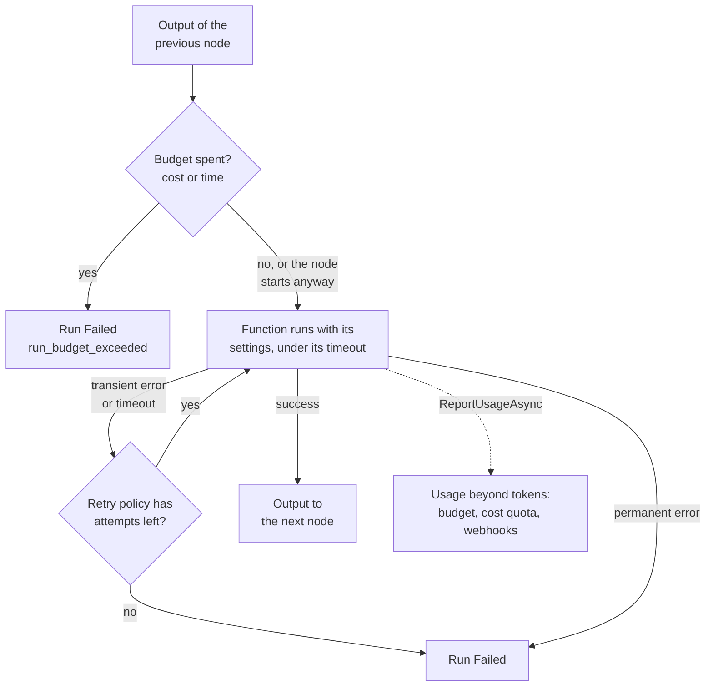

A real pipeline has steps that are not AI calls — a file download, a format
conversion, a database write. `AddWorkflowFunction` registers one by name:

```csharp
tracon.AddWorkflowFunction<List<ChatMessage>, List<ChatMessage>>(
    "word-count",
    services => (messages, context, cancellationToken) =>
    {
        var text = messages[^1].Text;
        return ValueTask.FromResult<List<ChatMessage>>([new(ChatRole.User, $"{text}\n\n({text.Split(' ').Length} words)")]);
    },
    "Appends a word count. Runs no model call.");
```

A `Sequential` definition's `Nodes` list can then mix that name in with catalog
agents, in order:

```csharp
new WorkflowDefinition
{
    Name = "summarize-and-count",
    Kind = WorkflowKind.Sequential,
    Nodes =
    [
        new WorkflowNodeReference { Name = "summarizer", Kind = WorkflowNodeKind.Agent },
        new WorkflowNodeReference { Name = "word-count", Kind = WorkflowNodeKind.Function },
    ],
}
```

`Nodes` and `AgentNames` are mutually exclusive — a definition sets one or the
other. Only `Sequential` supports function nodes: the ready-made builders for
the other four patterns accept only agents.

Each node must take what the node before it passes on. An agent node takes and passes
on a `List<ChatMessage>`, and a run starts by sending the user's message as one, so the
first node must take a `List<ChatMessage>` too. A function's types are the two type
arguments of its registration (`inputType` and `outputType` on
`GET /api/workflows/functions`). A node that takes a wider type, such as
`IEnumerable<ChatMessage>` or `object`, accepts the narrower one; a function that
declares `object` as its output is not checked against the next node. Saving a chain
that breaks this answers `400` and names both nodes and both types: Microsoft Agent
Framework drops a message that no handler takes, without an error, so the chain would
end every run `Completed` with no output. A stored chain that fails this check
fails before its first node runs, with the same message.

The first node must not take `object`. Every start and every resume also sends the first
node Microsoft Agent Framework's turn token, and a node that takes `object` receives it as a
second input: the node would run twice, and a node that writes to an outside system or calls
a paid service would do that work twice. Saving such a chain answers `400`, and a stored one
fails before its first node runs. Declare `List<ChatMessage>` or `IEnumerable<ChatMessage>`
instead. A graph you build in code (`AddWorkflow`) gets the same token on its start
executor; give that executor a `List<ChatMessage>` handler, not an `object` one.

The console builds such a chain too: **Workflows → New workflow**, then *Add an agent*
and *Add a function*, which picks from the functions registered in code. The arrows
reorder the steps and ✕ removes one. The function picker appears only for `Sequential`,
and the pattern stays `Sequential` while the chain holds a function.

A chain of agents only can be stored in either form over HTTP, `agentNames` or `nodes`,
and both keep working. The console writes one form per chain: **`nodes` when the chain
holds at least one function or one agent step [pinned to a version](/concepts/workflows/#pin-an-agent-step-to-a-version),
`agentNames` otherwise.** Removing the last function or pin in the console therefore saves
the chain back as a plain agent list on the built-in sequential pattern, and adding the
first one saves it as a node list. The editor says which form it is about to store. The
difference you can observe is token streaming: an agent step in a node list does not
stream its tokens into the workflow's live event feed (its own run row keeps the full
message history), while the built-in pattern does.

The factory passed to `AddWorkflowFunction` runs once, when the function
registry is built — not once per run. Every workflow compile shares the same
handler closure, so **the handler must be thread-safe**: a captured counter or
non-thread-safe client needs its own guard.

:::note[Code only, same boundary as tools]
A function's body is never written from the UI or the database; only its
*name* crosses that boundary, as `AgentDefinition.ToolNames` does for tools.
`GET /api/workflows/functions` lists what is registered, for a picker.
:::

A function node opens no `runs` row of its own and adds nothing to the token
totals — it made no model call. What it spent that is not tokens, it can report
itself ([below](#report-what-a-node-spent-beyond-tokens)). `ExecutorInvoked` /
`ExecutorCompleted` / `ExecutorFailed` still fire for it as for any node, so
it shows in the run's event stream and live in the graph.

:::caution[The handler must be idempotent]
Resuming from the run's *latest* checkpoint after it already completed does
not call the handler again — there is nothing left to run. Resuming from an
**earlier** checkpoint (the shape a real crash recovery takes) replays the
super-step that follows it, and the handler runs again with the same input. A
handler with a real side effect must tolerate being called more than once.
:::

## Give a function settings

One function often serves several workflows with a different configuration in each: a
voice, a loudness target, a destination folder. Register it with a settings type, and an
operator fills in the values on each workflow's node:

```csharp
tracon.AddWorkflowFunction<List<ChatMessage>, AudioClip, TtsSettings>(
    "tts",
    services =>
    {
        var speech = services.GetRequiredService<ITextToSpeech>();

        return (messages, settings, context, cancellationToken) =>
            speech.SpeakAsync(messages[^1].Text, settings.Voice, settings.LoudnessLufs, cancellationToken);
    },
    options => options.Description = "Text to speech");

public sealed record TtsSettings
{
    public required string Voice { get; init; }

    public double LoudnessLufs { get; init; } = -16;
}
```

```bash
curl -sS -X PUT http://localhost:5081/tracon/api/workflows/narrated \
     -H 'Content-Type: application/json' -d '{
       "kind": "Sequential",
       "nodes": [
         { "name": "writer", "kind": "Agent" },
         { "name": "tts", "kind": "Function", "settings": { "voice": "alloy", "loudnessLufs": -14 } }
       ]
     }'
```

In the console the same object goes into the **Settings** field of the function's step,
with the fields the function takes listed under it.

- **The code declares the shape; the operator writes values.** Settings are values, not
  expressions: nothing in them is evaluated, and a run parameter is not substituted into
  them. A function that needs a run's value reads it with `context.GetRunParameters()`.
- **A save checks the settings by reading them into your type.** An unknown field (a
  misspelled name), a missing `required` member, a number written as text, an enum written
  as a number and a `null` where the member does not allow one are all refused with `400`,
  and the message names the node and the member. A node without settings is read as `{}`,
  so a type with a `required` member refuses a node that carries none — you hear about it
  when you save, not in the first run. Names are camelCase and matched without regard to
  case. The function receives exactly the object that was checked.
- **Some settings are refused whatever the type.** Settings on an agent node, settings that
  are not a JSON object, and settings on a function that declares no settings type.
- **A change takes effect on the next run.** The graph is built again for every run, so
  the run in progress keeps the settings it started with. So does a run that waits to be
  resumed: a resume compiles the definition version the run recorded (see
  [Versions, rollback and pinning an agent step](/concepts/workflows/#versions-rollback-and-pinning-an-agent-step)).
  Name the edited version to carry the run over the new settings. The checkpoint stays
  usable: the settings are not part of the node's identity, its name and place in the
  chain are.
- **A settings type that changed since the workflow was saved fails the run by name.**
  The run ends `Failed` before any node runs, and the error names the workflow, the node
  and the member. Save the workflow again with settings that fit. The same happens to a
  function that stopped taking settings while a stored node still carries some.
- **Never put a secret in settings.** They are stored in the workflow definition, appear
  in the audit trail, stay in every [version](/concepts/workflows/#versions-rollback-and-pinning-an-agent-step)
  of its history (a later save does not rewrite them) and are returned to everyone who
  can read the workflow. Make the
  setting the *name* of the configuration key (`"apiKeyConfigurationKey": "Tts:ApiKey"`)
  and read the value from `IConfiguration` inside the factory.
- **A chain uses a function once.** A node's name is its identity in the graph, so the
  same function cannot appear twice in one chain; register it under a second name when it
  should run twice.
- **Wide numbers.** The console reads a JSON number as a double, like any JavaScript
  client, so an integer beyond 9007199254740991 (2^53 − 1) loses its low digits when an
  operator opens the workflow and saves it again. Settings are read strictly, so a string
  cannot fill a numeric member: declare an identifier that wide (a snowflake, a 64-bit
  database key) as a `string`.
- **Size.** One node's settings may be at most `MaxNodeSettingsLength` bytes of JSON
  (16 KiB by default) when a workflow is saved.

`GET /api/workflows/functions` returns each function with `settingsSchema`, the JSON
schema of its settings type, and `null` for a function that takes none. The console lists
the fields from it. It is for display: the check is the read described above, so what the
schema says and what a save accepts cannot drift apart.

## Report what a node spent beyond tokens

A node that speaks, renders or transcribes spends something that is not a token: a
text-to-speech character, a GPU second, a minute of audio. Tracon cannot see that work, so
the node reports it. `ReportUsageAsync` is an extension on the `IWorkflowContext` the
node already receives:

```csharp
tracon.AddWorkflowFunction<List<ChatMessage>, string>(
    "narrate",
    services => async (messages, context, cancellationToken) =>
    {
        var text = messages[^1].Text;

        // ... synthesize the speech with your provider, then report what it billed.
        await context.ReportUsageAsync(new ToolCallUsage
        {
            Unit = ToolUsageUnits.Characters,
            Quantity = text.Length,
            Cost = text.Length * 0.00003m,
            Currency = "USD",
            Provider = "elevenlabs",
            Model = "eleven_multilingual_v2",
        });

        return text;
    });
```

A report is one **item**. The run lists its items, in the order they were reported, at
`GET /api/runs/{runId}/usage` (Reader role, `runs:read` scope); this abridged answer (each item also carries its `id`, `runId` and `createdAt`) is
from a run whose `speak` node reported an estimated, priced item and whose `render` node
reported seconds it has no price for:

```json
[
  {
    "nodeName": "speak",
    "usage": { "unit": "characters", "quantity": 76, "cost": 0.0076, "currency": "USD",
               "isEstimated": true, "provider": "tone", "model": "tone-1" }
  },
  {
    "nodeName": "render",
    "usage": { "unit": "gpu-seconds", "quantity": 1, "cost": null, "currency": null,
               "isEstimated": false, "provider": "local-gpu", "model": null }
  }
]
```

- **Tracon never prices a node's work.** `Cost` is the amount the node computed from its
  provider's rate. `Unit` is free text; `ToolUsageUnits` only names the units Tracon's own
  tools use. `Provider` and `Model` are names for the reader and take no part in a total.
- **The call does not throw.** It returns `false`, logs the cause and lets the node carry
  on when it is called outside a Tracon workflow run, when the item is invalid, and when
  the run already holds 1,000 items, so report once per step and not per chunk. An item is
  invalid when its `Unit` is empty, its quantity or amount is negative, or a value is more
  than its column holds (a unit of 64 characters, a currency of 16, a provider of 100, a
  model of 200, a quantity above 9,999,999,999, an amount above 1,000,000,000). Only a
  `null` argument throws.
- **An item is written the moment it is reported and is not cancelled with the run.** The
  provider billed that work, so a run that is cancelled or fails keeps what its node had
  spent. A node that fails and is [retried](#retry-a-node-on-a-transient-error) keeps the
  items of its failed attempts for the same reason.
- **The item names its node.** A custom `Executor` in a graph built in code is not a
  function node registered with Tracon, so its items carry no node name.
- **Amounts of one currency add up; nothing else does.** The run's **non-token total**
  (`nonTokenCost` on the run, and `treeNonTokenCost` for the run and every run below it)
  adds an item only when the item has a `Cost` and that cost is in `Tracon:Pricing:Currency`;
  an item with no currency label is in it. An item with no amount, or in another currency,
  is listed and counted in `unsummedItemCount`, and is never added or converted. A quantity
  is never added across units, because 76 characters and 1 GPU second make no number. An
  item with no price is *unknown, not free*, so it never counts as zero, and a run that
  reported nothing has `nonTokenCost: null`, not zero. An estimated item adds and marks the
  total `isEstimated`, so a quota ceiling is not passed on a quantity nobody measured.
- **The total stands beside the token cost, not inside it.** A caller that wants "what did
  this run spend" adds the two with `RunSpend.Total`, which leaves the reported amount out
  when the token cost is in another currency.

Where the non-token amount counts:

| Place | What happens |
|---|---|
| The call-tree budget (`AgentGraph.MaxTotalCost`) | An amount that adds is recorded the moment it is reported, so the next model call is refused once the ceiling is passed, and so is the next function node: it does not start (see [below](#a-spent-budget-stops-a-function-node-from-starting)) |
| The tenant's cost quota | Every run of a call tree writes its own entry when it ends, under the root's name: the root (an agent run or a workflow run) and each child run count the token cost plus the reported amount |
| `run.completed` and `run.failed` webhooks | `cost` is the token cost and the reported amount together; `nonTokenCost` is the reported part, so the token part is `cost - nonTokenCost` |

Still token-only: `GET /api/stats`, the dashboard, the `tracon.run.cost` metric, run
comparison and the console's Tools screen. A quota has no limit on a unit such as
characters.

An item reported after the run closed — from a node that outlived its
[timeout](#bound-a-node-with-a-timeout) — stays in the run's detail and does not change the
total, the quota entry or the webhook, because those were already written; a handler that
passes its token on never reaches this case. (A *tool* that outlived its timeout is different:
its amount does reach the quota counter, once.) The items live with their run: erasing a data
subject's runs deletes them too, and they hold no message text, so a data subject export
does not list them. What a *tool* measured stays on `GET /api/runs/{runId}/tools`, and it
joins the same total (see [Tools](/concepts/tools/#report-what-a-tool-spent-beyond-tokens)).

## A spent budget stops a function node from starting

The call-tree budget refuses a function node's **start** once `AgentGraph.MaxTotalCost` or
`AgentGraph.MaxDuration` is spent: the run ends `Failed` with `run_budget_exceeded` and no later
node runs. A node that is already running is never stopped, so the ceiling is not absolute.
`MaxTotalTokens` does not stop a node, and a host that sets neither ceiling sees no change. See
[Function nodes and the budget](/guides/reliability/#function-nodes-and-the-budget).

A node that spends nothing and has to run afterwards, such as a step that stores what the budget
has just paid for, is exempt with `options.StartsWhenBudgetIsSpent = true` in its registration. Its
own spend still counts, and an operator cannot set the exemption in a definition.

A tool call is gated the same way, and `MaxTotalTokens` stops it too: see [a tool call](/guides/reliability/#a-spent-budget-stops-a-tool-call-from-starting).

## Retry a node on a transient error

`AddWorkflowFunction` takes an optional retry policy. For the settings overload it is
`options.RetryPolicy` on the `WorkflowFunctionOptions` callback, and every attempt sees the same
settings:

```csharp
tracon.AddWorkflowFunction<List<ChatMessage>, List<ChatMessage>>(
    "call-shipping-api",
    services => (messages, context, cancellationToken) => CallShippingApiAsync(messages, cancellationToken),
    "Looks up a shipment.",
    retryPolicy: new WorkflowNodeRetryPolicy
    {
        MaxAttempts = 3,
        InitialDelay = TimeSpan.FromSeconds(1),
        BackoffMultiplier = 2.0,
    });
```

Only a transient failure is retried — a provider error, an open circuit breaker, a
rate limit, or a timeout. Anything else (a bad argument, a permanent downstream
error) is thrown on the first attempt, exactly as without a policy. A failure that
carries a permanent HTTP status — any `4xx` except `408` and `429`, such as a `401`
from `EnsureSuccessStatusCode()` or a `404` from a model provider — is also thrown on
the first attempt: the same request gets the same answer, and a repeated `409` on a
non-idempotent call can repeat its side effect. Tracon reads the status from
`HttpRequestException.StatusCode` or from `HTTP nnn` text in the exception chain,
and a registered `IRunErrorClassifier` cannot make such a failure retry. Neither can
a failure whose stable error type says the next attempt gets the same answer: a
provider the tenant's rules refuse (`tenant_provider_refused`), or a structured
answer cut off at the output limit. The type decides, not the message, which names
the tenant and its providers. A definition that does not compile keeps its retries:
it can fail because a loop criterion or a provider client could not be created for
the moment. The retry loop
runs entirely inside the node's own call: Microsoft Agent Framework invokes the
node once per routed message either way, so retrying costs nothing against
`TraconWorkflowOptions.MaxSuperSteps` — a node that succeeds on its third
attempt still counts as exactly one super-step.

## Bound a node with a timeout

A step that waits on a slow service can hold the whole run. Give the function a
timeout when you register it, with the overload that takes a
`WorkflowFunctionOptions` callback:

```csharp
tracon.AddWorkflowFunction<List<ChatMessage>, List<ChatMessage>>(
    "render-audio",
    services => (messages, context, cancellationToken) => RenderAsync(messages, cancellationToken),
    options =>
    {
        options.Description = "Renders the episode's audio.";
        options.Timeout = TimeSpan.FromMinutes(2);
    });
```

A stored definition can set a node's own `timeout`, which wins over the registered one
for that node; leave it out to use the registration's. `GET /api/workflows/functions`
shows each registered timeout.

```json
{ "name": "render-audio", "kind": "Function", "timeout": "00:05:00" }
```

- When the timeout passes, the token the handler was given is cancelled and the run
  ends `Failed` with the error type `workflow_function_timeout` (class `Timeout`),
  which names the node and the limit. No later node runs. Match the type with
  `TraconWorkflowFunctionTimeoutException.WorkflowFunctionTimeoutErrorType` when you
  read a run's `error`.
- The run stops waiting at the timeout even when the handler ignores its token. Such
  a handler keeps running in the background, its result is discarded, and its late end
  is logged; its side effects still happen. Pass the token on.
- With a retry policy, the timeout applies to each attempt, and a timed-out attempt is
  retried like any transient failure. The longest a node can take is about
  `MaxAttempts × Timeout` plus the delays.
- A caller's cancel or the run's own `RunTimeout` is not a node timeout: the run ends
  `Canceled` with the reason it already had.
- A timeout runs from 1 millisecond to about 49.7 days; a value outside the range is
  refused with `400` on save, or with `ArgumentOutOfRangeException` at registration.
  It is not checked against `RunTimeout`: whichever passes first stops the node.
- `options.MaxConcurrency` limits how many calls of the function run at once in the process;
  [the review-and-revise guide](/guides/review-and-revise-workflow/#limits-that-work-together) says how it
  interacts with retries, the budget and the node's timeout.

An **agent node** of a node list can carry a `timeout` too. It replaces the
installation's `Tracon:AgentGraph:ChildDeadline` for that step, and the hard cutoff for
an agent that ignores its deadline stays 30 seconds after it. A step past it fails the
run with `child_run_timeout`, and the message names the node. A chain with neither a
function step nor a pinned agent step is stored as `agentNames`, which has no node to
carry a timeout, so its steps use the installation's deadline; the console offers the
field only on a chain it saves as a node list.

## Read next

- [Workflows](/concepts/workflows/) — the five patterns, versions, checkpoints, and asking a human
- [Workflow parameters](/concepts/workflow-parameters/) — run parameters that a function node can read
- [Reliability](/guides/reliability/) — budgets, timeouts, and retries across a call tree
