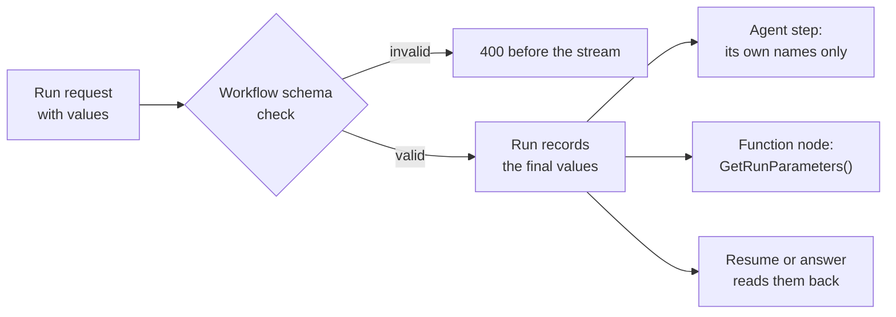

How do one workflow definition serve many tones, voices or customers without being copied? A workflow declares run
parameters, a run supplies the values, and every step receives the part of them it declared.



A stored workflow can declare run parameters, the same `AgentParameter` an agent
declares (name, kind, `Required`, `DefaultValue`, `Description`). The values a run
supplies reach every agent step, so one definition serves many tones, voices or
customers without being copied:

```bash
curl -sS -X PUT http://localhost:5081/tracon/api/workflows/podcast \
     -H 'Content-Type: application/json' -d '{
       "kind": "Sequential",
       "agentNames": ["podcast-writer", "podcast-editor"],
       "parameters": [
         { "name": "tone",  "kind": "Text", "required": true },
         { "name": "voice", "kind": "Text", "defaultValue": "alloy" }
       ]
     }'

curl -N -X POST http://localhost:5081/tracon/api/workflows/podcast/run \
     -H 'Content-Type: application/json' \
     -d '{"message":"Episode 12","parameters":{"tone":"formal","voice":"nova"}}'
```

- **The workflow's schema is the contract.** A missing required value, a name the
  workflow does not declare, or a value over `MaxParameterValueLength` is refused with
  `400` before the stream opens, with the same body an agent run gives
  (`missingParameters`, `unknownParameters`, `tooLongParameters`). The runner checks
  again, so a caller that skips HTTP gets the same refusal.
- **A step receives the values its own schema names.** `podcast-writer` declares only
  `tone`, so it never sees `voice`; `podcast-editor` declares both. A name the step does
  not declare is dropped for that step, and a value the workflow supplies wins over the
  step's own default. The step is bound the way a direct run of that agent would be
  (its instructions, its recording, its tool-approval gate), and its own run row records
  the values it was bound with.
- **Every participant is checked before the first model call.** If an agent in the
  workflow needs a required parameter that has no default and that the workflow does not
  supply, the run ends `Failed` without a single model call, and the error names the
  agent and the parameter. Saving the workflow does not check this, because the agents
  can change after it is saved.
- **A function node reads the values** with `context.GetRunParameters()`, a read-only
  dictionary with the defaults applied:

```csharp
tracon.AddWorkflowFunction<List<ChatMessage>, List<ChatMessage>>(
    "narrate",
    services => (messages, context, cancellationToken) =>
    {
        var voice = context.GetRunParameters().GetValueOrDefault("voice", "plain");
        return ValueTask.FromResult<List<ChatMessage>>([new(ChatRole.User, $"[{voice}] {messages[^1].Text}")]);
    });
```

  Called outside a workflow run it throws `InvalidOperationException` instead of
  returning an empty set, so a forgotten setup is not read as "no values".
- **Resume and respond use the same values.** The run records its final values, and a
  resume from a checkpoint or an answer to a waiting request reads them back and passes
  them on to the run it opens. If the version the run continues with declares parameters
  but the run recorded none, the resume is refused — the agents would otherwise continue
  under their defaults, halfway through the work. That happens when
  `RunRecording:RecordRunInput` is off, so a workflow with parameters that waits for a
  human needs it on. The values are read against the schema of the version the run
  continues with, which by default is the one it recorded (see
  [Versions, rollback and pinning an agent step](/concepts/workflows/#versions-rollback-and-pinning-an-agent-step)).
  When you name a newer version, a name its schema no longer declares is dropped and a
  required name it gained since is refused.
- **A workflow defined in code declares its schema in its registration**
  (`WorkflowRegistrationOptions.Parameters`), checked, queued and recorded like a stored one's.
  Without a schema every value sent is refused.

A workflow row stores no message: the values are the only input it records.

## Read next

- [Workflows](/concepts/workflows/): the patterns, function nodes, versions and recovery these values flow through.
- [A workflow that a person can send back](/guides/review-and-revise-workflow/): parameters on a graph built in code.
