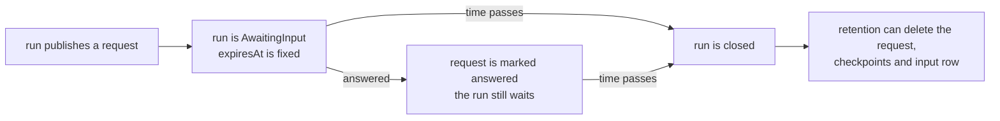

How many people are your workflows waiting on right now, and what happens to a request
nobody answers? This page covers the tenant-wide list of waiting requests and the time
limit a workflow can give them. How a workflow asks, and how an answer resumes it, is in
[Asking a human](/concepts/workflows/#asking-a-human); what an answer leaves behind is in
[Answering a workflow](/concepts/workflow-answers/).

## The list of waiting requests

`GET /api/workflows/requests` lists the human requests that the workflow runs of your
tenant wait on, across every workflow, oldest first. The console shows the same list in
the *Workflow requests* panel of the Approvals screen. Each item is a
[pending request](/http-api/schemas/workflowpendingrequest/) with five more fields:

| Field | Meaning |
|---|---|
| `workflowName`, `sessionId` | The workflow, and the execution session its runs share |
| `expiresAt` | When the request runs out; `null` when the workflow sets no time limit |
| `answered` | Whether somebody answered the request |
| `lastResponseRunId` | The run that carried out the latest answer; `null` while nobody answered |

| Query | Meaning |
|---|---|
| `state` | `pending` (default): nobody answered. `answered`: answered, but the run still waits. `all`: both |
| `workflowName` | List one workflow |
| `skip`, `take` | A page; `take` is from 1 to 200 and defaults to 50 |

The filter runs before the page, so a page is full unless the list ends. A `state` that is
none of the three is `400`.

**One request is listed once.** An answered run stays `AwaitingInput`, and the run that
continues it publishes the requests that are still open again, with the same request id.
The same request id in the same session is therefore one request, and the item names the
newest run that waits on it: the run to answer. `GET /api/workflows/runs/{runId}/requests`
is unchanged in what it returns — the requests that run published — and carries the same
five fields.

**An answered request stays in the list** until its run is closed, marked `answered`, with
the run that carried the answer out. The default `state=pending` hides it. This is the
same rule that keeps an answered run `AwaitingInput`: a second answer opens a new branch.

The list needs the `Reader` role and read access to runs. A registered
`IRunAuthorizationHandler` that refuses reading runs rejects the whole list with `403`; it
never filters the list, because a filtered page would be shorter than the caller is allowed
to see. A host without the workflow engine answers `501`.

:::note[Runs that started waiting before the list existed are not in it]
The list is built from a row the engine writes when a run starts waiting. A run that
started waiting on an older version has no row: read its requests with
`GET /api/workflows/runs/{runId}/requests` and answer them as before. The row also carries no
copy of the prompt — the list reads it from the run's own event stream, the same text the
run's card shows, with the same content protection.
:::

## Giving a request a time limit

A run that waits for a person keeps its request event, its checkpoints and its input row
for as long as it waits, because answering needs them. An answered run waits too, so these
rows are never deleted. A **request timeout** is how a workflow lets go of them: when the
time passes, the run is closed and retention can delete what it kept.

Set it per workflow:

- `requestTimeout` on `PUT /api/workflows/{name}`, as `d.hh:mm:ss`.
- The *Answer time limit* field in the console's workflow editor, in seconds or `d.hh:mm:ss`.
- For a workflow defined in code, `WorkflowRegistrationOptions.RequestTimeout`:

```csharp
builder.AddWorkflow(
    "publish-approval",
    services => BuildPublishApproval(services),
    options => options.RequestTimeout = TimeSpan.FromDays(7));
```

The value is from one minute to 365 days; a save outside the range is refused with `400`.
Without a value a request waits without limit. The save is a full replace like every other
field, so a client that leaves `requestTimeout` out removes the limit.

The time counts from the moment the run published the request, and it is fixed then. A run
that waits keeps the limit of the version it started with: saving the workflow again
changes it for runs that start afterwards. A continuation that publishes a request again
starts that run's count from its own moment.



## When the time passes

A background scan closes the requests whose time has passed, and then the runs that wait on
no other request:

| What the run waited on | The run is closed |
|---|---|
| A request nobody answered | `Failed`, with the error type `WorkflowRequestExpired` (error class `Timeout`) |
| Requests that were all answered | `Completed`, with no error: the answer was given and its work continued on another run |
| Several requests, the last one now due | When the last one passes. A request a slower branch published later keeps the run waiting |

A run that fails this way publishes `run.failed` to the webhooks subscribed to it, with the same
payload any failed workflow run carries, so a pipeline driven by webhooks learns that the review ended
without polling. The event is sent after the run is closed; a publisher that fails is logged and the
close stands. A run closed `Completed` publishes nothing: the answer started a run of its own, which
published its own `run.completed` when it ended.

An answer to a closed run is refused with `400`, as an answer to any run that is not
`AwaitingInput` is, and opens no run. The closed run keeps its usage, cost and event count.
The next retention round deletes its request event, checkpoints and input row by age, like
those of any finished run; the `workflow_requests` retention target deletes the closed rows
of the list after `Tracon:Retention:WorkflowRequests:MaxAgeDays` (30 days by default).

Two settings under `Tracon:Workflows` control the scan:

| Key | Default |
|---|---|
| `RequestExpirationScanInterval` | 1 minute |
| `MaxRequestExpirationsPerScan` | `100` |

A request is closed at most one interval after its time. Only one instance of a cluster
scans at a time. The scan reads an index of the requests that have a limit, so it costs
nothing while no workflow sets one.

:::caution[A request whose row could not be written never expires]
When the row of a request cannot be written, the run still waits and the request can still be
answered from the run, but it is missing from the list and it never expires. That is logged
as a warning.
:::

A scan closes the request first and the run second. If the second write fails, the scan tries
the run again on each scan of the same process. If the process stops between the two writes,
the next instance that takes the scan lease looks for runs that still wait although none of their
requests is open, and closes them the same way.

### An answer that arrives with the time limit

The request and the run are two writes, so an answer can arrive between them.

- An answer **before** the scan closes the request is taken and marks the request answered. At the limit the run closes `Completed`.
- An answer **between** the two writes is taken too, and its work runs: the run still waits, so the check passes. The request is already closed and cannot be marked. The run you answered then closes `Failed` with `WorkflowRequestExpired`, and the run that carried out your answer is not affected.
- An answer **after** the run is closed is refused with `400`, as above. A queued answer (`Prefer: respond-async`) that was accepted before the limit but starts after it fails on its own run for the same reason.

The window is the time between two writes, usually milliseconds.

## Read next

- [Asking a human](/concepts/workflows/#asking-a-human) — how a workflow asks and how an answer resumes it.
- [Answering a workflow](/concepts/workflow-answers/) — the audit entry and the record every answer leaves.
- [Retention defaults](/reference/configuration/#retention-defaults) — what retention keeps for a run that waits, and what it deletes after.
