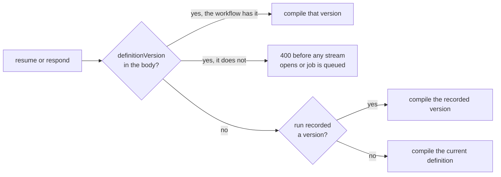
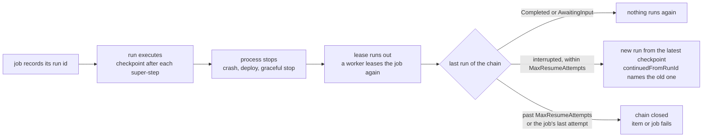
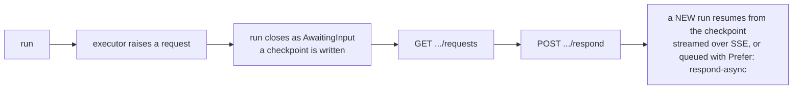

A workflow runs several agents together. Where a callable agent is one agent using
another as a tool, a workflow is an orchestration you define and can watch.

**Tracon does not implement a workflow engine.** A definition compiles onto the
Microsoft Agent Framework's own graph, and `Microsoft.Agents.AI.Workflows` executes
it. What Tracon adds around that engine is the catalog a definition lives in, the
checkpoint store it resumes from, the quota and cancellation it runs under, and the
`runs` row that records what happened. Five public types are the whole of Tracon's
workflow surface.

Workflows need `Tracon.Workflows`. Without that package registered, definition
management still works and only the execution endpoints answer `501` — the package
stays optional on purpose.

## Five patterns

| Kind | What it does |
|---|---|
| `Sequential` | Agents run in order; each output is the next input |
| `Concurrent` | Agents run at the same time; results are merged |
| `Handoff` | One agent starts and hands off when needed — the **model** decides |
| `GroupChat` | A manager distributes turns among participants |
| `Magentic` | A manager plans, tracks progress, and replans; a manager agent is required |

`MaxIterations` bounds the turn count for `Handoff`, `GroupChat`, and `Magentic` — the
only structural guard against two agents handing off to each other forever. Each
participant call also carries the same two-layer wait limit a callable agent's
sub-call does (see [Agents calling agents](/concepts/agents/#agents-calling-agents)):
a cooperative deadline, then a hard cutoff for a participant that ignores it. The
installation-wide default applies, except to an agent node of a `Sequential` node
list, which can carry its own `timeout` (see
[Bound a node with a timeout](/concepts/workflow-function-nodes/#bound-a-node-with-a-timeout)).

A participant that cannot answer **fails the run**, unlike a callable agent, whose
caller's model reads the refusal and can try another way. No model reads a
workflow step's answer, so the refusal would reach the next node as its input. The
run ends `Failed` and no later node runs: past the wait limit with error type
`child_run_timeout` (class `Timeout`), refused by the call-tree budget with
`run_budget_exceeded` (class `QuotaExceeded`), or with the provider's own error when
the provider never answered. Match the wait-limit type with
`TraconChildRunTimeoutException.ChildRunTimeoutErrorType` when you read a run's `error`.

A tool that asks for approval is not a refusal where the pattern hosts the agent: the
workflow waits for a person ([A tool that asks for approval](#a-tool-that-asks-for-approval)).
It is a refusal for an agent node of a `Sequential` node list, for `GetWorkflowAgentStep` and for
the manager of a `Magentic` workflow. The first two run the agent in a plain function node
that cannot wait, and the manager plans the task rather than being hosted as a participant:
the run ends `Failed` with the message *a workflow step cannot wait for a tool
approval*, and the tool does not run. Give that agent a tool that needs no approval, or an
[approval rule](/concepts/governance/#approvals) for the tool.

```csharp
new WorkflowDefinition
{
    Name = "triage",
    Kind = WorkflowKind.Handoff,
    AgentNames = ["frontline", "billing", "technical"],
}
```

Which fields are required depends on the kind, and the definition is validated when it
is **saved** using the same rules the compiler applies. A shape that could not run is
rejected at write time rather than on the first execution.

## Function nodes

A real pipeline has steps that are not AI calls — a file download, a format
conversion, a database write. `AddWorkflowFunction` registers one by name, and a
`Sequential` definition places it in its `Nodes` list next to catalog agents.
[Workflow function nodes](/concepts/workflow-function-nodes/) covers the
registration, the type rules between nodes, settings, what a node reports beyond
tokens, the budget check, retries, and timeouts.

## Graphs built in code

Workflows can also be built in code with MAF's own builder.

:::caution[The registration key is what routing uses]
When you add a workflow in code, `AddWorkflow("approval-flow", …)` is the key every
URL resolves against. A different name passed to the builder's `WithName(…)` is
cosmetic — and an inconsistency between the two produces a silent `404` or a timeout
rather than an error. Use the same string in both places.
:::

A graph with a way back or a human gate is built in code with `AddWorkflow`. Two helpers give its steps
what a stored chain's steps have: `GetWorkflowFunction` binds a registered function with its time limit,
retry, budget gate and cost line, and `GetWorkflowAgentStep` binds an agent as a plain step that a message
can return to; the step can run a fixed version of its agent or the one a run parameter names (see
[Let a run choose the version of an agent step](/concepts/workflow-parameters/#let-a-run-choose-the-version-of-an-agent-step)).
A registration also takes `RunTimeout` and `Parameters`.
[A workflow that a person can send back](/guides/review-and-revise-workflow/) builds one.

A graph built in code can also raise its own `WorkflowEvent` from an executor
(`context.AddEventAsync`). Tracon has no event type for a type of your own, so it records the
event as a `tracon.workflow.event` event on the workflow run, naming the event's type (and the
executor, when the event derives from `ExecutorEvent`), instead of dropping it. See
[Content and events the run has no type for](/concepts/runs/#content-and-events-the-run-has-no-type-for).

## Parameters

A workflow declares run parameters, the same `AgentParameter` an agent declares. A run supplies the values, each agent
step is bound with the names its own schema declares, and a function node reads them with `context.GetRunParameters()`.
[Workflow parameters](/concepts/workflow-parameters/) has the rules, for a stored workflow and for one defined in code.

## Versions, rollback and pinning an agent step

Every save of a stored workflow appends a version. Nothing rewrites history:

- `GET /api/workflows/{name}/versions` lists full snapshots, newest first. It needs the
  Reader role (the `WorkflowsRead` scope for an API key).
- `GET /api/workflows/{name}/versions/{a}/diff/{b}` returns both snapshots verbatim, as
  `left` and `right`. The client computes the diff.
- `POST /api/workflows/{name}/rollback` with `{"version": 2}` writes the content of
  version 2 as a **new** version. It needs the Admin role (the `WorkflowsAdmin` scope).
  The audit trail records `workflow.rollback`, and a rollback can be rolled back in turn.

A rollback is checked like a save. A version that names a function that is no longer
registered, settings that no longer fit their function, or an agent version that no longer
exists answers `400`; nothing is written and nothing is audited. An unknown version answers
`404`. A workflow defined in code answers `409` to a rollback and `404` ("Workflow has no
version history") to the read calls: its history is your source history.

A version number is never reused. Deleting a workflow keeps its history, and saving the same
name again continues the numbering: after version 3 and a delete, the next save is version
4. The kept versions are not served over HTTP while the workflow is deleted. A workflow
stored before versions were kept starts its history at the version it has today.

### A resume compiles the version the run recorded

The row of a workflow run records the definition version it was compiled from, as
`agentVersion` on `GET /api/runs/{runId}`. It is `null` for a workflow defined in code and
for a row written before versions were kept. A resume and a response are stamped with the
version they ran.

A resume compiles the version the run **recorded**, not the current one. An edit made while
the run waits changes nothing for it: not a setting, a timeout or the parameter schema, and
not a step that was added or removed. A run that recorded no version resumes with the
current definition. A workflow that was deleted is still refused.



To carry a waiting run over a fix, send the edited version in the optional
`definitionVersion` field of `resume` or `respond`, for example
`{"definitionVersion": 4}`:

- A version the workflow does not have answers `400` ("Definition version not found"),
  and so does a recorded version the workflow no longer has. `0`, a negative number, or a
  version of a workflow defined in code answers `400` ("Definition version invalid"). The
  check runs before a stream opens or a job is queued.
- The checkpoint belongs to the graph that wrote it. A version whose graph differs from it
  — a step added, removed or reordered, another pattern, another stored form — fails the
  run, and the error says the graph's structure differs. A version that differs only in
  settings, timeouts or an agent pin resumes: those are not part of a step's identity.

### Pin an agent step to a version

An agent step in the `nodes` form can run one version of its agent while the agent is
edited. Set `agentVersion` on the node:

```bash
curl -sS -X PUT http://localhost:5081/tracon/api/workflows/narrated \
     -H 'Content-Type: application/json' -d '{
       "kind": "Sequential",
       "nodes": [
         { "name": "writer", "kind": "Agent", "agentVersion": 4 },
         { "name": "tts", "kind": "Function" }
       ]
     }'
```

- The step runs version 4's instructions, model and tools, and its own run row records
  version 4. A step with no `agentVersion` runs the agent's current version, resolved each
  time the step runs.
- A save refuses a pin that cannot hold with `400`: a pin on a function node, a number
  below 1, an agent defined in code (it keeps no version history), and a version the stored
  agent does not have. The compile repeats the check, because the agent can be deleted
  after the workflow was saved: the run then fails before its first step.
- A pin is not part of the step's identity. Changing the pin of a step in a node list never
  makes a waiting run's checkpoint unusable.
- A pin reaches the step's agent and the callable agents that version pins. An entry with no
  `version`, and the skills, run their current version.
- Only `Sequential` workflows have `nodes`, so only they can pin. A chain written as
  `agentNames` cannot.

The console lists a workflow's versions, compares two of them and rolls back; its chain
editor pins an agent step (see [the console](/ui/#workflows)). It saves a pinned chain in
the `nodes` form, so pinning the first step of a chain stored as `agentNames` changes the
stored form. A different form is a different graph, and a run that waits keeps resuming
the version it recorded.

## Running one

```bash
curl -N -X POST http://localhost:5081/tracon/api/workflows/triage/run \
     -H 'Content-Type: application/json' \
     -d '{"message":"My invoice is wrong and the app crashes"}'
```

Events stream over SSE. The first frame reports the run id, and **every agent invoked
inside the workflow opens its own run row** — so the whole thing is readable as a tree
with `GET /api/runs/{runId}/tree`, with each agent's tokens and duration attributed
separately.

The request is checked before the stream opens, so a mistake is a status code, not an
event in a `200` stream. An unknown workflow or run answers `404`, and so does a run of
another tenant. An invalid `sessionId`, a checkpoint the run does not have, a
`definitionVersion` the workflow does not have, and an answer to a run that does not
wait for input answer `400`. None of these opens a run.

The name `functions` is reserved: `GET /api/workflows/functions` lists the function
nodes, so a workflow saved under that name could not be read back. Saving it answers
`400`, and `AddWorkflow` throws.

### Queue a run instead of streaming it

A streamed run belongs to the connection that reads it: if the client stops reading,
the run ends `Canceled`. To run in the background — a render that takes
minutes, a pipeline a deploy must not cut short — send `Prefer: respond-async`:

```bash
curl -i -X POST http://localhost:5081/tracon/api/workflows/podcast/run \
     -H 'Content-Type: application/json' \
     -H 'Prefer: respond-async' \
     -H 'Idempotency-Key: episode-12' \
     -d '{"message":"Episode 12","sessionId":"episode-12"}'
```

The request passes the same checks a streamed one does — attribution, authorization,
session ownership, quota and parameters — and only then is the run queued. The answer
is `202 Accepted` with a `Location` header and a body that names the run:

```json
{
  "runId": "01a1340e-ad31-75e4-b64b-e3d0a26ab0a1",
  "jobId": "01a1340e-ad31-75e4-b64b-e3d0a26ab0a1",
  "location": "/tracon/api/runs/01a1340e-ad31-75e4-b64b-e3d0a26ab0a1",
  "eventsLocation": "/tracon/api/runs/01a1340e-ad31-75e4-b64b-e3d0a26ab0a1/events"
}
```

The run's row exists at once with the status `Queued`, so `GET /api/runs/{runId}` and
`POST /api/runs/{runId}/cancel` work before a worker picks it up. The job id is the
run id. Read the events from `GET /api/runs/{runId}/events`. A run queued without a
`sessionId` gets one before the `202`, and the row names it.

`resume` and `respond` take the same header. A queued answer is checked before the
`202`: an answer of the wrong shape, a request id that is not pending, a run that
is not waiting, and a `definitionVersion` the workflow does not have are each refused
with `400`, and an unknown run with `404`. A machine
that answers a request when its own work finishes therefore never has a background run
fail on the answer. The queued answer is stored with the job until the job is removed:
do not put a secret in it.

`Idempotency-Key` makes a retried call safe: the same key returns the same `202` and
queues nothing. On these three endpoints the key is accepted only together with
`Prefer: respond-async`. A stream cannot be stored and replayed, so a key on a
streamed call is refused with `400`. A `sessionId` is a correlation, not a
de-duplication: two calls with the same session id and no key are two runs.

Queuing needs a job worker (`Tracon:Scheduling:RunWorker`, on by default), and
`Tracon:AsyncRun:Enabled = false` answers the header with `501`. A queued run is not
something a schedule can start: schedule `tracon.workflow` instead (see
[Background work](/guides/background-work/)).

`GET /api/workflows/{name}/graph` returns the compiled graph. Node ids are identical
to the executor ids in the run events, which is how the console colours nodes live as
the workflow progresses. The response also carries MAF's generated Mermaid text.

A workflow run's `error` follows the [same redaction rule as an agent
run](/concepts/runs/#the-error-message-is-safe-to-display-not-safe-to-debug-from): a
node that throws a `TraconException` keeps its message. Any other exception —
your own node's included — carries only its exception type and a correlation id,
and its message goes to the server log under the same id. Throw a
`TraconException` when a node's message is meant for the person reading the run.

A workflow run ends `Canceled` only when it was cancelled — the
caller's request going away, `POST /api/runs/{id}/cancel`, a worker that stops
gracefully while it runs a queued run, or `Tracon:Workflows:RunTimeout` being
reached. The call-tree budget's
`AgentGraph.MaxDuration` is not one of these: a step it refuses ends the run
`Failed` with `run_budget_exceeded` (see below). A node whose model or tool call
never came back ends the run `Failed` instead, even though .NET surfaces an
`HttpClient` timeout as a `TaskCanceledException`. The same holds for the steps
around the graph: an agent catalog that times out while the workflow resolves, and
a stop at the super-step limit whose cancellation call times out, both end the run
`Failed`. Alert on the two separately: one is a person stopping, the other is an
outage.

`RunTimeout` (10 minutes by default) is **cooperative, and observed between
super-steps**. It cancels the token the run is given and the runner checks it
as each super-step ends. A node without a timeout of its own that ignores its
cancellation token runs to completion, and the run stops at the next boundary;
a node with a timeout stops being waited for at once. To bound one step, give
the node a timeout (see [Bound a node with a timeout](/concepts/workflow-function-nodes/#bound-a-node-with-a-timeout)).
A run stopped this way ends `Canceled` with a `TimeoutException` error that names
`Tracon:Workflows:RunTimeout`.

A definition can set its own `runTimeout`. It may always shorten
`Tracon:Workflows:RunTimeout`; it may be longer only up to
`Tracon:Workflows:MaxRunTimeout`, which is unset by default because a running
workflow holds a slot every tenant shares. A save above the ceiling is refused with
`400`. A run stopped by its definition's value names the definition's `runTimeout`
instead.

The deadline starts when the run starts, so it also counts the time a run waits
for a slot when `MaxConcurrentRuns` workflows are already running. A waiting run
already has its run record and shows `Queued` ([limit it per
tenant](/guides/background-work/#limit-workflow-runs-per-tenant)); a run whose
deadline passes before it gets a slot ends like any other timed-out run.

A workflow stream writes an SSE comment whenever it has sent nothing for
`StreamKeepAliveInterval` (15 seconds by default), so a node that works quietly
for minutes does not look like a dead connection. A closed connection still
cancels the run.

A workflow's root run shares the same call-tree budget every agent run does
(`AgentGraph.MaxTotalTokens`/`MaxTotalCost`/`MaxDuration` — see [Reliable
runs](/guides/reliability/#bound-multi-agent-trees)): every agent node the
workflow invokes spends against the same tree, so a workflow with a long chain
of agent steps is bounded the same way a single agent's own tool loop is. A step
the budget refuses fails the run (see above), and so does a function node it
refuses to start. What a function node
[reported beyond tokens](/concepts/workflow-function-nodes/#report-what-a-node-spent-beyond-tokens) counts against
`MaxTotalCost` too. The budget is [the logical run's](/guides/reliability/#the-ceiling-of-a-workflow-is-the-logical-run): a
run that continues an earlier one starts from what the earlier runs spent. The tenant's cost quota
[stops a node that has not started](/concepts/governance/#a-quota-also-stops-work-that-has-not-started) too.

## Checkpoints

A workflow writes checkpoints as it goes, controlled by
`Tracon:Workflows:EnableCheckpointing` (default `true`).
`GET /api/workflows/runs/{runId}/checkpoints` lists them and
`POST /api/workflows/runs/{runId}/resume` continues from one — omit the id to resume
from the latest.

Resuming opens a **new** run. The original is never rewritten, so the history stays two readable
records, not one edited one. The new run
compiles the definition version the original recorded, unless the request names another
(see [Versions, rollback and pinning an agent step](#versions-rollback-and-pinning-an-agent-step)).

A workflow run whose process stopped is closed as `Failed` by
[run reconciliation](/guides/reliability/#reconcile-runs-left-behind-by-a-crash), like
any other orphaned run. Automatic run continuation does not pick it up or any of its
steps: continuation repeats an agent turn, and a workflow run is
not one. With continuation on, the run's event stream records a
`RunContinuationBlocked` event that names the call to make instead,
`POST /api/workflows/runs/{runId}/resume`. Resuming from the latest checkpoint repeats
the step the stop cut short, so the idempotency rule for function nodes above applies.
A run a job started can be resumed by that job instead, as the next section shows.

### Resume an interrupted run automatically

A run a job started — a queued run, or an item of a `tracon.workflow` batch — has an
owner that outlives the process: the job. With `ResumeInterruptedRuns` on, the job
continues an interrupted run when it is leased again:

```csharp
builder.Services.AddTracon()
    .UsePostgreSql(connectionString)
    .UseWorkflows(options =>
    {
        options.ResumeInterruptedRuns = true;
        options.MaxResumeAttempts = 1;
    });
```



- Before a batch item's run starts, the handler writes the run's id on the item. A
  queued run's id is the job's id from the start.
- When the job is leased again after a crash, a deploy or a graceful stop, the
  handler reads that run. If it is `Completed` or `AwaitingInput`, nothing runs again.
  Otherwise a run left `Running` is closed as `Failed` with the error type
  `interrupted`, and a new run continues it from the latest checkpoint in its chain.
  A continuation that was opened and never started counts as interrupted too.
- A run its job's time limit stopped is not interrupted: it closes `Canceled` with
  the error type `job_max_duration_exceeded` and is never continued, so the limit
  bounds the work, not one attempt of it
  ([Background work](/guides/background-work/#queue-one-workflow-run)).
- The new run's `continuedFromRunId` names the run it continues.
  `GET /api/runs?continuedFromRunId={runId}` walks the chain forward.
- The new run uses the same session, the parameter values the chain recorded, and the
  user and labels of whoever queued the job. It is not counted against the quota or
  asked for authorization again: the job was, when it was queued.
- A continuation from a checkpoint compiles the definition version the run that wrote the
  checkpoint recorded, like any other resume. A save made while the job waits for its
  lease does not change it.
- If no run of the chain wrote a checkpoint — the process stopped before the first
  super-step ended — the run starts again in the same session, or the resume or the
  answer is applied again. A run that starts again compiles the definition version the
  chain's first run recorded, so a save made while the job waited does not change it; a
  workflow defined in code has no versions.
- `MaxResumeAttempts` (default `1`, from `0` to `100`) bounds the continuations of one
  chain. Past it the batch item fails with the chain's last run closed, or the queued
  run's job fails with `tracon.job.workflow-run-not-continued`. With `0`, nothing
  continues, but the interrupted run is still found and closed.
- The worker fails a lease past the job's attempt limit before the handler runs, so
  the job's last attempt never starts a continuation: nothing would close it if it
  were interrupted too. The last attempt closes the chain instead. A queued run's job
  gets `2 + MaxResumeAttempts` attempts: one for the run, one per continuation, and
  the one that closes the chain. A batch job keeps its own attempt limit
  (`Tracon:Scheduling:MaxAttempts`, `3` by default, or the job's `maxAttempts`), so
  give it `2 + MaxResumeAttempts` attempts to get every continuation.

:::caution[The step in progress runs again]
A checkpoint is written as each super-step ends. The steps finished before the stop
are not repeated; the step that was running is. A function step with a side effect
must be idempotent, an agent step repeats its model calls and tool calls, and a
`Loop` agent step repeats every turn it had finished — its turns are not
checkpointed.
:::

The job notices the stop only when its lease runs out (`Tracon:Scheduling:LeaseDuration`,
five minutes by default) and a worker leases it again. A run bound to a connection is
never resumed automatically: its reader is gone. Recovery needs `EnableCheckpointing`
(turning recovery on without it fails at startup) and a SQL provider, so checkpoints
survive the restart. A graceful stop closes the run it stops as `Canceled` and keeps
its checkpoints, even with `KeepCheckpointsAfterCompletion` off: the continuation shares
the session, and the cleanup runs when the continuation finishes. Run reconciliation
still never resumes a workflow run itself: two owners would resume the same run twice.

Checkpoints survive a process restart only with a SQL provider registered
(`UsePostgreSql()`, `UseSqlServer()`, or `UseSqlite()`). The in-memory store keeps at
most 50 checkpoints per session and drops the oldest — enough for local development,
not for a workflow you expect to resume after a restart. They are also a retention
target, so an old run may have none left even on durable storage — except a run
waiting for a human answer, whose checkpoints retention keeps until the run is closed
(see [time limits](/concepts/workflow-requests/#giving-a-request-a-time-limit)).

With `KeepCheckpointsAfterCompletion = false`, a finished run deletes its session's
checkpoints only when no other run of the session still needs them — none is
waiting for an answer and none is running. A run that a stopping worker left to its
job is not finished: with `ResumeInterruptedRuns` on, it keeps its checkpoints for the
continuation. A run that asked a human keeps waiting
even after an answer (a second answer opens a new branch), so a session that
paused for input keeps its checkpoints; retention removes those of its finished
runs.

Attachments that an agent step makes — a generated image, a speech clip — carry
the workflow's session id. That id never gets a session row, so the workflow run
owns the attachments instead: retention keeps them while a run with that session id
waits for input, is still running, or finished after the retention cutoff. After
that they are orphaned, and the `attachments` retention target removes them
together with their stored content.

Turning off `EnableCheckpointing` does not silently disable resumption: a workflow
that stops to wait for a human answer fails outright instead of hanging with no way
to resume.

A checkpoint's state is the Microsoft Agent Framework's own serialized graph;
Tracon does not interpret it and makes no promise that a checkpoint written
by one Microsoft Agent Framework version can be resumed by a different one. See
[Versions and upgrades](/reference/versioning/#persisted-session-and-checkpoint-state)
for the compatibility policy.

`tracon state-check` counts stored checkpoints by the Tracon envelope
generation stamped on them and says which of those the build running the
command understands. That is as far as it can go for a checkpoint: the state
inside has no decoder outside a running workflow, so the command reports a
sampled checkpoint as checked for structure only and never claims to have
resumed it.

## Asking a human

A workflow can stop and wait for input:



A request's prompt and form are read from the run's own event stream — nothing copies
them — and only a run in `AwaitingInput` has any. [Workflow requests and time
limits](/concepts/workflow-requests/) covers the tenant-wide list of them and the time
limit a workflow can give them. The answer is matched to the request that is
re-published with the same id when execution resumes. A very long prompt is cut at
the event payload limit (`RunRecording:MaxPayloadLength`) and marked
`…[truncated]`; the request is still listed and can still be answered.

The answer must fit the request's `form`: `approved` for `Boolean`, `text` for `Text`,
`data` that reads into the port's response type for `Json`, and for `PlanReview`
either an approval or `approved: false` with the revision in `text`, and for `ToolApproval`
`approved`, an optional reason in `text` and an optional `remember`. An answer that
does not fit is refused with `400` before anything runs, and no new run opens. The
detail names the port and the missing or unreadable field. A request recorded by
Tracon 1.0.0-preview.3 or earlier does not carry its response type's assembly: for it,
a `data` value that does not read into the type is still reported on the stream, as a
failed run.

This is the same append-only shape as tool approvals: the waiting run stays as it was,
and the response opens a new one. The new run compiles the definition version the waiting
run recorded, so editing the workflow while a person decides does not change what continues
(see [Versions, rollback and pinning an agent step](#versions-rollback-and-pinning-an-agent-step)).
In the default response mode, a second answer to the same request opens a second new run.

### A tool that asks for approval

Where the pattern hosts the agent, a tool that needs approval stops the workflow instead of
failing it: the request has the form `ToolApproval` and is answered with `approved`, a
reason, and optionally `remember`. [Answering a tool
approval](/concepts/workflow-answers/#a-tool-that-asks-for-approval) has the rules.

The skill tools are tools that ask. A step whose agent names skills stops for an approval at its
first `load_skill` call, unless the agent's definition sets `Skills.DisableReadApproval`.
`run_skill_script` always stops the step. See [Approval of the skill
tools](/concepts/tools/#approval-of-the-skill-tools).

### One answer per request

A workflow can take one answer per request instead (`WorkflowResponseMode.SingleAnswer`):
the same answer given again follows the run the first one started, and a different answer
gets `409 Conflict`. In either mode, every answer that starts a run is written to the audit
trail first and recorded for `GET /api/workflows/runs/{runId}/responses`. [Answering a
workflow](/concepts/workflow-answers/) has the rules, what each answer leaves behind, and
the crash case that needs run reconciliation.

## Read next

- [A workflow that a person can send back](/guides/review-and-revise-workflow/) — a code graph with a human gate and a bounded revision loop.
- [Runs and recording](/concepts/runs/) — reading the tree
- [Evaluation and experiments](/concepts/evaluation/) — compare agent versions using cases, judges, and experiments.
