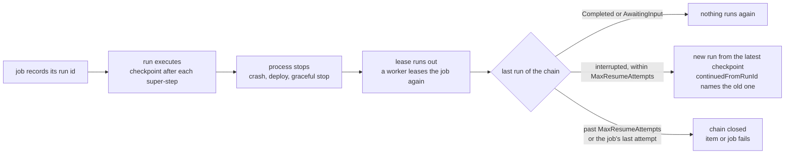
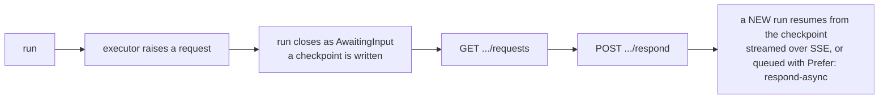

A workflow runs several agents together. Where a callable agent is one agent using
another as a tool, a workflow is an orchestration you define and can watch.

**Tracon does not implement a workflow engine.** A definition compiles onto the
Microsoft Agent Framework's own graph, and `Microsoft.Agents.AI.Workflows` executes
it. What Tracon adds around that engine is the catalog a definition lives in, the
checkpoint store it resumes from, the quota and cancellation it runs under, and the
`runs` row that records what happened. Five public types are the whole of Tracon's
workflow surface.

Workflows need `Tracon.Workflows`. Without that package registered, definition
management still works and only the execution endpoints answer `501` — the package
stays optional on purpose.

## Five patterns

| Kind | What it does |
|---|---|
| `Sequential` | Agents run in order; each output is the next input |
| `Concurrent` | Agents run at the same time; results are merged |
| `Handoff` | One agent starts and hands off when needed — the **model** decides |
| `GroupChat` | A manager distributes turns among participants |
| `Magentic` | A manager plans, tracks progress, and replans; a manager agent is required |

`MaxIterations` bounds the turn count for `Handoff`, `GroupChat`, and `Magentic` — the
only structural guard against two agents handing off to each other forever. Each
participant call also carries the same two-layer wait limit a callable agent's
sub-call does (see [Agents calling agents](/concepts/agents/#agents-calling-agents)):
a cooperative deadline, then a hard cutoff for a participant that ignores it. The
installation-wide default applies, except to an agent node of a `Sequential` node
list, which can carry its own `timeout` (see
[Bound a node with a timeout](#bound-a-node-with-a-timeout)).

A participant that cannot answer **fails the run**, unlike a callable agent, whose
caller's model reads the refusal and can try another way. No model reads a
workflow step's answer, so the refusal would reach the next node as its input. The
run ends `Failed` and no later node runs: past the wait limit with error type
`child_run_timeout` (class `Timeout`), refused by the call-tree budget with
`run_budget_exceeded` (class `QuotaExceeded`), when a tool asks for approval, or
with the provider's own error when the provider never answered.

```csharp
new WorkflowDefinition
{
    Name = "triage",
    Kind = WorkflowKind.Handoff,
    AgentNames = ["frontline", "billing", "technical"],
}
```

Which fields are required depends on the kind, and the definition is validated when it
is **saved** using the same rules the compiler applies. A shape that could not run is
rejected at write time rather than on the first execution.

## Function nodes

A real pipeline has steps that are not AI calls — a file download, a format
conversion, a database write. `AddWorkflowFunction` registers one by name:

```csharp
tracon.AddWorkflowFunction<List<ChatMessage>, List<ChatMessage>>(
    "word-count",
    services => (messages, context, cancellationToken) =>
    {
        var text = messages[^1].Text;
        return ValueTask.FromResult<List<ChatMessage>>([new(ChatRole.User, $"{text}\n\n({text.Split(' ').Length} words)")]);
    },
    "Appends a word count. Runs no model call.");
```

A `Sequential` definition's `Nodes` list can then mix that name in with catalog
agents, in order:

```csharp
new WorkflowDefinition
{
    Name = "summarize-and-count",
    Kind = WorkflowKind.Sequential,
    Nodes =
    [
        new WorkflowNodeReference { Name = "summarizer", Kind = WorkflowNodeKind.Agent },
        new WorkflowNodeReference { Name = "word-count", Kind = WorkflowNodeKind.Function },
    ],
}
```

`Nodes` and `AgentNames` are mutually exclusive — a definition sets one or the
other. Only `Sequential` supports function nodes: the ready-made builders for
the other four patterns accept only agents.

Each node must take what the node before it passes on. An agent node takes and passes
on a `List<ChatMessage>`, and a run starts by sending the user's message as one, so the
first node must take a `List<ChatMessage>` too. A function's types are the two type
arguments of its registration (`inputType` and `outputType` on
`GET /api/workflows/functions`). A node that takes a wider type, such as
`IEnumerable<ChatMessage>` or `object`, accepts the narrower one; a function that
declares `object` as its output is not checked against the next node. Saving a chain
that breaks this answers `400` and names both nodes and both types: Microsoft Agent
Framework drops a message that no handler takes, without an error, so the chain would
end every run `Completed` with no output. A run of a chain stored before this check,
or after a deployment changed a function's types, fails before its first node runs and
says the same.

The console builds such a chain too: **Workflows → New workflow**, then *Add an agent*
and *Add a function*, which picks from the functions registered in code. The arrows
reorder the steps and ✕ removes one. The function picker appears only for `Sequential`,
and the pattern stays `Sequential` while the chain holds a function.

A chain of agents only can be stored in either form over HTTP, `agentNames` or `nodes`,
and both keep working. The console writes one form per chain: **`nodes` when the chain
holds at least one function, `agentNames` otherwise.** Removing the last function in the
console therefore saves the chain back as a plain agent list on the built-in sequential
pattern, and adding the first one saves it as a node list. The editor says which form it
is about to store. The difference you can observe is token streaming: an agent step in a
node list does not stream its tokens into the workflow's live event feed (its own run row
keeps the full message history), while the built-in pattern does.

The factory passed to `AddWorkflowFunction` runs once, when the function
registry is built — not once per run. Every workflow compile shares the same
handler closure, so **the handler must be thread-safe**: a captured counter or
non-thread-safe client needs its own guard.

:::note[Code only, same boundary as tools]
A function's body is never written from the UI or the database — only its
*name* crosses that boundary, the identical shape `AgentDefinition.ToolNames`
already uses for tools. `GET /api/workflows/functions` lists what is
registered, for a picker to choose from.
:::

A function node opens no `runs` row of its own and contributes nothing to
cost or token totals — it made no model call. `ExecutorInvoked` /
`ExecutorCompleted` / `ExecutorFailed` still fire for it, same as any node, so
it is visible in the run's event stream and colored live in the graph.

:::caution[The handler must be idempotent]
Resuming from the run's *latest* checkpoint after it already completed does
not call the handler again — there is nothing left to run. Resuming from an
**earlier** checkpoint (the shape a real crash recovery takes) replays the
super-step that follows it, and the handler runs again with the same input. A
handler with a real side effect must tolerate being called more than once.
:::

### Give a function settings

One function often serves several workflows with a different configuration in each: a
voice, a loudness target, a destination folder. Register it with a settings type, and an
operator fills in the values on each workflow's node:

```csharp
tracon.AddWorkflowFunction<List<ChatMessage>, AudioClip, TtsSettings>(
    "tts",
    services =>
    {
        var speech = services.GetRequiredService<ITextToSpeech>();

        return (messages, settings, context, cancellationToken) =>
            speech.SpeakAsync(messages[^1].Text, settings.Voice, settings.LoudnessLufs, cancellationToken);
    },
    options => options.Description = "Text to speech");

public sealed record TtsSettings
{
    public required string Voice { get; init; }

    public double LoudnessLufs { get; init; } = -16;
}
```

```bash
curl -sS -X PUT http://localhost:5081/tracon/api/workflows/narrated \
     -H 'Content-Type: application/json' -d '{
       "kind": "Sequential",
       "nodes": [
         { "name": "writer", "kind": "Agent" },
         { "name": "tts", "kind": "Function", "settings": { "voice": "alloy", "loudnessLufs": -14 } }
       ]
     }'
```

In the console the same object goes into the **Settings** field of the function's step,
with the fields the function takes listed under it.

- **The code declares the shape; the operator writes values.** Settings are values, not
  expressions: nothing in them is evaluated, and a run parameter is not substituted into
  them. A function that needs a run's value reads it with `context.GetRunParameters()`.
- **A save checks the settings by reading them into your type.** An unknown field (a
  misspelled name), a missing `required` member, a number written as text, an enum written
  as a number and a `null` where the member does not allow one are all refused with `400`,
  and the message names the node and the member. A node without settings is read as `{}`,
  so a type with a `required` member refuses a node that carries none — you hear about it
  when you save, not in the first run. Names are camelCase and matched without regard to
  case. The function receives exactly the object that was checked.
- **Some settings are refused whatever the type.** Settings on an agent node, settings that
  are not a JSON object, and settings on a function that declares no settings type.
- **A change takes effect on the next run.** The graph is built again for every run, so
  the run in progress keeps the settings it started with. A resume reads the current
  settings, and an older checkpoint stays usable: the settings are not part of the node's
  identity, its name and place in the chain are.
- **A settings type that changed since the workflow was saved fails the run by name.**
  The run ends `Failed` before any node runs, and the error names the workflow, the node
  and the member. Save the workflow again with settings that fit. The same happens to a
  function that stopped taking settings while a stored node still carries some.
- **Never put a secret in settings.** They are stored in the workflow definition, appear
  in the audit trail and are returned to everyone who can read the workflow. Make the
  setting the *name* of the configuration key (`"apiKeyConfigurationKey": "Tts:ApiKey"`)
  and read the value from `IConfiguration` inside the factory.
- **A chain uses a function once.** A node's name is its identity in the graph, so the
  same function cannot appear twice in one chain; register it under a second name when it
  should run twice.
- **Wide numbers.** The console reads a JSON number as a double, like any JavaScript
  client, so an integer beyond 9007199254740991 (2^53 − 1) loses its low digits when an
  operator opens the workflow and saves it again. Settings are read strictly, so a string
  cannot fill a numeric member: declare an identifier that wide (a snowflake, a 64-bit
  database key) as a `string`.
- **Size.** One node's settings may be at most `MaxNodeSettingsLength` bytes of JSON
  (16 KiB by default) when a workflow is saved.

`GET /api/workflows/functions` returns each function with `settingsSchema`, the JSON
schema of its settings type, and `null` for a function that takes none. The console lists
the fields from it. It is for display: the check is the read described above, so what the
schema says and what a save accepts cannot drift apart.

### Retry a node on a transient error

`AddWorkflowFunction` takes an optional retry policy. For the settings overload it is
`options.RetryPolicy` on the `WorkflowFunctionOptions` callback, and every attempt sees the same
settings:

```csharp
tracon.AddWorkflowFunction<List<ChatMessage>, List<ChatMessage>>(
    "call-shipping-api",
    services => (messages, context, cancellationToken) => CallShippingApiAsync(messages, cancellationToken),
    "Looks up a shipment.",
    retryPolicy: new WorkflowNodeRetryPolicy
    {
        MaxAttempts = 3,
        InitialDelay = TimeSpan.FromSeconds(1),
        BackoffMultiplier = 2.0,
    });
```

Only a transient failure is retried — a provider error, an open circuit breaker, a
rate limit, or a timeout. Anything else (a bad argument, a permanent downstream
error) is thrown on the first attempt, exactly as without a policy. A failure that
carries a permanent HTTP status — any `4xx` except `408` and `429`, such as a `401`
from `EnsureSuccessStatusCode()` or a `404` from a model provider — is also thrown on
the first attempt: the same request gets the same answer, and a repeated `409` on a
non-idempotent call can repeat its side effect. Tracon reads the status from
`HttpRequestException.StatusCode` or from `HTTP nnn` text in the exception chain,
and a registered `IRunErrorClassifier` cannot make such a failure retry. The retry loop
runs entirely inside the node's own call: Microsoft Agent Framework invokes the
node once per routed message either way, so retrying costs nothing against
`TraconWorkflowOptions.MaxSuperSteps` — a node that succeeds on its third
attempt still counts as exactly one super-step.

### Bound a node with a timeout

A step that waits on a slow service can hold the whole run. Give the function a
timeout when you register it, with the overload that takes a
`WorkflowFunctionOptions` callback:

```csharp
tracon.AddWorkflowFunction<List<ChatMessage>, List<ChatMessage>>(
    "render-audio",
    services => (messages, context, cancellationToken) => RenderAsync(messages, cancellationToken),
    options =>
    {
        options.Description = "Renders the episode's audio.";
        options.Timeout = TimeSpan.FromMinutes(2);
    });
```

A stored definition can set a node's own `timeout`, which wins over the registered one
for that node; leave it out to use the registration's. `GET /api/workflows/functions`
shows each registered timeout.

```json
{ "name": "render-audio", "kind": "Function", "timeout": "00:05:00" }
```

- When the timeout passes, the token the handler was given is cancelled and the run
  ends `Failed` with the error type `workflow_function_timeout` (class `Timeout`),
  which names the node and the limit. No later node runs.
- The run stops waiting at the timeout even when the handler ignores its token. Such
  a handler keeps running in the background, its result is discarded, and its late end
  is logged; its side effects still happen. Pass the token on.
- With a retry policy, the timeout applies to each attempt, and a timed-out attempt is
  retried like any transient failure. The longest a node can take is about
  `MaxAttempts × Timeout` plus the delays.
- A caller's cancel or the run's own `RunTimeout` is not a node timeout: the run ends
  `Canceled` with the reason it already had.
- A timeout runs from 1 millisecond to about 49.7 days; a value outside the range is
  refused with `400` on save, or with `ArgumentOutOfRangeException` at registration.
  It is not checked against `RunTimeout`: whichever passes first stops the node.

An **agent node** of a node list can carry a `timeout` too. It replaces the
installation's `Tracon:AgentGraph:ChildDeadline` for that step, and the hard cutoff for
an agent that ignores its deadline stays 30 seconds after it. A step past it fails the
run with `child_run_timeout`, and the message names the node. A chain without a
function step is stored as `agentNames`, which has no node to carry a timeout, so its
steps use the installation's deadline; the console offers the field only on a chain
with a function step.

Workflows can also be built in code with MAF's own builder.

:::caution[The registration key is what routing uses]
When you add a workflow in code, `AddWorkflow("approval-flow", …)` is the key every
URL resolves against. A different name passed to the builder's `WithName(…)` is
cosmetic — and an inconsistency between the two produces a silent `404` or a timeout
rather than an error. Use the same string in both places.
:::

## Parameters

A stored workflow can declare run parameters, the same `AgentParameter` an agent
declares (name, kind, `Required`, `DefaultValue`, `Description`). The values a run
supplies reach every agent step, so one definition serves many tones, voices or
customers without being copied:

```bash
curl -sS -X PUT http://localhost:5081/tracon/api/workflows/podcast \
     -H 'Content-Type: application/json' -d '{
       "kind": "Sequential",
       "agentNames": ["podcast-writer", "podcast-editor"],
       "parameters": [
         { "name": "tone",  "kind": "Text", "required": true },
         { "name": "voice", "kind": "Text", "defaultValue": "alloy" }
       ]
     }'

curl -N -X POST http://localhost:5081/tracon/api/workflows/podcast/run \
     -H 'Content-Type: application/json' \
     -d '{"message":"Episode 12","parameters":{"tone":"formal","voice":"nova"}}'
```

- **The workflow's schema is the contract.** A missing required value, a name the
  workflow does not declare, or a value over `MaxParameterValueLength` is refused with
  `400` before the stream opens, with the same body an agent run gives
  (`missingParameters`, `unknownParameters`, `tooLongParameters`). The runner checks
  again, so a caller that skips HTTP gets the same refusal.
- **A step receives the values its own schema names.** `podcast-writer` declares only
  `tone`, so it never sees `voice`; `podcast-editor` declares both. A name the step does
  not declare is dropped for that step, and a value the workflow supplies wins over the
  step's own default. The step is bound the way a direct run of that agent would be
  (its instructions, its recording, its tool-approval gate), and its own run row records
  the values it was bound with.
- **Every participant is checked before the first model call.** If an agent in the
  workflow needs a required parameter that has no default and that the workflow does not
  supply, the run ends `Failed` without a single model call, and the error names the
  agent and the parameter. Saving the workflow does not check this, because the agents
  can change after it is saved.
- **A function node reads the values** with `context.GetRunParameters()`, a read-only
  dictionary with the defaults applied:

```csharp
tracon.AddWorkflowFunction<List<ChatMessage>, List<ChatMessage>>(
    "narrate",
    services => (messages, context, cancellationToken) =>
    {
        var voice = context.GetRunParameters().GetValueOrDefault("voice", "plain");
        return ValueTask.FromResult<List<ChatMessage>>([new(ChatRole.User, $"[{voice}] {messages[^1].Text}")]);
    });
```

  Called outside a workflow run it throws `InvalidOperationException` instead of
  returning an empty set, so a forgotten setup is not read as "no values".
- **Resume and respond use the same values.** The run records its final values, and a
  resume from a checkpoint or an answer to a waiting request reads them back and passes
  them on to the run it opens. If the workflow declares parameters now but the run
  recorded none, the resume is refused — the agents would otherwise continue under their
  defaults, halfway through the work. That happens when
  `RunRecording:RecordRunInput` is off, so a workflow with parameters that waits for a
  human needs it on. A name the schema no longer declares is dropped; a required name it
  gained since is refused.
- **A workflow defined in code declares no parameters** (`AddWorkflow` builds a free graph
  with no definition), so any value sent to it is refused.

A workflow row stores no message: the values are the only input it records.

## Running one

```bash
curl -N -X POST http://localhost:5081/tracon/api/workflows/triage/run \
     -H 'Content-Type: application/json' \
     -d '{"message":"My invoice is wrong and the app crashes"}'
```

Events stream over SSE. The first frame reports the run id, and **every agent invoked
inside the workflow opens its own run row** — so the whole thing is readable as a tree
with `GET /api/runs/{runId}/tree`, with each agent's tokens and duration attributed
separately.

The request is checked before the stream opens, so a mistake is a status code, not an
event in a `200` stream. An unknown workflow or run answers `404`, and so does a run of
another tenant. An invalid `sessionId`, a checkpoint the run does not have, and an
answer to a run that does not wait for input answer `400`. None of these opens a run.

The name `functions` is reserved: `GET /api/workflows/functions` lists the function
nodes, so a workflow saved under that name could not be read back. Saving it answers
`400`, and `AddWorkflow` throws.

### Queue a run instead of streaming it

A streamed run belongs to the connection that reads it: if the client stops reading,
the run ends `Canceled`. To run a workflow in the background — a render that takes
minutes, a pipeline a deploy must not cut short — send `Prefer: respond-async`:

```bash
curl -i -X POST http://localhost:5081/tracon/api/workflows/podcast/run \
     -H 'Content-Type: application/json' \
     -H 'Prefer: respond-async' \
     -H 'Idempotency-Key: episode-12' \
     -d '{"message":"Episode 12","sessionId":"episode-12"}'
```

The request passes the same checks a streamed one does — attribution, authorization,
session ownership, quota and parameters — and only then is the run queued. The answer
is `202 Accepted` with a `Location` header and a body that names the run:

```json
{
  "runId": "01a1340e-ad31-75e4-b64b-e3d0a26ab0a1",
  "jobId": "01a1340e-ad31-75e4-b64b-e3d0a26ab0a1",
  "location": "/tracon/api/runs/01a1340e-ad31-75e4-b64b-e3d0a26ab0a1",
  "eventsLocation": "/tracon/api/runs/01a1340e-ad31-75e4-b64b-e3d0a26ab0a1/events"
}
```

The run's row exists at once with the status `Queued`, so `GET /api/runs/{runId}` and
`POST /api/runs/{runId}/cancel` work before a worker picks it up. The job id is the
run id. Read the events from `GET /api/runs/{runId}/events`. A run queued without a
`sessionId` gets one before the `202`, and the row names it.

`resume` and `respond` take the same header. A queued answer is checked before the
`202`: an answer of the wrong shape, a request id that is not pending, and a run that
is not waiting are each refused with `400`, and an unknown run with `404`. A machine
that answers a request when its own work finishes therefore never has a background run
fail on the answer. The queued answer is stored with the job until the job is removed:
do not put a secret in it.

`Idempotency-Key` makes a retried call safe: the same key returns the same `202` and
queues nothing. On these three endpoints the key is accepted only together with
`Prefer: respond-async`. A stream cannot be stored and replayed, so a key on a
streamed call is refused with `400`. A `sessionId` is a correlation, not a
de-duplication: two calls with the same session id and no key are two runs.

Queuing needs a job worker (`Tracon:Scheduling:RunWorker`, on by default), and
`Tracon:AsyncRun:Enabled = false` answers the header with `501`. A queued run is not
something a schedule can start: schedule `tracon.workflow` instead (see
[Background work](/guides/background-work/)).

`GET /api/workflows/{name}/graph` returns the compiled graph. Node ids are identical
to the executor ids in the run events, which is how the console colours nodes live as
the workflow progresses. The response also carries MAF's generated Mermaid text.

A workflow run's `error` follows the [same redaction rule as an agent
run](/concepts/runs/#the-error-message-is-safe-to-display-not-safe-to-debug-from): a
node that throws a `TraconException` keeps its message. Any other exception —
your own node's included — carries only its exception type and a correlation id,
and its message goes to the server log under the same id. Throw a
`TraconException` when a node's message is meant for the person reading the run.

A workflow run ends `Canceled` only when the run was actually cancelled — the
caller's request going away, `POST /api/runs/{id}/cancel`, a worker that stops
gracefully while it runs a queued run, or `Tracon:Workflows:RunTimeout` being
reached. The call-tree budget's
`AgentGraph.MaxDuration` is not one of these: a step it refuses ends the run
`Failed` with `run_budget_exceeded` (see below). A node whose model or tool call
never came back ends the run `Failed` instead, even though .NET surfaces an
`HttpClient` timeout as a `TaskCanceledException`. The same holds for the steps
around the graph: an agent catalog that times out while the workflow resolves, and
a stop at the super-step limit whose cancellation call times out, both end the run
`Failed`. Alert on the two separately: one is a person stopping, the other is an
outage.

`RunTimeout` (10 minutes by default) is **cooperative, and observed between
super-steps**. It cancels the token the run is given and the runner checks it
as each super-step ends. A node without a timeout of its own that ignores its
cancellation token runs to completion, and the run stops at the next boundary;
a node with a timeout stops being waited for at once. To bound one step, give
the node a timeout (see [Bound a node with a timeout](#bound-a-node-with-a-timeout)).
A run stopped this way ends `Canceled` with a `TimeoutException` error that names
`Tracon:Workflows:RunTimeout`.

A definition can set its own `runTimeout`. It may always shorten
`Tracon:Workflows:RunTimeout`; it may be longer only up to
`Tracon:Workflows:MaxRunTimeout`, which is unset by default because a running
workflow holds a slot every tenant shares. A save above the ceiling is refused with
`400`. A run stopped by its definition's value names the definition's `runTimeout`
instead.

The deadline starts when the run starts, so it also counts the time a run waits
for a slot when `MaxConcurrentRuns` workflows are already running. A waiting run
already has its run record and shows `Running`; a run whose deadline passes
before it gets a slot ends like any other timed-out run.

A workflow stream writes an SSE comment whenever it has sent nothing for
`StreamKeepAliveInterval` (15 seconds by default), so a node that works quietly
for minutes does not look like a dead connection. A closed connection still
cancels the run.

A workflow's root run shares the same call-tree budget every agent run does
(`AgentGraph.MaxTotalTokens`/`MaxTotalCost`/`MaxDuration` — see [Reliable
runs](/guides/reliability/#bound-multi-agent-trees)): every agent node the
workflow invokes spends against the same tree, so a workflow with a long chain
of agent steps is bounded the same way a single agent's own tool loop is. A step
the budget refuses fails the run (see above).

## Checkpoints

A workflow writes checkpoints as it goes, controlled by
`Tracon:Workflows:EnableCheckpointing` (default `true`).
`GET /api/workflows/runs/{runId}/checkpoints` lists them and
`POST /api/workflows/runs/{runId}/resume` continues from one — omit the id to resume
from the latest.

Resuming opens a **new** run. The original is never rewritten, so "what happened, then
what we did about it" stays two readable records rather than one edited one.

A workflow run whose process stopped is closed as `Failed` by
[run reconciliation](/guides/reliability/#reconcile-runs-left-behind-by-a-crash), like
any other orphaned run. Automatic run continuation does not pick it up, and does not
pick up any of its steps: continuation repeats an agent turn, and a workflow run is
not one. With continuation on, the run's event stream records a
`RunContinuationBlocked` event that names the call to make instead,
`POST /api/workflows/runs/{runId}/resume`. Resuming from the latest checkpoint repeats
the step the stop cut short, so the idempotency rule for function nodes above applies.
A run a job started can be resumed by that job instead, as the next section shows.

### Resume an interrupted run automatically

A run a job started — a queued run, or an item of a `tracon.workflow` batch — has an
owner that outlives the process: the job. With `ResumeInterruptedRuns` on, the job
continues an interrupted run when it is leased again:

```csharp
builder.Services.AddTracon()
    .UsePostgreSql(connectionString)
    .UseWorkflows(options =>
    {
        options.ResumeInterruptedRuns = true;
        options.MaxResumeAttempts = 1;
    });
```



- Before a batch item's run starts, the handler writes the run's id on the item. A
  queued run's id is the job's id from the start.
- When the job is leased again after a crash, a deploy or a graceful stop, the
  handler reads that run. If it is `Completed` or `AwaitingInput`, nothing runs again.
  Otherwise a run left `Running` is closed as `Failed` with the error type
  `interrupted`, and a new run continues it from the latest checkpoint in its chain.
  A continuation that was opened and never started counts as interrupted too.
- A run its job's time limit stopped is not interrupted: it closes `Canceled` with
  the error type `job_max_duration_exceeded` and is never continued, so the limit
  bounds the work, not one attempt of it
  ([Background work](/guides/background-work/#queue-one-workflow-run)).
- The new run's `continuedFromRunId` names the run it continues.
  `GET /api/runs?continuedFromRunId={runId}` walks the chain forward.
- The new run uses the same session, the parameter values the chain recorded, and the
  user and labels of whoever queued the job. It is not counted against the quota or
  asked for authorization again: the job was, when it was queued.
- If no run of the chain wrote a checkpoint — the process stopped before the first
  super-step ended — the run starts again in the same session, or the resume or the
  answer is applied again.
- `MaxResumeAttempts` (default `1`, from `0` to `100`) bounds the continuations of one
  chain. Past it the batch item fails with the chain's last run closed, or the queued
  run's job fails with `tracon.job.workflow-run-not-continued`. With `0`, nothing
  continues, but the interrupted run is still found and closed.
- The worker fails a lease past the job's attempt limit before the handler runs, so
  the job's last attempt never starts a continuation: nothing would close it if it
  were interrupted too. The last attempt closes the chain instead. A queued run's job
  gets `2 + MaxResumeAttempts` attempts: one for the run, one per continuation, and
  the one that closes the chain. A batch job keeps its own attempt limit
  (`Tracon:Scheduling:MaxAttempts`, `3` by default, or the job's `maxAttempts`), so
  give it `2 + MaxResumeAttempts` attempts to get every continuation.

:::caution[The step in progress runs again]
A checkpoint is written as each super-step ends. The steps finished before the stop
are not repeated; the step that was running is. A function step with a side effect
must be idempotent, an agent step repeats its model calls and tool calls, and a
`Loop` agent step repeats every turn it had finished — its turns are not
checkpointed.
:::

The job notices the stop only when its lease runs out (`Tracon:Scheduling:LeaseDuration`,
five minutes by default) and a worker leases it again. A run bound to a connection is
never resumed automatically: its reader is gone. Recovery needs `EnableCheckpointing`
(turning recovery on without it fails at startup) and a SQL provider, so checkpoints
survive the restart. Keep `KeepCheckpointsAfterCompletion` on as well: a graceful stop
closes the run it stops as `Canceled`, and with that setting off its checkpoints are
deleted, so its continuation starts from the beginning. Run reconciliation still never
resumes a workflow run itself: two owners would resume the same run twice.

Checkpoints survive a process restart only with a SQL provider registered
(`UsePostgreSql()`, `UseSqlServer()`, or `UseSqlite()`). The in-memory store keeps at
most 50 checkpoints per session and drops the oldest — enough for local development,
not for a workflow you expect to resume after a restart. They are also a retention
target, so an old run may have none left even on durable storage — except a run
waiting for a human answer, whose checkpoints retention keeps.

With `KeepCheckpointsAfterCompletion = false`, a finished run deletes its session's
checkpoints only when no other run of the session still needs them — none is
waiting for an answer and none is running. A run that asked a human keeps waiting
even after an answer (a second answer opens a new branch), so a session that
paused for input keeps its checkpoints; retention removes those of its finished
runs.

Attachments that an agent step makes — a generated image, a speech clip — carry
the workflow's session id. That id never gets a session row, so the workflow run
owns the attachments instead: retention keeps them while a run with that session id
waits for input, is still running, or finished after the retention cutoff. After
that they are orphaned, and the `attachments` retention target removes them
together with their stored content.

Turning off `EnableCheckpointing` does not silently disable resumption: a workflow
that stops to wait for a human answer fails outright instead of hanging with no way
to resume.

A checkpoint's state is the Microsoft Agent Framework's own serialized graph;
Tracon does not interpret it and makes no promise that a checkpoint written
by one Microsoft Agent Framework version can be resumed by a different one. See
[Versions and upgrades](/reference/versioning/#persisted-session-and-checkpoint-state)
for the compatibility policy.

`tracon state-check` counts stored checkpoints by the Tracon envelope
generation stamped on them and says which of those the build running the
command understands. That is as far as it can go for a checkpoint: the state
inside has no decoder outside a running workflow, so the command reports a
sampled checkpoint as checked for structure only and never claims to have
resumed it.

## Asking a human

A workflow can stop and wait for input:



Requests are read from the run's own event stream — there is no separate table — and
only a run in `AwaitingInput` has any. The answer is matched to the request that is
re-published with the same id when execution resumes. A very long prompt is cut at
the event payload limit (`RunRecording:MaxPayloadLength`) and marked
`…[truncated]`; the request is still listed and can still be answered.

The answer must fit the request's `form`: `approved` for `Boolean`, `text` for `Text`,
`data` that reads into the port's response type for `Json`, and for `PlanReview`
either an approval or `approved: false` with the revision in `text`. An answer that
does not fit is refused with `400` before anything runs, and no new run opens. The
detail names the port and the missing or unreadable field. A request recorded by
Tracon 1.0.0-preview.3 or earlier does not carry its response type's assembly: for it,
a `data` value that does not read into the type is still reported on the stream, as a
failed run.

This is the same append-only shape as tool approvals: the waiting run stays as it was,
and the response opens a new one.

## Read next

- [Runs and recording](/concepts/runs/) — reading the tree
- [Evaluation and experiments](/concepts/evaluation/) — compare agent versions using cases, judges, and experiments.
