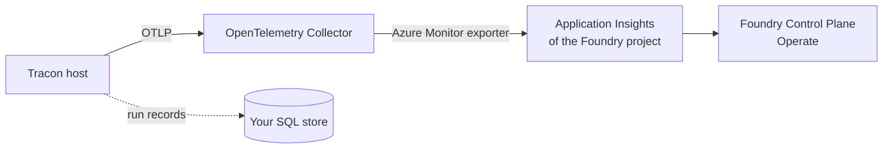

Microsoft sells several products that manage AI agents. Where does Tracon stand next to them? Tracon is a
library in your own ASP.NET Core host. The four products below are services that Microsoft runs. They answer
different questions, and none replaces another. This page draws the border and says what was tested.

:::caution[Read on 2026-10-30]
Every status below is a reading of the linked Microsoft Learn page on 2026-10-30. Microsoft changes these
statuses and these pages. Open the source before you decide anything on the strength of a row.
:::

## The four products

| Product | What Microsoft says it does | Status on Learn | Source |
|---|---|---|---|
| Foundry Control Plane | One interface for visibility, governance, and control of agents, models, and tools across a Foundry enterprise. It also lists agents that run on other platforms. Fleet, observability, compliance, and security views sit under **Operate** | **Preview** for the Operate panes (Overview, Assets, Compliance) and for Monitoring. Tracing is GA for prompt and hosted agents and Preview for external agents. Page updated 2026-09-23 | [Overview](https://learn.microsoft.com/azure/foundry/control-plane/overview) · [Feature readiness](https://learn.microsoft.com/azure/foundry/concepts/general-availability) |
| Microsoft Entra Agent ID | An identity and security framework for agents: agent identities, blueprints, and OAuth 2.0, MCP, and A2A flows. It works with agents from Microsoft and other platforms. It is available to all Entra customers. Extending Entra security features to agents, such as Conditional Access for agents, needs a Microsoft Agent 365 license | **GA.** The What's new page announces general availability and carries the date 2026-05-01 | [What is Agent ID](https://learn.microsoft.com/entra/agent-id/what-is-microsoft-entra-agent-id) · [What's new](https://learn.microsoft.com/entra/agent-id/whats-new-agent-id) · [Conditional Access for agents](https://learn.microsoft.com/entra/identity/conditional-access/agent-id) |
| Microsoft Agent 365 | A central registry of an organization's agents, with observe, govern, and secure functions through Microsoft 365 admin center, Entra, Purview, and Defender | **GA** since 2026-05-01 for the Commercial segment, licensed per user | [Overview](https://learn.microsoft.com/microsoft-agent-365/overview) |
| Foundry Hosted Agents | Containerized agent applications that run on Microsoft-managed infrastructure. Each deployed agent gets its own Entra identity. An agent built with Microsoft Agent Framework is exposed through the Foundry Responses or Invocations protocol | **GA.** The page that says so is dated 2026-10-22 and gives no GA date. The hosting package for .NET, `Microsoft.Agents.AI.Foundry.Hosting`, is installed with `--prerelease` | [Agent Framework hosting page](https://learn.microsoft.com/agent-framework/hosting/foundry-hosted-agent) |

## Where Tracon stands

Tracon is a control plane for one host. It does not claim to be the control plane of an organization.

| Question | Tracon | The Microsoft product |
|---|---|---|
| Where does the record of a run live? | In a store you run: PostgreSQL, SQL Server, or SQLite. Runs, events, tool calls, cost, and an audit chain | Foundry Control Plane reads traces and logs from the Application Insights resource of a Foundry project |
| What does the host send out? | OpenTelemetry spans for runs, agent calls, model calls, and tools, and the `Tracon` meter. You choose the exporter | Foundry expects the OpenTelemetry semantic conventions for generative AI. See the next section |
| Who lists every agent of the company? | Nobody. Tracon keeps a catalog of the agents of its own host, with versions | Foundry Control Plane (Assets) and the Agent 365 registry |
| Who enforces policy across the fleet? | Nobody. Tracon enforces inside its host: quotas, cost budgets, tool approvals, an optional tenant boundary | Foundry compliance policies, and Defender and Purview alerts. Agent 365 |
| Who issues an agent an identity? | Not Tracon. The host resolves the caller through ASP.NET Core and your own identity layer. `Tracon.Azure` accepts an Entra credential that you supply, to call Azure OpenAI | Entra Agent ID issues the identity. Conditional Access evaluates a token request to a resource that Entra protects. It does not cover a resource that an API key protects |
| Where does the code run? | In your ASP.NET Core process, wherever you deploy it | Foundry Hosted Agents run containers that use the Foundry protocols. Tracon does not reference the Agent Framework Foundry hosting package |

## How telemetry can reach Foundry

Microsoft documents one route for an agent that is not built in Foundry and emits OpenTelemetry through OTLP. The agent
sends OTLP to an OpenTelemetry Collector. The collector forwards it with the Azure Monitor exporter to the
Application Insights resource of the Foundry project. Foundry Control Plane reads it from there.

Registering a host as a custom agent in Foundry adds conditions. Foundry puts an Azure API Management gateway in front
of the agent, and clients must call the new address. The agent must expose an endpoint that Foundry can reach, and use
HTTP or A2A. Foundry also looks for a span with the operation `create_agent` that carries the attribute
`gen_ai.agent.id`. Tracon's own code emits no `create_agent` span, and the trace in the Aspire guide shows none. Without
more instrumentation, Microsoft's page says the Foundry trace view shows only the HTTP call to the agent.

## What this page does not claim

- **No test.** Nobody registered a Tracon host in Foundry Control Plane, Agent 365, or Entra Agent ID, or ran one as a
  Foundry hosted agent. The Aspire sample in this repository shows Tracon spans and metrics in the Aspire dashboard
  only. See [Run Tracon with Aspire](/guides/aspire/).
- **No ranking.** The tables list boundaries. They do not say that one product is better than another.
- **No affiliation.** Tracon is not a Microsoft product, and no Microsoft product certifies it.

## Read next

- [Run Tracon with Aspire](/guides/aspire/): the one OpenTelemetry path that is tested, with the exporter code.
- [Observability and cost](/guides/observability/): the spans, the meter, and the switches that decide what a span carries.
- [Tracon and DevUI](/getting-started/devui/): the same boundary drawn against the framework's own interface.
