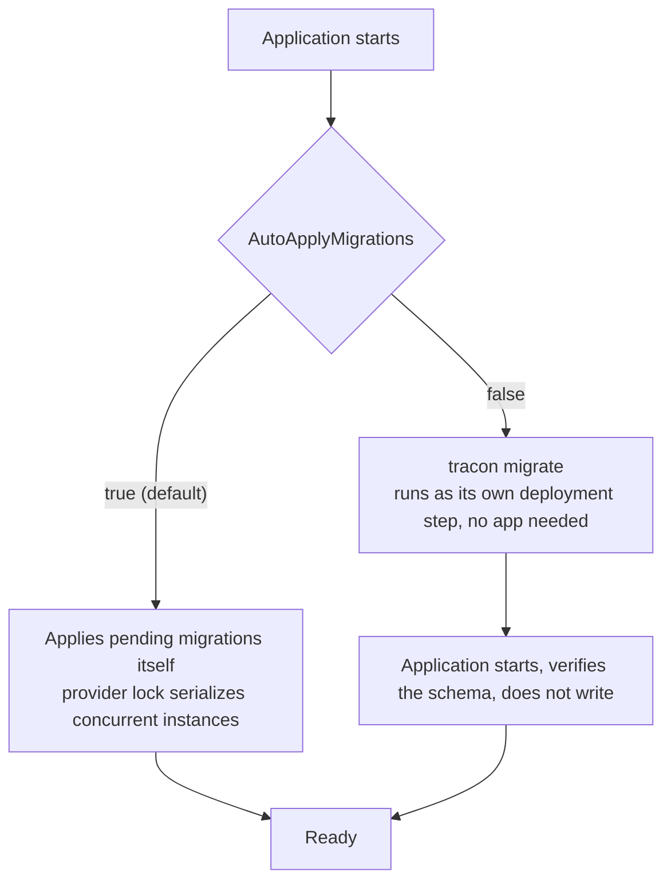

Without a database every store is in memory and everything ends with the process.
That is deliberate — it makes the first agent work with no infrastructure — but it is
not where you stop.

:::caution[In production, Tracon says so out loud]
Start a host in the `Production` environment while storage is still in memory and
Tracon writes one warning at startup, naming the stores that do not survive a
restart. In-memory storage stays a supported mode — the warning never fails
startup and there is no switch to silence it, because a production installation
losing its runs on the next deployment should not be a quiet fact. The same
judgement is what `GET /api/meta` reports as `storage.persistent`, and what the
console's settings screen shows.
:::

## Pick one

```csharp
builder.AddTracon()
       .UsePostgreSql(connectionString);   // Tracon.PostgreSql
```

The `Tracon` meta package carries no storage engine, so the store you pick is a second
reference: `dotnet add package Tracon.PostgreSql --prerelease`. A host that calls
`UsePostgreSql()` with only `Tracon` referenced does not build (`CS1061`).

| Package | Choose it when |
|---|---|
| `Tracon.PostgreSql` | The default. The only one with vector search for knowledge |
| `Tracon.SqlServer` | You already run SQL Server |
| `Tracon.Sqlite` | One node, or a durable local development setup |

All three implement the same store contracts and pass the same shared contract tests.
Their operational limits differ: only PostgreSQL supports Knowledge, only PostgreSQL
keeps the AOT promise, and SQLite is a single-node choice.

:::caution[The connection string is a secret]
It never belongs in `appsettings.json`. Use `dotnet user-secrets` in development and
the environment or a secret store in production. The same rule runs through the whole
product: a webhook or MCP registration stores the *name* of the configuration key its
secret is read from, never the value.
:::

Binding from configuration is the usual shape:

```csharp
.UsePostgreSql(builder.Configuration.GetSection(TraconPostgreSqlOptions.SectionName))
```

```json title="appsettings.json"
{
  "Tracon": {
    "PostgreSql": {
      "ConnectionString": "",
      "SchemaName": "tracon",
      "AutoApplyMigrations": true,
      "CommandTimeoutSeconds": 30,
      "EnableKnowledge": false,
      "EnableReadViews": false
    }
  }
}
```

## How each provider isolates its tables

| Provider | Namespace | Migration coordination |
|---|---|---|
| PostgreSQL | Separate `tracon` schema by default | `pg_advisory_lock`, scoped to the schema |
| SQL Server | Separate `tracon` schema by default; your `dbo` objects stay untouched | `sp_getapplock`, scoped to the schema |
| SQLite | No schema support; `tracon_` table prefix by default | A sidecar file lock next to the database |

Rename `SchemaName` or `TablePrefix` when your conventions require it. A bare SQLite
`Data Source=:memory:` connection is rejected because each opened connection would
see a different database; use a shared in-memory URI for tests.

:::note[Knowledge is opt-in and needs pgvector]
The migration set that creates the `vector` extension and the `document_embeddings`
table only applies when `EnableKnowledge` is `true` — off by default, so a managed
PostgreSQL instance without permission to install extensions works with no
configuration at all. Turn it on only if an agent uses Knowledge:

```csharp
.UsePostgreSql(options =>
{
    options.ConnectionString = connectionString;
    options.EnableKnowledge = true;
})
```

With it off, an agent definition that sets `Memory.EnableVectorSearch` fails
compilation with a clear error instead of a database error at run time. Embedding
`Dimensions` become part of the column type: changing embedding models later needs a
schema migration and a re-embed of existing documents. See
[Knowledge](/guides/knowledge/).
:::

:::note[Read views are opt-in on all three providers]
`EnableReadViews` publishes `runs_v1`, a versioned, read-only SQL view over run
data — off by default, so a deployment that never turns it on never sees the
object. Query it with your own SQL or map it as an EF Core keyless entity. See
[Read contract views](/reference/read-views/).
:::

## Migrations run at startup

The SQL files ship embedded in the assembly and are applied when the application
starts, unless that responsibility is moved to its own deployment step:



Two properties make in-process application safe with several instances starting at
once:

- The runner takes the provider-specific lock shown above, so instances serialize
  instead of racing.
- Each applied file's SHA-256 is recorded. If the content later differs from what was
  applied, startup **fails loudly** rather than running against a schema that is not
  what the code expects.

When an existing database is upgraded, the runner writes two `Information` lines for
every pending migration: `Applying migration …` before it runs and
`Applied migration … in … ms` after it. A migration that rewrites a large table runs as
one statement and can take a long time, and the first line is what tells a slow upgrade
from a hang. A migration that fails has its first line and no second. A new database
logs only the closing summary, `Tracon applied N migration(s)`.

:::caution[Migrations refuse a non-canonical tenant id]
The tenant identifier is stored in its canonical form — lower-case ASCII letters,
digits, `_`, `.` and `-` — see
[Multi-tenancy](/concepts/governance/#what-a-tenant-identifier-may-be). Before
applying anything, the runner checks every table that carries a `tenant_id` and
**stops, naming the tables**, if any row holds a value that is not canonical. `*` in
`retention_policies` is the default policy of every tenant and is not a finding.

It does not fold those rows for you. On PostgreSQL and SQLite, which compare
case-sensitively, `Acme` and `acme` may be two real tenants, and merging two
tenants cannot be undone. Decide per table whether the rows belong to one
tenant (lower-case them) or to two (rename one), then start again.

The audit trail is the exception: the tenant of an entry is part of its hash, so a
renamed entry fails the chain verification. Export the entries of that tenant first,
then either remove all of them (a chain belongs to one tenant, so the chains of the
others stay whole) or rename them and accept that the chain of that tenant fails from
the first renamed entry.
:::

:::caution[A migration can be one-way]
A migration may move data and drop a column in the same file, and Tracon ships no
downgrade. After such a migration an older build of the application cannot read the
table. Back up the database before you upgrade; the release notes name every migration
that drops or rewrites data.
:::

:::danger[Do not edit an applied migration]
The checksum covers the file's whole text, comments included. Editing a file that has
already been applied makes every existing database refuse to start. Add a new
migration instead. If you must take such a change, drop and recreate the schema in
that environment first.
:::

:::caution[A migration can be one-way]
Most migrations only add. Some rewrite or drop a column, and while Tracon is in
preview a release may contain one: the data is carried across by the migration
itself, but there is no downgrade path back to the older schema. Take a backup
before upgrading a database you cannot lose, and roll a version back by restoring
that backup rather than by pointing an older build at the newer schema — the
checksum check will refuse it anyway.

The `run_scores` migration is the current example. It widens the score value from an
integer to a nullable double, adds the score's name and its categorical value, and
rewrites the uniqueness index. Existing rows are carried across: a score written by a
judge keeps that judge's name, every other row is named `overall`. On SQLite the
value column is rebuilt in place, so the table is rewritten — size that step against
your own row count before upgrading a large database.

The `approval_rule_source` migration only adds: a nullable `source_fingerprint`
column on `tool_approval_rules`, which also joins the rule's uniqueness index.
Existing rules keep a `NULL` fingerprint on purpose, so a standing rule for a tool
of an MCP server asks once more after the upgrade
([approval rules](/concepts/governance/)).

The `run_input_parameters` migration only adds: a nullable `parameters` column on
`run_inputs`. Existing rows keep `NULL` on purpose, which means "nothing was
recorded". A replay, a continuation after a crash or an approval resume of such a
run is refused when the agent declares [parameters](/concepts/agents/#parameters),
instead of running on the defaults.

The `job_max_duration` migration only adds: a nullable `max_duration_ms` column on
`jobs`. Existing jobs keep `NULL`, which means "no time limit of its own": the limit
`Scheduling:MaxDurationByHandlerKey` maps the job's handler key to applies, and a key
the map does not list has none ([Background work](/guides/background-work/)).

The `non_token_cost` migration only adds. It creates the `run_non_token_usage` table, whose
rows belong to a run and are deleted with it, and appends four nullable snapshot columns to
`runs` and two (`usage_provider`, `usage_model`) to `tool_invocations`. Existing rows keep
`NULL` on purpose: for a run that closed before the upgrade, `nonTokenCost` is `null`, which
means "nobody reported a number", not zero ([Runs](/concepts/runs/#what-a-run-carries)).

The `workflow_definition_versions` migration only adds: `0059` on PostgreSQL, `0047` on
SQL Server and `0046` on SQLite. It creates the table that keeps every version a stored
workflow has had, and copies each existing workflow's current definition into it as the
first entry of that workflow's history. The versions a workflow had before the upgrade
were never kept, so its history starts at the version it has today. The table has no
foreign key to `workflows`: deleting a workflow keeps its versions, and saving the name
again continues the numbering
([Workflows](/concepts/workflows/#versions-rollback-and-pinning-an-agent-step)).

The `agent_definition_version_counters` migration only adds: `0065` on PostgreSQL, `0053` on
SQL Server and `0052` on SQLite. It creates the table that holds the highest version number
each stored agent has had, and starts the counter of every existing agent at the version it
holds today. An agent that was deleted and created again before the upgrade cannot be
recovered: its earlier numbers were never kept, so its counter starts at the highest number it
holds now. The table has no foreign key to `agent_definitions` and no agent content: deleting
an agent keeps the number, and saving the name again continues the numbering
([Versions](/concepts/agents/#versions)).

The `ordinal_definition_names` migration (`0060`, SQL Server only) keeps every value and changes
how SQL Server compares them: the name of each definition, and every column that repeats an agent,
workflow, skill or tool name, takes `Latin1_General_BIN2`, so `Support` and `support` are two
agents there as on the other providers. It drops and rebuilds the unique keys over those columns in
one transaction, and each table it touches is closed to reads and writes until the whole migration
commits. Measured in an emulated container on Apple Silicon: 1.3 s over 100 000 runs, 5.1 s over a
million runs with two million events. The default `CommandTimeoutSeconds` of 30 covers that; raise
it for the run that applies the migration if your storage is slower
([Compatibility](/reference/compatibility/)).

The `ordinal_lease_owner` migration (`0062`, SQL Server only) keeps every value and changes how SQL Server
compares the name of a lease owner: `jobs.lease_owner` and `singleton_leases.owner_id` take
`Latin1_General_BIN2`, so a worker named `worker-a` no longer renews, starts, completes or releases the
lease of a worker named `Worker-A` (you choose the name, in `JobLeaseRequest.Owner` and in the owner you pass
to `ISingletonLeaseStore.TryAcquireAsync`). No row is merged, removed or rewritten, and a lease that is running
keeps its owner. Measured in an emulated container on Apple Silicon: 4 to 8 ms over 100 000 jobs and 9 to 30 ms
over a million, because the statement changes the comparison and not the stored text. It takes a schema lock on
the two tables, so apply it before you start the new nodes: a worker that leases a job waits for it. SQL Server
still ignores trailing blanks in an owner name (`w` and `w ` are one owner).

The `ordinal_request_and_parent_ids` migration (`0063`, SQL Server only) keeps every value and changes how SQL Server
compares two ids that no key holds: `pending_approvals.request_id` and `workflow_checkpoints.parent_id` take
`Latin1_General_BIN2`, as the ids they name already do (the parent of a checkpoint is the `checkpoint_id` of an earlier
row), so a comparison of the two never stops with "Cannot resolve the collation conflict". No row is merged, removed or
rewritten. Measured in an emulated container on Apple Silicon over a million checkpoints and half a million pending
approvals (2.3 GB): 10 ms, because the statement changes the comparison and not the stored text. It takes a schema lock on
the two tables, so apply it before you start the new nodes.

On SQL Server a store call that is one statement (an event append, a read, a delete) that the server picks as a
deadlock victim is sent again, up to five attempts in all, as a transaction has been; an error that is not a
deadlock reaches your code unchanged. Before this the call threw `SqlException` 1205, and a run lost the events
that followed the failed append.

The second write of a queued run, which the worker that runs it makes and which sets the time the run started,
used to be the cause of most of these victims: it moved the row in the clustered index of `runs`, and an event
append or a read of the same run took its locks in the other order. The write now takes its exclusive lock on the
run's primary-key entry first, so the two orders cannot cross. Measured on SQL Server 2022 in an emulated container
on Apple Silicon, with one second write against six appends and six reads over 3,000 rounds: 191 victims before,
none after. Nothing changes in the schema, so there is no migration to apply.

The `decimal_columns_as_text` migration (`0058`, SQLite only) rewrites `runs`. Seven columns were
declared `NUMERIC` (`cached_input_cost`, `non_token_cost` and the five unit prices), and SQLite turned
the text of a cost into a double and kept 15 digits of it: `999999999.999999` read back as
`999999999.99999905`. They are `TEXT` now, like every other cost column, and a cost reads back as it was
written. A stored value is carried over as its 15-digit decimal. A cost or price written with 15
digits or fewer, which is every real one, comes back digit for digit. A value written with more had
been rounded to a double on its way in, and the migration keeps 15 of its digits
(`1234567890.1234567890` becomes `1234567890.12346`). The quota counters, which the old addition
left a float tail on (`0.30000000000000004`), are rounded the same way, and from now on every cost
total and counter is added as a `decimal`. No table is rebuilt (`runs` has children that a rebuild
would delete), so the migration adds a column, fills it, drops the old one and renames the new one,
which rewrites `runs` once per column. Measured on an Apple Silicon machine in a busy session: 1.9 s
over 100 000 runs (with 200 000 run events), and 22 s to 30 s over a million runs with two million
run events. SQLite does not cut a statement short at `CommandTimeoutSeconds`, but a second process
that waits for the write lock does give up at it, so apply the migration in your own deployment step
(`AutoApplyMigrations = false`) before you start the new instances. Two things stop it. A view or
trigger of your own that names one of the seven columns makes SQLite refuse to drop the column
(`error in view … after drop column`), and so does a view of your own built on `runs_v1`, because
the migration drops that view first (`error in view <yours>: no such table: main.<prefix>runs_v1`).
Nothing is changed in either case: drop yours first and create it again afterwards. The `runs_v1`
view is dropped and, when `EnableReadViews` is on, built again in the same run; a database that had
it enabled and later switched it off loses the view that was left behind
([Read contract views](/reference/read-views/)). The data subject export and the retention archive
write these seven fields as JSON strings on SQLite from then on (`"0.5"`, like `input_cost` already was);
PostgreSQL and SQL Server write numbers.
:::

Most upgrades are not like that one. The latest `run_scores` migration, which adds
the `evaluator_version` column, is the ordinary shape: a single nullable column
appended to the table, no backfill, and no index change. Existing rows are left
exactly as they are and read back with a null version, so the step costs the same
whether the table holds a thousand rows or a million.

The cache-write migration is of that shape too: `0066` on PostgreSQL, `0054` on SQL Server
and `0053` on SQLite. It appends five nullable columns to `runs`, which hold the
tokens, the charge and the unit prices of prompt-cache writes. Rows written before it read
back with nulls. A database that turned on `EnableReadViews` also gets a second definition
of `runs_v1`: its `total_cost` adds the write charge and the five columns are published
at the end of the view ([Read contract views](/reference/read-views/)).

Set `AutoApplyMigrations = false` when schema changes are their own deployment step.
Tracon then verifies but does not write. The diagnostics endpoint can report
whether the schema is current, but it is deliberately not mapped by default because
it exposes setup details:

```csharp
app.MapTracon("/tracon", options =>
{
    options.EnableDiagnosticsEndpoint = true;
});
```

After that opt-in, `GET /tracon/api/diagnostics` is an Admin surface and still
passes through the configured access layers.

Something still needs to **apply** the schema before the application starts with
`AutoApplyMigrations = false`. The `tracon` CLI does that as its own step,
against the database directly — no running application required:

```bash
tracon migrate --provider postgres --connection "$TRACON_CONNECTION"
```

Running it again applies nothing (`0 applied`) and exits `0`; `tracon migrate
status` lists pending migration names without writing. See the [typed client and
CLI guide](/guides/cli/) for setup and the rest of the commands.

A deployment step that already runs your own code can apply them in process
instead: resolve `IMigrationApplier` and call `ApplyAsync()`. Every SQL provider
registers it, so the same call works whichever provider the application uses.

## Giving your own data source instead of a connection string

Each provider's `Options.DataSource` field accepts a `DbDataSource` you built
yourself instead of `ConnectionString` — most useful when your host already owns
one, for example an EF Core `DbContext` configured with an `NpgsqlDataSource`:

```csharp
.UsePostgreSql(options => options.DataSource = yourDataSource)
```

Tracon never disposes an instance it did not build; ownership stays with
whoever created it. Building two separate data sources from the identical
connection string does **not** share a connection pool — see
[Two data planes, one connection pool or two](/guides/embedding/#two-data-planes-one-connection-pool-or-two)
and, for the full EF Core pattern,
[Two connection planes: EF Core and Tracon](/guides/ef-core/).

## What changes once it is durable

Runs, events, and tool calls survive restarts, so the console shows real history
rather than the current process. Sessions can be read back as chat history rather
than an opaque blob — which is also what makes branching a conversation possible.
Queued runs, schedules, evals, experiments, quotas, and the pending-approval mailbox
all become usable, since they depend on state outliving a request. A resolved
[approval presentation](/concepts/governance/#approvals) is persisted next to the
raw call arguments, so it survives a restart the same way the arguments do.

It is also what makes recovering from a crash possible at all: a run's recorded
tool calls are what an [automatically continued run](/guides/reliability/#continue-an-interrupted-run-automatically)
replays instead of repeating, and orphan reconciliation itself only has a stale
`Running` row (or a `Queued` one that was waiting for a workflow slot) to find because
that row, and every tool call it already made, outlived the process that opened it.

Session and workflow checkpoint rows carry a version stamp of their own, separate
from the schema migrations above: Tracon's envelope around the row, and the
Microsoft Agent Framework version that wrote the opaque state inside it. See
[Versions and upgrades](/reference/versioning/#persisted-session-and-checkpoint-state)
for what that stamp promises and what happens when an old row can no longer be read.

Durable state is also state an upgrade has to keep being able to read, and the
stamp is what makes that answerable ahead of time rather than in production:

```bash
tracon state-check --provider postgres --connection "$TRACON_CONNECTION"
```

Run with the **new** version of the tool, it counts your stored rows by stamp,
says which of them the new build understands, and decodes a sample of each. It
writes nothing, so it is safe against the live database. See [the supported
upgrade window](/reference/versioning/#the-supported-upgrade-window).

An agent definition keeps its content in one JSON column. A field that a new version adds
to the definition, such as the list of agent extensions, needs no migration: a row that
was written before the field existed reads the field as empty, and it keeps running as it did.
A row without `skills` reads back with the approval on for all three skill tools.
A row that holds the callable agents as a list of names (`callableAgentNames`) reads back as
entries with no version, and takes the new shape the next time it is saved.

## Keeping it from growing forever

A recorded run is data, and recorded runs accumulate. Retention policies set an age
or row limit per target — run events, tool calls, traces, jobs, webhook deliveries,
eval results, checkpoints, and more.

Database policies take precedence. When no database policy exists and
`Tracon:Retention:Enabled` is true, configuration falls back to built-in target
defaults, such as 30 days for run events and 14 days for spans. With retention
disabled, nothing is deleted. An `archive: true` policy also deletes nothing when no
`IArchiveSink` is registered; data loss is the failure mode the worker avoids. With a
sink, each batch deletes only the rows the sink received — see
[Retention](/concepts/governance/#retention). A database policy saved without `enabled`
is paused: send `"enabled": true` to start deleting.

Cleanup runs through the job queue. Preview a policy before you execute it:

```bash
curl 'http://localhost:5081/tracon/api/retention/preview'
curl -X POST 'http://localhost:5081/tracon/api/retention/run'
```

## Durability also enables governance

A durable `audit_log` can be **verified**: `GET /api/audit/verify` walks a
hash chain and reports whether any entry was altered or deleted after it was
written. Set a chain key and the hash is an HMAC that only your host can produce
([Sign the audit chain with a key](/guides/audit-chain-key/)). And because sessions, runs, conversations, and workflow checkpoints are real
rows now, a data subject's content can be found and erased by identity, not just aged
out — see [Data subject rights](/concepts/governance/#data-subject-rights).

Both endpoints accept an optional `tenantId` filter; leaving it out never means
"every tenant" — it resolves to the caller's own ambient tenant. A custom
`IAuditLog` implementation must apply this same fallback (see
[Write your own store](/guides/write-your-own-store/)).

Durable rows are also what
[content protection](/getting-started/security/#at-rest-content-protection) encrypts.

A durable `sessions` row is also what
[session ownership](/concepts/sessions/#session-ownership) writes its owner into.
The column is added by a migration, is nullable, and stays NULL until you turn
ownership on — so enabling persistence costs nothing here, and enabling ownership
later is a configuration change rather than a data change. The listing filter is a
`WHERE` clause on that column, applied before paging, which is precisely what an
in-memory setup cannot offer.

## Read next

- [Securing the endpoints](/getting-started/security/) — required reading
before this leaves your machine.
- [Write your own store](/guides/write-your-own-store/) — implement `IRunStore`
  (or another store interface) against a persistence engine none of the three
  built-in providers cover.
