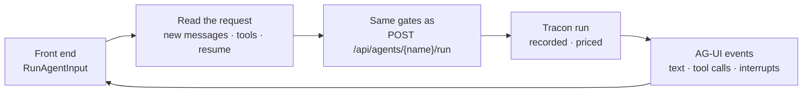

How does a front end built on the [AG-UI protocol](https://docs.ag-ui.com) — CopilotKit, or your own
React code on `@ag-ui/client` — run a Tracon agent? Through one extra endpoint,
`POST /tracon/agui/{agentName}`. The request is a Tracon run: it is recorded, the tenant is resolved,
roles are enforced, the quota is counted and the cost is written. Session ownership applies when
[`Tracon:SessionOwnership`](/concepts/sessions/#session-ownership) is on; it is off by default, and until then a thread
is whatever the front end chooses and any operator of the tenant can continue it. Only the dialect on the wire is AG-UI.

## Map the endpoint

AG-UI lives in its own package, so an application whose front end does not speak it never carries the
AG-UI SDK.

```bash
dotnet add package Tracon.AGUI --prerelease
```

```csharp
builder.AddTracon()
       .UseOpenAI(apiKey)
       .AddClientTool(
           "read_shopping_cart",
           "Reads the items in the customer's shopping cart in the browser.",
           JsonSerializer.Deserialize<JsonElement>("""{"type":"object","properties":{}}"""))
       .AddAgent(new AgentDefinition
       {
           Name = "support",
           Instructions = "You are a support assistant.",
           Model = new ModelBinding { Provider = "openai", Model = "gpt-5.4-mini" },
           ToolNames = ["read_shopping_cart"],
       });

app.MapTracon();
app.MapTraconAGUI();
```

`MapTraconAGUI` must come after `MapTracon`. It inherits the same access protection from there: loopback
by default, the bearer token, your authorization policy and the `Operator` role. An API key also needs a
run scope, `ChatRun` or `RunsWrite` — see [Who can call the endpoint](#who-can-call-the-endpoint). The path is
`/tracon/agui` unless you pass another prefix.

The body is an AG-UI `RunAgentInput` and the answer is `text/event-stream`, one `data:` frame per event:

```bash
curl -N -X POST http://localhost:5081/tracon/agui/support \
  -H 'Content-Type: application/json' \
  -d '{"threadId":"t1","runId":"r1","messages":[{"id":"m1","role":"user","content":"hello"}],
       "tools":[{"name":"read_shopping_cart","description":"Reads the cart in the browser.","parameters":{"type":"object","properties":{}}}],
       "context":[]}'
```

The agent carries a client-side tool, so the request declares it; an empty `tools` list would be refused (see
[Front-end tools](#front-end-tools)).

## Connect a front end

CopilotKit's runtime reaches a remote AG-UI agent through `HttpAgent` from `@ag-ui/client`. Point it at
the Tracon endpoint and pass the credential as a header:

```ts
import { HttpAgent } from "@ag-ui/client";
import { CopilotRuntime } from "@copilotkit/runtime/v2";

const runtime = new CopilotRuntime({
  agents: {
    support: new HttpAgent({
      url: "https://your-host/tracon/agui/support",
      headers: { Authorization: `Bearer ${process.env.TRACON_API_KEY}` },
    }),
  },
});
```

When the browser itself calls the endpoint, add its origin to `AllowedOrigins`: the AG-UI path gets the
same [CORS answer](/guides/client-side-tools/#cors) as the rest of Tracon, and nothing wider.

## Who can call the endpoint

The endpoint passes the same doors as `POST /api/agents/{name}/run`: loopback, the bearer token, your
authorization policy and the `Operator` role. What a browser front end adds is the scope of an API key.

| Caller | What opens the endpoint |
|---|---|
| An API key | The `ChatRun` scope **or** the `RunsWrite` scope |
| A claims principal (cookie, JWT, OpenID Connect) | The `Operator` role. A scope belongs to an API key, so a claims principal is gated by role alone |
| The static `AuthToken` | The token. It carries no scope |

`ChatRun` opens this endpoint and no other. A key that holds only `ChatRun` is refused with `403` by every
management endpoint that asks for a scope — runs, sessions, agents, approvals, API keys — exactly as a key
that lacks the scope of that endpoint is. It is the key to put in a front end's hands. Create one in the
console or through the API:

```bash
curl -X POST http://localhost:5081/tracon/api/api-keys \
  -H 'Content-Type: application/json' \
  -d '{"name":"shop-chat","scopes":["ChatRun"]}'
```

The answer carries the key once, in `plaintextKey`. A key that holds `RunsWrite` keeps working: the scope still
opens this endpoint, so an existing deployment changes nothing. It also opens many other endpoints — starting
runs elsewhere, cancelling them, deciding approvals, deleting sessions — which is why a key that only chats should
hold `ChatRun` instead.

A claims principal needs the `Operator` role, and a role cannot tell this endpoint from the rest of the management
API: a user who may chat can usually read runs and sessions as well. If your chat users hold `Operator` and must not
see the management API, narrow the group that `MapTracon` returns with a stricter policy. `MapTraconAGUI` is mapped
beside that group, not inside it, so it keeps the role policy and your base policy and none of the extra one:

```csharp
// "TraconAccess" lets every signed-in user in; "TraconStaff" is the people who may use the management API.
app.MapTracon("/tracon", options =>
{
    options.AllowRemoteAccess = true;
    options.RequireAuthorization("TraconAccess");
}).RequireAuthorization("TraconStaff");

app.MapTraconAGUI();
```

## How a request is read



| AG-UI field | What Tracon does |
|---|---|
| `threadId` | It is the session. At most 200 characters; a thread belongs to the tenant that opened it, and with session ownership on also to the user |
| `messages` | The server keeps the conversation. Only the messages after the **last assistant message** are new input: the user's text, and the results of the client-side tool calls that message made. Earlier messages are already in the session and are not added again. System and developer messages are not read — the instructions are the agent's |
| `tools` | Must name every client-side tool the agent carries. The schema is always the one in code |
| `resume` | Answers a tool approval or a request for user input |
| `context` | Becomes run documents, kept apart from the instructions |
| `forwardedProps.parameters` | The run's [parameter values](#run-parameters), only when the host turned on `AcceptForwardedParameters` |
| `state`, the rest of `forwardedProps` | Not used |

Text is the only input kind read: image, audio, video and document parts of a message are ignored.

## Run parameters

An agent can declare [parameters](/concepts/agents/#parameters): named placeholders in its instructions that a run
fills with values. An AG-UI request cannot supply them unless the host allows it, because **a value becomes part
of the agent's instructions**. The option is off by default:

```csharp
app.MapTracon();
app.MapTraconAGUI("/tracon/agui", options => options.AcceptForwardedParameters = true);
```

With it on, the front end sends the values in `forwardedProps.parameters`, an object whose values are all strings.
For an agent whose instructions read `Hello {{customer}}, answer in a {{tone}} tone.`:

```json
{
  "threadId": "t1",
  "runId": "r1",
  "messages": [{ "id": "m1", "role": "user", "content": "Where is my order?" }],
  "tools": [],
  "context": [],
  "forwardedProps": { "parameters": { "customer": "Priya Shah", "tone": "formal" } }
}
```

- **Checked like a run from the management API.** A name the agent's schema does not declare, a required parameter
  with no value and no default, and a value over `Tracon:MaxParameterValueLength` (4096 UTF-8 bytes by default) are each
  a `400` before anything runs, with the same problem body as `POST /api/agents/{name}/run`
  (`unknownParameters`, `missingParameters`, `tooLongParameters`).
- **Strings only.** A value that is a number, a boolean, `null`, an object or an array is a `400` titled
  `Invalid run parameters`, and so is a `parameters` that is not an object. Tracon does not convert a value: a number
  that became `"1"` would put into the instructions something the front end did not write. `parameters` left out, set
  to `null` or set to `{}` supplies nothing.
- **Every request sends them.** Each request takes the values it carries, so the turns of one thread can differ. The
  request that answers an approval, or sends the result of a front-end tool, is a request like any other: without a
  required value it is refused.
- **Recorded with the run.** The values are kept in the run's protected input record, so a replay, an automatic
  continuation and the resume after an approval repeat them.
- **Only `parameters` is read.** The tenant, the session (the thread) and the agent never come from `forwardedProps`.
  Every other key in it is the front end's own, and ignored.
- **Names in the log, never values.** What Tracon logs and what a `RUN_ERROR` or a refusal says names the parameter
  and never quotes its value.

Off, `forwardedProps` is not read at all: an agent with a required parameter cannot be started from AG-UI, and an
agent whose parameters all have defaults runs on the defaults.

:::caution[A value is part of the instructions]
The instructions are the trusted channel to the model, and the content guard does not read them: it inspects what
users send and what the model answers. A browser that can set a parameter writes part of the instructions, within
the length limit and the name the schema declares. Turn the option on only when the host accepts that for this
front end. Keep the schema narrow: declare only the parameters the front end needs, keep `MaxParameterValueLength`
low, and prefer a parameter whose value is a short identifier or a choice from a list your agent's instructions
can name, not free text.
:::

## Front-end tools

A tool that runs in the browser is a [client-side tool](/guides/client-side-tools/): its declaration lives
in code, the server never runs it, and the result comes back with the next request. In AG-UI terms the model's
call arrives as `TOOL_CALL_START`, `TOOL_CALL_ARGS` and `TOOL_CALL_END`, the run finishes, the front end runs
the tool, and the next request carries the result as a `tool` message with the same `toolCallId`.

An AG-UI front end declares its tools on every request. Tracon treats that as information, not as
instruction:

- A tool the request declares and the agent carries as a client-side tool is run by the front end. The model
  sees the **code's** schema, never the request's.
- A client-side tool the agent carries and the request does not declare is refused with `400`, and the
  response names it. The model would call a tool nobody can run.
- A tool the request declares and the agent does not carry is **ignored**. The model never sees it, and the
  run records its name under the `tracon.agui.tools.ignored` event.

A front end cannot add a tool or change a schema through this endpoint. Tools are defined only in code.

## Approvals and requests for input

A tool that [waits for approval](/concepts/governance/), and an MCP server that [asks the user for
input](/concepts/tools/#a-server-asks-the-user-for-input), end the run with an **interrupt** in
`RUN_FINISHED`. The run stays open on the Tracon side (`AwaitingApproval` or `AwaitingInput`).

```json
{
  "type": "RUN_FINISHED",
  "threadId": "t1",
  "runId": "r1",
  "outcome": {
    "type": "interrupt",
    "interrupts": [{
      "id": "ficc_call_YhKBs3eWkkfjxpTyfphRGAnV",
      "reason": "tool_call",
      "message": "Cancel order ORD-1001 for Priya Shah.",
      "toolCallId": "call_YhKBs3eWkkfjxpTyfphRGAnV",
      "responseSchema": {
        "type": "object",
        "properties": {
          "approved": { "type": "boolean" },
          "reason": { "type": "string" },
          "remember": { "type": "boolean" },
          "rememberArgumentsOnly": { "type": "boolean" }
        },
        "required": ["approved"]
      },
      "metadata": { "toolName": "cancel_order", "entityType": "order", "entityId": "ORD-1001", "entityName": "Order ORD-1001" }
    }]
  }
}
```

The `message` and `metadata` come from the tool's approval presenter when one is registered. The answer is the `resume`
of the next request, on the same thread. For an approval, `remember: true` saves
the decision as a standing rule, exactly as it does on the management API; without `rememberArgumentsOnly`
the rule covers every call of the tool:

```json
{
  "threadId": "t1",
  "runId": "r2",
  "messages": [],
  "resume": [{ "interruptId": "ficc_call_YhKBs3eWkkfjxpTyfphRGAnV", "status": "resolved", "payload": { "approved": true } }]
}
```

- A `cancelled` status is a refusal for an approval, and a cancellation for a request for input. It is never
  an approval.
- For a request for input (`reason: input_required`) the interrupt carries the server's own field schema, and
  the `payload` is an object of those fields. A value that does not fit is refused with `400` before anything
  runs again.
- An interrupt id that is not pending in the thread — unknown, already answered, or another tenant's — is a `400`.
- The decision is written to the audit trail before it is applied, with `"surface": "ag-ui"`. A decision that
  cannot be recorded is not applied.

## What comes back

The first event after `RUN_STARTED` is a `CUSTOM` event named `tracon.run`. Its value carries the Tracon run
id, which is how a front end finds the run in the console and in `GET /api/runs/{id}`.

A failure after the stream began is a `RUN_ERROR` event: its `code` is the exception type and its message
says what failed. The provider's address and the exception text never reach the front end; the server log
holds them under a correlation reference, which an exception Tracon does not recognize also puts at the end
of the message as `(ref: …)`.

No frame carries `rawEvent`. The protocol lets an event hold the provider's own update, and the converter
fills it with the model id, the response id, the author name, the additional properties and the whole
contents of the update. A browser has no use for that and should not see it, so Tracon removes it from every
event. Read the event's own fields instead; the full record of a run is `GET /api/runs/{id}/events`.

A front end that closes the connection mid-run stops the run, and the run is recorded as `Canceled`.

## Limits

- One thread, one run at a time. Two overlapping runs of the same thread behave as on the management API: the
  second to save loses, and its stream ends with `RUN_ERROR`.
- No `Idempotency-Key` and no `Prefer: respond-async`: an AG-UI run is always live.
- No culture: instructions resolve in the agent's default culture. An agent with a required
  [parameter](/concepts/agents/#parameters) cannot be started from AG-UI unless the host turned on
  [`AcceptForwardedParameters`](#run-parameters).
- Attachments are not read; only the text of a message is.
- The package is not Native AOT compatible.

## Read next

- [Client-side tools and the embeddable widget](/guides/client-side-tools/) — how the front-end tool mechanic works without AG-UI.
- [Governance](/concepts/governance/) — what an approval is and where its rules and audit trail live.
- [Security](/getting-started/security/) — the access layers `MapTraconAGUI` inherits, and API-key scopes.
