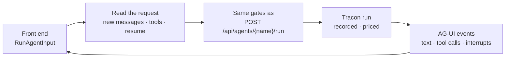

How does a front end built on the [AG-UI protocol](https://docs.ag-ui.com) — CopilotKit, or your own
React code on `@ag-ui/client` — run a Tracon agent? Through one extra endpoint,
`POST /tracon/agui/{agentName}`. The request is a Tracon run: it is recorded, the tenant is resolved,
roles and session ownership are enforced, the quota is counted and the cost is written. Only the dialect
on the wire is AG-UI.

## Map the endpoint

AG-UI lives in its own package, so an application whose front end does not speak it never carries the
AG-UI SDK.

```bash
dotnet add package Tracon.AGUI --prerelease
```

```csharp
builder.AddTracon()
       .UseOpenAI(apiKey)
       .AddClientTool(
           "read_shopping_cart",
           "Reads the items in the customer's shopping cart in the browser.",
           JsonSerializer.Deserialize<JsonElement>("""{"type":"object","properties":{}}"""))
       .AddAgent(new AgentDefinition
       {
           Name = "support",
           Instructions = "You are a support assistant.",
           Model = new ModelBinding { Provider = "openai", Model = "gpt-5.4-mini" },
           ToolNames = ["read_shopping_cart"],
       });

app.MapTracon();
app.MapTraconAGUI();
```

`MapTraconAGUI` must come after `MapTracon`. It inherits the same access protection from there: loopback
by default, the bearer token, your authorization policy, the `Operator` role and the `runs:write` API key
scope. The path is `/tracon/agui` unless you pass another prefix.

The body is an AG-UI `RunAgentInput` and the answer is `text/event-stream`, one `data:` frame per event:

```bash
curl -N -X POST http://localhost:5081/tracon/agui/support \
  -H 'Content-Type: application/json' \
  -d '{"threadId":"t1","runId":"r1","messages":[{"id":"m1","role":"user","content":"hello"}],"tools":[],"context":[]}'
```

## Connect a front end

CopilotKit's runtime reaches a remote AG-UI agent through `HttpAgent` from `@ag-ui/client`. Point it at
the Tracon endpoint and pass the credential as a header:

```ts
import { HttpAgent } from "@ag-ui/client";
import { CopilotRuntime } from "@copilotkit/runtime/v2";

const runtime = new CopilotRuntime({
  agents: {
    support: new HttpAgent({
      url: "https://your-host/tracon/agui/support",
      headers: { Authorization: `Bearer ${process.env.TRACON_API_KEY}` },
    }),
  },
});
```

When the browser itself calls the endpoint, add its origin to `AllowedOrigins`: the AG-UI path gets the
same [CORS answer](/guides/client-side-tools/#cors) as the rest of Tracon, and nothing wider.

## How a request is read



| AG-UI field | What Tracon does |
|---|---|
| `threadId` | It is the session. At most 200 characters; a thread belongs to the user and the tenant that opened it |
| `messages` | The server keeps the conversation. Only the messages after the **last assistant message** are new input: the user's text, and the results of the client-side tool calls that message made. Earlier messages are already in the session and are not added again. System and developer messages are not read — the instructions are the agent's |
| `tools` | Must name every client-side tool the agent carries. The schema is always the one in code |
| `resume` | Answers a tool approval or a request for user input |
| `context` | Becomes run documents, kept apart from the instructions |
| `state`, `forwardedProps` | Not used |

Text is the only input kind read: image, audio, video and document parts of a message are ignored.

## Front-end tools

A tool that runs in the browser is a [client-side tool](/guides/client-side-tools/): its declaration lives
in code, the server never runs it, and the result comes back with the next request. In AG-UI terms the model's
call arrives as `TOOL_CALL_START`, `TOOL_CALL_ARGS` and `TOOL_CALL_END`, the run finishes, the front end runs
the tool, and the next request carries the result as a `tool` message with the same `toolCallId`.

An AG-UI front end declares its tools on every request. Tracon treats that as information, not as
instruction:

- A tool the request declares and the agent carries as a client-side tool is run by the front end. The model
  sees the **code's** schema, never the request's.
- A client-side tool the agent carries and the request does not declare is refused with `400`, and the
  response names it. The model would call a tool nobody can run.
- A tool the request declares and the agent does not carry is **ignored**. The model never sees it, and the
  run records its name under the `tracon.agui.tools.ignored` event.

A front end cannot add a tool or change a schema through this endpoint. Tools are defined only in code.

## Approvals and requests for input

A tool that [waits for approval](/concepts/governance/), and an MCP server that [asks the user for
input](/concepts/tools/#a-server-asks-the-user-for-input), end the run with an **interrupt** in
`RUN_FINISHED`. The run stays open on the Tracon side (`AwaitingApproval` or `AwaitingInput`).

```json
{
  "type": "RUN_FINISHED",
  "threadId": "t1",
  "runId": "r1",
  "outcome": {
    "type": "interrupt",
    "interrupts": [{
      "id": "01a16958-a46d-7f03-8fa7-b0010259802b",
      "reason": "tool_call",
      "message": "Cancel order for Priya Shah",
      "toolCallId": "call_x1",
      "responseSchema": {
        "type": "object",
        "properties": {
          "approved": { "type": "boolean" },
          "reason": { "type": "string" },
          "remember": { "type": "boolean" },
          "rememberArgumentsOnly": { "type": "boolean" }
        },
        "required": ["approved"]
      }
    }]
  }
}
```

The answer is the `resume` of the next request, on the same thread. For an approval, `remember: true` saves
the decision as a standing rule, exactly as it does on the management API; without `rememberArgumentsOnly`
the rule covers every call of the tool:

```json
{
  "threadId": "t1",
  "runId": "r2",
  "messages": [],
  "resume": [{ "interruptId": "01a16958-a46d-7f03-8fa7-b0010259802b", "status": "resolved", "payload": { "approved": true } }]
}
```

- A `cancelled` status is a refusal for an approval, and a cancellation for a request for input. It is never
  an approval.
- For a request for input (`reason: input_required`) the interrupt carries the server's own field schema, and
  the `payload` is an object of those fields. A value that does not fit is refused with `400` before anything
  runs again.
- An interrupt id that is not pending in the thread — unknown, already answered, or another tenant's — is a `400`.
- The decision is written to the audit trail before it is applied, with `"surface": "ag-ui"`. A decision that
  cannot be recorded is not applied.

## What comes back

The first event after `RUN_STARTED` is a `CUSTOM` event named `tracon.run`. Its value carries the Tracon run
id, which is how a front end finds the run in the console and in `GET /api/runs/{id}`.

A failure after the stream began is a `RUN_ERROR` event: its `code` is the exception type and its message
says what failed. The provider's address and the exception text never reach the front end; the server log
holds them under a correlation reference, which an exception Tracon does not recognize also puts at the end
of the message as `(ref: …)`.

A front end that closes the connection mid-run stops the run, and the run is recorded as `Canceled`.

## Limits

- One thread, one run at a time. Two overlapping runs of the same thread behave as on the management API: the
  second to save loses, and its stream ends with `RUN_ERROR`.
- No `Idempotency-Key` and no `Prefer: respond-async`: an AG-UI run is always live.
- The package is not Native AOT compatible.

## Read next

- [Client-side tools and the embeddable widget](/guides/client-side-tools/) — how the front-end tool mechanic works without AG-UI.
- [Governance](/concepts/governance/) — what an approval is and where its rules and audit trail live.
- [Security](/getting-started/security/) — the access layers `MapTraconAGUI` inherits.
