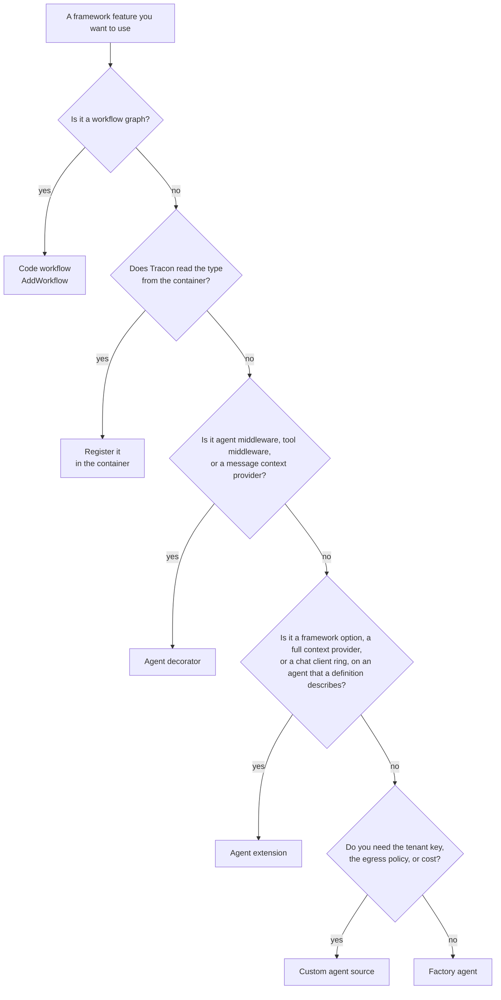
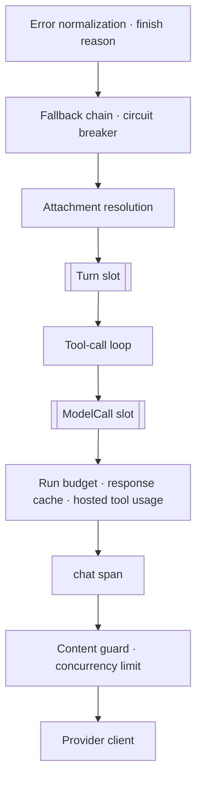

Does Tracon block a Microsoft Agent Framework (MAF) feature that it does not model?
No. Every MAF feature runs under Tracon when your code builds the agent. The real
question is what the agent loses on the way. This page puts the ways in order, lightest
first, and says what each one keeps and loses.

Every code block on this page comes from `samples/Tracon.Samples.MafFeatures`. That
sample builds against the packed packages. Its test project checks six claims: the
decorator sees the tool calls of every door, the custom source uses the tenant's own
key, the custom source records cost, the egress policy reaches the custom source and
not the factory agent, an agent extension adds a context provider to an agent defined
as data without losing the tenant's key or cost, and a chat client ring that an extension
adds sees every model call of that agent.

## The coverage ladder

Four levels say how far a feature reaches into Tracon:

| Level | Meaning |
|---|---|
| Unavailable | You cannot use the feature, or using it turns off the run record or the tenant boundary. |
| Runs | You use the feature from code. The run of the agent is recorded. Some Tracon rings can be lost. |
| Recorded | The events, usage, and cost of the feature enter the run record and the span. The tenant boundary applies. |
| Managed | You turn the feature on with data: a definition, the HTTP API, or the console. Tracon validates it, versions it, and puts it under roles and the audit trail. |

The rule is: code defines, data selects. Anything that executes is registered in
code — a tool, a context provider, middleware. A definition picks it by name. A feature
that you wire in from code reaches **Runs** at once. It does not reach **Managed** by
itself.

## Pick the lightest door

Start at the top of the diagram and stop at the first door that fits.



| Door | Use it when | What you keep | What you lose |
|---|---|---|---|
| Container registration | Tracon reads the type from the container | Everything | Nothing |
| Agent decorator | The feature is agent middleware, tool middleware, or a message context provider | Everything: the model rings, the tenant key, the egress policy, cost | A full context provider |
| Agent extension | The feature is a framework option, a full context provider, or a chat client ring, and a definition describes the agent | Everything a decorator keeps, plus the definition: console editing, versions, validation | The options the definition owns are protected. A tool that your provider adds skips the tool chain |
| Factory agent | Code builds the agent and you need none of the three below | The run record, the model rings (through the registry), the wrapped tools | The tenant key, the egress policy, cost |
| Custom agent source | Code builds the agent and you need the tenant key, the egress policy, or cost | All of the above, plus the tenant key, the egress policy, and cost | Console editing and the features the compiler wires |
| Code workflow | The feature is a graph | The graph, in full | Events that Tracon does not map |

## Register it in the container

Some Microsoft.Extensions.AI types need no agent at all. You register the type, and
Tracon uses it where it needs one. An `IEmbeddingGenerator` serves knowledge search, an
`ITextToSpeechClient` or `ISpeechToTextClient` serves voice, and an `IEvaluator` serves
evaluation. Register the type with the extension of its own package, then bind it as the
page of the feature says. Each page also says what the feature records:

- [Knowledge and RAG](/guides/knowledge/) — the embedding generator
- [Voice and live conversation](/guides/voice/) — speech clients
- [Evaluation and experiments](/concepts/evaluation/) — evaluators

## Wrap the agent with a decorator

An `IAgentDecorator` wraps every agent that the catalog resolves. A decorator can add
MAF middleware with `AIAgentBuilder`. It can add run middleware, function-invocation
middleware that sees each tool call, or a `MessageAIContextProvider`. The decorator
wraps the agent that the catalog already built, so the agent keeps every Tracon ring.

```csharp
public sealed class ToolCallLogDecorator(ToolCallLog log) : IAgentDecorator
{
    public int Order => 100;

    public AIAgent Decorate(AIAgent agent, AgentDescriptor descriptor)
        => agent.AsBuilder()
            .Use(async (innerAgent, context, next, cancellationToken) =>
            {
                log.Record(descriptor.Name, context.Function.Name);
                return await next(context, cancellationToken).ConfigureAwait(false);
            })
            .Build();
}
```

Give the decorator an `Order` above `0`. Run recording sits at `0` and hands the agents
inside it a plain `AgentRunOptions`. MAF function middleware accepts that type. A
decorator outside run recording receives Tracon's own run options, and the middleware
rejects them.

The decorator sees every agent. To act on one agent only, check `descriptor.Name`. The
sample tests run this decorator against three agents: one defined as data, one from a
factory, and one from a custom source. It sees the tool call of all three.

A decorator cannot add a full context provider, one that adds tools or instructions.
`UseAIContextProviders` takes only message providers. For a full provider on an agent that
a definition describes, use an agent extension. For an agent that code builds, use one of
the doors after it.

The sample registers the decorator together with the log it writes to:

```csharp
builder.Services.AddSingleton<ToolCallLog>();

return builder.AddAgentDecorator<ToolCallLogDecorator>();
```

See [Write your own agent decorator](/guides/write-your-own-agent-decorator/) for the
full contract.

## Add an option, a provider, or a ring with an agent extension

An agent extension is code that you register once and a definition selects by name. It
reaches the options that Tracon builds the agent from, so it can set a framework option or
add a full `AIContextProvider`. It can also put a chat client ring into the model pipeline
of the agent. The agent still goes through the definition compiler. It keeps the model
rings, the tenant's own key, the egress policy, and cost, and the console can still edit and
version it.

The sample adds a provider that puts a policy notice into the instructions of every model
call:

```csharp
return builder.AddAgentExtension(
    ExtensionName,
    context =>
    {
        // Add after the providers Tracon built; the compiler refuses a change to them.
        var options = context.ChatAgentOptions!;
        options.AIContextProviders = [.. options.AIContextProviders ?? [], new PolicyNoticeProvider()];
    },
    description: "Adds the refund policy to the instructions of every model call.");
```

```csharp
private sealed class PolicyNoticeProvider : AIContextProvider
{
    protected override ValueTask<AIContext> ProvideAIContextAsync(InvokingContext context, CancellationToken cancellationToken = default)
        => new(new AIContext { Instructions = Notice });
}
```

The sample puts the name in the definition of the agent. A stored definition does the same
with `extensionNames`, and the console offers the registered names in the agent editor:

```csharp
ExtensionNames = [PolicyNoticeExtensionRegistration.ExtensionName],
```

### Add a chat client ring

`context.UseChatClient` puts a `Microsoft.Extensions.AI` chat client into one of two fixed
places in the model pipeline that Tracon builds. A client that the framework documents as
one that must see every model call belongs here: a check on each call, a log of each call,
or a reducer of the request. The sample logs every model call:

```csharp
return builder.AddAgentExtension(
    ExtensionName,
    context =>
    {
        var log = context.Services.GetRequiredService<ModelCallLog>();
        var agent = context.Definition.Name;

        context.UseChatClient(ChatClientSlot.ModelCall, inner => new ModelCallLogChatClient(inner, log, agent));
    },
    description: "Logs the role of the last message of every model call.");
```

The ring derives from `DelegatingChatClient`. The sample's ring records the role of the last
message and passes the call on:

```csharp
public override Task<ChatResponse> GetResponseAsync(
    IEnumerable<ChatMessage> messages,
    ChatOptions? options = null,
    CancellationToken cancellationToken = default)
{
    var request = messages as IReadOnlyList<ChatMessage> ?? [.. messages];
    Record(request);

    return base.GetResponseAsync(request, options, cancellationToken);
}
```

The sample test runs an agent that calls a tool. The ring sees two calls: the question, and
the call that takes the tool result to the model.

The two slots, from the outside of the pipeline in:



| Slot | What the ring sees | Use it for |
|---|---|---|
| `ChatClientSlot.ModelCall` | Every model call of a turn, including the call that takes a tool result to the model | A check or a log of each call, a change to each request |
| `ChatClientSlot.Turn` | One call for each agent turn. The tool-call loop runs inside it | A reducer of the conversation, a log of each turn |

What follows from the order:

- **The content guard inspects the messages that the ring sends.** A user, assistant, or
  tool message that the ring adds reaches the guard before the model. The guard does not
  inspect a system message or the instructions in `ChatOptions`, on any agent. Do not let a
  ring put text that it did not write there, for example a retrieved document. The ring also
  receives the answer after the guard has checked it.
- **The budget counts the calls that the ring sends.** A ring that answers by itself and
  does not call the client below it spends nothing and leaves no `chat` span.
- **The response cache keys on the request after the ring.** Two requests that the ring
  makes the same share one cache entry.
- **The fallback chain gets the same ring.** When a fallback model answers in place of the
  agent's model, the ring factory builds a ring for that model's pipeline too.
- **A provider failure passes up through the ring.** The circuit breaker counts it, the
  fallback chain moves on, and normalization masks it as before. An exception that the ring
  throws by itself is your code's: it is not counted and not masked, the same as an exception
  from a wrapper that `context.Use` adds.
- **The compaction summarizer and the judge of a loop criterion get no ring.** They serve
  their own call, not the agent's turn.

The ring factory runs each time the pipeline is built: when the agent is compiled, and when
a fallback model is first used. Keep it cheap and keep state that belongs to one run out of
it. With several rings in one slot, the first one added is the innermost. Derive the ring
from `DelegatingChatClient`. A `Turn` ring that hides the tool-call loop from `GetService`
fails the compilation, because the framework would add a second loop above it. A host that
replaces `IModelProviderRegistry` with its own cannot place a ring: an agent that selects a
ring extension fails to compile on that host, with an error that names the extension.

What to know about this door:

- **`Configure` runs when the agent is compiled, not on every run.** The compiled agent is
  cached for each tenant, agent name, and definition, so the runs that follow share it. Two
  runs that start before the cache holds the agent can each compile it. A run with parameter
  values, and an agent of a tenant that holds its own provider key, is not cached and runs
  the extension each time.
- **The extension gets one options object.** `ChatAgentOptions` is set for a chat agent and
  `HarnessAgentOptions` for a harness agent. `context.Use` adds a wrapper around the
  compiled agent, inside Tracon's own wrappers and decorators. `context.UseChatClient` adds
  a ring to the model pipeline of both kinds of agent.
- **Some options are protected.** A definition or a tenant and security decision owns the
  tool chain, the tool approval settings, the instructions and sampling settings (including the seed,
  top-k, stop sequences, penalties, tool mode, and `AllowMultipleToolCalls`), the chat
  history provider, file access, the working-directory skill scan, file memory, web search,
  compaction, the loop, and the sub-agent tree. Some other options are protected because
  they change a protected setting indirectly. `UseProvidedChatClientAsIs` removes the
  framework's default chat client stack, and with it the approval binding and the per-call
  history writer. `AllowConcurrentInvocation` turns on concurrent tool calls in the tool loop
  that Tracon builds. For concurrent tool calls, set `ToolLoop.AllowConcurrentToolCalls` in the model
  binding of the definition. `ChatOptions.RawRepresentationFactory` replaces the model,
  sampling, and provider settings of the definition on the wire. Two options are protected
  because they do not work under Tracon. `EnableMessageInjection` and
  `RequirePerServiceCallChatHistoryPersistence` act on each model call only when they are under
  the tool loop. Tracon's tool loop is inside the model client, so these layers are above it. An
  injected message does not reach the running turn, and the history is written once per turn.
  A layer of this kind belongs in the `ModelCall` slot of a chat client ring.
  An extension that changes a protected option fails the compilation with
  an error that names the extension and the option. Tracon does not undo the change. The
  provider list is append-only. The other options are yours, for example
  `ThrowOnChatHistoryProviderConflict`. The check covers the options object. It does not look inside a
  provider or a wrapper that the extension adds, so a provider you add can still read files
  or load skills by itself. Register only extension code that you trust, as you do for a tool.
- **A provider can add tools, and Tracon does not run them through the tool chain.**
  Authorization, approval, and the timeout apply to the tools that the tool registry gives
  an agent. A tool that your own provider adds skips them. The run record still shows the
  call.
- **A replay that plays tools back does not run the extension**, for the same reason.
- **Model options for one run follow the same rule.** Code can run a catalog agent with
  `ChatClientAgentRunOptions`. The run may add instructions and tool declarations, and it may
  turn parallel tool calls off (`AllowMultipleToolCalls = false`), which a handoff step does. A
  model id, a sampling setting, a tool mode, a response format, a chat client factory, or a tool
  that runs throws `ArgumentException` before the run starts. No HTTP endpoint takes model options for one run. To change a run, change the
  definition, run an experiment, or declare a parameter.

## Build the agent in a factory

`AddAgent(name, factory)` takes a factory that returns any MAF `AIAgent`. Tracon records
the run and applies its decorators. The agent skips the definition compiler, so the
factory has to ask for each piece it wants to keep:

```csharp
// The registry builds the model rings: run budget, circuit breaker,
// fallback, response cache, content guards, and the 'chat' span. This
// synchronous call applies no tenant key and no egress policy.
var chatClient = services.GetRequiredService<IModelProviderRegistry>().CreateChatClient(model);

// The registry returns the wrapped tool: authorization, validation,
// timeout, truncation, and approval stay on.
if (!services.GetRequiredService<IToolRegistry>().TryGet(SearchOrdersToolRegistration.ToolName, out var searchOrders))
{
    throw new InvalidOperationException($"The tool '{SearchOrdersToolRegistration.ToolName}' is not registered.");
}

return chatClient.AsAIAgent(new ChatClientAgentOptions
{
    Name = AgentName,
    ChatOptions = new ChatOptions
    {
        Instructions = "Answer questions about orders. Look orders up with the search tool.",
        Tools = [searchOrders],
    },

    // Tracon's history store, so the console and /v1/conversations show the
    // turns. With SQL storage, leaving this out leaves both of them empty.
    ChatHistoryProvider = services.GetService<ChatHistoryProvider>(),

    // Any framework provider or option is now yours.
    AIContextProviders = [new TodoProvider(new TodoProviderOptions())],
});
```

What a factory agent keeps, and how:

| Piece | Kept? | How |
|---|---|---|
| Run row, events, tool-call record, usage, cancellation, webhooks, error class, input record, replay | Yes | Automatic. Run recording wraps every agent. |
| `invoke_agent` span and saved approval rules | Yes | Automatic. |
| Sessions, `/v1/*`, A2A and MCP publication, being called as a sub-agent | Yes | Automatic. |
| The model rings | Yes | Build the chat client with `IModelProviderRegistry.CreateChatClient`. |
| The tool chain: authorization, validation, timeout, truncation, approval flag | Yes | Take the tool from `IToolRegistry.TryGet`. |
| History in the console and in `GET /v1/conversations/{id}/items` | Yes | Pass the `ChatHistoryProvider` from the container. |
| The tenant's own provider key and the egress policy | **No** | The factory is synchronous. Use a custom agent source. |
| Cost, model breakdown, and cost quota | **No** | The descriptor of a factory agent names no model. Use a custom agent source. |

Three facts about this door:

- **The history provider matters on SQL storage.** With the in-memory store, the turn
  shows in the console and in `/v1/conversations/{id}/items` whether or not the agent
  uses the provider from the container. With a SQL store, both stay empty unless the
  agent uses it. The sample passes it.
- **The factory runs on every resolve.** Keep it cheap, and keep state out of it.
- **Tracon warns about a bypassed registry.** If the chat client of a factory agent did
  not come from `IModelProviderRegistry`, Tracon writes one warning for that agent name
  the first time the catalog resolves it. An agent that exposes no chat client gets no
  warning.

## Build the agent in a custom source

A factory is synchronous, and its descriptor names no model. An `IAgentSource` has
neither limit. Its `ResolveAsync` is asynchronous, so it can call
`CreateChatClientAsync`, which applies the tenant's own provider key and egress policy.
Its `ListAsync` returns a descriptor that names the model, and run recording prices the
run from that model. The sample describes its agent like this:

```csharp
// The model named here is what run recording prices. Leave it out and the
// run is recorded with no model and no cost.
private AgentDescriptor Descriptor => new()
{
    Name = AgentName,
    Description = "A custom-source agent that answers questions about invoices.",
    Origin = AgentDefinitionOrigin.Custom,
    SourceName = SourceName,
    Model = model,
    ToolNames = [SearchOrdersToolRegistration.ToolName],
};
```

`ResolveAsync` then builds the agent:

```csharp
// The asynchronous call applies the tenant's own provider key and the tenant's
// egress policy, on top of the model rings.
var chatClient = await models.CreateChatClientAsync(model, cancellationToken).ConfigureAwait(false);

if (!tools.TryGet(SearchOrdersToolRegistration.ToolName, out var searchOrders))
{
    throw new InvalidOperationException($"The tool '{SearchOrdersToolRegistration.ToolName}' is not registered.");
}

return chatClient.AsAIAgent(new ChatClientAgentOptions
{
    Name = AgentName,
    ChatOptions = new ChatOptions
    {
        Instructions = "Answer questions about invoices. Look orders up with the search tool.",
        Tools = [searchOrders],
    },
    ChatHistoryProvider = history,
});
```

The sample tests run this agent for a tenant that has its own key. The chat client is
built with that key, and the run record carries the model and a cost. The same tests run
the factory agent for the same tenant: its client is built with the setup key, and its
run record has no model and no cost. They also set an egress policy that forbids the
provider. The custom source is refused. The factory agent still runs.

A custom source does not run the definition compiler. It owns the whole shape of the
agent. Do not cache an agent whose client carries a tenant's own key across tenants.
[Write your own agent source](/guides/write-your-own-agent-source/) explains the
lifecycle, the priority, and the contract tests.

## Build the workflow in code

`AddWorkflow(name, factory)` runs a MAF `WorkflowBuilder` graph. Every builder feature
runs, and Tracon records a root run. Tracon maps the started, output, error, warning,
super-step, executor, request, and agent-response-update events into the run record. It
records every other event — the plan and ledger events of a Magentic workflow, or an event
class that you define — as a `tracon.workflow.event` with its type name and its data as
text ([Runs and recording](/concepts/runs/)). Such an event has no card of its own in the
console.

If you write executors with MAF source-generated handlers (`[MessageHandler]`), add the
`Microsoft.Agents.AI.Workflows.Generators` analyzer package to your own project.
Tracon does not reference it for you.

See [Workflows](/concepts/workflows/) for the registration key, the helpers that give a
code graph the time limit, retry, and budget of a stored one, and the full recording
model.

## Ready-made pieces from the framework

Some framework packages ship a finished piece instead of a hook. Three of them were tried
under Tracon on 2026-10-21 with Microsoft Agent Framework 1.25. The shell tool and the
remote agent ran against a real host; Purview was read from its package, because it needs a
Microsoft 365 tenant.

- **A shell tool in a container** (`Microsoft.Agents.AI.Tools.Shell`, preview).
  `DockerShellExecutor.AsAIFunction()` returns an ordinary tool. Register it with `AddTool`
  and name it in the definition: authorization, approval, the timeout, and the audit trail
  apply. Use `ShellMode.Stateless`, so every call runs in a new container and no tenant or
  conversation sees another's files. The persistent mode keeps one shell for one
  conversation, and a registered tool serves every run, so do not register a persistent
  executor. The executor starts the `docker` command line on the Tracon host, and access
  to a Docker socket is root access on that machine: point it at an engine that runs
  nothing else. The executor asks for approval by default, and Tracon reports that tool as
  one that needs approval. Do not use `LocalShellExecutor` on a shared host: it runs the
  command on the host itself.
- **A remote agent** (`Microsoft.Agents.AI.A2A`, preview). `A2AClient.AsAIAgent()` returns
  an agent that sends each turn to another A2A server. Register it with
  `AddAgent(name, factory)`. The run is recorded at the agent level, and the session keeps
  the remote `contextId`, so the next turn on the same Tracon session continues the remote
  conversation. The remote server runs its own model and tools: the record has no model,
  usage, or cost, and the remote run is not a child of the run that called it. The HTTP
  client that you give the agent does not go through Tracon's egress policy.
- **Microsoft Purview** (`Microsoft.Agents.AI.Purview`, release candidate).
  `PurviewExtensions.PurviewAgentMiddleware(...)` returns agent middleware: apply it with
  an agent extension or a decorator. Build it once at startup, because each call builds its
  own cache, background queue, and HTTP client. Purview checks the input and the final
  answer of a run. When it blocks, it returns its message as an ordinary answer, so the run
  closes `Completed`, not as blocked content. Its check of every model call is a chat client
  and needs a seat below the tool loop: the `ModelCall` slot of a chat client ring. That form
  was not tried under Tracon. Its calls to Microsoft Graph do not go through Tracon's egress
  policy.

## What you cannot win back today

These losses have no door that removes them:

- **A protected option on an agent defined as data.** An agent extension can set any
  framework option that the definition and the tenant do not own. The tool chain, the chat
  history provider, the approval settings, the file access and skill-scan options, and the model
  settings stay with Tracon as options. A feature that needs one of them needs an agent that your code builds. That agent is code, so the
  console cannot edit it.
- **The tool chain for a tool that your own provider adds.** An extension's provider can
  add a tool, and that tool skips authorization, approval, and the timeout. Register the
  tool in the tool registry instead, and name it in the definition.
- **Tracon's managed skills, compaction, MCP resources, and loop recording on a
  code-built agent.** The definition compiler wires skills with their script gates,
  context compaction with its record, MCP tools and resources, loop recording, and the
  budget of the agent tree. It does this only when it compiles a definition. A factory
  agent or a custom-source agent gets none of them from Tracon.
- **A file store that is scoped to the tenant and the agent.** The agent file store in
  the container is not built for a provider of your own. The in-memory default has no
  tenant prefix and no agent prefix: every tenant and agent of the process shares it. The
  SQL stores scope every call to the tenant and to the agent of the current run, so a
  provider of your own shares the space of that agent's file memory, and it fails outside
  a run. Do not give the in-memory store to an agent that serves more than one tenant.
- **Everything a definition gives.** A code-built agent cannot take parameterized,
  per-culture, or shared instructions. It has no versions, experiments, rollback, or
  validation when you save, and you cannot edit it in the console.
- **The tenant key, the egress policy, and cost on a factory agent.** A custom agent
  source gets all three.

## Checklist

Answer these five questions before you write a factory agent:

1. Can a decorator or an agent extension do the job? If the feature is middleware, a
   message provider, a framework option, a full context provider, or a chat client ring, one
   of them can, and you keep every ring.
2. Do you need the tenant's own key, the egress policy, or cost? If yes, use a custom
   agent source.
3. Does the factory build its chat client with `IModelProviderRegistry`? If not, the
   model rings are off, and Tracon logs a warning.
4. Does the agent take its tools from `IToolRegistry` and its history from the
   container? If not, tool policy is off, and the console may show an empty history.
5. Can the agent live as code? Without console editing, versions, and rollback, and
   without Tracon's skills, compaction, and MCP resources, is it still the agent you
   want?

## Read next

- [Write your own agent decorator](/guides/write-your-own-agent-decorator/) — the decorator door in full, with ordering rules
- [Write your own agent source](/guides/write-your-own-agent-source/) — the source contract, priority, and tenancy
- [Agents and definitions](/concepts/agents/) — where the catalog gets its agents
