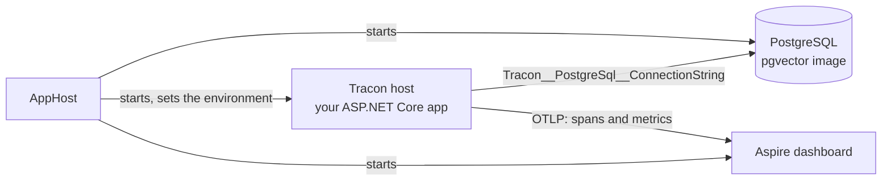

How do you add a Tracon host to an Aspire solution, and what do you see in the dashboard? Three decisions are
specific to Tracon: whether the database image carries the `vector` extension, the name of the connection string
setting, and the telemetry registration. The rest is a normal AppHost.

The repository shows all three in `samples/Tracon.AppHost`. Start it with one command. Docker, or another
container runtime that Aspire supports, must be running:

```bash
dotnet run --project samples/Tracon.AppHost
```

The console prints a dashboard address with a login token. The AppHost starts PostgreSQL, then the sample API
(`samples/Tracon.Api`), and opens no browser.



## The AppHost

The AppHost project uses `Aspire.AppHost.Sdk` and references your Tracon host project. It references no Tracon
package.

```xml
<Project Sdk="Aspire.AppHost.Sdk/13.6.4">

  <PropertyGroup>
    <OutputType>Exe</OutputType>
    <TargetFramework>net10.0</TargetFramework>
  </PropertyGroup>

  <ItemGroup>
    <ProjectReference Include="../YourTraconHost/YourTraconHost.csproj" />
    <PackageReference Include="Aspire.Hosting.PostgreSQL" Version="13.6.4" />
  </ItemGroup>

</Project>
```

```csharp
var builder = DistributedApplication.CreateBuilder(args);

// Needed because this host turns Knowledge on (EnableKnowledge = true). Leave both lines out when it stays off.
var postgres = builder.AddPostgres("postgres")
    .WithImage("pgvector/pgvector")
    .WithImageTag("pg18");

var database = postgres.AddDatabase("tracon");

builder.AddProject<Projects.YourTraconHost>("tracon-host")
    .WithEnvironment("Tracon__PostgreSql__ConnectionString", database)
    .WaitFor(database);

builder.Build().Run();
```

| Decision | What goes wrong if you skip it |
|---|---|
| Use the `pgvector/pgvector` image when `EnableKnowledge` is `true` | [Knowledge](/guides/knowledge/) needs the `vector` extension, and the Tracon PostgreSQL migrations create it only when `Tracon:PostgreSql:EnableKnowledge` is `true`. The sample turns it on. With the official `postgres` image, which `AddPostgres` starts by default, the host then stops at start: `Migration '0001_vector' could not be applied: extension "vector" is not available`. Measured with `postgres:18-alpine`. With `EnableKnowledge` off, the same image starts and migrates |
| Set `Tracon__PostgreSql__ConnectionString` with `WithEnvironment` | `WithReference(database)` writes `ConnectionStrings__tracon`. Tracon reads `Tracon:PostgreSql:ConnectionString` and never that key, so the host starts without persistence. The environment variable also wins over a connection string that your user-secrets hold for another database |
| Keep model keys out of the AppHost | The AppHost needs no secret. Put provider keys in the host project's own user-secrets, as you do without Aspire |

The AppHost adds no data volume, so each start creates a new database. Stop the AppHost and Aspire removes the
container.

## Send Tracon telemetry to the dashboard

Tracon does not choose an exporter. Your host does. The AppHost gives the host the standard `OTEL_*` variables,
including the dashboard address, so the host registers the exporter only when those variables exist:

```bash
dotnet add package OpenTelemetry.Extensions.Hosting
dotnet add package OpenTelemetry.Exporter.OpenTelemetryProtocol
dotnet add package OpenTelemetry.Instrumentation.AspNetCore
```

```csharp
using OpenTelemetry;
using OpenTelemetry.Metrics;
using OpenTelemetry.Trace;
using Tracon;

if (builder.Configuration["OTEL_EXPORTER_OTLP_ENDPOINT"] is { Length: > 0 })
{
    builder.Services.AddOpenTelemetry()
        .WithTracing(tracing => tracing
            .AddAspNetCoreInstrumentation()
            .AddSource(TraconDiagnostics.ActivitySourceName)
            .AddSource("Microsoft.Agents.AI.Workflows"))
        .WithMetrics(metrics => metrics
            .AddAspNetCoreInstrumentation()
            .AddMeter(TraconDiagnostics.MeterName))
        .UseOtlpExporter();
}
```

Three details matter:

- **The request span is the parent.** The ASP.NET Core instrumentation makes the HTTP request span the parent of
  the `tracon.run` span, so the dashboard shows one tree for each request.
- **The framework source is separate.** `Microsoft.Agents.AI.Workflows` carries the spans of a workflow that you
  build in code and mark with `WithOpenTelemetry()`. Leave it out if you use no such workflow.
- **Without the variable, nothing changes.** The condition keeps a host that runs outside Aspire exactly as it was.

## What the dashboard shows

Run an agent once, then open the Traces and Metrics pages. The sample API, run with its built-in echo provider
on 2026-10-30, produced this trace:

| Span | Source |
|---|---|
| `POST /tracon/api/agents/{name}/run` | ASP.NET Core instrumentation |
| `tracon.run` | Tracon: the root span of a run |
| `invoke_agent translator` | The agent invocation |
| `chat echo-1` | The model call |

The Metrics page lists the `Tracon` meter next to the ASP.NET Core meters. It showed `tracon.runs` and
`tracon.run.duration`, and the `gen_ai.client.operation.*` instruments of the model call. See
[Observability and cost](/guides/observability/#stable-metric-names) for the full metric list.

## When something is missing

| Symptom | Check |
|---|---|
| The dashboard lists the host but no `tracon.run` span | No run has happened yet, or the host process has no `OTEL_EXPORTER_OTLP_ENDPOINT`. Open the resource in the dashboard and read its environment variables |
| The host stops at start with `extension "vector" is not available` | `EnableKnowledge` is `true` and the database image does not provide `vector`. Use `pgvector/pgvector`, or leave `EnableKnowledge` off |
| The host runs but reports a different database than the container | The `Tracon__PostgreSql__ConnectionString` variable is missing, so a user-secrets value is in use. `GET /api/diagnostics` shows the active provider when you turn it on |
| The collector or dashboard is down | Runs still complete. The OpenTelemetry SDK drops what it cannot send. Measured: a run finished normally with the endpoint pointing at a closed port |

## Microsoft's DevUI

The Microsoft Agent Framework has its own Aspire hosting package for DevUI, `Aspire.Hosting.AgentFramework.DevUI`.
On 2026-10-29 NuGet listed prerelease versions only, so the sample does not use it. See
[Tracon and DevUI](/getting-started/devui/) for how the two user interfaces differ.

## Read next

- [Observability and cost](/guides/observability/): the metric names, the span tree, and the switches that decide what a span carries.
- [Tracon and Microsoft's control planes](/getting-started/microsoft-control-planes/): where Tracon stands next to Foundry Control Plane, Agent 365, and Entra Agent ID.
- [Run more than one instance](/guides/multiple-instances/): what two hosts on one database share.
