Tracon can move a run out of the request path or create work from a recurring
schedule. Both paths use the same durable job queue and worker. This gives an API
caller a short `202 Accepted` response while Tracon owns execution, status, and
recovery.

Use background work when the caller cannot keep an SSE connection open, when a batch
contains many independent inputs, or when work must start on a calendar. Keep the
normal streaming run endpoint for interactive conversations and approval flows.

## What this queue is, and what it is not

It is not a general-purpose durable execution engine, and it does not try to be one.
It dispatches Tracon's own work — an agent run, a batch, a workflow start, the
continuation of an interrupted run — and it carries the things those items need: the
tenant they belong to, the quota they spend against, and the `runs` row that records
what happened. It lives in the same database as every other Tracon store, so an
operator reads one schema rather than two.

That leaves a boundary worth naming, because the Microsoft Agent Framework has a
durability story of its own. Its durable extension makes a **workflow** survive the
loss of the process running it. It does not schedule catalog agent runs, does not
carry a tenant or a quota, and does not write a Tracon run record. The two are
complementary rather than competing, and Tracon already uses both: durability inside
a workflow is the Agent Framework's checkpointing, reached through Tracon's
[checkpoint store](/concepts/workflows/#checkpoints), while dispatch and scheduling
around it are this queue's.

If all you need is for one workflow to resume after a crash, reach for the Agent
Framework's own durability first. Reach for this queue when the work has to be
queued, leased, retried, attributed to a tenant, and recorded.

```mermaid
stateDiagram-v2
    accTitle: Life of a queued job
    accDescr: A queued job is polled by a worker, leased exclusively, and run. Success completes it, a retryable failure returns it to the queue until the attempt limit, and a worker that dies lets the lease expire so another worker can take the item again. A store error while the worker writes the outcome is retried while the lease holds; it does not run the handler again.
    [*] --> Queued: enqueued by API or schedule
    Queued --> Leased: worker polls and takes an exclusive lease
    Leased --> Running: handler resolved
    Running --> Completed: every item finished
    Running --> Failed: attempt limit reached, or no handler
    Running --> Queued: retryable failure, JobRetryException.RetryAfter
    Leased --> Queued: lease expires after the worker dies
    note right of Running
        A store error while the outcome is written
        is retried while the lease holds. The handler
        does not run again for it.
    end note
    Completed --> [*]
    Failed --> [*]
```



## Configure the worker

`AddTracon()` registers the scheduling stores and worker. `UseScheduling()` only
changes its settings:

```csharp
var builder = WebApplication.CreateBuilder(args);

builder.Services.UseScheduling(options =>
{
    options.RunWorker = true;
    options.MaxConcurrentJobs = 4;
    options.PollInterval = TimeSpan.FromSeconds(5);
    options.LeaseDuration = TimeSpan.FromMinutes(5);
    options.MaxAttempts = 3;
    options.MaxItemsPerJob = 1_000;
});

var tracon = builder.AddTracon()
    .UseOpenAI(builder.Configuration.GetSection(OpenAIProviderOptions.SectionName))
    .UsePostgreSql(
        builder.Configuration.GetSection(TraconPostgreSqlOptions.SectionName));

var app = builder.Build();
app.MapTracon("/tracon");
app.Run();
```

The same values can come from configuration:

```json
{
  "Tracon": {
    "Scheduling": {
      "Enabled": true,
      "RunWorker": true,
      "MaxConcurrentJobs": 4,
      "PollInterval": "00:00:05",
      "LeaseDuration": "00:05:00",
      "MaxAttempts": 3,
      "MaxItemsPerJob": 1000
    },
    "AsyncRun": {
      "Enabled": true,
      "MaxAttempts": 1
    }
  }
}
```

Code passed to `UseScheduling()` wins over configuration.

## Queue one agent run

Send the normal management run request with `Prefer: respond-async`:

```bash
curl -i https://agents.example.com/tracon/api/agents/support/run \
  -H "Authorization: Bearer $TRACON_API_KEY" \
  -H 'Content-Type: application/json' \
  -H 'Prefer: respond-async' \
  -d '{"message":"Prepare the weekly escalation report."}'
```

Tracon returns `202 Accepted`, `Preference-Applied: respond-async`, and a
`Location` header. The response identifies both the run and its backing job. For this
path, the job ID is the run ID. Follow the returned location, or read the run and its
events directly:

```bash
curl -sS \
  -H "Authorization: Bearer $TRACON_API_KEY" \
  https://agents.example.com/tracon/api/runs/$RUN_ID

curl -sS \
  -H "Authorization: Bearer $TRACON_API_KEY" \
  https://agents.example.com/tracon/api/runs/$RUN_ID/events
```

Queued runs do not accept `attachmentIds` or an initial `approvals` collection. They
do accept `parameters` and `documents`, with the same meaning as on a synchronous run:

```bash
curl -sS -X POST https://agents.example.com/tracon/api/agents/writer/run \
  -H "Authorization: Bearer $TRACON_API_KEY" \
  -H 'Prefer: respond-async' -H 'Content-Type: application/json' \
  -d '{"message":"Draft","parameters":{"tone":"formal"},
       "documents":[{"name":"brief.txt","content":"Ship on Friday."}]}'
```

The values are checked when the request arrives, against the schema of the version the
worker will run, so a missing required value or an undeclared name is a `400` with the
same body a synchronous run gives. The worker checks them again where the run executes,
because a payload is stored data and the agent may have changed since the `202`. Each
document becomes its own message before the request, in order, and leaves a
`DocumentAttached` event. Without `parameters`, a queued run of a parameterized agent
binds each parameter's default; an agent with a required parameter that has no default
is refused with `400` and `missingParameters`. If a tool asks for approval later, the
queued request must include a `sessionId`; the run that resumes after the decision binds
the same values.

:::caution[The job payload is not a protected column]
The payload holds the message, the parameter values and the document text as plain JSON.
Content protection covers run inputs, run events and the other columns
`ContentProtection` lists; `jobs.payload` and the item inputs are not among them. Do not
queue values that must not sit in plain text in your database.
:::

A queued run uses the request's `culture`, as a synchronous run does. If the agent is
in a running [experiment](/concepts/evaluation/#experiments), Tracon assigns the arm
when it accepts the request, with the same key as a synchronous run, and the worker
runs that arm's version. The `202` is returned only after Tracon compiles that version,
so a version that does not compile is a `400`, not a failed job.

The job payload carries the culture and the arm. A schedule can write a payload by
hand, so the worker checks the arm before it runs. The arm must name a variant of a
started experiment for this agent in this tenant, with that variant's version. If it
does not, the job fails before the run starts, and no model call is made. A payload
with only an `agentVersion` runs that version outside any experiment.

**Do not start a second run yourself.** Deciding the approval is enough: the
decision endpoint creates the continuation run and queues it for the worker in
the same request, and the response's approval record is your confirmation that
it did. Starting another run in that session on top of it duplicates the work.

The run that asked for approval stays `AwaitingApproval` — it is finished. The
continuation is a separate run in the same session, so a client watching for a
result should follow the session rather than the original run id.

The continuation can ask for approval again, for example for the next tool in a
chain. It then ends `AwaitingApproval` too, and its request appears in
`GET /api/approvals/pending` like the first one; decide it the same way and the
chain goes on. A run that [run reconciliation](#singleton-services-and-orphaned-run-recovery)
continues after a crash puts its requests in the same list.

The continuation runs under the user and labels of the run that asked for
approval, so its tools and sub-agents see the same attribution. The person who
decided is recorded in the audit trail, not as the run's user.

The continuation runs on the agent version of the run that asked for approval and
counts in the same experiment arm. This stays true when someone saves a new version
while the approval waits: the tool call and its answer are one turn. A code agent
keeps no version history, so its continuation uses the current definition. The
original request's `culture` is not kept: the continuation uses the default
instructions.

If the decision request fails partway, repeat exactly the same decision. The
continuation run's identity is derived from the approval, so a repeat completes
the interrupted handoff instead of creating a second run; only a repeat that
asks for the *opposite* answer is refused with `409`.

This is the durable-mailbox path. An in-band approval — one supplied in a
run request's `approvals` collection — is answered on the next request instead,
and a workflow's human-in-the-loop step uses its own respond call.

`AsyncRun.MaxAttempts` defaults to one. This is deliberate: an expired lease must not
silently repeat an agent run that already changed an external system. A lease that
runs out counts as an attempt, so when the worker running a one-attempt job dies,
the job fails with `tracon.job.attempts-exhausted` instead of running again; its
run stays `Running` until [run reconciliation](#singleton-services-and-orphaned-run-recovery) closes it.
Raise the limit only when every tool in the run is idempotent and you have tested
replay after a worker crash.

A store error after the agent run has finished is not a failed attempt. The worker
tries the write of the job's outcome again while it still holds the lease, so a
short database outage neither fails a finished run nor runs it a second time. Only
a write that keeps failing until the lease is about to run out leaves the job to
lease expiry, and with one attempt that fails it with
`tracon.job.attempts-exhausted`.

The session the run saves is part of the same turn, and the same rule applies to
it: a store error on the session save is tried again under the lease, and the model
is not called again. If the save still fails, the job fails with
`tracon.job.session-save-failed` on that attempt, whatever its attempt limit, and
the run keeps the status the turn gave it.

Two built-in handlers apply the same rule to their own last write. An eval run whose
cases have all run is not marked `Failed` because the write that closes it failed:
the handler tries that write again for a third of the lease, and if it still fails,
the next attempt of the job runs no case again and only repeats the write. A webhook
delivery the receiver accepted is not sent again because its result could not be
written ([webhooks](/concepts/governance/#webhooks)).

## Queue one workflow run

A workflow run, a resume and an answer to a waiting request queue the same way: send
`Prefer: respond-async` to `POST /api/workflows/{name}/run`,
`POST /api/workflows/runs/{runId}/resume` or `POST /api/workflows/runs/{runId}/respond`.
The answer is `202 Accepted` with the run id, which is also the job id, and the job
runs under the built-in key `tracon.workflow-run`. Every check the streamed call makes
happens before the `202`, so a refused request queues nothing. See
[Queue a run instead of streaming it](/concepts/workflows/#queue-a-run-instead-of-streaming-it).

`tracon.workflow-run` cannot be scheduled, with or without
`HttpSchedulableHandlerKeys`: its payload names a run and the operation to apply, and
the caller is checked only when the HTTP endpoint queues it. A schedule that runs a
workflow uses `tracon.workflow`.

While `Tracon:Workflows:ResumeInterruptedRuns` is off, a queued workflow run's job
gets `AsyncRun.MaxAttempts`, like a queued agent run. While it is on, the job gets
`2 + MaxResumeAttempts` attempts, and a lease taken again after a crash or a graceful
stop continues the run from its latest checkpoint instead of starting it over. The
last attempt closes the chain instead of continuing it, so a `tracon.workflow` batch
job needs `2 + MaxResumeAttempts` attempts too to get every continuation
([Resume an interrupted run automatically](/concepts/workflows/#resume-an-interrupted-run-automatically)).

## Create a recurring schedule

The schedule name is part of the URL. The body selects the handler key, target,
calendar, time zone, and payload:

```bash
curl -sS -X PUT \
  https://agents.example.com/tracon/api/schedules/weekday-support-review \
  -H "Authorization: Bearer $TRACON_API_KEY" \
  -H 'Content-Type: application/json' \
  -d '{
    "handlerKey": "tracon.agent-batch",
    "targetName": "support",
    "cron": "0 8 * * 1-5",
    "timeZone": "UTC",
    "payload": [
      "Review unresolved priority-one tickets.",
      "Summarize breaches of the response-time objective."
    ],
    "enabled": true
  }'
```

A JSON array creates one item for each element. Any other JSON value creates one
item. A missing payload creates no items. Each job accepts at most
`MaxItemsPerJob` items.

### Give an item its own values

For `tracon.agent-batch` and `tracon.workflow`, an item that is a JSON object with a
string `message` member is a **structured item**. It may add `parameters` (an object of
string values), for an agent batch `documents` (an array of `{name, content}`), and for
a workflow batch `sessionId`:

```json
"payload": [
  "Plain text still works.",
  { "message": "Review this", "parameters": { "tone": "formal" },
    "documents": [{ "name": "brief.txt", "content": "Ship on Friday." }] },
  { "message": "Summarize", "parameters": { "tone": "casual" } }
]
```

A workflow item's `sessionId` becomes the run's execution session, so you can
correlate the run with your own record — a production id, say. The run, its
`run.completed` webhook and a run that resumes it all carry that id. It is a
correlation, not a de-duplication: two items with the same id are two runs. The id
follows the session id rule — at most 128 letters, digits, `-` or `_` — and an item
that breaks it fails alone. An agent batch item that names a `sessionId` fails alone
too: an agent batch runs every item without a session. For the same reason, an item
whose run asks for a tool approval fails, and its run is closed as `Failed`: an
approval is answered in the session's next turn, which the item does not have.

```json
"payload": {
  "items": [ { "message": "Episode 12", "sessionId": "episode-12" } ]
}
```

With `Tracon:Workflows:ResumeInterruptedRuns` on, a workflow batch writes each item's
run id on the item before its run starts. A job leased again after a crash finds the
item still pending, and its run is continued from the latest checkpoint instead of
starting over; an item whose run had already finished is reported without running
again. Each such lease counts against the job's own attempt limit
(`Scheduling.MaxAttempts`, or the job's `maxAttempts`).

Saving the schedule, or triggering it with a payload, refuses an item whose shape is
wrong — `parameters` that is not an object of strings, a `documents` entry without a
`name` and a `content`, a member the shape does not name — with a `400` that names the
item's position. The values themselves are checked when each item runs, against the
agent's or the workflow's schema at that moment. An item with an invalid value fails
**alone**: the other items run and the batch still finishes `Completed`. When no item in
an agent batch carries a value, an agent with a required parameter that has no default
fails the whole job once, up front. A workflow item cannot carry `documents`; it fails
with that reason instead of running without them.

:::note[A text item that looks like a structured item is one]
A stored item is text, and a plain-text item whose content happens to be a JSON object
with a string `message` member is read as structured. Quote or reshape such text if it
is ever a real input.
:::

### Attribute the runs a schedule starts

A schedule has no caller when it fires, so its runs carry no
[user or labels](/concepts/runs/#who-ran-it-and-for-what) unless the payload names
them. For `tracon.workflow` and `tracon.agent-batch`, wrap the items in an envelope —
an object whose only members are `items`, `userId`, and `labels`:

```json
"payload": {
  "items": [ "Summarize yesterday's escalations." ],
  "userId": "user-42",
  "labels": { "job": "nightly-digest" }
}
```

The items read exactly as a top-level array does, and every run the job starts carries
that user and those labels; the workflow's nodes and tools read them from
`TraconRunContext.Current`. The labels obey the same limits as on every run — at most
8, keys up to 64 characters, values up to 256 — and saving or triggering a schedule
whose envelope breaks one, or names a member of the wrong type, is a `400`. An object
with any other member keeps its old meaning: one item. Only the Admin role can write a
schedule, so the attribution it names is an administrator's statement; Tracon does not
check it against your identity pipeline. **Trigger now** runs with the schedule's own
attribution, or with the one the trigger request's payload names, not the caller's.

Work you queue yourself carries an attribution without an envelope. A workflow or agent
batch queued through `IJobDispatcher` keeps the user and labels `IRunAttributionContext`
resolves at the time of the call — your request's, or an open
`AmbientRunAttributionScope`'s with the built-in context — and Tracon writes them into
the stored payload as this envelope. A workflow an
[inbound trigger](/guides/inbound-triggers/) starts keeps the accept request's.

`handlerKey` names the handler that runs the jobs this schedule produces. Only
the keys the server allows over HTTP are accepted —
`GET /api/schedules/handler-keys` returns exactly that list, and anything else
is a `400`. It is Tracon's own built-in keys unless the host set
`Scheduling.HttpSchedulableHandlerKeys`, so making one of your own handlers
schedulable from outside is a deliberate opt-in. A non-empty setting
**replaces** that default rather than extending it — which is what lets an
operator narrow the surface, and also what makes a list naming only a consumer
key turn every built-in key off. See
[Write your own job handler](/guides/write-your-own-job-handler/).

The schedule name `handler-keys` is reserved for that list: a schedule saved under it
could not be read back, so `PUT /api/schedules/handler-keys` answers `400`.

Tracon accepts five-field cron expressions: minute, hour, day of month, month,
and day of week. It supports `*`, fixed values, ranges, lists, and `/step`. It does
not support seconds or the `L`, `W`, and `#` extensions. When both day-of-month and
day-of-week are restricted, either field can match. Time-zone identifiers are
validated by `TimeZoneInfo` on the host.

Useful operations are:

| Operation | Endpoint |
|---|---|
| List schedules | `GET /api/schedules` |
| List the handler keys a schedule may use | `GET /api/schedules/handler-keys` |
| Read, replace, or delete one schedule | `GET`, `PUT`, or `DELETE /api/schedules/{name}` |
| Trigger now | `POST /api/schedules/{name}/trigger` |
| List jobs | `GET /api/jobs?handlerKey=&status=&lane=&scheduleId=&skip=&take=` |
| Inspect one job and its items | `GET /api/jobs/{id}` |
| Request cancellation | `POST /api/jobs/{id}/cancel` |

Manual trigger works even when the schedule is disabled. It does not change the next
calendar occurrence. Deleting a schedule does not cancel jobs that it already
created.

## Separate API and worker processes

All application instances run a worker by default. Set `RunWorker=false` on API-only
instances. Start one or more worker instances with the same storage, provider, agent,
and handler registrations:

```csharp
builder.Services.UseScheduling(options =>
{
    options.RunWorker = builder.Configuration.GetValue<bool>("Worker:Enabled");
});
```

`MaxConcurrentJobs` is a per-process limit. Four worker processes with the default of
two can execute up to eight jobs at once. SQL leasing prevents two processes from
owning the same job at the same time, and schedule claiming prevents duplicate
calendar dispatch. PostgreSQL uses a non-blocking row-lock strategy for competing
workers.

## Lanes

Every job runs in a lane — a plain text tag, `"default"` unless something else is
set. A worker leases jobs from every lane by default, so a single long batch and a
fast approval resume compete for the same concurrency slots. Give a lane its own
budget, or scope a worker to specific lanes, to stop one kind of work from blocking
another:

```csharp
builder.Services.UseScheduling(options =>
{
    // This process only leases "default" and "media" work.
    options.Lanes = ["default", "media"];

    // "media" gets its own concurrency budget, separate from MaxConcurrentJobs.
    options.MaxConcurrentJobsPerLane["media"] = 1;

    // A retention job queued without an explicit lane is routed to "housekeeping".
    options.LaneByHandlerKey[JobHandlerKeys.Retention] = "housekeeping";
});
```

A lane name is 1-64 characters: lowercase ASCII letters, digits, `.`, `_`, or `-`,
starting with a letter or digit. An invalid name is rejected where it is set —
`PUT /api/schedules/{name}` and a queued run's `lane` field both return `400`.

Set a job's lane explicitly, or let it inherit one:

- A queued agent run (`Prefer: respond-async`) accepts an optional `lane` field
  next to `message`.
- A schedule accepts an optional `lane` field; every job it produces — on its
  cron, or from a manual trigger — inherits that value.
- Any other job (evaluation, retention, webhook delivery, and so on) uses
  `Scheduling.LaneByHandlerKey` if the operator configured one for its handler
  key, otherwise `"default"`.

`Scheduling.Lanes` left `null` (the default) means the worker leases from every
lane — the same behavior as before lanes existed. Once `MaxConcurrentJobsPerLane`
has an entry and `Lanes` is still `null`, the worker's effective coverage narrows
to `"default"` plus the lanes listed there; a job queued under some other, unlisted
lane is simply never leased by that worker. It still exists — filter
`GET /api/jobs?lane=` or check the lane column on the Jobs screen to find it.

## Watching the queue

The worker publishes two metrics with no configuration at all, both tagged by
lane, handler key, and terminal status:

| Instrument | What it counts |
|---|---|
| `tracon.job.executions` | Jobs that reached `Completed`, `Failed`, or `Cancelled` |
| `tracon.job.duration` | How long a single attempt took, in seconds |

A job released for another attempt is **not** counted. A job configured with three
attempts that ultimately fails is one `Failed`, not three, and the recorded duration
belongs to that last attempt rather than to the job's whole lifetime.

A third instrument answers "is work piling up in a lane nobody is leasing from",
which the jobs list and the Jobs screen can only show if somebody looks:

```json
{
  "Tracon": {
    "Observability": {
      "EnableJobQueueDepthGauge": true,
      "JobQueueDepthRefreshInterval": "00:00:30"
    }
  }
}
```

`tracon.job.queue.depth` then reports outstanding jobs per lane and open status
(`Pending`, `Leased`, `Running`). It is off by default because it queries the
database. When it is on, a background refresh reads the depth at startup and
then once per refresh interval; a scrape only reads that last result, so it
never waits for the database and costs nothing extra however often it runs. The
reported depth can be up to one interval old. Terminal jobs are never counted
here — they are already on the counter — which keeps the query's cost tied to the
work still outstanding instead of to the queue's history.

Alerting is yours to configure: Tracon measures the depth and leaves the
threshold to your observability stack. See
[observability](/guides/observability/#what-the-job-metrics-count) for the full tag
list and the lane-cardinality guard.

## Singleton services and orphaned-run recovery

Two more background concerns sit next to the job queue, both off by default and
both meant for a multi-instance deployment.

**Singleton execution** (`Tracon:SingletonExecution`) elects one active
instance for periodic background services that must not run twice at once:
approval expiration, model-provider health polling, canary evaluation, and run
reconciliation itself. It does not protect the job queue — that already uses
per-job SQL leasing, which is unaffected by this setting.

```json
{
  "Tracon": {
    "SingletonExecution": {
      "Enabled": true,
      "LeaseDuration": "00:01:00"
    }
  }
}
```

Renewal happens at one third of `LeaseDuration`, so a single missed renewal
still leaves two more attempts before another instance can take over. Renewal
never runs more than once a second, which puts a floor of **three seconds**
under `LeaseDuration`: a shorter lease would expire between two renewals while
its owner is alive and working, so startup fails rather than letting two
instances alternate on work that has to run on one.
`OwnerId` defaults to the machine name, process id, and a random suffix; set
it explicitly only to force a specific instance to hold the lease.

**Run reconciliation** (`Tracon:RunReconciliation`) closes runs stuck in
`Running` after the owning process crashes mid-execution — a `Queued` job is
already covered by lease expiry, but a run that already started has no lease
of its own. Without reconciliation, an orphaned row stays `Running` forever
and dilutes the run error rate. An active run writes a bulk heartbeat every
`HeartbeatInterval`; a singleton-elected scanner then looks for rows silent
longer than `OrphanThreshold` and marks them `Failed`.

```json
{
  "Tracon": {
    "RunReconciliation": {
      "Enabled": true,
      "HeartbeatInterval": "00:00:30",
      "OrphanThreshold": "00:05:00",
      "ScanInterval": "00:01:00",
      "MaxRunsPerScan": 100
    }
  }
}
```

Both settings work with the in-memory lease store, but that store only
coordinates within one process. Run PostgreSQL or SQL Server to get real
cross-instance election.

SQLite implements the same lease contract and is correct within one process,
but it is not a cross-instance backend: the caution below applies to election
too. A store having lease semantics is not a cluster-support guarantee.

## Defaults and limits

| Setting | Default | Limit or effect |
|---|---:|---|
| `Scheduling.Enabled` | `true` | `false` stops dispatch and worker execution; APIs and stores remain available |
| `Scheduling.RunWorker` | `true` | `false` disables the worker in this process |
| `Scheduling.MaxConcurrentJobs` | `2` | Must be at least `1`; applies per process |
| `Scheduling.PollInterval` | 10 seconds | 1 ms to about 49.7 days; checked at startup |
| `Scheduling.LeaseDuration` | 5 minutes | Must be positive and at most about 149 days; renewal runs at a third of the lease |
| `Scheduling.MaxAttempts` | `3` | Must be at least `1`; jobs can override it |
| `Scheduling.MaxItemsPerJob` | `1,000` | Must be at least `1` |
| `Scheduling.Lanes` | `null` | `null` leases from every lane; a list scopes the worker to only those lanes |
| `Scheduling.MaxConcurrentJobsPerLane` | empty | Per-lane concurrency; a lane not listed shares `MaxConcurrentJobs` |
| `Scheduling.LaneByHandlerKey` | empty | Maps a handler key to a lane when the caller left it unset |
| `Scheduling.HttpSchedulableHandlerKeys` | empty | Handler keys `PUT /api/schedules/{name}` accepts; empty means the built-in keys, and a non-empty list replaces that default. `tracon.workflow-run` is never accepted |
| `AsyncRun.Enabled` | `true` | A queued run request returns `501` when disabled |
| `AsyncRun.MaxAttempts` | `1` | Controls queued agent-run retries, and queued workflow runs while workflow recovery is off |
| Job list page | 50 records | `skip` defaults to `0`; `take` defaults to `50` |
| `SingletonExecution.Enabled` | `false` | `true` elects one instance for the singleton services above |
| `SingletonExecution.LeaseDuration` | 60 seconds | Renewal at one third of this duration; at least 3 seconds while enabled |
| `RunReconciliation.Enabled` | `false` | `true` closes orphaned `Running` rows after a crash |
| `RunReconciliation.HeartbeatInterval` | 30 seconds | How often an active run's process signals it is alive |
| `RunReconciliation.OrphanThreshold` | 5 minutes | Silence beyond this marks a run orphaned |
| `RunReconciliation.ScanInterval` | 1 minute | Wait between reconciliation passes |
| `RunReconciliation.MaxRunsPerScan` | `100` | Upper bound on rows closed per pass |

The cron search looks ahead for at most four years. A nonexistent local time during a
spring daylight-saving transition is skipped. A duplicated local minute during the
fall transition maps to the earlier occurrence.

## Delivery and failure behavior

The queue provides exclusive leases, not exactly-once side effects. A process can
fail after an external call succeeds but before its item is committed. A lease can
then expire and another worker can see that item again. Tool calls and custom job
side effects must therefore use their own idempotency key or transactional boundary.
A retried job's item list is unfiltered — it carries every item, including ones an
earlier attempt already completed — so a custom `IJobHandler` must skip any item
whose status is no longer `Pending`; see
[Write your own job handler](/guides/write-your-own-job-handler/).

- A handler exception is retried until the job's attempt limit is reached. A lease that
  runs out (its worker died) counts as an attempt too: past the limit the job fails
  with `tracon.job.attempts-exhausted` without running again.
- A store error while the worker writes a job's outcome is not a handler failure.
  The worker tries the write again with a growing pause, under the same lease, and
  the handler does not run again for it. The worker stops a third of the lease
  before the lease it can prove runs out, so its write never lands on another
  worker's attempt; it logs an error, and the job takes the lease-expiry path above.
- A queued agent turn — a queued run, an approval continuation, a run continuation —
  saves its session after the model answers. A store error on that save is tried
  again the same way, and the model is not called again. If the save still fails,
  the job fails with `tracon.job.session-save-failed`, and the reference in the
  message names the log entry that carries the cause. A turn that asked for
  approval saves its session before the approval is listed; when that save fails,
  its run closes `Failed` with the same code, because an approval without its
  session cannot be answered.
- `JobRetryException.RetryAfter` asks the queue to delay the next attempt. Other
  failures can be retried immediately.
- A missing handler marks the job as failed.
- Lease-renewal, polling, and dispatch errors are logged; later ticks continue. A
  failed renewal is retried on the next tick, a third of the lease later.
- Cancellation is cooperative, and it reaches a running handler only through
  `JobContext.IsCancelledAsync`: the built-in handlers check it between items, and a
  long handler must check it itself. The token `ExecuteAsync` receives is cancelled
  only when the worker shuts down, so passing it on does not make a cancel request
  arrive sooner. A cancelled job stays `Cancelled`, even when its handler throws on
  the way out, and a job cancelled before its handler starts does not start.
- A batch with both successful and failed items finishes as `Completed`. A batch in
  which every item fails finishes as `Failed`. Inspect item counters, not only the job
  status. An item is recorded as failed only when its own run failed; a store error
  while recording a finished item ends the attempt, and the item stays `Pending`
  and runs again if the job has an attempt left.

:::caution[Production caveat]
In-memory job and schedule stores disappear when the process stops and cannot
coordinate multiple instances. Use PostgreSQL or SQL Server for durable workers.
SQLite is suitable for one process only. Keep the lease longer than the longest
normal operation between cancellation checks, and make all external side effects
idempotent.
:::

## Troubleshooting

| Symptom | Check |
|---|---|
| A queued run remains `Queued` | Confirm `Scheduling.Enabled` and `RunWorker`; confirm at least one worker passed the schema-ready gate and can reach the same SQL database |
| The request returns `501` | `Tracon:AsyncRun:Enabled` is false |
| The request returns `400` | Supply `message`; remove `attachmentIds` and initial `approvals` from a queued run |
| The same external action happens twice | The lease was replayed after an uncertain failure; add an operation-level idempotency key and leave queued-run attempts at one until the tool is safe |
| A job is `Completed` but work is missing | Inspect `failedItems` and the individual item records; mixed-result batches still complete |
| A schedule never fires | Validate the five-field cron, host time-zone identifier, enabled flag, and next occurrence; remember that daylight-saving gaps are skipped |
| More jobs run than expected | Multiply `MaxConcurrentJobs` by the number of worker processes |
| Cancellation takes time | It is a request, not a forced thread abort. The handler sees it when it calls `JobContext.IsCancelledAsync`, which the built-in handlers do between items; a long single item runs to its end |
| A run stays `Running` forever after a crash | Enable `RunReconciliation`; confirm a SQL store is registered and `OrphanThreshold` is not longer than an acceptable outage window |
| Two instances both act as the singleton service | Confirm `SingletonExecution.Enabled` and that all instances share the same SQL store; the in-memory lease store cannot coordinate across processes |
| A job never leaves `Pending` even though a worker is running | Check its lane against `Scheduling.Lanes` and `MaxConcurrentJobsPerLane`; a worker only leases the lanes it is scoped to |

## Read next

- [Write your own job handler](/guides/write-your-own-job-handler/) — the `IJobHandler` at-least-once contract, and the reusable test suite that verifies it
- [Reliable runs](/guides/reliability/) — what happens to a queued run when a worker dies during execution
- [Production deployment](/guides/production/) — where the worker process lives and how many of them you run
