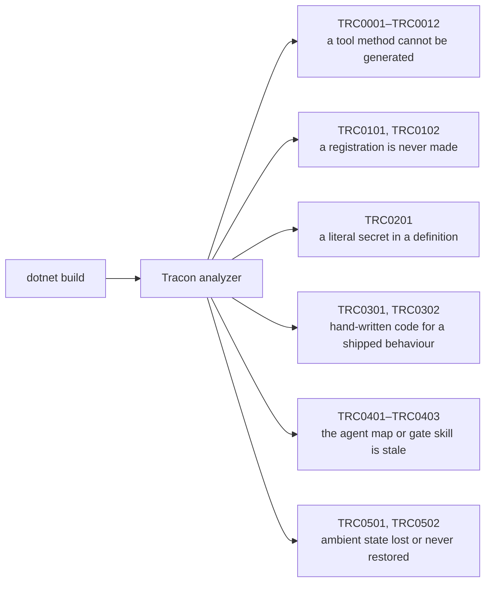

Tracon's analyzer reports problems while the project builds, before anything runs. This
page explains each diagnostic and the agent map files the same build writes. For a
failure at run time, start with [Troubleshooting](/troubleshooting/).

## The build reports a TRC diagnostic

`Tracon.Core` ships an analyzer with two families.

| Ids | Category | What it reports |
|---|---|---|
| `TRC0001`–`TRC0012` | `Tracon.Tools` | A method marked `[TraconTool]` cannot be generated, a parameter has no description, or a constraint attribute does not apply. Errors: fix the method. `TRC0009` and `TRC0010` are warnings. |
| `TRC0101`, `TRC0102` | `Tracon.Usage` | A registration this compilation never makes. The application fails at run time. |
| `TRC0201` | `Tracon.Usage` | A definition carries a literal secret instead of the name of a configuration key. |
| `TRC0301`, `TRC0302` | `Tracon.Usage` | Code written by hand for behaviour the package already ships. |
| `TRC0401` | `Tracon.Usage` | `AGENTS.md` was generated from an older capability map. |
| `TRC0402` | `Tracon.Usage` | The local reference file is written, and your own `AGENTS.md` never names it, so the map is unreachable. |
| `TRC0403` | `Tracon.Usage` | The gate skill `tracon agent-skill` wrote was stamped with an older capability map. |
| `TRC0501` | `Tracon.Usage` | An async iterator writes ambient state once but a loop advances the enumeration without repeating it. |
| `TRC0502` | `Tracon.Usage` | An ambient scope's `Begin(...)` result is discarded, so it is never restored. |

Each message names the API that resolves it, and each diagnostic links to the
section of the [capability map](/capabilities/) that documents it.



## A tool name is invalid (TRC0002)

A method marked `[TraconTool]` has a name — the attribute argument, or the method
name when none is given — outside the range a tool name may use. A tool name must be
1-64 characters and contain only letters, digits, `_`, or `-`.

The name reaches the model as-is, and a model's own tool-calling protocol rejects
names outside this range before the call ever reaches Tracon. Rename the method,
or give an explicit name to `[TraconTool("valid-name")]`.

## A tool parameter type is unsupported (TRC0003)

The generator produces a JSON Schema for each parameter from its .NET type, and it
recognizes primitive types, `string`, `Guid`, `DateTime`/`DateTimeOffset`, `enum`,
arrays or `IReadOnlyList<T>` of these, `CancellationToken`, and a supported **object**
(a public record or class with a single public constructor — see [Write your own
tool](/guides/write-your-own-tool/)), up to 3 nested object levels deep. A parameter
of any other type — a `Dictionary<,>`, a tuple, a type with more than one public
constructor, an object graph deeper than 3 levels or containing a cycle (`TRC0012`) —
has no schema mapping and is reported instead of silently ignored.

**The generator's expression boundary, stated once:** it can express a parameter's
scalar type, array shape, object shape (and arrays of objects), `description`,
whether it is required, and a `minimum`, `maximum`, length, or `pattern` constraint
from a standard `System.ComponentModel.DataAnnotations` attribute (`RangeAttribute`,
`MinLengthAttribute`, `MaxLengthAttribute`, `StringLengthAttribute`,
`RegularExpressionAttribute`). An object parameter's own type, and every nested
object type in its graph, must be declared with `[JsonSerializable]` on the
`JsonSerializerContext` the tool points at (`TRC0011`) — the generator never emits
its own context. There is no partial path beyond this boundary: a parameter
either gets an exact schema within it, or it needs the escape route below.

Change the parameter to a supported type, or register the tool by hand instead of
through `[TraconTool]`:

```csharp
builder.AddTracon()
       .AddTool(AIFunctionFactory.Create(MyMethod));
```

`AIFunctionFactory.Create` builds the schema itself and accepts a wider range of
parameter shapes, including a nested object — reflection maps its properties at run
time instead of at compile time. For an AOT-safe version of the same call, give it a
source-generated `JsonSerializerOptions` instead of relying on reflection:

```csharp
public sealed record OrderFilter(string Status, int MinAmount);

[JsonSerializable(typeof(OrderFilter))]
internal partial class OrderFilterJsonContext : JsonSerializerContext;

builder.AddTracon()
       .AddTool(AIFunctionFactory.Create(
           (OrderFilter filter) => SearchOrders(filter),
           "search_orders",
           "Searches orders matching a filter.",
           OrderFilterJsonContext.Default.Options));
```

## A generic method is marked as a tool (TRC0004)

`[TraconTool]` was put on a generic method. A tool call carries a name and a
JSON argument object; there is no call syntax that supplies a type argument, so the
generator has nothing to generate. Write a concrete, non-generic wrapper method and
mark that one instead.

## AddGeneratedTools() finds nothing to register (TRC0005)

`AddGeneratedTools()` registers only the calling assembly's `[TraconTool]`
methods, and this one has none. The mark was forgotten, the call outlived its
tools, or the tools live in a referenced library: call the extension that
library exposes instead.

## A tool has no description (TRC0006)

A model chooses which tool to call from its name and description; a tool with no
description gives the model only the name and the parameter schema to decide with,
which is not enough for names that are not entirely self-explanatory. Give a
description:

```csharp
[TraconTool("get_order_status", "Returns an order's current shipping status.")]
public static string GetOrderStatus(string orderId) => "shipped";
```

## A complex tool result has no JSON context (TRC0008)

Generated tools return complex results as canonical JSON. Declare a
source-generated `JsonSerializerContext` in your own source and give its type
to the tool attribute. A context emitted by the Tracon generator itself is
too late for the JSON generator to process.

```csharp
[JsonSerializable(typeof(OrderPreview))]
internal partial class ToolJsonContext : JsonSerializerContext;

[TraconTool(
    "preview_order",
    "Returns an order preview.",
    JsonSerializerContext = typeof(ToolJsonContext))]
public static OrderPreview PreviewOrder(string orderId) => new(orderId, "ready");
```

## An instance method is marked as a tool (TRC0007)

Generated tools must be static. Microsoft Agent Framework invokes an
`AIFunction` with an empty service provider, so an instance method cannot rely
on constructor dependencies. There are three ways out, and the diagnostic names
all three: make the generated method static, create the object during
registration and hand over a built function with
`AddTool(AIFunctionFactory.Create(...))`, or — when the dependency has to be
resolved per call — register it with
[`AddScopedTool`](/getting-started/tools/#the-rule-that-trips-people-up),
which opens a dependency-injection scope for each invocation.

## A tool parameter has no description (TRC0009)

The model fills in a tool call's arguments from the JSON Schema the generator
produces; a parameter's `description` is the strongest signal it has for which
argument to put where and what value belongs in it — stronger than the parameter
name, which a model reads but was never written for this purpose. `System.ComponentModel.DescriptionAttribute`
reaches the schema:

```csharp
[TraconTool("submit_order", "Submits an order to the fulfillment system.")]
public static Task<OrderReceipt> SubmitOrderAsync(
    [Description("The identifier of the order to submit.")] string orderId,
    CancellationToken cancellationToken)
```

This is a warning, not an error — existing code keeps compiling. `AIFunctionFactory.Create`
reads the same attribute, so a tool written either way teaches the model the same
way. `CancellationToken` never needs one: it never reaches the schema.

## A parameter constraint does not apply (TRC0010)

A `System.ComponentModel.DataAnnotations` constraint attribute was found on a
parameter whose type or shape it does not support — `[Range]` on a `string`, a
length constraint on a `bool`, or `[Range(typeof(decimal), "0", "1")]` (the
`Type`-based overload never gives the generator a compile-time constant). The
constraint is silently left out of the generated schema instead of producing a
wrong one:

```csharp
// TRC0010: [Range] does not apply to string.
public static void SetCode([Range(1, 10)] string code) { }
```

This is a warning, not an error — existing code keeps compiling, minus the one
constraint. Remove the attribute, or register the tool by hand instead of through
`[TraconTool]`:

```csharp
builder.AddTracon()
       .AddTool(AIFunctionFactory.Create(MyMethod));
```

## An object parameter references a type missing from the JSON context (TRC0011)

A tool has an object parameter (or a parameter whose type contains a nested
object), and the type in the message is not declared with `[JsonSerializable]`
on the `JsonSerializerContext` that `TraconTool.JsonSerializerContext` points
at. The generator never emits its own context for a nested type — the same rule
`TRC0008` enforces for a complex result: binding a nested object requires its
metadata, and that metadata comes only from a context the tool owner wrote.

Declare every type in the object graph — the parameter's own type and any type it
nests — with its own `[JsonSerializable]`:

```csharp
public sealed record Criterion(string Name, int Weight);
public sealed record Rubric(string Title, IReadOnlyList<Criterion> Criteria);

// TRC0011 until BOTH types are declared - Rubric nests Criterion.
[JsonSerializable(typeof(Rubric))]
[JsonSerializable(typeof(Criterion))]
internal partial class ToolJsonContext : JsonSerializerContext;

[TraconTool("score_submission", "Scores a submission against a rubric.", JsonSerializerContext = typeof(ToolJsonContext))]
public static string ScoreSubmission(Rubric rubric) => "scored";
```

Every distinct missing type is reported once, in the same compilation, so a
consumer can add them all rather than discovering them one build at a time.

## An object parameter's graph is too deep or cyclic (TRC0012)

A supported object parameter (`TRC0003`) nests another object more than 3 levels
deep, or a type reaches itself again through its own members — the message names
the path (`A → B → A`). Both are rejected at compile time instead of risking a
generator that recurses forever, or a schema the model's own error rate rises
against once it gets this deep.

Flatten the type so it needs fewer nested levels, break the cycle, or register
the tool by hand instead of through `[TraconTool]`:

```csharp
builder.AddTracon()
       .AddTool(AIFunctionFactory.Create(MyMethod));
```

## TRC0101 or TRC0102 fires although the registration exists

An analyzer sees a single compilation. When `AddTracon()` or a provider
registration lives in another assembly, the diagnostic cannot see it. Turn the
whole usage family off with one property:

```xml
<PropertyGroup>
  <TraconUsageDiagnostics>false</TraconUsageDiagnostics>
</PropertyGroup>
```

To keep the rest, silence one rule in `.editorconfig` instead:

```ini
[*.cs]
dotnet_diagnostic.TRC0101.severity = none
```

The `Tracon.Tools` family is unaffected by either switch; those diagnostics
report a tool that cannot be generated at all.

## AGENTS.md does not appear

Writing it is opt-in, so that adding a package reference never changes files in
your repository:

```xml
<PropertyGroup>
  <TraconWriteAgentsFile>true</TraconWriteAgentsFile>
</PropertyGroup>
```

The next build writes the capability map to `AGENTS.md` at the root of the
repository, next to the project when there is no repository. A project created
with `dotnet new tracon-api` sets the property already.

## AGENTS.md is out of date (TRC0401)

An existing file is never overwritten, because you may have added notes to it.
Refresh it by deleting it and building again:

```bash
rm AGENTS.md && dotnet build
```

The same map is published for web-based agents at
[`/llms.txt`](/llms.txt), followed by one line per
documentation page, with every hand-written page concatenated at
[`/llms-full.txt`](/llms-full.txt).

## I keep my own AGENTS.md, so the map never arrives (TRC0402)

Expected: your file is never overwritten. The map still ships inside the package,
and `Tracon.LocalReference.md` carries its absolute path on this machine. Ask
for that file — it lands beside each project and leaves your repository root alone:

```xml
<PropertyGroup>
  <TraconWriteLocalReference>true</TraconWriteLocalReference>
</PropertyGroup>
```

Then point your own file at it, in one line:

```markdown
Tracon: read Tracon.LocalReference.md beside each project for the capability
map and the API documentation of the installed version.
```

`TRC0402` looks for that file name anywhere in `AGENTS.md` and goes quiet once it is
there. It stays silent in two other cases as well: while the property above is off,
because then there is no file to name, and on a file this package generated, because
a generated map already names it.

## The gate skill is out of date (TRC0403)

`tracon agent-skill` stamps the file it writes with the capability map revision
the tool was built from, and the build compares that against the map your
installed packages ship.

The tool carries the revision it stamps, so update the tool first — re-running an
older one writes the same stale value back:

```bash
dotnet tool update -g Tracon.Cli --prerelease
rm .claude/skills/tracon/SKILL.md
tracon agent-skill
```

Deleting is the refresh step because the file is never overwritten in place: you
may have added notes to it. A `SKILL.md` without that stamp is treated as yours
and is never reported.

## An ambient write does not survive a streaming loop (TRC0501)

`TraconRunContext.SetCurrent`, `AmbientTenantScope.Begin`, `AmbientRunAttributionScope.Begin`,
and `ActivitySource.StartActivity` all write through an `AsyncLocal<T>`. An assignment
made inside an `async` iterator's body does not cross a `yield return`: the driver
restores the execution context, and the next step of the loop starts with a null or
stale scope, so a nested call inside it reads the wrong tenant, run, or span.

```csharp
// Wrong: the write happens once, before the loop starts.
TraconRunContext.SetCurrent(scope);

while (true)
{
    if (!await enumerator.MoveNextAsync())
    {
        break;
    }

    yield return enumerator.Current;
}
```

```csharp
// Right: the write repeats immediately before every step that advances the
// enumeration.
while (true)
{
    TraconRunContext.SetCurrent(scope);

    if (!await enumerator.MoveNextAsync())
    {
        break;
    }

    yield return enumerator.Current;
}
```

The diagnostic is reported on the loop, not on the write: move the assignment it
names into the loop the warning points at, immediately before the call that advances
the enumeration.

## A `Begin(...)` scope is opened without being restored (TRC0502)

`AmbientTenantScope.Begin(...)` and `AmbientRunAttributionScope.Begin(...)` return an
`IDisposable` for exactly one reason: disposing it restores the ambient value that was
there before the scope opened. A call whose result is never assigned anywhere never
restores it, and the value it set stays visible for the rest of the current execution
context.

```csharp
// Wrong: the scope is never restored.
AmbientTenantScope.Begin(tenantId);

// Right.
using var scope = AmbientTenantScope.Begin(tenantId);
```

## The agent knows a capability exists but not how to call it

The map names every entry point; it explains none of them. The explanation is
already on your disk, and `Tracon.LocalReference.md` names where. The same
property writes it, beside each project that references Tracon:

```xml
<PropertyGroup>
  <TraconWriteAgentsFile>true</TraconWriteAgentsFile>
</PropertyGroup>
```

The file lists one XML documentation file per referenced package, and — when you
reference `Tracon.AspNetCore` — the OpenAPI document that describes the HTTP
surface. Every entry point in those files carries a worked example, so an agent
answers a call-shape question with a search rather than a guess:

```bash
grep -A 12 'AddToolApprovalPolicy' <api-doc>
```

One file is written per project, not one for the repository: a solution that
splits a web host from a worker gives each project a different set of packages,
and only the web host's file names the HTTP API document. The paths are specific
to your machine and to the versions that project restored, so the file is
regenerated on every build and belongs in `.gitignore`; a project created with
`dotnet new tracon-api` already ignores it. To write the map but not the
pointer file, set `TraconWriteLocalReference` to `false`.

## Read next

- [Troubleshooting](/troubleshooting/) — failures at run time, by symptom
- [Coding agent integration](/guides/coding-agents/) — what the agent map and the gate skill are for
- [Capability map](/capabilities/) — the page every diagnostic links to
