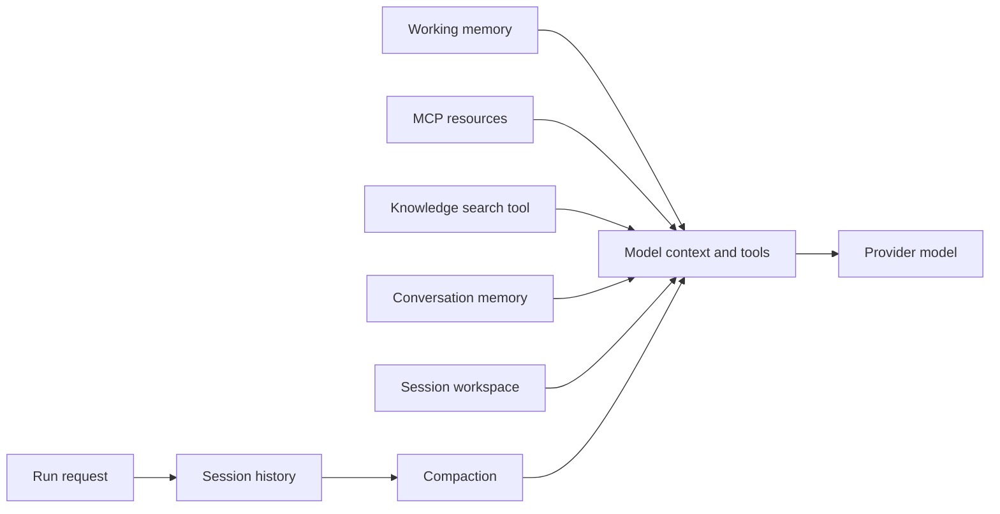

“Memory” is not one store. Tracon separates conversation continuity, context
budgeting, working state, fixed resources, semantic knowledge, what one user told
an agent before, and the files an agent keeps during one conversation. Choose each layer
for the question it answers.

## Mental model: seven different jobs

| Layer | Question it answers | Main API |
|---|---|---|
| Session history | What did this conversation already say? | `AgentRunRequest.SessionId` |
| Compaction | Which old context still fits in the next model call? | `CompactionSettings` |
| Working memory | What files, todos, or text should this agent manage during work? | `MemorySettings` |
| MCP resources | Which fixed remote resources enter every run? | `AgentDefinition.McpResourceUris` |
| Knowledge search | Which durable external facts are relevant to this question? | `MemorySettings.EnableVectorSearch` |
| Conversation memory | What did this user tell this agent in an earlier session? | `MemorySettings.EnableConversationMemory` |
| Session workspace | Which files does this agent write and edit during this conversation? | `AgentDefinition.Workspace` |



A session preserves continuity. Compaction reduces what the model sees. It does not
delete the persisted run record. File memory and knowledge search add capabilities; they
do not replace session history.

These layers all shape what already made it into the conversation. A tool's
[output size limit](/concepts/tools/#output-size-limit) works earlier, at the source:
it bounds a single tool result before that result ever becomes context to compact. The
two are complementary, not competing — a tool limit caps one call's contribution,
compaction manages the accumulated history afterward.

## Session history starts with `sessionId`

A run with no `sessionId` is sessionless. The next request does not receive its chat
history. Reuse a session id when turns must build on each other:

```bash
curl -N -X POST http://localhost:5081/tracon/api/agents/research/run \
  -H "Authorization: Bearer $TRACON_TOKEN" \
  -H 'Content-Type: application/json' \
  -d '{"sessionId":"case-4182","message":"Summarize the customer request."}'

curl -N -X POST http://localhost:5081/tracon/api/agents/research/run \
  -H "Authorization: Bearer $TRACON_TOKEN" \
  -H 'Content-Type: application/json' \
  -d '{"sessionId":"case-4182","message":"Now list the unresolved questions."}'
```

Without a SQL package, session history is in memory. `UsePostgreSql()`,
`UseSqlServer()`, or `UseSqlite()` replaces it with the corresponding durable store.

## Add compaction and working memory

Compaction and memory work on a plain chat agent. A `HarnessSettings` value is not
required. Add the harness only when you also need its execution policy.

```csharp
tracon.AddAgent(new AgentDefinition
{
    Name = "research",
    Instructions = "Investigate the request. Keep a concise evidence trail.",
    Model = new ModelBinding
    {
        Provider = OpenAIProviderNames.ChatCompletions,
        Model = "your-current-model-name",
        MaxOutputTokens = 2_048,
    },
    Harness = new HarnessSettings
    {
        MaxContextWindowTokens = 64_000,
        MaxOutputTokens = 2_048,
        MaximumIterationsPerRequest = 12,
        HarnessInstructions = "Update the todo list before the final answer.",
    },
    Compaction = new CompactionSettings
    {
        Strategy = CompactionStrategyKind.Pipeline,
        TriggerTokens = 48_000,
        MinimumPreservedTurns = 3,
        MinimumPreservedGroups = 6,
        SummarizationModel = new ModelBinding
        {
            Provider = OpenAIProviderNames.ChatCompletions,
            Model = "your-lower-cost-summary-model",
            MaxOutputTokens = 1_024,
        },
    },
    Memory = new MemorySettings
    {
        EnableFileMemory = true,
        EnableTodo = true,
        EnableTextSearch = true,
    },
});
```

The compiler checks conflicts before the run. For example, it rejects
`Memory.EnableFileMemory = true` together with `Harness.DisableFileMemory = true`.
The same rule applies to compaction and todo tracking, to `SkillNames` together
with `Harness.DisableAgentSkillsProvider = true`, and to
`Harness.EnableWebSearch` together with `Harness.DisableWebSearch`.

A harness does not add file memory, skills or web search on its own. File memory
needs `Memory.EnableFileMemory`, skills need `SkillNames`, and web search needs
`Harness.EnableWebSearch`. The harness never reads skills from the server's working
directory and never writes memory files there.

The provider bills each call of the harness's web search. Set
`Tracon:Pricing:HostedTools:{provider}:WebSearch:PerCall` and the calls join the run's cost, the budget,
the quota, and the `run.completed` webhook, as the calls of a [hosted tool](/guides/hosted-tools/) do. An
agent cannot also select a registered hosted web search: the model would receive two.

## Choose a compaction strategy

| Strategy | What it does | Required input |
|---|---|---|
| `None` | Sends no compaction policy | None |
| `SlidingWindow` | Drops the oldest turns | At least one trigger |
| `Truncation` | Truncates excluded message groups | At least one trigger |
| `ToolResult` | Shortens tool-call and tool-result groups | At least one trigger |
| `Summarization` | Replaces older groups with a model summary | At least one trigger |
| `ContextWindow` | Evicts or truncates against a known window | `MaxContextWindowTokens` |
| `Pipeline` | Runs ToolResult, then SlidingWindow, then Summarization | At least one trigger |

`TriggerTokens`, `TriggerMessages`, and `TriggerTurns` are combined with **OR**. The
first threshold reached starts compaction. `ContextWindow` manages its own trigger and
does not require one of those fields.

Defaults are explicit:

| Setting | Default |
|---|---|
| `CompactionSettings.Strategy` | `None` |
| `MinimumPreservedTurns` | 2 |
| `MinimumPreservedGroups` | 4 |
| `ContextWindow.MaxOutputTokens` | Agent model limit, then 4096 |
| Summarization prompt | MAF default |
| Summarization model | Agent setting, then application `UtilityModel`, then the agent model |

:::caution[No compaction can become a run failure]
When `Compaction` is absent or uses `None`, Tracon sends no compaction strategy.
A long session eventually exceeds the provider's context window. Set a measured
trigger below the real model limit and leave room for output and tool results.
:::

MAF currently marks its compaction and `AgentFileStore` APIs as evaluation features.
Tracon keeps the integration in one compiler boundary, but you should still test
context behavior when upgrading MAF packages.

## Understand the memory flags

All `MemorySettings` flags default to `false`.

`EnableFileMemory` adds MAF file memory, on a plain agent and on a harness agent
alike: without it a harness agent has no file memory. On a plain agent, `EnableTodo` adds todo
tracking. A harness already keeps todo tracking on unless
`Harness.DisableTodoProvider` is true. `EnableTextSearch` searches the registered
`AgentFileStore`. The default file store is in memory. `UsePostgreSql()`,
`UseSqlServer()`, or `UseSqlite()` replaces it with the corresponding persistent SQL
file store.

`EnableVectorSearch` is different. It adds the code-defined `search_knowledge` tool
over a persistent semantic knowledge base that you loaded. It does not remember
conversations. See [Knowledge and RAG](/guides/knowledge/).

`EnableConversationMemory` remembers what one user said to this agent in earlier
sessions. It needs setup in code. See
[Remember a user across sessions](#remember-a-user-across-sessions).

The console agent editor exposes harness settings, all compaction strategies, file
memory, todo tracking, text search, conversation memory (one box and the search
choice), and the session workspace (three boxes). It does not currently expose vector search, the search limit of conversation
memory, or MCP resource URIs. Set those through code or the management HTTP API. Set
MCP resource URIs in code.

## Remember a user across sessions

A session keeps one conversation. Conversation memory keeps what a *user* said, and
gives it to the same agent in a later session. Ada tells the agent her favourite
colour in one session. In a new session, the agent finds that message and answers
"teal".

Two switches turn it on. Both are off by default.

1. **Setup, once, in code.** Register a `Microsoft.Extensions.VectorData.VectorStore`
   in the service collection, and call `UseConversationMemory`:

   ```csharp
   builder.Services.AddSingleton<VectorStore>(provider => new PostgresVectorStore(
       connectionString,
       new PostgresVectorStoreOptions
       {
           EmbeddingGenerator = provider.GetRequiredService<IEmbeddingGenerator<string, Embedding<float>>>(),
       }));

   builder.AddTracon()
       .UseConversationMemory(options => options.VectorDimensions = 1536);
   ```

   `VectorDimensions` is the vector size of your embedding model. `CollectionName`
   defaults to `tracon_conversation_memory`. The store belongs to your application:
   you choose the connector, register it as a singleton, and the store turns each
   message into a vector with its own embedding generator. Tracon never creates a
   store and never calls the embedding model.

2. **A definition that asks for it.**

   ```json
   {
     "memory": {
       "enableConversationMemory": true,
       "conversationMemorySearch": "BeforeEachTurn",
       "conversationMemoryMaxResults": 3
     }
   }
   ```

If a definition asks for memory and the application has not done step 1, the agent
does not compile. The error names the missing call or the missing `VectorStore`.

### Who the memory belongs to

A record carries the tenant, the agent, the user, and the session it came from. A
search looks at the tenant, the agent, and the user, not the session. This is why a
new session still finds the old one.

| A run… | Memory |
|---|---|
| has a user and a session | reads and writes |
| has no user (an anonymous run) | neither reads nor writes |
| has no session id | neither reads nor writes — a record with no session could not be deleted with its session |
| is a workflow run, or runs below one | neither reads nor writes — the workflow's session has no record to delete it with |
| belongs to another tenant, agent, or user | never sees the record |

The user is the one your [run attribution](/concepts/governance/) resolves, never a
field in the request body. Name a `sessionId` in the request; a request without one
opens no session and remembers nothing.

A sub-agent and a queued run remember for the same user and session as the run that
started them. A [workflow](/concepts/workflows/) run remembers nothing, and neither does
an agent step below it. The workflow's session id never gets a session record, so nothing
could delete what the step kept: session delete, the sessions retention target and a
session-keyed erasure all start from that record. Call the same agent directly, with a
`sessionId` of its own, and it remembers.

A user with the same `sessionId` as another user keeps a separate memory. Tracon
reads the scope from the run on every call, not from the session, so the first user
to name a session does not decide the scope for the next one.

### What is stored, and when it is searched

Tracon stores the text of the user's messages and of the agent's answers. It does not
store tool calls, tool results, or messages another provider added to the request.
The agent's own earlier answers are stored too, so an answer such as "I do not know
that yet" can come back in a later search.

`conversationMemorySearch` decides when the search runs:

| Value | Behavior |
|---|---|
| `BeforeEachTurn` (default) | Searches with the user's message before each turn, and adds what it finds as a message under a *Memories* heading. |
| `OnDemand` | Offers the model a tool named `search_conversation_memory`. The model decides when to search and what to ask for. |

`conversationMemoryMaxResults` limits one search to 1–20 records. The default is 3.
The `OnDemand` tool is not part of the agent's `ToolNames`: it needs no approval, and
it reads only the scope of the run that calls it. A tool of the agent with the same
name fails the build.

### Deleting memory

The records are a copy of the session's content, so they go when their session goes:

- `DELETE /api/sessions/{id}` deletes the records first, then the session. If the
  store cannot delete, the request fails and the session stays, so a repeat request
  finishes the work.
- A [data subject erasure](/concepts/governance/#data-subject-rights) deletes the
  records of the subject's sessions inside the erasure. A preview counts them under
  `conversation_memory`, and an export lists them.
- The [retention](/concepts/governance/#retention) policy for sessions deletes the
  records of an expired session before the session row.

The store can keep data for its own reasons, such as backups. Tracon cannot delete
that.

### Failures, cost, and limits

- If the store is down when a run starts, the run goes on without memory and the
  framework logs the error. If it is down when the run ends, the run's answer is
  kept and the messages are not remembered. Memory is context, not the answer.
- The records hold the text of the messages in plain text, in your store. The
  [content protection](/getting-started/security/) that encrypts session tables does not
  reach them. Protect the store, its backups and its table permissions the way you protect
  the messages themselves.
- The store embeds each message. That model call is not on the run's usage and cost.
  Check the cost with your embedding provider.
- Search quality, and whether the filter on tenant, agent, and user is applied at
  all, belong to the connector. Test that two users do not see each other's records
  before you rely on it.
- **Check the connector against the abstractions version.** The Microsoft Agent
  Framework needs `Microsoft.Extensions.VectorData.Abstractions` 10.10 or newer.
  Connectors built against an older version, such as the
  `Microsoft.SemanticKernel.Connectors.*` packages (1.74 preview), call a member
  that no longer exists. NuGet raises no warning, and the failure is a
  `MissingMethodException` in the log at run time, with the agent answering without
  memory. `CommunityToolkit.VectorData.*` 1.0 connectors work.
- The vector store is not AOT-analyzed by Tracon. Tracon's own code and the framework
  provider publish with no Native AOT warning; your connector has its own result.

## Give an agent files in each session

The agent file memory above belongs to the agent: every session of that agent shares it.
A session workspace is the opposite. It is a private file area that belongs to **one
session** of one agent. The agent lists, reads, searches, writes, edits and deletes
files there, and when the session goes, the files go with it. Use it for a draft the
user and the agent work on during one conversation, not for what the agent should know
tomorrow.

Turn it on in the definition. It is off by default.

```json
{
  "workspace": {
    "enabled": true,
    "readOnly": false,
    "disableReadApproval": false
  }
}
```

The agent gets the eight `file_access_*` tools of the Microsoft Agent Framework. The
framework supplies them, and Tracon runs each one through the same chain as a tool you
register in code: your authorization handler, argument validation, the tool timeout, and
the approval step.

| Tool | Does | Asks for approval |
|---|---|---|
| `file_access_ls`, `file_access_read`, `file_access_read_lines`, `file_access_grep` | list, read and search | yes, unless `disableReadApproval` is true |
| `file_access_write`, `file_access_replace`, `file_access_replace_lines` | write and edit | always |
| `file_access_delete` | delete | always |

There is no setting that turns the approval of the tools that change a file off. With
`readOnly` the four tools that change a file are not offered at all. A "remember this
choice" approval rule works for one tool at a time, as it does for every tool.

### Whose files they are

A workspace is private to the tenant, the agent and the session. A second session of the
same agent starts with an empty workspace. Another agent in the same session has a
workspace of its own. The agent's [file memory](#understand-the-memory-flags) is a
different area: a text search of the file memory does not find a workspace file, and
the workspace tools do not see the file memory.

| A run… | Workspace |
|---|---|
| names a `sessionId` | has one |
| names no session | has none: the agent is offered no file tool |
| is a workflow run, or runs below one | has none — the workflow's session has no record to delete the files with |
| belongs to another tenant, agent or session | never sees the files |

A path leaves the workspace through nothing: a path with `..`, a rooted path, or a path
over 400 characters is refused, and the model reads the reason as the result of the
call. The path in the store, which holds the tenant and a key made from the session, is
never shown to the model.

### Limits

A write is refused when it would pass a limit. The model reads "Workspace quota
reached" and the run goes on, so the agent can delete a file or write less.

| Setting (`Tracon:Workspace`) | Default | Limits |
|---|---|---|
| `MaxFileBytes` | 256 KiB | one file |
| `MaxSessionBytes` | 5 MiB | all the files of one session |
| `MaxTenantBytes` | 500 MiB | all the workspaces of one tenant |

A file counts its content and also 1 KiB for its row, in the limit of the session and of
the tenant: a model that writes thousands of empty files reaches the limit instead of
filling your table. The limits are soft: two writes at the same moment can pass a limit by
one file. The sizes are what the store keeps. PostgreSQL and SQLite count the UTF-8 bytes. SQL Server
keeps text as UTF-16, so it counts two bytes for each ASCII character and reaches a limit
with half as many characters. The default store is in memory and loses the files when the
process restarts; use a SQL provider for a workspace that must last. With a custom
`AgentFileStore`, a size check reads every file under the prefix, and deleting a session lists the
workspace directory outside any run: a store that only works inside a run (a wrapper around the SQL
store, for example) makes `DELETE /api/sessions/{id}` fail, and the session stays. Tracon does not
turn a failed listing into "nothing to delete", because the erasure would then tell the audit trail
that files were deleted that were not.

### Deleting a workspace

The files go when their session goes:

- `DELETE /api/sessions/{id}` deletes the files, then the session.
- A [data subject erasure](/concepts/governance/#data-subject-rights) deletes the files
  of the subject's sessions inside the erasure. A preview counts them under
  `session_workspace`, and an export lists them with their path and content.
- The [retention](/concepts/governance/#retention) policy for sessions deletes the files
  of an expired session before the session row.

What the agent wrote may hold personal data, in plain text in your file store (the
[content protection](/getting-started/security/) of the SQL provider encrypts the file
column when you turn it on). The content a tool wrote or read also appears in the run record
and in a pending approval (`RecordToolPayloads`, on by default), and deleting a session does not
delete its run records. Protect the store and its backups the way you protect the
messages.

### Expose an agent with a workspace

An external caller of A2A or MCP cannot answer an approval request. The application
refuses to start when it exposes an agent whose workspace can change a file, or asks for
approval to read one. Set `readOnly` and `disableReadApproval` together, or turn the
workspace off, or leave the agent off the allow list. See
[External agents](/guides/external-agents/).

### Things that do not work

- **A tool of your own with the name of one of the eight file tools** (`file_access_read`,
  `file_access_write` and the others). The build stops: an approval rule for the file tool
  would cover your tool as well.
- **An agent named `~workspace`, or with a `/` in its name.** The first cannot have file
  memory, because its memory would be every workspace of the tenant. The second cannot
  have a workspace.
- **Run continuation after a crash.** The [run continuation](/capabilities/) that resumes an
  orphaned run (`Tracon:RunContinuation`) refuses an agent with a workspace: the file tools do not go
  through the recorded tool playback, and a continuation could repeat a write or a delete. The run stays closed
  as it was.
- **A replay with its recorded tools.** A replay has no session, so the agent has no workspace in it.

## Know the agent modes

A harness agent always runs in a mode. The mode provider is on unless
`Harness.DisableAgentModeProvider` is true. A plain chat agent has no modes.

Two modes come from MAF, and a new session starts in the first one:

| Mode | Behavior |
|---|---|
| `plan` | Interactive. The agent asks clarifying questions, discusses options, and waits for your approval before it proceeds. **This is the starting mode.** |
| `execute` | Autonomous. The agent carries the work out without stopping for approval. |

The provider adds two tools, `mode_set` and `mode_get`, so the model can read and
change its own mode. It also injects the current mode's instructions on every
invocation. Those instructions apply to every substantive request, including short
factual questions — a harness agent in `plan` mode can answer a simple question with
questions of its own.

You cannot define your own modes today. Tracon passes no mode options to MAF, so
you get these two. Set `Harness.DisableAgentModeProvider = true` to turn the provider
off, together with both of its tools.

## Add predictable MCP resources

Code-defined agents can name resources in `{server}:{uri}` form:

```csharp
tracon.AddAgent(new AgentDefinition
{
    Name = "release-reviewer",
    Instructions = "Review the release against the supplied policy.",
    Model = new ModelBinding
    {
        Provider = OpenAIProviderNames.ChatCompletions,
        Model = "your-current-model-name",
    },
    McpResourceUris =
    [
        "github:https://example.com/release-policy.md",
    ],
});
```

Call `UseMcp()` before compiling an agent that uses this field. Tracon reads these
resources at the start of each run. The defaults are 64 KiB per resource and 256 KiB
in total. Configure them with `TraconMcpOptions.MaxResourceBytesPerResource` and
`MaxResourceBytesTotal`.

The current `AgentDefinitionRequest` management contract does not expose
`McpResourceUris`. Define this field in code. Remote tools and server registrations
remain available through the MCP management surface.

Only resources declared by the server are read. An invalid reference, unreachable
server, or undeclared resource is skipped and logged. Content above the per-resource
budget is truncated; resources after the total budget is exhausted are skipped.

## Validate before saving

The validation endpoint compiles the same definition without writing it and without
calling a model:

```bash
curl -sS -X POST http://localhost:5081/tracon/api/agents/validate \
  -H "Authorization: Bearer $TRACON_TOKEN" \
  -H 'Content-Type: application/json' \
  -d '{
    "name": "research",
    "instructions": "Investigate the request.",
    "model": { "provider": "openai", "model": "your-current-model-name" },
    "compaction": {
      "strategy": "Pipeline",
      "triggerTokens": 48000,
      "minimumPreservedTurns": 3,
      "minimumPreservedGroups": 6
    },
    "memory": {
      "enableFileMemory": true,
      "enableTodo": true,
      "enableTextSearch": true
    }
  }'
```

A well-formed request returns `200` even when the report says `valid: false`. That
distinguishes an invalid definition from a transport failure.

## Troubleshooting

**The second turn forgot the first one.** Reuse the same non-empty `sessionId`. A
sessionless run carries no history to a later request.

**A compaction strategy fails to compile.** Every strategy except `ContextWindow`
needs at least one trigger. `ContextWindow` needs `MaxContextWindowTokens`.

**Context still overflows.** Lower the trigger. Reserve space for output, system
instructions, tool schemas, tool results, skills, and resources. A provider's nominal
window is not all available to conversation history.

**Summarization costs more than expected.** It is another model call. Set the agent's
`SummarizationModel`, or configure the application-wide `TraconOptions.UtilityModel`.
The summarizer reads the tenant's conversation, so it is treated like the agent's own
model: the tenant's egress policy applies to its provider, and it uses the tenant's
own key when one is bound.

**File memory disappears after restart.** The default `AgentFileStore` is in memory.
Register PostgreSQL, SQL Server, or SQLite for a built-in persistent implementation.

**Harness compilation reports a conflict.** Do not enable a capability in
`Compaction` or `Memory` while the matching `Harness.Disable...` flag is true.

**A harness agent asks questions instead of answering.** A new session starts in
`plan` mode, which is interactive by design. Tell the agent to switch, or set
`Harness.DisableAgentModeProvider = true`.

**An MCP resource fails to compile or is truncated.** Confirm `UseMcp()` ran, the
reference uses `{server}:{uri}`, and the resource stays within the configured byte
budgets.

**Vector search fails to compile.** It needs both an `IVectorSearchStore` and an
`IEmbeddingGenerator<string, Embedding<float>>`. The built-in store comes from
PostgreSQL.

**The agent does not remember the user.** Check four things. The request names a
`sessionId`. Your attribution resolves a user for the run. The earlier session was
stored under the same tenant and agent. The log has no `ChatHistoryMemoryProvider`
error — a `MissingMethodException` there means the connector is older than the
abstractions (see the warning in
[Remember a user across sessions](#remember-a-user-across-sessions)).

**An agent with conversation memory does not compile.** It needs
`UseConversationMemory` and a registered `VectorStore`. The message names the one
that is missing.

## In the reference

- [Agent management HTTP API](/http-api/agents/)
- [`HarnessSettings` API](/api/tracon.harnesssettings/)
- [`CompactionSettings` API](/api/tracon.compactionsettings/)
- [`MemorySettings` API](/api/tracon.memorysettings/)
- [`TraconConversationMemoryOptions` API](/api/tracon.traconconversationmemoryoptions/)
- [`TraconMcpOptions` API](/api/tracon.traconmcpoptions/)

## Read next

- [Sessions and conversations](/concepts/sessions/) — retain conversation state and understand session lifetime.
- [Agents and definitions](/concepts/agents/) — configure and version the definitions that the catalog resolves.
- [Tools, skills, and MCP](/concepts/tools/) — choose code tools, instruction skills, or remote MCP integration.
