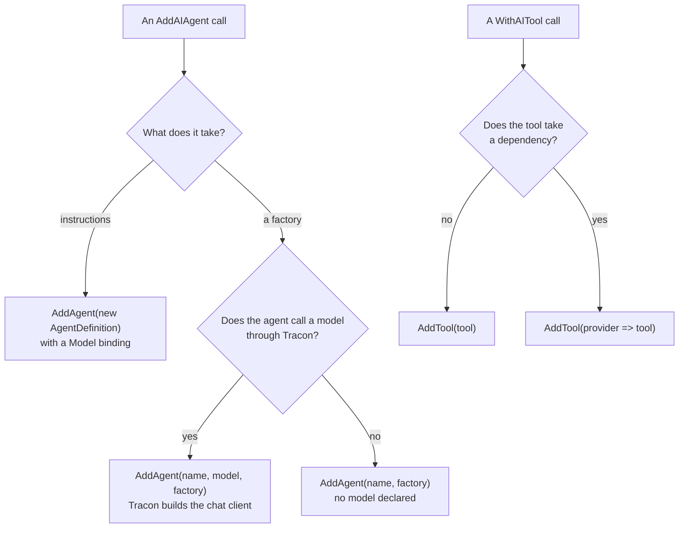

You built an agent with `AddAIAgent` from Microsoft Agent Framework (MAF) hosting. What
is the Tracon call for it? This page maps each hosting call to the Tracon call that does the
same work, and says what you keep and gain on the way. Read it with the code of the
`samples/Tracon.Samples.MafFeatures` sample open: its tests run the agent mappings against the
packed packages. The tool block comes from `samples/Tracon.Samples.CustomTool`.

Tracon does not read `AddAIAgent` registrations. An agent you registered with `AddAIAgent`
is not in the Tracon catalog until you register it again with a Tracon call. The table is
the list of calls to change.

## Pick the Tracon call

Start from how your MAF agent gets its model, and follow the arrow to the Tracon call.



## The mapping

| MAF hosting call | Tracon call | What changes |
|---|---|---|
| `AddAIAgent(name, instructions)` | `AddAgent(new AgentDefinition { … })` | The agent is data. Tracon compiles it and gives it versions, validation, and console editing. |
| `AddAIAgent(name, instructions, chatClient)` | `AddAgent(new AgentDefinition { … })` with a `Model` binding | The chat client becomes a model binding that names a provider and a model. See [the model client](#the-model-client). |
| `AddAIAgent(name, (sp, key) => agent)` | `AddAgent(name, model, context => agent)` | The factory is yours. Tracon builds the chat client and hands it over as `context.ChatClient`. |
| `AddAIAgent(name, (sp, key) => agent)`, an agent that calls no model through Tracon | `AddAgent(name, sp => agent)` | The agent declares no model. Tracon records the run and nothing more. |
| `WithAITool(tool)`, `WithAITools(…)` | `AddTool(tool)`, and the agent lists the tool name in `ToolNames` | The tool is registered once, with its policy, and every agent finds it by name. |
| `WithAITool(sp => tool)` | `AddTool(sp => tool)` | The factory runs once, at start. |
| `WithSessionStore(…)`, `WithInMemorySessionStore()` | Nothing to write | Tracon keeps the session. Pick a store with `UsePostgreSql` (package `Tracon.PostgreSql`), `UseSqlServer` (`Tracon.SqlServer`), or `UseSqlite` (`Tracon.Sqlite`). |
| `AddWorkflow(name, (sp, key) => workflow)` | `AddWorkflow(name, factory)` from `Tracon.Workflows` | See [Workflows](/concepts/workflows/). |

## An agent with instructions only

`AddAIAgent(name, instructions)` becomes a definition. The definition names the model, so
Tracon can build the chat client, price the run, and apply the tenant's own provider key:

```csharp
builder.AddTracon()
       .AddAgent(new AgentDefinition
       {
           Name = "support-agent",
           Instructions = "Answer questions about orders. Look orders up with the search tool.",
           Model = model,
           ToolNames = [SearchOrdersToolRegistration.ToolName],
       });
```

## An agent that your code builds

`AddAIAgent(name, (sp, key) => agent)` gives you the whole agent. In Tracon you keep that, and
you declare the model the agent calls. Tracon then builds the chat client for the model, with
the tenant's own provider key and the tenant's egress policy, and the factory builds the agent
around it:

```csharp
return builder.AddAgent(
    AgentName,
    model,
    context =>
    {
        // The registry returns the wrapped tool: authorization, validation,
        // timeout, truncation, and approval stay on.
        if (!context.Services.GetRequiredService<IToolRegistry>().TryGet(SearchOrdersToolRegistration.ToolName, out var searchOrders))
        {
            throw new InvalidOperationException($"The tool '{SearchOrdersToolRegistration.ToolName}' is not registered.");
        }

        // The client carries the model rings (run budget, circuit breaker, fallback,
        // response cache, content guards, the 'chat' span), the tenant's key, and the
        // egress policy. Build the agent around it and nothing else.
        return context.ChatClient.AsAIAgent(new ChatClientAgentOptions
        {
            Name = context.AgentName,
            ChatOptions = new ChatOptions
            {
                Instructions = "Answer questions about orders. Look orders up with the search tool.",
                Tools = [searchOrders],
            },

            // Tracon's history store, so the console and /v1/conversations show the
            // turns. With SQL storage, leaving this out leaves both of them empty.
            ChatHistoryProvider = context.Services.GetService<ChatHistoryProvider>(),

            // Any framework provider or option is now yours.
            AIContextProviders = [new TodoProvider(new TodoProviderOptions())],
        });
    },
    description: "A factory agent that declares its model and answers questions about orders.");
```

Three differences from the hosting factory:

- **You do not use the key.** The hosting factory receives a service key that selects a
  chat client in the container. Tracon does not read the container for the chat client. The
  model you declare selects a provider, and the provider holds the credential.
- **A request field is refused.** The factory builds its own `ChatOptions`, so a binding that
  sets `Temperature`, `MaxOutputTokens`, `ResponseFormat`, or any other request field fails
  when you register, and the message names the field. Set the field in the factory.
- **Tracon keeps nothing between calls.** The factory runs on every resolve, and the client
  holds the key of one tenant. Do not keep the agent, or the client, in a static field or a
  cache.

## The model client

A hosting agent takes its chat client from the container, selected by a key. That client is
a `Microsoft.Extensions.AI` `IChatClient` that you registered yourself. In Tracon the
equivalent is a model provider: `UseOpenAI`, one of the other provider packages, or
`AddModelProvider` for your own. The provider builds the client from a model binding, which
is a provider name and a model name. The tenant's key and the egress policy apply to that
path, and a client you register in the container does not use it.

## A tool that takes a dependency

`WithAITool(sp => tool)` and `AddTool(sp => tool)` are the same idea. The factory gets the host's
service provider when Tracon builds its tool registry at start, and the tool keeps what the factory
resolved. A tool does not get the container at call time, in MAF or in Tracon.

```csharp
return builder.AddTool(
    static provider => provider.GetRequiredService<OrderFulfillmentTool>().CreateFunction(),
    static options =>
    {
        options.RequiresApproval = true;
        options.Effect = ToolEffect.External;
        options.RequiredPermission = "orders.submit";
        options.Timeout = TimeSpan.FromSeconds(30);
        options.SafeToRepeat = true;
        options.MaxOutputBytes = 768;
    });
```

Do not ask the factory for `IToolRegistry`. The registry is built from the result of the
factory, and Tracon stops the host with an error that says so. For a dependency that must be
new on every call, use `AddScopedTool`.

## What you gain

The agent you move keeps its code. It gains the parts that hosting does not have:

- a run record for every run, with events, usage, and cost;
- the tenant's own provider key, the egress policy, and the cost quota;
- the tool chain: authorization, approval, timeout, and output limits;
- the catalog, the console, and the HTTP API.

## Read next

- [Use any Microsoft Agent Framework feature](/guides/any-maf-feature/) — the full list of doors, and what each one keeps
- [Agents and definitions](/concepts/agents/) — how the catalog gets its agents
- [Write your own tool](/guides/write-your-own-tool/) — approval, permission, and timeout for a tool
