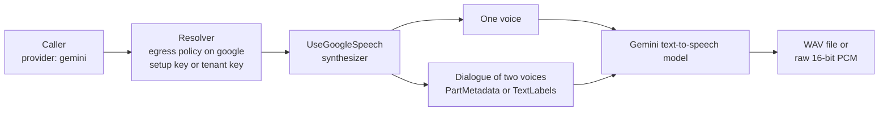

How do you speak with a Gemini text-to-speech model, and voice a two-host dialogue with it? You register the model
with `UseGoogleSpeech`, and a caller names the provider `gemini`. This page covers the provider. The speech
layer it plugs into, the tenant's checks and the dialogue contract are in [Voice and live
conversation](/guides/voice/).

`UseGoogleSpeech` registers a Gemini text-to-speech model as a named provider. It shares the
client of `UseGoogle`, so call that first. The same provider speaks one voice and voices a
dialogue of two.



## Register it

```csharp
builder.AddTracon()
    .UseGoogle(builder.Configuration.GetSection(GoogleProviderOptions.SectionName))
    .UseGoogleSpeech(options =>
    {
        options.Model = "gemini-3.8-flash-tts";
        options.Voices.Add(new VoiceDescriptor { VoiceId = "Kore", Name = "Kore" });
        options.Voices.Add(new VoiceDescriptor { VoiceId = "Puck", Name = "Puck" });
    });
```

```http
POST /tracon/api/voice/speak
{ "text": "Your order is on its way.", "provider": "gemini", "voiceId": "Kore" }
```

## Voice a dialogue

The same provider voices a dialogue. Take the capability from the resolver, as [the voice
guide](/guides/voice/#voice-a-dialogue-with-several-speakers) describes:

```csharp
var dialogue = await speech.GetDialogueSynthesizerAsync("gemini", cancellationToken);
var result = await dialogue.SynthesizeDialogueAsync(
    new SpeechDialogueRequest
    {
        Turns =
        [
            new SpeechDialogueTurn { Text = "Welcome back.", VoiceId = "Kore" },
            new SpeechDialogueTurn { Text = "Glad to be here.", VoiceId = "Puck" },
        ],
    },
    cancellationToken);
```

A synthesizer of your own refuses the same requests, in the same words, with
`DialogueCapabilities.Check(request, ProviderName)`.

`result.Audio` is one WAV file. `GET /api/voice/providers` shows `dialogue` for `gemini` as
`maxVoices: 2` and `supportsSegmentTimestamps: false`.

## Options

`Model` is the only required option of `GoogleSpeechOptions`: Tracon carries no Gemini model or voice list. The provider
name is `google`, the name the chat provider uses, so one egress rule covers chat, images, and speech.
A prebuilt voice name such as `Kore` is the `voiceId`.

| Option | Default | Meaning |
|---|---|---|
| `Model` | none | The text-to-speech model. A request can name another model. |
| `Name` | `gemini` | The registration name. |
| `DialogueSpeakerMode` | `PartMetadata` | How a dialogue names its speakers. See the rule below. |
| `MaxCharactersPerRequest` | `5000` | The limit `speak` enforces. Tracon's own guard: Gemini bounds a request by tokens. |
| `MaxDialogueCharactersPerRequest` | `2000` | The most characters one dialogue request carries. |
| `Voices` | empty | The voices `GET /api/voice/voices` lists. |
| `UseAsDefault` | `false` | Also register the synthesizer as the unnamed default, with `TryAdd`. Call `UseGoogleSpeech` before `UseVoice` for it to take effect. The `speak` tool then sends `Tracon:Voice:OutputFormat`, which defaults to `mp3_44100_128` and which Gemini cannot produce: set it to `wav`. Keep Gemini a named provider for the live conversation socket, which streams the raw PCM the shipped panel cannot play. |

## Rules that follow from the Gemini service

- **The speaker format follows the model generation.** The `gemini-3.8` models want the speaker
  on each text part and refuse a label in the text; `gemini-2.5-flash-preview-tts` and
  `gemini-3.1-flash-tts-preview` want a label in the text (`Speaker1: …`) and refuse the part
  metadata. Set `DialogueSpeakerMode` to `PartMetadata` or `TextLabels` to match the model. The wrong
  one answers `400`, and the error names the other mode. With `TextLabels`, a turn that has a line
  starting with a speaker label would change the voice, so Tracon refuses that turn before the call
  and does not rewrite it.
- **A dialogue takes exactly two voices.** One voice or three is refused before the call. Voice
  a single-voice text with `SynthesizeAsync`.
- **Timing is refused.** `IncludeTimestamps` fails on a speech and on a dialogue: Gemini reports no
  timing, so a dialogue result has no `Segments`.
- **The audio container follows the model.** The `gemini-3.8` models answer a WAV file with a `C2PA`
  provenance chunk after the samples; the older models answer raw 16-bit PCM. `OutputFormat` takes
  `wav` (the default) or `pcm`, and another format is refused. A `wav` result is the model's own
  file, or the samples in a new header. A `pcm` result is the samples alone, at the sample rate the
  answer states (24 kHz so far).
- **Streaming yields raw PCM** and never a WAV header, because a header carries the length of the
  audio. A `wav` request on a stream is refused. Whether the model streams in many parts depends on
  the model: `gemini-3.8-flash-tts` sends the first part after about a second, and
  `gemini-2.5-flash-preview-tts` sends the whole audio as one part.
- **A tenant with its own Google key is served with that key,** on the same client its chat
  requests use. A binding with an endpoint override is refused: the synthesizer calls the address
  it was built with.
- **Billing is an estimate.** Gemini bills speech by tokens and the answer carries no character
  count, so Tracon records the length of the text and marks it as estimated. A character price under
  `Tracon:Pricing:Voice:google:{model}` gives the cost; the price reader comes with `UseVoice()`.
- **Provider settings are refused.** Gemini speech reads no `google.*` setting.
- **A failure is a `502`** that carries the HTTP status and Google's status name
  (`HTTP 400 (INVALID_ARGUMENT)`), never the service's text.
- **The sample application** registers this provider when `Tracon:Providers:Google:ApiKey` is set.

## When a Gemini dialogue fails

The run's error names the cause. `takes exactly 2 voices` means the dialogue used one voice. `starts with
a speaker label` means a turn of a `TextLabels` dialogue would change the voice; rephrase the line. An
`HTTP 400` whose message names `DialogueSpeakerMode` means the model wants the other speaker format.
`GET /api/voice/providers` shows `dialogue: null` for a provider that cannot voice a dialogue at all.

## Read next

- [Voice and live conversation](/guides/voice/) - named speech providers, the tenant's checks and the dialogue contract
- [Model providers](/guides/model-providers/) - `UseGoogle`, the client this provider shares
- [Packages](/packages/) - when to add `Tracon.Google`
