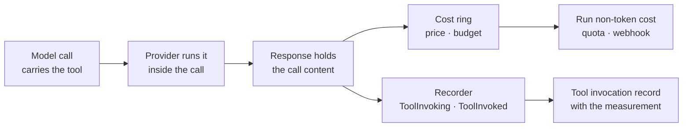

How does an agent use a tool that the model provider runs, not your code? You register the tool in code
with `AddHostedTool`, the agent definition selects it by name, and Tracon records and prices each call.

## What a hosted tool is

A function tool is code in your process. A hosted tool runs on the provider's side, inside the model
call. The provider decides when to run it. The response carries the call and its outcome.

| | Function tool | Hosted tool |
|---|---|---|
| Who runs it | Your process | The model provider |
| Registered with | `AddTool` and the other `Add*Tool` calls | `AddHostedTool` |
| Selected with | `ToolNames` | `ToolNames`, the same list |
| Approval, permission, timeout | Yes | No. Tracon has nothing to put in front of it |
| Billed | By your own cost | By the provider, per call |
| Where its calls are recorded | Tool events | Tool events, under the registered name |

Three kinds exist: `WebSearch`, `CodeInterpreter` and `FileSearch`. Image generation and hosted MCP
servers are not kinds. For images, see [Multimodal input and output](/guides/multimodal/).

## Register a hosted tool

```csharp
builder.AddTracon()
    .AddHostedTool("web_search", HostedToolKind.WebSearch, _ => new HostedWebSearchTool(),
        description: "Searches the web.")
    .AddHostedTool("docs_search", HostedToolKind.FileSearch,
        context => new HostedFileSearchTool
        {
            Inputs = [new HostedVectorStoreContent(Docs.VectorStoreFor(context.TenantId))],
        },
        description: "Searches the product documentation.");
```

The tool is code, like every tool. Registration is the only way to add one. The console and the HTTP API
can select a registered tool and cannot create one.

The factory has to follow these rules:

- **Return the type that matches the kind.** `HostedWebSearchTool` for `WebSearch`, `HostedCodeInterpreterTool`
  for `CodeInterpreter`, `HostedFileSearchTool` for `FileSearch`. Another type stops the compilation.
- **Return a new instance on every call.** Tracon remembers the name a tool was built under. An instance that
  another hosted tool returned too stops the compilation.
- **Keep it cheap.** The factory runs on every run of an agent that selects the tool. Tracon compares what it builds
  with the cached compiled agent and compiles again only when they differ. Do not call the network.
- **Read tenant values from `context`.** `context.TenantId` names the tenant. The identifier of a tenant's
  own vector store belongs here. An identifier is not a secret. Never put a credential in a hosted tool.

A tenant that replaces its vector store reaches the next run. Tracon compares what the factory builds, not only
the definition, before it reuses a compiled agent. It compares text, numbers, booleans, enums, lists and dictionaries of
those, the identifiers of vector stores and files, and the bytes of a code interpreter input. A tool that holds anything
else, such as a provider SDK object in `AdditionalProperties`, cannot be compared: the agent is compiled again for every
run, and the response cache never serves an answer for it.

A name is unique among all tools. A hosted tool and a function tool with one name stop the host at start.

## Select it in a definition

```json
{
  "name": "research",
  "instructions": "Answer from the web. Cite what you found.",
  "toolNames": ["web_search", "lookup_order"],
  "model": { "provider": "openai-responses", "model": "gpt-5.4-mini" }
}
```

An agent that does not list the name is not offered the tool. An agent selects at most one hosted tool of each
kind: the provider's response names the kind and not your tool, so two tools of one kind could not be told apart
in the run record.

`GET /api/tools` lists hosted tools with a `hostedKind` and no argument schema. The console shows a badge. Listing
runs no factory.

## Which provider runs which kind

The provider's API surface decides. The table is what the shipped adapters send, checked against the request body
each adapter writes (2026-10-20).

| Kind | `openai` (Chat Completions) | `openai-responses` | `anthropic` | `google` |
|---|---|---|---|---|
| `WebSearch` | No | Yes | Yes | Yes |
| `CodeInterpreter` | No | Yes | Yes | Yes |
| `FileSearch` | No | Yes | No | No |

`azure-openai` uses the Chat Completions surface and runs none. On Chat Completions the adapter drops a code
interpreter and a file search without an error, and the model answers as if it had none. For that reason an
agent that asks a surface for a kind it would drop does not compile. `POST /api/agents/validate` reports it
with the code `hosted_tool_unsupported`, the path of the tool name, the tool and the provider.

A fallback model link receives the same tools. A link whose surface drops a kind fails the same check.

A surface that runs a kind is not a promise. A model can still refuse the tool, and the refusal is the provider's
own error. Check your model and plan with a real call.

A provider you write opts in with `IHostedToolSupport`. A provider that does not state its support runs no kind.

## What the run record shows



A call of a registered tool is a `ToolInvoking` and a `ToolInvoked` event with the registered name and the
provider's call identifier. The result of the call is part of the same call and adds no event. The event has no
payload: a search query is the user's text.

The tool invocation record holds one measurement for the call: unit `calls`, quantity `1`, the price when one
is configured, and the provider's name.

A hosted call that no registered tool owns keeps the content event `tracon.content`. The harness's own web
search is one such call. Both kinds of call are priced.

A provider can show one call in several pieces while it streams. Tracon writes the call once.

## Cost

Set a price for each provider and kind:

```text
Tracon:Pricing:HostedTools:{provider}:{kind}:PerCall
```

```json
{
  "Tracon": {
    "Pricing": {
      "Currency": "USD",
      "HostedTools": {
        "openai-responses": {
          "WebSearch": { "PerCall": 0.01 },
          "CodeInterpreter": { "PerCall": 0.03 }
        }
      }
    }
  }
}
```

Tracon has no built-in prices. Check your provider's price page. The values above are examples.

The price of a call joins the run's non-token cost. The run total, the tree's cost budget, the tenant's quota and
the `run.completed` webhook all count it once. Cost reaches the budget when the call arrives, so a budget that the
call used up stops the next model turn.

- **A kind with no price is not priced at zero.** The call is listed on the run, the run says one item is not
  added, and the host logs one warning. Set the price to add it.
- **A code interpreter price is an estimate.** The provider bills a container session, and the response names no
  container. The record marks the measurement as estimated.
- **Anthropic states how many searches it billed.** When that number is higher than the calls in the response,
  Tracon adds the difference. When it is lower, the calls already counted stay and Tracon logs the difference.
- **A cached response is not billed again.** A response cache hit spends nothing.

## Limits

- **The data goes to the provider.** A web search sends the query. A code interpreter sends the data it works on.
  A file search reads the vector store of the account behind the key. The provider is the one the model call
  already uses, and the tenant's [egress policy](/concepts/governance/) already applies to it.
- **A hosted tool runs when the model chooses it.** `ToolMode` `required:<name>` cannot name a hosted tool.
- **A harness agent that turns on `EnableWebSearch` cannot also select a hosted web search.** The model would
  receive two. Turn one off.
- **A replay never runs a hosted tool.** `ReplayTools` and `NoTools` remove it, so a replay does not search and
  bill again. `LiveTools` keeps it.
- **A code interpreter file output is not collected.** Tracon does not store files that the interpreter makes.
- **The response cache keys a hosted tool by what it puts on the wire.** Two file searches over different vector
  stores do not share an answer. A hit replays the stored response, so a hosted call in it is a content event and
  costs nothing: the run did not search.
- **Automatic run continuation does not stop for a hosted call.** The provider ran it inside a model turn that already
  answered, and a continuation runs no hosted call again.

## Test an agent that uses a hosted tool

`FakeModelProvider` from `Tracon.Testing` runs every kind. Its `Requests` list shows the tool objects that reached
the model, so a test can check the selection without a network call.

## Read next

- [Tools, skills, and MCP](/concepts/tools/) - where each kind of tool runs
- [Model providers](/guides/model-providers/) - the API surfaces and what each one sends
- [Observability](/guides/observability/) - runs, tool events and cost
