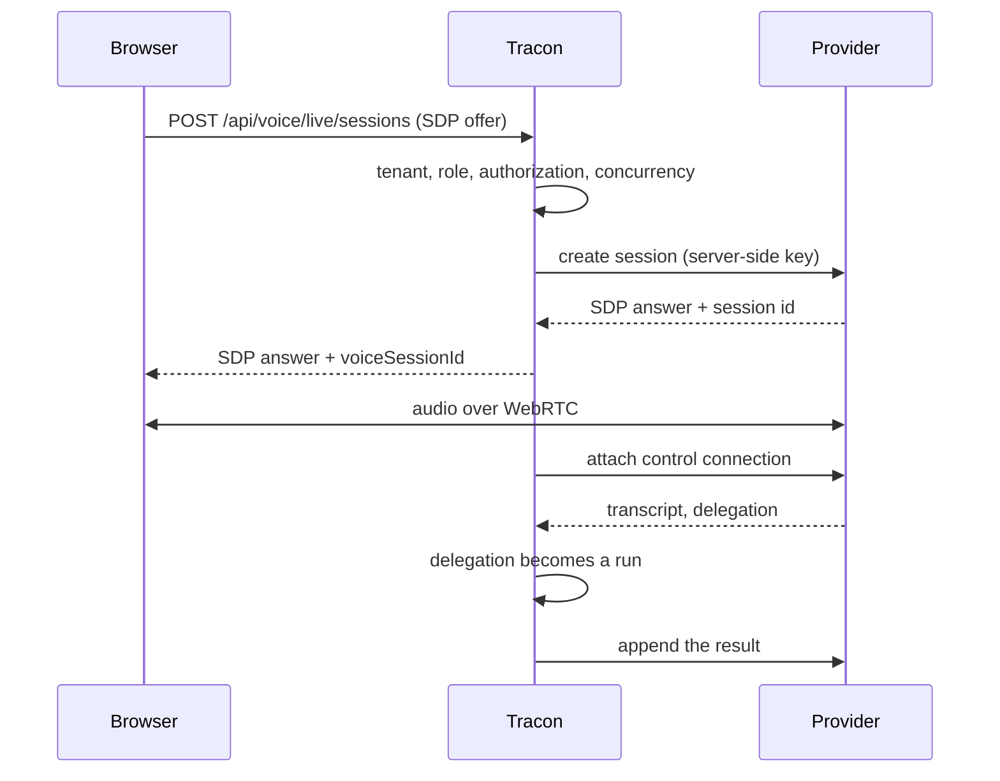

Some providers now host the whole spoken conversation themselves: the model listens,
speaks, detects turns, and carries the audio straight to the browser over WebRTC. It
is genuinely full duplex — the caller can interrupt mid-sentence — which a one-turn-at-a-time
pipeline cannot reproduce no matter how fast it gets.

Tracon stands in exactly two places on that path:

1. **It creates the session.** The browser sends an SDP offer to Tracon, not to the
   provider. Tenancy, role, authorization and concurrency gates all apply before
   anything is created, and your API key never reaches the browser.
2. **It attaches a sideband.** A server-side control connection joins the same session.
   When the model hands work back — a lookup, a calculation, anything needing your
   tools — Tracon turns that delegation into an **ordinary run**, with the same
   tool registry, content guard, quota, cost accounting and audit trail as
   `POST /api/agents/{name}/run`.

The provider runs the conversation; your agents do the work.



## Enable it

`UseLiveVoice()` turns the layer on; a provider registration supplies the model. Both
calls are needed, and they are separate on purpose: the provider connection is billed
by the second, so an application opts into that spend explicitly rather than inheriting
it from an unrelated call.

```csharp
var tracon = builder.AddTracon()
    .UseOpenAI(builder.Configuration.GetSection(OpenAIProviderOptions.SectionName))
    .UseOpenAILive(builder.Configuration.GetSection(OpenAILiveOptions.SectionName))
    .UseLiveVoice(options =>
    {
        options.MaxConcurrentSessionsPerTenant = 3;
        options.MaxConcurrentDelegations = 2;
        options.MaxSessionDuration = TimeSpan.FromMinutes(30);
        options.PendingSessionTimeout = TimeSpan.FromMinutes(2);
        options.PersistTranscript = true;
        options.Instructions = "Delegate any lookup to the client; never guess.";
    });

var app = builder.Build();
app.MapTracon("/tracon");
```

`UseLiveVoice()` is independent of `UseVoiceConversation()`. Enable either, both, or
neither. Without `UseLiveVoice()` the live routes do not exist at all and the address
returns `404`; with the layer on but no provider registered, it returns `501` naming
the call that is missing.

`UseOpenAILive()` reuses the key from `UseOpenAI()`, so that call has to come first.
Validation says so by name at startup if it does not.

## Settings

The live layer reads `Tracon:Voice:Live`, bound to `VoiceLiveOptions`:

| Setting | Default | What it does |
|---|---|---|
| `MaxConcurrentSessionsPerTenant` | `3` | How many live sessions one tenant may hold open. Checked before the provider is called, so a rejected request never leaves a billed session behind. |
| `MaxSessionDuration` | `00:30:00` | How long a session may stay open before it is closed. |
| `PendingSessionTimeout` | `00:02:00` | How long a created session waits for its media peer. After this the record closes as `Abandoned` — not `Error`, because an unused session is not a failure. |
| `MaxConcurrentDelegations` | `2` | How many delegations may run at once in one session. The provider decides when to delegate, so without this ceiling it decides how many agent runs you start. |
| `MaxAppendsPerDelegation` | `12` | How many appends one delegation may push back into the conversation. |
| `DelegationTimeout` | `00:02:00` | How long one delegated run may take. |
| `MaxTranscriptLedgerCharacters` | `20000` | How much transcript is kept for cutting delegations from. Oldest entries drop first, so a long conversation cannot grow without limit. |
| `MaxLedgerEntriesPerDelegation` | `40` | How many transcript entries one delegation's prompt may carry. |
| `DelegationMode` | `Client` | Who executes delegated work. `Client` means your agents do, and it is the only mode. A name that is not a mode stops the host at startup. |
| `Instructions` | *(none)* | System instructions for the live model — for example, telling it to delegate rather than guess. |
| `PersistTranscript` | `true` | Whether the conversation text is written to durable session history. See [Privacy and retention](/guides/voice/#privacy-and-retention). |

The OpenAI provider reads `Tracon:Providers:OpenAI:Live`, bound to
`OpenAILiveOptions`:

| Setting | Default | What it does |
|---|---|---|
| `Model` | `gpt-live-1` | The live model. |
| `Voice` | *(provider default)* | The output voice. |
| `Endpoint` | `https://api.openai.com/v1/` | The API root. |
| `MaxAppendCharacters` | `1000` | The per-append ceiling. The provider states its limit in tokens; Tracon ships no tokenizer, so the limit is converted once and conservatively — text over it is split, never dropped. |
| `Timeout` | `00:00:30` | The timeout of the session-creation call. |

The API key comes from `Tracon:Providers:OpenAI:ApiKey`; the live provider does
not take one of its own.

## Tenant policy and credentials

A live session is bound to a tenant, and it obeys the tenant's provider rules exactly
as a model call does ([egress and per-tenant credentials](/concepts/governance/)).
Before anything else happens — no session row, no concurrency slot, no provider call:

- The tenant's egress policy must allow the live provider's name (`openai` for
  `UseOpenAILive()`). Otherwise `POST /api/voice/live/sessions` answers `403` and the
  tenant's audio never reaches the provider.
- A tenant with its own binding for that provider gets its own key on **both** calls:
  the session creation and the sideband attach. A binding whose configuration key has
  no value answers `403`; the session does not fall back to the shared key.
- A binding that sets an endpoint override answers `403`: the override names a chat API
  base, not a live session surface, so the session is not opened rather than sent
  somewhere the tenant did not choose.

A custom `ILiveVoiceProvider` receives the tenant's key only if it sets
`SupportsTenantCredentials` to `true` and implements `AttachSessionAsync`; the key then
arrives in `LiveVoiceCreateRequest.Credential` and `LiveVoiceAttachRequest.Credential`.
A provider that does not opt in is refused (`403`) for a tenant with its own binding,
because it would open the session on its own configured key — the wrong account.

## The endpoints

| Method | Path | Role | Purpose |
|---|---|---|---|
| `POST` | `/api/voice/live/sessions` | Operator | Relay the SDP offer, create the session, attach the sideband |
| `DELETE` | `/api/voice/live/sessions/{voiceSessionId}` | Operator | Close the session and write its record |
| `GET` | `/api/voice/live/sessions/{voiceSessionId}` | Reader | Report state, duration and delegation count |

These are plain HTTP, so they use the ordinary bearer layer — the subprotocol token
that the conversation WebSocket needs does not apply here.

`POST` takes `{ sessionId, agent, sdp, voice? }` and answers
`{ voiceSessionId, sdp, model, persistTranscript }`. Hand the `sdp` to
`RTCPeerConnection.setRemoteDescription` and the media flows.

A caller that may not reach a session is told the session does not exist, in exactly
the words a genuinely missing session produces. That is deliberate: a distinguishable
`403` would tell an attacker which session ids are real in someone else's tenant.

## What the provider-hosted path gives up

This is a real trade, and the honest list is short but sharp:

| What you lose | Why it matters |
|---|---|
| **Tracon does not see most of the conversation** | The media flows between the browser and the provider. The content guard never inspects what is spoken, so the model can say a sentence Tracon never reviewed. |
| **Not every turn is a run** | Only delegations produce runs. Token accounting, quota and guards cover the **delegated work**, not the chat around it. |
| **`PersistAudio` does not apply** | There is no audio passing through Tracon to store. That setting belongs to `UseVoiceConversation()` and is ignored here. |
| **The caller's audio goes to a third party** | Nothing is stored by Tracon, but the transmission itself is a change worth telling your users about. |
| **The transcript text is durable by default** | See [Privacy and retention](/guides/voice/#privacy-and-retention) below. |
| **Your own speech providers are unused** | `ISpeechTranscriber` and `ISpeechSynthesizer` are not called on this path. |
| **The spend ceiling is duration, not quota** | Voice seconds are not a quota unit. `MaxSessionDuration` and `MaxConcurrentSessionsPerTenant` are what bound the cost. |

None of this makes `UseVoiceConversation()` obsolete. For any provider without a
realtime API, it remains the right layer.

## Cost

A live session is billed by wall-clock duration, and the number in the record is the
**provider's**, not a local stopwatch: Tracon does not carry the media and cannot
time it honestly. When the provider reports nothing, `liveSeconds` stays `null` rather
than being invented.

Price the model per minute:

```json
{
  "Tracon": {
    "Pricing": {
      "Currency": "USD",
      "Voice": { "openai": { "gpt-live-1": { "PerMinute": 0.60 } } }
    }
  }
}
```

`GET /api/voice/sessions` then reports `provider`, `model`, `liveSeconds` and a `cost`
object. With no price configured, `cost` is `null` — never `0`, which would claim the
conversation was free.

:::caution[This figure is not the whole bill]
`cost` covers the **voice connection only**. Every delegated task also produces a
`runs` row with its own token cost, which is deliberately not repeated here. The
honest total is this cost plus the session's run costs.
:::

## Read next

- [Voice and live conversation](/guides/voice/) — speech tools and the WebSocket conversation Tracon runs itself
- [Model providers](/guides/model-providers/) — the providers that offer a hosted live session
- [Governance](/concepts/governance/) — the tenant policy and credentials a session uses
