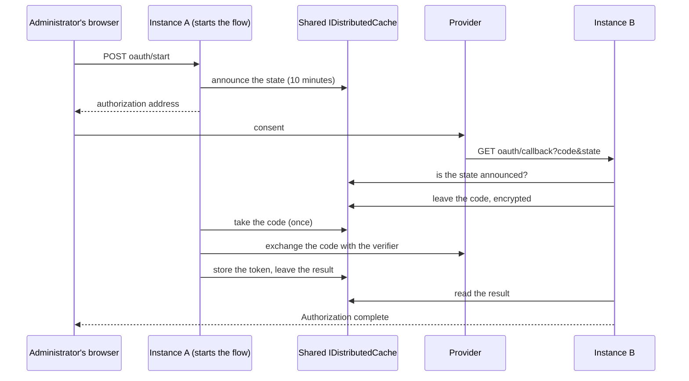

An MCP server that uses OAuth works on two instances when you change one setting. Two things differ
from a single instance, and the first needs no setting.

**Every instance discovers.** Each instance keeps its own catalog of remote tools and the live connection a tool
call goes through. Discovery therefore runs on every instance, also with `Tracon:SingletonExecution:Enabled` on.
With two instances, each opens one connection to each server and lists its tools once for each
`Tracon:Mcp:RefreshInterval` (5 minutes by default). A change you make in the console reaches the instance that
took the request at once and the other instance at its next refresh.

**A token must be where every instance can read it.** `Tracon:Mcp:OAuthTokenStore` says where:

| `OAuthTokenStore` | Token | A callback on the other instance | Cost |
|---|---|---|---|
| `Memory` (default) | The memory of the process that obtained it | The page says that this instance may not have started the authorization | None |
| `DistributedCache` | Your `IDistributedCache`, encrypted with the content protector | Completes the flow | One cache read for each request the MCP client sends |

Both modes keep the token out of the Tracon database. A token also belongs to the endpoint and client id it was
issued for: when you change either, the server asks for authorization again.

```json
{
  "Tracon": {
    "Mcp": {
      "OAuthCallbackBaseUri": "https://myapp.example.com/tracon/",
      "OAuthTokenStore": "DistributedCache"
    },
    "ContentProtection": {
      "Enabled": true,
      "ActiveKeyId": "2026-10",
      "Keys": { "2026-10": "ContentProtectionKeys:2026-10" }
    }
  }
}
```

```csharp
builder.Services.AddStackExchangeRedisCache(options =>
    options.Configuration = builder.Configuration.GetConnectionString("Redis"));

builder.AddTracon()
       .UsePostgreSql(connectionString)
       .AddContentProtection()
       .UseMcp(builder.Configuration.GetSection(TraconMcpOptions.SectionName), configure: null);
```

The mode checks what it needs when the application starts:

- No `IDistributedCache` is registered: the application does not start, and the message names the missing
  registration.
- Content protection is off: the application does not start. A token is never written to a cache as plain text, and no
  setting allows it.
- The cache lives in one process (`AddDistributedMemoryCache`): the application starts with a warning, because other
  instances do not see its entries. ASP.NET Core registers this cache without being asked when you call
  `AddControllersWithViews` or `AddRazorPages`, so read the warning.
- The lease store lives in one process (no SQL provider): the application starts with a warning. Instances then refresh a
  token without waiting for each other.

The provider redirects the administrator's browser to the callback address, and the load balancer picks the instance.
The authorization itself cannot move: the connection call that waits for the code, and the PKCE verifier it holds, stay in
the process that started the flow. The instances meet in the cache.



These rules apply to `OAuthTokenStore = DistributedCache`:

- The callback endpoint takes no bearer token (the provider's redirect cannot carry one), and in this mode it writes
  to your cache for the instance that does not own the flow. It writes only for a `state` that an instance announced,
  and it refuses a `state` that is not 16 to 128 URL-safe characters or a code longer than 4096 characters before it
  touches the cache. Every entry ends by itself, and the code and the result are encrypted. The endpoint has no rate
  limit of its own: it is outside the management API's limiter. Limit requests to it in your ingress.
- The cache entry of a token ends after `Tracon:Mcp:OAuthTokenSlidingLifetime` without a write (30 days by default).
  When it ends for a server in use, the server asks for authorization again. The 30 days is an estimate: a provider does
  not tell how long its refresh token lives.
- The cache key is a digest of the tenant and the server name; no name and no `state` is in a key.
- One instance at a time refreshes a token. The instance that reads an expired token takes a lease in the lease store; the
  other instance reads the cache until the new token is there, for at most 30 seconds, and then uses what it has. The lease
  is "eventually correct, not strictly exclusive" (see `ISingletonLeaseStore`): it makes two refreshes with one refresh
  token rare, not impossible. A provider that rotates refresh tokens and refuses a token it has seen can ask for a new
  authorization after such a refresh.
- A cache that fails does not stop the application. A read that fails returns no token and logs a warning, so the server's
  tools drop out of the next refresh as they do for a server that cannot be reached. A write that fails ends the
  authorization that stored the token.
- The process keeps no second copy of a token, because a copy could refresh with a refresh token the provider has
  replaced. The MCP client therefore reads the cache for each HTTP request it sends: connecting and listing the tools
  took two requests and two reads (measured 2026-10-29, `ModelContextProtocol.Core` 2.3.0, a token in the cache).
  The sequence is the SDK's, and a new SDK version can change it. Choose a cache whose read you can afford on that path.
- A token written under an encryption key that is no longer configured cannot be read. It counts as no token, and the
  server asks for authorization again. Keep an old key configured until its tokens are gone, as for other protected content.

## Read next

- [Production deployment](/guides/production/#design-the-process-topology) — the other things that differ with more than one instance
- [Tools](/concepts/tools/) — how a remote MCP server's tools reach an agent, and the approval rule they carry
- [Threat model](/reference/threat-model/) — what a token in a shared cache is and is not protected against
