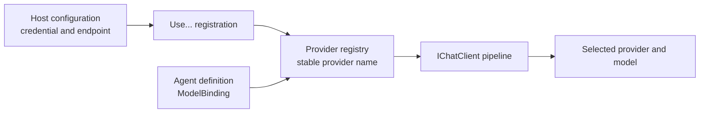

A provider registration opens a model route in the host. An agent definition selects
that route by name. The definition never contains the credential.

## Mental model: register once, select per agent



This separation has two useful effects. You can register several providers in one
process. You can also move an agent to another provider without moving a secret into
the database or the console.

| Package | Registration | Provider name in `ModelBinding` | Surface |
|---|---|---|---|
| `Tracon.OpenAI` | `UseOpenAI()` | `openai` | OpenAI Chat Completions |
| `Tracon.OpenAI` | `UseOpenAI()` | `openai-responses` | OpenAI Responses |
| `Tracon.OpenAI` | `UseOpenAICompatible(name, …)` | your `name` | Compatible Chat Completions |
| `Tracon.Anthropic` | `UseAnthropic()` | `anthropic` | Anthropic Messages |
| `Tracon.Google` | `UseGoogle()` | `google` | Gemini Developer API; [speech](/guides/gemini-speech/) with `UseGoogleSpeech()` |
| `Tracon.Azure` | `UseAzureOpenAI()` | `azure-openai` | Azure OpenAI Chat Completions |

The `Tracon` meta package includes `Tracon.OpenAI`. Add the Anthropic, Google,
or Azure package only when the host uses it.

## Register providers

Read credentials from configuration. Put their values in user-secrets, environment
variables, or a secret manager.

```bash
dotnet user-secrets set "Tracon:Providers:OpenAI:ApiKey" "<key>"
dotnet user-secrets set "Tracon:Providers:Anthropic:ApiKey" "<key>"
dotnet user-secrets set "Tracon:Providers:Google:ApiKey" "<key>"
dotnet user-secrets set "Tracon:Providers:AzureOpenAI:ApiKey" "<key>"
```

Register only the providers for which your host has complete configuration:

```csharp title="Program.cs"
using Tracon;

var tracon = builder.AddTracon()
    .UseOpenAI(builder.Configuration.GetSection(OpenAIProviderOptions.SectionName))
    .UseAnthropic(builder.Configuration.GetSection(AnthropicProviderOptions.SectionName))
    .UseGoogle(builder.Configuration.GetSection(GoogleProviderOptions.SectionName))
    .UseAzureOpenAI(builder.Configuration.GetSection(AzureOpenAIProviderOptions.SectionName));
```

Each options type validates at startup. Missing required configuration stops the host
before the first run. A named compatible endpoint can be keyless, and Azure can use a
credential factory instead of an API key.

## Live voice providers

OpenAI can also register an `ILiveVoiceProvider`, which is a different kind of
registration again: it opens an outbound connection billed by the second, so it is a
separate call rather than a flag on `UseOpenAI()`.

```csharp title="Program.cs"
tracon
    .UseOpenAI(builder.Configuration.GetSection(OpenAIProviderOptions.SectionName))
    .UseOpenAILive(builder.Configuration.GetSection(OpenAILiveOptions.SectionName))
    .UseLiveVoice();
```

The provider runs the whole spoken conversation and carries the audio straight to the
browser; your agents handle the work it delegates. The API key stays on the server.
The tenant's egress policy and its own `openai` binding apply to a live session as to
a model call; see [tenant policy and credentials](/guides/live-voice/#tenant-policy-and-credentials).
See [provider-hosted live voice](/guides/live-voice/) for what
that trade gives up.

## Image generation providers

OpenAI, Azure OpenAI, and Google can also register an `IImageGenerator`. These are
separate from chat-model registrations because an image model or Azure deployment is
not safely inferred from an agent's chat model.

```csharp title="Program.cs"
tracon
    .UseOpenAIImages(options =>
    {
        options.Enabled = true;
        options.Model = "gpt-image-1";
    });

// Azure uses an image deployment name.
// tracon.UseAzureOpenAIImages(options => options.Model = "image-deployment");

// Google uses a provider image model. It does not support WIDTHxHEIGHT in this surface.
// tracon.UseGoogleImages(options => options.Model = "gemini-2.5-flash-image");
```

Each extension shares the authenticated client factory already created by `UseOpenAI`,
`UseAzureOpenAI`, or `UseGoogle`; it adds no second credential path or package. The
extensions register generators by provider name. When more than one is registered,
set `Tracon:Images:Provider` to `openai`, `azure-openai`, or `google` to select
the generator and matching price table. An unkeyed `IImageGenerator` that your
application registers remains the fallback for a custom provider.

`UseOpenAICompatible()` does not imply image support. Register a supported image
extension only after you verify that its provider API supports the selected model.

A generated image is billed by the piece or by output tokens, not by the chat model's
tokens. `generate_image` records the measurement on its tool call with the provider
and model that made the image, and the amount joins the run's non-token total beside the
token cost ([Report what a tool spent beyond tokens](/concepts/tools/#report-what-a-tool-spent-beyond-tokens)).
The speech tools of `Tracon.Voice` record theirs the same way.

Google generates images through the `generateContent` surface, so the model you
name must be one that supports it — a Gemini image model. The older Imagen
`predict` surface is not served by the Gemini API, and a model that only
supports it fails every request. Two option limits follow from that surface:
`Count` is passed as the candidate count and an image model commonly returns one
image whatever you ask for, and a requested media type is passed to the model
and then **checked** — if the model answers in another format the call fails
rather than handing back bytes that do not match the request. Omit the media
type to accept the model's own choice.

Then bind an agent to one stable provider name:

```csharp
tracon.AddAgent(new AgentDefinition
{
    Name = "support",
    Instructions = "Resolve support requests. State uncertainty clearly.",
    Model = new ModelBinding
    {
        Provider = AnthropicProviderNames.Anthropic,
        Model = "your-current-model-name",
        MaxOutputTokens = 2_048,
    },
});
```

Use a current model name from the provider. Tracon does not pin one for you.

Provider registration is host configuration, not a console operation. The console
never accepts or displays provider secrets. Its Models screen shows the catalog and
cached health for providers that the host already registered. The agent editor can
select a provider and model, but it does not currently edit `ProviderSettings`; set
vendor-specific keys in code or through the management HTTP API.

## OpenAI and compatible endpoints

`UseOpenAI()` always registers both official OpenAI routes. The
`OpenAIProviderOptions.EnableResponsesSurface` option does not change this behavior.
That option applies only to compatible endpoints.

```csharp
tracon.UseOpenAICompatible("ollama", options =>
{
    options.Endpoint = new Uri("http://localhost:11434/v1");
    // A local server can run without an API key.
});
```

A compatible registration creates only the Chat Completions route by default. Set
`EnableResponsesSurface = true` only if the server implements `/v1/responses`. The
second provider is then named `{name}-responses`.

The name must match `[a-z0-9][a-z0-9-]{0,31}`. The names `openai` and
`openai-responses` are reserved. An absolute `Endpoint` is required. A compatible
server with no key is valid; Tracon supplies only the fixed placeholder required
by the OpenAI client library.

:::caution[Compatibility is measured per server and model]
A successful health check proves reachability. It does not prove tool calling,
structured output, streaming usage, or Responses API compatibility. Some compatible
servers omit usage from streamed responses. In that case token count and cost stay
`null`; Tracon does not fabricate them.
:::

## Sampling and tool-use fields

Beyond `Temperature`, `TopP`, `MaxOutputTokens`, `ReasoningEffort`, and
`ResponseFormat`, a `ModelBinding` sets eight more request fields. They belong to the
definition, so a stored version, an experiment variant, and a replay carry them. A field
left empty sends nothing, and the provider default applies.

| Field | Type | What it does |
|---|---|---|
| `Seed` | `long?` | Asks for repeatable sampling |
| `TopK` | `int?` | Limits sampling to the `k` likeliest tokens; above zero |
| `StopSequences` | `IReadOnlyList<string>?` | Ends the answer when one appears; no entry may be empty |
| `FrequencyPenalty` | `float?` | Lowers the odds of a token that already appeared often |
| `PresencePenalty` | `float?` | Lowers the odds of a token that already appeared |
| `ToolMode` | `string?` | `auto`, `none`, `required`, or `required:<tool>` |
| `AllowMultipleToolCalls` | `bool?` | Whether the model may ask for several tool calls in one turn |
| `ReasoningOutput` | `string?` | `None`, `Summary`, or `Full`: how much reasoning the response carries |

```csharp
Model = new ModelBinding
{
    Provider = OpenAIProviderNames.ChatCompletions,
    Model = "your-current-model-name",
    Seed = 42,
    StopSequences = ["END"],
    ToolMode = "required:get_order_status",
},
ToolNames = ["get_order_status"],
```

**A provider sends only some of them.** The model adapters of each API surface drop the
fields they have no wire member for, without an error. A field that never reaches the model
looks exactly like a field that worked, so Tracon refuses it instead. A `v` marks a field the
surface sends:

| Field | `openai` | `openai-responses` | `anthropic` | `google` | `azure-openai` |
|---|:-:|:-:|:-:|:-:|:-:|
| `Seed` | v | | | v | v |
| `TopK` | | | v | v | |
| `StopSequences` | v | | v | v | v |
| `FrequencyPenalty` | v | | | v | v |
| `PresencePenalty` | v | | | v | v |
| `ToolMode` | v | v | v | v | v |
| `AllowMultipleToolCalls` | v | v | v | | v |
| `ReasoningOutput` | | v | v | v | |

- A `UseOpenAICompatible()` registration follows the same two columns: its Chat Completions
  provider is the `openai` column, and its `{name}-responses` provider is the
  `openai-responses` column.
- The table is what the API surface sends, not what a model accepts. A model can still reject
  a field its surface sends: some OpenAI reasoning models answer a request that carries `stop` with
  `400 unsupported_parameter`. That error is the provider's own and comes back as the run's failure.
- A definition that sets a field the provider does not send fails to compile. The error
  names the field, the provider, and the providers that send it. `POST /api/agents/validate`
  reports it as `sampling_field_unsupported` at the field's path (for example `model.seed`),
  and saving the definition returns `400`. Nothing runs without the field.
- A `Fallbacks` link gets the request options of the primary call, so it is held to the same
  table: a fallback on a provider that drops `Seed` makes the definition invalid.
- A provider you write sends none of these fields until it states them. Implement
  `ISamplingSupport` next to `IModelProvider` and return the `SamplingFields` its surface sends.
  The table above is what the shipped adapters send; Tracon measures it again when it upgrades
  a provider SDK.
- **`ToolMode`** `required` makes the model call a tool; `required:<tool>` makes it call that
  one, and the tool must be in the definition's `ToolNames`. The requirement holds for the first
  model call of a turn only. The tool-call loop lifts it for the calls that follow, because the
  model could never answer otherwise. A request with no tools carries no tool mode. A value
  other than the four above fails to compile.
- **`ReasoningOutput`** goes with `ReasoningEffort`, and either stands alone. A value outside
  `None`, `Summary`, and `Full` fails to compile, as an unknown effort does. On `anthropic` it sets
  how the thinking is shown, and with no `ReasoningEffort` it turns adaptive thinking on by itself;
  it is not sent when `ReasoningEffort` is `None` or when an `anthropic.thinking.*` provider setting
  is set. On `openai-responses` it becomes the reasoning summary.
- **`AllowMultipleToolCalls`** on `anthropic` travels in the request's `tool_choice`. A definition
  that sets it with no `ToolMode` sends `auto` as the mode, which is what the provider does
  without one.
- **`StopSequences`** has a limit on the number of entries that depends on the provider.
  Tracon does not check it; the provider's own error comes back when it is exceeded.
- An agent extension and the options of one run cannot set these fields. See
  [Use any Microsoft Agent Framework feature](/guides/any-maf-feature/).

## Hosted tools

A web search, a code interpreter, or a file search can run on the provider's side, inside the
model call. A host registers one with `AddHostedTool` and a definition selects it in `ToolNames`;
see [Hosted tools](/guides/hosted-tools/). Each API surface runs only some kinds, and the adapter
drops the others without an error, so a provider states what its surface runs. A `v` marks a kind
the surface runs:

| Kind | `openai` | `openai-responses` | `anthropic` | `google` | `azure-openai` |
|---|:-:|:-:|:-:|:-:|:-:|
| `WebSearch` | | v | v | v | |
| `CodeInterpreter` | | v | v | v | |
| `FileSearch` | | v | | | |

- The table is the request body each adapter writes (2026-10-20), as the sampling table above is.
  A model can still refuse a tool its surface sends.
- A definition that selects a kind the provider does not run fails to compile, and
  `POST /api/agents/validate` reports it as `hosted_tool_unsupported` at the path of the tool
  name. A `Fallbacks` link is held to the same table.
- Chat Completions maps only a web search, to a field that a model without search answers with
  `400`. Tracon does not offer the kind on that surface.
- A `UseOpenAICompatible()` registration follows the same two OpenAI columns. An endpoint that is
  not OpenAI can still reject the tool.
- A provider you write runs no kind until it states it. Implement `IHostedToolSupport` next to
  `IModelProvider` and return the `HostedToolKinds` its surface runs.
- Each call is billed by the provider. Set `Tracon:Pricing:HostedTools:{provider}:{kind}:PerCall`.

## Provider-specific settings

Portable settings live directly on `ModelBinding`: `Temperature`, `TopP`,
`MaxOutputTokens`, `ReasoningEffort`, `ResponseFormat`, and the fields above.
Vendor-only settings live in `ProviderSettings`. Unknown keys fail compilation instead of
being ignored.

```csharp
using System.Text.Json;

var anthropicBinding = new ModelBinding
{
    Provider = AnthropicProviderNames.Anthropic,
    Model = "your-current-claude-model",
    MaxOutputTokens = 64_000,
    ProviderSettings = new Dictionary<string, JsonElement>(
        StringComparer.OrdinalIgnoreCase)
    {
        [AnthropicProviderNames.EffortSetting] =
            JsonSerializer.SerializeToElement("high"),
        [AnthropicProviderNames.ThinkingModeSetting] =
            JsonSerializer.SerializeToElement("adaptive"),
        [AnthropicProviderNames.PromptCachingSetting] =
            JsonSerializer.SerializeToElement(true),
        [AnthropicProviderNames.PromptCachingTtlSetting] =
            JsonSerializer.SerializeToElement("1h"),
        [AnthropicProviderNames.PromptCachingPlacementSetting] =
            JsonSerializer.SerializeToElement("system"),
    },
};

var googleBinding = new ModelBinding
{
    Provider = GoogleProviderNames.Google,
    Model = "your-current-gemini-model",
    ProviderSettings = new Dictionary<string, JsonElement>(
        StringComparer.OrdinalIgnoreCase)
    {
        [GoogleProviderNames.SafetyHarassmentSetting] =
            JsonSerializer.SerializeToElement("BLOCK_ONLY_HIGH"),
        [GoogleProviderNames.ThinkingBudgetTokensSetting] =
            JsonSerializer.SerializeToElement(512),
        [GoogleProviderNames.ThinkingIncludeThoughtsSetting] =
            JsonSerializer.SerializeToElement(true),
    },
};
```

Anthropic supports six keys. Each one is off or absent by default, so an existing
agent sends the same request as before:

| Key | Values | Sent as |
|---|---|---|
| `anthropic.effort` | `low`, `medium`, `high`, `xhigh`, `max` | `output_config.effort` |
| `anthropic.thinking.mode` | `enabled`, `adaptive` | `thinking.type` |
| `anthropic.thinking.budgetTokens` | integer above zero | `thinking.budget_tokens` (mode `enabled` only) |
| `anthropic.promptCaching` | `true`, `false` | prompt caching on or off |
| `anthropic.promptCaching.ttl` | `5m`, `1h` | `cache_control.ttl` |
| `anthropic.promptCaching.placement` | `request`, `system` | where the cache breakpoint goes; `system` with no instructions falls back to `request` |

- **Effort** controls how many tokens the model spends, thinking included, and it is
  the main cost lever on current models. The values come from the Anthropic SDK, so a
  level the SDK adds is accepted without a Tracon release. A model that does not
  support a level rejects the request.
- **Thinking.** `adaptive` lets the model decide how much to think; `effort` sets the
  depth. `enabled` needs `budgetTokens`, and current Claude models reject a budget
  with `400`. A budget on its own still means `enabled`, as before. Setting
  `adaptive` together with a budget is an error. With `enabled`, the budget must be
  smaller than the output limit, and temperature must be absent or `1`.
- **Prompt caching.** `request` (the default) caches the whole request. `system`
  marks the end of the agent's instructions instead, so requests that carry a
  different document after the same instructions read the same cached prefix; with
  `request`, each of them writes an entry the next one cannot read. A request with
  no instructions has nothing to mark, so `system` then sends the `request`
  breakpoint. A `1h` entry
  costs more to write and pays off when the same prefix returns more than five
  minutes apart. `ttl` and `placement` without `anthropic.promptCaching = true` are
  an error, not a silent no-op.
- **Thinking tokens count against the output limit.** At `high` effort or above,
  set `MaxOutputTokens` explicitly. Without it, the request goes out with
  `DefaultMaxOutputTokens` (4096), and the validation report warns when the
  catalog states a higher maximum for the model. See
  [Truncated output](/concepts/runs/#truncated-output).

`ModelBinding.ReasoningEffort` maps differently on Anthropic: it becomes adaptive
thinking (`thinking.type = adaptive`) plus `output_config.effort` (`low`, `medium`,
`high`, `xhigh`), which every current Claude model accepts. A model that predates
adaptive thinking (for example `claude-haiku-4-5`) rejects that form with `400`:
select it with `anthropic.thinking.mode = enabled` and `anthropic.thinking.budgetTokens`.
When `anthropic.thinking.mode` or `budgetTokens` is set, the provider setting wins and
`ReasoningEffort` is not sent.
Provider settings do not reach a `Fallbacks` link: a link gets the binding's
portable fields only.

Google supports five `google.safety.*` thresholds plus
`google.thinking.budgetTokens` and `google.thinking.includeThoughts`. The thinking
budget range is `-1..65535`; `-1` lets the model decide and `0` disables thinking.
Valid safety values are `BLOCK_LOW_AND_ABOVE`, `BLOCK_MEDIUM_AND_ABOVE`,
`BLOCK_ONLY_HIGH`, `BLOCK_NONE`, and `OFF`. A safety-filtered empty response becomes a
failed run with error type `content_filtered`; one that already has text completes with a
`tracon.output.filtered` run event.

OpenAI and Azure OpenAI support one `ProviderSettings` key each, and both reject every
other key:

| Key | Values | Sent as |
|---|---|---|
| `openai.strictJsonSchema` | `true`, `false` (default) | `strict: true` on the response format |
| `azure-openai.strictJsonSchema` | `true`, `false` (default) | `strict: true` on the response format |

The OpenAI key covers `openai`, `openai-responses`, and every `UseOpenAICompatible()`
registration, whatever its name; a server that does not know strict mode can refuse the
request. The setting reaches the response format of an agent whose `ResponseFormat` is a
JSON schema, and not its tools. See
[Strict mode](/guides/structured-output/#strict-mode). A key written for another
provider, such as `anthropic.promptCaching` left over after a provider switch, is
rejected too. `POST /api/agents/validate` reports it as `invalid_setting` at
`model.providerSettings`, saving the definition returns `400`, and an agent defined in
code fails compilation. The console does not edit `providerSettings`; remove a stray
key through the HTTP API or in code.

A refusal names the key and, for a setting with a fixed set of values, the accepted
values. It never repeats the value you wrote: a value can be a credential pasted into
the wrong field, and the message reaches logs and run records.

## Azure OpenAI uses deployments

For `azure-openai`, `ModelBinding.Model` is the **deployment name**, not the base model
name. A wrong deployment produces an Azure error even when provider health is good.

The provider calls the resource's v1 API (`{endpoint}/openai/v1/`) with the plain
OpenAI client; the deployment name travels in the request's `model` field. The
resource must support the v1 API.

Use an API key, or supply an Azure Core credential factory. Managed identity wins if
both are present.

```csharp
// Add Azure.Identity to the consumer project for DefaultAzureCredential.
using Azure.Identity;

tracon.UseAzureOpenAI(options =>
{
    options.Endpoint = new Uri("https://my-resource.openai.azure.com/");
    options.CredentialFactory = static () => new DefaultAzureCredential();
    options.DefaultDeployment = "support-production";
});
```

`Tracon.Azure` depends on `Azure.Core`, not `Azure.Identity`. The consumer chooses
the credential implementation. The Entra token is sent only over HTTPS. Azure OpenAI
Responses, On Your Data, and Azure AI Foundry Agents are not exposed by this provider.

## Per-tenant credentials (BYOK)

By default every tenant shares the credential a `Use...()` call registered at startup.
A multi-tenant host can instead let each tenant bring its own key — its usage and its
bill stay separate from every other tenant's.

BYOK is an **optional** provider capability, not a universal contract. A provider
opts in by implementing `ITenantCredentialModelProvider` in addition to
`IModelProvider`; the four built-in providers (OpenAI, Anthropic, Google, Azure
OpenAI) all do. A provider that does not implement it simply never sees a tenant
credential, and Tracon never falls back to the setup-time key on its behalf: a
tenant binding saved against a provider that does not support BYOK fails **every**
run with a stable `tenant_provider_refused` error (class `TenantProviderRefused`)
instead of silently billing the tenant's traffic to the host's own account. A run
recorded before that error type existed carries `provider_credential_unsupported`.

A tenant's binding stores only the **name** of a configuration key, never the value:

```bash
dotnet user-secrets set "Tracon:ProviderKeys:Acme:OpenAI" "<acme's key>"
```

```bash
curl -X PUT "http://localhost:5081/tracon/api/tenants/acme/providers/openai" \
  -H "Authorization: Bearer $TRACON_TOKEN" \
  -H "Content-Type: application/json" \
  -d '{"apiKeyConfigurationName": "Tracon:ProviderKeys:Acme:OpenAI"}'
```

The name must sit under the configured prefix (default `Tracon:ProviderKeys:`) and
inside the tenant's own segment — `Tracon:ProviderKeys:acme:` for tenant `acme`; the
segment matches without regard to case. A flat name directly under the prefix belongs
to the default tenant. A name outside that space is rejected with `400` both when it is
saved and again when it is resolved, so one tenant cannot bind another tenant's key.
Managing a tenant other than your own requires platform authority: an API key with the
`PlatformAdmin` scope, the static token, or the `TraconPolicies.PlatformAdmin`
policy. `GET /api/tenants/acme/providers` reports whether the name currently
resolves to a value (`resolved: true`/`false`) — never the value itself. A tenant with
no binding for a provider keeps using the global setup-time credential; nothing changes
until a binding is written. A binding that exists but resolves to no value does not
fall back to the global credential silently — the run fails with a clear error instead,
so a misconfigured tenant is never billed to the wrong account.

Restrict which providers a tenant's agents may call with an egress policy:

```bash
curl -X PUT "http://localhost:5081/tracon/api/tenants/acme/egress" \
  -H "Authorization: Bearer $TRACON_TOKEN" \
  -H "Content-Type: application/json" \
  -d '{"allowedProviders": ["openai", "anthropic"]}'
```

A tenant with no saved policy is unrestricted — saving one is an additive
restriction, not a default wall. An agent definition naming a provider outside the
saved list is rejected **at compile time**, before any request reaches the network;
the same check also protects `PUT .../providers/{provider}` itself, so both surfaces
agree. The console's Settings screen exposes both panels; no field there accepts a
credential value, only a configuration key name and an optional endpoint override.

The same policy and the same bindings cover speech providers. A text-to-speech or
speech-to-text call is refused when the policy does not name the provider name the
engine reports (`elevenlabs` for the built-in client), and a tenant binding for that
name reaches only an engine that declares `SupportsTenantCredentials`; any other engine
is refused for that tenant rather than billed to the host. The console lists speech
providers next to the model providers, by the name a policy uses. See
[tenant policy and credentials for speech](/guides/voice/#tenant-policy-and-credentials-for-speech).

## A provider without a package

`AddModelProvider()` registers a provider Tracon does not ship a package for.
Implement `IModelProvider` — a stable `Name`, a `Models` catalog, and
`CreateChatClient(ModelBinding)` returning a raw `IChatClient` — and register it. If
the provider should also accept a per-tenant credential (see [Per-tenant
credentials](#per-tenant-credentials-byok) above), additionally implement
`ITenantCredentialModelProvider`, whose `CreateChatClient(ModelBinding,
ModelProviderCredential)` takes a non-null credential; a provider that does not
implement it is never called with one — Tracon fails the run instead of
falling back to the setup-time key on its behalf:

```csharp
public sealed class ContosoModelProvider(HttpClient httpClient, string setupApiKey)
    : ITenantCredentialModelProvider
{
    public string Name => "contoso";

    public IReadOnlyList<ModelDescriptor> Models { get; } =
        [new ModelDescriptor { Name = "contoso-large", SupportsTools = true }];

    public IChatClient CreateChatClient(ModelBinding binding)
        => Create(binding, setupApiKey);

    public IChatClient CreateChatClient(ModelBinding binding, ModelProviderCredential credential)
        => Create(binding, credential.ApiKey);

    private ContosoChatClient Create(ModelBinding binding, string apiKey)
    {
        // Contoso supports no ProviderSettings key, so every key is rejected.
        ModelProviderSettings.Validate(binding, Name, []);
        return new ContosoChatClient(httpClient, binding.Model, apiKey);
    }
}

services.AddHttpClient();

tracon.AddModelProvider(services =>
    new ContosoModelProvider(services.GetRequiredService<HttpClient>(), setupApiKey));
```

A provider that never wants to support BYOK simply implements only `IModelProvider`
and stops there — it still works with the setup-time credential for every tenant.

A complete, runnable version of this provider — including per-tenant credentials
and provider-settings validation — lives in the repository at
`samples/Tracon.Samples.CustomModelProvider`. It takes Tracon by
`PackageReference` only, which is what makes it a proof rather than an
illustration.

### The runtime contract

The rules below are what the registry and the compile path actually rely on. An
implementation that breaks one still compiles and still passes its own unit
tests; it misbehaves under a real deployment. Verify them by deriving
`ModelProviderContract` from the
[`Tracon.Testing.Contracts.Xunit`](/packages/) package rather than by reading carefully.
If your provider supports BYOK, derive its opt-in
`ModelProviderCredentialContract` too. Its required assertion must inspect the
provider request boundary (for example a recording transport), not merely a
different client object; otherwise a new wrapper can still send the setup-time
key and bill the wrong tenant. Derive `ModelProviderSettingsContract` for every
provider, including one that supports no settings key.

**Lifetime and threading.** Your provider is a **singleton**. It must not capture
a scoped service, and the provider set is fixed once the container is built.
`CreateChatClient` is called **concurrently** and must be thread-safe. If you
cache a client per credential in a `ConcurrentDictionary`, remember that
`GetOrAdd` may run its factory more than once for the same key under a race and
discard the extras — so building a client must be side-effect free.

**Return a raw client.** `UseFunctionInvocation()`, OpenTelemetry, the content
guard, the circuit breaker, the concurrency limiter, attachment resolution,
response caching, the fallback chain and content-filter detection are all added
by `ModelProviderRegistry` around whatever you return. Building any of them
yourself is not merely redundant: the registry places the content guard directly
above your client so that *every* turn of the tool-call loop is inspected. With
your own inner loop, the turn that carries a tool result back into the model runs
beneath the guard — the exact path prompt injection takes — while the reply text
and the tool-call count stay identical, so nothing else reveals it.

**Tracon never disposes the client you return.** It is built once per
compiled agent and held by it; the compiled agent implements neither
`IDisposable` nor `IAsyncDisposable`, and evicting one from the compile cache
drops the reference without disposing. You own the lifetime of what you return,
and it must tolerate never being disposed — which is why the shipped providers
return clients backed by a long-lived, shared SDK client.

**Provider settings.** Reject every `ModelBinding.ProviderSettings` key you do not
support. A provider that supports no key rejects them all. Call
`ModelProviderSettings.Validate(binding, prefix, supportedKeys)` from
`CreateChatClient`, and pass an empty list when you support none. Its exception is
the one the registry passes through with the key named. The registry masks the
message of any other exception thrown while a client is built, so a hand-rolled
check reaches the author as a generic provider failure. When you refuse a value of a
supported key yourself, name the key and the accepted values, not the value:
`ModelProviderSettingsContract` fails a provider whose message repeats it.

**Default output limit.** If your client sends an output-token limit of its own
when `ModelBinding.MaxOutputTokens` is empty, return a `ModelOutputLimit` from
`GetService(typeof(ModelOutputLimit))` on the client you build for that binding,
with `HighReasoningEffort = true` when the binding's settings ask for deep
reasoning. `POST /api/agents/validate` reads it through the whole pipeline and
warns when the limit is below the catalog's `MaxOutputTokens` for the model. A
client that sends no limit returns nothing.

**Naming.** `Name` is matched against `ModelBinding.Provider` case-insensitively.
Registering two providers under one name is not last-one-wins: the host fails at
startup.

**The catalog is not an allow list.** See [the next
section](#model-catalog-is-metadata-not-permission).

**Credentials.** `CreateChatClient(ModelBinding, ModelProviderCredential)` — the
`ITenantCredentialModelProvider` overload — is called only when a tenant supplies a
credential **and** your provider implements that interface; without it, Tracon
never calls your provider with a tenant credential at all, and it does not fall back
to calling the plain `CreateChatClient(ModelBinding)` overload with the tenant's
request either — the run fails closed with `tenant_provider_refused`
instead. If you do implement the interface, the key must never fall back to your
setup-time key: a tenant that supplied a credential is billed on it, or the call
fails. An endpoint may fall back, so a globally configured base address still
applies when a tenant overrides only its key.

### How failures are classified

Tracon decides whether to move to the next `Fallbacks` link by reading the
exception's type **name** and message **text** across the whole exception graph,
because the core holds no compile-time reference to any provider SDK's exception
types. The one typed value it reads is `HttpRequestException.StatusCode`, which
belongs to .NET itself. What that means when you write a provider:

| Failure | Next fallback link is tried |
|---|---|
| A timeout — a `TimeoutException` in the graph, or a message that says it timed out | Yes |
| `OperationCanceledException` with no timeout signal, while the caller's token is cancelled | No — the caller asked to stop |
| Message carries `HTTP 401` or `HTTP 403` | No — switching providers would hide a configuration mistake |
| Any other permanent `4xx` (every `4xx` except `408` and `429`), in an `HTTP nnn` message or in `HttpRequestException.StatusCode` | No — the next provider gets the same request, so a bad body or an unknown model name fails there too |
| Message carries `429`, `too many requests`, or `rate limit` | Yes |
| Message carries `HTTP 5xx` | Yes |
| A transport/SDK-client type with no permanent `4xx` (usually no status at all) | Yes — treated as a connection failure |
| Anything else | No — the retry set is closed and positive |

:::caution[A timeout is not a cancellation]
.NET reports an `HttpClient` request timeout as a `TaskCanceledException`, which
derives from `OperationCanceledException`. Do not let your own provider or retry
classifier take that type at face value: a timeout with nobody cancelling is a
failure, and treating it as a cancellation makes a provider outage look like a
user pressing stop. Tracon separates them by looking for a timeout signal in
the exception graph and, where a token is in scope, by asking whether that token
was actually cancelled.
:::

Two consequences are worth stating plainly. A provider-side safety filter is
**not** an exception here: return an ordinary `ChatResponse` with
`ChatFinishReason.ContentFilter` and Tracon raises
`TraconContentFilteredException` itself when the response is empty, or records a
`tracon.output.filtered` event when it already has text. The same holds for the output limit:
report `ChatFinishReason.Length`, and Tracon raises
`TraconOutputTruncatedException` for a structured request or records a
`tracon.output.truncated` event for plain text. Throwing instead leaves the decision to
your exception: one with no readable HTTP status counts against the provider's
circuit as a connection failure does, so a healthy provider can look like it is
failing. And a `TraconException` thrown
from `CreateChatClient` is wrapped as a compilation error naming the agent, while
every other exception propagates raw — so use it for configuration or binding
problems the host author can act on.

## Model catalog is metadata, not permission

Every provider options type has a `Models` collection. It drives the console model
picker, capability hints, and cost calculation. It is not an allow list. A definition
can use a model that is absent from the catalog.

The capability flags do not carry equal weight, and only two of them are gates:

| Flag | What it does |
|---|---|
| `SupportsStructuredOutput` | **Enforced.** An agent requesting JSON output fails compilation when the model is *found* in the catalog with this explicitly `false`. A model absent from the catalog is not checked. See [Structured output](/guides/structured-output/) |
| `SupportsSampling` | **Enforced.** `null` (the default) means unknown and checks nothing. When it is `false`, a definition that sets `Temperature` or `TopP` fails compilation, the validation report names the field as `sampling_unsupported`, and saving returns `400`. `Fallbacks` links are checked too, because they get the same parameters |
| `MaxOutputTokens` | Read by the validation report: when a binding leaves its own limit empty and the provider's default is lower, a structured or high-effort agent gets an `output_truncation_risk` warning |
| `SupportsTools` | Advisory metadata — nothing enforces it at run time |
| `SupportsStreaming` | Advisory metadata — nothing enforces it at run time |
| `SupportsReasoning` | Advisory metadata — nothing enforces it at run time |

The advisory flags still drive the console's picker and capability hints, so an
inaccurate catalog misleads a human even where it cannot fail a run.

## Response caching

Enable it per agent. Tracon forces the cache key with three inputs beyond the
messages and options themselves: the tenant, the sorted tool names, and the provider
— a hit never crosses a tenant boundary and never lands on an agent with a different
tool set, even when the prompt and instructions are otherwise identical.

```csharp
builder.Services.AddDistributedMemoryCache(); // or a real distributed cache: Redis, SQL Server, ...

tracon.AddAgent(new AgentDefinition
{
    Name = "cached-support",
    Instructions = "Resolve support requests. State uncertainty clearly.",
    Model = new ModelBinding
    {
        Provider = AnthropicProviderNames.Anthropic,
        Model = "your-current-model-name",
        ResponseCache = new ResponseCacheSettings { Enabled = true, Lifetime = TimeSpan.FromMinutes(10) },
    },
});
```

A hit skips the model call entirely: no token usage, no cost, and no new trace span
for that turn. It does **not** skip the tool-call loop — if the cached response
carries a tool call, the tool still runs; a hit is not a shortcut around side
effects. A run's own `usage` field reports `null` for a hit, not `0`: Tracon
distinguishes "not measured" from "measured as zero" everywhere it reports usage.

Turning `ResponseCache.Enabled` on without an `IDistributedCache` registered fails
validation and fails to compile the agent; the error names the missing registration.
Nothing runs uncached silently. A store failure (a timeout, an oversized payload the
store rejects) is logged and treated as a miss on read, or simply dropped on write —
a cache problem never fails a call that would otherwise have succeeded.

## Tool-call loop

`ModelBinding.ToolLoop` configures the loop that runs the tools the model asks for and
sends their results back. Every member is optional and keeps the loop's own default when
it is left unset, so an agent without it behaves as before. A `Fallbacks` link runs the
same agent's tools, so it takes the whole `ToolLoop` of the primary model.

| Member | Default | What it does |
|---|---|---|
| `AllowConcurrentToolCalls` | `false` | Runs the independent tool calls of one turn at the same time |
| `MaximumConsecutiveErrors` | `3` | How many failed tool turns in a row the loop tolerates before it rethrows; `0` rethrows the first |
| `TerminateOnUnknownCalls` | `false` | Ends the loop and hands the call back when the model asks for a tool the agent does not have; by default the model sees an error result |

### Concurrent tool calls

By default, independent tool calls returned in the same turn run one after another.
Turn `AllowConcurrentToolCalls` on to run them at the same time instead — useful when
a turn calls several independent, I/O-bound tools and their combined latency matters
more than a small increase in peak concurrency.

```csharp
Model = new ModelBinding
{
    Provider = AnthropicProviderNames.Anthropic,
    Model = "your-current-model-name",
    ToolLoop = new ToolLoopSettings { AllowConcurrentToolCalls = true },
},
```

Off by default: with no change, calls still run one at a time exactly as they do
today. Turn it on only for tools whose bodies are safe to run concurrently with
themselves — a tool that shares mutable state across calls without its own
synchronization should not opt in.

It is not `AllowMultipleToolCalls`. That field decides whether the model may *ask* for
several calls in one turn; `AllowConcurrentToolCalls` decides whether Tracon *runs* them at the
same time.

:::note[Upgrading from a build that had `ModelBinding.AllowConcurrentToolCalls`]
The setting moved into `ToolLoop`. A definition stored before the move is read with the setting
in its new place, and the next save writes the new place only. `POST /api/agents`,
`PUT /api/agents/{name}`, and `POST /api/agents/validate` refuse the old key
`model.allowConcurrentToolCalls` with `400` and name `model.toolLoop.allowConcurrentToolCalls`.
:::

## Check a prompt against the context window before running it

The pre-flight check is `TraconPreflightOptions`, bound from
`Tracon:Preflight`. It is off until `Enabled` is set, and `ReserveRatio` decides
how much of the window is held back for the answer.

Outgoing concurrency is `TraconModelConcurrencyOptions`, bound from
`Tracon:ModelConcurrency`: `MaxConcurrentCallsPerProvider` caps how many calls
Tracon has in flight against one provider at a time.

`ContextWindowTokens` on a catalog `ModelDescriptor` powers two features:
derivation for `ContextWindow` compaction, and an optional pre-flight check on
`POST /api/agents/{name}/run` that rejects an oversized prompt **before** any
provider is called.

```json
{
  "Tracon": {
    "Preflight": {
      "Enabled": true,
      "ReserveRatio": 0.2
    }
  }
}
```

`Preflight.Enabled` is off by default: a wrong estimate stops a run that
would have succeeded, and that risk needs an explicit opt-in.
`ReserveRatio` (default `0.2`) sets aside a share of the window for the answer;
a prompt estimated above the remaining budget returns `400` with the counted
and allowed token numbers, and no provider is contacted.

The count is **approximate** — it uses a single fixed OpenAI encoding
regardless of the bound provider, because Anthropic and Google publish no
equivalent offline tokenizer. Diagnose the estimate for any agent, independent
of whether the check is enabled, with:

```bash
curl -X POST "http://localhost:5081/tracon/api/agents/support/estimate" \
  -H "Authorization: Bearer $TRACON_TOKEN" \
  -H 'Content-Type: application/json' \
  -d '{"message":"..."}'
```

`contextWindowTokens` and `allowedPromptTokens` come back `null` when the
agent's model is not in the catalog — a missing catalog entry is never treated
as a rejection, since there is nothing to compare the prompt against.

## Defaults and operational behavior

| Setting | Default or rule |
|---|---|
| Model fallback | Provider options can define a default model or Azure deployment for programmatic use; the management HTTP API still requires `model.model` |
| Sampling fields | `null` uses the provider default |
| Anthropic output limit | `DefaultMaxOutputTokens = 4096` because Anthropic requires `max_tokens` |
| Compatible Responses route | Off |
| Health cache | 60 seconds |
| Background health checks | Off; checks run on request unless an interval is configured |
| Circuit breaker | On; 5 consecutive failures; one half-open attempt after 30 seconds |
| Model catalog | Empty until the host supplies entries |
| Pre-flight context-window check | Off; `POST /api/agents/{name}/estimate` still works when off |
| Fallback chain | Empty; an unavailable primary throws, same as before this feature existed |
| Tenant provider binding | None; every tenant uses the global setup-time credential until one is saved |
| Tenant egress policy | Unrestricted; saving one is an additive restriction, never a default wall |
| Allowed configuration prefix for a binding | `Tracon:ProviderKeys:{tenant}:`; a flat name belongs to the default tenant, and any other name is rejected with `400` |
| Response cache | Off; a binding with `ResponseCache.Enabled = true` and no registered `IDistributedCache` fails to compile |
| Response cache lifetime | 10 minutes, when caching is enabled |
| Concurrent tool calls | Off; independent tool calls in one turn run one after another |

Force a current, cost-free reachability check with:

```bash
curl -H "Authorization: Bearer $TRACON_TOKEN" \
  "http://localhost:5081/tracon/api/models/health/openai?refresh=true"
```

The health call reads a model list. It does not run a completion.

## Troubleshooting

**“Provider is not registered.”** Confirm that the matching `Use...()` call ran and
that `ModelBinding.Provider` uses the exact stable name from the table above.

**The host fails during startup.** Check the provider's configuration section. Keep
the secret value out of `appsettings.json`, but make sure the environment or secret
manager supplies it. Azure also requires an absolute resource endpoint.

**The model does not appear in the console.** Add it to the provider's `Models`
collection. The absence does not stop a definition from using it.

**Azure health is good, but a run returns `404`.** Health verifies the resource and
credential, not a deployment. Check the deployment name in `ModelBinding.Model`.

**Azure health reports `Credential error (...)`.** The `CredentialFactory` credential
could not return a token. A common cause is `DefaultAzureCredential` on a machine
without an Azure sign-in. The detail shows only the exception type; the credential
library's message stays out of the response. The other providers' health is not
affected.

**A compatible run has no token count or cost.** The upstream server probably omitted
streaming usage. Configure no estimate unless you can label it as an estimate.

**A compatible provider returns `402`.** Some gateways reserve credit against the
maximum possible output. Set a realistic `ModelBinding.MaxOutputTokens` value.

**Anthropic rejects a thinking request.** Current models reject
`budget_tokens` and sampling parameters with `400`: switch to
`anthropic.thinking.mode = adaptive` with `anthropic.effort`, remove `Temperature`
and `TopP`, and mark the model `SupportsSampling = false` in the catalog so the next
definition fails at compile time. On an older model, keep the thinking budget below
the output limit and set temperature to `1` or leave it out.

**A long Anthropic answer stops in the middle.** The response hit the output limit.
A structured response fails the run with `output_truncated`; a text answer completes
with a `tracon.output.truncated` run event, which a streaming client also receives as a
`custom` frame before `done`, and `/v1/chat/completions` reports
`finish_reason: "length"`. Raise `MaxOutputTokens`. When the message
and the event's `cause` name the **context window** instead (Anthropic's
`model_context_window_exceeded`), the conversation filled the window: shorten it with
context compaction or use a model with a larger window.

**An Anthropic turn with web search takes several calls.** The API pauses a long turn
of its own server tools (`pause_turn`). Tracon sends the paused answer back as the API
returned it and the model continues; each call is billed and counted. A turn still
paused after five continuations fails the run with `upstream_error`, fault
`AnthropicTurnPausedException`.

**A working prompt gets rejected by the pre-flight check.** The token estimate is
approximate. Raise `ReserveRatio` toward zero, or call `/estimate` to see the
counted value against the model's real `ContextWindowTokens` before deciding.

## In the reference

- [Model health HTTP API](/http-api/models/)
- [`ModelBinding` API](/api/tracon.modelbinding/)
- [`ResponseCacheSettings` API](/api/tracon.responsecachesettings/)
- [`UseOpenAI` API](/api/tracon.openaiproviderextensions/)
- [`UseOpenAICompatible` API](/api/tracon.openaicompatibleproviderextensions/)
- [`UseAnthropic` API](/api/tracon.anthropicproviderextensions/)
- [`UseGoogle` API](/api/tracon.googleproviderextensions/)
- [`UseAzureOpenAI` API](/api/tracon.azureopenaiproviderextensions/)

## Read next

- [Reliable runs](/guides/reliability/) — provider fallback chains and outgoing concurrency limits
- [Choosing packages](/packages/) — select the packages needed by your host and its integrations.
- [Agents and definitions](/concepts/agents/) — configure and version the definitions that the catalog resolves.
