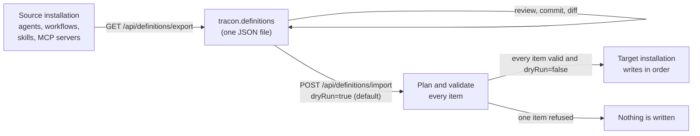

You build an agent in a development installation. You try it and version it
there. Then it has to run in staging and in production. This guide moves the
definition as a file: you export it, you review it, and you import it with a dry
run first.

The import does one thing: it copies **definitions**. It does not copy history,
runs, sessions, secrets, tokens or script permissions. Read
[What a file carries](#what-a-file-carries) before you use it as a backup. It is
not one.



## Export

```bash
# Everything the tenant keeps in its database
tracon export --url https://dev.example.com/tracon --output bundle.json

# One agent, and what it needs
tracon export --url https://dev.example.com/tracon --agent triage --output bundle.json

# Every skill and every MCP server, nothing else
tracon export --url https://dev.example.com/tracon --types skills,mcp-servers --output bundle.json
```

The same call over HTTP: `GET /api/definitions/export`, with `?agent=` and
`?workflow=` (each may repeat) or `?types=` (`agents`, `workflows`, `skills`,
`mcpServers`; comma separated). Naming definitions and kinds in one call is
refused with `400`.

A selection by name brings **what the named definitions need**, so the file
imports on its own:

| A definition of this kind | brings |
|---|---|
| Agent | the stored skills it loads, the agent it takes shared instructions from, the agents it calls, the agents that review it in a loop, and the MCP servers whose tools or resources it uses |
| Workflow | the agents of its list, its manager and its agent nodes (and what those agents need) |

An MCP server is matched by name prefix: a tool `lookup_find` belongs to the
server `lookup`. When two server names are both prefixes of one tool name, the
file carries both. It may bring one server too many and never one too few.

An agent defined in code, or in a custom agent source, is not exported: the
importing installation has to carry it in its own code. When a selection by name
reaches one, the file leaves it out and says so in `warnings`.

The file is sorted by name. The same definitions always write the same bytes,
so you can commit it and read the diff.

Exporting needs the `Reader` role and the `AgentsRead` scope when you call with
an API key. A file that holds workflows needs `WorkflowsRead` too; the answer is
`403` and names the scope that is missing. Every export writes one line to the
audit trail with the counts. The line never holds content.

## What a file carries

| Carried | Not carried |
|---|---|
| Agents, workflows, stored skills, remote MCP servers, in the shape of the save endpoint | Version history. Each definition travels as its current content, with the version it had in the source as `sourceVersion` |
| For an MCP server: the **names** of its plain headers, and the names of the configuration keys its credentials are read from | A plain MCP header value. A response never returns one, so a file never carries one |
| | The tenant. The import writes to the tenant of the caller |
| | `secret` values, OAuth tokens, script permissions, runs, sessions, approvals |
| | Skills defined in code or on disk, agents defined in code |

A definition's `secret` stays where it is. The file moves the **name** of a
configuration key, for example `Tracon:McpSecrets:acme:SearchKey`. The target
has to hold a value under that key. A tenant may only name keys of its own key
space, so a file exported from tenant `acme` is refused in tenant `beta` for
every server that names an `acme` key.

## Import

```bash
# Dry run: plans and validates, writes nothing (the default)
tracon import --url https://prod.example.com/tracon --file bundle.json

# Write it
tracon import --url https://prod.example.com/tracon --file bundle.json --apply
```

Over HTTP: `POST /api/definitions/import`. `dryRun` **defaults to true**. A bare
call never writes. `?dryRun=false` writes and needs the `Admin` role; a dry run
needs `Operator`. Each kind needs its scope when you call with an API key:
`AgentsAdmin` for agents, skills and MCP servers, `WorkflowsAdmin` for workflows.

### What the report says

Every item of the file gets one action:

| Action | Meaning |
|---|---|
| `create` | The target has no such definition |
| `newVersion` | The target has the agent or workflow with other content. The history grows by one version |
| `update` | The target has the skill or MCP server with other content. It is overwritten in place, because neither keeps a history |
| `unchanged` | The target already holds this content. Nothing is written |
| `rejected` | A write rule refuses the item. `messages` says which |
| `blocked` | The item waits for an earlier step. See [MCP servers and their tools](#mcp-servers-and-their-tools) |
| `skipped` | The call left the item's kind out of `types` |

`changedPaths` lists the JSON paths that differ. `current` and `incoming` hold
the two definitions, so a reviewer can read the change. In the console the
Transfer screen shows them side by side.

Importing the same file twice is safe: the second run finds every item
`unchanged` and writes nothing. That also makes a half-finished import
recoverable. See [When a write stops half way](#when-a-write-stops-half-way).

### The file is validated as if it were saved

The import does not write its own rules. Every item passes the **same rules the
save endpoints apply** (`POST /api/agents`, `PUT /api/workflows/{name}`,
`PUT /api/skills/{name}`, `PUT /api/mcp-servers/{name}`), so a file the import
accepts is a file you could have saved by hand. An item the save refuses, the
import refuses with the same words.

The target and the file are read together. An agent in the file may call, pin,
review with, or take shared instructions from another agent of the same file,
and may load a skill of the same file. None of them has to exist in the target
yet. A dry run never changes what the target does: the agents of the file do not
appear in the catalog, and a run of an existing agent still uses its saved
content.

**Nothing is written unless every item is valid.** One refused item stops the
whole file. A dry run answers `200` with `"valid": false`. `?dryRun=false` on
such a file answers `400` with the same report.

### Version pins

A pin names a version: a callable agent with a `version`, a loop reviewer with
`reviewerAgentVersion`, a workflow node with `agentVersion`. The number is the
**source** installation's. In the target, version 4 of an agent can be other
content, or not exist.

The import therefore translates every pin to the version the target holds after
the import. If the file holds agent `x` as `sourceVersion: 4` and an agent pins
`x` at 4, the pin becomes the version the target gives `x`. That is the new
version when `x` changes, or the version it already has when `x` is
`unchanged`. The report shows the mapping, for example `v4 -> v7`.

A pin the import cannot translate stops it with `import_pin_untranslatable`: a
pin to an agent the file does not hold, or to a version of an agent other than
the one the file holds. Leave out the version to run the current one, or export
the file again. The export warns about such a pin in `warnings`, next to its
cause.

### MCP servers and their tools

A server's tool list comes from the live server, and the import cannot ask a
server it has not saved yet. An agent that uses a tool of an MCP server the file
would **create or change** is therefore `blocked` in the first pass. Import in
two steps:

```bash
# 1. The servers only. Authorize OAuth afterwards if a server uses it.
tracon import --url https://prod.example.com/tracon --file bundle.json \
  --types mcp-servers --apply

# 2. The rest. The servers are now `unchanged`, and the tools are read live.
tracon import --url https://prod.example.com/tracon --file bundle.json --apply
```

Three more things need a person after an MCP server is imported. The report
lists each as a warning:

- A new server's **plain header values** have to be entered in the target. The file only names the headers. A server that exists in the target keeps the header values it has.
- A server that uses OAuth has to be **authorized again** in the target. A token is not carried across.
- A server that moves to another host keeps its stored headers, and they now go to the new host.

A server that waives approval (`requiresApproval: false`) also needs the
`SecurityAdmin` scope when you call with an API key, as it does when you save
it directly.

### Scripts

A skill script's permission to run pins the content it was granted for. When an
import changes a script, the old permission no longer holds. The report warns,
and you grant it again in the target.

### When a write stops half way

The four stores share no transaction. Items are written one at a time through
the same save the endpoints use, so the audit trail of each store records every
item. When a store fails after some items were written, the answer is `200`
with `"applied": false` and `"partial": true`. `written` lists what is in the
target. Run the same command again: the written items read as `unchanged`, and
the rest is written.

Once the first item is written, the import does not stop when the caller drops
the connection. A half-imported bundle left by a closed laptop would help no one.
The write ends with one summary line in the audit trail (counts and the SHA-256
of the file, never content). A dry run writes no audit line at all.

There is no lock. Two imports at the same time, or an import and a save, are
both written and the last write wins. The version history of each side stays
whole.

## Exit codes of the CLI

| Code | `tracon import` | `tracon export` |
|---:|---|---|
| `0` | The file is valid (dry run), or it was written | The file was written |
| `1` | Argument error | Argument error |
| `2` | Could not run: connection, HTTP, timeout, or a store failed while writing. Run it again | Could not run |
| `3` | The file is invalid, or an item is `blocked`. Running it again unchanged will not help | — |

`--json` prints the report exactly as the server sent it. The CLI sends the file
as bytes and does not read it through typed objects, so a field a newer server
adds is never lost on the way.

## The file format

`format` is `tracon.definitions` and `formatVersion` is `1`. A file with a larger
`formatVersion` is refused with `400`. So is a file with a member this version
does not know, and the answer names the path of the member. A reader that
dropped such a member silently would import a definition that is not the one in
the file.

```json
{
  "format": "tracon.definitions",
  "formatVersion": 1,
  "exportedAt": "2026-10-29T12:00:00Z",
  "agents":     [ { "sourceVersion": 4, "definition": { "name": "triage", "...": "same shape as POST /api/agents" } } ],
  "workflows":  [ { "name": "intake", "sourceVersion": 2, "definition": { "...": "same shape as PUT /api/workflows/{name}" } } ],
  "skills":     [ { "sourceVersion": 3, "definition": { "name": "policy", "...": "same shape as PUT /api/skills/{name}" } } ],
  "mcpServers": [ { "name": "search", "definition": { "...": "same shape as PUT /api/mcp-servers/{name}" }, "headerNames": ["X-Region"] } ],
  "warnings": []
}
```

An import reads at most 8 MiB. A larger body is refused with `413`.

## Read next

- [Typed client and CLI](/guides/cli/) — set up the CLI and read the other commands
- [Agents](/concepts/agents/#versions) — how versions and pins work inside one installation
- [Console](/ui/) — the Transfer screen
