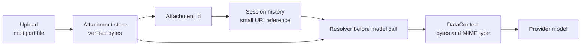

Tracon treats binary input as a stored attachment, not as JSON inside a message.
The run carries an attachment id. The model receives the verified bytes only when the
provider call is made.

## Mental model: bytes out of history



This shape keeps session payloads small and makes attachment ownership enforceable.
It also avoids asking a provider to fetch a private URL it cannot reach.

## Upload, then run

Upload with a multipart field named `file`. `sessionId` is optional. When present, it
groups the attachment with that session for listing and lifecycle cleanup.

```bash
curl -sS -X POST \
  "http://localhost:5081/tracon/api/attachments?sessionId=case-4182" \
  -H "Authorization: Bearer $TRACON_TOKEN" \
  -F 'file=@invoice.png'
```

The response is `201 Created` with an `AttachmentDescriptor`. Copy its `id`, then put
that UUID in `attachmentIds`:

```bash
curl -N -X POST \
  http://localhost:5081/tracon/api/agents/invoice-reader/run \
  -H "Authorization: Bearer $TRACON_TOKEN" \
  -H 'Content-Type: application/json' \
  -d '{
    "sessionId": "case-4182",
    "message": "Read this invoice and identify missing fields.",
    "attachmentIds": ["6c825f61-85e1-4e5e-8ed4-247391e2a9bd"]
  }'
```

The run endpoint checks every id before it starts the SSE stream. An unknown id, or an
id owned by another tenant, returns `400` without contacting the model. A request can
contain attachments without text, because one of `message`, `attachmentIds`, or
`approvals` is sufficient.

The console Playground implements the same flow behind its attachment button. It
uploads first, sends the returned ids with the next turn, and fetches protected image
or audio bytes into object URLs for preview.

## What reaches the model

The stored message contains a `UriContent` reference. Immediately before each model
call, `AttachmentResolvingChatClient` loads the tenant-owned bytes and replaces that
reference with `DataContent`. The resolved bytes are not written back into chat
history.

:::caution[Upload support is not model support]
Passing the upload guard means Tracon can store and transport the file. It does
not mean the selected model understands that image, PDF, or audio format. Verify the
exact provider, model, and API surface. A text-only model can ignore the content or
reject the request.
:::

## Default types and limits

One attachment is limited to 20 MiB by default. The default allow list is:

- `image/png`, `image/jpeg`, `image/webp`, and `image/gif`
- `application/pdf`
- UTF-8 `text/plain`
- `audio/*`; the built-in detector recognizes WAV, Ogg, and MP3

The client-provided `Content-Type` and file extension are not trusted. Tracon
derives the type from magic bytes. Plain text is the exception: when the first 1 KiB
is valid UTF-8 and has no NUL or disallowed control byte, it is treated as
`text/plain`.

Empty files, unknown signatures, files above the byte limit, and detected types
outside the allow list return `400`.

Change the limit and narrow the list through options:

```csharp
builder.Services.Configure<TraconOptions>(options =>
{
    options.Attachments.MaxBytes = 8 * 1024 * 1024;
    options.Attachments.AllowedMediaTypes.Clear();
    options.Attachments.AllowedMediaTypes.Add("image/png");
    options.Attachments.AllowedMediaTypes.Add("application/pdf");
});
```

Register this configuration after `AddTracon()` when code values must override
the values read from `Tracon:Attachments`.

## List, download, and delete

```bash
# Descriptors only. Defaults: skip=0, take=50. take is clamped to 1..200.
curl -H "Authorization: Bearer $TRACON_TOKEN" \
  "http://localhost:5081/tracon/api/attachments?sessionId=case-4182"

# Raw bytes with the stored MIME type and a SHA-256 ETag.
curl -OJ -H "Authorization: Bearer $TRACON_TOKEN" \
  "http://localhost:5081/tracon/api/attachments/{attachmentId}"

# Immediate hard delete.
curl -X DELETE -H "Authorization: Bearer $TRACON_TOKEN" \
  "http://localhost:5081/tracon/api/attachments/{attachmentId}"
```

Downloads send `Content-Disposition: attachment` and
`X-Content-Type-Options: nosniff`. A browser must fetch with the authorization header
and create an object URL for preview. A protected download URL cannot be used directly
as an `` or `<audio>` source.

Deletion is not reversible. Stored messages keep their small reference, but the
reference stops resolving. Delete the owning session when the whole conversation is
finished; session deletion removes its attachments too.

## Persistence and production storage

With no SQL package, descriptors and bytes are in memory. SQL packages persist
attachment metadata and content. If the host registers an external
`IAttachmentStorage`, the SQL store keeps metadata while object storage holds the
bytes.

Every delete removes the bytes first and the metadata row second: a single
delete, a session delete, retention, and data subject erasure. If the byte
delete throws, the row stays, because it is the only record of where the bytes
are. A single or session delete then fails, erasure rolls back, and retention
logs a warning and tries the row again on its next run. Two rules follow for
your `IAttachmentStorage.DeleteAsync`:

- **Make it idempotent.** Deleting a location that is already gone must
  succeed. A retry, or two deletes that race, calls it again for bytes that
  are gone.
- **Throw only when the bytes may still exist.** A throw keeps the row, so the
  delete can be repeated later.

Without an `IAttachmentStorage` registered, a delete of a row that points at external
bytes is refused: deleting the row would leave the bytes in your store with nothing
that names them. A single delete, a session delete and an erasure fail with an error that
names no location, and nothing is deleted. A session with one such attachment keeps all
of its attachments until a call can delete them all, and an erasure is refused before it
erases anything, so the subject is not reported erased while their files stay. Rows with
their bytes in the database are deleted as usual. Register the `IAttachmentStorage`
that wrote the bytes and repeat the call.

Attachments are tenant-scoped. Listing, download, use in a run, and deletion all
resolve through the current tenant. A caller cannot use an id to cross that boundary.

Queued runs do not accept attachments. A request with `Prefer: respond-async` and a
non-empty `attachmentIds` list returns `400`. Use the live run endpoint for multimodal
input.

## Audio input and voice are separate

An audio attachment is model input. It is not automatically transcribed.
`Tracon.Voice` is a separate package for speech operations. `UseVoice()` registers
the code-defined `speak`, `transcribe`, and `list_voices` tools. Generated speech is
stored as an attachment.

The default speech output is `mp3_44100_128`. Headerless `pcm_*` and `ulaw_*` outputs
cannot pass attachment magic-byte validation and are rejected. For live WebSocket
conversation, register `UseVoiceConversation()` as well.

## Generate an image as an attachment

Image generation is off by default. Register an image-capable provider, then enable
the capability and choose its image model. The built-in `generate_image` tool is added
to the normal tool registry, so it has the same authorization, timeout, audit, quota,
and run-recording behavior as every other server-side tool.

```csharp title="Program.cs"
var tracon = builder.AddTracon()
    .UseOpenAI(builder.Configuration.GetSection(OpenAIProviderOptions.SectionName))
    .UseOpenAIImages(provider =>
    {
        provider.Model = "gpt-image-1";

        // The one provider setting: the image quality (low, medium, high or auto).
        provider.ProviderSettings["openai.quality"] = JsonSerializer.SerializeToElement("medium");
    })
    .ConfigureImages(images =>
    {
        images.Enabled = true;
        images.MaxImagesPerRequest = 1;
    });
```

With two image providers registered, each keeps its own model and settings, and `images.Provider` names the one the tool
and the operator endpoint draw with.

Add `generate_image` to the agent's `ToolNames`. It accepts `prompt`, optional
`count`, and optional `size` such as `1024x1024`. Its result contains attachment ids
only. It never returns image bytes or base64 to the model. The saved attachment uses
the current tenant and the run's session id, so it appears in the existing transcript
and attachment UI.

Generated `DataContent` is written directly. A provider `UriContent` result is
downloaded immediately through Tracon's outbound-network guard, then stored as
bytes; an expired provider URL does not break later downloads. Hosted-file references
are rejected because an attachment store has no durable provider-file reference field.
If a multi-image response fails after an earlier image is saved, Tracon attempts
to delete the earlier attachments. That cleanup is best effort: a storage delete
failure is logged, the original generation failure is returned, and an operator can
remove any remaining attachment through the normal attachment API.

Code of your own that draws without an agent uses `IImageGenerationService`, which applies the same checks and records
what the call spent on a [step run](/guides/step-runs/).

The optional operator endpoint uses the same path outside a run:

```bash
curl -sS -X POST http://localhost:5081/tracon/api/images/generate \
  -H "Authorization: Bearer $TRACON_TOKEN" \
  -H 'Content-Type: application/json' \
  -d '{"prompt":"A teal lighthouse at dawn","sessionId":"case-4182"}'
```

It is mapped only when images are enabled. `provider` and `model` in the body choose what draws for one request;
without them the default provider and its model draw, and an unregistered provider returns `400`. The response has
attachment descriptors and the observed image usage. It does not create a `tool_invocations` row because it
is not part of a run.

Both paths apply the tenant's provider checks before the prompt leaves the process.
If the tenant has an egress policy that does not name the image provider
(`Images:Provider`), the endpoint returns `403` and the tool call fails. If the
tenant has its own key for the image provider, generation is refused in the same
way: the provider package builds the generator with the setup key and cannot use
the tenant's, so Tracon does not generate the tenant's images on the host's account.
When the provider names a configuration key for its key and address, the image generator
sends the pair that is current when it generates; see
[change the provider key without a restart](/guides/model-providers/#change-the-provider-key-without-a-restart).

### Change the quality of one call

The settings you register with `UseOpenAIImages` apply to every call. Code that calls `IImageGenerationService` can lay
its own over them for one call, in `TraconImageRequest.ProviderSettings`:

```csharp
var result = await images.GenerateAsync(
    new TraconImageRequest
    {
        Prompt = "A lighthouse at dawn",
        ProviderSettings = { ["openai.quality"] = JsonSerializer.SerializeToElement("high") },
    },
    cancellationToken);
```

The call's value wins for that call. The next call starts from the registered value again, and the registered settings
are never changed. A key the provider does not support, a key of another provider, and a value that is not text throw a
`TraconException` before anything is sent; the message names the key and never the value.

The `generate_image` tool and `POST /api/images/generate` take no such setting. The quality changes what a call costs,
so a model or a client does not choose it: it is set in code.

### Send a failed image call fewer times

An image call is billed. The OpenAI client sends a call again on `429`, `500` and `503`, so with its default of three
retries one failing call reaches the server four times. That count is shared with chat, and a count that suits chat can
be too high for a call that is priced per image. `Tracon:Images:Providers:{name}:MaxRetries` lowers the count for image
calls alone, from `0` (send once) to `10`:

```json
{
  "Tracon": {
    "Images": {
      "Providers": { "openai": { "MaxRetries": 0 } }
    }
  }
}
```

It is a ceiling: a value above the client's own count changes nothing, and chat calls on the same client keep the
client's count. The OpenAI and Azure OpenAI image providers take it, and so does the matching `MaxRetries` property of
`TraconImageProviderOptions` in code. Azure OpenAI has no retry option of its own, so this is the one way to ask its
client for fewer than three. Google has no retry setting to lower: a value on `google` stops the host at start instead of
being ignored.

## Troubleshooting

**Upload returns “type rejected.”** Changing the multipart `Content-Type` does not
help. Check the actual file bytes and the configured allow list.

**Upload returns “too large.”** Raise `TraconOptions.Attachments.MaxBytes` only
after reviewing proxy limits, memory pressure, database growth, and provider limits.
The smallest limit in the request path wins.

**Run returns “attachment not found.”** The id must exist in the current tenant. Also
check whether the attachment or owning session was deleted.

**The model ignores the attachment.** Confirm that the exact provider/model surface
supports the detected MIME type. Upload validation covers transport safety, not model
capability.

**Image generation returns `403`.** The tenant's egress policy does not allow the
image provider, or the tenant has its own key for it. Add the provider to the
policy, or remove the tenant's binding for it.

**A queued run returns `400`.** Attachments are not supported with
`Prefer: respond-async`. Use the live SSE run endpoint.

**A browser preview shows `401` or a broken image.** Fetch the download with the bearer
header, turn the response into a `Blob`, and use an object URL.

**An old conversation can no longer replay.** A referenced attachment was hard
deleted. Keep it for at least as long as any session or replay path that needs it.

## In the reference

- [Attachment HTTP API](/http-api/attachments/)
- [Agent run HTTP API](/http-api/agents/)
- [Voice HTTP API](/http-api/voice/)
- [Image HTTP API](/http-api/images/)
- [`TraconAttachmentOptions` API](/api/tracon.traconattachmentoptions/)
- [`TraconImageOptions` API](/api/tracon.traconimageoptions/)
- [`AgentRunRequest` API](/api/tracon.agentrunrequest/)
- [`UseVoice` API](/api/tracon.voicebuilderextensions/)

## Read next

- [Sessions and conversations](/concepts/sessions/) — retain conversation state and understand session lifetime.
