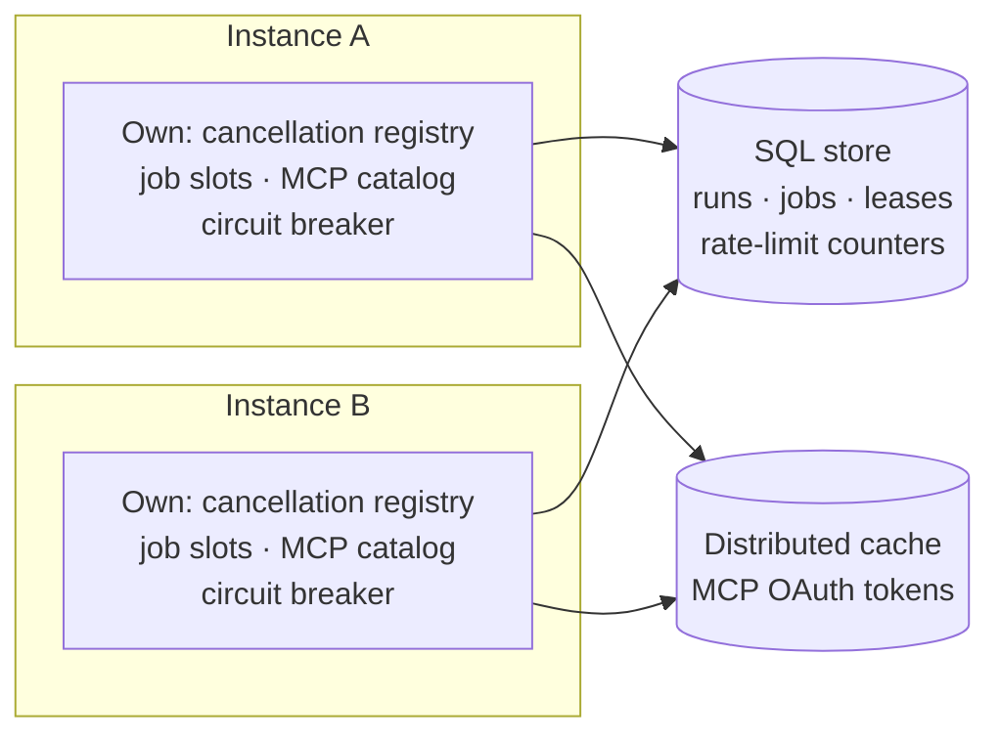

Tracon supports **two instances** that share **one PostgreSQL or SQL Server database**. This page is the support
statement. Each line says whether a behavior is supported, which setting it needs, and how it was shown.

:::caution[A narrow promise, not a service level]
Two instances are tested and measured. Three or more are not measured, so they are not supported. The numbers on this
page describe one machine, one database and one date. They are not an SLA and they are not a guaranteed capacity.
:::

## Declare the shape

Tracon cannot see how many replicas your orchestrator starts. You tell it:

```json
{
  "Tracon": {
    "Deployment": { "Instances": 2 },
    "SingletonExecution": { "Enabled": true },
    "RunReconciliation": { "Enabled": true },
    "RateLimit": { "Enabled": true, "Scope": "Deployment" },
    "Mcp": { "OAuthTokenStore": "DistributedCache" }
  }
}
```

`Tracon:Deployment:Instances` changes nothing at run time. It decides what `RequireProductionProfile()` asks.
The default is `1`. A value below `1` stops the host at start.

With `Instances` above `1`, the profile asks five more decisions. Each one is its own risk, with its own `Accept` line,
like every other decision of the profile. With the default of `1` none of them is asked, so a host that never declared a
second instance starts exactly as before.

| Risk | What the profile checks | What goes wrong when it is permissive |
|---|---|---|
| `InstanceLocalState` | The storage provider is `UsePostgreSql` or `UseSqlServer` | The state lives in one process (memory, or a SQLite file). Each instance sees its own runs, sessions and job queue |
| `UnreconciledRuns` | `Tracon:RunReconciliation:Enabled` is `true` | A cancel that reaches the other instance answers `409`. A run whose instance died stays `Running` |
| `UnelectedBackgroundWork` | `Tracon:SingletonExecution:Enabled` is `true` | Every instance runs the periodic background work at the same time: approval expiry, canary rollback, workflow request expiry, the orphaned-run scan, the model health probe |
| `InstanceLocalRateLimit` | `Tracon:RateLimit:Scope` is `Deployment`. Asked also while `Tracon:RateLimit:Enabled` is off, because the inbound trigger limit is always on | Each instance counts in its own memory. Two instances admit the limit twice |
| `InstanceLocalMcpTokens` | `Tracon:Mcp:OAuthTokenStore` is `DistributedCache` on a cache that every instance shares. Asked only when `UseMcp()` is on the chain | An authorization that one instance started cannot finish on the other, and a token that one instance obtained is not used by the other |

Tracon cannot tell at start whether an MCP server uses OAuth: the servers are rows in the store. If none of yours does,
accept the last risk by name.

```csharp
builder.AddTracon()
       .UsePostgreSql(builder.Configuration.GetConnectionString("Tracon")!)
       .RequireProductionProfile(profile => profile
           .Accept(TraconProductionRisk.InstanceLocalMcpTokens));
```

The profile checks that the settings are on. It does not check that your instances really share one database: it
reads the declaration and the composition, not the network. See
[Production deployment](/guides/production/#start-from-a-production-registration).

## What is supported



| Class | Behavior |
|---|---|
| Supported, needs a setting | A SQL store on PostgreSQL or SQL Server · `SingletonExecution:Enabled` · `RunReconciliation:Enabled` (cancel across instances, orphaned runs) · `RateLimit:Scope = Deployment` · `Mcp:OAuthTokenStore = DistributedCache` with content protection on and a cache that every instance shares |
| Supported, needs no setting | The job queue and its leases · approvals · idempotency keys · quotas · webhooks · the run event stream (the stream reads the database, so any instance serves it) · MCP Tasks · the compiled agent cache (it is keyed by the definition's content) · the model health cache (a request fills it) |
| Per instance, on purpose | `Scheduling:MaxConcurrentJobs` · the workflow `MaxConcurrentRuns` · `ModelConcurrency` limits · the circuit breaker · the live voice session limit (a WebSocket stays on the instance that accepted it) · the rate limit with `Scope = Instance` |
| Not supported | SQLite with more than one process · the in-memory stores · more than two instances · a live voice session that moves to another instance |

"Per instance" means the number applies to each instance. With two instances, `MaxConcurrentJobs: 8` allows 16 jobs
at once. Size the total against your provider limits and your database.

## What the acceptance set shows

Two hosts run in one test, on one database in a container. Each host has its own DI container, its own
cancellation registry, its own job worker, its own MCP catalog and its own pending OAuth flows. The same scenarios run
on PostgreSQL and on SQL Server on every build.

| Behavior | What the test shows |
|---|---|
| Cancel across instances | A cancel that lands on one instance stops a direct run and a queued run that the other instance executes |
| A shared rate limit | With `Scope = Deployment`, two instances admit the limit once. This holds for the API, for each tenant, and for the inbound trigger |
| OAuth across instances | The provider's redirect completes the flow on the instance that did not start it. A token that one instance obtained serves a tool call on the other. Two instances that refresh together call the token endpoint once. A token belongs to the tenant that authorized it |
| MCP tools | Both instances list the tools of an MCP server while `SingletonExecution` is on |
| Job lease takeover | When a worker process is killed, its job is not taken before the lease expires, it is taken after, and the two workers never run it at the same time. Separate operating-system processes, killed with `SIGKILL` |
| Workflow concurrency | `MaxConcurrentRunsPerTenant` holds in the queue across both instances: a tenant at its ceiling holds one slot, and another tenant still runs |

Four of them were also shown to fail when their setting is off: the rate-limit scope, the tenant ceiling in the queue, run reconciliation and the OAuth token store. A test that cannot fail proves nothing. The other behaviors have no setting to switch off, so they were not tried that way.

## Cancel, rate limits and MCP across instances

A cancel request reaches the run whichever instance receives it. A queued run is
cancelled through the shared job store: the worker that executes it stops the handler
within its `Scheduling.PollInterval` (10 seconds by default). A run that another
instance executes directly needs `Tracon:RunReconciliation:Enabled`. The receiving
instance writes the request onto the run's row (`cancelRequestedAt` in
`GET /api/runs/{id}`), the owner reads it on its next heartbeat, and the run ends within
one `RunReconciliation:HeartbeatInterval` (30 seconds by default) plus the time it takes
to notice its token. Without reconciliation nobody would read the request, so the call
returns `409` instead of a `202` it cannot keep. If the owner stopped before it read the
request, reconciliation closes the row as `Failed` (`orphaned`), not `Canceled`, and does
not continue the run. No sticky routing and no custom `IRunCancellationRegistry` is
needed for this.

Rate limits are per process by default for the same reason. The endpoint limiter
(`Tracon:RateLimit`) and the inbound trigger limiter both count in the memory
of one instance. Two instances with a `PermitLimit` of 100 admit 200 requests per
window between them, and a `Tenant` partition splits each instance's own window
rather than a window shared across the deployment. There are three ways to hold a
limit for the deployment as a whole:

- **Count it in the database.** Set `Tracon:RateLimit:Scope` to `Deployment`. Both
  limiters then count in the `rate_limit_counters` table, so the limit and its `Tenant`
  partition hold across all instances. It costs one database write for each counted
  request (see [the cost](#what-the-deployment-scope-costs)), it needs `QueueLimit` to
  be `0`, and when the database cannot be reached an instance falls back to its own
  limit for the requests that fail. See
  [Quotas and rate limits](/concepts/governance/#quotas-and-rate-limits).
- **Count it in the ingress.** A gateway in front of the instances shares one counter
  at no database cost, but it does not know the tenant: Tracon resolves the tenant from
  the API key or the claim, behind the gateway.
- **Use a quota.** A ceiling on total consumption is a quota: quotas count in the
  database, so the instance count does not change them.

### Rate limits across instances

`Tracon:RateLimit:Scope` chooses where the counter lives, for both rate limiters (the endpoint groups and the inbound
trigger accept endpoint):

| `Scope` | Counter | With two instances | Cost |
|---|---|---|---|
| `Instance` (default) | The memory of each process | Each instance admits the limit: a `PermitLimit` of 100 admits 200 between two | None |
| `Deployment` | The database (`rate_limit_counters`), through `IRateLimitCounterStore` | The limit, and its `Tenant` partition, hold across both | One database write per counted request |

A rejected request counts too, which a fixed window accepts. These rules apply to `Scope = Deployment`:

- It needs a counter store that every instance can reach. Each SQL provider (`UsePostgreSql`, `UseSqlServer`,
  `UseSqlite`) registers one. Without a provider the counter stays in the memory of the process, the limit applies per
  instance, and the application logs a warning at startup. To count somewhere else (Redis, for example), implement
  `IRateLimitCounterStore` and register it; see
  [Write your own store](/guides/write-your-own-store/#count-rate-limits-somewhere-else).
- The windows are cut from the Unix epoch, so every instance closes a window at the same moment, within the drift between
  their clocks. A request counted by an instance whose clock is behind lands in the window the database already holds,
  never in an earlier one. A request cancelled after it was counted stays counted.
- Keep the instances' clocks synchronised (NTP). The stored window never moves back, so an instance whose clock jumps
  far ahead moves the window forward for everyone, and the counter does not restart until real time catches up. With a
  one-minute window and a ten-minute jump, a partition is spent for ten minutes. The application logs a warning, at most
  once a minute for each partition, when the stored window is more than one window ahead of the instance's own.
- `QueueLimit` must be `0`: a database counter has no waiting line, so a request over the limit gets `429` at once. A larger
  value together with `Deployment` stops the application at startup.
- The management API and the AG-UI endpoint each keep a counter of their own with either scope: an AG-UI request does not
  spend the management API's window. The console polls the API like any other client and spends the window too.
- If the counter store fails, the instance applies its own in-memory limit for that request and carries on. The limit is never
  lifted and no request is refused only because the database is down. The failure is logged once a minute for each partition and
  counted on `tracon.rate_limit.store_failures`; while it is above zero, the limit holds per instance, not for the deployment.

### What the deployment scope costs

`Scope = Deployment` adds one `INSERT … ON CONFLICT DO UPDATE` (SQL Server: an `UPDATE`
followed by an `INSERT` when the row is new) to every counted request. All requests of one
partition write the same row, so they take turns on it. A `Global` partition is therefore
the worst case: one row for every caller. Prefer the `Tenant` partition on a busy
deployment; its rows are spread by tenant.

The numbers below are a one-off measurement, not a gate. They show the cost of the statement and the row lock, not of a network: the
database ran in a container on the same machine as the two instances.

| Measured 2026-10-29 | PostgreSQL 18 | SQL Server 2022 |
|---|---:|---:|
| Counter call, one caller (`p50` / `p95`) | 0.29 / 0.38 ms | 2.4 / 4.8 ms |
| `Tenant` partition, 16 callers (`p50` / `p95`) | 0.94 / 2.1 ms | 6.4 / 10.2 ms |
| `Global` partition, 16 callers (`p50` / `p95`) | 0.95 / 2.0 ms | 25.4 / 34.2 ms |
| `Global` partition, 64 callers (`p50` / `p95`) | 3.1 / 15.6 ms | 97.3 / 113.6 ms |
| `Global` partition, highest rate seen | about 14,500 calls/s | about 640 calls/s |
| `Tenant` partition, highest rate seen | about 24,000 calls/s | about 2,700 calls/s |

Read them as an order of magnitude, not as capacity. One Apple silicon laptop ran two
connection pools and the database in a Docker container; the PostgreSQL image is native
(arm64) and the SQL Server 2022 image is amd64, so it ran under emulation and its
absolute numbers are lower than a native server's. The ratio is what
carries over: on both engines a `Tenant` partition spreads the load, and a `Global`
partition queues every request on one row. On SQL Server the queue is steep, since the
`UPDATE … WITH (UPDLOCK, SERIALIZABLE)` and the `INSERT` of a new row hold their locks
until the transaction ends. Use a `Tenant` partition there. In every run the
total admitted under a limit of 500 was exactly 500 (40,000 attempts from 32 callers
through two pools), and SQL Server reported no deadlock.

The requests that the limiter does not count (a disabled limit, or `Scope` left at
`Instance`) cost no database call at all.

### MCP tools and OAuth across instances

Every instance discovers its own MCP tools, also with singleton execution on, and an MCP server that uses OAuth
needs its token where every instance can read it: set `Tracon:Mcp:OAuthTokenStore` to `DistributedCache`. See
[MCP tools and OAuth across instances](/guides/mcp-across-instances/).

## What two instances cost

One machine measured one host and two hosts on the same database at a constant 16 requests in flight (2026-10-29,
commit `647aa02e`, three repeats of 60 seconds):

| Path | One host | Two hosts |
|---|---|---|
| Buffered (the run is inside the request): throughput, p50 | 14.9 runs/s, 1053 ms | 14.8 runs/s, 1057 ms |
| Queued: throughput, p50 | 6.98 runs/s, 2109 ms | 11.8 runs/s, 1320 ms |
| Queued: queue wait p95 | 1.13-1.14 s | 0.10 s |

A second host does not slow a request that runs inside the request, and it is not free: the two hosts together used more processor
time than one host did over the same window, on both paths (the kept report lists it, and does not say where the extra time went). The queued path waited less, and the likely reason is that
`Scheduling:MaxConcurrentJobs` is per instance, so 16 slots served 16 runs; no control cell was measured to prove the cause. The
hosts ran with the shipped defaults, so reconciliation, single-executor election and the rate-limit counter writes of a declared
two-instance deployment are not in these numbers. Every cell reconciled with the store: no missing run, no gap in an event
stream, nothing under the wrong tenant. The full table, the
conditions and the caveats are in [Adding a second HTTP host](/guides/production/#adding-a-second-http-host).

**This is not an SLA.** It is one machine, one database and one clock. Network partition, clock skew, inter-machine
latency and more than two hosts were not measured.

## What you still own

- **Clocks.** The deployment rate-limit windows are cut from the Unix epoch. Keep the clocks of your instances
  synchronised with NTP. The stored window never moves back, so an instance whose clock jumps ahead holds a partition
  closed for as long as the jump lasts.
- **A shared cache for OAuth.** `DistributedCache` needs an `IDistributedCache` that every instance reaches, for example
  Redis. `AddDistributedMemoryCache` lives in one process; the application starts with a warning, and the production
  profile refuses it when you declare more than one instance.
- **The callback address.** `Tracon:Mcp:OAuthCallbackBaseUri` ends with `/`. See
  [MCP tools and OAuth across instances](/guides/mcp-across-instances/).
- **A third instance.** It may work. Nobody measured it, so Tracon does not say it is supported.

## Read next

- [Production deployment](/guides/production/): the process topology, the measured capacity and the measured failures.
- [MCP tools and OAuth across instances](/guides/mcp-across-instances/).
- [Compatibility](/reference/compatibility/): the production profile as a versioned set.
