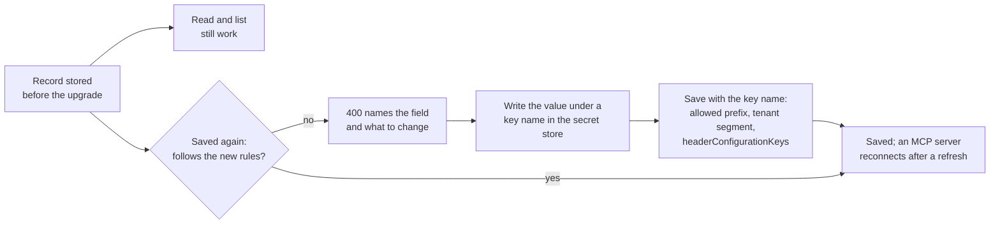

Some releases tighten a boundary that a running deployment relied on. Each section
below says what is now refused, how the refusal reads, and what to change. Read it
before you upgrade an installation that was set up on an earlier preview.



## Outbound targets and configuration keys

Three boundaries tightened, and all three can refuse something a running setup
accepted before. Reading is unaffected in each case; only writing, connecting, and
long-running calls change.

**Private network targets are refused on all three outbound surfaces.** Webhook
delivery already behaved this way; MCP server connections and per-tenant provider
endpoints now do too. If your MCP servers run inside the internal network, this is a
one-line change:

```json
{
  "Tracon": {
    "Egress": {
      "AllowPrivateNetworkTargets": true
    }
  }
}
```

The rejection message names that setting, so an operator who hits it can act without
reading this page. `Tracon:Webhooks:AllowPrivateNetworkTargets` still works and
still applies to webhook delivery only; either setting being on is enough for a
webhook target.

**The agent-graph token budget now actually cuts a run off.** The default
(`AgentGraph.MaxTotalTokens`, 200,000) always existed, but earlier releases only
checked it before starting a *new* child run — a single agent's own tool loop could
run past it freely. It is now enforced between model turns for every run, so a tree
whose tool loop genuinely needs more than 200,000 tokens now ends `Failed` with
`error_class: QuotaExceeded` where it previously would have finished. Raise the
setting, or set it to `0` to remove the limit:

```json
{
  "Tracon": {
    "AgentGraph": {
      "MaxTotalTokens": 500000
    }
  }
}
```

**Configuration key names must sit under an allowed prefix.** MCP server definitions
and webhook subscriptions join inbound triggers and provider bindings in this rule. A
record whose key name sits outside its prefix can still be **read** and listed, but
saving it again is refused with a message naming both the field and the prefix.

| Record | Field | Required prefix |
|---|---|---|
| MCP server | `headerConfigurationKeys`, `oauthClientSecretConfigurationKey` | `Tracon:McpSecrets:` |
| Webhook subscription | `headerConfigurationKeys`, `secretConfigurationKey` | `Tracon:WebhookSecrets:` |

Fix each record by moving the key name under the prefix and re-writing the value under
the new name in your secret store. There is no migration helper and this is
deliberate: it is one field per record, and what moves is a **name**, not a secret
value. Alternatively, widen the prefix through
`Tracon:Mcp:AllowedConfigurationPrefix` or
`Tracon:Webhooks:AllowedConfigurationPrefix` — but a prefix broad enough to cover
an arbitrary key removes the boundary it exists to provide.

## Tenant key space and anonymous access

Three more boundaries tightened. Each one refuses something a running setup accepted
before, and each refusal names what to change.

**A secret's key name must sit inside its record's tenant.** The prefix is one per
installation, so a record of one tenant could name another tenant's key. Now a
non-default tenant names keys under `{prefix}{tenant}:` — for tenant `acme`,
`Tracon:ProviderKeys:acme:OpenAI` or `Tracon:McpSecrets:acme:GithubToken`. A flat name
directly under the prefix belongs to the default tenant, so a single-tenant
installation changes nothing. The rule covers MCP servers, provider bindings, webhook
subscriptions, and inbound triggers. A record that breaks it can still be read, but
saving it again returns `400`, and its value no longer resolves: the MCP server does
not authenticate, the provider call fails, the webhook delivery is dropped, and the
trigger refuses the signature. Move the value under the tenant's segment in your secret
store and save the record with the new name.

**Another tenant's settings require platform authority.** The provider binding, egress
policy, and tenant record endpoints act on the tenant named in the request. A caller
now reaches another tenant only with an API key that also carries `PlatformAdmin`, the
static `AuthToken`, or — for a claims principal while multi-tenancy is on — the
`TraconPolicies.PlatformAdmin` policy. Register that policy for your operators before
you upgrade; without it, their requests for other tenants return `403`.

**Anonymous access is a same-machine convenience only.** With `AllowRemoteAccess` on
and neither `AuthToken` nor an authorization policy configured, an anonymous remote
request now returns `401`; API keys keep working. A request that a local reverse proxy
forwarded counts as remote. An anonymous request with a non-loopback `Host` or `Origin`
returns `403`, which blocks DNS rebinding and cross-site requests from a browser. If
you reach a keyless local installation through a machine name, use `localhost` or
configure a token.

## Credential headers

A credential header of an MCP server or a webhook subscription now lives in
`headerConfigurationKeys`, as the **name** of the configuration key its value is read
from. Four saves that used to succeed now return `400`, and one field is removed.

**A credential-looking plain header is refused.** A save whose `headers` carry
`Authorization`, `Cookie`, a name containing `api-key`, `token`, `password` or
`secret`, or a name ending in `-key` returns `400`; the detail names the header and
`headerConfigurationKeys`, never the value. Only the headers a request sends are
judged: a stored row keeps working, is still sent, and each connection or delivery
logs a warning with the header name.

**A header name may appear only once.** `X-A` next to `x-a`, or the same name in
`headers` and `headerConfigurationKeys`, returns `400`. Before, the webhook save
answered `500` and the MCP server never connected.

**A header name must be a valid HTTP name.** An empty name, a space, `:`, or a line
break returns `400`.

**A webhook's two maps share `MaxExtraHeaders`.** Together they may carry at most
`Tracon:Webhooks:MaxExtraHeaders` entries (20 by default); more returns `400` instead of
being cut at delivery.

**`authorizationConfigurationKey` is removed.** `McpServerDefinition` and `McpServerRequest`
no longer have the member, and no response carries the field. Code that sets it no longer
compiles; use `headerConfigurationKeys["Authorization"]`. The first start on the new
version moves every stored key into that map and drops the column, in one migration
(PostgreSQL, SQL Server and SQLite). A row with OAuth on, or whose map already names
`Authorization` in any letter case, keeps its map: the connection never read the old
key in those two cases, so nothing changes on the wire. Every other connection
reconnects once after the upgrade. **The migration has no way back**: a build from
before it cannot read the table, so back up the database first.

A save whose body still carries `authorizationConfigurationKey`, with any value
including an empty one, returns `400` with the title `Removed field`; the detail names
`headerConfigurationKeys["Authorization"]`. Without this the field would be dropped
silently and the first tool call would fail with `401`. Other unknown fields are still
ignored. Naming `Authorization` in the map while OAuth is on returns `400`. So does
turning OAuth on while the kept plain `headers` still carry `Authorization`: the MCP
client does not send its bearer token while that header is present. Send `headers`
without it in the same save.

**Saves now keep what they leave out.** `headers` or `headerConfigurationKeys` absent or
`null` keeps the stored map; `{}` removes it. Before, a save without `headers` removed
every stored header, which is what the admin forms did on every save.

### Moving a plain credential to a key name

For a record whose plain `headers` hold `X-API-Key` next to `X-Team`:

1. Write the value under a key name in your secret store, inside the tenant's key
   space: `dotnet user-secrets set "Tracon:McpSecrets:acme:SearchKey" "<value>"`
   (the default tenant can use `Tracon:McpSecrets:SearchKey`).
2. Save the record once with **both** maps: `headers` without the credential but with
   every other plain header, and the new map.

```json
{
  "endpoint": "https://mcp.example.com/mcp",
  "headers": { "X-Team": "t1" },
  "headerConfigurationKeys": { "X-API-Key": "Tracon:McpSecrets:acme:SearchKey" }
}
```

Sending only `headerConfigurationKeys` returns `400` with "remove 'X-API-Key' from
headers": `headers` left out keeps the stored map, so the name would appear twice. A
read shows every plain value as `***`, so you have to know the values of the other plain
headers to send them again. `headers: {}` removes them instead. For an MCP server, call
`POST {prefix}/api/mcp-servers/refresh` afterwards to reconnect.

## Read next

- [Production deployment](/guides/production/) — storage, access control, topology, and retention for a production host
- [Versions and upgrades](/reference/versioning/) — how to pin the family and move between releases
- [Governance](/concepts/governance/) — tenants, key names, and the policies these boundaries enforce
