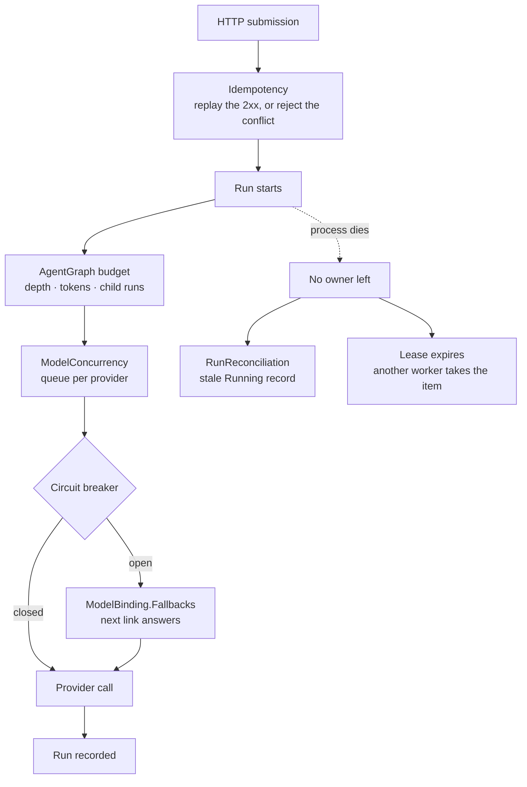

Reliable agent execution is not one retry switch. Provider calls, HTTP submissions,
background leases, live cancellation, and multi-agent trees fail at different
boundaries. Tracon gives each boundary a separate control so recovery stays
explicit.



A useful production baseline is:

```json
{
  "Tracon": {
    "CircuitBreaker": {
      "Enabled": true,
      "FailureThreshold": 5,
      "BreakDuration": "00:00:30"
    },
    "Idempotency": {
      "Enabled": true,
      "MaxKeyLength": 255
    },
    "SingletonExecution": {
      "Enabled": true,
      "LeaseDuration": "00:01:00"
    },
    "RunReconciliation": {
      "Enabled": true,
      "HeartbeatInterval": "00:00:30",
      "OrphanThreshold": "00:05:00",
      "ScanInterval": "00:01:00",
      "MaxRunsPerScan": 100
    },
    "AgentGraph": {
      "MaxDepth": 3,
      "MaxTotalTokens": 200000,
      "MaxTotalRuns": 25
    },
    "ModelConcurrency": {
      "MaxConcurrentCallsPerProvider": null
    }
  }
}
```

Enable the SQL provider before treating singleton election, reconciliation, or
idempotency as cluster-wide. Their in-memory stores coordinate only one process.

## Stop calling an unhealthy provider

The circuit breaker is maintained per provider name and per process. After five
consecutive counted failures by default, it opens for 30 seconds. Calls rejected by
an open circuit do not reach the provider and throw
`TraconProviderUnavailableException`; its `ProviderName` and `RetryAfter` tell an
HTTP or job caller when recovery can be tried.

A successful provider call resets the consecutive failure count. Only a failure that
shows the provider is unhealthy counts: no connection, a timeout, a `5xx`, `408` or
`429` response, or a `401`/`403`, because a rejected key fails every caller in the
same way. Any other permanent `4xx`, for example a `400` or a `404`, rejects the
request and not the provider, so it does not count. On a setup-time key that several
tenants share, one tenant's bad requests therefore cannot open the circuit for the
others. A failure that starts inside Tracon does not count either: caller
cancellation, `TraconContentBlockedException`, an exhausted run budget, a missing
attachment, or a tool failure. The status is read from
`HttpRequestException.StatusCode` or from an `HTTP nnn` exception message, the same
rule the fallback chain uses; a failure whose status cannot be read counts as a
connection failure does. After the break duration, new calls can probe recovery;
a successful probe closes the circuit.

| Setting | Default | Validation |
|---|---:|---|
| `CircuitBreaker.Enabled` | `true` | When false, every call reaches the provider |
| `FailureThreshold` | `5` | Must be at least `1` |
| `BreakDuration` | 30 seconds | Must be positive |

The breaker fails fast. It does not replay a complete direct run, and it does not
roll back tool calls that already succeeded. Decide retry policy at the HTTP client,
job, or business-operation boundary where idempotency is known.

An open circuit still blocks a call even when [response caching](/guides/model-providers/#response-caching)
is on for that agent: the breaker sits outside the whole tool-call loop, a cached
lookup sits inside it, so a would-be cache hit is never reached while the circuit is
open. Once the circuit closes again, the same prompt can still resolve from cache.

## Fall back to a secondary provider

`ModelBinding.Fallbacks` is an ordered list of `{ provider, model }` links tried
after the primary binding, without changing today's behavior when the list is
empty:

```json
{
  "provider": "openai",
  "model": "gpt-5.4-mini",
  "fallbacks": [
    { "provider": "anthropic", "model": "claude-opus-5" },
    { "provider": "google", "model": "gemini-3.6-flash" }
  ]
}
```

A fallback link names only a provider and a model. The fallback call gets the
same request options as the primary call — `temperature`, `topP`,
`maxOutputTokens`, `responseFormat` and the tools — with only the model name
replaced, so a structured-output agent keeps its schema on the fallback model.
The primary binding's `providerSettings` do not carry over: they configure the
primary provider's client. If the fallback model needs its own provider settings,
or rejects one of the primary's sampling settings, give it a separate agent.

The chain tries the next link only for a transient failure: the local circuit
already open, a `5xx`/`429` response, or a bare connection error. It never falls
back on an authentication error (`401`/`403`), on any other permanent `4xx` (every
`4xx` except `408` and `429`, for example a `404` for an unknown model name), or on a
canceled request — masking a misconfigured key or a bad request behind a silent
provider switch costs more than the switch saves, and the next provider gets the
same request. A provider's own content/safety filter is not a fallback trigger either;
that decision is made once, after whichever link actually answered.

Registering an `IProviderRetryClassifier` overrides this decision for a
specific SDK exception without replacing the built-in rules above — see
[Write your own error classifier](/guides/write-your-own-error-classifier/).

A fallback switch is never silent. The run record gets a `ModelFallbackUsed`
event naming the primary and fallback bindings, and cost and the `runs.model_id`
column both reflect the model that actually answered — not the primary
binding. `RunStatistics.ByModel` groups by the real model too.

This applies to the agent's own model binding. The context compaction summarizer
and the judge of an `aiJudge` loop criterion call models on bindings of their own,
and those bindings can have fallbacks too. When one of them falls back, the run
keeps the agent's model and gets no `ModelFallbackUsed` event; that call's tokens
are priced at the fallback model that answered, and the switch is logged on the
`Tracon.ModelProvider` category.

If every link in the chain fails, the error surfaces the **first** failure, not
the last one — the root cause across a chain of transient errors is more useful
than whichever link happened to fail last — and its message names every
provider that was tried.

Because the fallback client wraps the whole tool-call loop, switching providers
mid-turn restarts that turn from scratch on the fallback provider — the
conversation state itself is not carried over. A tool call that already
completed on an earlier link is not run a second time, though: every link in
the chain shares one ledger for the turn, so if the fallback model asks the
same question again, it gets the already-computed answer instead of running
the tool's body a second time. This matters for a tool with a real side effect
(charging a payment, sending a webhook, deleting a record) — without it, a
provider outage that happens right after such a tool call would silently run
it twice. A read-only tool call is answered from the ledger the same way; the
rule does not special-case tool effects, only whether the exact same call was
already made in this turn. This only applies to a non-streaming run: a
streaming response can only fall back before its first chunk, at which point
no tool has been called yet.

| Setting | Default | Effect |
|---|---:|---|
| `ModelBinding.Fallbacks` | `[]` | Empty preserves today's behavior: an unavailable primary throws |

## Limit outgoing concurrency per provider

`ModelConcurrency.MaxConcurrentCallsPerProvider` bounds how many calls to one
provider can be in flight at once, across every agent that binds to it. The goal
is to avoid producing the burst of `429` responses that would eventually open
the circuit breaker in the first place. A call over the limit **waits** for a
slot — bounded by its own cancellation token — instead of being rejected; an
immediate rejection would turn a short traffic spike into exactly the failure
this setting exists to prevent.

| Setting | Default | Effect |
|---|---:|---|
| `ModelConcurrency.MaxConcurrentCallsPerProvider` | `null` (unlimited) | `null` matches today's behavior; the hot path allocates nothing extra |

## Make supported HTTP submissions idempotent

Add a unique `Idempotency-Key` to a non-streaming request:

```bash
curl -i https://agents.example.com/tracon/api/agents/support/run \
  -H "Authorization: Bearer $TRACON_API_KEY" \
  -H 'Content-Type: application/json' \
  -H 'Idempotency-Key: support-ticket-4182-v1' \
  -d '{"message":"Prepare the customer-safe status for ticket 4182."}'
```

The management run endpoint normally streams SSE. Supplying an idempotency key makes
this endpoint return one buffered JSON response so it can be stored and replayed. A
later request with the same tenant, key, method, path, and exact request body receives
the saved response and `Idempotency-Replayed: true`.

Idempotency is attached only to these routes:

- `POST /api/agents/{name}/run`
- `POST /v1/responses`
- `POST /v1/chat/completions`
- `POST /api/workflows/{name}/run`, `POST /api/workflows/runs/{runId}/resume` and
  `POST /api/workflows/runs/{runId}/respond` — only together with
  `Prefer: respond-async`, because their synchronous answer is a stream; a key
  without the preference is refused with `400`, and the queued `202` is what a repeat
  gets back

It does not apply globally to management writes. A request without the header avoids
body buffering and the idempotency-store query.

### Exact outcomes

| Condition | Result |
|---|---|
| First request reserves the key | The endpoint executes |
| Same completed 2xx request | Stored status, body, content type, `Location`, and `Preference-Applied` are replayed |
| Same key is still in progress | `409 Conflict` |
| Same key, different path or raw body | `422 Unprocessable Entity` |
| Key longer than 255 characters by default | `400 Bad Request` |
| Key on a request whose body sets `stream:true` | `400 Bad Request` |
| Key on a workflow run, resume or respond request without `Prefer: respond-async` | `400 Bad Request`; nothing is reserved or run |
| Idempotency is disabled but the header is present | `501 Not Implemented`; the endpoint does not execute |
| Endpoint returns non-2xx or throws | Reservation is released; a retry can execute |

The fingerprint contains the HTTP method, path, and raw body. Semantically equivalent
JSON with different whitespace or property order is a different request. Generate the
key at the business operation boundary and reuse both the serialized bytes and key on
transport retry.

In a crash after reservation but before completion, an `InProgress` record can remain.
SQL makes that record visible to every node but does not infer whether the side effect
finished. Set a retention policy for idempotency keys and build an operator path for
the rare uncertain result. Configuration retention is off by default; its enabled
fallback for idempotency records is one day.

## Cancel with the right delivery guarantee

Request cancellation with:

```bash
curl -i -X POST \
  -H "Authorization: Bearer $TRACON_API_KEY" \
  https://agents.example.com/tracon/api/runs/$RUN_ID/cancel
```

For a registered live run, Tracon returns `202 Accepted`. This confirms that the
request reached the owner, not that execution already stopped. Poll the run until it
reaches a terminal status. Providers and tools must observe and pass on the
cancellation token.

The live cancellation registry is in-process by default. A request routed to another
instance, or sent after the owner restarts, returns `409`. Unknown and cross-tenant
runs return `404`; terminal runs return `409`. A `Queued` run that no process has
picked up is canceled through the shared job store and can work across processes. A
workflow run that waits for a concurrency slot in this process is canceled like a
running one.

Canceling a root run propagates to its child runs. Canceling one child does not cancel
the root or its siblings.

## Reconcile runs left behind by a crash

With run reconciliation enabled, active runs write a bulk heartbeat every 30 seconds
by default. A periodic scan closes `Running` records that have not signaled for five
minutes. The reconciler changes them to `Failed`, records the infrastructure error
type `orphaned`, and appends a `RunFailed` event.

Only `Running` records are reconciled, and the `Queued` records that wrote a heartbeat.
A workflow run that waits inside its process for a concurrency slot is `Queued` and
writes a heartbeat from the moment its record opens, so when that process dies the
waiting record closes as `orphaned` too instead of staying `Queued` for good. Any other
`Queued` work belongs to the job queue and its leases: a record with no heartbeat is
never closed by the scan, however old it is. Heartbeat-write failures are logged, and the
next interval tries again.

| Setting | Default | Validation or effect |
|---|---:|---|
| `RunReconciliation.Enabled` | `false` | No heartbeats or scan until enabled |
| `HeartbeatInterval` | 30 seconds | 1 ms to about 49.7 days |
| `OrphanThreshold` | 5 minutes | Must be positive and at least the heartbeat interval |
| `ScanInterval` | 1 minute | 1 ms to about 49.7 days |
| `MaxRunsPerScan` | `100` | Must be positive; bounds one pass |

Choose `OrphanThreshold` above the longest expected database pause, runtime stop-the-
world event, or deployment handoff. A threshold that is too short can close a run
whose process is still working.

## Continue an interrupted run automatically

`RunContinuation` builds on reconciliation: right after an orphaned `Running` record
closes, a session-bound run can be picked up again — in the same session, as a new
run — instead of staying `Failed` for good.

```json
{
  "Tracon": {
    "RunContinuation": {
      "Enabled": true,
      "MaxAttempts": 1
    }
  }
}
```

The continuation re-sends the interrupted turn's original input into the same
session and lets the model run its turn again from the start. Every tool call the
interrupted run already completed is answered from its own recorded result instead
of running again; only a call past the interruption point — one with no recorded
result, because it never happened — actually runs. A tool the interrupted run called
with different arguments each time can still repeat, because matching is by the
exact recorded arguments.

A tool whose effect is destructive or leaves the process (a database delete, a
payment, a webhook) blocks continuation by default; the interrupted run stays
`Failed` and its event stream records why. A tool author who can prove a call is
safe to repeat — typically because it carries its own idempotency key — opts that
one tool back in when registering it. A run with no session, or one whose chain has
already reached `MaxAttempts`, is never continued.

Only an agent turn at the root of its run tree is continued. A workflow run is resumed
from its checkpoints instead: it stays `Failed`, and its event stream records a
`RunContinuationBlocked` event that names `POST /api/workflows/runs/{runId}/resume`
(see [Checkpoints](/concepts/workflows/#checkpoints)). A workflow run that a job
started is resumed by that job when `Tracon:Workflows:ResumeInterruptedRuns` is on —
see the next section — and never by reconciliation, so one run has one owner. A sub-run — a workflow step or a
callable agent's run — is not continued on its own either. It carries its root's
session and nothing waits for its answer, so it stays `Failed` with the same kind of
event, and the run at the root of its tree is the one that is continued or resumed.

The new run's record links back to the interrupted one, so an operator reading the
run tree can see that a run continued another rather than starting fresh.

An agent that declares [parameters](/concepts/agents/#parameters) continues with the
values the interrupted run recorded. A run that recorded none — input recording was
off, or it predates parameter recording — stays `Failed` rather than continue on the
defaults, and the event stream says why.

| Setting | Default | Effect |
|---|---:|---|
| `RunContinuation.Enabled` | `false` | No continuation is attempted until `RunReconciliation` is also enabled |
| `MaxAttempts` | `1` | The most continuations one interruption chain may have before it stays `Failed` |

## Resume an interrupted workflow run

A queued workflow run and a workflow batch item have an owner that survives the
process: their job. Turn on `ResumeInterruptedRuns` and the job continues a run that a
crash, a deploy or a graceful stop interrupted, from the latest checkpoint in its
chain, when the job is leased again:

```json
{
  "Tracon": {
    "Workflows": {
      "ResumeInterruptedRuns": true,
      "MaxResumeAttempts": 1
    }
  }
}
```

The interrupted run is closed as `Failed` with the error type `interrupted` (if
reconciliation has not closed it already), and a new run in the same session
continues it; its `continuedFromRunId` names the interrupted run. A run that had
finished, or that waits for a human answer, is not run again. Past
`MaxResumeAttempts` continuations the item, or the queued run's job, fails. The job's
last attempt never starts a continuation, because nothing would close it if it were
interrupted too: it closes the chain instead.

The step that was running when the process stopped runs again: steps finished before
the stop are covered by their checkpoint, the step in progress is not. Make a
function step with side effects idempotent, and expect an agent step to repeat its
model and tool calls. A run bound to an HTTP connection is never resumed
automatically. The details, and how a run without any checkpoint is handled, are in
[Resume an interrupted run automatically](/concepts/workflows/#resume-an-interrupted-run-automatically).

| Setting | Default | Effect |
|---|---:|---|
| `Workflows.ResumeInterruptedRuns` | `false` | An interrupted batch item starts again from the beginning. A queued run's job gets `AsyncRun.MaxAttempts` attempts (default `1`): after an interruption the worker fails it with `tracon.job.attempts-exhausted`, and the run stays `Running` until run reconciliation closes it |
| `Workflows.MaxResumeAttempts` | `1` | The most continuations one chain may have, from `0` to `100`. A queued run's job gets two more attempts than this; a batch job needs as many to get every continuation |

`ResumeInterruptedRuns` needs `Workflows.EnableCheckpointing`; turning it on without
checkpoints fails at startup.

## Elect one owner for periodic services

`SingletonExecution.Enabled` adds lease-based cluster election to Tracon's
periodic model-health refresh, MCP discovery, run reconciliation, approval expiry,
and canary evaluation. It is off by default and uses a 60-second lease. Renewal runs
at one third of the lease duration. An empty `OwnerId` becomes a
machine/process/unique-suffix identifier.

Lease acquisition or renewal errors are logged. The process stops treating itself as
the owner until it acquires a valid lease again. This is coordination, not a guarantee
that an external side effect happens exactly once.

The background job queue does not use this option. It already owns independent job
leases, so turning on singleton execution does not reduce job-worker concurrency.

## Bound multi-agent trees

Every root run creates a budget shared by its child-agent tree:

| Limit | Default | Meaning |
|---|---:|---|
| `AgentGraph.MaxDepth` | `3` | Root is depth zero; negative values clamp to zero |
| `AgentGraph.MaxTotalTokens` | `200,000` | Zero or negative removes the token limit |
| `AgentGraph.MaxTotalCost` | none | Zero, negative, or unset removes the cost limit |
| `AgentGraph.MaxTotalRuns` | `25` | Counts child runs only; zero or negative removes the count limit |
| `AgentGraph.MaxDuration` | none | Zero, negative, or unset removes the wall-clock limit |

`MaxDepth` and `MaxTotalRuns` only stop a *new* child run from starting — a run
already in progress finishes even if the tree is over either limit.
`MaxTotalTokens`, `MaxTotalCost`, and `MaxDuration` are enforced differently:
the check runs between two model turns, inside the tool-call loop, so a tree
that has already spent past its limit is cut off before its *next* model
call — mid-run, not only at the next child call. A workflow function node is checked
when it would start (each attempt of a retried node too): `MaxTotalCost` and `MaxDuration`
keep it from starting, and `MaxTotalTokens` does not. A tool call is checked when it would
start as well, and all three limits keep it from starting (see [A spent budget stops a tool
call from starting](#a-spent-budget-stops-a-tool-call-from-starting)). The run ends `Failed` with
`error_class: QuotaExceeded` and a message naming which limit was hit and
which setting raises it. A cost limit falls back to the token limit for a
model whose price is undefined (`PricingSource.Unknown`) — the cost cannot be
measured, so it cannot be enforced.

`MaxTotalCost` counts more than model tokens. What a workflow function node or a tool
[reported beyond tokens](/concepts/workflow-function-nodes/#report-what-a-node-spent-beyond-tokens)
is recorded into the budget the moment it is reported, so a tree whose speech and renders
have already spent the ceiling is refused at its next model call, the same as one that
spent it on tokens. Only an amount that adds counts: an item with no amount, or in a
currency other than `Tracon:Pricing:Currency`, is unknown to the budget. The same ceiling
keeps the next function node from starting; see [Function nodes and the
budget](#function-nodes-and-the-budget).

`MaxDuration` is not a hard timeout: a tool call already running when the
deadline passes is never interrupted, only the *next* tool call and the *next* model call
after it are refused. It applies the same way to a queued (`Prefer: respond-async`) run,
whose lease is otherwise renewed for as long as the run keeps going — before
`MaxDuration`, nothing capped a queued run's wall-clock time.

**For a workflow, the tree is the logical run** (see [the ceiling of a workflow](#the-ceiling-of-a-workflow-is-the-logical-run)).

Because several branches of a tree can be mid-turn at the same time, the check
is not perfectly precise: two concurrent turns can each pass the check before
either records its spend, so a tree can still overshoot its limit by a bounded
amount before the next check on each branch catches it. Use stricter per-run
budgets for externally exposed MCP and A2A agents.

### The ceiling of a workflow is the logical run

A workflow that waits for a person, is resumed by an operator, or is picked up after an interruption is one run to its
owner, but each step of that chain is a run row with a budget of its own. A run that continues an earlier one starts from
what the earlier runs spent (tokens, cost and child runs), so a workflow with an approval loop does not get the whole
ceiling again with every answer.

| The run that continues | Its budget starts from |
|---|---|
| The answer to a request (`POST /api/workflows/runs/{runId}/respond`) | The run that waited, and every run it continues |
| An operator's resume (`POST /api/workflows/runs/{runId}/resume`) | The run it resumes, and every run it continues. The resume run records that run in `continuedFromRunId` |
| A recovery after an interruption | The interrupted run, and the runs before it. What its function nodes reported is read from the run's items, because the process that kept the total is gone |

The time limit counts the time the chain's runs were **executing**. The time a workflow waited for a person does not count:
`MaxDuration` bounds the work, not the answer. A chain that has used all of its time refuses its first function node, and a
resume of a run that failed for its budget is refused at the same node. Raise the setting in `Tracon:AgentGraph` and resume
again; the run goes on from what it spent.

A run that someone else closed after its process died (an interruption the recovery closed) counts to the last thing it
wrote, not to the moment it was closed, so the time the host was down is not charged to the ceiling. A run that did
nothing for a long time before it died is counted short by that time.

The chain is read once, when the run starts. If it cannot be read (the run store does not answer, or the chain is longer than
128 runs), the run does not start with a budget of zero: it ends `Failed` before its first node. Two limits are worth knowing.
The child count is the direct children of each run, so a nested sub-agent call is spent but not counted as a started run. A
model call that was still running when the process stopped is in no row at all.

### Function nodes and the budget

A [workflow function node](/concepts/workflow-function-nodes/#a-spent-budget-stops-a-function-node-from-starting)
is checked when it would start, and again before each retry attempt:

| Limit | Stops a node from starting | Why |
|---|---|---|
| `AgentGraph.MaxTotalCost` | Yes | The unit a paid node spends. What nodes and tools reported beyond tokens counts |
| `AgentGraph.MaxDuration` | Yes | The clock has run out, so no new work begins |
| `AgentGraph.MaxTotalTokens` | No | It is on by default (`200000`) and a function node spends no tokens |
| `AgentGraph.MaxTotalRuns`, `MaxDepth` | No | A function node opens no child run |

A refused node does not run. The run ends `Failed` with error type `run_budget_exceeded` (class
`QuotaExceeded`), the message names the node and the setting to raise, and no later node runs. The
run's events show the node as invoked, then failed. A host that sets neither `MaxTotalCost` nor
`MaxDuration` sees no change.

**The ceiling is not absolute.** The check happens when a node starts. A node that is already running
is never stopped, and Tracon cannot know what a node will spend before it runs, so a tree passes its
ceiling by as much as its last node spends. A background agent run that is still going can spend after
the check, too.

A node that spends nothing and has to run afterwards, such as a step that stores the output the budget
has just paid for, is exempt in its registration. Its own spend still counts. The exemption is code, not
configuration, so an operator cannot loosen a ceiling from a definition:

```csharp
tracon.AddWorkflowFunction<List<ChatMessage>, List<ChatMessage>>(
    "store-audio",
    services => (messages, context, cancellationToken) => StoreAsync(messages, cancellationToken),
    options => options.StartsWhenBudgetIsSpent = true);
```

A refusal is never retried, whatever the registered `IRunErrorClassifier` says about it: cost and time
only grow within a run, so waiting cannot change the answer. When the first attempt spent past
`MaxTotalCost`, the second does not start and the run ends with the refusal.

The tenant's cost quota stands at the same place. A node does not start either once the quota for the
current period is spent, counting what the run has spent that the quota's counter has not seen yet; the
run ends `Failed` with error type `tenant_quota_exceeded` (`TraconTenantQuotaExceededException`, which carries the metric, the
period and the limit), in the same class (`QuotaExceeded`). The remedy
differs: a budget is a setting you raise, and a quota resets when its period ends. The exemption above covers
both. See [A quota also stops work that has not started](/concepts/governance/#a-quota-also-stops-work-that-has-not-started).

A graph built in code with `AddWorkflow` and its own executors is not wrapped, so nothing gates its
executors. Such an executor reads the budget itself: `TraconRunContext.Current?.Budget` has
`IsCostBudgetExhausted` and `IsDurationBudgetExhausted`.

### A spent budget stops a tool call from starting

When one model turn asks for two paid tools and the first passes the ceiling, the second does not run.
Its result would be read only by the next model call, and that call is refused. Running the tool would
only spend money and cause its side effect.

| Limit | Stops a tool call from starting | Why |
|---|---|---|
| `AgentGraph.MaxTotalTokens` | Yes | The next model call is refused for the same reason, so nothing reads the result |
| `AgentGraph.MaxTotalCost` | Yes | The unit a paid tool spends. What a tool reported with `TraconToolUsage.Report` counts the moment it is reported |
| `AgentGraph.MaxDuration` | Yes | The clock has run out, so no new work begins |
| `AgentGraph.MaxTotalRuns`, `MaxDepth` | No | A tool call opens no child run |

A function node is different on the first row: its output goes to the next node, not to a model, so
`MaxTotalTokens` does not stop it.

A refused call does not run. Its result is the limit and the setting to raise, followed by "The tool
call did not start." No model reads that sentence, because the next model call is refused: it goes to
the event stream and to the run record. The call is recorded as failed, with that sentence as its error,
whether the run streams or not: the tool chain writes each call where it happens, so a queued run that
fails at its next model call still lists the calls it made, the refused one included
([a failed run keeps its calls](/concepts/runs/#tool-calls-are-recorded-where-they-happen)).
The run itself ends as it always did: the next model call is refused, and the run is
`Failed` with error type `run_budget_exceeded`. The refusal needs no setting, and a host whose run
never passes a ceiling sees no change. The check happens before the authorization handler, so a spent
run does not ask it. Code tools, workspace tools, MCP tools, the knowledge search and the conversation memory search pass the check in the
tool chain. A skill
script is checked by the script runner when its run would start, with the same condition and the same
sentence in the refusal. The runner also writes the refusal to the audit trail as `script.denied`, the
entry it writes for every other gate: the entry names the skill and the script, and its reason is the
sentence. The entry is best-effort here, as for the other gates. If it cannot be written, the script
still does not start and the run ends as above.

**Two limits remain.**

- **The ceiling is not absolute.** The check happens when a call starts. A call that has started is
  never stopped, and the amount a tool spent is known only when it ends. The call that crosses the
  ceiling is therefore the last one that starts.
- **Concurrent tool calls start together.** With `ToolLoop.AllowConcurrentToolCalls` on, the tools of
  one turn start at the same time, so all of them start before any of them reports. An installation
  that needs the ceiling to hold turns concurrent calls off.

A hosted tool (a provider's web search or code interpreter) is not checked: it runs inside the model call, so
Tracon cannot see it start. The file memory, todo and harness tools, an agent called as a tool and a tool that an
agent extension adds are not checked either. The next model call is still refused.

## Wait for in-flight runs before the process stops

By default a process that receives a stop signal exits immediately and any run in
flight is cut off — the same crash reconciliation and continuation exist to recover
from. `Drain` makes a graceful stop wait instead:

```json
{
  "Tracon": {
    "Drain": {
      "Enabled": true,
      "Timeout": "00:00:30"
    }
  }
}
```

Once a stop signal arrives, new runs are refused, and the background job worker stops
leasing new jobs, while runs already in flight are given up to `Timeout` to finish
before the process actually exits. Every surface that starts a run in the process
refuses it:

- The agent and workflow run endpoints (with or without `Prefer: respond-async`),
  workflow resume and respond, and run replay return `503`.
- `/v1/chat/completions` and `/v1/responses` return `503` in the OpenAI error shape,
  with `type` `service_unavailable`.
- The voice conversation handshake returns `503` before the upgrade.
- An MCP `tools/call` returns an error result, and an A2A message fails.

A request that only writes a job (an inbound trigger, an eval run, a schedule trigger,
an approval decision) is still accepted: its job waits in the queue until a worker
that is not draining leases it.

A run that is still going when the timeout elapses is cut off anyway; a stuck run
must not block a deployment forever. The host's own shutdown timeout still applies on
top of this value, so raise both together for the full wait to take effect.

| Setting | Default | Effect |
|---|---:|---|
| `Drain.Enabled` | `false` | The process stops immediately, exactly as before |
| `Drain.Timeout` | 30 seconds | The longest a stop waits for in-flight runs |

## Failure boundaries at a glance

| Failure | Tracon response | Your responsibility |
|---|---|---|
| Consecutive provider errors | Open the local provider circuit and fail fast | Choose whether the whole business operation is safe to retry |
| Primary provider unavailable, transiently | Try the next `ModelBinding.Fallbacks` link and record which one answered | Configure a fallback chain for agents where availability matters more than a fixed model |
| Provider approaching its own rate limit | Queue outgoing calls at `ModelConcurrency.MaxConcurrentCallsPerProvider` instead of bursting | Set a limit sized to the provider's own quota, if bursts are a recurring problem |
| Duplicate supported HTTP request | Replay the completed 2xx response or reject conflict | Keep key and serialized request stable |
| Process dies during a direct run | Reconcile a stale `Running` record when enabled, and continue it in the same session when safe | Make external tool effects idempotent, or declare a tool safe to repeat |
| Process dies during a queued job | Release or expire the lease for another worker | Make item processing replay-safe |
| Process dies during a queued workflow run or batch item | With `ResumeInterruptedRuns`, continue the run from its latest checkpoint on the next lease | Make the step in progress safe to run again |
| Process receives a stop signal mid-run | Wait up to `Drain.Timeout` for in-flight runs, refuse new ones | Set a timeout that covers your slowest normal run |
| Live cancel reaches wrong node | Return `409` | Use sticky routing or a distributed cancellation registry |
| Child-agent fan-out grows | Refuse new children at tree limits | Set budgets that match cost and latency objectives |

:::caution[Production caveat]
Do not combine automatic retries with side-effecting tools until you can prove an
operation-level idempotency contract. HTTP response idempotency prevents duplicate
execution only on its supported ingress routes. It cannot undo or deduplicate a
tool call after a process fails. Use SQL for cluster coordination, and monitor lease
age, orphaned runs, open circuits, and `409` cancellation responses.
:::

## Troubleshooting

| Symptom | Check |
|---|---|
| Every call fails fast with provider unavailable | Inspect the provider circuit and `RetryAfter`; fix upstream health before adding retries |
| A run's response came from an unexpected model | Check the run's events for `ModelFallbackUsed`; the primary provider was unavailable for that call |
| A fallback never triggers on a real outage | Confirm the failure is transient (`5xx`/`429`/connection error) — a permanent `4xx` such as `401`, `403`, or `404`, or a canceled request, never retries by design |
| The same idempotency key returns `422` | Method, path, or raw JSON bytes changed; reuse the original serialization or issue a new key for a new operation |
| A duplicate request returns `409` | The first reservation is still in progress; wait and query the original operation instead of starting another |
| An idempotent request returns `400` | Remove streaming or shorten the key to `MaxKeyLength` |
| An idempotent request returns `501` | Re-enable `Tracon:Idempotency` or omit the header and accept normal execution semantics |
| A run stays `Running` after a process crash | Enable reconciliation, use shared SQL state, and confirm singleton election permits a scanner to run |
| Healthy long runs become `orphaned` | Increase `OrphanThreshold`; inspect heartbeat-store latency and failures |
| Two nodes perform the same periodic scan | Confirm singleton execution is enabled and backed by the same SQL database; in-memory leases are process-local |
| A cancel request returns `409` | The run is terminal, the live owner restarted, or the request reached another node |
| A child call is refused | Inspect depth, child-run count, and total-token budget on the root tree |
| An orphaned run never continues | Confirm `RunContinuation.Enabled` and `RunReconciliation.Enabled` are both on, the run had a session, and its chain has not already reached `MaxAttempts`. A workflow run or a sub-run is never continued: read its `RunContinuationBlocked` event, and resume a workflow run with `POST /api/workflows/runs/{runId}/resume` |
| A continuation stops instead of finishing | A tool it called has no recorded result and no matching arguments in the new turn; check the tool's argument stability, or whether its effect blocks continuation entirely |
| A run request returns `503` right after a deploy | The process is draining; retry shortly, or lower `Drain.Timeout` if deploys should not wait this long |

## Read next

- [Jobs, schedules, and queues](/guides/background-work/) — the queue these failure boundaries protect
- [Observability and cost](/guides/observability/) — the signals that tell you a boundary fired
- [Production deployment](/guides/production/) — the process topology that makes reconciliation possible
