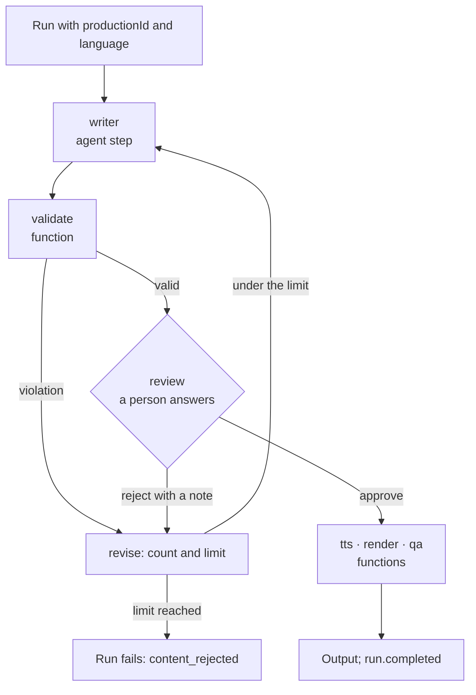

How do you build a workflow where an agent writes, code checks the draft, a person approves it
or sends it back with a note, and costly steps run only after the approval? This page builds
that graph in code, on the sample's `review-and-revise` workflow, and says what each part
gives you.

A stored workflow chain cannot do this. It is a straight line of agents and functions, with no
way back and no human gate. A graph built in code can, and two helpers give its steps what a
stored chain's steps have: `GetWorkflowAgentStep` for the writer and `GetWorkflowFunction` for
every function you registered.

## The graph



## Register the pieces

The agent and the functions are registered the usual way. The graph itself is a registration
too, and it carries the workflow-level settings a stored definition would:

```csharp
tracon.AddAgent(new AgentDefinition
{
    Name = "episode-writer",
    Instructions = "Write a short script in {{language}}. Answer ONLY with JSON: {\"title\": string, \"script\": string}.",
    Parameters = [new AgentParameter { Name = "language", Kind = AgentParameterKind.Text, DefaultValue = "en" }],
    Model = new ModelBinding
    {
        Provider = "openai",
        Model = "gpt-5.4-mini",
        ResponseFormat = new AgentResponseFormat { Kind = AgentResponseFormatKind.JsonSchema, SchemaName = "episode_script", Schema = schema },
    },
});

tracon.AddWorkflowFunction<List<ChatMessage>, ScriptCheck>("episode-validate", ValidateFactory);

tracon.AddWorkflowFunction<List<ChatMessage>, List<ChatMessage>, SpeakSettings>(
    "episode-tts",
    TtsFactory,
    options =>
    {
        options.Timeout = TimeSpan.FromMinutes(2);
        options.MaxConcurrency = 1;       // one voice synthesis at a time in this process
    });

tracon.AddWorkflow(
    "review-and-revise",
    services => Build(services),
    options =>
    {
        options.ResponseMode = WorkflowResponseMode.SingleAnswer;   // a double click follows the first answer
        options.RequestTimeout = TimeSpan.FromDays(2);              // a review nobody answers fails the run
        options.RunTimeout = TimeSpan.FromMinutes(5);               // one run, not the wait for a person
        options.Parameters =
        [
            new AgentParameter { Name = "productionId", Kind = AgentParameterKind.Text, Required = true },
            new AgentParameter { Name = "language", Kind = AgentParameterKind.Text, DefaultValue = "en" },
        ];
    });
```

## Build the graph

The graph is built again for every run, so the factory must be cheap and must not keep state.

```csharp
static Workflow Build(IServiceProvider services)
{
    var writer = services.GetWorkflowAgentStep("review-and-revise", "episode-writer", step => step.Timeout = TimeSpan.FromMinutes(3));
    var validate = services.GetWorkflowFunction("episode-validate");
    var ask = Step<ScriptCheck, string>("ask", (check, _, _) => new ValueTask<string>(check.Text));
    var review = RequestPort.Create<string, EpisodeReview>("episode-review").BindAsExecutor(allowWrappedRequests: false);
    var reviseAfterViolation = Step<ScriptCheck, List<ChatMessage>>("revise-after-violation", (c, ctx, ct) => ReviseAsync(c.Violation!, ctx, ct));
    var reviseAfterRejection = Step<EpisodeReview, List<ChatMessage>>("revise-after-rejection", (d, ctx, ct) => ReviseAsync(d.Note ?? "", ctx, ct));
    var approved = Step<EpisodeReview, List<ChatMessage>>("approved", async (_, ctx, ct) => [new(ChatRole.User, await ctx.ReadStateAsync<string>("draft", "review", ct) ?? "")]);
    var tts = services.GetWorkflowFunction("episode-tts", step => step.SetSettings(new SpeakSettings { Voice = "alloy" }));
    var render = services.GetWorkflowFunction("episode-render");
    var qa = services.GetWorkflowFunction("episode-qa");

    return new WorkflowBuilder(writer)
        .AddEdge(writer, validate)
        .AddEdge<ScriptCheck>(validate, reviseAfterViolation, check => check?.Violation is not null)
        .AddEdge<ScriptCheck>(validate, ask, check => check is not null && check.Violation is null)
        .AddEdge(reviseAfterViolation, writer)
        .AddEdge(ask, review)
        .AddEdge<EpisodeReview>(review, reviseAfterRejection, decision => decision is { Approved: false })
        .AddEdge<EpisodeReview>(review, approved, decision => decision is { Approved: true })
        .AddEdge(reviseAfterRejection, writer)
        .AddEdge(approved, tts).AddEdge(tts, render).AddEdge(render, qa)
        .WithOutputFrom(qa)
        .WithName("review-and-revise")
        .Build();
}
```

`Step` is a two-line helper over `new FunctionExecutor<TIn, TOut>(id, handler).BindExecutor()`.
`ReviseAsync` reads and writes the counter described below.

## Three traps this graph avoids

- **The writer is an agent step, not an agent binding.** An agent bound with
  `GetWorkflowAgent` and an `AIAgentBinding` runs only when the framework sends it a turn token,
  and nothing sends one to a node that is not the graph's entry. A message that returns to it
  over a back edge is accepted and nothing happens: the run ends with no output and no error.
  `GetWorkflowAgentStep` returns a plain function executor that runs whenever a message arrives.
  The price is that it streams no token deltas into the workflow's event feed and keeps no
  framework session, so a revision carries the previous draft and the note in its input.
- **The revision counter lives in the workflow's state.** Every answer is a new run and the
  graph is built again, so a counter kept in a field of an executor starts from zero each time and
  the loop never ends. `QueueStateUpdateAsync` and `ReadStateAsync` keep it in the checkpoint,
  and the run that answers reads it back. An update is visible to the executor that wrote it at once
  and to the others from the next super-step on: the step that counts also reads the counter, and the
  approval reads the draft a super-step after the validation wrote it.
- **The request is a string.** The console shows a request's text. A record shows its type name,
  and the answer is read into `EpisodeReview` from the `data` field of the respond call.

## What each helper gives a step

`GetWorkflowFunction` takes a `WorkflowFunctionStepOptions` (`Timeout`, `Settings`, and `SetSettings(value)` for a typed
value). `GetWorkflowAgentStep` takes a `WorkflowAgentStepOptions` (`Timeout`, `AgentVersion`, `AgentVersionParameter`).

| Step | Time limit | Retry | Budget gate | Cost named by node | Settings | Version pin | Concurrency |
|---|---|---|---|---|---|---|---|
| `GetWorkflowFunction` | the registration's, or the step's own | the registration's | yes | yes | strict read, typed or JSON | no | the registration's |
| `GetWorkflowAgentStep` | the step's own, else `ChildDeadline` | no | yes: a refused step fails | the agent's own run rows | no | yes: `AgentVersion`, or `AgentVersionParameter` for a run to choose | no |

A pinned version that does not exist, or an agent defined in code that keeps no versions, fails the
step by name before its model call. A graph factory is synchronous, so it cannot check this when
the graph is built, as a stored chain does.

The writer of a script that a template produces is an agent that its owner edits. Set
`step.AgentVersionParameter = "writerVersion"` and declare `writerVersion` in the registration's
`Parameters`: a run that sends `"writerVersion": "2"` runs version 2 of the writer on every pass of the
loop, including the pass after a rejection, and a run that leaves it out runs the current version. See
[Let a run choose the version of an agent step](/concepts/workflow-parameters/#let-a-run-choose-the-version-of-an-agent-step).

The agent step asks the agent for its whole answer. A JSON answer that does not fit the schema is
repaired as it is for a plain agent run (`Tracon:StructuredResponse`), and a loop agent hands the
next node its final iteration only.

## Limits that work together

- **A revision limit and a cost ceiling.** Each answer is a new run, and the ceiling is the logical run's: a
  run that answers a request starts from what the runs before it spent, so `MaxTotalCost` and `MaxTotalTokens` add
  up across rounds, and the time the workflow waited for the reviewer does not count against `MaxDuration`. Bound
  the rounds with your own counter, as here, because the ceiling counts money and the counter counts attempts, and
  set the ceiling for the whole review, not for one round. A round the ceiling refuses fails the run with
  `run_budget_exceeded`; the tenant's quota refuses it with `tenant_quota_exceeded` (see
  [Governance](/concepts/governance/#a-quota-also-stops-work-that-has-not-started)).
- **`MaxConcurrency` is per process and per function.** It holds across workflows and tenants, in a stored chain
  and in a graph built in code, and it multiplies with the number of replicas. A call that finds every slot taken
  waits. The wait is not part of the node's own `Timeout`, and it ends when the run is cancelled or reaches its
  `RunTimeout`. Each attempt of a retried node takes a slot of its own and gives it back before the retry's delay,
  and the budget gate is read after the slot is taken, so a budget that runs out during the wait refuses the node
  when its turn comes. A handler that ignores its token after a timeout keeps running without a slot, so pass the
  token on. A value below 1 throws at registration.
- **`RunTimeout` is held to the host's ceiling.** A value above `Tracon:Workflows:MaxRunTimeout`
  (or above `RunTimeout` while no ceiling is set) stops the host at startup and names the workflow.
- **A request nobody answers** fails the run with `WorkflowRequestExpired` and publishes `run.failed`
  to your webhooks, so a pipeline driven by webhooks hears that the review ended.

## Run it

```bash
curl -sS -X POST http://localhost:5081/tracon/api/workflows/review-and-revise/run \
  -H 'Prefer: respond-async' -H 'Content-Type: application/json' \
  -d '{"message":"start","parameters":{"productionId":"p-1","language":"en"}}'

curl -sS "http://localhost:5081/tracon/api/workflows/requests?state=pending"

curl -sS -X POST http://localhost:5081/tracon/api/workflows/runs/{runId}/respond \
  -H 'Prefer: respond-async' -H 'Content-Type: application/json' \
  -d '{"requestId":"{requestId}","data":{"approved":false,"note":"Make it shorter."}}'
```

The answer returns the run that continues. List the pending requests again for the next draft, and
answer with `"approved": true` to run the media functions. `GET /api/runs/{runId}/usage` lists what
each media function reported, by node name.

## After a crash, and after a change

A queued run that the process left half done continues from its latest checkpoint with
`ResumeInterruptedRuns` on, as a new run linked by `continuedFromRunId`. The finished steps do not run
again, and an approval already given is not asked for again. The run parameters are the recorded ones.

A run that waits for a person was written against the graph it ran. If you change the graph's
structure (add, remove or rename a node) while a run waits, that run cannot continue under the new
graph: the framework refuses its checkpoint. Changing a handler's code, a node's settings or a time limit
does not. Let waiting runs finish or expire before a structural change.

## Read next

- [Workflows](/concepts/workflows/): the five patterns, function nodes, parameters and recovery.
- [Answering a workflow](/concepts/workflow-answers/): the rules for one answer per request.
- [Workflow requests and time limits](/concepts/workflow-requests/): the list of waiting requests and how they expire.
