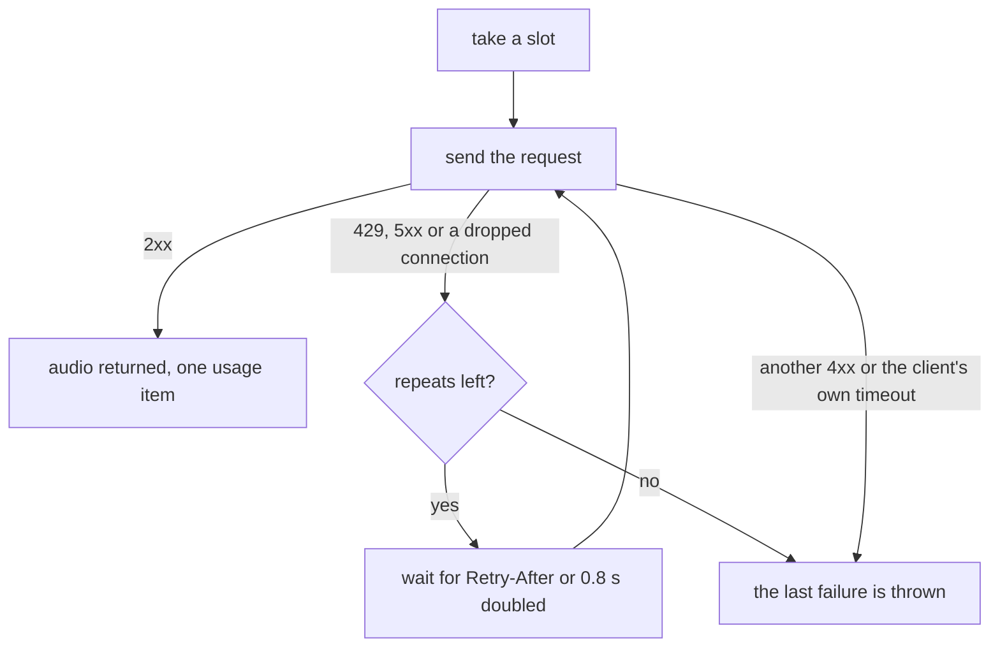

A speech call is billed by the provider in a unit of its own, a host with live conversations and a batch
of narration shares one account, and a request that failed can be worth sending again. This page covers
the three. The examples use `UseVoice()` and `AddElevenLabsSynthesizer()` from the `Tracon.Voice`
package, which the [voice guide](/guides/voice/) installs together with the speech tools.

## Voice cost has a different unit

Synthesis cost uses characters and transcription cost uses duration. Tracon
writes that measurement on the tool invocation, with the provider and model that did
the work, and never adds it to the token cost: a character, a second and a token are
different units, so a quantity is never added across them. The *amount* is a different
matter. It joins the run's non-token total (`nonTokenCost` on the run), which the call-tree
budget, the tenant's cost quota and the `run.completed` webhook count beside the token
cost. See [Report what a tool spent beyond tokens](/concepts/tools/#report-what-a-tool-spent-beyond-tokens)
for the rule, and
[Report what a node spent beyond tokens](/concepts/workflow-function-nodes/#report-what-a-node-spent-beyond-tokens)
for a workflow function node that voices text itself, and
[step runs](/guides/step-runs/#generate-images-and-speech-from-code) for code of your own.
If pricing is not configured, cost stays `null`: the measurement is listed as unpriced
and left out of the total, because zero would claim the call was free.
If the provider omits billed characters, the text length is used and marked as an
estimate; an estimated amount still adds, and the total says it rests on an estimate.

### What `CharactersBilled` is

`SpeechAudio.CharactersBilled` is the quantity the provider reported for **one request**, in
the provider's own unit. The built-in client reads the `character-cost` response header
(`x-character-cost` when that is missing). ElevenLabs' documentation does not say whether
that unit is a character or a credit, and it is not a count of the characters you sent, so
quote `PerMillionCharacters` in that unit.

- **It is per request.** Tracon does not add or split values. Five requests are five audio
  results and five usage items, each with its own value; a host that voices a text in parts
  adds the values itself.
- **It is not promised to match the provider's counter.** The sum of the values over a
  month is not guaranteed to equal what the provider's subscription counter shows: the
  provider keeps that counter by its own rules, and the header of one request cannot show
  them. Do not reconcile a bill against it.
- **The estimate is the text length.** With no header, `CharactersBilled` is the length of
  the text sent and `UsageSource` is `Estimated`.
- **`CharactersSent` is the count Tracon took.** It is the length of the text of a
  single-voice request, or the sum of the turns of a dialogue (inline tags such as
  `[laughs]` included), counted before the call and counted once when a failed request was
  sent again. Compare it with `CharactersBilled` to see how far the provider's unit is from
  the text: the two can differ, and neither is a measurement of the other. Only the built-in
  ElevenLabs client reports it. The built-in OpenAI speech synthesizer and the built-in Gemini
  synthesizer leave it `null`, as does a synthesizer of your own that does not set it.

Prices live under `Tracon:Pricing:Voice:{provider}:{model}`. `{provider}` is the
`ProviderName` of the implementation that did the work — `elevenlabs` for the built-in
client — not the `Tracon:Voice:Provider` setting. `{model}` is the model the
implementation reports on its result (`SpeechAudio.ModelId`,
`SpeechTranscript.ModelId`), then the one the request named. Only when neither is
known does the default provider fall back to `SynthesisModelId` or
`TranscriptionModelId`, and only the built-in client to its own default model. The
built-in client always reports the model it used.

A model with no price does not fail the call and is never recorded as free. Tracon says so twice: the
first time a synthesis, transcription or live voice session finds no price for a model, one `Warning`
names the provider, the model and the key to set; and the `SynthesisModelId` and `TranscriptionModelId`
you configure are listed under `pricing.unpricedMediaModels` in
[`GET /api/diagnostics`](/guides/observability/#export-traces-and-metrics) and in a startup warning
until a rate covers them. A synthesis needs `PerMillionCharacters`; a transcription and a live
session need `PerMinute`.

## Several speech providers in one host

A host that picks the text-to-speech engine per pipeline or per customer — a hosted
service for one, a model on its own GPU for another — registers each engine under a
name, next to the default one:

```csharp
builder.AddTracon()
    .UseVoice(builder.Configuration.GetSection(VoiceOptions.SectionName))
    .AddSpeechSynthesizer("studio", provider => new StudioSpeechSynthesizer(
        provider.GetRequiredService<IConfiguration>()["Studio:ApiKey"]))
    .AddSpeechSynthesizer("gpu", _ => new LocalGpuSynthesizer(new Uri("http://gpu-01:9000/")))
    .AddSpeechTranscriber("gpu", _ => new LocalGpuTranscriber(new Uri("http://gpu-01:9000/")));
```

A second **built-in** client is a name too, with a concurrency pool of its own, so a batch does not queue a live turn:
[Keep a batch from queueing a live turn](/guides/voice-conversation-lifecycle/#keep-a-batch-from-queueing-a-live-turn).

A name is 1 to 64 characters of `a-z`, `0-9`, `.`, `_` and `-`, compared in lower
case; synthesizer and transcriber names are separate. Registering the same name twice
throws at startup instead of letting the later call win. The call can come before or
after `UseVoice()`, and it never changes which provider `UseVoice()` binds as the
default. A factory that returns one instance for two names shares that instance — and
its concurrency limit — between them.

A caller selects an engine by name:

| Caller | How it names the engine |
|---|---|
| `POST /api/voice/speak` | `"provider": "studio"` in the body |
| `GET /api/voice/voices` | `?provider=studio` |
| A workflow function node | `ISpeechProviderResolver.GetSynthesizerAsync(name)` with a name from the node's settings or a run parameter |
| The `speak`, `transcribe` and `list_voices` tools, the conversation socket | Always the default provider |

`GET /api/voice/providers` lists every registration — its name (`null` for the
default), its kind, the provider name it reports, whether it accepts a tenant's own
key, and `dialogue`: the limits of one dialogue request, or `null` when the provider cannot voice
a dialogue. An unknown name answers `400` and names the registered ones; a request without a
name when no default is registered answers `501`. A provider failure the speech
adapter reports as a `TraconException` (the built-in adapters do) answers `502`, while
it speaks or lists its voices; any other exception is a server error.

A function node takes the resolver when it is built, because the service provider a
node sees at call time is not the host's:

```csharp
builder.AddTracon()
    .UseWorkflows()
    .AddWorkflowFunction<List<ChatMessage>, List<ChatMessage>, NarrationSettings>(
        "narrate",
        provider =>
        {
            var speech = provider.GetRequiredService<ISpeechProviderResolver>();
            var pricing = provider.GetRequiredService<IVoicePricingReader>();

            return async (messages, settings, context, cancellationToken) =>
            {
                var synthesizer = await speech.GetSynthesizerAsync(settings.Provider, cancellationToken);
                var audio = await synthesizer.SynthesizeAsync(
                    new SpeechRequest { Text = messages[^1].Text },
                    cancellationToken);

                // The node called the engine itself, so Tracon did not see the spend.
                var characters = audio.CharactersBilled ?? messages[^1].Text.Length;
                await context.ReportUsageAsync(new ToolCallUsage
                {
                    Unit = ToolUsageUnits.Characters,
                    Quantity = characters,
                    Cost = pricing.ForSynthesis(synthesizer.ProviderName, audio.ModelId, characters),
                    Currency = pricing.Currency,
                    IsEstimated = audio.UsageSource != SpeechUsageSource.Provider,
                    Provider = synthesizer.ProviderName,
                    Model = audio.ModelId,
                });

                return [new ChatMessage(ChatRole.Assistant, $"{audio.Data.Length} bytes")];
            };
        });
```

A named engine never receives the default's `SynthesisModelId` or `OutputFormat`: a
model identifier of one engine sent to another is a wrong request. Set them on the
request when the engine needs them. `IVoicePricingReader.ForSynthesis` returns `null`
when no price is configured; the item is then listed as unpriced instead of counting as
zero.

A second **built-in** client (`AddElevenLabsSynthesizer`) is always the built-in
ElevenLabs client, whatever the default synthesizer is, and it needs a key of its own. A
host that registered its own pair before `UseVoice()` has no key for the default, so give the
named one `ApiKey` or `ApiKeyConfigurationName` in the callback. The key is checked at the first
call for the name; a missing one is reported there, by the name of the configuration key that
held none.

## Repeat a failed request

A request to ElevenLabs that fails is not sent again unless you ask. A batch that voices a
podcast makes five requests; when the fifth fails with a `503`, the four finished parts are
paid for, and the host that starts over pays for them again. `MaxRetries` is the number of
times the built-in client sends a speech or dialogue request again, from `0` (the default) to
`10`:



```csharp
builder.AddTracon()
    .UseVoice(builder.Configuration.GetSection(VoiceOptions.SectionName))
    .AddElevenLabsSynthesizer("batch", options =>
    {
        options.MaxConcurrentRequests = 4;
        options.MaxRetries = 3;
    });
```

Put it on the batch's synthesizer, as above: the named client copies the options of
`UseVoice()` and keeps its own values, so a live conversation on the default synthesizer
does not start to wait for a repeat. `Tracon:Voice:MaxRetries` in configuration sets it for the
default synthesizer and for every named one that does not set its own, since they copy the
options of `UseVoice()`.

| Outcome of a try | Repeated |
|---|---|
| `429` or any `5xx` answer | Yes |
| A connection that failed or dropped before the answer was complete | Yes |
| Any other `4xx` (a voice that does not exist, a key the provider refuses) | No: the answer is the same every time |
| The client's own `Timeout` | No: the provider may have finished, and billed, a request the client gave up on |
| A cancellation | No: it ends the call and the wait at once |
| Streaming synthesis and transcription | No: a conversation's audio cannot wait, and the audio sent for transcription is a stream that cannot be read twice |

The wait before a repeat is the provider's `Retry-After` when it is a delay of at most 60
seconds, and a longer one is ignored. Without one the wait is 0.8 seconds, doubled for every
repeat and never more than 60 seconds. The repeats run while the call still holds its place
among `MaxConcurrentRequests`: a pool that is waiting to repeat a request is not free for
another one. When every try fails, the last failure is thrown as a single try would throw it,
a `ProviderInvocationException`. `Timeout` is the limit of one try, not of the whole call, which
can last up to `MaxRetries + 1` times `Timeout` plus the waits between the tries.

A repeated request is measured once. The retry lives below the service that records a call, so
a synthesis that took two tries is one usage item, with the quantity of the answer that
succeeded.

:::caution[A repeat can be billed twice]
Tracon has not measured whether ElevenLabs bills a request it answered with a `5xx` or cut
off midway, and a repeat of a request it did bill is paid for again. The request ids that a request can name
(`elevenlabs.previousRequestIds`) keep speech continuous across requests; they are not an
idempotency key and do not make a repeat free. That is why the setting is off by default.
:::

## Read next

- [Voice and live conversation](/guides/voice/) — enable the layer, add the speech tools and open a conversation.
- [Gemini speech and dialogue](/guides/gemini-speech/) — the Gemini synthesizer and a dialogue with several speakers.
- [Configuration reference](/reference/configuration/#pricing) — the `Tracon:Pricing` keys and `Tracon:Voice` options.
