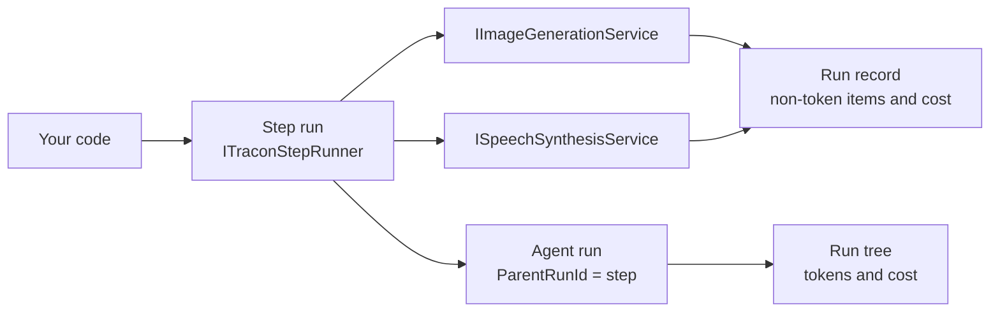

An agent run and a workflow run record themselves. A job that your own code does
without a model — draw a cover, voice a script, render an episode — has no run, so its
cost is in no run, no quota counter and no run tree. A **step run** closes that gap:
your code opens it, does the work inside it, and Tracon records it like any other run.



## Open a step

`ITraconStepRunner` runs a delegate as a run. The delegate gets a token that both your
caller and `POST /api/runs/{id}/cancel` can cancel.

```csharp
app.MapPost("/episodes/{episode}", async (
    string episode,
    ITraconStepRunner steps,
    IImageGenerationService images,
    ISpeechSynthesisService speech,
    CancellationToken cancellationToken) =>
{
    var stepRunId = Guid.CreateVersion7();

    await steps.RunAsync(
        new TraconStepOptions { Name = "podcast-render", RunId = stepRunId },
        async stepToken =>
        {
            var cover = await images.GenerateAsync(
                new TraconImageRequest { Prompt = $"Cover art for the episode {episode}" },
                stepToken);
            var intro = await speech.SynthesizeAsync(
                new SpeechRequest { Text = "Welcome to the show." },
                cancellationToken: stepToken);

            // Store cover.Images and intro.Audio where your application keeps them.
        },
        cancellationToken);

    return Results.Ok(new { runId = stepRunId });
});
```

`RunAsync` also takes a delegate that returns a value. The run scope exists only inside
the delegate: when `RunAsync` returns, your code is outside the run again.

| Option | Meaning |
|---|---|
| `Name` | Required. It is the run's agent name in run lists, statistics and quota. At most 200 characters, with no surrounding whitespace |
| `RunId` | The id of the run, when you want to know it before the step ends. Make it in your own code (`Guid.CreateVersion7()`), never from a client's request. An id a run of your tenant already has is refused. An id a run of another tenant holds is refused by the run store, which never gives a row to another tenant: that run is left as it was, the refusal is logged and the step runs without a record. Without it, Tracon makes one |
| `ParentRunId` | A run of the **same tenant** to attach the step to. The step then belongs to that run's tree. A run of another tenant is refused the same way as a run that does not exist |

## What the run holds

The run has the kind `Step`, the current tenant, and the user and labels of your
[run attribution](/concepts/starting-runs/). It ends `Completed` when the delegate
returns, `Canceled` when its token was canceled, and `Failed` when the delegate throws.
The exception reaches your caller unchanged, and the run keeps a classified error whose
message follows the [same safety rule](/concepts/run-errors/) as every run error.

A step has no model, no token usage and no input of its own. It holds:

- the non-token items its code reported, in `GET /api/runs/{runId}/usage`, and their sum
  in the run's `nonTokenCost`;
- the runs below it, with their tokens and cost in the run's tree totals.

A root step publishes the `run.completed` or `run.failed` [webhook](/concepts/webhooks/),
writes one run to the tenant's [quota counter](/concepts/governance/) with its amount,
and opens a run span for tracing.

## Generate images and speech from code

The two services are the code equivalent of the `generate_image` and `speak` tools. A
keyed `IImageGenerator`, or a synthesizer from `ISpeechProviderResolver`, called
directly records nothing — and the image generator then also skips the tenant checks and
the failure mask.

| Service | Call | Result |
|---|---|---|
| `IImageGenerationService` | `GenerateAsync(TraconImageRequest)` — prompt, count, size, and optionally provider and model | The images as bytes with their media type, the measurement, and whether it was recorded |
| `ISpeechSynthesisService` | `SynthesizeAsync(SpeechRequest, provider)` | The audio, the measurement, and whether it was recorded |
| `ISpeechSynthesisService` | `SynthesizeDialogueAsync(SpeechDialogueRequest, provider)` | The dialogue audio and its segments, the measurement, and whether it was recorded |

Both services:

- apply the tenant's egress policy and refuse a call when the tenant has its own key
  that the setup-built client cannot use;
- throw `ProviderInvocationException` with the provider, the status and whether a retry
  can help when an image provider or the built-in ElevenLabs client fails (see
  [decide a retry from the failure](/concepts/run-errors/#decide-a-retry-from-the-failure-not-from-its-text)).
  The OpenAI and Gemini speech clients and a synthesizer of your own throw what they throw, usually a `TraconException`;
- refuse a blank text, a dialogue without turns, and a text longer than the synthesizer takes before the provider is called;
- record the measurement on the current run — a step, a workflow function node or a
  tool call. Outside a run, the result still carries the measurement and
  `UsageRecorded` is `false`.

The image service does not need `Tracon:Images:Enabled`: that switch offers images to
agents and over HTTP. It uses the [image provider settings](/guides/multimodal/#generate-an-image-as-an-attachment)
and returns bytes; it saves no attachment.

A cost appears when a price is configured; without one the amount is `null`, never zero:

```json
{
  "Tracon": {
    "Pricing": {
      "Currency": "USD",
      "Images": {
        "openai": {
          "gpt-image-1": { "PerImage": 0.04 }
        }
      },
      "Voice": {
        "elevenlabs": {
          "eleven_multilingual_v2": { "PerMillionCharacters": 100 }
        }
      }
    }
  }
}
```

## Agents inside a step

An agent run started inside the delegate is a separate root run unless you say that the
step is its parent:

```csharp
app.MapPost("/summaries", async (ITraconStepRunner steps, IAgentCatalog agents, CancellationToken cancellationToken) =>
{
    var stepRunId = Guid.CreateVersion7();

    var summary = await steps.RunAsync(
        new TraconStepOptions { Name = "nightly-summary", RunId = stepRunId },
        async stepToken =>
        {
            var writer = await agents.ResolveAsync("writer", cancellationToken: stepToken)
                ?? throw new InvalidOperationException("The writer agent is not registered.");

            var response = await writer.RunAsync(
                "Summarize today's tickets.",
                options: new TraconRunOptions { ParentRunId = stepRunId },
                cancellationToken: stepToken);

            return response.Text;
        },
        cancellationToken);

    return Results.Ok(new { runId = stepRunId, summary });
});
```

The agent run then joins the step's tree: it shares the tree's budget, and its tokens
and cost count toward the step's tree totals and the same quota counter. Naming the step as
the parent makes the agent run a **child run**, with a child run's rules:

- A tool that asks for approval fails the run instead of waiting. A child cannot wait for a
  person in the middle of a tree: give the tool an automatic approval rule, or run the agent
  outside the step.
- Parameter values you bind for a child do not reach its tools.
- It writes no webhook of its own and adds no run to the quota counter (the step's does),
  and online evaluation does not sample it.

The step's tenant is the agent's: an agent run that names a step of another tenant as its
parent does not join that tree.

## What a step does not do

- **A step in a tool shares that run's ceiling.** A step that a tool of an agent run opens
  with that run as its parent spends against the run's budget. A step opened with any other
  parent, or none, has a budget of its own.
- **It asks no admission question.** The run authorization handler and the quota check
  sit in front of Tracon's HTTP endpoints. A step's spend is still counted. To refuse a
  step before it starts, ask `RunAdmission.CheckAsync` with the step's name, as in
  [embedding](/guides/embedding/).
- **It is not replayed, continued or judged.** A step has no recorded input to run
  again, and online evaluation does not sample it.
- **Statistics count it, but their money is token money.** `/api/stats` counts the step
  as a run under its name; `totalCost` there is the token cost, as for every run. Read a
  step's non-token amount from the run, its tree or the quota counter.
- **A store that fails does not stop it.** When the run cannot be written, or cannot be read
  to check the `RunId` and the `ParentRunId` you named, the step still runs and the failure is
  logged.
- **With run recording off**, the delegate runs and nothing is recorded.

## In the reference

- [Runs HTTP API](/http-api/runs/)
- [`ITraconStepRunner` API](/api/tracon.itraconsteprunner/)
- [`IImageGenerationService` API](/api/tracon.iimagegenerationservice/)
- [`ISpeechSynthesisService` API](/api/tracon.ispeechsynthesisservice/)

## Read next

- [Runs and recording](/concepts/runs/) — what every run keeps and how to read it.
- [Observability and cost](/guides/observability/) — prices, usage and traces.
