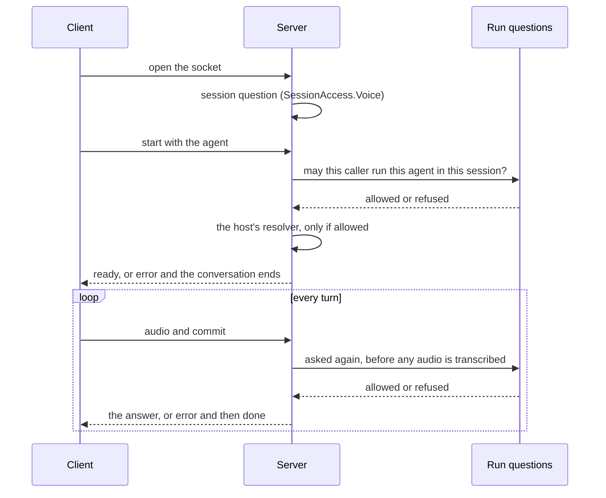

A [voice conversation](/guides/voice/#enable-live-conversation) is a long-lived socket that runs
an agent turn after turn. This page covers what happens around it: the questions asked before
it may run, how a host with its own sign-in authenticates it, the time limit of one connection,
how an agent ends it, and how it closes. The frames themselves are in the
[protocol reference](/reference/voice-conversation-protocol/).

The examples use `UseVoice()` from the `Tracon.Voice` package, which the
[voice guide](/guides/voice/) installs.

## A conversation is a run start



The question above is about the session, and it is asked before the agent is known: the
`start` frame names the agent after the socket is open. So the conversation asks again, with
the three questions every other way to start a run asks:

1. The registered `IRunAuthorizationHandler` is asked `AuthorizeRunAsync` with
   `RunAccess.Start`, the agent, the session, the tenant and the user.
2. The session's owner is checked when session ownership is on.
3. The tenant's quota is checked.

They are asked when `start` arrives, before `ResolveConnection`, and before every turn,
including the opening prompt of a conversation that has one. A greeting is not a run and
asks nothing more. A caller who may open a conversation therefore cannot name another agent
in it and run it.

| Refused when | What the client reads | What follows |
|---|---|---|
| `start` | `error` with the reason the handler or the quota gave, the text an HTTP run would answer | The conversation ends and the record's end reason is `Error`. The host's resolver is not called |
| A turn | `error`, then `done` with the number of turns already completed | The turn is not counted, its audio is never sent to the transcription provider and no run starts. The conversation goes on, and the next turn is asked again |

A handler or a quota store that throws refuses, with the fixed text
`The run authorization check failed. Retry the request.`; the exception stays in your log.
A spent quota refuses a new conversation and the next turn of an open one, and never cuts a
turn in progress. A voice turn was recorded and counted before, but never refused.

## Carry your own token from the browser

Tracon's `tracon.token.` subprotocol carries a credential **Tracon** checks: its static
`AuthToken` or one of its API keys. A host that has its own sign-in (a JWT it issued) puts
that token in a subprotocol **of its own**, and its own authentication reads it from the
`Sec-WebSocket-Protocol` header. Tracon reads only its own prefix and ignores every other
offer, so it selects `tracon.voice.v1` and never echoes the token.

On the host, give the endpoints the policy your sign-in satisfies and let the sign-in find
the token in the header. With the JWT bearer handler that is its `OnMessageReceived` event:
set `context.Token` to the value `ReadHostToken` returns. The helper reads the value your
prefix marks:

```csharp
using Microsoft.AspNetCore.Http;

// "host.bearer." is your choice of prefix. Do not use "tracon.token.": Tracon reads that prefix as its own credential
// and refuses a value that is not one.
static string? ReadHostToken(HttpRequest request)
{
    const string prefix = "host.bearer.";

    foreach (var header in request.Headers.SecWebSocketProtocol)
    {
        foreach (var offer in (header ?? string.Empty).Split(',', StringSplitOptions.TrimEntries | StringSplitOptions.RemoveEmptyEntries))
        {
            if (offer.StartsWith(prefix, StringComparison.Ordinal))
            {
                return offer[prefix.Length..];
            }
        }
    }

    return null;
}

app.MapTracon("/tracon", options => options.RequireAuthorization("HostAccess"));
```

In the browser, offer it next to the protocol with the `subProtocols` option of
[`createVoiceConversation`](/guides/typescript-client/#talk-to-a-voice-conversation), or in
the second argument of your own `new WebSocket(url, [protocol, 'host.bearer.' + jwt])`:

```ts
createVoiceConversation({ baseUrl, sessionId, agent, subProtocols: () => ['host.bearer.' + currentJwt()] });
```

Three limits apply:

- A subprotocol value holds only the characters of an HTTP token. A base64url JWT does
  (`A-Z a-z 0-9 - _ .`); a value with `=`, `/`, `+` or a space does not, so encode it first.
- Do not put the token in the query string. It is the one place the address, your proxy's
  log and the browser's history all keep it. Tracon refuses its own token there for that reason, and the same
  holds for yours.
- Tracon's own checks still apply to a socket your sign-in authenticated. Tracon cannot tell
  a token the page holds from an identity the browser sends by itself (a cookie), so a page
  of another site is refused unless its origin is in `AllowedOrigins`, a client with no
  `Origin` header is not judged by it, and the run questions below are asked as for any
  other conversation.

## Limit how long a conversation lasts

`MaxConnectionDuration` (30 minutes by default) is one limit for every connection. It is a
hygiene limit: when it passes, the server closes the socket without a word and the client is
expected to reconnect, and the session keeps its history.

A host whose conversations differ in length (a kind of conversation, a tenant's plan) sets a
shorter limit for each connection with `MaxDuration`, in the resolver:

```csharp
builder.AddTracon()
    .UseVoice(builder.Configuration.GetSection(VoiceOptions.SectionName))
    .UseVoiceConversation(options =>
    {
        options.MaxConnectionDuration = TimeSpan.FromMinutes(30);
        options.ResolveConnection = (request, cancellationToken) =>
            ValueTask.FromResult<VoiceConnectionSettings?>(new VoiceConnectionSettings
            {
                MaxDuration = request.AgentName == "assessment" ? TimeSpan.FromMinutes(10) : TimeSpan.FromMinutes(15),
            });
    });
```

The value must be greater than zero and no greater than `MaxConnectionDuration`, which stays
the ceiling of every connection: a resolver that returns anything else fails like any other
mistake of the resolver, and the limit is never cut or stretched to fit. The time is counted
from the moment the connection opened.

When the limit is reached the turn in progress is cut off (its `done` carries
`"cancelled": true`), the server sends `ended` with `"reason": "duration"` and closes the
socket normally, and the record's end reason is `DurationLimit`. **The client does not
reconnect:** the conversation is over. That is what tells this limit from the global one,
whose close carries no `ended` frame.

Nothing remembers how long an earlier connection of the same session lasted. A host that
allows a conversation a fixed total sums the time already used and returns what is left each
time it is asked, or refuses the new connection in the resolver.

## Let the agent end the conversation

An agent that lists the tool `end_conversation` in its `ToolNames` can end the conversation
after its answer. It takes no argument. Tell the agent when to use it in its instructions
(the topic is done, the time is up, the caller said goodbye) and to say a short goodbye in
the same answer:

```csharp
tracon.AddAgent(new AgentDefinition
{
    Name = "coach",
    Instructions = "Coach the student. When the exercise is done, say goodbye and call end_conversation.",
    Model = new ModelBinding { Provider = OpenAIProviderNames.ChatCompletions, Model = "your-model" },
    ToolNames = ["end_conversation"],
});
```

The server lets the answer finish, speaks it, sends `done`, then `ended` with
`"reason": "agent"`, and closes the socket normally. The record's end reason is `Agent`.
If the user interrupts the goodbye (`cancel`), or the turn fails, the request is dropped and
the conversation goes on. An agent that does not list the tool can never end a conversation,
and the tool ends nothing when an agent runs outside a voice conversation.
A conversation also ends when the time limit the host set for its connection passes, and every
close has its own frame, description and end reason: they are on the
[voice conversation lifecycle](/guides/voice-conversation-lifecycle/#how-a-conversation-closes) page.

## How a conversation closes

Every close the server starts is a normal closure with a description, and the record carries
the end reason. What came before the close tells the client whether to come back:

| Cause | Frame before the close | Close description | End reason |
|---|---|---|---|
| The client sent `stop` or closed the socket | none | `The conversation closed.` | `Client` |
| The agent ended it | `ended` (`agent`) | `The conversation was ended by the agent.` | `Agent` |
| The limit the host set for the connection | `ended` (`duration`) | `The conversation reached its time limit.` | `DurationLimit` |
| `MaxConnectionDuration`, the global limit | none | `The connection reached the duration limit.` | `DurationLimit` |
| No frame from the client for `IdleTimeout` | none | `The connection stayed idle.` | `IdleTimeout` |
| The host is stopping | none | `The server is shutting down.` | `ServerShutdown` |
| The conversation failed | `error` | `The conversation closed with an error.` | `Error` |

The end reason is decided once, by the first thing that ended the conversation, and a client
that drops the connection the moment it reads `ended` does not change it. `ServerShutdown` is
written only when the host is stopping: a client that goes away while the host runs is
`Client`. A host that stops closes its open conversations and cuts the turn in progress.

A close is a handshake: the server sends its close frame and waits for the client's. A
browser answers by itself; another client must keep reading until the close arrives. The
server waits five seconds, and then drops the connection, so a client that reads nothing
cannot hold a tenant's connection slot.

## Read next

- [Voice and live conversation](/guides/voice/) — enable the layer, decide the voice on the server, open and end the conversation.
- [Voice conversation protocol](/reference/voice-conversation-protocol/) — every frame, field, handshake answer and close.
- [Run and session authorization](/guides/embedding/#6--run-and-session-authorization) — the handler these questions ask.
