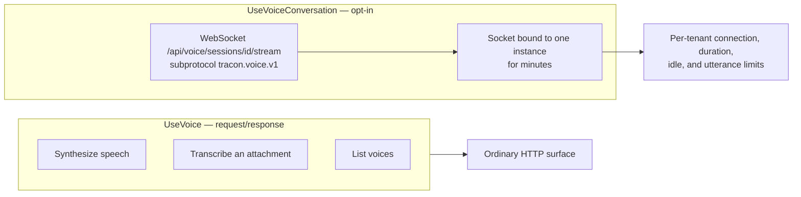
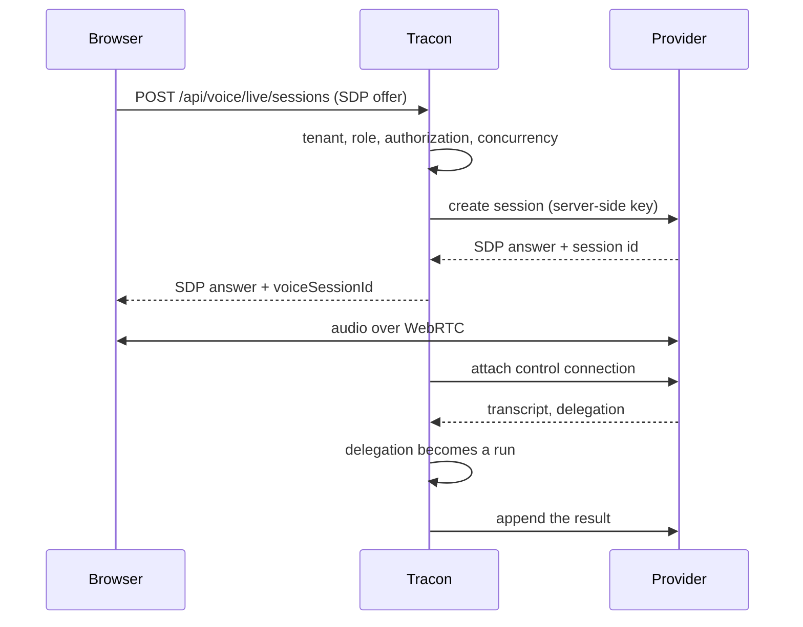

:::note[Preview packages]
Tracon is published as `1.0.0-preview.5`. Use `--prerelease` for discovery or
pin the exact version for reproducible builds.
:::

Tracon has three voice layers:

| Layer | Use it for | Registration |
|---|---|---|
| Voice tools and REST | Generate speech, transcribe an attachment, list voices, and voice a multi-speaker dialogue from a workflow node | `UseVoice()` from `Tracon.Voice` |
| Live conversation | Keep a bidirectional audio/text session over WebSocket, with Tracon transcribing and synthesizing | `UseVoiceConversation()` from Core |
| Provider-hosted live voice | Let a realtime model run the conversation and hand the heavy work back to your agents | `UseLiveVoice()` plus a provider such as `UseOpenAILive()` |

The second and third solve the same problem in opposite directions, and the choice
matters. Under `UseVoiceConversation()` the audio reaches Tracon, so every turn is
a run, the content guard sees what was said, and any speech provider works. Under
`UseLiveVoice()` the provider owns the conversation and the audio never touches your
server — you get true full duplex and provider-side turn detection, and you give up
seeing most of what was said. [What you give up](#what-the-provider-hosted-path-gives-up)
lists that trade in full.



The tool layer is request/response. The conversation layer changes the hosting model:
a socket stays bound to one application instance for minutes. Enable only the layer
you need.

## Add speech tools

Install `Tracon.Voice`, keep the provider key out of files, and register it:

```bash
dotnet add package Tracon.Voice --prerelease
dotnet user-secrets set "Tracon:Voice:ApiKey" "..."
```

```csharp
var tracon = builder.AddTracon()
    .UseVoice(builder.Configuration.GetSection(VoiceOptions.SectionName));

tracon.AddAgent(new AgentDefinition
{
    Name = "voice-assistant",
    Instructions = "Answer clearly. Speak the answer when the caller asks.",
    Model = new ModelBinding
    {
        Provider = OpenAIProviderNames.ChatCompletions,
        Model = "your-model",
    },
    ToolNames = ["speak", "transcribe", "list_voices"],
});
```

| Tool | Input and result |
|---|---|
| `speak` | Text in; generated audio attachment ID out |
| `transcribe` | Audio attachment ID in; resolved text out |
| `list_voices` | Provider voice names, identifiers, and safe scalar attributes out |

Generated audio is stored through the normal attachment contract. The model receives
an attachment ID, not a large byte array. The file name takes its extension from the
type the attachment guard detects — `.mp3`, `.ogg` or `.wav` — not from the requested
format.

`UseVoice()` validates `Tracon:Voice` when the application starts. A missing key, an
unknown `Provider` or a headerless `OutputFormat` stops the host before the first
request, not at the first tool call.

### Voice attributes

`VoiceDescriptor.Attributes` carries a provider's own bounded, safe scalar
metadata for a voice — for example `gender`, `language`, `accent`, `age`, or
`use-case`. `VoiceAttributeNames` names the well-known keys, but the set is not
closed: any other safe scalar label a provider reports survives under its own
key. The collection is empty, never `null`, when the provider reports nothing.

```csharp
var voices = await synthesizer.ListVoicesAsync();
var femaleEnglish = voices.Where(v =>
    v.Attributes.GetValueOrDefault(VoiceAttributeNames.Gender) == "female" &&
    (v.Attributes.GetValueOrDefault(VoiceAttributeNames.Language) ?? "").Contains("en"));
```

Bounds keep a misbehaving provider response from becoming a payload: at most 32
attributes per voice, a 64-character key, a 256-character value. A duplicate
key that differs only by case or by `_`/`-` collapses to one canonical
lowercase, hyphenated entry (`use_case` and `use-case` both become `use-case`).
`preview_url` is never carried — playing it would connect the browser directly
to the provider's address — and neither is any other provider-internal field;
only the declared safe scalar labels reach the model.

Whether `language` is populated depends entirely on what the underlying
provider reports: the built-in ElevenLabs implementation reads it from that
provider's per-model verified-languages list, joining multiple verified
languages into one comma-separated value (for example `"en,fr"`). A provider
that reports nothing comparable simply omits the key — it is never guessed.

### Use a storable output format

The attachment guard trusts magic bytes, not a claimed media type. Raw `pcm_*` and
`ulaw_*` output has no file header and cannot be stored as an attachment. The default
`mp3_44100_128` is valid; choosing a non-storable provider format fails option
validation at startup.

### Voice cost has a different unit

Synthesis cost uses characters and transcription cost uses duration. Tracon
writes that measurement on the tool invocation, with the provider and model that did
the work, and never adds it to the token cost: a character, a second and a token are
different units, so a quantity is never added across them. The *amount* is a different
matter. It joins the run's non-token total (`nonTokenCost` on the run), which the call-tree
budget, the tenant's cost quota and the `run.completed` webhook count beside the token
cost. See [Report what a tool spent beyond tokens](/concepts/tools/#report-what-a-tool-spent-beyond-tokens)
for the rule, and
[Report what a node spent beyond tokens](/concepts/workflows/#report-what-a-node-spent-beyond-tokens)
for a workflow function node that voices text itself.
If pricing is not configured, cost stays `null`: the measurement is listed as unpriced
and left out of the total, because zero would claim the call was free.
If the provider omits billed characters, the text length is used and marked as an
estimate; an estimated amount still adds, and the total says it rests on an estimate.

Prices live under `Tracon:Pricing:Voice:{provider}:{model}`. `{provider}` is the
`ProviderName` of the implementation that did the work — `elevenlabs` for the built-in
client — not the `Tracon:Voice:Provider` setting. `{model}` is the model the
implementation reports on its result (`SpeechAudio.ModelId`,
`SpeechTranscript.ModelId`), then the one the request named. Only when neither is
known does the default provider fall back to `SynthesisModelId` or
`TranscriptionModelId`, and only the built-in client to its own default model. The
built-in client always reports the model it used.

### Character-level timing

`POST /api/voice/speak` accepts `includeTimestamps` (default `false`). When set, the
response's `alignment` field carries one entry per character — the character itself
and its start/end offset from the beginning of the audio. Alignment is not a separate
billing unit: `characters` and `cost` are computed exactly as without it.

Timestamps are not available on the streaming synthesis path
(`ISpeechSynthesizer.SynthesizeStreamingAsync`): that method returns raw audio chunks
only and has no channel to carry per-character timing back to the caller. Requesting
both together throws rather than silently dropping the alignment. Grouping characters
into words, or producing a subtitle format such as SRT or VTT, is left to the
consumer — the raw per-character form is what the provider gives, and turning it into
something else is application-specific.

### Use your own speech provider

The built-in implementation uses ElevenLabs through raw `HttpClient` and
source-generated JSON. The package adds no NuGet dependency and remains AOT
compatible. To replace it, register your implementation **before** `UseVoice()`;
`TryAdd` preserves it:

```csharp
builder.Services.AddSingleton<ISpeechSynthesizer, ContosoSpeechProvider>();
builder.Services.AddSingleton<ISpeechTranscriber, ContosoSpeechProvider>();

builder.AddTracon().UseVoice(options =>
{
    options.DefaultVoiceId = "customer-care";
    options.SynthesisModelId = "contoso-tts-1";
});
```

With both contracts registered first, no API key is needed. `Provider`, `ApiKey`
and `Endpoint` configure only the built-in client, so they are neither required nor
validated. The other settings still apply and are still validated at startup: the
`speak` tool passes `OutputFormat` and `SynthesisModelId` to your synthesizer, and
`transcribe` passes `TranscriptionModelId` to your transcriber. Replace only one
contract and the built-in client serves the other — the key is then still required.

`UseVoice()` reads the service collection when you call it. A registration added
after the call wins resolution but not validation: the host stops at startup with a
message that says to register first.

Three behaviors follow the bound implementation, not the settings:

| Behavior | Read from |
|---|---|
| Character limit of `speak` and `POST /api/voice/speak` | `ISpeechSynthesizer.MaxCharactersPerRequest` |
| Price lookup | `Tracon:Pricing:Voice:{ProviderName}:{model}` of the synthesizer or transcriber that did the work |
| `GET /api/voice/health` | Your synthesizer's own `IVoiceHealthCheck`, when it implements one; otherwise a voice-list call that reports your `ProviderName` |

With no model identifier set, your provider's cost stays `null`: Tracon does not
borrow the built-in client's default model or its price.

A provider that already ships a `Microsoft.Extensions.AI` speech client needs no
hand-written adapter. See [Use any Microsoft.Extensions.AI speech client](#use-any-microsoftextensionsai-speech-client).

### Several speech providers in one host

A host that picks the text-to-speech engine per pipeline or per customer — a hosted
service for one, a model on its own GPU for another — registers each engine under a
name, next to the default one:

```csharp
builder.AddTracon()
    .UseVoice(builder.Configuration.GetSection(VoiceOptions.SectionName))
    .AddSpeechSynthesizer("studio", provider => new StudioSpeechSynthesizer(
        provider.GetRequiredService<IConfiguration>()["Studio:ApiKey"]))
    .AddSpeechSynthesizer("gpu", _ => new LocalGpuSynthesizer(new Uri("http://gpu-01:9000/")))
    .AddSpeechTranscriber("gpu", _ => new LocalGpuTranscriber(new Uri("http://gpu-01:9000/")));
```

A name is 1 to 64 characters of `a-z`, `0-9`, `.`, `_` and `-`, compared in lower
case; synthesizer and transcriber names are separate. Registering the same name twice
throws at startup instead of letting the later call win. The call can come before or
after `UseVoice()`, and it never changes which provider `UseVoice()` binds as the
default. A factory that returns one instance for two names shares that instance — and
its concurrency limit — between them.

A caller selects an engine by name:

| Caller | How it names the engine |
|---|---|
| `POST /api/voice/speak` | `"provider": "studio"` in the body |
| `GET /api/voice/voices` | `?provider=studio` |
| A workflow function node | `ISpeechProviderResolver.GetSynthesizerAsync(name)` with a name from the node's settings or a run parameter |
| The `speak`, `transcribe` and `list_voices` tools, the conversation socket | Always the default provider |

`GET /api/voice/providers` lists every registration — its name (`null` for the
default), its kind, the provider name it reports, whether it accepts a tenant's own
key, and `dialogue`: the limits of one dialogue request, or `null` when the provider cannot voice
a dialogue. An unknown name answers `400` and names the registered ones; a request without a
name when no default is registered answers `501`. A provider failure the speech
adapter reports as a `TraconException` (the built-in adapters do) answers `502`, while
it speaks or lists its voices; any other exception is a server error.

A function node takes the resolver when it is built, because the service provider a
node sees at call time is not the host's:

```csharp
builder.AddTracon()
    .UseWorkflows()
    .AddWorkflowFunction<List<ChatMessage>, List<ChatMessage>, NarrationSettings>(
        "narrate",
        provider =>
        {
            var speech = provider.GetRequiredService<ISpeechProviderResolver>();
            var pricing = provider.GetRequiredService<IVoicePricingReader>();

            return async (messages, settings, context, cancellationToken) =>
            {
                var synthesizer = await speech.GetSynthesizerAsync(settings.Provider, cancellationToken);
                var audio = await synthesizer.SynthesizeAsync(
                    new SpeechRequest { Text = messages[^1].Text },
                    cancellationToken);

                // The node called the engine itself, so Tracon did not see the spend.
                var characters = audio.CharactersBilled ?? messages[^1].Text.Length;
                await context.ReportUsageAsync(new ToolCallUsage
                {
                    Unit = ToolUsageUnits.Characters,
                    Quantity = characters,
                    Cost = pricing.ForSynthesis(synthesizer.ProviderName, audio.ModelId, characters),
                    Currency = pricing.Currency,
                    IsEstimated = audio.UsageSource != SpeechUsageSource.Provider,
                    Provider = synthesizer.ProviderName,
                    Model = audio.ModelId,
                });

                return [new ChatMessage(ChatRole.Assistant, $"{audio.Data.Length} bytes")];
            };
        });
```

A named engine never receives the default's `SynthesisModelId` or `OutputFormat`: a
model identifier of one engine sent to another is a wrong request. Set them on the
request when the engine needs them. `IVoicePricingReader.ForSynthesis` returns `null`
when no price is configured; the item is then listed as unpriced instead of counting as
zero.

### Use any Microsoft.Extensions.AI speech client

A provider that already ships an `ITextToSpeechClient` or `ISpeechToTextClient` needs no
hand-written adapter. Register the client in the container with the extension of its own
package, then bind it to a name. Tracon serves it through its own speech contracts, so it
passes the same tenant checks as every other engine:

```csharp
#pragma warning disable MEAI001 // Microsoft.Extensions.AI marks its speech clients experimental
builder.Services.AddKeyedTextToSpeechClient("studio", provider =>
    new StudioTextToSpeechClient(provider.GetRequiredService<IConfiguration>()["Studio:ApiKey"]));
builder.Services.AddKeyedSpeechToTextClient("studio", provider =>
    new StudioSpeechToTextClient(provider.GetRequiredService<IConfiguration>()["Studio:ApiKey"]));

builder.AddTracon()
    .AddSpeechSynthesizer("studio", new TextToSpeechClientBinding
    {
        ServiceKey = "studio",
        ProviderName = "studio",
        MaxCharactersPerRequest = 4000,
        Voices = [new VoiceDescriptor { VoiceId = "river", Name = "River" }],
    })
    .AddSpeechTranscriber("studio", new SpeechToTextClientBinding
    {
        ServiceKey = "studio",
        ProviderName = "studio",
    });
```

The binding says what the client cannot say about itself:

| Field | Meaning |
|---|---|
| `ServiceKey` | The key the client is registered under. Leave it out for the unkeyed registration. |
| `ProviderName` | The name a tenant's egress policy and provider bindings use. Leave it out to read the name from the client's metadata. |
| `MaxCharactersPerRequest` | Required, greater than zero. `speak` and `POST /api/voice/speak` refuse longer text before the client is called. |
| `Voices` | The list `GET /api/voice/voices` returns. The client has no way to list its voices, so the list is a declaration. Empty by default. |

What the bridge does and does not do:

- **The host stops at startup** when the client is not registered, or when neither the binding nor
  the client names a provider. A provider with no name would pass every egress policy.
- **A tenant with its own key for the provider is refused** with `403`. The client was built with
  your key and cannot take another.
- **Billing is an estimate.** The client reports no billed characters, so Tracon records the length
  of the text and marks it as estimated. A transcription has a duration only when the client reports
  a start and an end time; without one it has no cost.
- **Character timing and dialogue are refused.** `IncludeTimestamps` fails, and
  `GetDialogueSynthesizerAsync` reports that the engine cannot voice a dialogue.
- **The media type is not passed on.** The client takes a stream and no media type.
- **A failure is a `502`** that carries the exception type and, for HTTP, the status code. The
  client's own message can echo the request, so it stays in the log.
- **Request settings reach the client unchanged,** as its `AdditionalProperties`. Tracon cannot tell
  which keys the client reads, so it cannot refuse an unknown one. Put no secret there:
  `LoggingTextToSpeechClient` writes its options to the log at Trace level.

No Tracon public member names an experimental type: the bindings hold a key, a name, a limit, and a list.

### OpenAI speech

`UseOpenAISpeech` registers OpenAI text-to-speech and speech-to-text as named providers. It
shares the client of `UseOpenAI`, so call that first:

```csharp
builder.AddTracon()
    .UseOpenAI(builder.Configuration["OpenAI:ApiKey"]!)
    .UseOpenAISpeech(options =>
    {
        options.SynthesisModel = "gpt-4o-mini-tts";
        options.TranscriptionModel = "gpt-4o-mini-transcribe";
    });
```

```http
POST /tracon/api/voice/speak
{ "text": "Your order is on its way.", "provider": "openai" }
```

Set at least one model on `OpenAISpeechOptions`. The provider name is `openai`, the name the chat provider uses, so
one egress rule covers chat, images, and speech.

| Option | Default | Meaning |
|---|---|---|
| `SynthesisModel` | none | The text-to-speech model. A synthesizer is registered when it is set. |
| `TranscriptionModel` | none | The speech-to-text model. A transcriber is registered when it is set. |
| `SynthesizerName`, `TranscriberName` | `openai` | The registration names. Register a second model under another name. |
| `MaxCharactersPerRequest` | `4096` | The limit `speak` enforces. |
| `Voices` | empty | The voices `GET /api/voice/voices` lists. A call that names none is spoken in `alloy`. |
| `UseAsDefault` | `false` | Also register the synthesizer and the transcriber as the unnamed defaults, with `TryAdd`. Call `UseOpenAISpeech` before `UseVoice` for it to take effect. |

Rules that follow from the OpenAI service:

- **One model for each name.** A request that names another model is refused instead of being
  answered by one model and priced as another. Leave the model out of the request.
- **Format names are read as containers.** `speak` sends the configured `OutputFormat`, an
  ElevenLabs name such as `mp3_44100_128`. OpenAI names the container only, so the part before the
  first underscore is the format: `mp3`, `opus`, `aac`, `flac`, `wav`, or `pcm`.
- **Streaming passes the audio on as the service sends it,** chunked and not as server-sent events,
  so playback can start early and every speech model serves it.
- **Provider settings are refused.** OpenAI speech reads none.
- **A transcription has no cost.** The answer carries no duration. The file name sent to the service
  follows the audio bytes, so a WAV stream is sent as a WAV file.
- **The project needs the model.** Without access the call fails with
  `OpenAI speech request failed with HTTP 403 (model_not_found)`: status and error code, never the
  service's text.
- **Native AOT.** The package publishes with Native AOT, including this path.

Gemini speech has [its own page](/guides/gemini-speech/).

### Voice a dialogue with several speakers

A two-host podcast voiced one line at a time and joined together sounds read aloud.
A provider that voices the whole exchange in one request keeps the turn-taking
natural. `ISpeechDialogueSynthesizer` is that capability: an ordered list of turns,
each with its own voice, in one request and one audio result. The built-in
ElevenLabs client implements it; a synthesizer of your own implements it next to
`ISpeechSynthesizer`.

Code takes the capability from the resolver, by the same name a synthesizer is
registered under. Nothing registers it in the container: a direct registration would
reach the provider without the tenant's checks.

```csharp
builder.AddTracon()
    .UseVoice(builder.Configuration.GetSection(VoiceOptions.SectionName))
    .UseWorkflows()
    .AddWorkflowFunction<List<ChatMessage>, List<ChatMessage>, NarrationSettings>(
        "two-voices",
        provider =>
        {
            var speech = provider.GetRequiredService<ISpeechProviderResolver>();

            return async (messages, settings, context, cancellationToken) =>
            {
                var dialogue = await speech.GetDialogueSynthesizerAsync(settings.Provider, cancellationToken);
                var result = await dialogue.SynthesizeDialogueAsync(
                    new SpeechDialogueRequest
                    {
                        Turns =
                        [
                            new SpeechDialogueTurn { Text = "Welcome back.", VoiceId = "host-voice" },
                            new SpeechDialogueTurn { Text = "Glad to be here.", VoiceId = "guest-voice" },
                        ],
                        OutputFormat = "pcm_24000",
                        IncludeTimestamps = true,
                    },
                    cancellationToken);

                return [new ChatMessage(ChatRole.Assistant, $"{result.Segments?.Count ?? 0} segments")];
            };
        });
```

| Rule | What happens |
|---|---|
| Limits | `DialogueCapabilities` states the most distinct voices (`MaxVoices`) and characters (`MaxCharactersPerRequest`) one request takes. The built-in client takes 10 voices and `Tracon:Voice:MaxDialogueCharactersPerRequest` characters (default 2,000, the provider's guidance). A request over a limit, an empty turn or a turn without a voice is refused before the call — Tracon does not split or cut a dialogue |
| Splitting and joining | Yours. Split a long script where its content allows, voice each part, and join the audio. Raw `pcm_*` output has no file header: join the samples, then add the header |
| Model | The request's `ModelId`, then `Tracon:Voice:DialogueModelId`, then the provider's default. The single-voice `SynthesisModelId` is never used. With the provider's default, the result names no model, so a price keyed by model is not found |
| Timing | `IncludeTimestamps` returns `Segments` — the turn index, voice and start and end of each part — and character `Alignment` over the turns' texts joined in order. A report that names a turn or voice the request did not have, leaves a turn without a segment, or is out of order gives `Segments = null` and keeps the audio |
| Usage | `Audio.CharactersBilled` comes from the provider when it reports a count (`UsageSource.Provider`), otherwise from the turns' text (`Estimated`). `Audio.ProviderRequestId` is the provider's id for the request |
| Tenant rules | The same as every other speech call (next section), applied to the dialogue capability's `ProviderName`. A synthesizer without the capability fails the call with a message that names it; the built-in client is not used in its place |

There is no dialogue tool and no dialogue HTTP endpoint: a dialogue is a workflow
step, written in code.

### Provider request settings

`SpeechRequest.ProviderSettings` and `SpeechDialogueRequest.ProviderSettings` carry a
provider's own tuning, keyed under its prefix, in the same form a model binding's
provider settings take. The built-in client reads these keys
(`ElevenLabsProviderNames` holds them as constants):

| Key | Value | Single voice | Dialogue |
|---|---|---|---|
| `elevenlabs.stability` | number from 0 to 1 | `voice_settings.stability` | `settings.stability` |
| `elevenlabs.similarityBoost` | number from 0 to 1 | `voice_settings.similarity_boost` | `settings.similarity` |
| `elevenlabs.style` | number | `voice_settings.style` | refused |
| `elevenlabs.useSpeakerBoost` | boolean | `voice_settings.use_speaker_boost` | refused |
| `elevenlabs.speed` | number, 1 is normal | `voice_settings.speed` | refused |
| `elevenlabs.seed` | integer from 0 to 4294967295 | `seed` | `seed` |
| `elevenlabs.previousText` | text | `previous_text` | `previous_text`, at most 100 characters |
| `elevenlabs.nextText` | text | `next_text` | `future_text`, at most 100 characters |
| `elevenlabs.previousRequestIds` | list of at most 3 texts | `previous_request_ids` | `previous_request_ids` |

An unknown key, another provider's key, a value of the wrong type or outside its range,
and on a dialogue a key the dialogue service does not take, are refused before the
call. The message names the key and the accepted values, never the value itself: a
value can be your user's text. The provider's dialogue service accepts an unknown field
without an error, so a silently dropped setting would never show — that is why the
client refuses instead. The seed is a best effort: two requests with the same seed can
return different audio.

To keep the speech continuous across parts of a long script, pass each earlier result's
`Audio.ProviderRequestId` in `elevenlabs.previousRequestIds` (the closest one last).
Add an id only when it is not `null`; a list with a missing id is refused.

The `speak` tool and `POST /api/voice/speak` send no provider settings. A synthesizer of
your own checks its keys with the same rule:

```csharp
ModelProviderSettings.Validate(request.ProviderSettings, "contoso", ["contoso.pitch"]);
```

### Tenant policy and credentials for speech

Every speech call obeys the calling tenant's provider rules, the same rules a model
call follows ([egress and per-tenant credentials](/concepts/governance/)). The checks
run before any text or audio leaves the process:

- The tenant's egress policy must allow the provider name the engine **reports**
  (`ProviderName`), not the name it was registered under — two names for one service
  are one provider to the policy. A local engine is not exempt: what it does with the
  text is outside Tracon's view. Otherwise the call is refused: `403` on the HTTP
  endpoints and on the conversation handshake, an error result for a tool, a failed
  node for a workflow — a refusal is not retried.
- A tenant with its own binding for that provider name is billed on its own key. The
  key reaches only an implementation that sets `SupportsTenantCredentials` to `true`;
  it arrives in `SpeechRequest.Credential`, `SpeechTranscriptionOptions.Credential`,
  `SpeechDialogueRequest.Credential` and `ListVoicesWithCredentialAsync`. Any other
  implementation is refused for that tenant rather than called on its own configured
  key — the wrong account. The built-in ElevenLabs client does not take a tenant key,
  and a request that carries one directly fails with `NotSupportedException` instead
  of using the configured key.
- A binding whose configuration key has no value, or that sets an endpoint override,
  is refused; the call never falls back to the shared key.

The tenant is the current run's tenant, or the request's tenant outside a run, so a
queued workflow is judged by the tenant that queued it. The policy and the binding are
read each time a provider is resolved. A tool call, an HTTP request and a function
node resolve on every call, so a policy saved now stops their next call. The
conversation socket resolves its transcriber and synthesizer **once, when the
connection opens**: an open connection keeps them until it closes, and a policy saved
meanwhile applies from the next connection — close the connection to apply it at once.
Reading the provider list and `GET /api/voice/health` apply no tenant check; the
health check calls the default synthesizer directly as a platform check, with the
configured key and no tenant data.

:::caution[Behavior change]
A tenant with a saved egress policy that does not name its speech provider can no
longer synthesize, transcribe or list voices. Add the provider name (`elevenlabs` for
the built-in client) to the policy — the tenant panel in the console lists speech
providers next to the model providers.
:::

## Enable live conversation

Live conversation needs both an `ISpeechTranscriber` and `ISpeechSynthesizer`. Add
the opt-in before the application is built:

```csharp
var tracon = builder.AddTracon()
    .UseVoice(builder.Configuration.GetSection(VoiceOptions.SectionName))
    .UseVoiceConversation(options =>
    {
        options.MaxConcurrentConnectionsPerTenant = 5;
        options.MaxConnectionDuration = TimeSpan.FromMinutes(30);
        options.IdleTimeout = TimeSpan.FromMinutes(2);
        options.MaxUtteranceDuration = TimeSpan.FromSeconds(60);
        options.MaxUtteranceBytes = 8 * 1024 * 1024;
        options.PersistAudio = false;
    });

var app = builder.Build();
app.MapTracon("/tracon");
```

`MapTracon` maps
`/api/voice/sessions/{sessionId}/stream` and installs WebSocket middleware only when
the conversation services exist. Without `UseVoiceConversation()`, the route does not
exist.

### Protocol

The negotiated subprotocol is `tracon.voice.v1`. The client sends JSON control
frames and binary audio:

1. Send `{"type":"start","agent":"voice-assistant","inputFormat":"webm-opus"}`.
2. Send audio chunks as binary frames.
3. Send `{"type":"commit"}` when client-side voice activity detection finds the
   end of speech.
4. Read `transcript`, `runStarted`, `text`, `audioStart`, binary audio, `audioEnd`,
   and `done` frames.
5. Read `idle` — a commit that closed no turn. Handle it or your client hangs.
6. Send `cancel` for barge-in or `stop` to close cleanly.

:::caution[A commit does not always produce a turn]
Two ordinary cases end a commit without a turn: the commit reaches the server
before any audio does (voice activity detection fired on a cough, or the user
pressed send inside the recorder's first timeslice), and the audio transcribes to
nothing usable (a noisy room). Both answer with a single `idle` frame and no
`done`.

Your client must treat `idle` as "the turn is over, start listening again" —
return to the listening state and reopen the microphone if you stopped it to
commit. Do not fold it into `done`: `done` closes a turn that exists and carries
that turn's number and cancelled flag, so a client that handles the two alike
rewrites the record of the previous turn. A client that ignores `idle` stays in
whatever pending state it entered when it committed, and never recovers.
:::

Input formats are `webm-opus` and raw mono 16-bit little-endian `pcm16`. WebM Opus is
the browser-friendly default. Raw PCM uses `InputSampleRate`, 16 kHz by default, when
the server adds a WAV header for transcription.

The server does not run voice activity detection. The 60-second utterance limit is a
safety net for a client whose VAD never commits.

### WebSocket authentication

Browsers cannot set an `Authorization` header on the WebSocket handshake. Tracon
accepts the bearer value through a second subprotocol with the
`tracon.token.` prefix and validates it with the same constant-time path as HTTP.
It never accepts the credential in the query string, where browser, server, and proxy
logs would capture it.

Authentication is not authorization. A registered
[`IRunAuthorizationHandler`](/guides/embedding/#6--run-and-session-authorization) is
asked before the socket upgrades, with `SessionAccess.Voice` and the session id from
the route, so a host can stop one user from speaking into another user's
conversation. A denial refuses the handshake with `404` — the same answer an
unreachable session already gives, so a refusal never confirms the conversation
exists.

A session id the server has never seen is **not** rejected: the first turn opens it.
The handler is still asked, so only you decide whether that caller may open a new
conversation under that id.

## Provider-hosted live voice

Some providers now host the whole spoken conversation themselves: the model listens,
speaks, detects turns, and carries the audio straight to the browser over WebRTC. It
is genuinely full duplex — the caller can interrupt mid-sentence — which a one-turn-at-a-time
pipeline cannot reproduce no matter how fast it gets.

Tracon stands in exactly two places on that path:

1. **It creates the session.** The browser sends an SDP offer to Tracon, not to the
   provider. Tenancy, role, authorization and concurrency gates all apply before
   anything is created, and your API key never reaches the browser.
2. **It attaches a sideband.** A server-side control connection joins the same session.
   When the model hands work back — a lookup, a calculation, anything needing your
   tools — Tracon turns that delegation into an **ordinary run**, with the same
   tool registry, content guard, quota, cost accounting and audit trail as
   `POST /api/agents/{name}/run`.

The provider runs the conversation; your agents do the work.



### Enable it

`UseLiveVoice()` turns the layer on; a provider registration supplies the model. Both
calls are needed, and they are separate on purpose: the provider connection is billed
by the second, so an application opts into that spend explicitly rather than inheriting
it from an unrelated call.

```csharp
var tracon = builder.AddTracon()
    .UseOpenAI(builder.Configuration.GetSection(OpenAIProviderOptions.SectionName))
    .UseOpenAILive(builder.Configuration.GetSection(OpenAILiveOptions.SectionName))
    .UseLiveVoice(options =>
    {
        options.MaxConcurrentSessionsPerTenant = 3;
        options.MaxConcurrentDelegations = 2;
        options.MaxSessionDuration = TimeSpan.FromMinutes(30);
        options.PendingSessionTimeout = TimeSpan.FromMinutes(2);
        options.PersistTranscript = true;
        options.Instructions = "Delegate any lookup to the client; never guess.";
    });

var app = builder.Build();
app.MapTracon("/tracon");
```

`UseLiveVoice()` is independent of `UseVoiceConversation()`. Enable either, both, or
neither. Without `UseLiveVoice()` the live routes do not exist at all and the address
returns `404`; with the layer on but no provider registered, it returns `501` naming
the call that is missing.

`UseOpenAILive()` reuses the key from `UseOpenAI()`, so that call has to come first.
Validation says so by name at startup if it does not.

### Settings

The live layer reads `Tracon:Voice:Live`, bound to `VoiceLiveOptions`:

| Setting | Default | What it does |
|---|---|---|
| `MaxConcurrentSessionsPerTenant` | `3` | How many live sessions one tenant may hold open. Checked before the provider is called, so a rejected request never leaves a billed session behind. |
| `MaxSessionDuration` | `00:30:00` | How long a session may stay open before it is closed. |
| `PendingSessionTimeout` | `00:02:00` | How long a created session waits for its media peer. After this the record closes as `Abandoned` — not `Error`, because an unused session is not a failure. |
| `MaxConcurrentDelegations` | `2` | How many delegations may run at once in one session. The provider decides when to delegate, so without this ceiling it decides how many agent runs you start. |
| `MaxAppendsPerDelegation` | `12` | How many appends one delegation may push back into the conversation. |
| `DelegationTimeout` | `00:02:00` | How long one delegated run may take. |
| `MaxTranscriptLedgerCharacters` | `20000` | How much transcript is kept for cutting delegations from. Oldest entries drop first, so a long conversation cannot grow without limit. |
| `MaxLedgerEntriesPerDelegation` | `40` | How many transcript entries one delegation's prompt may carry. |
| `DelegationMode` | `Client` | Who executes delegated work. `Client` means your agents do, and it is the only mode. A name that is not a mode stops the host at startup. |
| `Instructions` | *(none)* | System instructions for the live model — for example, telling it to delegate rather than guess. |
| `PersistTranscript` | `true` | Whether the conversation text is written to durable session history. See [Privacy and retention](#privacy-and-retention). |

The OpenAI provider reads `Tracon:Providers:OpenAI:Live`, bound to
`OpenAILiveOptions`:

| Setting | Default | What it does |
|---|---|---|
| `Model` | `gpt-live-1` | The live model. |
| `Voice` | *(provider default)* | The output voice. |
| `Endpoint` | `https://api.openai.com/v1/` | The API root. |
| `MaxAppendCharacters` | `1000` | The per-append ceiling. The provider states its limit in tokens; Tracon ships no tokenizer, so the limit is converted once and conservatively — text over it is split, never dropped. |
| `Timeout` | `00:00:30` | The timeout of the session-creation call. |

The API key comes from `Tracon:Providers:OpenAI:ApiKey`; the live provider does
not take one of its own.

### Tenant policy and credentials

A live session is bound to a tenant, and it obeys the tenant's provider rules exactly
as a model call does ([egress and per-tenant credentials](/concepts/governance/)).
Before anything else happens — no session row, no concurrency slot, no provider call:

- The tenant's egress policy must allow the live provider's name (`openai` for
  `UseOpenAILive()`). Otherwise `POST /api/voice/live/sessions` answers `403` and the
  tenant's audio never reaches the provider.
- A tenant with its own binding for that provider gets its own key on **both** calls:
  the session creation and the sideband attach. A binding whose configuration key has
  no value answers `403`; the session does not fall back to the shared key.
- A binding that sets an endpoint override answers `403`: the override names a chat API
  base, not a live session surface, so the session is not opened rather than sent
  somewhere the tenant did not choose.

A custom `ILiveVoiceProvider` receives the tenant's key only if it sets
`SupportsTenantCredentials` to `true` and implements `AttachSessionAsync`; the key then
arrives in `LiveVoiceCreateRequest.Credential` and `LiveVoiceAttachRequest.Credential`.
A provider that does not opt in is refused (`403`) for a tenant with its own binding,
because it would open the session on its own configured key — the wrong account.

### The endpoints

| Method | Path | Role | Purpose |
|---|---|---|---|
| `POST` | `/api/voice/live/sessions` | Operator | Relay the SDP offer, create the session, attach the sideband |
| `DELETE` | `/api/voice/live/sessions/{voiceSessionId}` | Operator | Close the session and write its record |
| `GET` | `/api/voice/live/sessions/{voiceSessionId}` | Reader | Report state, duration and delegation count |

These are plain HTTP, so they use the ordinary bearer layer — the subprotocol token
that the conversation WebSocket needs does not apply here.

`POST` takes `{ sessionId, agent, sdp, voice? }` and answers
`{ voiceSessionId, sdp, model, persistTranscript }`. Hand the `sdp` to
`RTCPeerConnection.setRemoteDescription` and the media flows.

A caller that may not reach a session is told the session does not exist, in exactly
the words a genuinely missing session produces. That is deliberate: a distinguishable
`403` would tell an attacker which session ids are real in someone else's tenant.

### What the provider-hosted path gives up

This is a real trade, and the honest list is short but sharp:

| What you lose | Why it matters |
|---|---|
| **Tracon does not see most of the conversation** | The media flows between the browser and the provider. The content guard never inspects what is spoken, so the model can say a sentence Tracon never reviewed. |
| **Not every turn is a run** | Only delegations produce runs. Token accounting, quota and guards cover the **delegated work**, not the chat around it. |
| **`PersistAudio` does not apply** | There is no audio passing through Tracon to store. That setting belongs to `UseVoiceConversation()` and is ignored here. |
| **The caller's audio goes to a third party** | Nothing is stored by Tracon, but the transmission itself is a change worth telling your users about. |
| **The transcript text is durable by default** | See [Privacy and retention](#privacy-and-retention) below. |
| **Your own speech providers are unused** | `ISpeechTranscriber` and `ISpeechSynthesizer` are not called on this path. |
| **The spend ceiling is duration, not quota** | Voice seconds are not a quota unit. `MaxSessionDuration` and `MaxConcurrentSessionsPerTenant` are what bound the cost. |

None of this makes `UseVoiceConversation()` obsolete. For any provider without a
realtime API, it remains the right layer.

### Cost

A live session is billed by wall-clock duration, and the number in the record is the
**provider's**, not a local stopwatch: Tracon does not carry the media and cannot
time it honestly. When the provider reports nothing, `liveSeconds` stays `null` rather
than being invented.

Price the model per minute:

```json
{
  "Tracon": {
    "Pricing": {
      "Currency": "USD",
      "Voice": { "openai": { "gpt-live-1": { "PerMinute": 0.60 } } }
    }
  }
}
```

`GET /api/voice/sessions` then reports `provider`, `model`, `liveSeconds` and a `cost`
object. With no price configured, `cost` is `null` — never `0`, which would claim the
conversation was free.

:::caution[This figure is not the whole bill]
`cost` covers the **voice connection only**. Every delegated task also produces a
`runs` row with its own token cost, which is deliberately not repeated here. The
honest total is this cost plus the session's run costs.
:::

## Privacy and retention

Voice is personal data. `PersistAudio` defaults to `false`; transcripts and normal
run records can still exist. When audio persistence is enabled, the `ready` frame
tells the client and the console shows the recording state. Apply attachment and
session retention policies, document consent, and test deletion before production.

On the provider-hosted path the audio is never stored, because it never reaches
Tracon — but the **text** is a separate question. `PersistTranscript` defaults to
`true`, which writes the conversation into the agent session's durable history so that
`GET /api/sessions/{id}` shows the full exchange and delegated runs see the whole
context. That is a real retention decision, so it is handled two ways:

- Set `PersistTranscript = false` to keep the transcript in memory only. Delegation
  keeps working with the same context for the session's lifetime; only the durable
  write is skipped.
- Either way the effective value comes back in the session-creation response as
  `persistTranscript`, so a client can show it. No recording happens silently.

The `MaxSpokenCharactersPerTurn` default is 5,000. Text beyond it still appears as
captions but is not synthesized, which bounds voice cost without hiding the complete
answer.

## Production checklist

- [ ] The reverse proxy permits WebSocket upgrade and preserves the full path.
- [ ] Load balancing is sticky for the lifetime of a connection.
- [ ] Proxy and server idle timeouts exceed the configured conversation idle timeout.
- [ ] Connection limits match file descriptors, memory, provider concurrency, and
  tenant quotas.
- [ ] `OutputMediaType` matches the configured synthesis format.
- [ ] Audio persistence, consent, access, backup, and retention policy are explicit.
- [ ] Barge-in, reconnect, maximum duration, provider outage, and slow clients are
  tested through the real proxy.

For the provider-hosted path:

- [ ] The trade in [what it gives up](#what-the-provider-hosted-path-gives-up) is
  acceptable for this workload, and the gap in content-guard coverage is written down.
- [ ] `PersistTranscript` matches your retention policy and your users were told.
- [ ] The model is priced per minute, and dashboards add the session's run costs to
  `cost` rather than showing it alone.
- [ ] `MaxConcurrentSessionsPerTenant` and `MaxSessionDuration` bound the spend a
  single tenant can cause.
- [ ] Load balancing is sticky: a live session binds to the instance that created it.

## Troubleshooting

### The voice WebSocket route returns `404`

Call `UseVoiceConversation()` before `builder.Build()`. The route is conditional and
does not exist without that registration. `MapTracon()` maps it; there is no
separate voice mapping call.

### The WebSocket request returns `400`

The request did not complete a WebSocket upgrade. Use a WebSocket client and the
mapped route `/api/voice/sessions/{sessionId}/stream`. `MapTracon()` installs the
required middleware when voice conversation is registered.

### The WebSocket request returns `401`

Browsers cannot add an `Authorization` header to the handshake. Send the token in the
documented `Sec-WebSocket-Protocol` subprotocol. Do not put it in the query string;
URLs reach browser, server, and proxy logs.

### Startup stops with `VoiceOptions: no API key was given`

The built-in ElevenLabs client serves at least one of the two speech contracts, and
it has no key. The message names the contract it still serves. Set the key with
`dotnet user-secrets set "Tracon:Voice:ApiKey" "..."`, or register your own
`ISpeechSynthesizer` and `ISpeechTranscriber` **before** `UseVoice()`. A
registration after `UseVoice()` is not seen, and the message is the same.

### A speech call returns `502` with `HTTP 403 (model_not_found)`

The OpenAI project behind your key cannot use the speech model. Open the project in the
OpenAI dashboard, allow the model, or set a model the project can use in
`SynthesisModel` or `TranscriptionModel`. `HTTP 401` means the key itself is refused.

### A speech call returns `403`

The tenant's egress policy does not name the provider the engine reports, or the
tenant has its own key for that provider and the engine cannot take one. The message
names the tenant and the provider. Add the provider name to the policy, or remove the
binding; `GET /api/voice/providers` shows each engine's provider name and whether it
accepts a tenant key.

### A dialogue node fails before any audio is made

The run's error names the cause. `cannot voice a dialogue` means the synthesizer
under that name does not implement `ISpeechDialogueSynthesizer`; name one that does.
`The dialogue has N characters` or `uses N voices` means the request is over the
limits in `DialogueCapabilities`; split it. `ProviderSettings is invalid` names the
key that is unknown, belongs to another provider or has no effect on a dialogue. A
provider `400` for a turn that holds only an inline tag such as `[pause]` means the
turn has no speakable text: the provider refuses it.

### Voice conversation reports `501`

The conversation driver exists, but transcription or synthesis does not. Register
both `ISpeechTranscriber` and `ISpeechSynthesizer`. `Tracon.Voice.UseVoice()`
provides the built-in ElevenLabs pair when its key and model settings are valid.

### Synthesized audio is rejected as an attachment

The attachment store validates file signatures. The built-in default
`mp3_44100_128` has a detectable MP3 format. Headerless PCM and µ-law output formats
cannot pass the default attachment guard without a deliberate custom storage and
validation design.

## In the reference

- [Voice HTTP endpoints](/http-api/voice/)

## Read next

- [Attachments and multimodal input](/guides/multimodal/) — attach validated files, images, and audio to a conversation.
- [Observability and cost](/guides/observability/) — interpret telemetry, pricing, and recorded token use.
- [Production deployment](/guides/production/) — prepare migrations, replicas, health checks, and operational settings.
