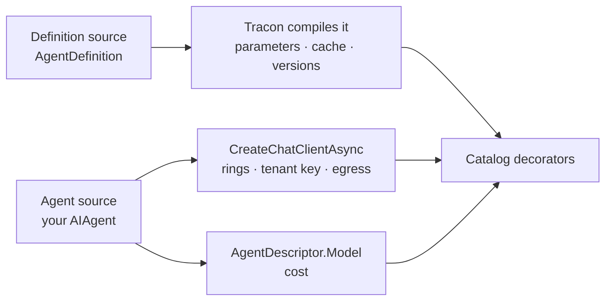

Two interfaces add agents to the catalog. `IAgentDefinitionSource` returns an
`AgentDefinition` and Tracon compiles it. `IAgentSource` returns an `AIAgent` that your
own code built. Use the first when the agent is a definition that lives in Git, an
object store or a database of your own. Use the second when another runtime owns the
agent, or when your code builds it. Both keep the normal decorator chain, so recording,
telemetry and approval behavior still apply.

A complete, buildable definition source lives in
`samples/Tracon.Samples.CustomAgentSource` — it reads `AgentDefinition` JSON files
from a directory, uses only published packages (`PackageReference`, not a
project-internal type), and its test project runs the official contract suite plus a
real agent run. Read its source alongside this guide.

`AddAgentDefinitionSource` and `AddAgentSource` each have three overloads. The generic
one resolves the source's own constructor dependencies (including its own settings,
registered separately) through DI:

```csharp
builder.Services.AddSingleton(new GitAgentSourceOptions { RepositoryUrl = url });
builder.AddTracon()
       .AddAgentDefinitionSource<GitAgentDefinitionSource>();
```

Pass a ready instance, or a factory, when the source needs something that does not
belong in the container as its own singleton:

```csharp
builder.AddTracon().AddAgentDefinitionSource(sp => new GitAgentDefinitionSource(repositoryPath, sp.GetRequiredService<ITenantContext>()));
```

All six register the source as a **singleton**; calling a generic overload twice for the
same type registers it once.

## Choose the source shape

| Shape | Use it when | What you write |
|---|---|---|
| Definition source (`IAgentDefinitionSource`) | You own an `AgentDefinition` in Git, object storage, or another database | Return the definition. Tracon compiles it |
| Agent source (`IAgentSource`) | You already own a runnable MAF `AIAgent` | Return the agent directly |



### Return a definition and Tracon compiles it

A definition source has two methods besides its name and priority. `ListAsync` returns every
definition and `GetAsync` returns one:

```csharp
public sealed class GitAgentDefinitionSource(GitAgentSourceOptions options) : IAgentDefinitionSource
{
    public string Name => "git";

    public int Priority => AgentSourcePriority.Database - 1;

    public async ValueTask<IReadOnlyList<AgentDefinition>> ListAsync(CancellationToken ct = default)
        => await _repository.ReadAllAsync(ct);

    public async ValueTask<AgentDefinition?> GetAsync(string agentName, CancellationToken ct = default)
        => await _repository.ReadAsync(agentName, ct);
}
```

Tracon does the rest, the same way it does for an agent saved in the database:

- It compiles the definition, caches the compiled agent by the definition's content and the tenant,
  and applies the tenant's provider key and egress policy.
- It builds the catalog descriptor from the definition you returned, so the agent and its descriptor
  never describe two versions.
- It reads the definition's [parameter schema](/concepts/agents/#parameters). A run, a queued run, a
  batch item, a replay and a workflow step bind the values the schema declares, and
  `AgentResolveOptions.Parameters` does the same for your own code.
- It refuses a definition that comes back under a name other than the one asked for, and records it as
  an `agent_source_contract` failure.

A definition source that ignores the ambient tenant serves the same definitions to every tenant. That is the way to give
all tenants of a multi-tenant host one set of agents the host owns, which the built-in database store, being per tenant,
cannot do: each tenant's run compiles the shared definition for itself. A source that reads `ITenantContext` serves
each tenant its own.

A tenant that saves a definition under a name your source serves cannot shadow it. The management API refuses
the write with `409` (`agent_custom_source`) and names your source. `IAgentDefinitionStore.SaveAsync`, called
from your own code, is a storage contract and does not make that check: a row saved there under the same name
is kept and never runs, because the source wins the name. Check the catalog first in a seed or a migration.

Implement `IVersionedAgentDefinitionSource` as well when the source keeps a version history. It adds
`GetVersionAsync(name, version)`. Without it, a run that is pinned to a version of the source's agents is
refused: an A/B experiment arm, a callable agent with a fixed version, or a workflow step with a pin. The
catalog never serves the current definition under a pin, because that would measure the wrong version.

### A source's agent takes no parameter values

`IAgentSource.ResolveAsync` receives the agent name and the culture. It receives nothing that a run
supplies. Tracon reads a [parameter schema](/concepts/agents/#parameters) only from a definition: one
registered in code, saved in the management database, or returned by an `IAgentDefinitionSource`. The agent
an `IAgentSource` builds is opaque to Tracon. A run that sends `parameters` to it is refused with `400`, and
each value is named as unknown. `AgentResolveOptions.Parameters` throws `TraconParameterException` for it,
for the same reason.

If the agent is a definition that you compile yourself, return the definition from an
`IAgentDefinitionSource` instead and drop the compile call. To give one run of an opaque agent its own
text, send the text in the run's messages.

For an agent source, the compiler does not run, so two things are yours. Build the
chat client with `IModelProviderRegistry.CreateChatClientAsync` inside
`ResolveAsync`: it applies the tenant's own provider key and egress policy, and it
adds the same model rings a compiled agent gets. Set `AgentDescriptor.Model` in
`ListAsync`: the run record reads the model from the descriptor, and without it the
run has no cost. Do not cache an agent whose client carries a tenant's own key
across tenants; `HasTenantProviderOverrideAsync` tells you when it does.
`samples/Tracon.Samples.MafFeatures` builds such a source, and its tests show the
tenant's key reach the chat client and the cost reach the run record.

Write an agent source for agents that do not live in your code: a repository, a
database of your own, or another runtime. An agent that code builds and that talks to
a model through Tracon needs no source. `AddAgent(name, model, factory)` hands the
factory the same chat client, with the tenant's key and egress policy, and names the
model for the run record. [Use any Microsoft Agent Framework
feature](/guides/any-maf-feature/) says when each shape fits.

## Source contract

Both interfaces follow the same rules. Sources are singleton and calls can run
concurrently. Keep no request or run state in fields, and do not capture scoped services.
`ListAsync()` is on the run path: it must be repeatable and side-effect free. Tracon does not
add a global snapshot, timeout, retry, or circuit breaker for a source.

`ListAsync()` and `ResolveAsync()` (or `GetAsync()` for a definition source) must describe the
same agent set: a name one returns has to appear in the other. Return stable values and never
mutate one — or its nested collections — after returning it. The catalog defensively copies each
descriptor at its own boundary too, but that is belt-and-suspenders, not a license to violate the
contract; a source that shares a mutable list with the catalog is still a bug the copy merely
contains.

An agent source that builds agents from an `AgentDefinition` has to copy the fields the host reads
off the descriptor: `SkillNames` and `Skills` for the A2A and MCP exposure check, and
`ExtensionNames` for the catalog. A descriptor that names skills and leaves `Skills` empty reads as
"the read approval is on", and the host refuses to expose the agent even when the definition turned
the approval off. A descriptor without `ExtensionNames` lists an agent compiled with an extension
as one without it. A definition source copies nothing: Tracon builds the descriptor from the
definition.

Honor the `CancellationToken` you are given — Tracon adds no timeout of its own, so
an uncancellable source blocks its caller indefinitely. A genuine
`OperationCanceledException` must propagate; do not catch and convert it into anything
else. "Genuine" means the token you were given is cancelled: an
`OperationCanceledException` while it is not — your own HTTP client timing out surfaces
as `TaskCanceledException` — is a source failure like any other, so listing skips the
source and resolution fails with `TraconAgentSourceException`.

A source can be global or tenant-aware; when it reads `ITenantContext`, any local cache
must include the tenant identity. Startup and background calls see the default tenant. For a
definition source, Tracon adds the tenant to the key of its compiled-agent cache, so a tenant-aware
source needs only to return each tenant its own definitions.

## Priority and management API

Smaller priority values win a name collision. `AgentSourcePriority.Code` (`0`) and
`AgentSourcePriority.Database` (`100`) are the values Tracon's own built-in sources
use, not values a custom source is barred from choosing. Pick `1` through `99` to run
between code and database definitions, or `101` or greater to run after the database.
Choosing `0` or `100` ties with the matching built-in source instead, and DI
registration order breaks the tie — the same rule as any other equal-priority pair.

Set custom descriptors to `AgentDefinitionOrigin.Custom`. They appear in the console
but are read-only: the management API cannot update or delete a definition that your
source owns.

## Prove the implementation

```csharp
using Tracon.Testing.Contracts.AgentDefinitionSources;

public sealed class GitAgentDefinitionSourceTests : AgentDefinitionSourceContract
{
    protected override string KnownAgentName => "support";
    protected override ValueTask<IAgentDefinitionSource> CreateSourceAsync()
        => new(new GitAgentDefinitionSource(/* test repository */));
}
```

Derive `VersionedAgentDefinitionSourceContract` when your source implements
`IVersionedAgentDefinitionSource`. Derive `TenantAwareAgentDefinitionSourceContract` when its list changes
by tenant. The suite checks repeatability, concurrency, cancellation, name integrity, and list/get
consistency without a network call. An `IAgentSource` has the matching `AgentSourceContract` family, in the
`Tracon.Testing.Contracts.AgentSources` namespace; the coverage check for each family is its own constant,
`ContractCoverage.AgentDefinitionSourceContracts` and `ContractCoverage.AgentSourceContracts`.

## Scale and operations

`GET /api/agents` is not paged. A definition source's `GetAsync()` runs on every resolve and on
every run request that reads the schema, so a source holding many definitions should keep its
own correctly invalidated cache. For an agent source, resolution scans the winning source's list,
and the run endpoint lists an agent source once more to learn whether it holds the name; version
resolution can list each source until it finds the owner. Source failures appear in
logs, diagnostics, and the `tracon.agent_source.failures` metric. List failures are
isolated; resolution failures stop so a lower-priority agent cannot run by mistake.

## Read next

- [Agents](/concepts/agents/) — the catalog and agent-definition model
- [Reference: IAgentDefinitionSource](/api/tracon.iagentdefinitionsource/) — the definition source contract
- [Reference: IAgentSource](/api/tracon.iagentsource/) — the agent source contract
