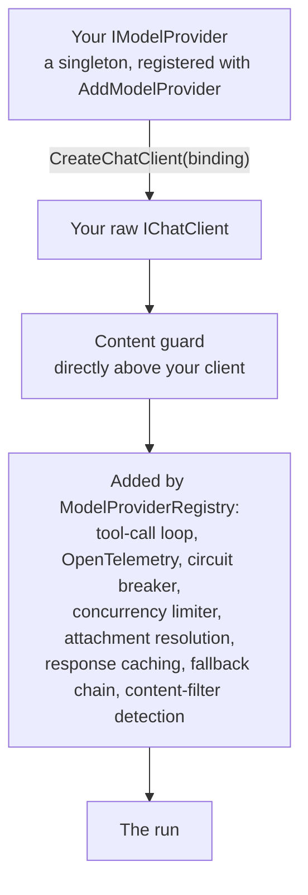

Tracon ships adapters for OpenAI, Anthropic, Google and Azure OpenAI, plus a named
compatible endpoint. A model service outside that list becomes a provider by
implementing one interface and registering it. How the shipped providers are
configured, selected per agent, and given per-tenant credentials is on
[Model providers](/guides/model-providers/).

## A provider without a package

`AddModelProvider()` registers a provider Tracon does not ship a package for.
Implement `IModelProvider` — a stable `Name`, a `Models` catalog, and
`CreateChatClient(ModelBinding)` returning a raw `IChatClient` — and register it. If
the provider should also accept a per-tenant credential (see [Per-tenant
credentials](/guides/model-providers/#per-tenant-credentials-byok)), additionally implement
`ITenantCredentialModelProvider`, whose `CreateChatClient(ModelBinding,
ModelProviderCredential)` takes a non-null credential; a provider that does not
implement it is never called with one — Tracon fails the run instead of
falling back to the setup-time key on its behalf:

```csharp
public sealed class ContosoModelProvider(HttpClient httpClient, string setupApiKey)
    : ITenantCredentialModelProvider
{
    public string Name => "contoso";

    public IReadOnlyList<ModelDescriptor> Models { get; } =
        [new ModelDescriptor { Name = "contoso-large", SupportsTools = true }];

    // The key this provider sends when a call has no tenant credential. Report it,
    // so that a failure never writes it (see "The runtime contract").
    public IReadOnlyList<string> SetupApiKeys => [setupApiKey];

    public IChatClient CreateChatClient(ModelBinding binding)
        => Create(binding, setupApiKey);

    public IChatClient CreateChatClient(ModelBinding binding, ModelProviderCredential credential)
        => Create(binding, credential.ApiKey);

    private ContosoChatClient Create(ModelBinding binding, string apiKey)
    {
        // Contoso supports no ProviderSettings key, so every key is rejected.
        ModelProviderSettings.Validate(binding, Name, []);
        return new ContosoChatClient(httpClient, binding.Model, apiKey);
    }
}

services.AddHttpClient();

tracon.AddModelProvider(services =>
    new ContosoModelProvider(services.GetRequiredService<HttpClient>(), setupApiKey));
```

A provider that never wants to support BYOK simply implements only `IModelProvider`
and stops there — it still works with the setup-time credential for every tenant.

A complete, runnable version of this provider — including per-tenant credentials
and provider-settings validation — lives in the repository at
`samples/Tracon.Samples.CustomModelProvider`. It takes Tracon by
`PackageReference` only, which is what makes it a proof rather than an
illustration.

### The runtime contract

The rules below are what the registry and the compile path actually rely on. An
implementation that breaks one still compiles and still passes its own unit
tests; it misbehaves under a real deployment. Verify them by deriving
`ModelProviderContract` from the
[`Tracon.Testing.Contracts.Xunit`](/packages/) package rather than by reading carefully.
If your provider supports BYOK, derive its opt-in
`ModelProviderCredentialContract` too. Its required assertion must inspect the
provider request boundary (for example a recording transport), not merely a
different client object; otherwise a new wrapper can still send the setup-time
key and bill the wrong tenant. Derive `ModelProviderSettingsContract` for every
provider, including one that supports no settings key.

**Lifetime and threading.** Your provider is a **singleton**. It must not capture
a scoped service, and the provider set is fixed once the container is built.
`CreateChatClient` is called **concurrently** and must be thread-safe. If you
cache a client per credential in a `ConcurrentDictionary`, remember that
`GetOrAdd` may run its factory more than once for the same key under a race and
discard the extras — so building a client must be side-effect free.



**Return a raw client.** `UseFunctionInvocation()`, OpenTelemetry, the content
guard, the circuit breaker, the concurrency limiter, attachment resolution,
response caching, the fallback chain and content-filter detection are all added
by `ModelProviderRegistry` around whatever you return. Building any of them
yourself is not merely redundant: the registry places the content guard directly
above your client so that *every* turn of the tool-call loop is inspected. With
your own inner loop, the turn that carries a tool result back into the model runs
beneath the guard — the exact path prompt injection takes — while the reply text
and the tool-call count stay identical, so nothing else reveals it.

**Tracon never disposes the client you return.** It is built once per
compiled agent and held by it; the compiled agent implements neither
`IDisposable` nor `IAsyncDisposable`, and evicting one from the compile cache
drops the reference without disposing. You own the lifetime of what you return,
and it must tolerate never being disposed — which is why the shipped providers
return clients backed by a long-lived, shared SDK client.

**Report the key you were set up with.** A service that refuses a key often quotes it in
the body of its answer, and the SDK puts that body into the exception it throws. Override
`IModelProvider.SetupApiKeys` and return every static key your provider sends when a call has
no tenant credential, **as you send it** (trim it first if you trim it before you send it). Tracon
replaces those values with `[redacted]` wherever the text of a failure of that provider's calls
is written: logs, the `chat` span, the stored trace, the run record and the response. The
default is an empty list, so a provider written before the member existed keeps working, but a
key you do not report stays readable when the service quotes it. Do not report a token you fetch
while the provider runs, and do not report a tenant's key: Tracon masks that one from the
credential the call was resolved with. A value shorter than eight characters is not replaced.
A decorator that wraps your provider must forward `SetupApiKeys`: the default body of a wrapper that does
not returns an empty list, and the key goes unreported. Tracon reads the list when it builds a client, to
build the replacement and for nothing else; if
your getter throws, the client is built without a replacement and Tracon logs a warning that
names the provider and the exception type. See [Provider error text in
logs](/guides/observability/#provider-error-text-in-logs).

**Provider settings.** Reject every `ModelBinding.ProviderSettings` key you do not
support. A provider that supports no key rejects them all. Call
`ModelProviderSettings.Validate(binding, prefix, supportedKeys)` from
`CreateChatClient`, and pass an empty list when you support none. Its exception is
the one the registry passes through with the key named. The registry masks the
message of any other exception thrown while a client is built, so a hand-rolled
check reaches the author as a generic provider failure. To refuse a value of a key
that takes one of a few texts, read it with `ModelProviderSettings.ReadChoice(binding, key,
accepted)`: it matches the accepted values without regard to case, returns the one you
spell, and raises the same pass-through exception, naming the key and the accepted values and
never the value that was given. `ReadBoolean`, `ReadInt32` and `ReadString` refuse a value of
the wrong kind the same way. A refusal of any other kind has to name the key and the accepted
values, not the value (`ModelProviderSettingsContract` fails a provider whose message
repeats it), and its text will be masked by the registry.

**Default output limit.** If your client sends an output-token limit of its own
when `ModelBinding.MaxOutputTokens` is empty, return a `ModelOutputLimit` from
`GetService(typeof(ModelOutputLimit))` on the client you build for that binding,
with `HighReasoningEffort = true` when the binding's settings ask for deep
reasoning. `POST /api/agents/validate` reads it through the whole pipeline and
warns when the limit is below the catalog's `MaxOutputTokens` for the model. A
client that sends no limit returns nothing.

**Naming.** `Name` is matched against `ModelBinding.Provider` case-insensitively.
Registering two providers under one name is not last-one-wins: the host fails at
startup.

**The catalog is not an allow list.** See [the next
section](/guides/model-providers/#model-catalog-is-metadata-not-permission).

**Credentials.** `CreateChatClient(ModelBinding, ModelProviderCredential)` — the
`ITenantCredentialModelProvider` overload — is called only when a tenant supplies a
credential **and** your provider implements that interface; without it, Tracon
never calls your provider with a tenant credential at all, and it does not fall back
to calling the plain `CreateChatClient(ModelBinding)` overload with the tenant's
request either — the run fails closed with `tenant_provider_refused`
instead. If you do implement the interface, the key must never fall back to your
setup-time key: a tenant that supplied a credential is billed on it, or the call
fails. An endpoint may fall back, so a globally configured base address still
applies when a tenant overrides only its key.

### How failures are classified

How Tracon reads a failure you throw (which ones move to the next `Fallbacks` link, which ones count against the
provider's circuit, how a safety filter and an output limit are reported) is described with the fallback chain, in
[How failures are classified](/guides/reliability/#how-failures-are-classified).

## Read next

- [Model providers](/guides/model-providers/) — the shipped providers, the catalog, and per-tenant credentials
- [Reliable runs](/guides/reliability/#how-failures-are-classified) — how a failure you throw moves the fallback chain
- [Write your own error classifier](/guides/write-your-own-error-classifier/) — override which failures retry
