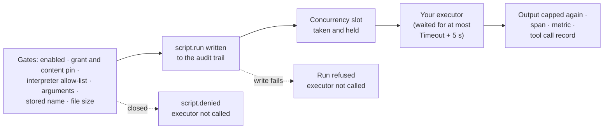

:::note[Preview packages]
Tracon is published as `1.0.0-preview.5`. Use `--prerelease` for discovery or
pin the exact version for reproducible builds.
:::

Where does an approved skill script run? By default, in a local process on the
Tracon host, under the host's own operating-system identity. Register an
`ISkillScriptExecutor` and the script runs where your executor runs it instead:
a container, a micro-VM, or a runner service you operate. Tracon still decides
**whether** a script runs; your executor decides **where**.

## What stays with Tracon

Turning scripts on is unchanged: `UseSkillScripts`, the acknowledgement flag, the
interpreter allow-list, and a tenant grant pinned to the content. An executor
receives a request only after every gate passed, and it cannot skip one:



The audit entry is written by Tracon before the call. A run whose entry cannot be
written never reaches your executor, so an executor can neither run code without
a record nor suppress one.

## Implement the executor

The request carries everything a remote runner needs; the executor maps it to
your runtime and maps the outcome back. This one posts the script to a runner
service:

```csharp
public sealed class RunnerServiceScriptExecutor(HttpClient runner) : ISkillScriptExecutor
{
    private static readonly JsonSerializerOptions Web = new(JsonSerializerDefaults.Web);

    public async ValueTask<SkillScriptExecutionResult> ExecuteAsync(
        SkillScriptExecutionRequest request, CancellationToken cancellationToken = default)
    {
        using var response = await runner.PostAsync(
            "runs",
            JsonContent.Create(new
            {
                tenant = request.TenantId,
                runtime = request.Interpreter,
                source = request.Content,
                sourceSha256 = request.ContentSha256,
                standardInput = request.ArgumentsJson,
                timeoutSeconds = request.Timeout.TotalSeconds,
                maxOutputBytes = request.MaxOutputBytes,
            }),
            cancellationToken);

        response.EnsureSuccessStatusCode();

        var outcome = JsonSerializer.Deserialize<RunnerOutcome>(
            await response.Content.ReadAsStringAsync(cancellationToken), Web)
            ?? throw new InvalidOperationException("The runner service returned no outcome.");

        return new SkillScriptExecutionResult
        {
            ExitCode = outcome.TimedOut ? null : outcome.ExitCode,
            StandardOutput = outcome.StandardOutput,
            StandardError = outcome.StandardError,
            Truncated = outcome.Truncated,
            TimedOut = outcome.TimedOut,
        };
    }

    private sealed record RunnerOutcome(
        int? ExitCode, string StandardOutput, string StandardError, bool Truncated, bool TimedOut);
}
```

Register it next to `UseSkillScripts`, before or after `AddTracon()` — a plain
`AddSingleton` wins in both orders. With a remote runner, an allow-list value can
name a runtime instead of an interpreter path:

```csharp
builder.Services.AddHttpClient<RunnerServiceScriptExecutor>(client =>
    client.BaseAddress = new Uri("https://script-runner.internal/"));
builder.Services.AddSingleton<ISkillScriptExecutor>(provider =>
    provider.GetRequiredService<RunnerServiceScriptExecutor>());

builder.AddTracon()
       .UseSkillScripts(o =>
       {
           o.PlatformIsolationAcknowledged = true;
           o.AllowStoredScripts = true;
           o.Interpreters["py"] = "python-3.12";
       })
       .RequireCustomBinding<ISkillScriptExecutor>();
```

`RequireCustomBinding<ISkillScriptExecutor>()` stops the host at startup while
the built-in executor is still the one that resolves — for example when a module
registers yours with `TryAddSingleton` after `UseSkillScripts` and the
registration is dropped. The acknowledgement flag stays required with any
executor: Tracon cannot verify the isolation an executor provides.

## What the request carries

| Member | Meaning |
|---|---|
| `TenantId` | The tenant whose grant opened the gates. Use it to pick a per-tenant runner; never read `ITenantContext` |
| `RunId` | The run that called the script, or `null` outside a run |
| `SkillName`, `ScriptName` | A stored script's name is a plain file name. A file script's name is its path inside the skill directory, such as `scripts/fetch.py` — check it before you use it as a file name |
| `Origin` | `Stored` (database or code, content-pinned) or `File` (under a skill root, not pinned). Throw for an origin you do not support |
| `Interpreter` | The allow-list value for the extension |
| `Content`, `ContentSha256` | The script text, and the upper-case hexadecimal SHA-256 of its UTF-8 bytes |
| `SourcePath` | A file script's host path; a remote runner cannot read it and runs `Content` |
| `ArgumentsJson` | The model's arguments; write them to standard input, or close it empty when `null` |
| `Timeout`, `MaxOutputBytes` | Stop the script at the timeout; keep at most this many UTF-8 bytes of each output stream |

The request carries no environment value. Give the script `TRACON_SKILL_NAME`
(the skill name) and `TRACON_SKILL_TEMP` (a writable directory of its own) and
nothing from your host, so a script behaves the same under every executor.
Logging a request is safe: its text form leaves out `Content` and
`ArgumentsJson`.

## Runtime contract

- **Lifetime: singleton.** One instance serves every run, concurrently. Make it
  thread-safe.
- **A timeout is a result, a cancellation is an exception.** Past `Timeout`, stop
  the script and return `TimedOut = true` with no exit code. When the caller
  cancels the token, throw `OperationCanceledException`.
- **Tracon does not wait forever.** It waits `Timeout` plus five seconds, then
  cancels the token, stops waiting, frees the concurrency slot, and records a
  timeout. Cancellation is cooperative: if your executor ignores the token, the
  script can keep running after Tracon has moved on.
- **Cap the output, do not annotate it.** Set `Truncated` when you cut a stream.
  Tracon caps each stream again and adds the one truncation notice the model sees.
- **A consistent result or an exception.** An exit code without `TimedOut`, or
  `TimedOut` without an exit code — any other shape fails the call. A thrown
  exception fails it too; the model and the tool call record see only the
  exception type, and the message goes to the server log.
- **No delivery guarantee applies.** Tracon calls the executor once per approved
  call and never retries. The model may call the script again; that call passes
  every gate again.

## Isolation is the executor's job

Tracon does not isolate the script process. The built-in executor runs it under
the host's own operating-system identity, which can read what that identity
reads — the [threat model](/reference/threat-model/) lists this as an accepted
risk. Your executor is how a deployment closes it: no host environment, no host
file system, a restricted network, and per-tenant resources. Tracon cannot see
or check any of this, so the grant rules do not relax: in a multi-tenant host a
stored script's grant still needs platform authority.

## Verify your implementation

Add the contract package to your test project:

```bash
dotnet add package Tracon.Testing.Contracts.Xunit --prerelease
```

```csharp
using Tracon.Testing.Contracts.Scripts;

public sealed class RunnerServiceScriptExecutorTests : SkillScriptExecutorContract
{
    protected override string Interpreter => "sh";

    protected override ValueTask<ISkillScriptExecutor> CreateExecutorAsync()
        => ValueTask.FromResult<ISkillScriptExecutor>(
            new RunnerServiceScriptExecutor(new HttpClient { BaseAddress = new Uri("http://localhost:8085/") }));
}
```

The inherited tests send POSIX `sh` scripts and check standard input, an empty
argument and an empty script, the exit code and standard error, the output cap
without a notice, the timeout, a caller cancellation, the two variables without
the host environment, separate temporary directories for concurrent calls, and
that a stored request runs its content and never a path. An executor for another
runtime overrides `Extension`, `Interpreter`, and the script bodies;
`SkipReason` skips the suite where the runtime is missing. Pair it with
`ContractCoverage.MissingDerivedTypes(..., ContractCoverage.ScriptContracts)` so
a new contract in a later package version does not go untested.

## Read next

- [Skill scripts](/concepts/tools/#skill-scripts--the-strict-exception) — the gates, grants, and content pin every executor sits behind
- [Threat model](/reference/threat-model/) — the operating-system identity risk an executor is there to close
- [Testing](/guides/testing/) — the contract packages and how to run them
