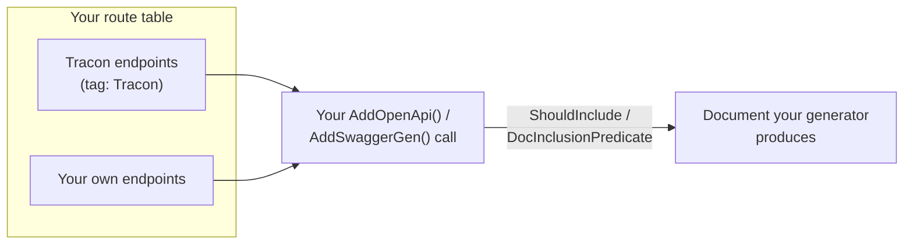

182 operations across 142 paths. This page is the shape they all share; the groups in
the sidebar are the operations themselves, each with what it does and what it returns.

The OpenAPI document is published as
[`/openapi/tracon.json`](/openapi/tracon.json) — load it into
Scalar, Swagger UI, Postman, or a client generator.

## The prefix is yours

Generated operation pages use `{prefix}`. Replace it with the value passed to
`MapTracon`; the project template uses `/tracon`.

```csharp
app.MapTracon("/tracon");
```

## Two surfaces

**The management API** (`/api/*`) drives the control plane: agents, runs, sessions,
skills, workflows, evals, experiments, jobs, and governance.

**OpenAI-compatible endpoints** (`/v1/*`) let an OpenAI client talk to your agents
with the familiar request and streaming formats. Configure its base URL and
authentication, and set `model` to the **agent** name — which provider model the
agent calls is server-side policy. See the [OpenAI API guide](/guides/openai-api/)
for copyable clients and the compatibility boundary.

## Authentication

A bearer token in the `Authorization` header, holding either the configured static
token or an API key. See
[securing the endpoints](/getting-started/security/) for the layers and how
scopes narrow roles.

`{prefix}/api/meta` answers without authentication — the console needs to learn which
method to present. It returns nothing sensitive.

## Streaming

Run endpoints answer with `text/event-stream`, one frame per run event, and the first
frame reports the run id.

```bash
curl -N -X POST http://localhost:5081/tracon/api/agents/support/run \
     -H 'Content-Type: application/json' \
     -d '{"message":"Where is order 4182?"}'
```

Two headers change the shape:

| Header | Effect |
|---|---|
| `Idempotency-Key` | One JSON response instead of a stream — a replay cannot be rebuilt from a stream |
| `Prefer: respond-async` | `202 Accepted` plus a `Location` header; poll the job |

:::caution[A stream cannot report a late failure as a status code]
The status code is sent before the first frame. A failure after that arrives as an SSE
`error` frame, not an HTTP error. A client that only checks the status code will treat
a failed run as a success.
:::

A run that stops on a tool call needing a human decision sends an `approvals` frame
before the stream ends — the pending request's id and tool name, plus whatever an
[approval presenter](/concepts/governance/#approvals) resolved for it. See
[Approvals](/concepts/governance/#approvals) for the queued-run mailbox shape, which
answers the same request differently.

Right before `done`, the stream sends a `custom` frame for each notice the run
recorded from a fixed list. The frame's data is the recorded event, byte for byte
the same as `GET /api/runs/{runId}/events` serves it, in the order it was recorded:

| `customType` | Sent |
|---|---|
| `tracon.output.truncated` | Always. The model cut a plain-text answer off at its output token limit or its context window; the streamed text is incomplete (see [Truncated output](/concepts/runs/#truncated-output)) |
| `tracon.output.filtered` | Always. The provider's content filter stopped the model after it wrote text; the streamed text is incomplete (see [Filtered output](/concepts/runs/#filtered-output)). A filter that stopped the model before any text ends the stream with an `error` frame instead |
| `tracon.quota.threshold` | Only with `Quotas:PublishThresholdToRunStream` turned on (off by default): the run crossed a [quota threshold](/concepts/governance/#quotas-and-rate-limits) |

No other custom event reaches this stream; a tool's own `Custom` event stays on
`/events`, and so do `tracon.content` and `tracon.workflow.event`
(see [Content and events the run has no type for](/concepts/runs/#content-and-events-the-run-has-no-type-for)). A client that reads frames by name and ignores an unknown `customType`
needs no change. If the run store cannot be read at that point, the stream still
ends with `done`, without the notices, and the server logs a warning; the run's
events keep them.

An agent with a [loop](/concepts/agents/#run-until-the-work-is-done) streams every
iteration, so the `update` frames carry the drafts and the feedback as well as the
answer. After each iteration the loop evaluated, the stream sends a
`loop.iteration-completed` frame. It comes after the last `update` of that iteration
and before the first `update` of the next. The frame's data is the recorded
`LoopIterationCompleted` event, byte for byte the same as `GET /api/runs/{runId}/events`
serves it. The event's `payload` is a JSON string with these fields, and it is `null`
when `RunRecording:RecordToolPayloads` is off (it is on by default); the frame's `text`
then still says what happened:

| Field | Meaning |
|---|---|
| `iteration` | The number of the iteration that just ended, counted from 1 |
| `continued` | `true` when a criterion asked for another iteration |
| `continuedBy` | The kind of that criterion, or `null` |
| `hasFeedback` | `true` when that criterion gave the agent feedback; the feedback text is not in the frame |
| `failedCriterion` | The kind of a criterion that failed to evaluate, or `null` |
| `ceilingReached` | `true` when the iteration ceiling ends the loop |
| `failsRun` | `true` when this evaluation fails the run |
| `criteria` | Every criterion evaluated in the iteration, in order, each with its `kind` and its `decision` (`stop`, `continue` or `failed`). An `aiJudge` entry adds `judge` (`provider`, `model`); an `agentReview` entry adds `reviewer` (`agentName`, `agentVersion`, `runId`). The list ends at the first criterion that continues or fails |

The answer is the iteration that the last frame closes, when that frame has
`continued: false`. When the last frame has `ceilingReached: true`, the answer is the
iteration **after** it: the turn at the ceiling is not evaluated, so it has no frame of
its own. With `OnExhausted` set to `FailRun` no turn follows, and the stream ends with
an `error` frame.

After a frame with `continued: true`, the next `update` is not the model's text. It
carries the feedback the loop gives the model, with `role` `user`. Skip it when you
collect the answer.

An agent without a loop never sends this frame. A frame mirrors a recorded event, so an
event the run could not record (its store failed) has no frame, and the run goes on. A
sub-agent's loop writes to the sub-agent's own run and never to this stream. A client that ignores a frame name it does
not know needs no change.

`GET /api/runs/{runId}/events` is a **separate** SSE contract with its own, larger
set of frame names (`run.started`, `tool.invoking`, ...) — see
[the two-contract table in Runs and recording](/concepts/runs/#two-sse-contracts-not-one).


## Paging

List endpoints that page use `skip` and `take`. `skip` defaults to 0, `take` to 50,
and **`take` is clamped to 1..200 rather than rejected** — an out-of-range value never
fails a request.

Ordering is usually newest first, which means an item can move between pages while a
client is paging. Use the id as identity, never the position.

Some lists are deliberately not paged — agents, skills, quotas, retention policies —
because their size is bounded by configuration rather than by traffic.

## Errors

Failures are `application/problem+json` with a title and a detail. Two conventions run
through the whole API:

**A resource you may not see is reported as `404`, not `403`.** Another tenant's run or
session is reported as missing, so the API does not confirm that it exists. A conversation
id is local to your tenant: one that only another tenant uses answers like an id nobody has
used (see [OpenAI-compatible API](/guides/openai-api/)).

**A field the schema declares as non-nullable rejects an explicit `null`.** Omitting
a list is fine — `{"message": "hello"}` is a complete run request, and every list the
schema does not require simply defaults to empty. Sending `{"message": "hello",
"approvals": null}` is not the same thing: it states a value for a field whose
contract has no null, and the API answers `400` rather than acting on it. A field
that genuinely distinguishes "not provided" from "provided empty" is declared
nullable in the schema and still accepts `null`. The same holds inside a list or a map:
`{"nodes": [null]}` is a `400` when the schema's items are not nullable, and a list of
`string | null` still takes its nulls.

The free-form members are declared nullable, because they are optional and an empty
value means nothing: a model's `providerSettings`, the `metadata` of an agent or a
skill, an eval suite's `checks` and a schedule's `payload`. `null` and a missing member
read the same way, as empty. A member the server fills in when it is left out (an MCP
server's `enabled` and `requiresApproval`, a schedule's `timeZone`) carries a `default`
in the schema; a generated client starts with it.

**Error text is English and is not translated.** The same failure has to read the same
way in a log, a test, and a support ticket. The console translates its own labels and
shows server text as it is.

| Status | Means |
|---|---|
| `400` | The request is malformed or fails validation. A query parameter that names no member of its enum is `400` whether it is written as text or as a number (`?bucket=99`), and a value that is only whitespace is no value: a blank `model`, a blank OAuth `state`. A value the store itself refuses is `400` too (below) |
| `401` | Missing or invalid credentials |
| `403` | Authenticated, but not allowed — including the loopback restriction |
| `404` | Not found, or not yours. A path segment that is only whitespace is a name nobody can have saved, so it is `404` too |
| `409` | Conflicting state — a name in use, a running experiment, a code-defined agent, a client-side tool that cannot be replayed |
| `413` | The JSON body is longer than `TraconEndpointOptions.MaxJsonBodyBytes` (8 MiB by default). It is counted as it arrives, so a body sent chunked or with a wrong length stops there too |
| `415` | The body has to be JSON and the request carried another `Content-Type`, or none (`Content-Type: application/json`) |
| `422` | A content guard blocked the content |
| `429` | A quota or rate limit was exceeded |
| `501` | The capability is not registered — the workflow engine, voice, knowledge, or MCP |
| `502` | The model provider failed or never answered — including a request that timed out |
| `503` | The store could not answer, or the process is draining in-flight runs before it stops |

`501` is worth its own note: it means "this build does not have that package wired
up", which is a different problem from a wrong address, and the API says so rather
than answering `404`.

**A provider that times out is a `502`, not an empty `200`.** .NET reports an
`HttpClient` request timeout as a `TaskCanceledException`, and a run that ends
because the caller cancelled has no error to report — so an implementation that
reads the exception type alone answers a timed-out provider with a clean, empty
success. Tracon decides from the request instead: unless the caller's
connection actually went away, a run that ends this way is a failure, the status
is `502`, and the run is recorded as `Failed` with the `Timeout` error class.

**A `503` says which kind of unavailable it is.** A store that cannot answer used
to surface as whatever your own exception handler made of a raw provider
exception — usually a bodyless `500` — while the same application was already
reporting the reason on `/health` and `/api/diagnostics`. Now the reason reaches
the caller, and the two causes are told apart by `title`:

| `title` | What it means | Does retrying help |
|---|---|---|
| `Database schema is not current` | The store is reachable; migrations have not been applied | No — apply them with `tracon migrate`, or start with `AutoApplyMigrations` on |
| `Persistence store unavailable` | The store could not be reached at all | Usually yes |
| `Server is shutting down` | In-flight runs are draining | Yes, shortly |

The `detail` never carries the schema name or the statement text; that stays in
your server's log, for the same reason a `502`'s detail is shallow.

**A value the store refuses is a `400`, not a `503`.** SQL Server holds the identifier
columns to 200 characters, and a longer value in a field the request does not bound
(a tenant's `displayName`, an approval rule's `toolName`) is refused by the server
itself. That is not an outage: the store answered, and the same request gets the same
answer. The reply is `application/problem+json` with `400` and one of two titles:

| `title` | What it means | Does retrying help |
|---|---|---|
| `Value too long for the store` | A text in the request is longer than its column | No — shorten the value |
| `Number out of range for the store` | A number in the request does not fit its column | No — use a smaller number |

The `detail` is fixed text. It names no field, column, table or value: the provider's
own message carries the value that was cut, and that can be a secret pasted into the
wrong field. Only your server's log records that the store refused something, and not
what. A connection that cannot be opened, a schema that is not current, a deadlock and
a timeout stay `503`.

The stores do not agree on the longest text. SQL Server counts UTF-16 code units, so
100 emoji fit in 200 and 101 do not; PostgreSQL and SQLite keep text of any length and
take the same request. Check the length in your own client if the code runs on more than
one of them.

**A `502`'s `detail` is deliberately shallow** — it never carries the failing
provider's own error text, only its exception type and a correlation id you can
match against your server's log. The same rule applies to a streaming run's `error`
frame and to MCP tool-call errors. See
[errors are classified](/concepts/runs/#the-error-message-is-safe-to-display-not-safe-to-debug-from)
for why.

## The groups

Pick one from the sidebar. Each operation shows every declared media type, parameters,
responses, and response headers. [HTTP schemas](/http-api/schemas/) expands
all 290 request and response contracts with required fields, defaults, and validation
constraints from the OpenAPI snapshot.

## About the published document

The Tracon packages do not generate the OpenAPI document themselves — they carry
route metadata, and your own `AddOpenApi()` call produces the document. Taking an
OpenAPI dependency would force it, and its transitive CVE exposure, onto every
consumer.

The consequence: the title, version, and server list in the published snapshot come
from the host that generated it. In **your** document they come from your application.
The paths, schemas, and descriptions are the same.

The published snapshot is corrected in three places that your document is not, because the
correction is a document transformer and a transformer needs the OpenAPI package this
library does not take on. A nullable enum is written once as nullable instead of twice; a
nullable free-form value is written as `anyOf` instead of `oneOf` (a `null` matches both of
its branches, and `oneOf` allows exactly one); a dictionary of free-form values names its
value schema, so a TypeScript client types it as `{ [key: string]: unknown }` and not as
`Record<string, never>`. Your own `AddOpenApi()` document shows the raw shapes the .NET
generator writes. The transformer is a single file in the reference host,
`samples/Tracon.Api/OpenApi/PublishedDocumentCorrections.cs`; copy it if you publish the
document or generate a client from it.

Because Tracon maps plain minimal API endpoints on your own
`IEndpointRouteBuilder`, they are also picked up by **your** OpenAPI/Swagger
generator, right alongside your own endpoints — no separate setup on Tracon's
side turns this on or off.



### Excluding Tracon from your document

Every Tracon endpoint carries the `Tracon` tag. If your document should not
describe Tracon's operations — for example, one you publish to external
partners — filter on that tag in your own OpenAPI setup; Tracon has no
built-in switch for this.

With `Microsoft.AspNetCore.OpenApi`:

```csharp
using Microsoft.AspNetCore.Http.Metadata;

builder.Services.AddOpenApi(options =>
{
    options.ShouldInclude = description =>
        !description.ActionDescriptor.EndpointMetadata
            .OfType<ITagsMetadata>()
            .Any(tags => tags.Tags.Contains("Tracon"));
});
```

With Swashbuckle:

```csharp
builder.Services.AddSwaggerGen(options =>
{
    options.DocInclusionPredicate((_, apiDescription) =>
        !apiDescription.ActionDescriptor.EndpointMetadata
            .OfType<ITagsMetadata>()
            .Any(tags => tags.Tags.Contains("Tracon")));
});
```

The filter only changes what your document *describes*. Tracon's endpoints stay
reachable; they just stop appearing in your Swagger UI or generated document.

## Read next

- [Agent operations](/http-api/agents/) — inspect a generated request and response contract
- [Securing the endpoints](/getting-started/security/) — the authentication these conventions assume
- [OpenAI-compatible API](/guides/openai-api/) — the other HTTP surface, with different rules
