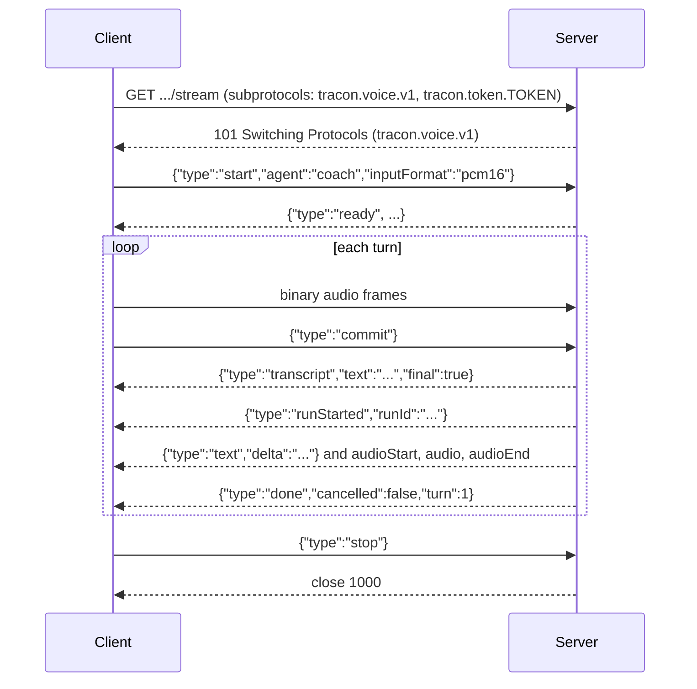

This page is what you need to write a client for `UseVoiceConversation()` in any language:
how the socket opens, which frames travel in each direction, what each field means, and how
a conversation ends. The server side, its settings and its privacy rules are in
[Voice and live conversation](/guides/voice/#enable-live-conversation). A TypeScript client
that implements everything here ships in [`@tracon/client`](/guides/typescript-client/#talk-to-a-voice-conversation).

The frames are described by a JSON Schema,
[`voice-conversation-frames.schema.json`](/schemas/voice-conversation-frames.schema.json).
The names of the frames, their fields and the handshake values are pinned by a test, so
removing or renaming one is a breaking change that a release note names; a new frame or a new
field is not. A reader ignores a frame type and a field it does not know.

## Open the socket

| Part | Value |
|---|---|
| Address | `{origin}{prefix}/api/voice/sessions/{sessionId}/stream`, where the prefix is the one `MapTracon` was given (`/tracon` by default). Use `wss` when the page is `https` |
| Subprotocol | `tracon.voice.v1`. The server echoes it on a successful handshake |
| Credential | A second subprotocol, `tracon.token.<token>`, because a browser cannot add an `Authorization` header to a WebSocket handshake. The token is never accepted in the query string, where logs would record it |
| Session | `{sessionId}` is the agent session the conversation runs in. An id the server has never seen is not refused: the first turn opens it. It is 1 to 200 characters |

### What the handshake can answer

The server judges the request before it upgrades, so a refusal is an HTTP status and not a
socket that closes after it opens:

| Status | Meaning |
|---|---|
| `101` | The conversation can start. Send `start` |
| `400` | The request is not a WebSocket upgrade |
| `401` | No credential or an unknown one. The body does not say what was expected |
| `403` | The API key lacks the `RunsWrite` scope or is not allowed for the tenant; the page's origin is not allowed (a socket authenticated by cookie only); or the tenant's policy does not allow the speech provider |
| `404` | The session belongs to another tenant, or the run authorization handler refused the caller. The two answers are identical, so a refusal never confirms a session exists. The same status answers a host that did not call `UseVoiceConversation()`: the route does not exist |
| `429` | The tenant already holds its maximum number of conversation connections |
| `501` | The host registered no speech provider: a conversation needs both transcription and synthesis |
| `503` | The host is shutting down and takes no new conversation |

## Frames the client sends

A text frame is one JSON object with a `type`. A binary frame is audio.

| `type` | Fields | When |
|---|---|---|
| `start` | `agent` (required), `voiceId`, `inputFormat` | First, once. A second `start` ends the conversation with an `error`: the agent, the session and the tenant are fixed for the connection. `voiceId` is the voice of the answers; a host that set a connection resolver ignores it. `inputFormat` is `webm-opus` (the default) or `pcm16` |
| binary | raw audio | After `ready`. Audio sent while the assistant is answering or opening is ignored: a client that speaks over the speaker is not an interruption |
| `commit` | none | The utterance ended. Voice activity detection is the client's job; the server runs none |
| `cancel` | none | Barge-in: stops the answer being generated or spoken. While the server is listening it discards the audio gathered so far |
| `stop` | none | Closes the conversation cleanly |

Audio formats. `webm-opus` is what `MediaRecorder` produces in a browser, and its chunks
concatenated are a valid file. `pcm16` is raw mono 16-bit little-endian PCM from an
`AudioWorklet`; it has no header, so the server writes a WAV header before transcription,
using `InputSampleRate` (16 kHz by default). Say the real rate in the server's settings.

## Frames the server sends

| `type` | Fields | Meaning |
|---|---|---|
| `ready` | `agent`, `sessionId`, `persistAudio` | `start` was accepted; send audio. `persistAudio` says whether the audio of the answers is stored: show it to the user |
| `transcript` | `text`, `final` | What the server heard. An empty `text` means nothing usable was heard, and the turn ends with `idle` |
| `runStarted` | `runId` | The agent's run began. `runId` is the run's identifier |
| `text` | `delta` | A piece of the answer, as a caption |
| `audioStart` | `mediaType` | The binary frames that follow are audio of the answer, in this media type (`audio/mpeg` unless the host changed it) |
| binary | audio chunk | Between `audioStart` and `audioEnd`. Play the chunks of one sentence in order |
| `audioEnd` | none | One spoken sentence ended. Another `audioStart` can follow in the same turn |
| `done` | `cancelled`, `turn`, `attachmentId` | The turn ended: answered, interrupted (`cancelled`) or failed. `turn` is the number of turns the user has completed; `attachmentId` is present only when the host stores audio |
| `idle` | none | A `commit` closed no turn: it came before any audio, or the audio held nothing usable. The conversation is listening again. It is neither an error nor a `done` |
| `error` | `message` | Something went wrong. Before `ready` it ends the conversation. During a turn it ends the turn and a `done` follows |
| `ended` | `reason` | The server ends the conversation and closes the socket right after. `reason` is `agent` when the agent called `end_conversation`. Do not reconnect on your own |

Two rules keep a client from hanging. Every `commit` the server accepts ends in a `done` or an
`idle`, never in silence: a client that put itself in a "thinking" state when it committed
leaves it on either frame. And `idle` is not `done`: `done` closes a turn that exists and
carries that turn's number, so a client that treats them alike rewrites the record of the
previous turn.

### Opening and ending

A host that set a connection resolver can open the conversation with a `Greeting` (a fixed
text) or an `OpeningPrompt` (the agent answers first). The frames are those of a turn, without
a `transcript`: a greeting sends `text`, `audioStart`, the audio, `audioEnd` and `done`; an
opening prompt sends `runStarted` before them. Their `done` carries `turn: 0`. While the
assistant opens, audio is ignored and a `commit` is not answered; `cancel` cuts the opening.

An agent that lists `end_conversation` can end the conversation: the server finishes the
answer, sends `done`, then `ended`, and closes the socket.

## Close and limits

Every close the server starts is a normal closure (code `1000`) and carries a description
that tells the client why:

| Description | Cause |
|---|---|
| `The conversation closed.` | The client sent `stop` or closed the socket |
| `The conversation was ended by the agent.` | An `ended` frame came first |
| `The connection stayed idle.` | No frame for `IdleTimeout` (2 minutes by default) |
| `The connection reached the duration limit.` | `MaxConnectionDuration` (30 minutes by default). Reconnect to continue: the session keeps its history |
| `The server is shutting down.` | The host is draining |
| `The conversation closed with an error.` | The connection failed |

An utterance is bounded by `MaxUtteranceDuration` (60 seconds) and `MaxUtteranceBytes` (8 MiB):
when a client's voice activity detection never commits, the server closes the utterance on its
own and answers it. A whole answer is spoken up to `MaxSpokenCharactersPerTurn` (5,000
characters); the text beyond it still arrives as `text` frames.

A conversation is bound to one server instance for its whole length. Behind a load balancer,
use sticky routing, allow the WebSocket upgrade, and keep the proxy's idle timeout longer than
`IdleTimeout`.

## Read next

- [Voice and live conversation](/guides/voice/): enable the layer, decide the voice on the server, open and end the conversation, and read what it cost
- [TypeScript client](/guides/typescript-client/): `@tracon/client` implements this protocol with typed frames
- [Security](/getting-started/security/): the loopback restriction, the token and the role policies that judge the handshake as they judge every other request
