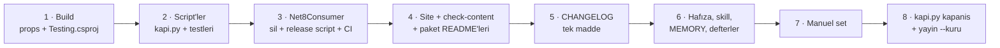

# Faz 193 — `net8.0` ve `net9.0` Hedeflerinin Düşürülmesi

> **Durum:** 📋 Planlandı (2026-10-11) — uygulama 2026-11-10'dan önce başlamaz (K-855)
> **Plan onayı:** Bakımcı, 2026-10-11 (engelleyici kararlar sohbette alındı: uygulama zamanı, yalnız düşürme, çoklu-TFM altyapısı korunur)
> **Kaynak:** [ADAYLAR.md](ADAYLAR.md) · **F-266**
> **Önkoşul:** [Faz 187](arsiv/fazlar/187-KIRICI-DEGISIKLIK-KAPISI.md) — `PKV006` kapısı düşen TFM'i sürüm notunda paket paket ister (kapandı) · takvim: Microsoft desteğinin bittiği **2026-11-10**
> **Paketler:** 17 kütüphane paketi (`Tracon.Abstractions` · `.Anthropic` · `.AspNetCore` · `.Azure` · `.Client` · `.Core` · `.Google` · `.Mcp` · `.OpenAI` · `.PostgreSql` · `.SqlServer` · `.Sqlite` · `.Testing` · `.Testing.Contracts.Xunit` · `.UI` · `.Voice` · `.Workflows`) + meta paket `Tracon`
> **Yeni paket:** Yok · **Migration:** Yok
> **Public API:** Büyümüyor. Tip yüzeyi aynı kalır; her pakette `net8.0` ve `net9.0` varlıkları düşer (yayın provası tabana karşı **34** `PKV006` kaydı üretir)
> **Tüketici yüzeyi:** site: `reference/compatibility.md`, `getting-started/index.md`, `troubleshooting.md`, `guides/testing.md`, `llms-full.txt` (üretilir) · sevk edilen: dört paket `README.md`'si (`Abstractions`, `AspNetCore`, `Core`, `PostgreSql`), kök `README.md`, `CONTRIBUTING.md`, `CHANGELOG.md` (`[Unreleased]`)
> **Manuel test alanı:** `docs/manuel-test/01-KURULUM-VE-PAKETLEME.md` · `docs/manuel-test/24-TEST-PAKETI-VE-SABLON.md`

---

## Bu Faza Başlarken

> `faz-baslangic` skill'ini uygula. Aşağıdaki liste o skill'in 2. adımıdır —
> **tamamını değil, yalnız işaret edilen bölümleri oku.**

0. **Tarihi kontrol et.** Bugün 2026-11-10'dan önceyse **dur** — bu faz o
   tarihten önce uygulanmaz (K-855). Acil bir güvenlik sürümü gerekiyorsa son
   etiketten (`v1.0.0-preview.3` veya sonrası) dal açılır; bu faz o dala girmez.
1. Bu doküman
2. Kararlar — dosyanın tamamını **okuma**, yalnız bu kalemleri grep'le:
   ```bash
   grep -n "K-005\|K-023\|K-270\|K-349\|K-855" docs/KARARLAR.md
   ```
   **K-005** (hedef `net8.0;net9.0;net10.0` — bu faz onu değiştirir), **K-023**
   (kendi UUIDv7 üreteci; yeniden açılma koşulu "paket `net8.0`'ı bırakırsa"),
   **K-270** (`Tracon.Testing` TestHost sürümü), **K-349** (üreteç Roslyn'i
   `4.8.0`; gerekçesi .NET 8 SDK'sıdır), **K-855** (düşürme tarihi ve istisnası)
3. İki faz devir notu — yalnız bu bölümler:
   ```bash
   awk '/## Sonraki Faza Devir Notu/,0' docs/arsiv/fazlar/183-COKLU-TFM-TEST-MATRISI.md
   awk '/## Sonraki Faza Devir Notu/,0' docs/arsiv/fazlar/187-KIRICI-DEGISIKLIK-KAPISI.md
   ```
   183 çoklu-TFM test matrisini kurdu (bu faz onu **korur**, listeyi daraltır);
   187 `PKV006`'nın sürüm notu kuralını kurdu.
4. Alan hafızası (üç alan):
   [`hafiza/build-ve-analyzer.md`](hafiza/build-ve-analyzer.md) (çok-TFM tuzakları, Roslyn tabanı) ·
   [`hafiza/test-kosum-tuzaklari.md`](hafiza/test-kosum-tuzaklari.md) (çoklu TFM test runtime'ları) ·
   [`hafiza/paketleme-ve-dagitim.md`](hafiza/paketleme-ve-dagitim.md) (çoğul `TargetFrameworks` kuralı)

---

## Amaç

Microsoft .NET 8 ve .NET 9 desteğini 2026-11-10'da bitirir. Tracon desteği
Microsoft'un yaşam döngüsüyle sınırlar ve uzatmaz
([`compatibility.md:39-41`](../docs-site/src/content/docs/reference/compatibility.md)).
Bu faz iki hedefi her paketten düşürür; `net10.0` kalır. Tüketici bunu
`1.0.0-preview.3` sürüm notunda ve site sayfasında tarihli olarak okudu.

- **F-266** — `net8.0` ve `net9.0` düşürülür; build, test, CI, yayın provası,
  site ve geliştirme dokümanı tek `net10.0` matrisine iner.

### Bugün ne var — doğrulanmış kanıt

| Kanıt | Gözlem |
|---|---|
| [`src/Directory.Build.props:13`](../src/Directory.Build.props#L13) | `<TargetFrameworks>net8.0;net9.0;net10.0</TargetFrameworks>` |
| [`tests/Directory.Build.props:27-37`](../tests/Directory.Build.props#L27-L37) | `TraconTestTargetFrameworks` varsayılanı üç TFM; sekiz projelik `TraconMultiTargetTest` kümesi çoğul, gerisi tekil `net10.0` |
| [`src/Tracon.Testing/Tracon.Testing.csproj:54-56`](../src/Tracon.Testing/Tracon.Testing.csproj#L54-L56) | `Microsoft.AspNetCore.TestHost` TFM başına: `net8.0` → `8.0.29`, `net9.0` → `9.0.18` (`VersionOverride`), `net10.0` → merkezi sürüm |
| [`scripts/kapi.py:1231`](../scripts/kapi.py#L1231) | `DEFAULT_TARGET_FRAMEWORKS = ("net8.0", "net9.0", "net10.0")` |
| [`scripts/kapi.py:2406-2413`](../scripts/kapi.py#L2406-L2413) | Yayın provası `net8.0` runtime'ını ön koşul olarak ister |
| `samples/Tracon.Samples.Net8Consumer/` (4 dosya) | Paketin `net8.0` bağımlılık grubunu .NET 8 runtime'ında koşan tüketici; `scripts/release_extension_samples.py` ve `ci.yml:389-395` onu koşar |
| [`.github/workflows/ci.yml:95-105`](../.github/workflows/ci.yml#L95-L105) | `8.0.x` ve `9.0.x` runtime kurulum adımı |
| [`Directory.Packages.props:248-258`](../Directory.Packages.props#L248-L258) | `Microsoft.CodeAnalysis.CSharp` `4.8.0` — gerekçe "Tracon `net8.0`'ı da hedefler" (K-349) |
| [`CHANGELOG.md:593-597`](../CHANGELOG.md#L593-L597) | `1.0.0-preview.3` `### Deprecated` duyurusu — tek madde, paket adı **anmaz** |
| [`scripts/breaking_changes.py:489-515`](../scripts/breaking_changes.py#L489-L515) | `unnamed_changes`: düşen TFM yalnız **paket kimliğini ve TFM'i code span olarak taşıyan tek bir liste maddesiyle** anılmış sayılır; genel madde reddedilir (`breaking_changes_test.py:391-409`) |
| [`docs-site/scripts/check-content.mjs:337-400`](../docs-site/scripts/check-content.mjs) | `compatibility.md` "Frameworks" hücrelerini `src/Directory.Build.props`'taki **çoğul** `<TargetFrameworks>` ile karşılaştırır |
| Kaynak kodda `#if NET8_0` / `NET9_0` / `NET*_OR_GREATER` | **Yok** (`git grep`: 0). net8 sınırları kod deseni + yorumla çözülmüştü |
| Son etiket | `v1.0.0-preview.3` (2026-09-24); MinVer sürümü etiketten türetir (`src/Directory.Build.props:107-111`) |

> Kanıtlar 2026-10-11 tarihinde doğrulandı. Uygulama oturumu 2026-11-10'dan
> sonra başlar; satır numaraları kaymış olabilir — `faz-uygulama` Adım 1'de
> envanteri yeniden ölç (komut: § *193.2*).

---

## 193.1 — Kapsam kararları

| Karar | Kaynak | Ne demek |
|---|---|---|
| Uygulama 2026-11-10 veya sonrasında, `main`'de | Kullanıcı, 2026-10-11 | Erken dal açılmaz; düşürmeyi taşıyan ilk sürüm o tarihten sonra etiketlenir (K-855) |
| Yalnız düşürme | Kullanıcı, 2026-10-11 | `net11.0` eklemek bu fazın kapsamı **değildir**; ayrı aday olur |
| Çoklu-TFM altyapısı korunur | Kullanıcı, 2026-10-11 | `TraconTestTargetFrameworks`, `TraconMultiTargetTest` kümesi, `kapi.py` bacak mantığı ve `RuntimeMatchesTargetFrameworkTests` **kalır**; listeler `net10.0`'a iner. Sonraki bir TFM eklemesi tek satır olur |
| Çoğul `<TargetFrameworks>net10.0</TargetFrameworks>` kalır | Ölçüm (envanter) | Tekil `<TargetFramework>`'e geçmek kırar: `Tracon.UI.Frontend.targets:52,219-249` dış derlemeye dayanır (`DispatchToInnerBuilds`, `TargetFramework==''`); `check-content.mjs`, `kapi.py _target_frameworks` ve `PackableProjects` çoğul öğeyi okur; `docfx/docfx.json` ve `CapabilityExampleTests.cs:285` `release_net10.0` klasörüne bağlıdır. **Doğrulanmadı — uygulama oturumu tek değerli çoğul öğenin çıktı klasörünü (`release_net10.0`) koruduğunu ilk build'de ölçer** |
| `Tracon.Samples.Net8Consumer` silinir | Plan | Amacı (`net8.0` bağımlılık grubunu runtime'da koşmak) ortadan kalkar; `net10.0` grubu diğer örnekler ve paket testleriyle zaten koşulur |
| Kod modernizasyonu kapsam dışı | Plan (YAGNI) | `System.Threading.Lock`, `ToHexStringLower`, `System.Linq.AsyncEnumerable` gibi artık kullanılabilir API'lere geçilmez. Yalnız **yalan olan yorum** düzeltilir. İstisna yok |
| 🚨 Kalıcı biçim değişmez | Plan | `MigrationDescriptor.cs:108-109` checksum'ı **büyük harf** hex'tir ve veritabanında yazılıdır; `TraconId` depolama anahtarı üretir. İkisinin yorumu net8'i anar; **çıktıları değişmez** |

## 193.2 — Dokunulan yüzey

Envanter 2026-10-11'de çıkarıldı. Uygulama oturumu önce yeniden ölçer:

```bash
git grep -n -E "net8\.0|net9\.0|net8/|net8;|\.NET 8|\.NET 9|Net8Consumer|8\.0\.x|9\.0\.x" -- . \
  ':!docs/arsiv' ':!docs/kesif' ':!**/package-lock.json' ':!scripts/testdata'
```

| Alan | Değişiklik |
|---|---|
| Build | `src/Directory.Build.props:13` → `net10.0` (paket doğrulama yorumu `:87-102` yeniden yazılır) · `tests/Directory.Build.props:27` → `net10.0`, `:6-24` gerekçe yorumu · `Tracon.Testing.csproj:54-55` iki koşullu `TestHost` satırı silinir, `:56`'nın koşulu kalkar, `:6-13` ve `:44-53` yorumları · yorum düzeltmeleri: `Tracon.Cli.csproj:5-11`, `Tracon.Templates.csproj:4-12`, `Tracon.Generators.csproj:5-14`, `Tracon.Core.csproj:27,51-56`, `Tracon.Testing.Contracts.Xunit.csproj:17-22`, `Tracon.Client.csproj:48`, `Tracon.UI.Frontend.targets:226-243` |
| Paket sürümleri | `Directory.Packages.props:99-108` (`Microsoft.Bcl.Memory` CVE pini — yeniden ölçülür, Açık Soru 3) · `:115-121` (Net8Consumer anması) · `:248-258` (Roslyn — Açık Soru 1) · `.github/dependabot.yml:68-72` |
| Yorumu yalan olan kod | `TraconId.cs:16-18` · `AuditChainHasher.cs:65-66` · `ErrorFingerprint.cs:68-69` · `WebhookSigner.cs:66-67` · `MigrationDescriptor.cs:108-109` · `RunTraceCollector.cs:349-351` · `InMemoryJobStore.cs:11-13` · `InMemoryAuditLog.cs:14-16` · `VoiceConversationDriver.cs:202-205` · `FakeModelProvider.cs:36-38` · `RecordedToolPlayback.cs:52-53` · testlerde `ModelRunJudgeTests.cs:237`, `ContentProtectionTests.cs:169`, `ObservabilityTests.cs:259`, `ChildAgentInvokerTests.cs:190`, `CapabilityExampleTests.cs:36-42` |
| Test altyapısı | `tests/Shared/Infrastructure/PackableProjects.cs:51,63` geri dönüş listesi → `["net10.0"]` (`ReleaseArtifactTests.cs:443,482` XML dokümanı sayısını TFM sayısından bekler) |
| Script'ler | `kapi.py:1229-1243` → `("net10.0",)` · `kapi.py:2406-2413` net8 ön koşulu silinir · docstring/yardım metinleri `:719,:844,:884,:1012,:2311` · `release_extension_samples.py` `NET8_CONSUMER_*`, doğrulama ve smoke adımı silinir · **kırılacak testler:** `kapi_test.py:63-69,71-77,87-89,885`; `release_extension_samples_test.py:27-33,52-70` silinir · `breaking_changes.py` **değişmez** (kapının kendisi) |
| CI | `ci.yml:95-105` runtime kurulum adımı silinir · `:389-395` `8.0.x` kurulumu silinir · `:69-81` Windows bacağının TFM değişkeni (artık işlevsiz; altyapı korunduğu için kalabilir — Açık Soru 4) · `:284-286` zaman aşımı yorumu yeniden ölçülür |
| Örnek | `samples/Tracon.Samples.Net8Consumer/` silinir; anmaları: `samples/README.md:22-23,30-31`, `README.md:203` |
| Site | `compatibility.md:20-21,25-31,47-48,55-57,59-63,72-90` (tarihli cümle geçmiş zamana: "dropped in `<sürüm>`") · `getting-started/index.md:78-85` · `troubleshooting.md:76-82` · `guides/testing.md:34,212` (bugün `compatibility.md` ile **çelişiyor**; düşürmeden sonra doğru olur — yeniden okunur) · `llms-full.txt` üretilir |
| Sevk edilen metin | `src/Tracon.{Abstractions,AspNetCore,Core,PostgreSql}/README.md` "Targets `net8.0`, `net9.0`, and `net10.0`" · `README.md:196-203,325-327` · `CONTRIBUTING.md:14-16` |
| Sürüm notu | `CHANGELOG.md` `[Unreleased]` → `### Removed` altında **tek liste maddesi**, 17 paket kimliğini ve iki TFM'i code span olarak taşır (§ *193.3*). `1.0.0-preview.3` duyurusu **tarih olarak kalır** |
| Geliştirme dokümanı | `hafiza/build-ve-analyzer.md:16,22,28,31,105-106,114-131` · `hafiza/analyzer-yazimi.md:14` · `hafiza/test-kosum-tuzaklari.md:51,191-225` · `hafiza/test-altyapisi.md:24` · `hafiza/paketleme-ve-dagitim.md:31-38` · `hafiza/elle-kosum-ortami.md:108` · `hafiza/frontend-test-altyapisi.md:27` · `hafiza/test-kosum-olcumleri.md:269,283` · `hafiza/site-uretim-kapilari.md:29,213` · `.agents/ortak/kapilar.md:15` · `.agents/skills/kusur-giderme/SKILL.md:57-59` · `.agents/skills/nuget-danismani/resources/mercekler.md:249-251`, `ga-olcutleri.md:29` · `MEMORY.md:59-60` |
| Defterler | `YAYIN-HAZIRLIK.md` (2026-10-16 sadeleştirmesinden sonra TFM tablosu yok; §2 ölçüt 6 satırı "✅" olur) · `KARARLAR.md`: K-005'in yerine yeni karar (kapanışta), K-023/K-349 yeniden açılma notları |
| Manuel set | `01-KURULUM-VE-PAKETLEME.md` (36 satır; Net8Consumer case'leri `:3557-3686`) · `24-TEST-PAKETI-VE-SABLON.md` (12 satır) · `00-INDEKS.md:363` |

## 193.3 — Sürüm notu ve yayın provası

`PKV006` kapısı `1.0.0-preview.3` tabanına karşı 17 paket × 2 TFM = 34 kayıt
üretir. Bugünkü duyuru maddesi kapıyı **geçmez** (paket adı anmaz). Düşürme
sürümü `[Unreleased]`'a şu biçimde tek bir madde ister (kapının kabul ettiği
biçim, `breaking_changes_test.py:391-409`):

```markdown
### Removed

- `Tracon.Abstractions`, `Tracon.Anthropic`, `Tracon.AspNetCore`, `Tracon.Azure`,
  `Tracon.Client`, `Tracon.Core`, `Tracon.Google`, `Tracon.Mcp`, `Tracon.OpenAI`,
  `Tracon.PostgreSql`, `Tracon.SqlServer`, `Tracon.Sqlite`, `Tracon.Testing`,
  `Tracon.Testing.Contracts.Xunit`, `Tracon.UI`, `Tracon.Voice`, `Tracon.Workflows`:
  the `net8.0` and `net9.0` targets. Microsoft support for .NET 8 and .NET 9
  ended on 2026-11-10. Every package now targets `net10.0` only.
```

Meta `Tracon`, `Tracon.Templates` ve `Tracon.Cli` kapıda değildir
(`IncludeBuildOutput=false` / `PackAsTool`, `Directory.Build.targets:42`); meta
paketin bağımlılık grupları yine de `net10.0`'a iner ve `compatibility.md:72`
bunu yazar. Kanıt: `python3 scripts/kapi.py yayin --kuru` yeşil ve 34
`PKV006` kaydının hepsi "anılmış" sayılır.

## 193.4 — Uygulama sırası



Her adımdan sonra `python3 scripts/kapi.py ic-dongu`. Adım 1'den sonra ilk iş:
çıktı klasörü `release_net10.0` mı (§ *193.1*, doğrulanmadı satırı).

---

## Planlanan Public API

Yok. Tip yüzeyi ve `PublicAPI.*.txt` dosyaları değişmez (TFM başına dosya yok,
envanter: 0). Paket yüzeyi değişir: `lib/net8.0/` ve `lib/net9.0/` klasörleri
ve bağımlılık grupları düşer.

### HTTP `endpoint`'leri

Yok.

### Arayüz payı

Yok.

---

## Planlanan Dosya Listesi

Silinecek:

```
samples/Tracon.Samples.Net8Consumer/
├── Program.cs
├── README.md
├── ReplyModelProvider.cs
└── Tracon.Samples.Net8Consumer.csproj
```

Değişecek dosyaların tam listesi § *193.2* tablosundadır.

---

## Hata Modları ve Testler

> Mutlu yoldan değil, **ne bozulabilir**den türetilir. Seviyeyi plan seçer.
> Bu fazın sınırı **paket**tir: davranış derlenen değil paketlenen yapıtta
> görünür — [`.agents/ortak/test-seviyeleri.md`](../.agents/ortak/test-seviyeleri.md).

| Ne bozulabilir | Seviye | Test / kapı |
|---|---|---|
| Sürüm notu paket adlarını anmaz, yayın kırmızı | Paket | `kapi.py yayin --kuru` → `PKV006` 34 kayıt anılmış |
| Bir paket hâlâ `net8.0`/`net9.0` varlığı taşır (proje başına ezme) | Paket | `ReleaseArtifactTests` (XML dokümanı sayısı = TFM sayısı) + `.nupkg` içinde `lib/` yalnız `net10.0` |
| Meta paket bağımlılık grubu eski TFM'leri taşır | Paket | meta `.nuspec` grupları yalnız `net10.0` — `ReleaseArtifactTests`'e iddia eklenir (bugün kapıda değil) |
| Çıktı klasörü `release_net10.0` → `release` kayar; docfx ve `CapabilityExampleTests` bayat yolu okur | Birim + site | `CapabilityExampleTests` + docfx/site üretimi; çoğul öğe korunur |
| `Tracon.Testing` `net10.0`'da TestHost'u çözemez | Paket | `Tracon.Package.Tests` tüketici restore'u + `24-TEST-PAKETI` case'i |
| `kapi.py` hâlâ 8/9 runtime ister ya da 3 bacak bekler | Birim (script) | `kapi_test.py` güncellenmiş iddialar; `--komutlari-bas` çıktısında `net8` yok |
| CI 8/9 runtime kurar ya da Net8Consumer'ı arar | CI | `ci.yml` gözden geçirme + `dokuman-bakim.py --denetle` *CI tek derleme zinciri*; CI dalında koşum yeşil |
| Site uyumluluk tablosu props ile çelişir | Site | `check-content.mjs` (props ↔ tablo) + `npm run build` |
| `Microsoft.Bcl.Memory` pini yanlışlıkla kalkar, CVE geri gelir | Paket | `dotnet list package --vulnerable --include-transitive` boş |
| "Modernizasyon" kalıcı biçimi değiştirir (checksum, kimlik) | Sözleşme | kapsam kuralı + mevcut migration checksum ve `TraconId` testleri değişmeden yeşil |
| Doküman `net8`/`net9`'u bugünkü gerçek gibi yazar | Doküman | § *193.2* grep komutu yalnız izinli yerleri döndürür (arşiv, `CHANGELOG` geçmişi, `breaking_changes` fixture'ları, K-005 geçmiş kaydı) |
| `net8.0` tüketicisi yeni sürümü restore etmeye çalışır | Manuel | case 1 — `NU1202` beklenir ve site bunu yazar |

Beş soru: **iptal / eşzamanlılık / başka kiracı** — kod yolu değişmez ·
**boş/aşırı girdi** — tek değerli TFM listesi (`kapi.py` ve `PackableProjects`
ayrıştırıcıları tek değerle sınanır) · **alt sistem hatası** — runtime ön
kontrolü tek TFM ile de anlamlı hata verir.

---

## Manuel Kabul Case'leri

> Kapanışta `docs/manuel-test/01-KURULUM-VE-PAKETLEME.md` ve
> `24-TEST-PAKETI-VE-SABLON.md` içine eklenir. Numara kapanışta alınır.

| # | Ön koşul | Adımlar | Beklenen sonuç |
|---|---|---|---|
| 1 | .NET 10 SDK; yerel paket kaynağı (`kapi.py yayin --kuru` çıktısı) | `net8.0` hedefli boş konsol + `dotnet add package Tracon.Core --version <yeni>` | restore `NU1202` ile reddeder ve `net10.0`'ı adıyla anar |
| 2 | Aynı kaynak | `net10.0` konsol + aynı paket + bir agent `run`'ı | restore ve run başarılı |
| 3 | Aynı kaynak | `unzip -l Tracon.Core.<sürüm>.nupkg \| grep lib/` | yalnız `lib/net10.0/` |
| 4 | Aynı kaynak | `Tracon.Testing` ile bir test projesi (`net10.0`) | TestHost çözülür, örnek test geçer |
| 5 | Net8Consumer'a bağlı mevcut case'ler (`01-KURULUM-VE-PAKETLEME.md:3557-3686`) | — | Manuel setin kendi kuralıyla emekliye ayrılır ya da case 1'e dönüştürülür; ölü case bırakılmaz |

---

## Açık Sorular

| # | Soru | Seçenekler | Öneri |
|---|---|---|---|
| 1 | Üreteç Roslyn'i (`Microsoft.CodeAnalysis.CSharp`) yükselsin mi? K-349'un gerekçesi (.NET 8 SDK = Roslyn 4.8.0) düşer | A: `4.8.0` kalır, yorum ve K-349 notu yeniden yazılır · B: `5.0.0`'a (.NET 10 SDK'nın Roslyn'i) çıkar | **A.** Bugün yeni bir Roslyn API'si gerekmiyor (YAGNI); düşük taban daha çok derleyicide yüklenir. Yeni API gerektiğinde ölçülerek yükseltilir |
| 2 | K-023'ün yeniden açılma koşulu oluşur: `TraconId` BCL'e (`Guid.CreateVersion7`) geçsin mi? | A: kendi uygulama kalır, K-023'e not · B: `NewId` BCL'e geçer | **A.** `DeriveId(timestamp, seed)` deterministik varyantının BCL karşılığı yok, public tip yine kalır; geçişin kazancı yok, kalıcı biçim riski var |
| 3 | `Microsoft.Bcl.Memory` CVE pini kalıyor mu? | Ölçüm: `dotnet nuget why` + `dotnet list package --vulnerable --include-transitive` | Ölç. `Microsoft.ML.Tokenizers.Data.O200kBase` yalnız `netstandard2.0` grubu taşıyor; pin büyük olasılıkla kalır, yorum yeniden yazılır |
| 4 | CI Windows bacağının `test-frameworks: net10.0` değişkeni ve `TraconTestTargetFrameworks` env'i | A: kalır (altyapı korunuyor, işlevsiz ama zararsız) · B: silinir | **A**, yorumu güncellenerek. Sonraki TFM eklemesinde aynı yer yeniden kullanılır |

---

## Bitiş Ölçütleri (DoD)

- [ ] `git grep -n "net8.0\|net9.0" -- src tests samples scripts .github` yalnız izinli yerleri döndürür (`breaking_changes` fixture'ları ve testleri, `release_extension_samples_test.py` nuspec fixture'ı)
- [ ] Her kütüphane paketinin `.nupkg`'sinde `lib/` yalnız `net10.0`; meta paket grupları yalnız `net10.0`
- [ ] `python3 scripts/kapi.py yayin --kuru` yeşil; 34 `PKV006` kaydı `CHANGELOG.md` `[Unreleased]` maddesiyle anılmış
- [ ] `samples/Tracon.Samples.Net8Consumer/` ve ona bağlı script/CI/doküman satırları yok
- [ ] `check-content.mjs` yeşil; `compatibility.md` tarihli cümlesi geçmiş zamanda ve sürümü anıyor
- [ ] `dotnet list package --vulnerable --include-transitive` boş
- [ ] Dört doğrulama kapısı sıfır uyarı verir
- [ ] `samples/Tracon.Api` ile gerçek `run` yapıldı, çıktı belgeye yazıldı
- [ ] `secret` taraması boş döndü
- [ ] Manuel kabul case'leri eklendi; Net8Consumer case'leri emekliye ayrıldı; otomatikleştirilebilenler koşuldu
- [ ] `faz-denetim` koşuldu; 🔴 bulgu kalmadı
- [ ] `docs-site/` güncellendi; `npm run build` + `check-links.mjs` temiz
- [ ] CI dalında bir tam koşum yeşil (Windows ayağı dahil) — dala push kullanıcı onayı ister

### Doğrulama komutları

```bash
# Paket yüzeyi
python3 scripts/kapi.py yayin --kuru
for p in artifacts/package/yayin/*/*.nupkg; do unzip -l "$p" | grep -E "lib/net(8|9)\.0" && echo "ESKI TFM: $p"; done
# Bağımlılık güvenliği
dotnet list Tracon.slnx package --vulnerable --include-transitive
# Tam kapı
python3 scripts/kapi.py kapanis --taban <faz öncesi commit>
```

---

## Riskler

| Risk | Önlem |
|------|-------|
| 2026-11-10'dan önce bir sürüm etiketlenir ve düşürmeyi taşır | Durum satırı ve "Bu Faza Başlarken" adım 0 tarihi zorlar; faz o tarihten önce `main`'e girmez |
| Düşürmeden sonra acil bir güvenlik sürümü `net8.0` ister (K-855 istisnası) | Son etiketten dal; bu fazın commit'leri o dala girmez |
| Tekil `TargetFramework`'e geçme cazibesi build'i ve site üretimini kırar | § *193.1* kararı + `hafiza/paketleme-ve-dagitim.md` kuralı |
| Tek TFM, çoklu-TFM test mantığını sessizce ölü koda çevirir | Altyapı bilerek korunur; `kapi_test.py` tek değerli listeyi sınar |
| CI süresi değişir, zaman aşımı eşiği bayatlar | `ci.yml:284-286` yeniden ölçülür ve yorum güncellenir |

---

<!-- ============================================================
     AŞAĞISI KAPANIŞTA DOLDURULUR — `faz-tamamlama` skill'i.
     Plan anında boş kalır. Başlıkları SİLME.
     ============================================================ -->

## Plandan Sapmalar

> Kapanışta doldurulur. Plan ile gerçek arasındaki fark **gizlenmez** — sonraki
> oturumun en değerli bilgisidir.

## Bu Fazda Verilen Kararlar

> Kapanışta doldurulur. Fazın kararları burada yazılır. Dört kategoriden birine
> giren karar (AGENTS.md) ayrıca `docs/KARARLAR.md`'ye K-NNN ve kategori
> etiketiyle girer ve numarası burada anılır; girmeyen karar yalnız burada
> kalır (`faz-tamamlama` Adım 8). Plan numara rezerve etmez.
>
> Kapanışta beklenen: K-005'in yerini alan hedef framework kararı
> (`public-api`) · Açık Soru 1 ve 2'nin sonucu K-349 ve K-023'e not olarak.

## Gerçekleşen Public API

> Kapanışta doldurulur. Koddaki **gerçek** imzalar.

## Dosya Listesi (gerçekleşen)

> Kapanışta doldurulur.

## Süreç Ölçümü

> Kapanışta doldurulur. **Tablo olarak** — onay kutusu DEĞİL.

| Metrik | Değer |
|---|---|
| Plan revizyonu sayısı | |
| Düzeltme turu sayısı | |
| 🔴 bulgu: gerçek / gürültü / araştırılacak | |
| Fazın ürettiği regresyon | |
| Faz kapandıktan sonra bulunan kusur | |

## Denetim Bulguları

> Kapanışta doldurulur — `faz-denetim` çıktısı. Her satır: bulgu · seviye
> (🔴/🟡/🟢) · sonuç (düzeltildi / gerekçelendi / F-NN olarak devredildi).
> Bulgu yoksa "🔴 ve 🟡 yok" yazılır; boş bırakılmaz.

## Sonraki Faza Devir Notu

> Kapanışta doldurulur: devralınan sözleşmeler, bilinen tuzaklar (🚨), yarım
> kalan işler, sıradaki faz.
