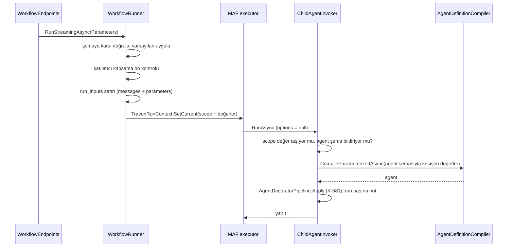

# Faz 194 — Workflow ve Kuyruk Yollarında Parametre Değerleri

> **Durum:** ✅ Tamamlandı (2026-10-12)
> **Plan onayı:** Bakımcı, 2026-10-12 (engelleyici kararlar sohbette alındı: kalem F-294; tam kapsam; workflow kendi şemasını bildirir; değer `run_inputs`'ta yeni sütunda; kuyruk yükünde alan; batch'te öğe başına nesne)
> **Kaynak:** [ADAYLAR.md](ADAYLAR.md) · **F-294**
> **Önkoşul:** Yok — F-330 (K-890) ve [Faz 192](arsiv/fazlar/192-DONGU-TUKENME-POLITIKASI.md) kapandı. [Faz 193](193-NET8-NET9-DUSURME.md) konu bakımından bağımsızdır; sıra serbesttir
> **Paketler:** `Tracon.Abstractions`, `.Core`, `.Workflows`, `.AspNetCore`, `.Sql.Shared`, `.PostgreSql`, `.SqlServer`, `.Sqlite`, `.UI` · üretilen: `Tracon.Client`, `@tracon/client`
> **Yeni paket:** Yok · **Migration:** gerekli — `run_inputs.parameters` sütunu, üç sağlayıcıda; numara uygulama anında alınır (K-178)
> **Public API:** büyüyor — `1.0.0` GA'dan (K-603) önce ucuz. Ölçüldü (2026-10-12): `wc -l src/*/PublicAPI.Shipped.txt` → 17 dosya, her biri yalnız `#nullable enable` satırı
> **Tüketici yüzeyi:** site: `concepts/workflows.md`, `concepts/agents.md`, `concepts/runs.md`, `guides/background-work.md`, `capabilities.md` (`api/` ve `http-api/` üretilir) · sevk edilen: yeni okuma uzantısının XML `<example>`'ı, `src/Tracon.Workflows/README.md`, `CHANGELOG.md` `[Unreleased]` (batch öğe yorumunun değişikliği **adıyla**)
> **Manuel test alanı:** `docs/manuel-test/15-WORKFLOWS.md` · `docs/manuel-test/16-IS-KUYRUGU-VE-ZAMANLAMA.md` · `docs/manuel-test/02-CEKIRDEK-VE-KATALOG.md`

---

## Bu Faza Başlarken

> `faz-baslangic` skill'ini uygula. Aşağıdaki liste o skill'in 2. adımıdır —
> **tamamını değil, yalnız işaret edilen bölümleri oku.**

1. Bu doküman
2. Kararlar — dosyanın tamamını **okuma**, yalnız bu kalemleri grep'le:
   ```bash
   grep -n "K-130\|K-380\|K-394\|K-580\|K-581\|K-582\|K-845\|K-887\|K-888\|K-890" docs/KARARLAR.md
   grep -n "^### K-890" -A 3 docs/arsiv/KARARLAR-GECMISI.md
   ```
   **K-890** (parametreli agent her yolda bağlanır ya da düşer; replay ve devam
   reddi — **bu faz o reddi kaldırır**, kararın yeniden açılma koşulu "bir yol
   değer taşımaya başlarsa (F-294)"dür), **K-580** (`*Payload` jsonb izdüşümü elle
   senkronlanır), **K-581** (katalog dışı derleme dekoratör zincirini elle
   uygular), **K-582** (tek `MaxParameterValueLength` sınırı), **K-380**
   (derlenmiş agent önbelleğinde kiracı anahtarı), **K-888** (retention
   `AwaitingInput` run'ın izini tutar — bu faz `run_inputs`'a genişletir),
   **K-130** (yanıt yeni run satırı açar), **K-887** (workflow katılımcısı
   `ChildRefusalMode.Fail`), **K-394** (workflow tek run sayılır), **K-845**
   (workflow run'ı okuyucuya bağlı)
3. Faz devir notları — yalnız bu bölümler:
   ```bash
   awk '/## Sonraki Faza Devir Notu/,0' docs/arsiv/fazlar/86-TALIMATIN-GIRDI-YUZEYI.md
   ```
   Faz 86 parametreli derleme yolunu kurdu: `CompileParameterizedAsync`,
   `AgentDecoratorPipeline.Apply`, `AgentDefinitionPayload` tuzağı. Bu faz o yolu
   dört yeni çağırana açar.
4. Alan hafızası (beş alan):
   [`hafiza/workflows.md`](hafiza/workflows.md) (executor kimliği, katalogdan
   doğrudan agent, `ChildAgentInvoker`) ·
   [`hafiza/agent-derleme-ve-onbellek.md`](hafiza/agent-derleme-ve-onbellek.md)
   (önbellek atlaması) ·
   [`hafiza/cekirdek-calistirma.md`](hafiza/cekirdek-calistirma.md)
   (`TraconRunContext`, `AsyncLocal` kuralı) ·
   [`hafiza/postgresql.md`](hafiza/postgresql.md) (sabit sütun indeksi — yeni
   sütun **sona**) ·
   [`hafiza/frontend.md`](hafiza/frontend.md) (tam değiştiren editör kapısı)
5. Gerektiğinde, tamamı değil ilgili bölümü:
   [`MIMARI-GUVENLIK.md`](MIMARI-GUVENLIK.md) içerik koruması
   (`IContentProtector`) ve retention bölümleri

---

## Amaç

Bir agent run'ı bugün yalnız senkron `/run` yolunda parametre değeri taşır.
Workflow run'ı, kuyruklu agent run'ı, batch öğesi, replay ve iki devam yolu
değer taşımaz; F-330'dan beri bu yollar varsayılanı bağlar ya da düşer. Bu
faz değeri **her yolda taşır ve run'la birlikte kalıcı yazar.** Çok kiracılı
host tek workflow tanımını run başına tonla, süreyle veya sesle sürer; tanım
kopyalanmaz. Kuyruklu ve zamanlanmış üretim bağlantı tutmadan aynı değerlerle
koşar. Bir run'ı tekrar koşan yol (resume, respond, replay, devam) kaynak
run'ın değerlerini kullanır.

- **F-294** — workflow parametre şeması ve run girdisi; agent adımına bağlama;
  fonksiyon düğümünde okuma; resume ve respond aynı değeri görür; kuyruklu agent
  run'ı ve batch öğesi `Parameters` + `Documents` taşır; `run_inputs`'a
  parametre kaydı; replay, çökme sonrası devam ve onay-devamı kayıtlı değeri
  kullanır.

### Kapsam dışı

| Kalem | Neden |
|---|---|
| Workflow `Prefer: respond-async` | F-318'in işidir |
| Workflow run'ına `Documents` | Talep yok; workflow girdisi tek mesajdır |
| Fonksiyon düğümüne düğüm başına ayar | F-295'in işidir |
| Konsolda parametre **şeması** düzenleme | Agent editörü de şemayı yalnız korur (`model.ts:207`); düzenleme F-292 komşusudur |
| Parametreyi talimat dışı alana bağlama (ör. `Loop.MaxIterations`) | Bağlayıcıyı bir mini dile çevirir (K2 komşusu); talep gelirse ayrı aday |
| Adımın çağırdığı alt agent'a değer | Agent `/run`'da da alt agent değer almaz; aynı kural korunur |
| OpenAI-uyumlu, MCP ve A2A girişleri | F-330'dan beri varsayılanı bağlar; bu faz dokunmaz |
| `jobs.payload` için içerik koruması | Ayrı aday — kapanışta F-ID ile açılır (§194.7) |

### Bugün ne çalışmıyor — doğrulanmış kanıt

| Kanıt | Gözlem |
|---|---|
| [`AgentEndpoints.cs:825-837`](../src/Tracon.AspNetCore/Endpoints/AgentEndpoints.cs) | Yalnız senkron `/run` değeri taşır: `CompileParameterizedAsync` + elle dekorasyon (K-581) |
| [`WorkflowContracts.cs:81-91`](../src/Tracon.AspNetCore/Contracts/WorkflowContracts.cs) · [`IWorkflowRunner.cs:121-145`](../src/Tracon.Abstractions/Workflows/IWorkflowRunner.cs) | `WorkflowRunHttpRequest` ve `WorkflowRunRequest` yalnız `Message`, `SessionId`, `RunId` taşır |
| [`WorkflowDefinition.cs:21`](../src/Tracon.Abstractions/Workflows/WorkflowDefinition.cs) | Tanımda parametre şeması yok |
| [`WorkflowEndpoints.cs:456-463`](../src/Tracon.AspNetCore/Endpoints/WorkflowEndpoints.cs) | Run ucu runner'a yalnız mesajı geçer |
| `grep -rln "Parameter" src/Tracon.Workflows/` → boş | Workflow motoru parametreye hiç dokunmaz |
| [`ChildAgentInvoker.cs:508-516`](../src/Tracon.Core/Graph/ChildAgentInvoker.cs) · [`WorkflowAgentCache.cs:95-150`](../src/Tracon.Workflows/Internal/WorkflowAgentCache.cs) | Katılımcı her çağrıda katalogdan çözülür; değer yolu yok |
| [`AgentDefinitionCompiler.cs:546-600`](../src/Tracon.Core/Compilation/AgentDefinitionCompiler.cs) | F-330: değersiz derleme varsayılanı bağlar, eksik zorunluda `UnboundParameterGuard`. Aday metnindeki `AgentDefinitionCompiler.ChatOptions.cs:115-119` atfı **kaymıştı**; doğru yer budur |
| [`AgentEndpoints.cs:1005-1013`](../src/Tracon.AspNetCore/Endpoints/AgentEndpoints.cs) | Kuyruklu run `parameters` ve `documents`'ı `400` ile reddeder |
| [`AgentRunJobHandler.cs:424`](../src/Tracon.Core/Scheduling/AgentRunJobHandler.cs) | Yük ayrıştırıcısı `runId`, `message`, `sessionId`, `userId`, `culture` okur; parametre yok |
| [`JobPayload.cs:34-56`](../src/Tracon.Abstractions/Scheduling/JobPayload.cs) | Nesne biçimli batch öğesi **ham JSON metni** olur ve modele mesaj gider |
| [`AgentBatchJobHandler.cs:27-37`](../src/Tracon.Core/Scheduling/AgentBatchJobHandler.cs) | Zorunlu parametresi varsayılansız agent'ta **bütün job** düşer |
| [`WorkflowJobHandler.cs:58`](../src/Tracon.Core/Scheduling/WorkflowJobHandler.cs) | Workflow batch öğesi yalnız `Message` olur |
| [`0023_replay_and_branching.sql:29-35`](../src/Tracon.PostgreSql/Migrations/0023_replay_and_branching.sql) · [`SqlRunInputStore.cs:37-55`](../src/Tracon.Sql.Shared/Stores/SqlRunInputStore.cs) | `run_inputs` yalnız `messages` taşır |
| [`RunRecordingAgent.Persistence.cs:165-173`](../src/Tracon.Core/Recording/RunRecordingAgent.Persistence.cs) | Girdi kaydı mesaj yoksa veya `RecordRunInput` kapalıysa yazılmaz; workflow motoru `IRunInputStore`'u hiç kullanmaz |
| [`RunReplayService.cs:275-287`](../src/Tracon.Core/Replay/RunReplayService.cs) · [`RunContinuationJobHandler.cs:107-117`](../src/Tracon.Core/Scheduling/RunContinuationJobHandler.cs) | Replay ve çökme sonrası devam parametre bildiren her agent'ı reddeder (K-890) |
| [`ApprovalResumeJobHandler.cs:93-95`](../src/Tracon.Core/Approvals/ApprovalResumeJobHandler.cs) | Onay-devamı agent'ı katalogdan değersiz çözer — kuyruklu kaynak değer taşımaya başlayınca sessizce farklı talimatla sürer |
| [`RetentionTargetRegistry.cs:266-271`](../src/Tracon.Sql.Shared/Internal/RetentionTargetRegistry.cs) | `RunInputs` yalnız `created_at`'e bakar; `AwaitingInput` istisnası yalnız checkpoint'lerde (`:165-176`, K-888) |
| [`full-replace-editors.test.tsx:172`](../src/Tracon.UI/frontend/src/full-replace-editors.test.tsx) · [`workflow-detail.tsx:189`](../src/Tracon.UI/frontend/src/screens/workflow-detail.tsx) | Editör `Complete<WorkflowSaveRequest>` ile denetlenir; run paneli yalnız `message` gönderir |

> Kanıtlar 2026-10-12 tarihinde doğrulandı.

---

## 194.1 — Workflow parametre şeması

`WorkflowDefinition` yeni bir alan alır: `Parameters`
(`IReadOnlyList<AgentParameter>`). Yeni tip yoktur — `AgentParameter` aynı
anlamı taşır (ad, `Kind`, `Required`, `DefaultValue`, `Description`).

- **Kayıtta yalnız yapısal kontrol.** Geçerli tanımlayıcı, tekrarsız ad,
  `DefaultValue`'nun `Kind`'a uygunluğu. `WorkflowDefinitionValidator`'ın
  ilkesi korunur (`WorkflowDefinitionValidator.cs:14-19`): katılımcı agent
  kayıttan sonra değişebilir, kayıtta katalog kontrolü yanlış güvence verir.
- 🚨 **Sohbetteki seçenek metninden sapma.** Seçenek "katılımcının zorunlu
  parametresi şemada yoksa kaydetme reddedilir" diyordu. Bu kontrol kayıt
  yerine **run başlangıcına** taşınır (§194.3), çünkü yukarıdaki ilke onu
  kayıtta yasaklar. Kapanışta *Plandan Sapmalar*'a değil, burada yazıldı.
- 🚨 **K-580:** `WorkflowDefinitionPayload` (`Tracon.Sql.Shared/Internal/`) yeni
  alanı elle almalıdır. Bellek içi depo bunu maskeler.
  `WorkflowDefinitionStoreContract`'ın tam alan round-trip testi alanı kapsar.
- **Kodla tanımlı workflow** (`AddWorkflow`) tanım taşımaz → şeması boştur →
  her değer `unknown_parameter` ile reddedilir. Ek kural gerekmez.
- **Desen:** şema beş desende de geçerlidir; bağlama `ChildAgentInvoker`
  seviyesinde olduğu için Magentic yöneticisi de değeri alır. Fonksiyon düğümü
  yalnız `Sequential`'da vardır (bugünkü sınır).

## 194.2 — Giriş ve doğrulama

`WorkflowRunHttpRequest.Parameters` ve `WorkflowRunRequest.Parameters`
(`IReadOnlyDictionary<string, string>?`) eklenir.

- **HTTP ucu** değeri workflow şemasına karşı
  `AgentParameterValidator.ValidateValues(schema, values, MaxParameterValueLength)`
  ile doğrular ve agent `/run`'ın **aynı** `400` gövdesini döner
  (`missingParameters`, `unknownParameters`, `tooLongParameters`) —
  `AgentParameterGate.Problem`. Sıra agent `/run` ile aynıdır: atıf → yetki →
  kota → parametre (`AgentEndpoints.cs:223-253` sonra `:808`). `400` akış
  başlamadan döner.
- **Runner otoritedir.** `IWorkflowRunner` public'tir; tüketici HTTP'yi atlayıp
  doğrudan çağırabilir. Runner da doğrular ve geçersiz değerde run'ı ilk
  sağlayıcı çağrısından önce düşürür. HTTP kontrolü yalnız erken `400` içindir.
- **Varsayılanlar** workflow şemasından bir kez uygulanır. Sonuç sözlüğü
  run'ın **nihai değer setidir**; kayda (§194.5) ve fonksiyon düğümüne
  (§194.4) bu set gider.

## 194.3 — Agent adımına bağlama



- **Yer:** değer `ChildAgentInvoker.ResolveAsync`'te bağlanır
  (`ChildAgentInvoker.cs:508`). Invoker örneği değişmez; yalnız içte çözülen
  agent değişir. Executor kimliği agent **örneğinden** türediği için
  (`hafiza/workflows.md`) checkpoint uyumu korunur.
- **Yalnız doğrudan adım.** Değer workflow kapsamından okunur ve yalnız
  `WorkflowAgentCache`'in kurduğu invoker'a uygulanır. Bunun için invoker'a
  açık bir işaret verilir (`ChildRefusalMode.Fail`'e yük bindirilmez — iki
  ayrı anlam). Adımın kendi alt agent'ı bugünkü gibi varsayılanla bağlanır.
- **Süzme:** adıma yalnız **kendi şemasındaki** adlar gider. Workflow şemasında
  olup adımda olmayan ad sessizce düşer — sözleşme workflow şemasıdır.
- **Tür uyuşmazlığı** (workflow `Number`, agent `Boolean`): adımın
  `ValidateValues`'u düşer, adım ilk sağlayıcı çağrısından önce düşer, hata
  agent'ı ve parametreyi adlandırır.
- **Kapsama ön kontrolü:** katılımcı tembel çözüldüğü için üçüncü adımın eksik
  zorunlu parametresi ilk iki adımın maliyetinden **sonra** ortaya çıkardı. Runner
  run başında her katılımcının (`AgentNames`, `Nodes`, `ManagerAgentName`)
  tanımını `AgentDefinitionLookup` ile okur (kod tanımı önce, K-890 (b)) ve
  varsayılansız zorunlu her adın nihai sette olduğunu doğrular. Eksikse run hiç
  sağlayıcı çağırmadan `Failed` biter. Kapanan run satırı bu durumu
  `error.class` ile taşır.
- **Önbellek:** `CompiledAgentCache` kullanılmaz (K-380, K-581). GroupChat
  turları ve Loop aynı adımı tekrar çağırır; bu yüzden derlenen agent **run
  başına** `(runId, agentName)` anahtarıyla bir kez tutulur. Değer taşımayan
  workflow ve şema bildirmeyen agent bugünkü katalog yolunda kalır.
  **Derleme maliyeti ölçülmeli** (adım başına süre, run başına not ile/olmadan).

## 194.4 — Fonksiyon düğümünde okuma

**Ölçüldü (2026-10-12, `maf-api-kesfi`, `Microsoft.Agents.AI.Workflows` 1.20.0):**
`IWorkflowContext` durum okuma/yazma üyeleri taşır (`ReadStateAsync`,
`ReadOrInitStateAsync`, `QueueStateUpdateAsync`, `ReadStateKeysAsync`) ama
grafa **başlangıç durumu verme** üyesi yoktur. Tracon bu yüzden MAF durumunu
tohumlamaz. Değer run kapsamından gelir: pompa kapsamı yürütmeden önce ve her
adımda yazar (`WorkflowRunner.cs:703-711`, `:810-814`); invoker aynı kapsamı
workflow içinde zaten okur.

Public okuma yüzeyi bir uzantı metodudur:

```csharp
builder.AddTracon()
       .UseWorkflows()
       .AddWorkflowFunction<string, string>(
           "narrate",
           provider => (input, context, cancellationToken) =>
           {
               var voice = context.GetRunParameters()["voice"];
               return ValueTask.FromResult($"{voice}: {input}");
           });
```

- Sözlük nihai settir (varsayılan uygulanmış) ve salt okunurdur.
- Run dışında çağrı (ör. birim testinde çıplak bağlam): Açık Soru 1.
- 🚨 **Doğrulanmadı — fonksiyonel testle ölçülmeli:** kapsamın
  `FunctionExecutor` gövdesine aktığı. Dolaylı kanıt var (invoker aynı pompada
  kapsamı okur) ama `MEMORY.md`'nin kuralı: izole ölçüm entegre davranışı
  kanıtlamaz.

## 194.5 — Kalıcı kayıt: `run_inputs.parameters`

- **Sütun:** `run_inputs.parameters`, boş bırakılabilir JSON metni, üç
  sağlayıcıda. 🚨 PostgreSQL okuyucusu sabit sütun indeksiyle okur; sütun
  tablonun **sonuna** eklenir (`hafiza/postgresql.md`).
- **Anlam:** `NULL` = "kayıt yok" (faz öncesi satır ya da kayıt kapalı). `{}` =
  "kaydedildi, değer yok". Bu ayrım fail-closed kuralının dayanağıdır (§194.6,
  §194.9); iki durum aynı okunursa replay sessizce varsayılanla koşar.
- **Koruma:** değer kullanıcı içeriğidir; `IContentProtector` uygulanır
  (`SqlRunInputStore.cs:47-52` deseni). Enum üyesi: Açık Soru 2.
- **Public kayıt:** `RunInputRecord.Parameters`
  (`IReadOnlyDictionary<string, string>?`).
- **Yazanlar:**
  - Agent kök run'ları: `RunRecordingAgent.SaveInputAsync`. Değer kaydediciye
    **iç** bir `TraconRunOptions` alanıyla ulaşır. **Doğrulanmadı — uygulama
    başında ölçülmeli:** kaydedicinin bu noktada seçeneklere eriştiği. Koşul
    değişir: mesaj **veya** parametre varsa yazılır
    (`RunRecordingAgent.Persistence.cs:170`).
  - Workflow: runner kendi satırını `writer.StartAsync` sonrasında yazar
    (`messages` = başlangıç mesajı, boşsa boş liste).
- **İlk yazan kazanır:** ekleme `ON CONFLICT (run_id) DO NOTHING`'dir
  (`PostgresQueries.cs:711-715`); kuyrukta kira kaybıyla ikinci koşum ilk kaydı
  değiştirmez. SQL Server ve SQLite eşdeğeri ölçülmeli.
- **Retention (kalıcı-veri):** `RunInputs` hedefi `AwaitingInput` run'ın
  satırını tutar — K-888'in checkpoint kuralının aynısı
  (`RetentionTargetRegistry.cs:165-176`). Yoksa yanıt bekleyen workflow retention
  sonrası değerini kaybeder ve respond reddedilir. Kapanışta K-888'e ek veya yeni
  K satırı (`kategori: kalıcı-veri`).
- **Veri hakları:** satır silme ve `CASCADE` yeni sütunu da kapsar —
  **ölçülmeli** (silme yolu `run_inputs`'a ulaşıyor mu).

## 194.6 — Resume ve respond

- `PrepareResumeAsync` ve `PrepareResponseAsync` (`WorkflowRunner.cs:269-334`)
  kaynak run'ın `run_inputs.parameters` değerini okur, `WorkflowExecution`'a
  koyar ve yeni run'ın satırına yazar. Zincir (resume'un resume'u) her halkada
  kendi kopyasını taşır.
- **Fail-closed:** kaynak `NULL` ve **güncel** tanım parametre bildiriyorsa
  resume/respond adı geçen bir mesajla reddedilir (K-890 ruhu: varsayılanla
  sessizce koşmak talimatı değiştirir). Tanım parametre bildirmiyorsa bugünkü
  gibi sürer.
- **Yeniden doğrulama:** kayıtlı değer güncel workflow şemasına karşı tekrar
  doğrulanır. Tek kural: her run, koştuğu tanımın şemasını karşılar. Şema
  değişip yeni zorunlu ad eklendiyse reddedilir.
- **Üzerine yazma yok.** Resume ve respond istek tipleri değişmez; checkpoint
  sürekliliği değeri sabitler.

## 194.7 — Kuyruklu agent run'ı

- `AgentEndpoints.cs:1005-1013`'teki ret `parameters` ve `documents` için
  kalkar; `approvals`, `toolResults`, `attachmentIds` reddi kalır.
- **Enqueue:** değer, atanan sürümün (F-351, `:1032-1047`) şemasına karşı
  `AgentParameterGate` ile doğrulanır → aynı `400`. `UnboundParameterGuard`
  kontrolü (`:1064-1070`) değerle birlikte değerlendirilir.
- **Yük:** `BuildQueuedRunPayload` `parameters` (string → string nesnesi) ve
  `documents` (`[{name, content}]`) alanlarını yazar. Alan yoksa (eski job veya
  elle yazılmış schedule yükü) varsayılan bağlanır — bugünkü davranış.
- **İşleyici:** `ParsePayload` iki alanı okur; bozuk biçim `TraconException`
  verir (diğer alanlarla aynı). Değer varsa `/run`'ın yolu izlenir:
  `AgentDefinitionLookup` → `CompileParameterizedAsync` →
  `AgentDecoratorPipeline.Apply`, yükteki sürüm ve kültürle.
- **Belge:** her belge kullanıcı mesajından **önce**
  `DocumentChannelMessageBuilder.Build` ile mesaj olur (`AgentEndpoints.cs:1702-1710`
  sırası). Kayıt `DocumentAttached` olaylarını bugünkü gibi yazar.
- 🚨 **Bilinen sınır (güvenlik):** `jobs.payload` korumalı sütun değildir
  (`ProtectedColumn` listesinde yoktur). Mesaj metni orada bugün de düz durur;
  bu faz parametre ve belge içeriğini de aynı yere koyar (kullanıcı kararı,
  2026-10-12). Site `background-work.md` ve `production.md` bunu açıkça yazar.
  Kapanışta "`jobs.payload` içerik koruması" yeni F-ID olarak açılır.
- **Onay-devamı:** `ApprovalResumeJobHandler` kaynak run'ın kayıtlı değerini
  okur ve parametreli derler. Kaynak `NULL` iken davranış: Açık Soru 3.

## 194.8 — Batch öğesi

- **Biçim:** öğe metni `message` adlı **string** üyesi olan bir JSON nesnesiyse
  yapılı öğedir: `{"message": "…", "parameters": {…}, "documents": […]}`.
  Diğer her öğe bugünkü gibi düz metindir.
- 🚨 **Belirsizlik:** `JobPayload.ExtractItems` string öğe ile nesne öğeyi aynı
  metne indirir (`JobPayload.cs:47`); `job_items.input` türü saklamaz. Bu
  yüzden içeriği `{"message":…}` olan bir **string** öğe de yapılı sayılır.
  Kural belgelenir; `CHANGELOG` değişikliği adıyla anar (preview'da serbest).
  Yeni sütun (tür işareti) bu belirsizliği kapatırdı ama migration ister;
  gerçek bir çakışma ölçülmeden açılmaz.
- **Yapısal kontrol** schedule kaydında ve tetiklemede yapılır
  (`SchedulingEndpoints.cs:245`, `:315` zaten öğeleri ayrıştırır): bozuk
  `parameters` (nesne değil, değer string değil) veya bozuk `documents` → `400`.
  Bilinmeyen üst alan: Açık Soru 4. Şema kontrolü **koşumda, öğe başına**dır —
  agent kayıttan sonra değişebilir.
- **Agent batch:** bütün job'ı düşüren ön kontrol (`AgentBatchJobHandler.cs:34`)
  daralır: **hiçbir** öğe değer taşımıyorsa F-330 davranışı kalır (job bir kez
  düşer); değer taşıyan öğe varsa kontrol öğe başına yapılır, geçersiz öğe
  `Failed` olur, diğerleri koşar. Değerli öğe parametreli derlenir (öğe başına
  çözümleme F-310'dan beri zaten vardır).
- **Workflow batch:** yapılı öğe `WorkflowRunRequest.Parameters` olur; `documents`
  taşıyan workflow öğesi "workflow run belge kabul etmez" diye `Failed` olur.

## 194.9 — Replay ve çökme sonrası devam

- `RunReplayService`'in reddi (`:275-287`) değişir: kaynak satırın
  `parameters`'ı okunur. `NULL` → bugünkü ret (mesaj güncellenir:
  `RecordRunInput` ve faz öncesi kayıt adlandırılır). Değer varsa parametreli
  derlenir.
- **Üzerine yazma:** `RunReplayRequest.Parameters` kayıtlı değerin üzerine
  **birleşir**; sonuç replay'in çözdüğü sürümün şemasına karşı doğrulanır. Bu
  F-330 kapanış ekinin "replay'de üzerine yazma" maddesidir.
- `RunContinuationJobHandler`'ın reddi (`:107-117`) aynı şekilde kalkar;
  devam üzerine yazma almaz.
- K-890'ın "replay ve devam parametreli tanımı reddeder" maddesi bu fazda
  değişir — kapanışta K-890 güncellenir veya yeni satır (`kategori: public-api`).

## 194.10 — Konsol

- **Workflow editörü** `parameters`'ı **korur**, düzenlemez — agent editörünün
  deseni (`agent-editor/model.ts:207`, `:255`). Kapı:
  `full-replace-editors.test.tsx` `Complete<WorkflowSaveRequest>` yeni alanı
  zorunlu kılar; alan korunmazsa test derlenmez.
- **Workflow detay run paneli** şema varsa değer alanlarını gösterir ve
  `parameters` gönderir (`workflow-detail.tsx:189`). Alanlar playground'daki
  bileşenden (`playground.tsx:217-240`) ortak bir bileşene çıkarılır; iki ekran
  aynı bileşeni kullanır.
- **Replay** ekranı değişmez: kayıtlı değer kendiliğinden kullanılır; üzerine
  yazma yalnız API'dedir.
- **Metin:** yeni anahtarlar `locales/en` + `locales/tr` (K-228). Sunucu
  hataları çevrilmez (K-232).

---

## Planlanan Public API

> Taslak imzalardır. Gerçekleşen imzalar kapanışta ayrı bir bölüme yazılır.
> Hepsi `sealed record`'a alan ekler: **bugün eklemek bedava / `1.0.0` GA
> sonrası kırıcı.**

```csharp
// Tracon.Abstractions
public sealed record WorkflowDefinition
{
    /// <summary>The run parameters the workflow accepts.</summary>
    public IReadOnlyList<AgentParameter> Parameters { get; init; } = [];
}

public sealed record WorkflowRunRequest
{
    /// <summary>Parameter values for this run, validated against the workflow's schema.</summary>
    public IReadOnlyDictionary<string, string>? Parameters { get; init; }
}

public sealed record RunInputRecord
{
    /// <summary>
    /// The run's final parameter values. <see langword="null"/>: nothing was recorded.
    /// Empty: recorded, no values.
    /// </summary>
    public IReadOnlyDictionary<string, string>? Parameters { get; init; }
}

public sealed record RunReplayRequest
{
    /// <summary>Values merged over the source run's recorded values.</summary>
    public IReadOnlyDictionary<string, string>? Parameters { get; init; }
}

public enum ProtectedColumn
{
    // Açık Soru 2 — yeni üye mi, RunInput'un genişlemesi mi
    RunInputParameters = 10,
}

// Tracon.Workflows
public static class TraconWorkflowContextExtensions
{
    /// <summary>Returns the running workflow's final parameter values.</summary>
    public static IReadOnlyDictionary<string, string> GetRunParameters(this IWorkflowContext context);
}
```

`Tracon.AspNetCore` sözleşmeleri: `WorkflowRunHttpRequest.Parameters`,
`WorkflowSaveRequest.Parameters` ve okuma yanıtındaki karşılığı. Agent run
sözleşmesi (`AgentContracts.cs:380-404`) tip olarak değişmez; XML'deki "queued
run rejects this field" cümlesi değişir.

Değişmeyenler: `IWorkflowRunner`, `WorkflowResumeRequest`,
`WorkflowRespondRequest`, `JobRequest`, `JobSchedule`, `AgentRunScope`'un
public yüzeyi (değer iç alanla taşınır).

### HTTP `endpoint`'leri

| Metot | Yol | Rol | Ne yapar |
|---|---|---|---|
| `PUT` | `/api/workflows/{name}` | Admin | Gövde `parameters` şemasını alır; yapısal kontrol |
| `GET` | `/api/workflows/{name}` | Reader | Yanıt `parameters` şemasını taşır |
| `POST` | `/api/workflows/{name}/run` | Operator | Gövde `parameters` alır; geçersizde akıştan önce `400` |
| `POST` | `/api/agents/{name}/run` + `Prefer: respond-async` | Operator | `parameters` ve `documents` artık kabul edilir |
| `POST` | `/api/runs/{runId}/replay` | Operator | Gövde isteğe bağlı `parameters` alır |
| `PUT` | `/api/schedules/{name}` | Admin | Yapılı batch öğesinin biçimi kontrol edilir |
| `POST` | `/api/schedules/{name}/trigger` | Operator | Aynı biçim kontrolü |

Rol sütunu bugünkü uç rolleridir; bu faz rol değiştirmez. Ölçüldü
(2026-10-12): `WorkflowEndpoints.cs:92,119`, `AgentEndpoints.cs:303`,
`RunEndpoints.cs:384`, `SchedulingEndpoints.cs:53,94`.

### Arayüz payı

Ölçüldü (2026-10-12): JS bundle **197,4 KB gzip** (`index-*.js.br` açılıp
`gzip -9`), bütçe 250 KB. Pay ortak bileşen çıkarımı ve bir form bölümüdür;
kapanışta ölçülür ve yazılır.

---

## Planlanan Dosya Listesi

```
src/Tracon.Abstractions/
├── Workflows/WorkflowDefinition.cs          (Parameters)
├── Workflows/IWorkflowRunner.cs              (WorkflowRunRequest.Parameters)
├── Runs/IRunInputStore.cs                    (RunInputRecord.Parameters)
├── Runs/RunReplay.cs                         (RunReplayRequest.Parameters)
├── Security/ProtectedColumn.cs               (Açık Soru 2)
└── Scheduling/BatchItemInput.cs              (yeni, internal — yapılı öğe ayrıştırıcısı)
src/Tracon.Core/
├── Graph/ChildAgentInvoker.cs                (değerli çözümleme, run başına not)
├── Recording/TraconRunContext.cs             (AgentRunScope iç değer alanı)
├── Recording/RunRecordingAgent.Persistence.cs
├── Workflows/WorkflowDefinitionValidator.cs  (şema yapısal kontrolü)
├── Scheduling/AgentRunJobHandler.cs
├── Scheduling/AgentBatchJobHandler.cs
├── Scheduling/WorkflowJobHandler.cs
├── Scheduling/RunContinuationJobHandler.cs
├── Approvals/ApprovalResumeJobHandler.cs
├── Replay/RunReplayService.cs
└── Storage/InMemoryRunInputStore.cs
src/Tracon.Workflows/
├── TraconWorkflowContextExtensions.cs        (yeni)
├── Internal/WorkflowRunner.cs                (doğrulama, ön kontrol, kayıt, resume/respond)
└── Internal/WorkflowAgentCache.cs            (invoker işareti)
src/Tracon.AspNetCore/
├── Contracts/WorkflowContracts.cs
├── Endpoints/WorkflowEndpoints.cs
├── Endpoints/AgentEndpoints.cs               (kuyruk yolu)
├── Endpoints/RunEndpoints.cs                 (replay gövdesi)
└── Endpoints/SchedulingEndpoints.cs          (yapısal kontrol)
src/Tracon.Sql.Shared/
├── Internal/WorkflowDefinitionPayload.cs     (K-580)
├── Internal/RetentionTargetRegistry.cs       (AwaitingInput istisnası)
└── Stores/SqlRunInputStore.cs
src/Tracon.PostgreSql/Migrations/NNNN_run_input_parameters.sql
src/Tracon.SqlServer/Migrations/NNNN_run_input_parameters.sql
src/Tracon.Sqlite/Migrations/NNNN_run_input_parameters.sql
src/Tracon.{PostgreSql,SqlServer,Sqlite}/Internal/*Queries.cs   (Insert/SelectRunInput)
src/Tracon.UI/frontend/src/
├── components/parameter-inputs.tsx           (yeni, playground'dan çıkarılır)
├── screens/playground.tsx
├── screens/workflow-detail.tsx
├── screens/workflow-editor.tsx
├── full-replace-editors.test.tsx
└── locales/{en,tr}/*.ts
samples/Tracon.Api/Program.cs                  (fonksiyon düğümü değer okur)
```

Konumlar ölçülmüş dosyalardır; `BatchItemInput`'un paketi (`Abstractions` mi
`Core` mu) `JobPayload`'ın yanında olma gereğine göre uygulama başında seçilir.

---

## Hata Modları ve Testler

> Mutlu yoldan değil, **ne bozulabilir**den türetilir. Seviyeyi plan seçer.
> Sınır geçen davranış (DI · HTTP · kiracı · akış · depo · paket) birim
> testiyle kanıtlanamaz — [`.agents/ortak/test-seviyeleri.md`](../.agents/ortak/test-seviyeleri.md).

| # | Ne bozulabilir | Seviye | Test sınıfı |
|---|---|---|---|
| 1 | Workflow değeri adımın talimatına ulaşmaz | Fonksiyonel (gerçek HTTP, sistem istemini yakalayan sahte istemci) | `WorkflowParameterBindingTests` |
| 2 | Eksik/bilinmeyen/uzun değer akış başladıktan sonra hata olur; gövde agent `/run`'dan farklıdır | Fonksiyonel | `WorkflowRunParameterGateTests` |
| 3 | Runner'ı doğrudan çağıran tüketici doğrulamayı atlar | Fonksiyonel (DI üzerinden `IWorkflowRunner`) | `WorkflowRunnerParameterValidationTests` |
| 4 | Üçüncü adımın eksik zorunlu parametresi iki adımın maliyetinden sonra çıkar | Fonksiyonel (sağlayıcı çağrı sayısı = 0) | `WorkflowParticipantCoverageTests` |
| 5 | **Eşzamanlılık:** aynı workflow'un farklı değerli iki run'ı tek derlenmiş agent'ı paylaşır | Fonksiyonel (paralel iki run, iki farklı istem) | `WorkflowParameterConcurrencyTests` |
| 6 | **Başka kiracı:** aynı ad, iki kiracı; değer veya not sızar | Fonksiyonel | `WorkflowParameterTenantIsolationTests` |
| 7 | Parametreli adım dekoratörsüz koşar — kayıt, ağaç, onay kapısı kaybolur (K-581) | Fonksiyonel (`GET /api/runs/{id}/tree` alt satırı) | `WorkflowParameterBindingTests` |
| 8 | Executor kimliği değişir, checkpoint uyumsuz olur | Fonksiyonel (aynı süreçte resume) | `WorkflowParameterResumeTests` |
| 9 | Resume/respond kaynak değeri kaybeder ya da varsayılanla koşar | Fonksiyonel | `WorkflowParameterResumeTests` |
| 10 | Kaynak `NULL` + parametreli tanım sessizce sürer | Fonksiyonel | `WorkflowParameterResumeTests` |
| 11 | Retention `AwaitingInput` run'ın girdisini siler | Sözleşme (dört depo) | `RetentionStoreContract` |
| 12 | `parameters` round-trip'te kaybolur; `NULL` ile `{}` aynı okunur | Sözleşme (dört depo) | `RunInputStoreContract` |
| 13 | Yeni sütun düz metin yazılır (koruma atlanır) | Fonksiyonel (koruyucu açık, ham satır okuması) | `RunInputProtectionTests` |
| 14 | PostgreSQL okuyucusu sütun indeksi kayar | Sözleşme (PostgreSQL koşumu) | `RunInputStoreContract` |
| 15 | `WorkflowDefinitionPayload` şemayı düşürür (K-580) | Sözleşme (dört depo) | `WorkflowDefinitionStoreContract` |
| 16 | Konsol editörü kaydederken `parameters`'ı siler | Vitest (tip kapısı + round-trip) | `full-replace-editors.test.tsx` |
| 17 | Fonksiyon düğümü kapsamı göremez (`AsyncLocal` akmaz) | Fonksiyonel | `WorkflowFunctionParameterTests` |
| 18 | Adımın alt agent'ı workflow değerini alır | Fonksiyonel | `WorkflowParameterBindingTests` |
| 19 | Kuyruklu run değeri worker'da kaybeder; kira kaybında ikinci koşum farklı değer görür | Fonksiyonel (job worker) | `QueuedRunParameterTests` |
| 20 | Kuyruklu belge mesaj sırasını bozar veya `DocumentAttached` yazılmaz | Fonksiyonel | `QueuedRunDocumentTests` |
| 21 | Eski yük (alan yok) düşer | Birim (`ParsePayload`) + Fonksiyonel | `QueuedRunParameterTests` |
| 22 | Bozuk elle yazılmış yük sonsuz yeniden denenir | Fonksiyonel | `QueuedRunParameterTests` |
| 23 | Yapılı öğe ayrıştırması düz metin öğeyi bozar | Birim | `BatchItemInputTests` |
| 24 | Tek geçersiz öğe bütün batch'i düşürür; değersiz batch'te F-330 davranışı kaybolur | Fonksiyonel | `AgentBatchParameterTests` |
| 25 | Workflow batch öğesi değeri taşımaz; belge taşıyan öğe sessizce koşar | Fonksiyonel | `WorkflowBatchParameterTests` |
| 26 | Replay kayıtlı değeri kullanmaz; üzerine yazma doğrulanmaz | Fonksiyonel | `RunReplayParameterTests` |
| 27 | Çökme sonrası devam ve onay-devamı farklı talimatla sürer | Fonksiyonel | `RunContinuationParameterTests` · `ApprovalResumeParameterTests` |
| 28 | **Alt sistem hatası:** `run_inputs` yazımı düşer, run durur | Fonksiyonel (atan depo) | `WorkflowRunInputStoreFailureTests` |
| 29 | **İptal:** değerli derleme sırasında iptal öksüz satır bırakır | Fonksiyonel | `WorkflowParameterCancellationTests` |
| 30 | **Boş/aşırı girdi:** boş sözlük, 4096 bayt üstü değer, çok sayıda ad | Fonksiyonel | `WorkflowRunParameterGateTests` |
| 31 | Değer log'a, OTel etiketine veya `run_events`'e düz yazılır | Fonksiyonel (log + span + olay taraması) | `ParameterValueLeakTests` |
| 32 | Üretilen istemciler yeni alanı taşımaz | Paket (istemci üretimi kapısı) | mevcut NSwag/TS üretim kapıları |

Sözleşme testleri `src/Tracon.Testing.Contracts.Xunit/Contracts/` altındaki mevcut sınıflara eklenir (`RetentionStoreContract`, `RunInputStoreContract`, `WorkflowDefinitionStoreContract`) — bellek içi ve üç SQL
sağlayıcısında koşar.

---

## Manuel Kabul Case'leri

> Kapanışta ilgili `docs/manuel-test/` dosyalarına eklenir; ID'ler o anda
> alınır. Otomatikleştirilebilenler kapanışta koşulur.

| # | Alan | Ön koşul | Adımlar | Beklenen sonuç |
|---|---|---|---|---|
| 1 | 15 | `{{tone}}` bildiren agent; şemasında `tone` olan Sequential workflow | `POST /tracon/api/workflows/{ad}/run` `{"message":"…","parameters":{"tone":"formal"}}` | Adımın `run.started` sonrası yanıtı resmî ton; `GET /api/runs/{id}/tree` alt satırı var |
| 2 | 15 | Aynı workflow | `parameters` olmadan run; agent'ın `tone`'u varsayılansız zorunlu | Akış başlamadan `400`, `missingParameters:["tone"]` |
| 3 | 15 | HITL adımlı, parametreli workflow | Run → `AwaitingInput` → respond | Devam eden adım aynı değeri kullanır; yeni run'ın `run_inputs`'u değeri taşır |
| 4 | 15 | Fonksiyon düğümü değer okur (örnek uygulama) | Run | Düğüm çıktısı değeri içerir |
| 5 | 15 | Konsol, parametreli workflow | Detay ekranında değer gir → Çalıştır; editörde kaydet | Run değeri taşır; editör kaydı `parameters`'ı korur (`GET` ile karşılaştır) — 👤 görsel |
| 6 | 16 | Parametreli agent | `Prefer: respond-async` + `parameters` + `documents` | `202`; worker çıktısı değeri kullanır; olaylarda `DocumentAttached` |
| 7 | 16 | Agent batch schedule | Yükte bir yapılı, bir düz, bir bozuk-şemalı öğe → tetikle | Yapılı öğe değerle, düz öğe varsayılanla koşar; bozuk öğe `Failed`, diğerleri `Completed` |
| 8 | 16 | Workflow batch schedule | Yapılı öğe `parameters` taşır | Workflow run'ı değeri kullanır |
| 9 | 02 | Parametreli `/run` | `POST /api/runs/{id}/replay` gövdesiz, sonra `{"parameters":{…}}` ile | İlki kayıtlı değerle, ikincisi birleşik değerle koşar |
| 10 | 02 | Faz öncesi parametreli run satırı (`parameters` `NULL`) | Replay | Ret; mesaj kaydın eksik olduğunu söyler |

---

## Açık Sorular

> Planı bloklamayan, faz uygulanırken karara bağlanacak sorular.

| # | Soru | Seçenekler | Öneri |
|---|---|---|---|
| 1 | `GetRunParameters()` run dışında çağrılırsa ne olur? | A: `InvalidOperationException` · B: boş sözlük | **A** — boş sözlük kablolama hatasını gizler; birim testi bağlamı kurmalıdır |
| 2 | `run_inputs.parameters` için koruma anahtarı | A: yeni `ProtectedColumn.RunInputParameters` · B: mevcut `RunInput` iki sütunu kapsar | **A** — operatör sütun başına seçer (`TraconContentProtectionOptions.Columns`); varsayılan küme `Enum.GetValues` olduğu için yeni üye kendiliğinden korunur |
| 3 | Onay-devamında kaynak `NULL` iken | A: parametreli agent'ta reddet · B: varsayılanla sür | **A** — K-890 ile tutarlı. Bedel: yükseltme anında bekleyen onaylar (parametreli agent + faz öncesi kuyruk run'ı) reddedilir; faz öncesi kuyruk run'ı zaten varsayılanla koştuğu için B o vakada doğrudur — iki vakayı ayıran işaret yoksa A. `CHANGELOG` anar |
| 4 | Yapılı batch öğesinde bilinmeyen üst alan | A: öğe `Failed` · B: yok say | **A** — bilinmeyen parametre adı da reddedilir; yazım hatası iz bırakmadan kaybolmaz |
| 5 | `RecordRunInput = false` iken parametreli workflow'un resume/respond'u | A: kayıt yok → ret, mesaj ayarı adlandırır · B: workflow parametre kaydını ayardan bağımsız yazar | **A** — operatör girdi saklamayı gizlilik için kapattı; değer de kullanıcı içeriğidir. Site bu etkileşimi yazar |
| 6 | Kuyruk yükündeki belge için boyut sınırı | A: yok (senkron `/run` ile aynı) · B: yeni sınır | **A** — senkron yolda da sınır yok; `jobs.payload` boyutu ölçülür ve yeni F-ID'ye (`jobs.payload` koruması) not düşülür |
| 7 | Run başına derleme notu gerekli mi? | A: `(runId, agentName)` notu · B: her çağrıda derle | **Önce ölç.** GroupChat'te tur sayısı kadar derleme olur; ölçüm küçükse B daha az durumdur |

---

## Bitiş Ölçütleri (DoD)

- [ ] `POST /tracon/api/workflows/{ad}/run` `parameters` ile koşar; adımın sistem istemi değeri taşır (test 1)
- [ ] Geçersiz değer akış başlamadan agent `/run` ile aynı `400` gövdesini döner (test 2)
- [ ] Eksik zorunlu katılımcı parametresinde run sıfır sağlayıcı çağrısıyla `Failed` biter (test 4)
- [ ] Resume ve respond kaynak değeri kullanır; kaynak `NULL` + parametreli tanım reddedilir (test 9-10)
- [ ] Fonksiyon düğümü `context.GetRunParameters()` ile değeri okur (test 17)
- [ ] Kuyruklu agent run'ı `parameters` ve `documents` kabul eder; worker değeri kullanır (test 19-20)
- [ ] Yapılı batch öğesi öğe başına değer taşır; tek geçersiz öğe yalnız kendini düşürür (test 24-25)
- [ ] Replay, çökme sonrası devam ve onay-devamı kayıtlı değeri kullanır (test 26-27)
- [ ] `run_inputs.parameters` üç sağlayıcıda migration ile gelir; `NULL`/`{}` ayrımı sözleşme testinde (test 12)
- [ ] Retention `AwaitingInput` run'ın girdisini tutar (test 11)
- [ ] Değer log'da, span'de ve `run_events`'te düz görünmez (test 31)
- [ ] Derleme maliyeti ölçüldü ve Açık Soru 7 karara bağlandı
- [ ] Dört doğrulama kapısı sıfır uyarı verir — `python3 scripts/kapi.py kapanis --taban <faz öncesi commit>`
- [ ] `samples/Tracon.Api` ile gerçek `run` yapıldı (parametreli workflow + kuyruklu agent), çıktı belgeye yazıldı
- [ ] `secret` taraması boş döndü
- [ ] Manuel kabul case'leri üç alan dosyasına eklendi; otomatikleştirilebilenler koşuldu
- [ ] `faz-denetim` koşuldu; 🔴 bulgu kalmadı
- [ ] `docs-site/` güncellendi (beş sayfa; `concepts/agents.md`'deki "replay ve devam reddedilir" paragrafı dahil); `npm run build` + `check-links.mjs` temiz
- [ ] `en.ts` ve `tr.ts` eksiksiz; bundle payı ölçüldü ve yazıldı
- [ ] `CHANGELOG.md` `[Unreleased]` batch öğe yorumunu, kuyruk yükünün yeni alanlarını ve K-890 değişikliğini adıyla anar
- [ ] Kapanışta iki yeni aday açıldı: `jobs.payload` içerik koruması; batch öğe türü işareti (yalnız çakışma ölçülürse)

### Doğrulama komutları

```bash
# Parametreli workflow run'ı (örnek uygulama, Operator rolü)
curl -sN -X POST http://localhost:5081/tracon/api/workflows/podcast/run \
  -H 'Content-Type: application/json' \
  -d '{"message":"Episode 12","parameters":{"tone":"formal","voice":"alloy"}}'

# Eksik zorunlu değer — akış başlamadan 400
curl -s -X POST http://localhost:5081/tracon/api/workflows/podcast/run \
  -H 'Content-Type: application/json' -d '{"message":"Episode 12"}'

# Kuyruklu agent run'ı — parametre + belge
curl -s -X POST http://localhost:5081/tracon/api/agents/writer/run \
  -H 'Prefer: respond-async' -H 'Content-Type: application/json' \
  -d '{"message":"Draft","parameters":{"tone":"formal"},"documents":[{"name":"brief.txt","content":"…"}]}'

# Kayıtlı değer (PostgreSQL; korumalı sütun şifreli görünmeli)
psql "$TRACON_PG" -c "SELECT run_id, parameters IS NOT NULL FROM tracon.run_inputs ORDER BY created_at DESC LIMIT 3;"
```

Yollar ve adlar örnek uygulamada uygulama anında kurulur; komutlar kapanışta
gerçek çıktıyla yeniden yazılır.

---

## Riskler

| Risk | Önlem |
|------|-------|
| Parametreli derleme önbelleği atlar; GroupChat/Loop'ta adım başına tekrar derleme | Run başına not (Açık Soru 7); önce ölçüm |
| Batch'te string öğe ile nesne öğe ayırt edilemez (`JobPayload.cs:47`) | Kural belgelenir, `CHANGELOG` anar; çakışma ölçülürse tür işareti adayı |
| `jobs.payload` korumasız; belge içeriği orada düz durur | Site açıkça yazar; yeni aday açılır |
| Retention istisnası `run_inputs`'u uzun bekleyen run'larda büyütür | F-319'un "süre" maddesi bu büyümenin de sınırıdır (K-888 ile aynı) |
| Fonksiyon düğümünde `AsyncLocal` akışı varsayımı | Test 17 ilk yazılan testlerden biridir; düşerse §194.4 yeniden tasarlanır |
| Kapsama ön kontrolü her run'da N tanım okuması ekler | Ölçülür; değer taşımayan ve şemasız workflow ön kontrolü atlar |
| Faz büyük — dört yol, migration, konsol | Uygulama sırası: §194.5 (kayıt) → §194.1-194.4 (workflow) → §194.6 → §194.7-194.8 (kuyruk) → §194.9 → §194.10. Her adımda iç döngü kapısı |
| Onay-devamında yükseltme anındaki bekleyen onaylar (Açık Soru 3-A) | `CHANGELOG` ve sürüm notu; etki yalnız parametreli agent + faz öncesi kuyruk run'ı |

---

<!-- ============================================================
     AŞAĞISI KAPANIŞTA DOLDURULUR — `faz-tamamlama` skill'i.
     Plan anında boş kalır. Başlıkları SİLME.
     ============================================================ -->

## Plandan Sapmalar

Numara `#N` ile verilir; sonraki fazlar bu numarayla atıf yapabilir.

| # | Plan | Gerçek | Neden |
|---|---|---|---|
| 1 | §194.1: kayıtta `DefaultValue`'nun `Kind`'a uygunluğu; §194.3: tür uyuşmazlığı adımı düşürür | **Yazılmadı.** `Kind` hiçbir yerde doğrulanmaz | `AgentParameterValidator.ValidateValues` agent şemasında da `Kind`'a bakmıyordu; site `Kind`'ı konsol etiketi diye anlatıyor. Workflow'a daha sıkı kural koymak iki şemayı tutarsız yapardı (K-897) |
| 2 | §194.3: derlenen agent run başına `(runId, agentName)` anahtarıyla tutulur | **Not yok.** Her çağrıda derlenir | Ölçüldü: derleme + dekorasyon **0,064 ms/çağrı**; katalog önbellek isabeti 0,077 ms. Sağlayıcı çağrısı saniyeler sürer. Açık Soru 7 → B |
| 3 | §194.5: workflow satırı `messages` = başlangıç mesajı | **`Messages = []`** yazar | Workflow motoru girdiyi içerik koruyucudan geçirmez; ham mesajı `run_inputs`'a yazmak koruyucuyu atlardı. Hiçbir tüketici workflow mesajını geri okumaz (K-898) |
| 4 | Plan yeni iç tip saymadı | `ParameterizedAgentFactory`, `ParameterValueSet`, `BatchItemInput` | Beş çağıran (`/run`, replay, devam, onay-devamı, workflow adımı) aynı derle + dekoratör sırasını ister. Bu sırayı beş yerde yazmak K-581'i beş kez bozma şansıdır |
| 5 | §194.9: replay `NULL` iken bugünkü ret | Workflow run'ının replay'i **400** döner ve resume'a yönlendirir | Workflow satırı mesaj taşımadığı için replay'i anlamsızdı; sessiz boş koşum yerine açık ret |
| 6 | §194.6: workflow resume/respond yeniden doğrular | Yapıldı; ek olarak `RecordRunInput=false` iken ret mesajı **ayarı adlandırır** (Açık Soru 5-A) | Operatör neyi açacağını mesajdan bilir |
| 7 | Kuyruk işleyicisi değeri yalnız varsa bağlar | Değer yokken de `UnboundParameterGuard` varsa bağlar | K-890: değersiz zorunlu parametre yine düşmeli, sessizce açılmamalı |
| 8 | `RunReplayService` yalnız değer ekler | Katalog yolunda dekoratörlü fabrika yeniden kurulur | Parametreli derleme önbelleği atlar; dekoratör zinciri yeniden uygulanmazsa bütçe ve onay düşerdi (K-581) |
| 9 | Retention: "satırı tutar" | Satır sınırı ifadesi `CASE WHEN EXISTS … THEN NULL` ile `AwaitingInput` satırını **saymaz** | K-888 deseni: yoksa sınır tutulan satırı silmeye çalışır. Mutasyon denetimi yapıldı: düzeltme kaldırılınca retention testi kırılıyor |
| 10 | §194.10: konsol yalnız gösterir | Run düğmesi zorunlu değer eksikken **kapalıdır** | `400`'ü kullanıcıya atmak yerine alan boş kalmasın |
| 11 | Örnek uygulama gerçek sağlayıcıyla koşar | Yeni `EchoModelProvider` (`echo-instructions-1`) ve yalnız Echo kipinde kayıtlı `podcast-writer`, `podcast-editor` | Anahtarsız koşum talimatı yanıta yazar; değerin modele ulaştığı gözle görülür |
| 12 | Plan `K-896…` rezerve etmedi | `K-897`, `K-898`, `K-899` | `K-896` F-332'ye aitti. Manuel case'lerde ilk yazılan numara düzeltildi |
| 13 | Plan `GET /api/runs/{id}/input` için bir şey demedi | Workflow satırı için artık **200 + boş mesaj listesi** döner | Satır var, mesaj yok. 404 "kayıt yok" demek olurdu ve yanlıştır (K-898) |

Açık Sorular: 1-A (`GetRunParameters()` run dışında `InvalidOperationException`) ·
2-A (yeni `ProtectedColumn.RunInputParameters = 10`) · 3-A (yükseltme anında
bekleyen parametreli onay-devamı reddedilir) · 4-A (bilinmeyen batch üst alanı
öğeyi düşürür) · 5-A (kayıt kapalıyken parametreli workflow resume edilmez) ·
6-A (kuyruk belgesinde boyut sınırı yok, eşzamanlı yolla aynı) · 7 (ölçüldü, B).

## Bu Fazda Verilen Kararlar

Üç karar `docs/KARARLAR.md`'ye girdi:

- **K-897** *(public-api)* — workflow parametre şeması, kapsama kuralı, `GetRunParameters()`, `Kind` doğrulanmaz
- **K-898** *(kalıcı-veri, public-api, güvenlik)* — `run_inputs.parameters`, `NULL` ≠ `{}`, `ProtectedColumn.RunInputParameters`, retention istisnası, K-890'ın replay/devam maddesinin değişmesi
- **K-899** *(güvenlik, public-api)* — kuyruk yükü ve yapılı batch öğesi, `jobs.payload` korumasız (kullanıcı kararı)

Faz içinde kalan yerel tercihler:

- Alt agent çağrısına değer geçirilmez: yalnız workflow'un **doğrudan** adımı alır. Adımın kendi alt agent'ı varsayılanla bağlanır.
- Magentic yöneticisi ve katılımcıları aynı süzmeyi alır: bağlama `ChildAgentInvoker` seviyesindedir, desene bağlı değildir.
- Fonksiyon düğümü sözlüğü salt okunurdur ve nihai settir (varsayılanlar uygulanmış).

## Gerçekleşen Public API

`PublicAPI.Unshipped.txt` satırları (koddaki gerçek imzalar):

| Paket | Üye |
|---|---|
| `Tracon.Abstractions` | `ProtectedColumn.RunInputParameters = 10` |
| `Tracon.Abstractions` | `RunInputRecord.Parameters` — `IReadOnlyDictionary<string, string>?` |
| `Tracon.Abstractions` | `RunReplayRequest.Parameters` — `IReadOnlyDictionary<string, string>?` |
| `Tracon.Abstractions` | `WorkflowDefinition.Parameters`, `WorkflowDescriptor.Parameters` — `IReadOnlyList<AgentParameter>` |
| `Tracon.Abstractions` | `WorkflowRunRequest.Parameters` — `IReadOnlyDictionary<string, string>?` |
| `Tracon.AspNetCore` | `WorkflowRunHttpRequest.Parameters`, `WorkflowSaveRequest.Parameters` |
| `Tracon.Workflows` | `TraconWorkflowContextExtensions.GetRunParameters(this IWorkflowContext)` — `IReadOnlyDictionary<string, string>` |
| `Tracon.Testing.Contracts.Xunit` | `RunInputStoreContract` +4 case · `WorkflowDefinitionStoreContract` +1 case |

Yeni **internal** tipler: `ParameterizedAgentFactory` (`Tracon.Core/Catalog`),
`ParameterValueSet` (`Tracon.Core/Compilation`), `BatchItemInput`
(`Tracon.Abstractions/Scheduling`). `TraconRunOptions.ParameterValues` ve
`AgentRunScope.ParameterValues` internal'dır. HTTP: `parameters` alanı workflow
`PUT`, workflow `run`, kuyruklu agent `run`, `POST /api/runs/{id}/replay` gövdelerinde;
`documents` kuyruklu agent `run` gövdesinde. Batch öğesi yapılı biçimi:
`{"message", "parameters"?, "documents"?}`.

## Dosya Listesi (gerçekleşen)

172 dosya, +7637 / −628 (`git diff --stat 12bf0b4c..HEAD`).

- **Kayıt:** `SqlRunInputStore.cs`, üç sağlayıcının sorguları, `RetentionTargetRegistry.cs`, `WorkflowDefinitionPayload.cs`; migration `0056` (PostgreSQL) · `0044` (SQL Server) · `0043` (SQLite); `scripts/applied-migrations.json`
- **Derleme ve bağlama:** `ParameterValueSet.cs`, `ParameterizedAgentFactory.cs`, `AgentParameterValidator.cs`, `AgentDefinitionCompiler.cs`, `ChildAgentInvoker.cs`, `TraconRunContext.cs`, `RunRecordingAgent.*`
- **Workflow:** `WorkflowRunner.cs`, `WorkflowCatalog.cs`, `WorkflowAgentCache.cs`, `WorkflowDefinitionValidator.cs`, `TraconWorkflowContextExtensions.cs`
- **Kuyruk:** `BatchItemInput.cs`, `AgentRunJobHandler.cs`, `AgentBatchJobHandler.cs`, `WorkflowJobHandler.cs`, `RunContinuationJobHandler.cs`, `ApprovalResumeJobHandler.cs`, `RunReplayService.cs`
- **HTTP:** `WorkflowEndpoints.cs`, `AgentEndpoints.cs`, `SchedulingEndpoints.cs`, `RunEndpoints.cs`, `WorkflowContracts.cs`, `AgentContracts.cs`
- **Konsol:** `components/parameter-inputs.tsx` (yeni, playground'dan çıkarıldı), `screens/workflow-detail.tsx`, `workflow-editor.tsx`, `playground.tsx`, `use-playground-run.ts`, `locales/{en,tr}/workflows.ts`
- **Üretilen:** `docs/openapi/tracon.json`, `TraconApiClient.g.cs`, `packages/tracon-client/src/schema.ts`
- **Örnek uygulama:** `samples/Tracon.Api/EchoModelProvider.cs`, `Program.cs`
- **Testler:** 32 dosya, +3469 satır (aşağıda)
- **Doküman:** 10 manuel case (MT-WF-127…131, MT-JOB-136…138, MT-CORE-141…142), 13 site sayfası, `CHANGELOG.md`, `src/Tracon.Workflows/README.md`, K-897…K-899, hafıza girdileri, F-374 ve F-375

### Testler

| Sınıf | Ne kanıtlar |
|---|---|
| `RunInputStoreContract` (+4) · `WorkflowDefinitionStoreContract` (+1) | Değerler aynen gider gelir; `NULL` ≠ `{}`; ikinci yazım ilkini değiştirmez; şema gidiş-dönüşte kalır — bellek içi ve üç sağlayıcıda |
| `RetentionDataPlaneTests` (PostgreSQL) · `RetentionMaxRowsDataPlaneTests` (SQLite) · `RunInputRetentionTests` (SQL Server) | `AwaitingInput` satırı silinmez ve sınıra sayılmaz; içerik koruması sütunu şifreler |
| `WorkflowParameterBindingTests` | Değer her adımın talimatına ulaşır; adım yalnız kendi şemasını alır; varsayılan uygulanır |
| `WorkflowRunParameterGateTests` · `WorkflowParticipantCoverageTests` | Geçersiz değer akış açılmadan `400`; eksik katılımcı parametresi run'ı sıfır model çağrısıyla düşürür |
| `WorkflowFunctionParameterTests` · `TraconWorkflowContextExtensionsTests` | Fonksiyon düğümü değeri okur; run dışında atar |
| `WorkflowParameterResumeTests` · `WorkflowParameterRespondTests` (Workflows.UnitTests) | Resume ve respond kayıtlı değeri kullanır; kayıt yoksa ret; kayıt kapalıysa mesaj ayarı adlandırır |
| `QueuedRunParameterTests` · `AgentBatchParameterTests` · `WorkflowBatchParameterTests` · `BatchItemInputTests` | Kuyruk yükü, yapılı öğe, öğe başına düşüş, F-330 ön kontrolü |
| `RunReplayParameterTests` · `ApprovalResumeParameterTests` · `RunContinuationTests` | Replay, devam, onay-devamı kayıtlı değerle koşar; üzerine yazma yalnız replay'de |
| `ParameterValueLeakTests` | Değer log'da, span'de, `run_events`'te, ret gövdesinde ve job hatasında görünmez |
| `WorkflowParameterTenantIsolationTests` | İki kiracı aynı workflow adını eşzamanlı koşar; değer, şema ve kayıt karışmaz |
| `WorkflowParameterCancellationTests` | İptal bağlanan adımı ve kaydı sızdırmaz |
| `workflow-detail.test.tsx` · `full-replace-editors.test.tsx` | Konsol değer alanları ve `parameters` korunur |
| Mimari ratchet'ler | Servis kaydı, public yüzey, SQL metni, sevk edilen doküman kapısı, kaynak dili |

## Örnek Uygulama Koşumu

`samples/Tracon.Api`, **Echo** sağlayıcıyla (`echo-instructions-1`, talimatı yanıta yazar) ve
SQLite çalışma veritabanıyla koştu. Çıktılar gerçektir; `runId` değerleri kısaltılmadan
korundu.

| Komut | Çıktı |
|---|---|
| `PUT /api/workflows/podcast` (`parameters`: `tone` zorunlu, `voice` varsayılan `alloy`) | `{"name":"podcast","version":1,"parameters":["tone","voice"]}` |
| `POST /api/workflows/podcast/run` `{"message":"Episode 12","parameters":{"tone":"formal","voice":"nova"}}` | `WorkflowOutput`: `Echo [instructions: Write the script in a formal tone.]: Episode 12` ve `Echo [instructions: Edit for a formal tone, voice nova.]: …` — iki adım da kendi talimatında değeri taşır |
| Aynı çağrı, `parameters` yok | `HTTP 400` · `{"title":"Invalid run parameters","missingParameters":["tone"],"unknownParameters":[],"tooLongParameters":[]}` |
| `POST /api/agents/podcast-writer/run` `Prefer: respond-async`, `parameters` + `documents` | kuyruğa girer, worker değeri ve belgeyi kullanır; zorunlu değer yoksa kabulde `400` |
| `POST /api/runs/{id}/replay` gövdesiz | `Echo [instructions: Edit for a dry tone, voice alloy.]: Episode 14` — kayıtlı değer |
| Aynı, `{"parameters":{"voice":"onyx"}}` | `… voice onyx.]` — birleşik değer |
| Aynı, `{"parameters":{"vice":"x"}}` | `Replay not supported` · `Unknown parameter 'vice'` |
| Agent batch: düz öğe · yapılı öğe (`tone`+`voice`) · bozuk öğe (`tonne`) · düz öğe | `Completed` · `Completed` (`formal … nova`) · `Failed` (`Unknown parameter 'tonne'`) · `Completed` |
| Zamanlama kaydı, `parameters` string olan öğe | `HTTP 400` |
| `podcast-narrated` (fonksiyon düğümü `GetRunParameters()["voice"]`) | `[shimmer] Echo [instructions: Write the script in a calm tone.]: Episode 15` |

Varsayılan dışı yapılandırma: `Tracon__Providers__OpenAI__ApiKey=` (boş) ve `ConnectionStrings` SQLite'a
çevrildi; gerçek sağlayıcı anahtarı ve PostgreSQL bağlantısı bu koşumda kullanılmadı.
Denetim sonrası webhook zarfı (`MT-JOB-139`) örnek uygulamada **koşulmadı**; imza `secret`'ı
gerektirir. Kanıtı `InboundTriggerDispatcherTests` (dispatcher + handler çifti) verir.

## Süreç Ölçümü

| Metrik | Değer |
|---|---|
| Plan revizyonu sayısı | 0 — plan tek commit'te kaldı (`12bf0b4c`); sapmalar "Plandan Sapmalar"da |
| Düzeltme turu sayısı | 5 — mimari ve ratchet kapıları (2: servis kaydı/yüzey/SQL metni; kaynak dili/sevk edilen doküman) · migration bütünlük manifesti (1) · site kapıları: ekran görüntüsü damgası, anasayfa pin'leri, agent map (1) · bağımsız denetim sonrası (1) |
| 🔴 bulgu: gerçek / gürültü / araştırılacak | 1 / 0 / 0 |
| Fazın ürettiği regresyon | 2 — `🔴1` (webhook gövdesi yapılı batch öğesi sayılıyordu, bu fazın ayrıştırıcısı getirdi) ve `🟡4` (parametreli workflow'un boş mesajlı satırı judge'ı kör puanlamaya açtı). İkisini de bağımsız denetim yakaladı, kapanıştan önce düzeltildi |
| Faz kapandıktan sonra bulunan kusur | 0 — kapanış anı; sonraki `kusur-giderme` koşumunda güncellenir |

## Denetim Bulguları

Denetçi: `faz-denetcisi` (taze bağlam, salt-okunur), aralık `12bf0b4c..84b02b3f`. Triyaj
`faz-tamamlama` Adım 5.1: her bulgunun kanıtı kodda **elle** doğrulandı.

| # | Seviye | Bulgu | Triyaj | Sonuç |
|---|---|---|---|---|
| 1 | 🔴 | Workflow hedefli inbound trigger'ın webhook gövdesi `WorkflowJobHandler`'da yapılı batch öğesi olarak okunuyordu; gönderen `parameters` ile workflow'un değerlerini seçebiliyordu, fazladan üyeli gövde de `Failed` oluyordu | **Gerçek** — `InboundTriggerDispatcher` düz metin yazıyor, handler `BatchItemInput.Parse` ile okuyor | **Düzeltildi.** `BatchItemInput.Envelope`: dispatcher metni `{"message": …}` ile sarar. Testler: `InboundTriggerDispatcherTests` (dispatcher+handler çifti, iki gövde), `BatchItemInputTests` (zarf gidiş-dönüş, beş girdi). Mutasyon denetimi: zarf kaldırılınca iki durum da kırılıyor. `MT-JOB-139`, K-899 metni, CHANGELOG |
| 2 | 🟡 | `run_inputs` yazımı düşerse HITL run kalıcı cevaplanamaz; ret mesajı yanlış nedeni söyler; test cevabı denemiyor | **Gerçek** (dar) | **Kısmen düzeltildi.** Mesaj artık depo hatasını adlandırır; test cevabı dener. Yeniden yazma (kurtarma yolu) **devredildi**: yazım best-effort kalır (K-898), log uyarısı sonucu adlandırır. F-381 |
| 3 | 🟡 | Kiracı yalıtımı testi kiracıya özgü **saklı** agent tanımını sınamıyor | **Gerçek** (kapsam açığı; kodda kusur yok) | **Düzeltildi.** `WorkflowParameterTenantIsolationTests.Two_tenants_with_a_STORED_agent_of_the_same_name_keep_their_own_instructions` — iki kiracı, aynı adlı saklı agent, farklı talimat, eşzamanlı run; karışma yok |
| 4 | 🟡 | Parametreli workflow'un `run_inputs` satırı boş mesajlıdır; online eval ve `/judge` "girdi yok" korumasını atlayıp kör puanlıyordu | **Gerçek** — workflow kökü `MessageDelta` yazar | **Düzeltildi.** `OnlineEvalJobHandler`: `Messages.Count == 0` kayıt yok sayılır. Test `A_run_inputs_record_with_no_messages_is_judged_like_a_missing_one`; mutasyon denetimi kırılıyor. CHANGELOG |
| 5 | 🟢 | Paylaşılan boş sözlükler `Dictionary` tabanlı | Gerçek, düşük | Devredildi: F-376 |
| 6 | 🟢 | `ReplayTools` + parametreli tanım testi yok | Gerçek, düşük | Devredildi: F-377 |
| 7 | 🟢 | Replay ret mesajı kayıt dışı giriş yollarını (OpenAI uyumlu, MCP, A2A, voice) anmıyor; test adı 404'ü "ayarı adlandırır" diye gösteriyor | Gerçek | **Düzeltildi** (mesaj eklendi, test yeniden adlandırıldı) |
| 8 | 🟢 | Agent batch `anyItemCarriesValues` yalnız `Pending` öğeleri sayar | Gerçek, uç durum | Devredildi: F-378 |
| 9 | 🟢 | `InMemoryRunInputStore` 1000 run'da keser | Gerçek, reddedici | Devredildi: F-379 |
| 10 | 🟢 | Kayıtlı schedule'larda `{"message":…, başka alan}` öğeleri yükseltmeden sonra tek tek `Failed` olur | Gerçek | **Düzeltildi** (belge): CHANGELOG sonucu adlandırır |
| 11 | 🟢 | Workflow run ucunun `WithDescription` metni parametre kapısını anmıyor | Gerçek, yalnız metin | Devredildi: F-380 (OpenAPI + istemci yeniden üretimi ister) |

Denetçinin "planı aşan kararlar" notu: `Kind` doğrulanmaması, workflow satırının mesaj saklamaması
ve `WorkflowDescriptor.Parameters` makul bulundu. **Açık Soru 7'nin ölçümü** repoda yeniden
üretilebilir bir artefakta bağlı değil, yalnız K-897'deki sayıdır; ölçüm tek seferlik bir test
koşumuydu ve kapsam dışı bırakıldı.

Plan test adlarından ayrı sınıf olarak **yazılmayanlar** (içerikleri başka sınıflardadır):
`WorkflowParameterConcurrencyTests` (→ `WorkflowParameterTenantIsolationTests`),
`WorkflowRunnerParameterValidationTests` (→ `WorkflowParameterRespondTests` içinde),
`QueuedRunDocumentTests` (→ `QueuedRunParameterTests`), `WorkflowRunInputStoreFailureTests`
(→ `WorkflowParameterRespondTests.A_failing_input_store_does_not_stop_the_run`).

## Sonraki Faza Devir Notu

**Sıradaki faz: [Faz 195](195-WORKFLOW-DUGUM-DUZENLEME-VE-AYAR.md).** Önkoşulu (bu faz) karşılandı;
başlayabilir.

### Devralınan sözleşmeler

- `WorkflowDefinition.Parameters` / `WorkflowSaveRequest.Parameters` (`IReadOnlyList<AgentParameter>`) **vardır**; editör onu **korur**, düzenlemez. Faz 195 `workflow-editor.tsx`'te `Draft.parameters`'ı **silmemelidir**: `full-replace-editors.test.tsx` `Complete<WorkflowSaveRequest>` alanı zorunlu kılar.
- `WorkflowDefinitionPayload` (`Tracon.Sql.Shared`) `Parameters`'ı elle taşır (K-580). Faz 195'in `Settings` alanı aynı sınıfa girer; bellek içi depo bunu maskeler, `WorkflowDefinitionStoreContract` tam alan gidiş-dönüşünü kanıtlar.
- `context.GetRunParameters()` fonksiyon düğümünde nihai değer setini verir ve run dışında `InvalidOperationException` atar. Faz 195'in `AddWorkflowFunction<TInput, TOutput, TSettings>` aşırı yüklemesi aynı bağlamı kullanır.
- `WorkflowDescriptor.Parameters` konsol detay ekranına gelir; Faz 195 düğüm listesi kurarken bu alanı bozmaz.
- Konsol bundle tabanı: **197,7 KB gzip** (bütçe 250 KB).

### 🚨 Bilinen tuzaklar

- **Parametreli derleme tek yerdedir:** `ParameterizedAgentFactory`. Önbelleği ve katalog dekoratör zincirini atlar; yeni bir çağıran kendi derlemesini yazarsa bütçe, onay ve kayıt dekoratörleri **sessizce** düşer.
- **`NULL` ≠ `{}`** (`run_inputs.parameters`): okuyucu ikisini aynı saymaz, yoksa parametreli tanım varsayılanla sessizce sürer (K-898).
- **Dış kaynaklı metin zarflanır** (`BatchItemInput.Envelope`): `job_items.input` tür taşımaz, `message` string üyeli her JSON yapılı sayılır. Dışarıdan gelen metinden öğe yazan her yeni yol aynısını yapar (denetim 🔴1, K-899).
- **`jobs.payload` ve `job_items.input` korumasızdır** (K-899): parametre değeri ve belge metni orada düz durur. F-374.
- **Workflow satırı mesaj saklamaz** (`Messages = []`); tüketiciler boş mesajlı satırı "girdi yok" sayar (online eval, `/judge`). Yeni bir `run_inputs` tüketicisi aynı kuralı uygular.
- **`dotnet build`'siz E2E:** `kapi.py test` derlemez; ekran görüntüsü ve E2E için önce UI açık tam `dotnet build Tracon.slnx -c Release` gerekir.
- **Anasayfa kırpımı pin'i:** `approvals*` ve `run-detail*` yeniden üretilirse `CAPTURE_PINS` güncellenir ve kırpım gözle doğrulanır (bu fazda yapıldı).

### Doküman bütçeleri (dar)

`docs/ADAYLAR.md` %2, `docs/manuel-test/*.md` %2, `hafiza/workflows.md` %2, `hafiza/cekirdek-calistirma.md` %0
boş. Faz 195 bunlara ekleme yapmadan **önce** içerik taşır.

### Açık işler

- `F-374…F-381` adayları ([ADAYLAR.md](ADAYLAR.md)): `jobs.payload` koruması, batch öğe türü işareti, paylaşılan boş sözlükler, `ReplayTools` testi, batch kira devri, bellek içi depo sınırı, OpenAPI açıklaması, HITL kayıt kurtarma.
- Site **yayınlanmadı** (`./scripts/site-deploy.sh` çalıştırılmadı; Adım 10 dışarıya dönük iştir, istenmedi). Kapı ve derleme yeşil.
