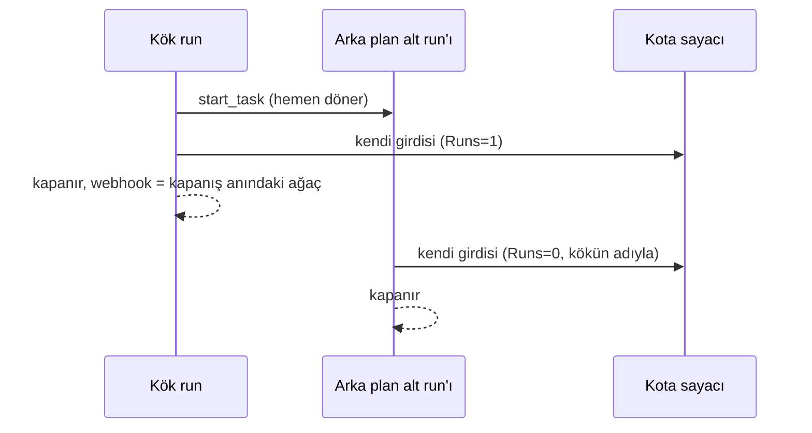

# Faz 205 — Kök Kapandıktan Sonra Biten Harcamanın Kotası

> **Durum:** ✅ Tamamlandı (2026-10-14)
> **Plan onayı:** 2026-10-14 — kullanıcı "Faz 205'i geliştir" dedi; engelleyici dört tasarım sorusu aynı gün cevaplanmıştı (§205.1 A, F-482 dahil, webhook belgelenir, eşik bildirimi çocuğun akışı). Açık Soru 1-4 önerilen seçenekle (hepsi A) uygulandı
> **Kaynak:** [ADAYLAR.md](ADAYLAR.md) · **F-418**, **F-482**
> **Genellik:** Alt agent çağıran ya da tool'u zaman aşımına düşebilen her tüketici, kiracı kotası açıksa etkilenir. İş tüketici kodunda kalamaz: kota sayacını yalnız Tracon yazar. Kalem bir sözleşme ihlalidir (kiracı kotası bir yönetişim sınırıdır, site "consumption is counted" der), bu yüzden § *Tüketici geri bildirimi kuralı*'ndan muaftır. İkinci kanıt ilk ilkedir: K-913 kendi bilinen sınırını yazar ve bir model talimatı ("görevi başlat, bekleme") harcamayı kotadan gizler
> **Karşı görüş:** "Arka plan alt run'ı `ChildDeadline` (2 dk) ile sınırlıdır; kaçak küçük ve nadirdir." Cevap: sınır run başınadır, toplam değildir. Bir kök en çok `MaxTotalRuns` (25) çocuk başlatır ve her biri 2 dakikaya kadar harcar; aynı istek tekrarlanınca kaçak sınırsız büyür. Geç biten tool'un harcaması (F-482) gerçek paradır ve bugün hiçbir sayaca girmez. Mekanizma ikisini de aynı kuralla kapatır
> **Önkoşul:** Yok — K-913 (Faz dışı, F-383) ve Faz 199 (K-972…K-974) kapalı
> **Paketler:** `Tracon.Abstractions` (yalnız `internal` üye), `Tracon.Core`, `Tracon.Workflows`
> **Yeni paket:** Yok · **Migration:** Yok
> **Public API:** Büyümüyor — taşıyıcı `internal`'dır (§205.2). Ölçüldü (2026-10-14): `wc -l src/*/PublicAPI.Shipped.txt` → 17 dosya, toplam 17 satır, her biri yalnız `#nullable enable`; bir sapma public üye gerektirirse GA'dan (K-603) önce hâlâ ucuzdur
> **Tüketici yüzeyi:** site: `concepts/governance.md` (kota bölümü: "counted once at the tree's root" cümlesi ve eşik bildirimi), `concepts/agents.md` (arka plan alt agent'ı, yalnız bir paragraf varsa), `guides/background-work.md`'ye dokunulmaz · sevk edilen: `CHANGELOG.md` (davranış değişikliği), `capabilities.md` kota satırı
> **Manuel test alanı:** `docs/manuel-test/23-SAKLAMA-ARSIV-KOTA.md` (kota case'leri, `MT-RET-*`)

---

## Bu Faza Başlarken

> `faz-baslangic` skill'ini uygula. Aşağıdaki liste o skill'in 2. adımıdır —
> **tamamını değil, yalnız işaret edilen bölümleri oku.**

1. Bu doküman
2. Kararlar — dosyanın tamamını **okuma**, yalnız bu kalemleri grep'le:
   ```bash
   grep -n "K-913\|K-972\|K-973\|K-974\|K-976\|K-219" docs/KARARLAR.md
   ```
   **K-913** (kök agent kotaya ve webhook'a ağaç toplamını yazar — bu faz kota yarısını değiştirir),
   **K-972** (para kararı yalnız `RunSpend.Total`'dan; yalnız `Tracon:Pricing:Currency` toplanır),
   **K-973** (webhook yükünün `Cost`/`NonTokenCost` anlamı), **K-974** (geç gelen kalem yalnız detaya —
   bu faz kota yarısını değiştirir, snapshot kuralı kalır), **K-976** (karışık para biriminde toplam yok)
3. Önceki faz devri: `awk '/## Sonraki Faza Devir Notu/,0' docs/arsiv/fazlar/199-FONKSIYON-DUGUMU-MALIYETI.md`
   — geç tool ölçümünün (`LateToolCompletionRecorder`) ve `NonTokenCostAccumulator.Seal()`'ın sözleşmesi
4. Alan hafızası:
   [`hafiza/olcum-kota-ve-secenekler.md`](hafiza/olcum-kota-ve-secenekler.md) (kota, toplama ifadesi, K-483 sınıfı) ·
   [`hafiza/cekirdek-calistirma.md`](hafiza/cekirdek-calistirma.md) (`AsyncLocal`/scope kuralı; arka plan görevi ortamı göremez)
5. Gerektiğinde: [`MIMARI.md`](MIMARI.md) — agent çağrı grafiği ve kota bölümü (`grep -n "kota\|quota" docs/MIMARI.md`)

---

## Amaç

Kiracı kotası bir çağrı ağacının harcamasını eksiksiz saymalıdır. Bugün harcama
yalnız kökün kapanış anında okunur: o anda hâlâ koşan arka plan alt run'ı ve
zaman aşımından sonra biten tool'un tutarı hiçbir sayaca girmez. Bu faz kuralı
tersine çevirir: **her harcama, kesinleştiği anda, onu yapan run tarafından,
ağacın kök kimliğiyle kotaya yazılır.** Kiracı, kotası olan operatör ve faturayı
kotadan okuyan tüketici kazanır.

- **F-418** — Kök kapandıktan sonra biten arka plan alt run'ının tüketimi kotaya girer.
- **F-482** — Kapanıştan sonra bildirilen tool harcaması kotaya girer (toplam snapshot'ı ve webhook değişmez).

### Bugün ne çalışmıyor — doğrulanmış kanıt

| Kanıt | Gözlem |
|---|---|
| [`RunRecordingAgent.Completion.cs:162-169`](../src/Tracon.Core/Recording/RunRecordingAgent.Completion.cs) | Yalnız `Depth == 0` run'ı ağacı okur ve kotaya yazar; çocuk hiç yazmaz (`:200` webhook için aynı kapı) |
| [`RunRecordingAgent.Notifications.cs:57-160`](../src/Tracon.Core/Recording/RunRecordingAgent.Notifications.cs) | Ağaç toplamı kökün satırı kapanmadan depodan **bir kez** okunur; o anda koşan çocuğun satırında usage yoktur |
| [`AgentDefinitionCompiler.Agents.cs:119-124`](../src/Tracon.Core/Compilation/AgentDefinitionCompiler.Agents.cs) | Alt agent'lar MAF `BackgroundAgentsProvider` ile sunulur; `start_task` görevi başlatıp hemen döner |
| `grep -rn "ReleaseSessionAsync" src/` → boş | Tracon görevleri kök bitince iptal etmez; görev oturumla yaşar ve sonraki turda da sonuçlanabilir. Kökü bekletmek ya da çocuğu iptal etmek bu yüzden çözüm değildir |
| [`TraconOptions.cs:190`, `:229`](../src/Tracon.Core/TraconOptions.cs) | `MaxTotalRuns = 25`, `ChildDeadline = 2 dk`: çocuk başına sınır var, toplamda yok |
| [`WorkflowRunner.cs:1551`, `:1737-1781`](../src/Tracon.Workflows/Internal/WorkflowRunner.cs) | Workflow kökü satırını kapattıktan **sonra** ağacı okur ve yazar; adımın başlattığı arka plan görevi aynı açıktadır |
| [`LateToolCompletionRecorder.cs:128`](../src/Tracon.Core/Recording/LateToolCompletionRecorder.cs) | Geç biten tool'un ölçümü yalnız çağrının `tool_invocations` satırına yazılır (K-974); kotaya gitmez |
| [`ChildAgentInvoker.cs:477-499`](../src/Tracon.Core/Graph/ChildAgentInvoker.cs) | Çocuk ağacın `AgentRunBudget` örneğini **aynı referansla** alır; kökün adını ve kiracısını almaz |
| [`concepts/governance.md:494-497`](../docs-site/src/content/docs/concepts/governance.md) | Site sınırı yazar: "A child run that is still running in the background when its root ends is not counted." |

> Kanıtlar 2026-10-14 tarihinde doğrulandı.

---

## 205.1 — Kural: harcama kesinleştiği anda yazılır

Seçilen tasarım A'dır (kullanıcı kararı, 2026-10-14). Kota girdisi artık ağaç başına
bir tane değildir; harcayan her olay kendi girdisini yazar.

| Kim | Ne zaman | Girdi |
|---|---|---|
| Kök agent run'ı | Kendi kapanışında | Kendi token'ı ve tutarı (`RunSpend.Total`), `Runs = 1` |
| Alt agent run'ı (her derinlik) | Kendi kapanışında, kök kapanmış olsa da | Kendi token'ı ve tutarı, `Runs = 0` |
| Workflow kökü | Kendi kapanışında | Kendi düğümlerinin token dışı tutarı, `Runs = 1`; token yok (satırın modeli yok) |
| Geç biten tool (F-482) | Ölçüm geç geldiği anda | Yalnız tutar, `Runs = 0`, token yok |

Her girdi **ağacın kök kimliğiyle** yazılır: kiracı ve ad kökünkidir (agent kökünde
agent adı, workflow kökünde workflow adı). Bugün yalnız kök yazdığı için sayaçlar
kökün adı altındadır; ağaç sayacı bu yüzden aynı kalır, yalnız eksiksiz olur. Çocuk
kendi adıyla hiç sayaç açmaz (`AgentTreeQuotaTests` bunu bugün de ölçer).



Kararın dört sonucu:

- **Çift sayım yoktur.** Her run yalnız kendini yazar; kök artık ağacı kotaya yazmaz.
  `ReadTreeConsumptionAsync` yalnız webhook için kalır (§205.3).
- **Sayaç daha erken güncellenir.** Çocuğun harcaması kök kapanmadan sayaca girer.
  Kota yine run başlamadan denetlenir; sayaç yaklaşık kalır (site uyarısı geçerli).
- **Para birimi kuralı her girdide aynıdır.** Girdinin tutarı `RunSpend.Total`'dır (K-972):
  `Tracon:Pricing:Currency` dışındaki tutar sayılmaz, token sayılır. Bugünkü F-419 testinin
  beklentisi (`AgentTreeQuotaTests.A_tree_priced_in_two_currencies…`: token 20, tutar 0.016)
  korunur — başka para birimli çocuk token'ıyla girer, tutarıyla girmez.
- **Yazım sayısı artar.** Ağaç başına en çok `MaxTotalRuns + 1` kota yazımı olur; her biri
  bugünkü tek yazımla aynı işlemdir (`QuotaEnforcer.RecordAsync` → `IQuotaStore.AddUsageAsync`).
  Maliyet model çağrısının yanında küçüktür; ölçülmedi, kapanışta ölçülmeli.

## 205.2 — Kök kimliği çocuğa nasıl ulaşır

Arka plan görevi kökün ortam kapsamını (`AsyncLocal`) güvenle göremez: görev kök
kapandıktan sonra sürer. Kimlik bu yüzden **ağacın paylaşılan nesnesinde** taşınır.
`AgentRunBudget` her çocuğa aynı referansla geçer (`ChildAgentInvoker.cs:489`) ve iki
kök de onu kendisi kurar (`RunRecordingAgent.Lifecycle.cs`'te `CreateBudget`,
`WorkflowRunner.cs:610`). Plan şunu önerir:

- `AgentRunBudget`'a `internal` bir **ağaç hesabı** üyesi: kiracı, kök adı, kök run kimliği,
  kökün kullanıcısı. Kök onu bütçeyi kurarken doldurur. `Tracon.Abstractions` bu üyeyi
  `Tracon.Core` ve `Tracon.Workflows`'a açar (ikisi de `InternalsVisibleTo` listesindedir,
  ölçüldü). Public yüzey büyümez.
- Çocuk kendi kapanışında girdisini bu hesapla yazar; ortam kiracısına bakmaz.
- MCP (`CatalogToolCallHandler.cs:103`) ve A2A (`ExternalAgentProxy.cs:187`) kendi
  bütçesini kurar ve oradaki run köktür; hesap o kökte doldurulur.

> **Doğrulanmadı — uygulama ölçmeli:** her kök yolunun (eşzamanlı, akışlı, kuyruklu run,
> devam, onay devamı, replay, eval case, MCP, A2A, workflow) bir bütçe kurduğu ve `Budget`'ın
> hiçbir kökte `null` kalmadığı. `null` kalan yol hesap taşımaz; o yolun çocuğu bugünkü gibi
> yazmamalı ve bu bir test ile sabitlenmeli.

## 205.3 — Webhook kapanış anının görüntüsüdür (belgelenir)

Kullanıcı kararı (2026-10-14): `run.completed` yükü değişmez. Kök kapanırken ağacı okur
(K-913) ve yükte o anki toplamı taşır. Kökten sonra biten çocuk ve geç gelen tool tutarı
yüke girmez; kesin toplam `GET /api/runs/{id}` (ağaç alanları) ve kota sayacıdır. Yeni
webhook olayı açılmaz (K1). Site bu sınırı açıkça yazar; bugünkü "not counted" cümlesi
kaldırılır.

## 205.4 — Eşik bildirimi eşiği geçen run'ın akışına yazılır

Kullanıcı kararı (2026-10-14): çocuğun girdisi bir eşiği geçerse
`tracon.quota.threshold` bildirimi **çocuğun kendi** olay akışına yazılır
(`PublishThresholdToRunStream` açıksa) ve `quota.threshold` webhook'u o run'ı
adlandırır. Kökün akışı kapanmış olabilir; kapanmış akışa yazılmaz. Geç gelen tool
tutarının girdisi bildirimi hiçbir akışa yazmaz (run kapanmıştır); yalnız webhook gider.
Sitenin "Only the root run of a call tree ever carries the notice" cümlesi değişir.

## 205.5 — Geç biten tool (F-482)

`LateToolCompletionRecorder` geç ölçümü çağrının satırına yazdıktan sonra, ölçümün
tutarı varsa (`ToolCallUsage.Cost`) ağaç hesabıyla bir kota girdisi yazar: `Runs = 0`,
token yok, tutar `RunSpend` kuralıyla. Run'ın snapshot sütunları değişmez (K-974'ün
snapshot kuralı kalır); değişen yalnız kotadır. Yazım fire-and-forget yoludur ve
"gözlemlenebilirlik işlevselliği bozmaz" kuralına uyar: depo hatası loglanır.

---

## Planlanan Public API

> Public yüzey büyümez. Aşağıdakiler `internal` taslaktır; gerçek adlar kapanışta yazılır.

```csharp
// Tracon.Abstractions (internal; Core ve Workflows görür)
internal sealed record TreeAccount(string TenantId, string RootName, Guid RootRunId, string? UserId);

public sealed class AgentRunBudget   // bugün sealed, partial değil — üye aynı dosyaya eklenir
{
    internal TreeAccount? Account { get; set; }   // kök kurarken doldurur, bir kez
}

// Tracon.Core (internal) — tek yazım yolu; kök, çocuk, workflow ve geç tool onu çağırır
internal static class TreeQuota
{
    internal static ValueTask<IReadOnlyList<QuotaThresholdCrossing>> RecordAsync(
        IQuotaEnforcer enforcer, TreeAccount account, Guid runId, long tokens, decimal? amount, int runs,
        DateTimeOffset occurredAt, CancellationToken cancellationToken);
}
```

🚨 Tek yazım yolu bir kapıdır, süs değildir: dört çağıran `QuotaConsumption`'ı elle kurarsa
K-483 sınıfı (elle tekrarlanan toplama ifadesine terim eklemek) geri gelir.

### HTTP `endpoint`'leri

Yok.

### Arayüz payı

Yok.

---

## Planlanan Dosya Listesi

```
src/Tracon.Abstractions/Runs/
├── AgentRunBudget.cs                     (internal Account)
└── TreeAccount.cs                        (yeni, internal)
src/Tracon.Core/
├── Quotas/TreeQuota.cs                   (yeni, internal — tek yazım yolu)
├── Recording/RunRecordingAgent.Completion.cs      (her derinlik kendini yazar)
├── Recording/RunRecordingAgent.Notifications.cs   (RecordQuotaAsync kendi tüketimi; ağaç okuması yalnız webhook)
├── Recording/RunRecordingAgent.Lifecycle.cs       (kök hesabı doldurur)
└── Recording/LateToolCompletionRecorder.cs        (geç tutarın girdisi)
src/Tracon.Workflows/Internal/WorkflowRunner.cs    (kendi düğüm tutarı, Runs=1; hesap kurulumu)
src/Tracon.Testing.Contracts.Xunit/Contracts/QuotaStoreContract.cs  (Runs=0 girdisi)
tests/Tracon.AspNetCore.FunctionalTests/BackgroundChildQuotaTests.cs (yeni)
docs-site/src/content/docs/concepts/governance.md
```

---

## Hata Modları ve Testler

| Ne bozulabilir | Seviye | Test sınıfı |
|---|---|---|
| Bekleme yapmayan kökün çocuğu kök kapandıktan sonra biter ve sayaca girmez (F-418 repro: `start_task`, kapı açılmadan cevap; çocuğun modeli kapıyla bekletilir) | Fonksiyonel, akışlı **ve** akışsız | `BackgroundChildQuotaTests` — önce kırmızı (sayaç 10, beklenen 20) |
| Kök ağacı yazmaya devam eder ve çocuk da yazar: çift sayım | Fonksiyonel | `AgentTreeQuotaTests` (mevcut: 20 token, 0.058) yeşil kalır; `BackgroundChildQuotaTests` tam toplamı ölçer |
| Workflow adımının başlattığı arka plan görevi workflow bitince sayılmaz | Fonksiyonel | `BackgroundChildQuotaTests` workflow case'i — önce kırmızı |
| Çocuk girdisi ortam kiracısına yazar (arka plan iş parçacığında ortam başka kiracıdır) | Fonksiyonel, iki kiracı | `BackgroundChildQuotaTests` iki kiracılı case |
| Başka para birimli çocuğun tutarı sayaca eklenir | Fonksiyonel | `AgentTreeQuotaTests.A_tree_priced_in_two_currencies…` (mevcut, beklenti korunur) |
| Çocuk kendi adıyla sayaç açar | Fonksiyonel | `AgentTreeQuotaTests` mevcut `CountersAsync(host, "arastirmaci")` boş kalır |
| `Runs = 0` girdisi bir depoda run sayısını artırır ya da reddedilir | Sözleşme (bellek + üç SQL) | `QuotaStoreContract` yeni case |
| Eşzamanlı biten çok çocuk sayaçta artış kaybeder | Sözleşme | `QuotaStoreContract.Concurrent_increments_lose_no_increment` (mevcut) — kapsamı yeter, ölçülmeli |
| Çocuğun eşik bildirimi köke yazılmaya çalışılır (kapanmış akış) ya da hiç yazılmaz | Fonksiyonel | `BackgroundChildQuotaTests` eşik case'i (`PublishThresholdToRunStream` açık) |
| Geç biten tool tutarı kotaya girmez (F-482 repro) | Fonksiyonel | `LateToolCompletionTests` yeni case — önce kırmızı |
| Geç tutar run snapshot'ını değiştirir (K-974 kırılır) | Fonksiyonel | Aynı case snapshot'ın değişmediğini ölçer |
| Kota deposu çocuğun girdisinde hata verir | Fonksiyonel | Çocuk run `Completed` kalır, uyarı loglanır (`RecordingLoggerProvider`) |
| Çocuk iptal edilir ya da `ChildDeadline`'a çarpar | Fonksiyonel | O ana kadar kaydedilen usage girer; bugünkü davranışla aynı, test sabitler |
| `Budget` `null` kalan bir kök yolu | Birim/fonksiyonel | §205.2 ölçümünün testi — her kök yolu hesap taşır |
| Kuyruklu run'ın ikinci denemesi önceki denemenin çocuğunu yeniden sayar | Fonksiyonel | Her çocuk ayrı run'dır ve bir kez yazar; kökün kendi girdisi deneme başına kendi harcamasıdır — `QueuedRunAttributionTests` emsaliyle bir case |

Beş soru: **iptal** (çocuk iptali, test var) · **eşzamanlılık** (eşzamanlı çocuklar,
sözleşme) · **boş/aşırı girdi** (usage'sız çocuk girdisi yazmaz ya da `0` yazar —
karar Açık Soru 2) · **başka kiracı** (iki kiracılı case) · **alt sistem hatası**
(kota deposu hatası).

---

## Manuel Kabul Case'leri

| # | Ön koşul | Adımlar | Beklenen sonuç |
|---|---|---|---|
| 1 | Örnek uygulama; günlük token kotası açık; yönlendirici agent'ın talimatı "görevi başlat, sonucu bekleme" | Yönlendiriciyi çalıştır; HTTP yanıtı gelince `GET /api/quotas/usage` oku; çocuk bitince tekrar oku | İlk okuma kökün token'ını, ikinci okuma kök + çocuğu gösterir; `runs` 1 |
| 2 | Aynı; `run.completed` webhook alıcısı | Aynı run | Webhook yükü kapanış anındaki ağacı taşır (çocuk dahil değil); fark site sınırıyla uyumlu |
| 3 | `PublishThresholdToRunStream` açık; eşik çocuğun girdisiyle geçilecek kadar düşük | Aynı run; çocuğun olay akışını oku | Bildirim çocuğun akışındadır; kökün akışında yoktur |
| 4 | Zaman aşımı kısa, tutar bildiren yavaş tool | Run'ı çalıştır; tool bitince sayacı oku | Sayaç tool tutarı kadar artar; run'ın `nonTokenCost`'u değişmez |

---

## Açık Sorular

| # | Soru | Seçenekler | Öneri |
|---|---|---|---|
| 1 | Taşıyıcı nerede? | A: `AgentRunBudget` `internal` üyesi · B: `AgentRunScope`'a yeni public alan + `TraconRunOptions` | A — bütçe zaten ağaç başına tek referanstır ve iki kök onu kurar; public yüzey büyümez |
| 2 | Hiç usage'ı ve tutarı olmayan çocuk girdi yazar mı? | A: yazmaz · B: `0` yazar | A — boş yazım depo turudur; eşik değişmez |
| 3 | Geç tool girdisinin `RunId`'si hangisi? | A: tool'u çağıran run · B: kök | A — eşik webhook'u tutarı harcayan run'ı adlandırır (§205.4 ile tutarlı) |
| 4 | `ReadTreeConsumptionAsync`'in kota yolundan çıkması `StartedRuns` kapısını gereksiz kılar mı? | A: yalnız webhook için kalır · B: kaldırılır | A — webhook kararı (§205.3) okumayı korur |

---

## Bitiş Ölçütleri (DoD)

- [x] Bekleme yapmayan kökün çocuğu bitince kökün sayacı kök + çocuğu taşır; `runs` 1 (`BackgroundChildQuotaTests`, akışlı ve akışsız; taban sürümde kırmızı: sayaç 10, beklenen 20)
- [x] Workflow adımının arka plan görevi workflow bitince sayaca girer (`A_workflow_steps_background_task_is_counted_under_the_workflow`; taban sürümde kırmızı)
- [x] Geç biten tool'un tutarı sayaca girer, run snapshot'ı değişmez (`LateToolCompletionTests`; taban sürümde kırmızı)
- [x] `AgentTreeQuotaTests`, `NonTokenSpendAgentTreeTests`, `NonTokenSpendTests` değiştirilmeden yeşil
- [x] `QuotaStoreContract` `Runs = 0` case'i dört depoda yeşil (bellek içi · Sqlite · PostgreSQL · SQL Server; iki case)
- [x] K-913 ve K-974'ün kota yarısını değiştiren karar `KARARLAR.md`'ye yazıldı (K-990, kategori: güvenlik, public-api)
- [x] Dört doğrulama kapısı sıfır uyarı verir (`kapi.py kapanis --taban 245afe91` çıkış 0: build · test 691 sn · pack · format; sözleşme paketine dokunulduğu için `kapi.py yayin --kuru` ayrıca koşar)
- [x] `samples/Tracon.Api` ile gerçek `run` yapıldı (manuel case 1 ve 3), çıktı aşağıda
- [x] `secret` taraması boş döndü (`kapi.py tarama`)
- [x] Manuel kabul case'leri `docs/manuel-test/23-SAKLAMA-ARSIV-KOTA.md` içine eklendi (`MT-RET-081…084`); otomatikleştirilebilenler koşuldu
- [x] `faz-denetim` koşuldu; 🔴 bulgu kalmadı (1 gerçek, düzeltildi)
- [x] `docs-site/` güncellendi (`concepts/governance.md`, `runs.md`, `tools.md`, `workflows.md`, `capabilities.md`); `npm run check` temiz

### Doğrulama komutları

```bash
# Arka plan çocuğunun kotası
python3 scripts/kapi.py test --proje Tracon.AspNetCore.FunctionalTests --sinif "*BackgroundChildQuotaTests" "*AgentTreeQuotaTests" "*LateToolCompletionTests"

# Örnek uygulamada sayaç (çocuk bitmeden ve bittikten sonra)
curl -s http://localhost:5081/tracon/api/quotas/usage -H "Authorization: Bearer $TOKEN"
```

---

## Riskler

| Risk | Önlem |
|------|-------|
| Kök hâlâ ağacı kotaya yazar ve çocuk da yazar: çift sayım | Kota yolu yalnız `TreeQuota.RecordAsync`'ten geçer; `AgentTreeQuotaTests` tam toplamı ölçer (çift sayım 40 token verir) |
| Arka plan görevi ortam kiracısını okur | Hesap bütçede taşınır; iki kiracılı test |
| Elle kurulan `QuotaConsumption` (K-483 sınıfı) | Tek yazım yolu; kapanışta `grep -rn "new QuotaConsumption" src/` yalnız o yolu göstermeli |
| Workflow kökü satırı kapattıktan sonra okuyordu; sıra değişince webhook yükü kayar | Webhook okuması değişmez (§205.3); yalnız kota yolu değişir |
| Yazım sayısının artması kota deposunu yükler | Ağaç başına en çok 26 yazım; kapanışta örnek uygulamada ölçülür ve yazılır |
| Site ve K-913 metni eski kuralı anlatır | `faz-tamamlama` Adım 7; `governance.md:494-497` iki cümle değişir |

---

<!-- ============================================================
     AŞAĞISI KAPANIŞTA DOLDURULUR — `faz-tamamlama` skill'i.
     Plan anında boş kalır. Başlıkları SİLME.
     ============================================================ -->

## Plandan Sapmalar

1. **Taşıyıcı `TreeAccount` plandaki taslaktan farklıdır.** `RootRunId` düştü (hiçbir okuyucusu yok); `Quota` (`IQuotaRecorder?`) eklendi. Gerekçe: geç tool yolu yalnız yakaladığı `AgentRunScope`'u tutar ve `TimeoutAIFunction` public bir tiptir — `QuotaEnforcer`'ı ona vermek yerine tohum bütçedeki hesaba bindi. Taslaktaki `IQuotaEnforcer` parametresi `IQuotaRecorder` oldu (`QuotaEnforcer` onu uygular; `Tracon.Abstractions` içinde, `internal`). Kök hesabı **bir kez değil her seferinde yeniden** atar: bir bütçeyi ikinci kök için yeniden kullanan tüketicinin çocukları birincinin kiracısına yazmasın (`TreeQuotaTests.A_budget_a_second_root_reuses_names_the_second_root`).
2. **Para birimi kuralı plandaki gibi uygulanamadı.** Plan "`Tracon:Pricing:Currency` dışındaki tutar sayılmaz" diyordu; ama `AgentTreeQuotaTests.A_tree_priced_in_two_currencies…` yapılandırılmış birim `null` iken koşar ve çocuk kapanırken kökün birimi bilinmez (çocuk kökten önce kapanır). Uygulanan: **kök kendi maliyetini olduğu gibi yazar**; alt run'ın token maliyeti etiketsizse ya da yapılandırılmış birimdeyse girer, etiketli ve farklıysa token ve token dışı tutar girer (`RunRecordingAgent.QuotaAmount`, `TreeQuotaTests` teorileri). Bedel: özel çözümleyici bütün ağacı yapılandırılmışın dışında bir birimle fiyatlıyorsa alt run'ların token maliyeti artık eklenmez (**F-499**). Mevcut test değişmedi.
3. **Geç tool tutarı çağrının kaydından değil birikimciden okunur.** Plan "`ToolCallUsage.Cost` varsa girdi yazılır" diyordu; kayıttan okumak, tool'un süresi içinde raporlayıp run kapandıktan sonra dönmesi hâlinde tutarı iki kez sayardı (kayıt da toplam da tutarı tutar). `NonTokenCostAccumulator.TakeLateToolAmount` yalnız mühürden **sonra** raporlananı verir ve mühürdeki aynı çağrının tutarını düşer (son rapor öncekinin yerine geçer; denetimin 🔴 bulgusu). Plandaki yapısal iddia (geç ölçüm yalnız çağrı satırına yazılır) doğruydu; eksik olan "kapanıştan önce mi sonra mı" ayrımıydı.
4. **Public yüzey `Tracon.Testing.Contracts.Xunit`'te iki test yöntemi büyüdü.** Plan "Public API büyümüyor" diyordu ve `Tracon.Abstractions`/`Core`/`Workflows` için doğrudur; ama sözleşme paketinin kendisi izlenir (`PublicAPI.Unshipped.txt` +2 satır): `QuotaStoreContract.Usage_that_adds_no_run_adds_its_tokens_and_cost_to_a_counter_that_does_not_exist_yet` ve `…_leaves_the_run_count_where_the_root_put_it`. Sevk edilen sözleşmeye case eklediği için `kapi.py yayin --kuru` kapanışta koşar. Ayrıca dört sevk edilen `///` metni eski kuralı anlatıyordu ve düzeltildi (`QuotaConsumption.Runs`/`RunId`, `WebhookQuotaSummary.RunId`, `RunEventCustomTypes.QuotaThreshold`, `PublishThresholdToRunStream`).
5. **Webhook okuması yalnız webhook kayıtlıyken yapılır** (plan: "yalnız webhook için kalır"; koşul `_quotaEnforcer is null && _webhookPublisher is null` idi, artık `_webhookPublisher is null`). Açık Soru 4: `StartedRuns` kapısı korundu.
6. **Eski bir test yeniden adlandırıldı:** `QuotaNoticeOrderingTests.A_child_run_never_records_quota_consumption` → `…_with_no_tree_account_records_no_quota_consumption`. Kural değişti ("çocuk hiç yazmaz" artık yanlış); test aynı kalır (hesapsız çocuk yazmaz), iddia tam hâliyle `TreeQuotaTests`'tedir.
7. **Açık Soru 1-4 önerilen seçenekle (A) kapatıldı:** `AgentRunBudget` internal üyesi · usage'sız çocuk girdi yazmaz · geç girdi `RunId`'si çağıran run · `ReadTreeConsumptionAsync` yalnız webhook için kalır.
8. **Eşik bildirimi payload'ı** kiracı ve kullanıcıyı çocuğun kapsamından değil hesaptan alır (`WriteQuotaThresholdNoticeAsync`); çocuğun ortam kiracısı arka planda varsayılandır (taban sürümde `A_late_childs_entry_goes_to_the_roots_tenant` kırmızı).
9. **Plan tablosunda vaat edilen üç test yazılmadı, gerekçeyle:** (a) *kuyruklu run'ın ikinci denemesi önceki denemenin çocuğunu yeniden sayar* — yapısal olarak olamaz: her run yalnız kendini yazar, kökün girdisi deneme başına kendi harcamasıdır; eski çift sayım (ağaç okuması) kota yolundan çıktı. (b) *her kök yolu hesap taşır* — §205.2 ölçümü: `AgentRunScope` yalnız iki yerde kurulur (`RunRecordingAgent.Lifecycle.cs`, `WorkflowRunner.cs`), ikisi de `Account` atar; MCP, A2A, eval, replay, devam ve onay devamı derinlik 0 olarak aynı `PrepareRun` yolundan geçer. İki yer `QuotaWriteSiteTests.Every_place_that_opens_a_root_scope_names_the_account…` ile sabitlendi. (c) *iptal edilen çocuk "o ana kadar kaydedilen usage"yı yazar* — çocuğun girdisi `CompleteAsync`'in elindeki usage'dır (satırın kendi rakamı); iptalden sonra dönen bir model yanıtı satırda da yoktur, yani sayaçta da yoktur (değişmedi). Usage'sız iptal yazmaz (`A_child_the_deadline_cancels_before_it_spent_anything_writes_no_entry`).
10. **Bir kusur bulundu, çözülmedi → aday:** SQLite kota sayacı tutarı kayan noktayla toplar (**F-497**; sözleşme testinin ilk sürümü `0,1 + 0,2`'de düştü, binary-kesin tutarlara çevrildi). Dört aday daha: **F-498** (eşik denetimi girdi başına okur), **F-499** (sapma 2), **F-500** ve **F-501** (denetimden: geç tool'un hata dalı ve webhook'suz eşik).

## Bu Fazda Verilen Kararlar

- **K-990** (kategori: güvenlik, public-api; kullanıcı kararı): kota girdisi harcayan run başına yazılır; kimlik ağacın bütçesindeki `TreeAccount`'tan okunur; tek yazım yolu `TreeQuota.RecordAsync`; `run.*` webhook'u kök kapanış anının görüntüsü; eşik bildirimi eşiği geçiren run'ın akışına. K-913'ün kota yarısını ve K-974'ün "yalnız detaya" kuralının kota yarısını değiştirir.
- Kategori dışı (yalnız burada): Açık Soru 1-4'ün seçimi (Sapma 7) · para birimi kuralının biçimi (Sapma 2) · geç tool tutarının kaynağı (Sapma 3) · üç testin yazılmaması (Sapma 9).

## Gerçekleşen Public API

`Tracon.Abstractions`, `Tracon.Core` ve `Tracon.Workflows` public yüzeyi **büyümedi** (`PublicSurfaceBaselineTests` yeşil, `PublicAPI.*.txt` değişmedi). Yalnız sözleşme paketi:

```csharp
// Tracon.Testing.Contracts.Xunit — PublicAPI.Unshipped.txt (+2)
public abstract class QuotaStoreContract
{
    [Fact] public Task Usage_that_adds_no_run_adds_its_tokens_and_cost_to_a_counter_that_does_not_exist_yet();
    [Fact] public Task Usage_that_adds_no_run_leaves_the_run_count_where_the_root_put_it();
}
```

Gerçekleşen `internal` yüzey:

```csharp
// Tracon.Abstractions
internal interface IQuotaRecorder { ValueTask<IReadOnlyList<QuotaThresholdCrossing>> RecordAsync(QuotaConsumption consumption, CancellationToken cancellationToken = default); }
internal sealed record TreeAccount(string TenantId, string RootName, string? UserId, IQuotaRecorder? Quota);
public sealed class AgentRunBudget { internal TreeAccount? Account { get; set; } }

// Tracon.Core
internal static class TreeQuota { internal static ValueTask<IReadOnlyList<QuotaThresholdCrossing>> RecordAsync(TreeAccount account, Guid runId, int runs, long tokens, decimal? amount, DateTimeOffset occurredAt, CancellationToken cancellationToken); }
internal sealed class NonTokenCostAccumulator { public decimal? TakeLateToolAmount(string callId); }
internal sealed class QuotaEnforcer : IQuotaRecorder { … }
public sealed partial class RunRecordingAgent { internal static decimal? QuotaAmount(bool isRoot, decimal? ownSpend, RunCost? cost, RunNonTokenCost? nonTokenCost, string? pricingCurrency, out bool tokenCostLeftOut); }
```

## Dosya Listesi (gerçekleşen)

```
src/Tracon.Abstractions/Quotas/IQuotaRecorder.cs                    (yeni)
src/Tracon.Abstractions/Runs/TreeAccount.cs                         (yeni)
src/Tracon.Abstractions/Runs/AgentRunBudget.cs                      (Account)
src/Tracon.Core/Quotas/TreeQuota.cs                                 (yeni — tek yazım yolu)
src/Tracon.Core/Quotas/QuotaEnforcer.cs                             (IQuotaRecorder)
src/Tracon.Core/Recording/RunRecordingAgent.Lifecycle.cs            (kök hesabı atar)
src/Tracon.Core/Recording/RunRecordingAgent.Completion.cs           (her derinlik kendini yazar)
src/Tracon.Core/Recording/RunRecordingAgent.Notifications.cs        (OwnConsumption · RecordQuotaAsync · QuotaAmount; ağaç okuması yalnız webhook)
src/Tracon.Core/Recording/NonTokenCostAccumulator.cs                (TakeLateToolAmount)
src/Tracon.Core/Recording/LateToolCompletionRecorder.cs             (geç tutarın girdisi)
src/Tracon.Workflows/Internal/WorkflowRunner.cs                     (hesap + yalnız kendi payı)
src/Tracon.Testing.Contracts.Xunit/Contracts/QuotaStoreContract.cs  (+2 case) · PublicAPI.Unshipped.txt (+2)
sevk edilen /// : QuotaTypes.cs · WebhookEventPayload.cs · RunEventCustomTypes.cs · TraconQuotaOptions.cs
tests/Tracon.AspNetCore.FunctionalTests/BackgroundChildQuotaTests.cs (yeni, 8 test) · LateToolCompletionTests.cs (+5)
tests/Tracon.AspNetCore.FunctionalTests/Infrastructure/{GatedModelProvider,EntryRecordingQuotaStore}.cs (yeni)
tests/Tracon.Core.UnitTests/Quotas/TreeQuotaTests.cs (yeni, 18) · Architecture/QuotaWriteSiteTests.cs (yeni, 7) · Recording/NonTokenCostAccumulatorTests.cs (+10)
docs-site/src/content/docs/concepts/{governance,runs,tools,workflows}.md · capabilities.md (+ public/llms-full.txt) · CHANGELOG.md
docs/KARARLAR.md (K-990, K-913/K-974 işareti) · arsiv/KARARLAR-GECMISI.md · hafiza/{olcum-kota-ve-secenekler,cekirdek-calistirma}.md · arsiv/HAFIZA-GECMISI.md
docs/manuel-test/23-SAKLAMA-ARSIV-KOTA.md (MT-RET-081…084; 033 ve 076 düzeltildi) · 00-INDEKS.md · 12-GOZLEMLENEBILIRLIK-MALIYET.md
docs/ADAYLAR.md (F-497…F-501)
```

### Örnek uygulama koşumu (2026-10-14, `samples/Tracon.Api`, bellek içi depo, `gpt-5.4-mini`)

`bg-router2` ("`background_agents_start_task` ile `bg-writer`'ı başlat, BEKLEME, `Started` de") günlük token kotasıyla koşuldu:

| An | `GET /api/quotas/usage` (`bg-router2`, günlük) |
|---|---|
| Kökün HTTP yanıtı döndü (`done`) | `runs 1 · tokens 1352 · cost 0.00043075` |
| Çocuk bitti (~7 sn sonra) | `runs 1 · tokens 1874 · cost 0.001417` (`bg-writer` adıyla satır yok) |
| Kök satırı | `usage 1352 · treeUsage 1874` (sayaçla aynı) |

Eşik (manuel case 3): `maxTokens 1500`, `ThresholdPercents [100]`, `PublishThresholdToRunStream` açık — kök 1352 (altında); çocuk bitince sayaç 1871. `tracon.quota.threshold` çerçevesi **çocuğun** akışında (sıra 3, terminal olaydan önce), kökün akışında yok.

## Süreç Ölçümü

| Metrik | Değer |
|---|---|
| Plan revizyonu sayısı | 0 (plan aynı gün yazıldı ve değişmedi; sapmalar yukarıda) |
| Düzeltme turu sayısı | 9 (derleme/analyzer 4: IDE0032, RS0016, CA1826, CS1503 · test kırmızısı 4: sevk edilen belge dili ×2, eşik testinin yarışı, SQLite kayan nokta · denetim 🔴 1) |
| 🔴 bulgu: gerçek / gürültü / araştırılacak | 1 / 0 / 0 |
| Fazın ürettiği regresyon | 0 (mevcut hiçbir test değiştirilmeden kırmızı olmadı; bir test yeniden adlandırıldı, Sapma 6) |
| Faz kapandıktan sonra bulunan kusur | ölçülmedi (faz henüz kapanmadı) |

## Denetim Bulguları

`faz-denetcisi` (taze bağlam, 2026-10-14). Taban sürümde sekiz yeni test kırmızıydı (sayaç 10, beklenen 20).

| Seviye | Bulgu | Triyaj | Sonuç |
|---|---|---|---|
| 🔴 | Geç tutar, tool süresi içinde de raporlamışsa çift sayılır: `KeepLateToolAmount` mühürdeki rapora bakmaz (0,02 süresinde + 0,05 sonradan → sayaç 0,07, gerçek 0,05) | **gerçek** — birim testi yazıldı ve düştü (`0,05` döndü, `0,03` olmalıydı) | Düzeltildi: `TakeLateToolAmount` mühürdeki tutarı düşer, yalnız artışı verir; küçük ya da eşit rapor bir şey eklemez. 3 birim testi + `A_tool_that_reports_a_larger_total_after_its_run_closed_adds_only_the_difference` |
| 🟡 | Sevk edilen XML metinleri eski kuralı anlatıyordu (`QuotaConsumption.Runs`/`RunId`, `WebhookQuotaSummary.RunId`, `RunEventCustomTypes.QuotaThreshold`) | — | Düzeltildi (dört metin + `PublishThresholdToRunStream` açıklaması) |
| 🟡 | CHANGELOG eşiği yalnız "sonra biten çocuk"a bağlıyordu | — | Düzeltildi ("çocuk run"); eşzamanlı çocuk için ayrı case yazılmadı: her `CompleteAsync` kendi `scope.Writer`'ına yazar, geç çocuk testi aynı yolu koşar |
| 🟡 | Para birimi dalı testsizdi (çocuk token dışı tutarı) | — | Kural `QuotaAmount` statik yöntemine çıkarıldı; 3 test (token dışı tutar korunur, tutarsız çocuk para eklemez, kök ve fiyatsız dokunulmaz) |
| 🟡 | Planın üç hata modu yazılmadı | — | Gerekçelendi (Sapma 9); kök yolu `QuotaWriteSiteTests` ile sabitlendi |
| 🟡 | Eski kural: `MT-RET-033`, `runs.md:90` | — | Düzeltildi |
| 🟢 | Geç tool hata verirse raporladığı tutar girmez · geç tutarın eşiği webhook yoksa duyulmaz · F-499'un tersi · ADAYLAR tablo biçimi | — | **F-500**, **F-501**, F-499 genişletildi, biçim düzeltildi |

Triyaj notu: `faz-denetim` Adım 5.1 🔴 bulguların kullanıcıya sorulmasını ister. Bu bulgu bir testle **mekanik olarak yeniden üretildi** (`KR-05`: repro varsa gerçektir) ve kullanıcı "karşılaşılan defect'leri çöz" demişti; bu yüzden sorulmadan kapatıldı. Kapanış mesajı bunu bildirir.

## Sonraki Faza Devir Notu

Sıradaki faz yok: `YOL-HARITASI.md`'nin son satırı 205'tir; seçilmemiş işler `ADAYLAR.md`'dedir.

**Devralınan sözleşmeler**

- Kota her run'da yazılır. Kök `AgentRunBudget.Account`'u atar (`TreeAccount`: kiracı, kök adı, kullanıcı, `IQuotaRecorder?`); çocuk (`Runs = 0`), workflow adımı, workflow kökü (yalnız kendi payı) ve geç tool aynı hesaba tek yoldan, `TreeQuota.RecordAsync`'ten yazar. `grep -rn "new QuotaConsumption" src/` yalnız `TreeQuota.cs`'i göstermelidir (`QuotaWriteSiteTests` zorlar).
- `run.*` webhook'u kök kapanış anının görüntüsüdür; `ReadTreeConsumptionAsync` yalnız onun içindir.

**Bilinen tuzaklar**

- 🚨 Kota girdisinin kimliği (kiracı, ad, kullanıcı) ortamdan okunmaz: arka plan çocuğu kök bittikten sonra biter ve ortam kiracısı varsayılandır. Yeni bir yazan eklersen hesabı bütçeden al, `ITenantContext`'ten değil.
- 🚨 Geç tool tutarı çağrının kaydından okunursa iki kez sayılır; kaynak `NonTokenCostAccumulator.TakeLateToolAmount`'tır (yalnız mühürden sonra raporlananı, mühürdeki aynı çağrının tutarını düşerek verir).
- 🚨 Para birimi: kök kendi maliyetini olduğu gibi yazar, alt run'ın token maliyeti yalnız yapılandırılmış birimdeyse girer (F-499). `Tracon:Pricing:Currency` `null` iken etiketli bir maliyet alt run'da girmez.
- Ağaç başına en çok `MaxTotalRuns + 1` kota yazımı ve girdi başına eşik okuması vardır (F-498); ölçülmüş bir yük sorunu bildirilmedi.
- SQLite kota sayacı tutarı kayan noktayla toplar (F-497); sözleşme testlerinde ikili-kesin tutarlar kullan.
- Bu dosyayı bir betikle düzenlerken `## Sonraki Faza Devir Notu` dizisini başlık olarak **satır başıyla** ara: "Bu Faza Başlarken" listesindeki `awk` komutu aynı dizeyi taşır ve düz `index` onu bulup dosyayı keser (bu fazın kapanışında bir kez yaşandı, git'ten geri alındı).

**Yarım kalan işler**

- **Site yayını (`faz-tamamlama` Adım 10) koşulmadı**: `./scripts/site-deploy.sh` dış dünyaya yayın yapar; kullanıcı onayı bekler. Kapılar yeşil (`npm run check`).
- `MT-RET-082` (webhook alıcısı gerekir) ve `MT-RET-084` (zaman aşımına uğrayıp tutar bildiren örnek tool yok) elle koşulmadı; ikisinin otomatik karşılığı CI'dadır.
