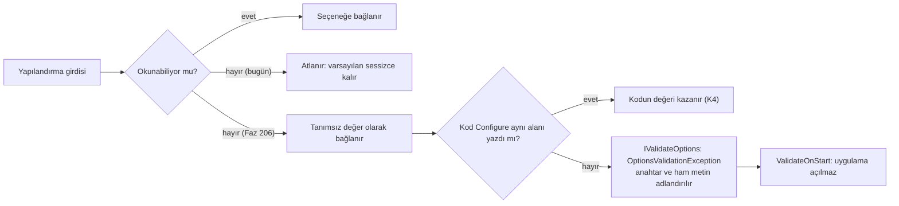

# Faz 206 — Yapılandırma Bölümlerinin Bağlama Kanıtı

> **Durum:** ✅ Tamamlandı (2026-10-14)
> **Plan onayı:** Bakımcı, 2026-10-14 — kapsam kararı sohbette alındı (22 tipin tamamı + IdempotencyKeys + okunamayan değerin açılışta hatası) ve Faz 205 ile paralel başlatma onaylandı; plan metni sohbette okunmadı
> **Kaynak:** [ADAYLAR.md](ADAYLAR.md) · **F-247**
> **Genellik:** İlk ilke: belgelenen ama bağlanmayan bir anahtar bir sözleşme ihlalidir. Yapılandırma dosyası ya da ortam değişkeni kullanan her tüketici etkilenir. İş tüketici kodunda kalamaz, çünkü bağlayıcıyı yalnız Tracon yazar. Ölçülen iki vaka var: `TraconImageOptions.Timeout` (`HATA-S1-010`) ve bu planın ölçtüğü `TraconRetentionOptions.IdempotencyKeys` (§206.3). Kalem bir sözleşme ihlali sınıfıdır, bu yüzden § *Tüketici geri bildirimi kuralı*'ndan muaftır
> **Karşı görüş:** "Bağlayıcılar küçüktür ve gözle denetlenebilir. 22 test sınıfı bakım yükü ekler. Okunamayan değerde açılışı durdurmak, yazım hatası olan tüketicinin uygulamasını yükseltmeden sonra açılmaz yapar." Cevap: gözle denetim aynı sınıfı beş kez kaçırdı (`RecordRunInput` K-406, `IncludeAgentVersionTag`, `McpTimeout` K-253, F-385 lane koleksiyonları, F-416 Knowledge) ve altıncısı bu planın ölçümünde çıktı. Test maliyeti tip başına bir kezdir; ratchet yeni bölümü zaten zorlar. Açılıştaki hata anahtarı adlandırır. Bugünkü sessiz varsayılan ise hatayı üretime taşır: PII maskeleme kapanır, korunması istenen bir sütun korumasız kalır. Davranış değişikliği `CHANGELOG`'da adıyla yazılır
> **Önkoşul:** Yok. Faz 205'in kirli dosya kümesine dokunmaz: `AgentRunBudget.cs`, `QuotaEnforcer.cs`, `src/Tracon.Core/Recording/*`, `WorkflowRunner.cs`, `QuotaStoreContract.cs`, `IQuotaRecorder.cs`. Faz 205 ile paralel koşabilir. Paylaşılan dosyalar yalnız birleştirmede çakışabilir (§ *Riskler*)
> **Paketler:** `Tracon.Core` (bağlayıcılar, bir yeni `internal` doğrulayıcı) · testler `Tracon.Core.UnitTests`
> **Yeni paket:** Yok · **Migration:** Yok
> **Public API:** Büyümüyor — yeni doğrulayıcı ve olası ham metin taşıyıcısı `internal`'dır. Ölçüldü (2026-10-14): `wc -l src/*/PublicAPI.Shipped.txt` → 17 dosya, toplam 17 satır; her biri yalnız `#nullable enable`. Bir sapma public üye isterse GA'dan (K-603) önce hâlâ ucuzdur. Dört public seçeneğin **davranışı** değişir (§206.4): preview'da serbesttir, sürüm notunda adıyla anılır
> **Tüketici yüzeyi:** site: `reference/configuration.md` (bölüm indeksine üç satır, `Columns` varsayılanı, `IdempotencyKeys` paragrafı, :708 başlığı, dört koleksiyon satırına "açılışta hata" cümlesi) · sevk edilen: `CHANGELOG.md` (`Changed` — davranış değişikliği · `Fixed` — `IdempotencyKeys`), dört seçeneğin XML `<remarks>`'ı (`ThresholdPercents`, `RetryDelays`, `Keys`/`Columns`, `MaskedPii`)
> **Manuel test alanı:** `docs/manuel-test/02-CEKIRDEK-VE-KATALOG.md` (`MT-CORE-*`; yapılandırma bağlama emsali `MT-CORE-065`). Numara kapanışta alınır; bugün son numara `MT-CORE-146`

---

## Bu Faza Başlarken

> `faz-baslangic` skill'ini uygula. Aşağıdaki liste o skill'in 2. adımıdır —
> **tamamını değil, yalnız işaret edilen bölümleri oku.**

1. Bu doküman
2. Kararlar — dosyanın tamamını **okuma**, yalnız bu kalemleri grep'le:
   ```bash
   grep -n "K-021\|K-059\|K-735\|K-934" docs/KARARLAR.md
   ```
   **K-021** (yapılandırma elle bağlanır, yansımalı `Bind()` yok — AOT),
   **K-059** (`Keys` yalnız yapılandırma anahtarının **adını** taşır, değeri değil),
   **K-735** ve **K-934** (`Columns` varsayılanı bütün `ProtectedColumn` üyeleridir; üye sayısı 12)
3. Önceki faz devri: yok. Kalemin öncülleri faz dışı kusur gidermedir (F-385 lane koleksiyonları, F-416 Knowledge). Tuzakları alan hafızasındadır (madde 4)
4. Alan hafızası:
   [`hafiza/secenek-baglama-ve-gizlilik.md`](hafiza/secenek-baglama-ve-gizlilik.md) — yalnız § *Seçenek bağlama* (satır 16-31). Üç not doğrudan bu fazın kuralıdır: satır 21 (`ValidateOnStart` olmadan doğrulayıcı tembeldir), satır 30 (F-385: okunamayan koleksiyon değeri doğrulayıcıya ulaşır), satır 31 (F-416: "bu bölümden okunur" diyen sınıf bağlanmamış olabilir) ·
   [`hafiza/icerik-koruma-ve-saglayici-kayit.md`](hafiza/icerik-koruma-ve-saglayici-kayit.md) (yalnız §206.4'ün `ContentProtection`/`ContentGuard` satırlarına dokunurken)
5. Gerektiğinde: [`.agents/ortak/test-seviyeleri.md`](../.agents/ortak/test-seviyeleri.md) (35 satır; §206.1'in seviye gerekçesi ona dayanır)

---

## Amaç

Tracon'un elle bağlanan 22 kardeş yapılandırma bölümünün her anahtarı gerçekten
seçeneğe ulaşmalıdır. Okunamayan bir değer de sessizce varsayılana düşmemelidir.
Bugün bunu yalnız `TraconOptions` ağacı için bir test kanıtlar. Bu faz dört iş yapar:
22 bölümün her birine bir bağlama testi yazar, bağlanmayan bir hedefi
(`IdempotencyKeys`) bağlar, okunamayan değeri sessizce atan dört bağlayıcıyı açılışta
hataya çevirir ve ratchet'ın boş bir sınıfı kabul etmesini engeller. Kazanan, ayarını
`appsettings.json` ya da ortam değişkeniyle yazan her tüketicidir: yazdığı değer ya
uygulanır ya da uygulama açılırken anahtarı adıyla söyler.

- **F-247** — 22 bölüme `<Tip>BindingTests`, `IdempotencyKeys` bağlaması, dört bağlayıcıda okunamayan değerin açılışta hatası, ratchet sertleştirmesi ve site düzeltmeleri.

### Bugün ne çalışmıyor — doğrulanmış kanıt

| Kanıt | Gözlem |
|---|---|
| [`OptionsSectionCoverageTests.cs:39-48`](../tests/Tracon.Core.UnitTests/Configuration/OptionsSectionCoverageTests.cs) | Ratchet yalnız **ada** bakar: assembly'de adı `{Tip}BindingTests` olan herhangi bir tip yeter. Boş bir sınıf listeden çıkarır |
| [`options-section-coverage-baseline.txt:12-33`](../tests/Tracon.Core.UnitTests/Configuration/options-section-coverage-baseline.txt) | 22 tip testsiz kayıtlıdır. Aday metnindeki "24" bayattır: `6466aebb` Scheduling'i, `1c78f6fe` Knowledge'ı listeden çıkardı |
| [`TraconRetentionOptions.cs:82`](../src/Tracon.Core/Retention/TraconRetentionOptions.cs), `:129` | `IdempotencyKeys` hedefi tanımlıdır ve `ForTarget` onu döndürür |
| [`TraconServiceCollectionExtensions.Binding.Security.cs:363-381`](../src/Tracon.Core/TraconServiceCollectionExtensions.Binding.Security.cs) | `BindRetention` 16 hedeften 15'ini okur, `IdempotencyKeys` yoktur. `Tracon:Retention:IdempotencyKeys:*` sessizce yok sayılır. Bu, `:375`'teki HATA-S1-005 yorumunun anlattığı sınıfın yeni bir vakasıdır |
| [`configuration.md:531-533`](../docs-site/src/content/docs/reference/configuration.md) | Site boşluğu belgeler ama çözüm olarak `Configure(TraconOptions)` yazar. `TraconOptions`'ta Retention yoktur (`grep -c Retention src/Tracon.Core/TraconOptions.cs` → 0) |
| [`…Binding.Operations.cs:203-205`](../src/Tracon.Core/TraconServiceCollectionExtensions.Binding.Operations.cs) | `ThresholdPercents`'teki `"abc"`, `"0"` ve `"-5"` sessizce düşer. Bu yüzden [`TraconQuotaOptionsValidator.cs:46`](../src/Tracon.Core/Quotas/TraconQuotaOptionsValidator.cs)'daki `<= 0` dalına yapılandırmadan ulaşılamaz |
| [`…Binding.Security.cs:316-318`](../src/Tracon.Core/TraconServiceCollectionExtensions.Binding.Security.cs) | `RetryDelays`'te aynı şekil vardır. [`TraconWebhookOptionsValidator.cs:55`](../src/Tracon.Core/Webhooks/TraconWebhookOptionsValidator.cs)'teki `<= Zero` dalına ulaşılamaz |
| [`…Binding.Security.cs:208`](../src/Tracon.Core/TraconServiceCollectionExtensions.Binding.Security.cs), `:223` | `Keys`'teki boş değer atlanır. `Columns`'taki bilinmeyen ad atlanır; yorum (`:179-184`) bunu bilinçli diye yazar. `["RunInput","Typo"]` yazılırsa yalnız `RunInput` korunur |
| [`…Binding.Security.cs:167`](../src/Tracon.Core/TraconServiceCollectionExtensions.Binding.Security.cs) | `MaskedPii`'deki bir yazım hatası (`"Emial,CreditCard"`) `Enum.TryParse`'ı **tümüyle** düşürür, değer `None` kalır ve PII maskeleme kapanır. `PatternContentGuardOptions`'ın doğrulayıcısı yoktur |
| [`TraconSchedulingOptionsValidator.cs`](../src/Tracon.Core/Scheduling/TraconSchedulingOptionsValidator.cs) (`BindSchedulingCollections`, `…Binding.Operations.cs:88-140`) | **Emsal.** F-385 okunamayan değeri `0` olarak bağlar. Doğrulayıcı koleksiyonları `Enabled`'dan bağımsız denetler |

> Kanıtlar 2026-10-14 tarihinde `245afe91` zemininde (bu worktree) doğrulandı.

---

## 206.1 — 22 bağlama testi

### Seviye

Testler **birim projesinde, DI kökünde** koşar: gerçek `AddTracon(section)` (ya da
gerçek `UseVoiceConversation(section)`/`UseLiveVoice(section)`), gerçek
`ServiceProvider` ve `IOptions<T>.Value` kullanılır. Gerekçe:

- Host bu yola bir şey eklemez. `AddTracon(IHostApplicationBuilder)` yalnız `services.AddTracon(builder.Configuration.GetSection("Tracon"))` çağırır ([`TraconServiceCollectionExtensions.cs:36-40`](../src/Tracon.Core/TraconServiceCollectionExtensions.cs)). DI kökü tüketicinin kompozisyonunu birebir koşar.
- `test-seviyeleri.md` "DI kaydı → fonksiyonel" der. O satırın gerekçesi K-283'tür (depo davranışı çağıranı değiştirir) ve bağlamaya uymaz. Bağlamanın geçtiği sınır yapılandırma → container'dır; DI kökü onu geçer.
- 🚨 Private `BindX`'i yansımayla çağıran `TraconPricingBindingTests.BindOnly` deseni bu sınırı **geçmez**. Emsal değildir; aday metni onu emsal gösteriyordu.
- Host'un eklediği tek şey yapılandırma kaynağıdır: ortam değişkeni (`__`) ve JSON dosyası. O yarıyı manuel case'ler örnek uygulamada ölçer.

"Açılışta hata" testleri `IStartupValidator.Validate()` üzerinden gider
(emsal: [`TimeoutOptionValidationTests.cs:189-217`](../tests/Tracon.Core.UnitTests/Hosting/TimeoutOptionValidationTests.cs)). `IOptions<T>.Value` doğrulayıcıyı çalıştırır, ama `ValidateOnStart` kaydı olmasa da çalıştırır. Hafıza satırı 21 bu farkı ölçtü.

### İskelet

Emsaller: `TraconImageOptionsBindingTests`, `TraconKnowledgeOptionsBindingTests`,
`TraconSchedulingOptionsBindingTests`. Voice kompozisyonu için
`TimeoutOptionValidationTests.cs:131`, `:144`.

```csharp
private static X Bind(Dictionary<string, string?> values)
{
    var configuration = new ConfigurationBuilder().AddInMemoryCollection(values).Build();
    var services = new ServiceCollection();
    services.AddSingleton<IConfiguration>(configuration);
    services.AddTracon(configuration.GetSection("Tracon"));   // section, NOT root
    // voice: var section = configuration.GetSection("Tracon");
    //        services.AddTracon(section).UseLiveVoice(section.GetSection("Voice:Live"));
    using var provider = services.BuildServiceProvider();
    return provider.GetRequiredService<IOptions<X>>().Value;
}
[Fact] Every_scalar_of_the_section_is_bound()          // every scalar: a NON-DEFAULT value the validator accepts
[Fact] The_<collection>_is_bound()                      // one per collection, if the type has any
[Fact] An_absent_section_leaves_the_shipped_defaults()
```

Kurallar:

- Anahtar **literal** yazılır (`"Tracon:Quotas:TimeZone"`), `nameof` kullanılmaz. Belgelenen anahtar sözleşmedir; `nameof` bir yeniden adlandırmayı gizler.
- `AddTracon(configuration)` (kök) değil `GetSection("Tracon")` geçirilir. Kök verilirse anahtar `Quotas:…` aranır ve test boşa geçer. `AddTracon()` ise yapılandırma almazsa hiçbir şey bağlamaz ([`…Registration.Operations.cs:169`](../src/Tracon.Core/TraconServiceCollectionExtensions.Registration.Operations.cs)).
- Biçimler: TimeSpan `"00:00:45"`, `"1.00:00:00"` (ISO 8601 desteklenmez); enum adı büyük/küçük harf duyarsızdır; flags `"Email,CreditCard"`; liste `:0`, `:1`; sözlük `:<anahtar>`; bool `"true"`/`"false"`; double `"0.25"`.
- Test sınıfı adı tam olarak `<Tip>BindingTests`'tir, namespace `Tracon.Core.UnitTests.Configuration`'dır, dosyası `tests/Tracon.Core.UnitTests/Configuration/` altındadır. Ratchet yalnız bu assembly'ye bakar. Voice testleri de buraya girer.

### 22 tip

Kısaltmalar: `B.Ops`, `B.Sec`, `B.Core` = `src/Tracon.Core/TraconServiceCollectionExtensions.Binding.{Operations,Security,Core}.cs`; `R.Ops` = `…Registration.Operations.cs`. Hepsi `Configure<T>(lambda)` ile elle bağlanır ve hepsinde `ValidateOnStart` vardır. init-only alan ya da private setter **yoktur**.

| # | Tip | Bölüm | Bağlayıcı · `Configure` | Skaler / koleksiyon / iç içe | TimeSpan | Doğrulayıcı | Not |
|---|---|---|---|---|---|---|---|
| 1 | `CanaryOptions` | `Tracon:Canary` | B.Ops:430 · R.Ops:189 | 2/0/0 | 1 | var | |
| 2 | `OnlineEvaluationOptions` | `Tracon:OnlineEvaluation` | B.Core:477 · R.Ops:187 | 7/1/0 | 2 | var | `AgentNames` listesi |
| 3 | `PatternContentGuardOptions` | `Tracon:ContentGuard:Pattern` | B.Sec:158 · R.Ops:221 | 2/1/0 | 0 | **yok → §206.4** | Bölümün varlığı yerleşik guard'ı kaydeder (R.Ops:228) |
| 4 | `RunReconciliationOptions` | `Tracon:RunReconciliation` | B.Ops:315 · R.Ops:183 | 5/0/0 | 3 | var | |
| 5 | `SingletonExecutionOptions` | `Tracon:SingletonExecution` | B.Ops:143 · R.Ops:52 | 3/0/0 | 1 | var | |
| 6 | `TraconApprovalOptions` | `Tracon:Approvals` | B.Sec:9 · R.Ops:185 | 4/0/0 | 2 | var | |
| 7 | `TraconAsyncRunOptions` | `Tracon:AsyncRun` | B.Ops:292 · R.Ops:181 | 2/0/0 | 0 | yok | |
| 8 | `TraconContentGuardOptions` | `Tracon:ContentGuard` | B.Sec:129 · R.Ops:216 | 3/0/0 | 0 | yok | |
| 9 | `TraconContentProtectionOptions` | `Tracon:ContentProtection` | B.Sec:185 · R.Ops:199 | 2/2/0 | 0 | var → §206.4 | `Keys` sözlüğü, `Columns` enum kümesi |
| 10 | `TraconDrainOptions` | `Tracon:Drain` | B.Ops:385 · R.Ops:203 | 2/0/0 | 1 | var | |
| 11 | `TraconEgressOptions` | `Tracon:Egress` | B.Sec:48 · R.Ops:195 | 1/0/0 | 0 | yok | |
| 12 | `TraconIdempotencyOptions` | `Tracon:Idempotency` | B.Ops:269 · R.Ops:179 | 2/0/0 | 0 | yok | |
| 13 | `TraconMcpSecurityOptions` | `Tracon:Mcp` | B.Sec:61 · R.Ops:197 | 1/0/0 | 0 | yok | Bölüm `TraconMcpOptions` ile ortaktır |
| 14 | `TraconQuotaOptions` | `Tracon:Quotas` | B.Ops:170 · R.Ops:171 | 4/1/0 | 0 | var → §206.4 | |
| 15 | `TraconRateLimitOptions` | `Tracon:RateLimit` | B.Ops:221 · R.Ops:175 | 5/0/0 | 1 | yok | `Partition` enum |
| 16 | `TraconRetentionOptions` | `Tracon:Retention` | B.Sec:334 (+:384) · R.Ops:177 | 3/0/16 | 1 | var | §206.3; her hedefte `MaxAgeDays`, `Archive` |
| 17 | `TraconRunContinuationOptions` | `Tracon:RunContinuation` | B.Ops:362 · R.Ops:201 | 2/0/0 | 0 | var | |
| 18 | `TraconSessionOwnershipOptions` | `Tracon:SessionOwnership` | B.Sec:415 · R.Ops:211 | 4/0/0 | 0 | yok | `ManagementPolicy=""` ayrı test (B.Sec:437-444, güvenlik) |
| 19 | `TraconStructuredResponseOptions` | `Tracon:StructuredResponse` | B.Ops:407 · R.Ops:209 | 2/0/0 | 0 | var | |
| 20 | `TraconWebhookOptions` | `Tracon:Webhooks` | B.Sec:242 · R.Ops:173 | 9/1/0 | 2 | var → §206.4 | `RetryDelays` TimeSpan listesi |
| 21 | `VoiceConversationOptions` | `Tracon:Voice:Conversation` | `Voice/VoiceConversationBuilderExtensions.cs:138` | 10/0/0 | 3 | var | `AddTracon` değil `UseVoiceConversation(section)` (`:46-54`) |
| 22 | `VoiceLiveOptions` | `Tracon:Voice:Live` | `Voice/LiveVoiceBuilderExtensions.cs:145` | 11/0/0 | 3 | var | `UseLiveVoice(section)` (`:47-55`); anahtarlar string literal (`:147-197`) |

Toplam: 86 üst seviye skaler, Retention'da 32 iç içe skaler, 6 koleksiyon, 20 TimeSpan skaler, 4 enum.

### Değer tuzakları — doğrulayıcının kabul ettiği, varsayılan dışı değerler

- Varsayılanı `true` olan bool'a `"false"` ver: `Quotas.Enabled`, `Quotas.AllowOnStoreFailure`, `AsyncRun.Enabled`, `Idempotency.Enabled`, `Approvals.ExpirationEnabled`, `ContentGuard.InspectInput`/`InspectOutput`/`BufferStreamingOutput`, `Webhooks.Enabled`, `SessionOwnership.RequireAuthenticatedOwner`, `VoiceLive.PersistTranscript`.
- `RunReconciliation`: `OrphanThreshold ≥ HeartbeatInterval` (`RunReconciliationOptionsValidator.cs:33`).
- `SingletonExecution`: `Enabled=true` ise `LeaseDuration` en az 3 sn olmalıdır (`SingletonGuard.MinimumLeaseDuration`, `SingletonGuard.cs:61`).
- `ContentProtection`: `Enabled=true` ise `ActiveKeyId` `Keys`'te bulunmalıdır. `Columns` varsayılanı on iki sütunun **tamamıdır**; kesin bir alt küme seç.
- `Quotas.TimeZone` geçerli bir sistem kimliği olmalıdır (IANA, ör. `Europe/Istanbul`). CI işletim sisteminde ölçülmeli. `ThresholdPercents` 1…100 arasıdır ve varsayılanı `[80,100]`'dür; ör. `[50,90]` seç.
- `OnlineEvaluation`: `SampleRate` 0…1 arasıdır, `"0.25"` InvariantCulture'ı da kanıtlar. `LowScoreThreshold` 0…100, `MinSampleSize` ≥ 1.
- Timer ve timeout alanları 1 ms … ~49,7 gün aralığındadır (`TimerPeriod`). `Drain.Timeout` her zaman denetlenir; `Canary.ScanInterval` `AutoRollbackEnabled` açıkken, `Approvals.ScanInterval` `ExpirationEnabled` açıkken denetlenir.
- `Retention`: `MaxAgeDays` ≥ 1, `BatchSize` ≥ 1, `BatchDelay` 0 … ~49,7 gün.
- `Webhooks`: `RetryDelays` varsayılanı beş girdidir, iki farklı girdi seç. `MaxResponseBytes` ≥ 1, `DisableAfterConsecutiveFailures` ≥ 1.
- `RunContinuation.MaxAttempts` ≥ 1; `StructuredResponse.MaxRepairAttempts` ≥ 0.
- Enum: `RateLimit.Partition` Tenant → `Global`; `VoiceLive.DelegationMode` Client → `Responses`; `MaskedPii` None → `"Email,CreditCard"`.
- `SessionOwnership.ManagementPolicy=""` ayrı bir testtir: boş metin "kimse süzülmemiş listeyi almaz" demektir ve varsayılana (`Tracon.Operator`) dönmemelidir.

## 206.2 — Her üye testte adıyla geçer (Açık Soru 3)

Ratchet yalnız sınıfın varlığını kanıtlar. Elle listelenmiş bir test bugünün alanlarını
kilitler, ama yarın eklenen alanı görmez: alan bağlayıcıya da teste de yazılmazsa sınıf
yine sessiz kalır. `TraconOptionsBindingCoverageTests` bu deliği yansımayla kapatır.
Bu faz aynı güvenceyi test tarafında küçük bir yardımcıyla verir:

```csharp
// tests/Tracon.Core.UnitTests/Configuration/OptionsKeyCoverage.cs (test-side, reflection is allowed here)
internal static class OptionsKeyCoverage
{
    // (a) every public settable scalar and every get-only collection/nested options property
    //     of TOptions is named by at least one key under sectionPath (nested: recursive);
    // (b) every bound scalar differs from new TOptions()'s value — a test value equal to
    //     the default proves nothing.
    public static void ShouldCoverEveryMember<TOptions>(
        IReadOnlyDictionary<string, string?> values, string sectionPath, TOptions bound,
        params string[] exempt) where TOptions : new();
}
```

Her `Every_scalar_of_the_section_is_bound` testi yardımcıyı da çağırır. Açık
`assert`'ler kalır: (b) yalnız değerin değiştiğini kanıtlar, doğru alana gittiğini değil.

## 206.3 — `IdempotencyKeys` bağlanır; hedefler elle sayılmaz

- `BindRetention`'a tek satır eklenir: `BindRetentionTarget(section.GetSection(nameof(TraconRetentionOptions.IdempotencyKeys)), options.IdempotencyKeys)` (`B.Sec:363-381` bloğu).
- `TraconRetentionOptionsBindingTests.Every_retention_target_is_bound` hedefleri elle değil, `TraconRetentionOptions`'ın `RetentionTargetOptions` tipli public property'lerinden **yansımayla** sayar. Her hedefe farklı bir `MaxAgeDays` ve `Archive=true` yazar ve geri okur. Test önce kırmızıdır (`IdempotencyKeys`). On yedinci hedef bağlayıcıya yazılmazsa test yine kırmızı olur (HATA-S1-005 sınıfı).
- Ek bir kontrol, property sayısının `RetentionTargets.All.Count` (16) ile eşit olduğunu kanıtlar.
- Site: `configuration.md:531-533` silinir. Tablodaki `IdempotencyKeys` satırı (:520) kalır, çünkü artık bağlanabilir bir alt bölümdür.

## 206.4 — Okunamayan değer açılışta hata verir

Kural F-385'tir (hafıza satırı 30): okunamayan değer atlanmaz, doğrulayıcıya ulaşır ve
doğrulayıcı onu açılışta adlandırır.



| Seçenek | Bugün | Faz 206 | Doğrulayıcı |
|---|---|---|---|
| `Quotas.ThresholdPercents` | `B.Ops:203-205`: okunamayan ya da ≤ 0 düşer; hepsi düşerse `[80,100]` kalır | Girdi atlanmaz: okunamayan `0` bağlanır, liste girdiyle **değişir** (Scheduling emsali `B.Ops:106-114`) | Mevcut: `TraconQuotaOptionsValidator.cs:46` adlandırır. Değişmez |
| `Webhooks.RetryDelays` | `B.Sec:316-318`: okunamayan ya da ≤ 0 düşer | Okunamayan `TimeSpan.Zero` bağlanır, süzgeç kalkar | Mevcut: `TraconWebhookOptionsValidator.cs:55`. Değişmez |
| `ContentProtection.Keys` | `B.Sec:208`: boş değer atlanır | Değer yazıldığı gibi bağlanır, boş da olsa (Scheduling `LaneByHandlerKey` emsali) | Mevcut `:48-55` döngüsü `Enabled` erken dönüşünün (`:27`) **önüne** taşınır |
| `ContentProtection.Columns` | `B.Sec:223`: bilinmeyen ad ve boş girdi atlanır; tanımsız sayı (`"99"`) kümeye girer | Okunamayan ya da tanımsız girdi kümede tanımsız bir değer olarak durur | Yeni denetim aynı doğrulayıcıda, `Enabled`'dan **önce**: tanımsız üye → hata |
| `Pattern.MaskedPii` | `B.Sec:167`: yazım hatası → `None`; `"64"` gibi tanımsız bit kabul edilir | Boş ya da yok → ayarlanmamış (`None`, bugünkü gibi). Okunamayan → tanımsız bit taşıyan bir değer | **Yeni** `internal sealed class PatternContentGuardOptionsValidator` (`src/Tracon.Core/Guards/`). Kayıt R.Ops:234-257 bloğunda `TryAddEnumerable` ile yapılır, `configurationSection` koşulunun dışındadır. `ValidateOnStart` zaten var (R.Ops:101) |

Tasarım kuralları:

- **`Enabled`'dan bağımsız.** Okunamayan değer denetimi özellik kapalıyken de koşar. İki gerekçe var. Emsal: `TraconSchedulingOptionsValidator` koleksiyonları `Enabled`'dan bağımsız denetler. Ölçüm: anahtar çözümü (`LoadKey`, `AesGcmContentProtector.cs:209-211`) `Enabled`'a bakmaz. Koruma kapalıyken de eski şifreli satır `Keys` ile okunur.
- **Mesaj ham metni adlandırır.** Örnek: `TraconContentProtectionOptions.Columns contains 'RunInputt', which is not a ProtectedColumn name.` Tanımsız değer tek başına ham metni taşıyamaz. Bu yüzden bağlayıcı ham metni `internal` bir alanda tutar; doğrulayıcı yalnız mesaj için okur. Alanın biçimi uygulamada seçilir. Kısıtları: public API büyümez, AOT temiz kalır (`Enum.TryParse<T>`, `Enum.IsDefined<T>`; yansıma yok), mesaj İngilizcedir (`SourceLanguageTests`).
- **Kod kazanır (K4, F-385 emsali; Açık Soru 2).** Hata alanın bağlanmış değerinden çıkar, ham metin kaydından çıkmaz. Kod `Configure` aynı alanı yeniden yazarsa hata kalkar. Örnek uygulama `MaskedPii`'yi kodda yazar (`samples/Tracon.Api/Program.cs:1519-1522`); manuel case bunu hesaba katar.
- **Kod yolu da denetlenir.** Yeni `MaskedPii` ve `Columns` denetimi tanımsız değeri kaynağından bağımsız reddeder; `AddPatternContentGuard(o => o.MaskedPii = (PiiPatterns)64)` de açılmaz. `CHANGELOG` bunu da yazar.
- Bağlayıcının `:179-184` yorumu ("skipped rather than failing") yeni kurala göre yeniden yazılır.

## 206.5 — Ratchet boş sınıfı saymaz

`OptionsSectionCoverageTests` `testClassNames` kümesini (`:39-41`) yalnız en az bir
`[Fact]` ya da `[Theory]` metodu taşıyan tiplerden kurar. xunit.v3'te `TheoryAttribute`'un
`FactAttribute`'tan türediği uygulamada yansımayla ölçülmeli; türemiyorsa ikisi ayrı
sayılır. Ad koşulunu taşıyan yüklem bir `internal static` metoda çıkarılır ve iki
`private` iç tiple test edilir (boş sınıf → sayılmaz; `[Fact]`'li sınıf → sayılır).
Yeni test önce kırmızıdır. Namespace koşulu eklenmez.

## 206.6 — Site ve `CHANGELOG`

`docs-site/src/content/docs/reference/configuration.md`:

- Bölüm indeksine (:39-76) üç satır: `Tracon:SessionOwnership` → `TraconSessionOwnershipOptions` · `AddTracon()` (anahtarlar [`concepts/sessions.md`](../docs-site/src/content/docs/concepts/sessions.md)); `Tracon:Voice:Live` → `VoiceLiveOptions` · `UseLiveVoice()`'un yapılandırma aşırı yüklemesi (anahtarlar `guides/voice.md`); `Tracon:InboundTriggers` → `TraconInboundTriggerOptions` · `AddTracon()` (anahtarlar `guides/inbound-triggers.md`).
- :489 `All eleven protected columns` → twelve (`ProtectedColumn` 0…11; `getting-started/security.md:320` "twelve" der).
- :531-533 silinir (§206.3).
- :708 `### Live voice conversation` → tablonun gerçek bölümünü (`Tracon:Voice:Conversation`) anlatan bir başlık. `Tracon:Voice:Live` ile karışmaz.
- `Quotas:ThresholdPercents`, `Webhooks` `RetryDelays`, `ContentProtection` `Keys`/`Columns`, `ContentGuard:Pattern:MaskedPii` satırlarına Scheduling satırlarının cümlesi eklenir: okunamayan değer açılışta hata verir ve anahtarı adlandırır.

`CHANGELOG.md` `[Unreleased]`:
- **Changed** (davranış değişikliği): dört bağlayıcı ve tanımsız `MaskedPii`/`Columns` değerinin kod yolu.
- **Fixed**: `Tracon:Retention:IdempotencyKeys` artık bağlanır.

Kapanış `tuketici-dokuman-senkronu`'nu koşar.

---

## Planlanan Public API

> Taslak imzalardır. Gerçekleşen imzalar kapanışta ayrı bir bölüme yazılır.

Public yüzey büyümez. Yalnız `internal` üyeler eklenir:

```csharp
// Tracon.Core — Guards/PatternContentGuardOptionsValidator.cs
internal sealed class PatternContentGuardOptionsValidator : IValidateOptions<PatternContentGuardOptions>
{
    public ValidateOptionsResult Validate(string? name, PatternContentGuardOptions options);
}

// Tracon.Core — the raw text of an unreadable entry, for the message only (shape chosen at implementation)
// on PatternContentGuardOptions / TraconContentProtectionOptions: internal members, never public
```

Dokunulan public tipler (`TraconQuotaOptions`, `TraconWebhookOptions`,
`TraconContentProtectionOptions`, `PatternContentGuardOptions`, `TraconRetentionOptions`):
imza değişmez. Bugün davranışı değiştirmek bedavadır; GA'dan (K-603) sonra aynı değişiklik
bir sürüm kararı olurdu.

### HTTP `endpoint`'leri

Yok.

### Arayüz payı

Yok.

---

## Planlanan Dosya Listesi

```
src/Tracon.Core/
├── TraconServiceCollectionExtensions.Binding.Operations.cs      BindQuotas
├── TraconServiceCollectionExtensions.Binding.Security.cs        BindRetention · BindWebhooks · BindContentProtection · BindPatternContentGuard
├── TraconServiceCollectionExtensions.Registration.Operations.cs yeni doğrulayıcının kaydı
├── Guards/
│   ├── PatternContentGuardOptions.cs                            XML <remarks>; olası internal ham metin alanı
│   └── PatternContentGuardOptionsValidator.cs                   yeni (internal)
├── Security/
│   ├── TraconContentProtectionOptions.cs                        XML <remarks>; olası internal ham metin alanı
│   └── TraconContentProtectionOptionsValidator.cs               Keys/Columns denetimi Enabled'dan önce
├── Quotas/TraconQuotaOptions.cs                                 XML <remarks>
└── Webhooks/TraconWebhookOptions.cs                             XML <remarks>
tests/Tracon.Core.UnitTests/Configuration/
├── OptionsSectionCoverageTests.cs                               boş sınıf sayılmaz
├── options-section-coverage-baseline.txt                        yalnız başlık kalır
├── OptionsKeyCoverage.cs                                        yeni yardımcı (Açık Soru 3)
└── <Tip>BindingTests.cs × 22                                    §206.1 tablosu
docs-site/src/content/docs/reference/configuration.md
CHANGELOG.md
docs/manuel-test/02-CEKIRDEK-VE-KATALOG.md                       kapanışta
docs/hafiza/secenek-baglama-ve-gizlilik.md                       kapanışta: IdempotencyKeys, sınıfın altıncı vakası
```

---

## Hata Modları ve Testler

> Mutlu yoldan değil, **ne bozulabilir**den türetilir. Seviyeyi plan seçer.
> Sınır geçen davranış (DI · HTTP · kiracı · akış · depo · paket) birim
> testiyle kanıtlanamaz — [`.agents/ortak/test-seviyeleri.md`](../.agents/ortak/test-seviyeleri.md).

"DI kökü" = birim projesinde gerçek `AddTracon`/`UseX` + gerçek container (§206.1).

| Ne bozulabilir | Seviye | Test sınıfı |
|---|---|---|
| Belgelenen bir skaler anahtar seçeneğe ulaşmaz (22 tip) | DI kökü | `<Tip>BindingTests.Every_scalar_of_the_section_is_bound` |
| Koleksiyon bağlanmaz ya da varsayılanı değiştirmez (`AgentNames`, `DeniedTerms`, `Keys`, `Columns`, `ThresholdPercents`, `RetryDelays`) | DI kökü | `<Tip>BindingTests.The_<koleksiyon>_is_bound` |
| Bölüm yokken varsayılan bozulur | DI kökü | `<Tip>BindingTests.An_absent_section_leaves_the_shipped_defaults` |
| `Retention:IdempotencyKeys` yok sayılır (repro) | DI kökü | `TraconRetentionOptionsBindingTests.Every_retention_target_is_bound` — önce kırmızı |
| Yeni retention hedefi bağlayıcıya yazılmaz (HATA-S1-005 sınıfı) | DI kökü, yansımalı sayım | Aynı test + hedef sayısı `RetentionTargets.All` ile eşit |
| Tiplere yeni alan eklenir, teste anahtarı yazılmaz | DI kökü, yardımcı | `OptionsKeyCoverage` (a) — Açık Soru 3 |
| Test değeri varsayılana eşittir; test boş kanıttır | DI kökü, yardımcı | `OptionsKeyCoverage` (b) + `faz-denetim` |
| Voice bölümü yanlış kompozisyonla test edilir ve boşa geçer | DI kökü | Voice testleri `UseVoiceConversation(section)` / `UseLiveVoice(section)` kullanır; "yok bölüm" testi aynı yolu kullanır |
| `ThresholdPercents` `"abc"`/`"0"` sessizce düşer | DI kökü, `IStartupValidator` | `TraconQuotaOptionsBindingTests.An_unreadable_threshold_fails_at_startup` — önce kırmızı |
| `RetryDelays` `"soon"`/`"00:00:00"` sessizce düşer | DI kökü, `IStartupValidator` | `TraconWebhookOptionsBindingTests.An_unreadable_retry_delay_fails_at_startup` — önce kırmızı |
| `Columns` `"RunInputt"`/`"99"` atlanır; sütun korumasız kalır | DI kökü, `IStartupValidator`; `Enabled` hem açık hem kapalı | `TraconContentProtectionOptionsBindingTests.An_unknown_column_fails_at_startup` — önce kırmızı; mesaj ham metni adlandırır |
| `Keys:<id>=""` atlanır | DI kökü, `IStartupValidator`; `Enabled=false` | `TraconContentProtectionOptionsBindingTests.An_empty_key_name_fails_at_startup` — önce kırmızı |
| `MaskedPii` yazım hatası maskelemeyi kapatır; `"64"` kabul edilir | DI kökü, `IStartupValidator` | `PatternContentGuardOptionsBindingTests.An_unreadable_pii_list_fails_at_startup` — önce kırmızı |
| Aşırı katı kural: boş `MaskedPii` açılışı durdurur | DI kökü | `PatternContentGuardOptionsBindingTests.An_empty_pii_list_means_none` |
| Kod `Configure` hatalı yapılandırma alanını düzeltir ama açılış yine durur (ya da tersi) | DI kökü | Dört tipte birer case; seçilen anlamı sabitler (Açık Soru 2) |
| `ManagementPolicy=""` varsayılana döner (güvenlik) | DI kökü | `TraconSessionOwnershipOptionsBindingTests.An_empty_management_policy_is_kept` |
| Ratchet boş sınıfı sayar | Birim (yüklem) | `OptionsSectionCoverageTests.An_empty_binding_test_class_does_not_count` — önce kırmızı |
| Mevcut bir çağıran sessiz düşmeye dayanır (MEMORY: davranış düzeltmek çağıranı değiştirir) | Tarama | Ölçüldü (2026-10-14): `tests/` içinde dört anahtarı string ile yazan tek yer `ContentGuardRegistrationTests.cs:72`'dir (`"Email,CreditCard"`, geçerli). `samples/Tracon.Api/appsettings.json`'da `Columns`, `ThresholdPercents`, `RetryDelays`, `MaskedPii` yok. Uygulamada `grep` yeniden koşulur |
| Ortam değişkeni (`__`) ya da JSON `null`/boş değer host'ta farklı okunur | Örnek uygulama (manuel) | Manuel case 1-6 |

Beş soru:
- **İptal:** yok. Bağlama eşzamanlıdır ve açılışta bir kez koşar.
- **Eşzamanlılık:** yok. `IOptions<T>` tekildir. `IOptionsMonitor` yeniden yüklemesi kapsam dışıdır.
- **Boş/aşırı girdi:** tablodaki okunamayan, boş ve tanımsız değer satırları.
- **Başka kiracı:** yok. Seçenekler süreç genelidir.
- **Alt sistem hatası:** yok. Yapılandırma sağlayıcısının hatası host'undur.

---

## Manuel Kabul Case'leri

> Kapanışta `docs/manuel-test/02-CEKIRDEK-VE-KATALOG.md` içine sıradaki boş
> `MT-CORE-NNN` numaralarıyla eklenir. Hepsi örnek uygulamada ortam değişkeniyle
> koşulur; otomatik karşılığı `➜ CI` satırında yazılır.

| # | Ön koşul | Adımlar | Beklenen sonuç |
|---|---|---|---|
| 1 | Örnek uygulama; `Tracon__Retention__Enabled=true`, `Tracon__Retention__IdempotencyKeys__MaxAgeDays=0` | Uygulamayı başlat | Açılmaz; mesaj `TraconRetentionOptions.idempotency_keys.MaxAgeDays must be at least 1` içerir. Eski kusur: açılıyordu (değer yok sayılıyordu). Değer `3` olunca açılır |
| 2 | `Tracon__Quotas__ThresholdPercents__0=80`, `Tracon__Quotas__ThresholdPercents__1=yuz` | Başlat | Açılmaz; mesaj `TraconQuotaOptions.ThresholdPercents[1] is 'yuz', which is not a whole number` içerir (girdiyi yazıldığı gibi alıntılar, yerine bağlanan `0`'ı değil). Eski kusur: `[80]` ile açılıyordu |
| 3 | `Tracon__Webhooks__RetryDelays__0=00:01:00`, `Tracon__Webhooks__RetryDelays__1=soon` | Başlat | Açılmaz; mesaj `TraconWebhookOptions.RetryDelays[1] is 'soon', which is not a TimeSpan` içerir. Eski kusur: dört basamaklı merdivenle açılıyordu |
| 4 | Örnek uygulamanın `appsettings.json`'ı (`ContentProtection:Enabled=true`, `AddContentProtection()`); `Tracon__ContentProtection__Columns__0=RunInputt` | Başlat; sonra `Tracon__ContentProtection__Enabled=false` ile yeniden başlat | İki kezde de açılmaz; mesaj `TraconContentProtectionOptions.Columns contains 'RunInputt', which is not a ProtectedColumn name` içerir. Not: bir SQL sağlayıcısı kayıtlıysa bu hata `IStartupValidator` toplamından **önce**, depo fabrikası `IOptions<TraconContentProtectionOptions>.Value` okurken atılır; aynı koşumdaki öteki seçenek hataları görünmez. Case'leri tek tek koş |
| 5 | `Tracon__ContentProtection__Keys__old=` (boş ortam değişkeni), `Tracon__ContentProtection__Enabled=false` | Başlat | Açılmaz; mesaj `TraconContentProtectionOptions.Keys['old'] cannot be empty` içerir. **Ölçüldü (2026-10-14, macOS):** boş ortam değişkeni sağlayıcıda `""` olarak durur; JSON'daki `"old": ""` de aynı sonucu verir |
| 6 | `Tracon__Demo__SuppressRegistrations=ContentGuard`, `Tracon__ContentGuard__Pattern__MaskedPii=Emial,CreditCard` | Başlat; sonra yalnız `SuppressRegistrations`'ı kaldırıp yeniden başlat | İlki açılmaz, mesaj `'Emial,CreditCard'` adlandırır. İkincisi açılır: örnek kod `MaskedPii`'yi yazar ve kod kazanır (Açık Soru 2-A) |
| 7 | Ortam değişkeni yok | Başlat; `POST /api/agents/{ad}/run` ile bir run | Açılır, run `Completed` olur. Davranış değişikliği temiz yapılandırmayı etkilemez |

---

## Açık Sorular

> Planı bloklamayan, faz uygulanırken karara bağlanacak sorular. Bloklayan
> sorular plan yazılmadan **önce** sorulur.

| # | Soru | Seçenekler | Öneri |
|---|---|---|---|
| 1 | `RetentionTargetOptions.MaxAgeDays` (`int?`) yapılandırmadan `null` yapılamıyor. Varsayılanı dolu bir hedef (ör. `RunEvents` 30 gün) dosyadan kapatılamaz: `int.TryParse` yalnız sayı kabul eder, `"0"` doğrulayıcıda düşer (`TraconRetentionOptionsValidator.cs:39`). JSON `null`'ın sağlayıcıda boş metin olup olmadığı ölçülmedi; boş metinse bugün sessizce varsayılan kalır | A: Bu fazda değişmez. Site, bir hedefin depolanan bir politika ya da `Configure<TraconRetentionOptions>` ile kapatıldığını yazar; kapanışta JSON `null` ölçümüyle bir aday açılır · B: Boş değer `null` bağlanır ve hedefi kapatır; sayı olmayan değer açılışta hata verir | **A.** B yeni bir yapılandırma sözleşmesidir ve kişisel veri saklama süresini uzatma yönünde açar. Skaler `TryParse` deseni de bu fazın kapsamı dışındadır |
| 2 | Yapılandırmadaki okunamayan değer ile aynı alanı yazan bir kod `Configure` birlikteyse ne olur? | A: Kod kazanır, hata kalkar (hata bağlanmış değerden çıkar; F-385 emsali, K4) · B: Dosyadaki hata her durumda açılışı durdurur (hata ham metin kaydından çıkar) | **A.** Emsalle tutarlıdır: Scheduling'de `UseScheduling` sözlük girdisini ezerse hata kalkar. Örnek uygulama `MaskedPii`'yi kodda yazar; B onu bir dosya hatası yüzünden açılmaz yapar |
| 3 | Her üyenin testte adıyla geçtiğini ve varsayılandan farklı olduğunu denetleyen `OptionsKeyCoverage` yardımcısı (§206.2) eklensin mi? | A: Eklenir ve 22 testte çağrılır · B: Testler yalnız elle listelenir | **A.** Ratchet sınıfın varlığını kanıtlar, alanın kapsamını kanıtlamaz. B'de 23. alan aynı kusuru yeniden üretir. Maliyet tek bir test yardımcısıdır |

**Uygulamada alınan karar (2026-10-14, bakımcının yönlendirmesi: üçünde de öneri A):**

- **1-A.** `MaxAgeDays` bağlaması değişmedi. Kapanışta site cümlesi ve aday açılır.
  JSON `null` ölçüldü (`dotnet run` probu, `Microsoft.Extensions.Configuration.Json`):
  **10.0.0**'da `null` → değer `null`, `Exists()=false`; **8.0.1**'de `null` → `""`,
  `Exists()=true`. İki sürümde de `int.TryParse` düşer ve hedef varsayılanında
  **sessizce** kalır. Aynı probda boş dizi (`"Columns": []`) iki sürümde de çocuksuzdur;
  `Columns` varsayılanı kalır (bugünkü davranış, değişmedi).
- **2-A.** Hata bağlanmış değerden çıkar. Dört tipte "kod kazanır" testi var:
  `Code_that_rewrites_the_thresholds_wins_over_an_unreadable_entry`,
  `Code_that_rewrites_the_retry_delays_wins_over_an_unreadable_entry`,
  `Code_that_rewrites_the_members_wins_over_unreadable_entries`,
  `Code_that_sets_the_pii_list_wins_over_an_unreadable_value`. Örnek uygulamada da
  ölçüldü (manuel case 6'nın ikinci yarısı açıldı).
- **3-A.** `OptionsKeyCoverage` eklendi ve 22 sınıfın `Every_scalar_of_the_section_is_bound`
  testinde çağrılır. Yardımcının kendisi `OptionsKeyCoverageTests` ile sınanır (beş
  boşluk: eksik anahtar, varsayılana eşit skaler, varsayılana eşit koleksiyon, eksik iç
  içe üye, bayat muafiyet).

---

## Bitiş Ölçütleri (DoD)

- [x] `options-section-coverage-baseline.txt` yalnız başlık satırlarını taşır; `OptionsSectionCoverageTests` yeşil
- [x] 22 `<Tip>BindingTests` sınıfı vardır; her biri en az "her skaler", varsa koleksiyon(lar) ve "yok bölüm varsayılanları" testini taşır
- [x] Boş bir `<Tip>BindingTests` ratchet'ı geçmez; test önce kırmızı görüldü
- [x] `Every_retention_target_is_bound` önce kırmızı (`IdempotencyKeys`), düzeltmeden sonra yeşil; kırmızı çıktı faz dokümanına yazıldı
- [x] Dört bağlayıcının "açılışta hata" testleri önce kırmızı görüldü ve `IStartupValidator` üzerinden yeşil
- [x] `CHANGELOG.md` `[Unreleased]`: `Changed` (davranış değişikliği) ve `Fixed` (`IdempotencyKeys`) girdileri var
- [x] Dört doğrulama kapısı sıfır uyarı verir — `kapi.py kapanis --taban 1292e24a` (§ *Örnek Uygulama Koşumu*, son madde)
- [x] `samples/Tracon.Api` ile gerçek `run` yapıldı, çıktı belgeye yazıldı (manuel case 7) ve case 1-6'nın açılış hataları yazıldı
- [x] `secret` taraması boş döndü (`kapi.py tarama`: temiz)
- [x] Manuel kabul case'leri `docs/manuel-test/02-CEKIRDEK-VE-KATALOG.md` içine eklendi (`MT-CORE-147`…`153`); hepsi örnek uygulamada koşuldu
- [x] `faz-denetim` koşuldu; 🔴 bulgu kalmadı (iki 🟡 düzeltildi)
- [x] `docs-site/` güncellendi (§206.6); `npm run check` (içerik · derleme · bağlantı · ağırlık) kapanış kapısında temiz
- [x] `docs/hafiza/secenek-baglama-ve-gizlilik.md`'ye `IdempotencyKeys` notu (elle denetimin altıncı vakası, HATA-S1-005'in beşinci hedefi) eklendi

### Doğrulama komutları

```bash
# Ratchet ve 22 bağlama testi
python3 scripts/kapi.py test --proje Tracon.Core.UnitTests --sinif OptionsSectionCoverageTests '*BindingTests'

# Taban dosyasında tip adı kalmadı (yalnız # ile başlayan satırlar)
grep -v '^#' tests/Tracon.Core.UnitTests/Configuration/options-section-coverage-baseline.txt | grep -c .   # → 0

# Retention bağlayıcısı 16 hedefin hepsini okur
grep -c 'BindRetentionTarget(section.GetSection' src/Tracon.Core/TraconServiceCollectionExtensions.Binding.Security.cs   # → 16

# Kapanış (taban: ana dalın faz birleşmesinden önceki son commit'i)
python3 scripts/kapi.py kapanis --taban 1292e24a
```

---

## Riskler

| Risk | Önlem |
|------|-------|
| Yazım hatası olan bir tüketici yükseltmeden sonra açılamaz | Hata anahtarı ve ham metni adlandırır. `CHANGELOG` `Changed` girdisi dört anahtarı adıyla yazar. Preview'da kırıcı değişiklik serbesttir, sürüm notunda anılır |
| Paralel fazlarla birleştirme çakışması: Faz 205, 207 ve 208 `CHANGELOG.md`, `docs/manuel-test/00-INDEKS.md`, `docs/ADAYLAR.md` ve `YOL-HARITASI.md`'ye de yazar | Değişiklikler satır yereldir. `YOL-HARITASI.md` üretilir; çakışmada `dokuman-bakim.py` yeniden üretir. `MT-CORE` numarası kapanışta alınır, plan numara ayırmaz |
| Seçilen test değerleri doğrulayıcıyı geçmez; test yanlış nedenle kırmızı olur | §206.1 değer tuzakları listesi |
| `Quotas.TimeZone` IANA kimliği CI işletim sisteminde bulunmaz | Kimlik CI'da ölçülmeli. Bulunmazsa her iki biçimi de tanıyan bir kimlik seçilir ya da sapma yazılır |
| `TheoryAttribute` xunit.v3'te `FactAttribute`'tan türemez; ratchet `[Theory]`'li sınıfı saymaz | §206.5: uygulamada yansımayla ölçülür |
| Yansımalı retention sayımı yanlış tipleri sayar | Sayım yalnız `RetentionTargetOptions` tipli public property'leri alır ve `RetentionTargets.All.Count` ile eşitlenir |
| 22 sınıf her testte tam bir `AddTracon` container'ı kurar; test süresi artar | Ölçülmeli: `Tracon.Core.UnitTests` süresi fazdan önce ve sonra yazılır |
| `docs/arsiv/**.md` bütçesi dar (%6 boş) | Bu faz arşive yalnız aday gövdesini taşır (planlama anında) |

---

## Kapsam dışı — kapanışta aday açılır

Plan numara ayırmaz. Kapanış her biri için `ADAYLAR.md`'de bir F-NN açar ya da
gerekçeyle reddeder.

- **`SectionName` sabiti olmayan, elle bağlanan iki bölüm.** Ratchet bunları görmez, testleri yoktur: `TraconTenantProviderOptions` (`B.Sec:75`, R.Ops:191) ve `TraconInboundTriggerOptions` (`B.Sec:89`, R.Ops:193).
- **Taranmayan assembly'lerdeki 13 `SectionName` tipi.** Ratchet yalnız Core ve Abstractions'ı tarar (`OptionsSectionCoverageTests.cs:104`). Kalanlar: `TraconMcpOptions` (kendi testi var: `McpOptionsConfigurationBindingTests`), `TraconWorkflowOptions`, `VoiceOptions`, altı sağlayıcı tipi, üç SQL tipi.
- **Enum ve skaler yazım hatası.** `RateLimit.Partition` (`B.Ops:259`) ve `VoiceLive.DelegationMode` (`LiveVoiceBuilderExtensions.cs:172`) yazım hatasında sessizce varsayılana düşer. Repo genelindeki skaler `TryParse`-atla deseni de (bool, int, TimeSpan) kapsam dışıdır.
- **`IOptionsChangeTokenSource` yok** (`grep -rn IOptionsChangeTokenSource src/` → boş). `Configure<T>(lambda)` yeniden yüklemeyi taşımaz. `IOptionsMonitor` tüketicileri (ör. `TraconRateLimitFilter.cs:33`) değişen dosyayı görmez. Site yeniden yükleme vaat etmez.
- **Doğrulayıcısı olmayan yedi tip** (`AsyncRun`, `ContentGuard`, `Egress`, `Idempotency`, `McpSecurity`, `RateLimit`, `SessionOwnership`). Geçersiz aralığın çalışma anında ne yaptığı ölçülmedi.
- **Retention `MaxAgeDays` `null`'ı.** Açık Soru 1-A seçilirse kapanışta aday açılır.

**Kapanışta (2026-10-14):** ilk iki madde → **F-509** · enum/skaler yazım hatası (+ denetim 🟢1) → **F-508** ·
`IOptionsChangeTokenSource` → **F-511** (tetik bekliyor) · doğrulayıcısız yedi tip → **F-512** · `MaxAgeDays`
`null`'ı → **F-513**. Denetimin 🟢2-4'ü → **F-510**. Hiçbiri reddedilmedi.

---

<!-- ============================================================
     AŞAĞISI KAPANIŞTA DOLDURULUR — `faz-tamamlama` skill'i.
     Plan anında boş kalır. Başlıkları SİLME.
     ============================================================ -->

## Plandan Sapmalar

> Kapanışta doldurulur. Plan ile gerçek arasındaki fark **gizlenmez** — sonraki
> oturumun en değerli bilgisidir.

Uygulama oturumu (2026-10-14) yazdı; kapanış gözden geçirir.

1. **§206.5 — `[Fact]`'li private iç tip yazılamaz.** Plan yüklemi "iki `private` iç
   tiple" sınıyordu. `[Fact]` taşıyan private bir sınıf `xUnit1000` (*Test classes must
   be public*) üretir ve derleme hata verir. Public bir iç tip ise xunit'in keşfettiği
   hayalet bir test olurdu. Çözüm: boş durum `private sealed class EmptyBindingTests;`
   ile, sayılan durum `OptionsSectionCoverageTests`'in kendisiyle sınanır. Ölçüm de
   teste girdi: xunit.v3 3.2.2'de `TheoryAttribute` `FactAttribute`'tan türer (yansıma
   probu); `typeof(TheoryAttribute).IsSubclassOf(typeof(FactAttribute))` satırı bu
   varsayım bozulursa düşer. Yüklem `IsDefined(typeof(FactAttribute), inherit: true)`
   ile tek denetimdir.
2. **Ortak test yardımcısı `SectionBinding`.** Plan iskeleti her sınıfa bir private
   `Bind` yazıyordu. 22 kopya yerine `tests/…/Configuration/SectionBinding.cs` üç metot
   taşır: `Bind<T>` (`IOptions<T>.Value`), `FailsAtStartup` ve `StartsCleanly`
   (`IStartupValidator.Validate()`). Voice kompozisyonu `compose` parametresiyle geçer.
   Emsal üç sınıf (`Image`, `Knowledge`, `Scheduling`) değişmedi.
3. **`OptionsKeyCoverageTests` eklendi.** Planda yoktu. Yardımcı boş geçerse 22 test boş
   kanıt olur; beş test her boşlukta düştüğünü gösterir.
4. **Retention'ın "her skaler" testi hedef anahtarlarını yansımayla üretir.** Literal
   anahtar kuralının tek istisnasıdır ve §206.3'ün kuralıdır: 16 hedef × 2 anahtar
   elle yazılsa 17. hedef yine görünmezdi. Üç üst seviye skaler literaldir.
5. **`Columns`'ta virgüllü girdi de okunamaz sayılır.** Ölçülmeden fark edildi:
   `Enum.TryParse` virgüllü metni bayrak olmayan enumda da OR'lar;
   `"RunInput,ToolArguments"` (2|5) `AgentFileContent` (7) olarak bağlanıyordu. Aynı
   kural sınıfıdır (bilinmeyen girdi → açılışta hata); kapsam büyümedi. `CHANGELOG`
   bunu yazar.
6. **Ham metin taşıyıcılarının biçimi** (plan "uygulamada seçilir" diyordu):
   `TraconContentProtectionOptions.UnreadableColumns` (`internal
   Dictionary<ProtectedColumn, string>`; anahtar, girdinin yerine bağlanan tanımsız
   değerdir — tanımsız sayı kendisi, değilse `-1`'den aşağı ilk boş değer, böylece iki
   yazım hatası kümede iki üye olur) ve `PatternContentGuardOptions.UnreadableMaskedPii`
   (`internal (string Text, PiiPatterns Bound)?`). Okunamayan `MaskedPii` metni
   `PatternContentGuardOptionsValidator.UnreadableMaskedPii` = `(PiiPatterns)int.MinValue`
   olarak bağlanır. Doğrulayıcı ham metni yalnız kayıttaki tanımsız bitler bugünkü
   değerin tanımsız bitleriyle aynıysa adlandırır; değilse sayıyı yazar (kod yolu).
   Denetimden sonra (🟡1) iki liste de aynı yolu izler:
   `TraconQuotaOptions.UnreadableThresholdPercents` ve
   `TraconWebhookOptions.UnreadableRetryDelays` (`internal Dictionary<int, string>`,
   anahtar girdinin indeksidir). Doğrulayıcı o indeksteki değer hâlâ yerine bağlanan
   sıfırsa ham metni alıntılar (`ThresholdPercents[1] is '9O'`); değilse eski mesajı
   (`Actual value: …`) yazar. Public API büyümedi.
7. **Mevcut testler.** `TraconContentProtectionOptionsValidatorTests.Disabled_options_always_pass_regardless_of_shape`
   adı artık yanlıştı → `Disabled_options_skip_the_active_key_check`; yanına
   `Disabled_options_with_an_empty_configuration_key_name_fail` ve
   `An_undefined_column_fails_whatever_enabled_says` eklendi.
   `ServiceRegistrationSnapshotTests` yeni doğrulayıcı tanımlayıcısıyla güncellendi.
8. **XML dokümanında geliştirme kaydı kimliği yok.** İlk sürüm `///` içinde `F-247`,
   `F-385`, `K4` yazıyordu; `ShippedDocumentationSelfContainmentTests` yakaladı. Kimlikler
   `//` yorumlarında kalır.
9. **Örnek uygulamada `ContentProtection` hatası tek başına görünür.** SQL deposunun
   fabrikası (`UseSqlite`) barındırılan servisler çözülürken
   `IOptions<TraconContentProtectionOptions>.Value` okur; hata `IStartupValidator`
   toplamından önce atılır ve aynı dosyadaki öteki hatalar görünmez. Bugünkü host
   davranışıdır, bu faz değiştirmedi. Manuel case 4 notu bunu yazar.

## Bu Fazda Verilen Kararlar

> Kapanışta doldurulur. Fazın kararları burada yazılır. Dört kategoriden birine
> giren karar (AGENTS.md) ayrıca `docs/KARARLAR.md`'ye K-NNN ve kategori
> etiketiyle girer ve numarası burada anılır; girmeyen karar yalnız burada
> kalır (`faz-tamamlama` Adım 8). Plan numara rezerve etmez.

- **K-993** (kategori: public-api, güvenlik; kullanıcı kararı): okunamayan yapılandırma girdisi atlanmaz,
  açılışta hata verir (dört bağlayıcı); ham metin `internal` taşıyıcıda, mesaj onu alıntılar; hata bağlanmış
  değerden çıkar (Açık Soru 2-A: kod kazanır); `Keys`/`Columns` denetimi `Enabled`'dan bağımsız; tanımsız enum
  değeri kod yolundan da reddedilir; boş `MaskedPii` "yok"tur; virgüllü `Columns` girdisi okunamaz sayılır.
- Kategori dışı (yalnız burada): ratchet yalnız test metodu taşıyan sınıfı sayar (`CountsAsBindingTest`;
  xunit.v3 3.2.2'de `TheoryAttribute : FactAttribute` ölçüldü ve testte kilitli) · Açık Soru 3-A
  (`OptionsKeyCoverage`) · ortak test yardımcısı `SectionBinding` · Açık Soru 1-A (`MaxAgeDays` bağlaması
  değişmedi; aday F-513).

## Gerçekleşen Public API

> Kapanışta doldurulur. Koddaki **gerçek** imzalar.

Public yüzey **değişmedi**: `git diff 1292e24a -- 'src/*/PublicAPI*'` boş. Davranışı değişen public üyeler
(XML `<remarks>`'ı yazar): `TraconQuotaOptions.ThresholdPercents`, `TraconWebhookOptions.RetryDelays`,
`TraconContentProtectionOptions.Keys` / `.Columns`, `PatternContentGuardOptions.MaskedPii`.

Eklenen `internal` üyeler:

```csharp
// Tracon.Core — Guards/PatternContentGuardOptionsValidator.cs
internal sealed class PatternContentGuardOptionsValidator : IValidateOptions<PatternContentGuardOptions>
{
    internal const PiiPatterns UnreadableMaskedPii = (PiiPatterns)int.MinValue;
    public ValidateOptionsResult Validate(string? name, PatternContentGuardOptions options);
    internal static PiiPatterns UndefinedBits(PiiPatterns value);
}

// ham metin taşıyıcıları (yalnız mesaj için; hata bağlanmış değerden çıkar)
PatternContentGuardOptions:      internal (string Text, PiiPatterns Bound)? UnreadableMaskedPii { get; set; }
TraconContentProtectionOptions:  internal Dictionary<ProtectedColumn, string> UnreadableColumns { get; }
TraconQuotaOptions:              internal Dictionary<int, string> UnreadableThresholdPercents { get; }
TraconWebhookOptions:            internal Dictionary<int, string> UnreadableRetryDelays { get; }
```

## Dosya Listesi (gerçekleşen)

> Kapanışta doldurulur.

```
src/Tracon.Core/
├── TraconServiceCollectionExtensions.Binding.Operations.cs      BindQuotas
├── TraconServiceCollectionExtensions.Binding.Security.cs        BindRetention (+IdempotencyKeys) · BindWebhooks · BindContentProtection (+BindProtectedColumn, UnreadableColumnPlaceholder) · BindPatternContentGuard
├── TraconServiceCollectionExtensions.Registration.Operations.cs PatternContentGuardOptionsValidator kaydı
├── Guards/PatternContentGuardOptions.cs · Guards/PatternContentGuardOptionsValidator.cs (yeni)
├── Security/TraconContentProtectionOptions.cs · Security/TraconContentProtectionOptionsValidator.cs
├── Quotas/TraconQuotaOptions.cs · Quotas/TraconQuotaOptionsValidator.cs
└── Webhooks/TraconWebhookOptions.cs · Webhooks/TraconWebhookOptionsValidator.cs
tests/Tracon.Core.UnitTests/
├── Configuration/<Tip>BindingTests.cs × 22 (yeni)
├── Configuration/OptionsKeyCoverage.cs · OptionsKeyCoverageTests.cs · SectionBinding.cs (yeni)
├── Configuration/OptionsSectionCoverageTests.cs · options-section-coverage-baseline.txt · ServiceRegistrationSnapshotTests.cs
└── Security/TraconContentProtectionOptionsValidatorTests.cs
docs-site/src/content/docs/reference/configuration.md · concepts/governance.md
CHANGELOG.md · docs/KARARLAR.md · docs/arsiv/KARARLAR-GECMISI.md · docs/ADAYLAR.md · docs/arsiv/ERTELENEN-ADAYLAR.md
docs/hafiza/secenek-baglama-ve-gizlilik.md · docs/manuel-test/02-CEKIRDEK-VE-KATALOG.md · docs/manuel-test/00-INDEKS.md
```

**Testler:** `Tracon.Core.UnitTests` bu fazda 88 vaka kazandı (3916 → 4004, birleşmeden önce; teori satırları
dahil): 22 bağlama sınıfı, `OptionsKeyCoverageTests` (5), ratchet yüklemi (1), içerik koruma doğrulayıcısı (+3).

## Süreç Ölçümü

> Kapanışta doldurulur. **Tablo olarak** — onay kutusu DEĞİL: arşivdeki her
> `- [ ]` satırı `tamamlanmis_faz_isaretsiz_kutular()` kapısında ayrıca hata
> sayılır ve bulgunun kaynağı bulanıklaşır.
>
> `dokuman-bakim.py --denetle` 14. kapısı (`surec_olcumu_bulgulari`) bu tabloyu
> **eşik 167**'den itibaren her kapanmış fazda arar. Boş bir değer hücresi
> kırmızıdır; `ölçülmedi` **geçerli bir değerdir** — kapı bir sayı değil, bir
> **karar** arar. Kapı bölümün VARLIĞINI denetler, doğruluğunu denetlemez
> (K-766).

| Metrik | Değer |
|---|---|
| Plan revizyonu sayısı | 0 (plan metni değişmedi; sapmalar yukarıda) |
| Düzeltme turu sayısı | 2 (XML'deki geliştirme kaydı kimlikleri `ShippedDocumentationSelfContainmentTests`'te bir kez kırmızı · denetimin iki 🟡'ı tek turda) |
| 🔴 bulgu: gerçek / gürültü / araştırılacak | 0 / 0 / 0 |
| Fazın ürettiği regresyon | 0 (`ServiceRegistrationSnapshotTests` yeni doğrulayıcı tanımlayıcısıyla, bir doğrulayıcı testinin adı yeni davranışla bilinçli güncellendi) |
| Faz kapandıktan sonra bulunan kusur | ölçülmedi (faz bugün kapandı) |

### Kırmızı → yeşil kanıtı

Uygulama oturumu yazdı (2026-10-14, `net10.0`, `kapi.py test`). Her test düzeltmeden
önce koşuldu ve düştü; düzeltmeden sonra üç TFM'de yeşil.

- **`TraconRetentionOptionsBindingTests.Every_retention_target_is_bound`** —
  `Tracon:Retention:IdempotencyKeys: expected MaxAgeDays=211 and Archive=true, got
  MaxAgeDays=1 and Archive=False. The binder does not read this target.` Aynı koşumda
  `Every_scalar_of_the_section_is_bound` da düştü (`OptionsKeyCoverage` (b):
  `TraconRetentionOptions.IdempotencyKeys.MaxAgeDays: the test value '1' equals the
  shipped default`). Düzeltme: `BindRetention`'a tek satır; `grep -c` → 16.
- **`OptionsSectionCoverageTests.An_empty_binding_test_class_does_not_count`** — yüklem
  bugünkü anlamıyla (`=> true`) çıkarıldıktan sonra: `CountsAsBindingTest(typeof(EmptyBindingTests))
  should be False but was True`.
- **Dört bağlayıcı, 16 kırmızı vaka** — hepsi `IStartupValidator.Validate()` `should
  throw but did not`:
  `TraconQuotaOptionsBindingTests.An_unreadable_threshold_fails_at_startup` (`yuz`, `0`, `-5`) ·
  `TraconWebhookOptionsBindingTests.An_unreadable_retry_delay_fails_at_startup` (`soon`,
  `00:00:00`, `-00:00:05`) ·
  `TraconContentProtectionOptionsBindingTests.An_unknown_column_fails_at_startup`
  (`true/RunInputt`, `false/RunInputt`, `false/99`, `false/""`) ·
  `TraconContentProtectionOptionsBindingTests.An_empty_key_name_fails_at_startup` ·
  `TraconContentProtectionOptionsBindingTests.An_undefined_column_from_code_fails_at_startup_too` ·
  `PatternContentGuardOptionsBindingTests.An_unreadable_pii_list_fails_at_startup`
  (`Emial,CreditCard`, `64`, `-1`) ·
  `PatternContentGuardOptionsBindingTests.An_undefined_pii_value_from_code_fails_at_startup_too`.
- **Yeşil kalması gereken sınır testleri** düzeltmeden önce de yeşildi: `An_empty_pii_list_means_none`,
  dört "kod kazanır" testi, `An_empty_management_policy_is_kept`.
- **Süre (Risk satırı):** `Tracon.Core.UnitTests` `net10.0` yalıtılmış koşum: önce 3916
  test 8,9 sn; sonra 4000 test 8,3–8,5 sn. Ölçülebilir artış yok.
- **Denetim 🟡1 (ham metin).** `TraconQuotaOptionsBindingTests.An_unreadable_threshold_is_named_as_written`
  (`ThresholdPercents:1 = "9O"`) ve `TraconWebhookOptionsBindingTests.An_unreadable_retry_delay_is_named_as_written`
  (`RetryDelays:1 = "soon"`) düzeltmeden önce düştü: mesaj
  `…ThresholdPercents values must be between 1 and 100. Actual value: 0.` ve
  `…RetryDelays values must be greater than zero. Actual value: 00:00:00.` idi,
  `ThresholdPercents[1] is '9O'` / `RetryDelays[1] is 'soon'` yoktu.
- **Denetim 🟡2 (iki `Columns` davranışı, mutasyon kanıtı).** (a)
  `An_unknown_column_fails_at_startup` satırı `("false", "RunInput,ToolArguments")`:
  `BindProtectedColumn`'daki virgül denetimi geçici olarak silinince düştü
  (`should throw but did not` — girdi sessizce `AgentFileContent` bağlandı); denetim
  geri kondu, yeşil. (b) `Every_unknown_column_is_named` (`RunInputt` + `ToolResultt`):
  yer tutucu geçici olarak sabit `(ProtectedColumn)(-1)` yapılınca düştü (yalnız
  `'ToolResultt'` adlandı); geri kondu, yeşil.

### Kapı koşumu notu

İlk `kapi.py ic-dongu --taban 245afe91` koşumunda `JobWorkerDeadlineTests.With_attempts_left_the_timed_out_attempt_is_released_and_the_next_attempt_gets_the_whole_limit`
`net8.0` tam koşumda 30 sn'de düştü (iş `Leased`'te kaldı). Yalıtılmış koşumda 3/3
geçti; ikinci tam koşum yeşildi. Faz 200'ün arşivindeki aynı kaynak çekişmesi
vakasıdır, bu fazla ilgisi yoktur (zamanlayıcı seçeneklerine dokunulmadı).

## Örnek Uygulama Koşumu

`samples/Tracon.Api` (Release, `artifacts/bin/Tracon.Api/release`, `Development`
ortamı, port 5206). Ortak veritabanına dokunmamak için:
`Tracon__PostgreSql__ConnectionString=` (boş) ve
`Tracon__Sqlite__ConnectionString=Data Source=<scratchpad>/faz206-sample.db`. Ücretli
çağrı olmasın diye `Tracon__Providers__OpenAI__ApiKey=` (boş → `echo` sağlayıcısı).
Hiçbir `secret` değeri yazılmadı ya da basılmadı.

1. **Okunamayan değerli dosya, 1. koşum** — geçici `appsettings.Development.json`
   (koşumdan sonra silindi): `Quotas:ThresholdPercents=["80","yuz"]`,
   `Webhooks:RetryDelays=["00:01:00","soon"]`, `ContentProtection:Columns=["RunInput","RunInputt"]`,
   `ContentProtection:Keys:old=""`, `ContentGuard:Pattern:MaskedPii="Emial,CreditCard"`
   (+ `Demo:SuppressRegistrations=ContentGuard`), `Retention:Enabled=true`,
   `Retention:IdempotencyKeys:MaxAgeDays=0`. Çıkış 134:
   `OptionsValidationException: TraconContentProtectionOptions.Keys['old'] cannot be empty. …; TraconContentProtectionOptions.Columns contains 'RunInputt', which is not a ProtectedColumn name. Known names: SessionState, …, WorkflowCheckpointState.`
   Yalnız `ContentProtection` göründü (Sapma 9).
2. **Aynı dosya, `ContentProtection` girdileri olmadan, 2. koşum** — çıkış 134, tek
   `AggregateException` içinde dört hata:
   `TraconQuotaOptions.ThresholdPercents values must be between 1 and 100. Actual value: 0.` ·
   `TraconWebhookOptions.RetryDelays values must be greater than zero. Actual value: 00:00:00.` ·
   `TraconRetentionOptions.idempotency_keys.MaxAgeDays must be at least 1 when specified. Actual value: 0.` ·
   `PatternContentGuardOptions.MaskedPii is 'Emial,CreditCard', which is not a comma-separated list of PiiPatterns names. Known names: None, Email, Iban, CreditCard, TurkishNationalId, ProviderApiKey.`
3. **Manuel case 5** — yalnız `Tracon__ContentProtection__Keys__old=` ve
   `Tracon__ContentProtection__Enabled=false`: çıkış 134, `Keys['old'] cannot be empty`.
4. **Temiz açılış + gerçek `run` (manuel case 7)** — dosya yok: 3 sn'de `Application started`.
   `POST /tracon/api/agents/support/run` → SSE `run` · `update` · `done`;
   `GET /tracon/api/runs/01a139d4-b2dd-76f0-8b12-84d009df143d` → `status: Completed`,
   `agentName: support`.
5. **Manuel case 6'nın ikinci yarısı** — `Tracon__ContentGuard__Pattern__MaskedPii=Emial,CreditCard`,
   `SuppressRegistrations` yok: açıldı. Örnek kod `MaskedPii`'yi yazar, kod kazanır (2-A).
6. **2. koşumun tekrarı, denetim 🟡1 düzeltmesinden sonra** (örnek yeniden derlendi) —
   çıkış 134; ilk iki hata artık girdiyi alıntılar:
   `TraconQuotaOptions.ThresholdPercents[1] is 'yuz', which is not a whole number. Values must be between 1 and 100.` ·
   `TraconWebhookOptions.RetryDelays[1] is 'soon', which is not a TimeSpan (for example 00:05:00). Values must be greater than zero.`
   Retention ve `MaskedPii` hataları aynı kaldı.

## Denetim Bulguları

> Kapanışta doldurulur — `faz-denetim` çıktısı. Her satır: bulgu · seviye
> (🔴/🟡/🟢) · sonuç (düzeltildi / gerekçelendi / F-NN olarak devredildi).
> Bulgu yoksa "🔴 ve 🟡 yok" yazılır; boş bırakılmaz.

Bağımsız denetim (2026-10-14): 🔴 yok, iki 🟡, dört 🟢.

| # | Bulgu | Seviye | Triyaj · Sonuç |
|---|---|---|---|
| 1 | `ThresholdPercents` ve `RetryDelays` hata mesajı operatörün yazdığı metni değil yerine bağlanan `0` / `00:00:00`'ı gösteriyordu; plan "hata anahtarı ve ham metni adlandırır" diyordu | 🟡 | gerçek · Düzeltildi: `internal` ham metin taşıyıcıları + doğrulayıcı alıntısı; iki test önce kırmızı (§ *Kırmızı → yeşil kanıtı*) |
| 2 | `Columns` bağlayıcısının iki davranışı testsizdi: virgüllü girdinin reddi ve iki yazım hatasının iki ayrı yer tutucu alması | 🟡 | gerçek (test eksiği; kod doğruydu) · Düzeltildi: `"RunInput,ToolArguments"` satırı + `Every_unknown_column_is_named`; ikisi de mutasyonla kırmızı görüldü |
| 3 | Liste anahtarına tek değer yazılırsa (`__0`'sız ortam değişkeni) `GetChildren()` boş döner ve değer yine sessizce yok sayılır (`…Binding.Operations.cs:205` `ThresholdPercents`, `…Binding.Security.cs:240` `Columns`, `:375` `RetryDelays`; ölçüm 🟡1 düzeltmesinden sonraki satırlar) | 🟢 | gerçek · **F-508** olarak devredildi (skaler/enum yazım hatasıyla birlikte; boş dizi de aynı sınıf) |
| 4 | Ratchet yanlış negatifleri: `[Fact(Skip)]`, `[Fact(Explicit)]` ya da ilgisiz tek bir `[Fact]` sınıfı saydırır; 23. bölüm sınıfını `OptionsKeyCoverage` çağırmaya zorlayan bir şey yok; `An_empty_binding_test_class_does_not_count` yalnız yüklemi sınar (`:40`'taki `Where` silinse de yeşil kalır) | 🟢 | gerçek · **F-510** olarak devredildi |
| 5 | `OptionsKeyCoverage` (b) mesajı bağlayıcı anahtarı hiç okumadığında da "the test value" der (`OptionsKeyCoverage.cs:114`); ayarlanabilir bir Tracon sınıfı property'si skaler sayılır (`:138`) | 🟢 | gerçek · **F-510** olarak devredildi |
| 6 | Retention anahtarları property adından türetilir (`TraconRetentionOptionsBindingTests.cs:114`); bir yeniden adlandırma belgelenen anahtarı sessizce taşır. Yansımalı sayıma eşit literal bir liste iki güvenceyi birden verirdi | 🟢 | gerçek · **F-510** olarak devredildi |

## Tüketici Yüzeyi Envanteri

`tuketici-dokuman-senkronu` Adım 1 (taban `1292e24a`):

1. **`docs-site/` (elle):** `reference/configuration.md` — bölüm indeksine üç satır (`Tracon:InboundTriggers`,
   `Tracon:SessionOwnership`, `Tracon:Voice:Live`, anahtarların yaşadığı sayfaya bağlantıyla); `Quotas:ThresholdPercents`,
   `ContentGuard:Pattern:MaskedPii`, Webhooks `RetryDelays`, ContentProtection `Keys`/`Columns` satırlarına "açılışta
   hata" cümlesi; "eleven" → "twelve"; `Keys`/`Columns` denetiminin `Enabled`'dan bağımsızlığı ve boş `Columns`
   listesi paragrafı; Retention'daki bayat `IdempotencyKeys` paragrafı yerine `MaxAgeDays` paragrafı (Açık Soru
   1-A: yapılandırma bir hedefi kapatamaz; kapalı politika ya da kod); `### Live voice conversation` →
   `### Voice conversation` (bağlantı yok, ölçüldü). `concepts/governance.md` — "listeyi boşalt" cümlesi
   yapılandırma için yanlıştı (`[]` çocuksuzdur, ölçüldü): kodda `Clear()`, açılış hatası cümlesi.
   **Üretilen:** `api/` (beş public üyenin `<remarks>`'ı), `reference/changelog.md` (`CHANGELOG.md`'den).
2. **Sevk edilen metin:** beş public üyenin XML `<remarks>`'ı · `CHANGELOG.md` (`Changed` + `Fixed`). Paket
   `README.md`'si ve `tracon.json` değişmedi.
3. **Yerel referans / agent haritası:** yeni giriş noktası yok; `capabilities.md` değişmedi
   (`build-agent-map.mjs --check`: güncel).

## Sonraki Faza Devir Notu

> Kapanışta doldurulur: devralınan sözleşmeler, bilinen tuzaklar (🚨), yarım
> kalan işler, sıradaki faz.

Sıradaki faz yok: seçilmemiş işler `ADAYLAR.md`'dedir (bu faz F-508…F-513'ü açtı). Faz 208 paralel daldadır.

**Devralınan sözleşmeler**

- Okunamayan yapılandırma girdisi açılışta hata verir (K-993). Kural F-385 + bu faz: girdi atlanmaz, tanımsız ya
  da sıfır değer olarak bağlanır, ham metin `internal` taşıyıcıda durur, hata bağlanmış değerden çıkar.
- Her elle bağlanan `SectionName` bölümünün bir `<Tip>BindingTests` sınıfı vardır (taban dosyası boş); sınıf en az
  bir test metodu taşımalı ve `Every_scalar_of_the_section_is_bound` `OptionsKeyCoverage.ShouldCoverEveryMember`'ı
  çağırmalı. Kompozisyon `SectionBinding` (gerçek `AddTracon(section)` + `IStartupValidator`).
- Retention hedefleri yansımayla sayılır ve `RetentionTargets.All` ile eşitlenir.

**Bilinen tuzaklar**

- 🚨 Yeni seçenek alanı: bağlayıcıya **ve** `<Tip>BindingTests`'in anahtar sözlüğüne yazılır; yazılmazsa
  `OptionsKeyCoverage` (a) kızarır. Yeni koleksiyon alanı ya testte adlandırılır ya da `exempt` edilip kendi testini alır.
- 🚨 Örnek uygulamada `ContentProtection` doğrulama hatası `IStartupValidator` toplamından önce, tek başına atılır
  (SQL deposu fabrikası seçeneği erken okur). Açılış hatası case'lerini tek tek koş.
- 🚨 JSON `null` ve `[]` yapılandırma paketi sürümüne göre farklı okunur; liste anahtarına `[]` yazmak varsayılanı
  değiştirmez (`hafiza/secenek-baglama-ve-gizlilik.md`).
- ➜ ratchet hâlâ `Skip`/`Explicit` testi sayar ve `OptionsKeyCoverage` çağrısını zorlamaz (F-510).
