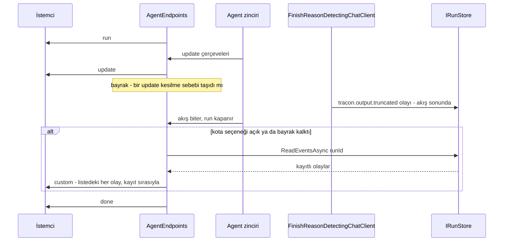

# Faz 207 — Akışta Kesilen Çıktı Bildirimi

> **Durum:** ✅ Tamamlandı (2026-10-14)
> **Plan onayı:** Bakımcı, 2026-10-14 — sözleşme kararı sohbette alındı (A: `done`'dan önce `tracon.output.truncated` custom çerçevesi, her zaman açık; chat/completions `finish_reason` düzeltmesi kapsamda) ve Faz 205 ile paralel başlatma onaylandı; plan metni sohbette okunmadı
> **Kaynak:** [ADAYLAR.md](ADAYLAR.md) · **F-427**
> **Genellik:** İlk ilke. Faz 204 kesilmeyi ayrı bir sonuç yaptı (K-919): kesik düz metin `Completed` biter ve `tracon.output.truncated` olayı yazar. Canlı akış bu olayı taşımaz. Akış okuyan her tüketici (C# ve TS istemcisi, konsol, kendi SSE okuyucusu) yarım yanıtı tam sanabilir. İş tüketici kodunda kalamaz: istemci kesilmeyi ancak `done`'dan sonra ikinci bir istekle (`GET /api/runs/{id}/events`) öğrenir. `/v1/chat/completions` ise ekosistem standardı bir alanı (`finish_reason`) her zaman `"stop"` ile doldurur; OpenAI SDK'sı kullanan tüketicinin başka kanalı yoktur. Kalem bir sözleşme kusurudur, bu yüzden § *Tüketici geri bildirimi kuralı*'ndan muaftır
> **Karşı görüş:** "İstemci `/events`'i okuyabilir. MAF `update` çerçevesinde `finishReason`'ı zaten taşıyor olabilir; yeni çerçeve gereksizdir." Cevap: `/events` ayrı bir sözleşme ve ikinci bir istektir; canlı istemci `done`'da durur. `update.finishReason` MAF'ın model çağrısı başına ham değeridir: tool turunda `tool_calls` olur, harness döngüsünde birden çok kez gelir, Tracon'un kararını (side-channel hariç tutma, `cause`) taşımaz ve MAF tipinin biçimine bağlıdır. Çerçeve, kararı tek yerde (`FinishReasonDetectingChatClient`) verir ve kayıtla bayt bayt aynıdır. Faz `update.finishReason`'ı bu yüzden yalnız belgeler (§207.1), sözleşme yapmaz
> **Önkoşul:** Kod: yok. Faz 205 ile örtüşme: **kodda dosya örtüşmesi yok** — 205'in dosyaları `AgentRunBudget.cs`, `QuotaEnforcer.cs`, `RunRecordingAgent.*.cs`, `LateToolCompletionRecorder.cs`, `NonTokenCostAccumulator.cs`, `WorkflowRunner.cs`, `QuotaStoreContract.cs`'tir; bu faz bunlara dokunmaz. **Semantik örtüşme** §205.4'tedir: çocuğun eşik bildirimi çocuğun kendi akışına taşınır. Bu fazın kota+kesilme sıra testleri 205'in semantiğine göre yazılır (yalnız kökün kendi eşiği kökün akışına gelir). **Doküman örtüşmesi** `concepts/governance.md` ve `capabilities.md`'dedir; bu iki sayfa kapanışta, 205 `main`'e girdikten sonra düzenlenir
> **Paketler:** `Tracon.AspNetCore` · `Tracon.Core` (yalnız bir yüklemin görünürlüğü ve XML remarks) · `Tracon.Abstractions` (yalnız XML remarks)
> **Yeni paket:** Yok · **Migration:** Yok
> **Public API:** Büyümüyor. Ölçüldü (2026-10-14, bu worktree): `wc -l src/*/PublicAPI.Shipped.txt` → 17 dosya, toplam 17 satır. Çerçeve yük record'ları `private`'tır (`AgentEndpoints.cs:1853-1860`, `OpenAIChatCompletionsEndpoints.cs:522-558`); yeni yardımcılar `internal` olur. Sözleşme değişikliği HTTP telindedir: yeni bir çerçeve oluşumu ve yeni `finish_reason` değerleri. Bir sapma public üye isterse GA'dan (K-603) önce hâlâ ucuzdur
> **Tüketici yüzeyi:** site: `http-api.md` (§ Streaming), `concepts/runs.md` (§ Two SSE contracts, § Truncated output), `guides/openai-api.md` (§ Compatibility matrix), `guides/model-providers.md` (sorun giderme satırı), `concepts/governance.md` (gerekirse tek cümle, 205'ten sonra) · sevk edilen: `CHANGELOG.md` (iki not), `capabilities.md` satırları (205'ten sonra), `RunEventCustomTypes.OutputTruncated` XML remarks (`api/` sayfası üretilir), Açık Soru 2-A seçilirse uç açıklamasından üretilen dört yapıt (§ Planlanan Public API)
> **Manuel test alanı:** `docs/manuel-test/22-GUARDRAIL-VE-YAPISAL-CIKTI.md` (MT-GUARD-111'in akışlı ikizi) · `docs/manuel-test/08-OPENAI-UYUMLU-UCLAR.md` (`finish_reason`)

---

## Bu Faza Başlarken

> `faz-baslangic` skill'ini uygula. Aşağıdaki liste o skill'in 2. adımıdır —
> **tamamını değil, yalnız işaret edilen bölümleri oku.**

1. Bu doküman
2. Kararlar — dosyanın tamamını **okuma**, yalnız bu kalemleri grep'le:
   ```bash
   grep -n "K-919\|K-679\|K-678\|K-384\|K-441\|K-885\|K-985" docs/KARARLAR.md
   ```
   **K-919** (kesilme ayrı sonuçtur; düz metin `Completed` + olay), **K-679** (`Custom` olayının
   çerçeve adı hep `custom`), **K-678** (kayıtlı akışın açık çerçeve tablosu), **K-384** (her istisna
   `error` çerçevesi olur), **K-441** (gömülebilir bileşen akışsızdır), **K-885** (keep-alive
   `SseWriter`'dadır), **K-985** (`TraconFinishReasons.ContextWindowExceeded` kesilme sayılır)
3. Önceki fazların devri:
   ```bash
   awk '/## Sonraki Faza Devir Notu/,0' docs/arsiv/fazlar/204-KESILEN-CIKTI-VE-ANTHROPIC-AYARLARI.md
   sed -n '73,74p;126p' docs/arsiv/fazlar/146-CALISTIRMAYA-BAGLI-KOTA-ESIGI.md
   ```
   Faz 204 kesilme sözleşmesini verir. Faz 146 kota aynasının tasarımını (b) ve genelleştirme notunu verir;
   bu faz o metodu genelleştirir
4. Faz 205'in §205.4 bölümü (semantik örtüşme): `sed -n '/## 205.4/,/^## 205.5/p' docs/205-GEC-BITEN-HARCAMA-KOTASI.md`
5. Alan hafızası:
   [`hafiza/model-boru-hatti.md`](hafiza/model-boru-hatti.md) (dekoratör sırası, dedektör) ·
   [`hafiza/http-uc-tuzaklari.md`](hafiza/http-uc-tuzaklari.md) (SSE tuzakları, satır 107 ve 111) ·
   [`hafiza/run-olay-sozlesmesi.md`](hafiza/run-olay-sozlesmesi.md) (olay sözleşmesi) ·
   [`hafiza/maf-harness-ve-loop.md`](hafiza/maf-harness-ve-loop.md) (§207.3 ölçümü) ·
   [`hafiza/nswag-istemci-uretimi.md`](hafiza/nswag-istemci-uretimi.md) satır 60-75 (yalnız Açık Soru 2-A seçilirse)

---

## Amaç

Bir kesik düz metin yanıtı, onu canlı okuyan istemciye kesik olduğunu söylemelidir. Bugün
söylemez: kesilme yalnız run'ın kayıtlı olaylarında görünür. Bu faz kayıtlı
`tracon.output.truncated` olayını ajan akışına, `done`'dan önce bir `custom` çerçevesi olarak
aynalar. Kota bildiriminin aynasını kapalı bir listeye genelleştirir. `/v1/chat/completions`'ın
`finish_reason` alanını gerçek bitiş sebebinden doldurur. Akış okuyan her tüketici ve her OpenAI
SDK kullanıcısı kazanır.

- **F-427** — Canlı ajan akışı ve chat/completions kesik yanıtı bildirir.

### Bugün ne çalışmıyor — doğrulanmış kanıt

| Kanıt | Gözlem |
|---|---|
| [`AgentEndpoints.cs:1367-1376`](../src/Tracon.AspNetCore/Endpoints/AgentEndpoints.cs) | Akış yalnız MAF güncellemelerini `update` çerçevesi olarak iletir; writer ile yazılan olay bu yoldan geçmez |
| [`AgentEndpoints.cs:1515-1569`](../src/Tracon.AspNetCore/Endpoints/AgentEndpoints.cs) | Tek ayna `WriteQuotaThresholdNoticesAsync`'tir: `PublishThresholdToRunStream` ile kapılı (1546), yalnız `QuotaThreshold`'u süzer (1556) |
| [`AgentEndpoints.cs:1404-1408`, `:1855`](../src/Tracon.AspNetCore/Endpoints/AgentEndpoints.cs) | `done` yalnız `sessionId` taşır |
| [`FinishReasonDetectingChatClient.cs:149-158`, `:267-298`](../src/Tracon.Core/Models/FinishReasonDetectingChatClient.cs) | Düz metin kesilmesi akış sonunda `Custom` olayı yazar; yük `provider`, `maxOutputTokens`, `cause` (341-363) |
| [`OutputTruncationStreamingTests.cs:84-105`](../tests/Tracon.AspNetCore.FunctionalTests/OutputTruncationStreamingTests.cs) | Test olayın kayıtta olduğunu kanıtlar (102-104). "`update` çerçevesi bitiş sebebi taşımaz" iddiası yalnız bir yorumdur (95); bunu hiçbir test iddia etmez |
| [`OpenAIChatCompletionsEndpoints.cs:233`, `:459`](../src/Tracon.AspNetCore/OpenAICompat/OpenAIChatCompletionsEndpoints.cs) | `finish_reason` akışsızda ve akışta sabit `"stop"`'tur |
| [`concepts/runs.md:521-522`](../docs-site/src/content/docs/concepts/runs.md) | Site "akışlı istemci `length` sebebini `update` çerçevelerinde görmez" der; §207.1 bunu ölçer |

> Kanıtlar 2026-10-14 tarihinde bu worktree'de (`245afe91`) doğrulandı.

**Kod okuması ile site çelişir. Ölçülmedi.** Decompile (ilspycmd 11.0, `~/.nuget/packages`, MAF
1.20.0 `lib/net10.0`):
- `Microsoft.Agents.AI.Abstractions` `AgentResponseUpdate..ctor(ChatResponseUpdate)` `FinishReason`'ı kopyalar. Özellikte `[JsonIgnore]` yoktur.
- `Microsoft.Agents.AI` `ChatClientAgent.RunCoreStreamingAsync` her güncellemeyi `new AgentResponseUpdate(current)` ile verir.

Tracon güncellemeyi yeniden kurmaz: `RunRecordingAgent.cs:510` aynen verir, `HarnessLoopBoundaryChatClient.cs:41`
`Clone()` kullanır, Anthropic adaptörü sebebi usage güncellemesine de yazar (`AnthropicStopReasonChatClient.cs:118-127`).
Serileştirme `AgentEndpoints.cs:1374`'teki `AIJsonUtilities.DefaultOptions`'tır. Bu yüzden son `update` çerçevesi
büyük olasılıkla `"finishReason":"length"` taşır. HTTP telinde ölçülmedi.

---

## 207.1 — Önce ölç: `update` çerçevesi bitiş sebebini taşıyor mu

Fazın ilk kod adımı bir ölçüm testidir. Üretim kodundan önce yazılır.

- Yer: `OutputTruncationStreamingTests`. Düz metin kesilmesi (`FinishReasonModelProvider` → `Length`).
- Ölçülen: `update` çerçevelerinin son null-olmayan `finishReason` alanı.
- Seviye: fonksiyonel HTTP (akış sınırı).

| Ölçüm sonucu | Yapılacak |
|---|---|
| Alan var (`"length"`) | Test kilit olarak kalır; bir MAF yükseltmesi alanı düşürürse kırmızı olur. Yorum (`OutputTruncationStreamingTests.cs:93-95`) ve `concepts/runs.md:521-522` düzeltilir. Site alanı şöyle anlatır: "MAF geçişi, model çağrısı başına bir değer; tool turunda `tool_calls`; Tracon garantisi değildir; kesilme kararı `custom` çerçevesidir". §207.2 kapısı ve §207.4 akış kolu bu alana dayanır |
| Alan yok | Yorum ve site doğrudur, kalır; test yokluğu kilitler. §207.2 kapısı düşer (koşulsuz tarama). §207.4 akış kolu `length`'i kayıtlı olaydan okur. Sapma `Plandan Sapmalar`'a yazılır |

> **Ölçüm sonucu (2026-10-14, MAF 1.20.0, bu worktree):** **alan var.** Kesik düz metin
> run'ında son `update` çerçevesi `"finishReason":"length"` taşır
> (`OutputTruncationStreamingTests.The_last_update_frame_carries_the_model_finish_reason`, üretim
> kodundan önce yazıldı, ilk koşumda yeşil). Seçilen yol: birinci satır. Test kilit olarak kalır;
> §207.2 kapısı ve §207.4 akış kolu bu alana dayanır. Testteki eski yorum düzeltildi;
> `concepts/runs.md:521-522` kapanışta düzeltilir.

---

## 207.2 — Ayrılmış bildirim aynası

`WriteQuotaThresholdNoticesAsync` kapalı bir listeye genelleşir. Yeni yer: `internal static`
`RunNoticeMirror` (`src/Tracon.AspNetCore/Streaming/RunNoticeMirror.cs`). Kapalı liste, tarama,
hata ve iptal kuralı bu dosyadadır. `AgentEndpoints` onu `done`'dan hemen önce çağırır (bugünkü
çağrı yeri `AgentEndpoints.cs:1401`).

| `CustomType` | Aynalanır mı |
|---|---|
| `tracon.quota.threshold` | Yalnız `PublishThresholdToRunStream` açıkken — bugünkü gibi (K1) |
| `tracon.output.truncated` | Her zaman — yeni seçenek yok (bakımcı kararı) |

Kurallar:

1. **Çerçeve.** Ad `custom`'dır (K-679 ile aynı). Veri, kayıtlı `RunEvent`'in JSON'udur ve
   `/events`'in yazdığıyla bayt bayt aynıdır. Kayıt ikinci kez okunur; ikinci bir kopya kurulmaz
   (Faz 146 tasarım b).
2. **Sıra.** `run` → `update`… → (`approvals`) → `custom`… (kayıt sırasıyla) → `done`. Kesilme
   olayı run sırasında yazılır, kota bildirimi kapanışta yazılır. İkisi birlikteyse kesilme önce gelir.
3. **Liste kapalıdır.** Tüketicinin kendi `Custom` olayı ve listede olmayan ayrılmış tipler aynalanmaz.
   Listeye tip eklemek bir sözleşme kararıdır.
4. **Ucuz tarama (kapı).** Uç nokta güncelleme döngüsünde (`AgentEndpoints.cs:1367-1376`) bir bayrak
   tutar. Bir güncellemenin `FinishReason`'ı kesilme sebebiyse bayrak kalkar. Depo okuması yalnız iki
   durumda yapılır: kota seçeneği açıksa ya da bayrak kalkmışsa. Normal run depoyu okumaz.
   - Bayrak "herhangi bir güncelleme" der, "son güncelleme" demez. Ara tool turu kesilmesi bayrağı
     kaldırır ama olay yoktur; tarama boş döner. Yanlış pozitif yalnız bir okuma maliyetidir.
     Yanlış negatif olmaz.
   - Kesilme yüklemi tek yerdedir. `FinishReasonDetectingChatClient.IsTruncated`
     (`FinishReasonDetectingChatClient.cs:166-170`) `internal static` olur ve uç nokta onu çağırır
     (`InternalsVisibleTo("Tracon.AspNetCore")`, `src/Tracon.Core/Properties/AssemblyInfo.cs:6`).
     İkinci bir bitiş sebebi sözlüğü yazılmaz.
   - **Öncül:** kayıtlı her kesilme olayının sebebi, uca ulaşan bir güncellemede görünür. §207.1 bunu
     ölçer. Öncül düşerse kapı kalkar: her akışlı run'da bir `ReadEventsAsync(runId, 0)` taraması yapılır.
     Maliyet örnek uygulamada ölçülür ve yazılır. Kabul edilemezse Açık Soru 3.
5. **Depo hatası.** Tarama `IRunStore` hatasını yakalar, uyarı loglar ve `done`'u yine yazar
   (gözlemlenebilirlik işlevselliği bozmaz). Bugün kota aynasındaki okuma hatası `catch (Exception)`'a
   (`AgentEndpoints.cs:1420`) düşer ve başarılı run `error` çerçevesiyle biter. Değişiklik kota yolunu da
   düzeltir; CHANGELOG'da davranış notu olur.
6. **İptal.** İstek iptal edilirse tarama durur. Mevcut
   `catch (OperationCanceledException) when (httpContext.RequestAborted…)` yolu (`AgentEndpoints.cs:1416`) geçerlidir.
7. **Başka kiracı.** Tarama yalnız isteğin kendi `runId`'sini okur; depo okuması bugünkü kiracı
   filtresinden geçer. Yeni bir kiracı yolu açılmaz.



---

## 207.3 — Birden fazla kesilme

**Plan seçimi:** kayıtlı her `tracon.output.truncated` olayı kendi `custom` çerçevesidir. Çerçeveler
`/events` ile aynıdır.

| Durum | Davranış |
|---|---|
| Tool döngüsü, ara tool turu kesildi | MEAI `FunctionInvokingChatClient` dedektörün içindedir (`ModelProviderRegistry.cs:406-418`, dedektör 513). Dedektör yalnız son turu yargılar: olay yok, çerçeve yok |
| Tool döngüsü, son tur kesildi (düz metin) | Bir olay, bir çerçeve |
| Harness / Loop, birden çok iterasyon kesildi | MAF döngüsü pipeline'ın üstündedir (`ModelProviderRegistry.cs:402-405`). Her iterasyon ayrı bir pipeline çağrısıdır ve kendi olayını yazabilir: birden çok çerçeve. Ara iterasyonun metninin istemciye akıp akmadığı ölçülmeli (`HarnessLoopTests` deseni) |
| Yapılandırılmış yanıt kesildi | İstisna → `error` çerçevesi (bugünkü gibi). Ayna `done` yolundadır; `custom` çerçevesi gelmez |

---

## 207.4 — `/v1/chat/completions` `finish_reason`

Bugün değer sabit `"stop"`'tur (`OpenAIChatCompletionsEndpoints.cs:233`, `:459`). Yeni kural: gerçek son
`ChatFinishReason`'dan eşleme. Eşleme tek bir `internal` yardımcıdadır (`OpenAICompatSupport.cs`) ve
kesilmeyi §207.2'deki yüklemle tanır.

| Son `ChatFinishReason` | `finish_reason` |
|---|---|
| `Length`, `TraconFinishReasons.ContextWindowExceeded` | `"length"` |
| `ContentFilter` (içerikli yanıt) | `"content_filter"` |
| `ToolCalls` | `"stop"` — bugünkü gibi; uç tool çağrısını istemciye açmaz, tool'lar sunucuda koşar |
| `Stop`, `null`, bilinmeyen | `"stop"` |

- **Akışsız kol:** değer `AgentResponse.FinishReason`'dan gelir. `ChatClientAgent.RunCoreAsync`
  `new AgentResponse(chatResponse)` döner ve ctor `FinishReason`'ı kopyalar (decompile, MAF 1.20.0).
  Tracon dekoratörlerinin (`StructuredResponseValidatingAgent`, harness) değeri koruduğu
  **doğrulanmadı** — kırmızı test ölçer.
- **Akış kolu:** döngü (`OpenAIChatCompletionsEndpoints.cs:430-441`) son null-olmayan `update.FinishReason`'ı
  tutar. Son parça (459) eşlenen değeri taşır. Ara parçalar `null` kalır. `[DONE]` son satır kalır.
  Öncül §207.1'dir. Öncül düşerse `"length"` kayıtlı olaydan okunur (aynı ayna taraması);
  `"content_filter"` akış kolunda verilemez (olay yok) ve sınır olarak belgelenir.
- **Değişmeyenler:** boş filtrelenmiş yanıt bugün gibi `502` / `error` olur. Yapılandırılmış kesilme
  bugün gibi hatadır. Oturumsuz onay yolu değişmez (`SessionlessApprovalTests.cs:153`). Normal yanıt
  `"stop"` kalır (`OpenAICompatTests.cs:291`).
- **CHANGELOG:** `### Fixed` altında **Behavior change** notu: kesik yanıt artık `"length"`, içerikli
  filtrelenmiş yanıt `"content_filter"` döner.

---

## 207.5 — Run kaydı kapalıyken

- `TraconRunRecordingOptions.Enabled = false` (`TraconOptions.cs:706`) → `RunRecordingAgent` kaydı atlar
  (`RunRecordingAgent.cs:344`) → scope ve writer yoktur → dedektör olay yazmaz
  (`FinishReasonDetectingChatClient.cs:272`) → ayna çerçeve üretmez.
- Writer `IsDisabled` olursa (`RunEventWriter.cs:146`, ilk depo hatasından sonra) sonuç aynıdır.
- Plan: sınır kabul edilir ve sitede belgelenir (Açık Soru 1).
- chat/completions eşlemesi kayıttan bağımsızdır (MAF alanını okur). Kayıt kapalıyken de çalışmalıdır — ölçülmeli.

---

## 207.6 — Kapsam dışı — kapanışta aday açılır

Bu kalemlere numara verilmez. Kapanışta `ADAYLAR.md`'ye aday olarak girer.

- **OpenAI Responses `incomplete`.** Çerçeveleri MAF Hosting.OpenAI 1.20.0-alpha üretir
  (`OpenAIResponsesEndpoints.cs:481-495`). Decompile'da `ResponseStatus.Incomplete` yalnız `IsTerminal`
  switch'inde geçer; üreten yer bulunmadı. Kesik yanıt `"completed"` görünür. Düzeltme, MAF'ın JSON'una bir
  yama ister (`AppendPendingApprovalOutputItems` emsali) ve akışta `response.incomplete` olayı ister.
- **Workflow SSE'de agent adımının kesilmesi.** Agent düğümü kendi writer'ı olan bir child run'dır
  (`RunRecordingAgent.Lifecycle.cs:87`, `hafiza/workflows.md:51`). Olay child run'da kalır. Workflow akışının
  `MessageDelta`'sı bitiş sebebi taşımaz (`WorkflowEventMapper.cs:36-40`). Kod okuması; ölçülmedi.
- **İçerikli `content_filter` yarım yanıtı.** Dedektör yalnız boş filtrelenmiş yanıtı hata yapar
  (`FinishReasonDetectingChatClient.cs:143-147`). İçerikli olan olay yazmaz; ajan akışında da `/events`'te de
  iz yoktur. Bu faz yalnız chat/completions'ta `"content_filter"` der.
- **Konsol playground rozeti.** `use-playground-run.ts:229-264` `custom`'u sessizce yok sayar (kota
  bildirimi de görünmez).
- **`concepts/runs.md:160` kayması.** Satır "(and the workflow and OpenAI-compatible equivalents)" der; workflow
  akışı `run`/`event`/`done`/`error` kullanır (`WorkflowEndpoints.cs:1640-1655`), OpenAI uçları kendi çerçevelerini
  kullanır. Bu faz satıra `custom`'u ekler; düzeltme yalnız ifade değişikliğiyse kapanışta yapılır, değilse aday olur.
- **Not:** A2A (`ExternalAgentProxy.cs:111`) ve MCP (`CatalogToolCallHandler.cs:116`) akışsızdır ve kesilme
  sinyali taşımaz. Canlı akış değildir; kapanışta değerlendirilir.

---

## 207.7 — Faz 205 ile sıra

- **Kod:** örtüşme yok (başlık § Önkoşul). Bu faz `RunRecordingAgent.*`'a ve `QuotaEnforcer`'a dokunmaz.
- **Test:** kota+kesilme sıra testi kökün **kendi** eşiğini kullanır. 205 sonrası çocuğun bildirimi kökün
  akışına gelmez; test bunu varsaymaz.
- **Site:** `concepts/governance.md` ve `capabilities.md` kapanışta, 205 `main`'e girdikten sonra düzenlenir.
  Diğer sayfalar fazın kendi turunda düzenlenir.

---

## Planlanan Public API

> C# public yüzeyi büyümez. Sözleşme değişikliği HTTP telindedir.

```csharp
// Tracon.Core — internal kalır, görünürlük private → internal
internal static bool IsTruncated(ChatFinishReason? finishReason); // FinishReasonDetectingChatClient

// Tracon.AspNetCore — yeni, internal
internal static class RunNoticeMirror
{
    internal static ValueTask<long> WriteAsync(
        HttpContext httpContext, Guid runId, SseWriter writer, long sequence,
        bool sawTruncation, CancellationToken cancellationToken);
}
```

### HTTP tel sözleşmesi

| Yüzey | Bugün | Faz sonrası |
|---|---|---|
| `POST /api/agents/{name}/run` (SSE), kesik düz metin | `run` · `update`… · `done` | `run` · `update`… · `custom` (`tracon.output.truncated`) · `done` |
| Aynı uç, kota seçeneği açık + eşik + kesilme | `custom` (kota) · `done` | `custom` (kesilme) · `custom` (kota) · `done` |
| Aynı uç, kota aynasında depo okuma hatası | `error` | uyarı logu · `done` |
| `POST /v1/chat/completions` | `finish_reason: "stop"` | `"length"` · `"content_filter"` · `"stop"` |
| `GET /api/runs/{id}/events` | Değişmez | Değişmez |

**Uç açıklaması (Açık Soru 2).** Ajan run ucunun OpenAPI açıklaması (`AgentEndpoints.cs:320-334`) bir cümle
kazanırsa dört üretilmiş yapıt yenilenir: `docs/openapi/tracon.json`, `src/Tracon.Client/Generated/TraconApiClient.g.cs`,
`packages/tracon-client/src/schema.ts` (üçü git'te izlenir) ve `docs-site/public/openapi/tracon.json`
(`build-http-api.mjs` derleme çıktısı; `.gitignore:116`, commit'e girmez). Sıra
`hafiza/nswag-istemci-uretimi.md:60-75`'tedir. `http-api/` site sayfası da derlemede üretilir. Ölçüldü: bugünkü
açıklamadaki `approval_unanswerable` dizgesi bu dört dosyanın her birinde geçer (ana ağaçta; worktree'de site
kopyası derlemeden önce yoktur).

### Arayüz payı

Yok.

---

## Planlanan Dosya Listesi

```
src/Tracon.AspNetCore/
├── Endpoints/AgentEndpoints.cs              # bayrak (1367-1376), ayna çağrısı (1401), eski metot kalkar (1515-1569)
├── Streaming/RunNoticeMirror.cs             # YENİ — kapalı liste, kapı, depo hatası, iptal
└── OpenAICompat/
    ├── OpenAIChatCompletionsEndpoints.cs    # 233 ve 459, akış döngüsü 430-441
    └── OpenAICompatSupport.cs               # finish_reason eşleme yardımcısı
src/Tracon.Core/Models/FinishReasonDetectingChatClient.cs   # IsTruncated internal; remarks
src/Tracon.Abstractions/Runs/RunEventCustomTypes.cs         # OutputTruncated remarks: canlı akışta da gelir
tests/Tracon.AspNetCore.FunctionalTests/
├── OutputTruncationStreamingTests.cs        # ölçüm, kırmızı test, yorum (93-95)
├── OutputTruncationToolTurnTests.cs         # ara tur: çerçeve yok; son tur düz metin: bir çerçeve
├── QuotaRunNoticeTests.cs                   # kota+kesilme sırası, depo hatası
├── OpenAICompatTests.cs                     # finish_reason, iki kol
└── HarnessLoopTests.cs (veya yeni sınıf)    # çok iterasyonlu kesilme
docs-site/src/content/docs/  http-api.md · concepts/runs.md · guides/openai-api.md · guides/model-providers.md
                             concepts/governance.md · capabilities.md (205'ten sonra)
docs/manuel-test/  22-GUARDRAIL-VE-YAPISAL-CIKTI.md · 08-OPENAI-UYUMLU-UCLAR.md
CHANGELOG.md
```

---

## Hata Modları ve Testler

> Sınır geçen davranış (DI · HTTP · kiracı · akış · depo · paket) birim testiyle kanıtlanamaz —
> [`.agents/ortak/test-seviyeleri.md`](../.agents/ortak/test-seviyeleri.md). Bu fazın her davranışı HTTP akış
> sınırını geçer; seviye fonksiyoneldir.

| Ne bozulabilir | Seviye | Test sınıfı |
|---|---|---|
| Ölçüm: son `update` çerçevesinin `finishReason`'ı beklenenden farklı | Fonksiyonel | `OutputTruncationStreamingTests` (ilk adım, §207.1) |
| Kesik düz metinde `custom` çerçevesi `done`'dan önce gelmez | Fonksiyonel | `OutputTruncationStreamingTests` (önce kırmızı) |
| Akıştaki çerçeve `/events`'teki çerçeveden bayt olarak farklı | Fonksiyonel | `OutputTruncationStreamingTests` (`QuotaRunNoticeTests.Direct_stream_and_the_events_endpoint_carry_the_same_notice` deseni) |
| Tam yanıt `custom` çerçevesi alır (yanlış pozitif) | Fonksiyonel | `OutputTruncationStreamingTests` (`Stop`) |
| Bağlam penceresi kesilmesinde yük `cause: context_window` taşımaz | Fonksiyonel | `OutputTruncationStreamingTests` (`TraconFinishReasons.ContextWindowExceeded`) |
| Ara tool turu kesilmesi çerçeve üretir | Fonksiyonel | `OutputTruncationToolTurnTests.Streamed_intermediate_tool_turn_at_the_limit_does_not_fail_the_run` (yeni iddia) |
| Tool turundan sonra kesik düz metin sıfır ya da iki çerçeve üretir | Fonksiyonel | `OutputTruncationToolTurnTests` (yeni düz metin case'i) |
| Yapılandırılmış kesilme `custom` çerçevesi de alır | Fonksiyonel | `OutputTruncationStreamingTests` (mevcut iki case'e iddia) |
| Harness iki iterasyonu kesilir; çerçeve sayısı olay sayısından farklı | Fonksiyonel | `HarnessLoopTests` deseni (olay sayısı ölçülür) |
| Kota açık + eşik + kesilme: sıra ya da sayı yanlış (205 semantiği: kökün kendi eşiği) | Fonksiyonel | `QuotaRunNoticeTests` (yeni case) |
| Kota açık, kesilme yok: bugünkü davranış değişir | Fonksiyonel | `QuotaRunNoticeTests` mevcut beş case değişmeden yeşil |
| Normal run depoyu okur (kapı çalışmaz) | Fonksiyonel | Sayan bir `IRunStore` dekoratörü; akış sırasında `ReadEventsAsync` çağrı sayısı 0 |
| Ayna depo okumasında hata → run `error` ile biter (alt sistem hatası) | Fonksiyonel | `ReadEventsAsync`'i fırlatan dekoratör + `RecordingLoggerProvider`: `done` gelir, uyarı loglanır |
| Run kaydı kapalı → istisna ya da `custom` çerçevesi | Fonksiyonel | `TraconRunRecordingOptions.Enabled = false`: `done` gelir, `custom` yok |
| chat/completions akışsız: kesik yanıt `"stop"` döner | Fonksiyonel | `OpenAICompatTests` (önce kırmızı) |
| chat/completions akış: son parça `"stop"` taşır ya da `[DONE]` son değildir | Fonksiyonel | `OpenAICompatTests` (önce kırmızı) |
| chat/completions içerikli filtrelenmiş yanıt `"stop"` döner | Fonksiyonel | `OpenAICompatTests` (önce kırmızı) |
| chat/completions tool turundan sonra normal yanıt `"stop"` dışı döner | Fonksiyonel | `OpenAICompatTests` |
| chat/completions oturumsuz onay yolu bozulur | Fonksiyonel | `SessionlessApprovalTests` değişmeden yeşil |

Beş soru:
- **İptal:** tarama isteğin token'ını kullanır; mevcut iptal yolu geçerlidir, yeni test gerekmez.
- **Eşzamanlılık:** tarama run kapandıktan sonra koşar; eşzamanlı tool olayları o anda yazılmıştır. Yeni yarış yok.
- **Boş/aşırı girdi:** olay yoksa çerçeve yok. Çok olaylı uzun run yalnız kapı açıkken taranır.
- **Başka kiracı:** yalnız kendi `runId`'si okunur; mevcut kiracı filtresi geçerlidir.
- **Alt sistem hatası:** depo okuma hatası testi (yukarıda).

---

## Manuel Kabul Case'leri

> Numaralar kapanışta alınır (bugün son: `MT-GUARD-113`).

| # | Ön koşul | Adımlar | Beklenen sonuç |
|---|---|---|---|
| 1 | MT-GUARD-111'in ön koşulu (Anthropic, `maxOutputTokens: 50`) | `curl -N -X POST "$APU/api/agents/$A/run" …` — `Idempotency-Key` **yok**; sonra `GET /api/runs/$RUN/events` | Akışta `event: done`'dan önce bir `event: custom` vardır; `data` `customType: tracon.output.truncated` taşır ve `/events`'teki `custom` çerçevesinin `data`'sıyla aynıdır. Run `Completed` |
| 2 | Aynı agent, `maxOutputTokens` boş, kısa soru | Aynı `curl -N` | `custom` çerçevesi yoktur; `done` gelir |
| 3 | Aynı agent | `POST $APU/v1/chat/completions` (`model` = agent adı), önce `"stream": false`, sonra `"stream": true` | Akışsızda `choices[0].finish_reason == "length"`. Akışta son parça `"finish_reason":"length"` taşır, ardından `data: [DONE]` gelir |
| 4 | Kısa yanıt veren agent | Aynı iki istek | `finish_reason == "stop"` |

> **Kapanışta sete girdi:** case 1 → `MT-GUARD-114`, case 2 → `MT-GUARD-115`
> (`22-GUARDRAIL-VE-YAPISAL-CIKTI.md`), case 3 → `MT-COMPAT-052`, case 4 → `MT-COMPAT-053`
> (`08-OPENAI-UYUMLU-UCLAR.md`). Dördü de örnek uygulamada koşuldu (§ *Örnek Uygulama Koşumu*).

---

## Açık Sorular

| # | Soru | Seçenekler | Öneri |
|---|---|---|---|
| 1 | Run kaydı kapalıyken ya da writer `IsDisabled` iken kesilme sinyali | A: kabul et ve sitede belgele · B: uç `update.finishReason`'dan çerçeve üretir (ikinci kaynak) | A — B kararı ikinci bir yere taşır; kaydı kapatan operatör olay sözleşmesini de kapatmıştır |
| 2 | Ajan run ucunun OpenAPI açıklaması bir cümle kazanır mı | A: evet; dört üretilmiş yapıt yenilenir · B: hayır; yalnız site | A — açıklama SSE sözleşmesinin makinenin okuduğu tek yeridir; `error`/`done` zaten orada anılır |
| 3 | §207.1 kapının öncülünü düşürürse tarama maliyeti | A: koşulsuz tarama, maliyet örnek uygulamada ölçülür · B: run başına `internal` bir sinyal (`RunCancellationRegistry` benzeri bir kayıt) | A — ölçülmeden yeni mekanizma kurulmaz; ölçüm kabul edilemezse B bakımcıya sorulur |
| 4 | CHANGELOG'da kota aynasının depo hatası düzeltmesi hangi başlıkta | A: `### Fixed` (davranış notu) · B: `### Changed` | A — başarılı run'ın `error` ile bitmesi bir kusurdur |

---

## Bitiş Ölçütleri (DoD)

- [x] §207.1 ölçüm testi yazıldı; sonuç ve seçilen yol bu dokümana yazıldı (alan var → kapı ve akış kolu ona dayanır)
- [x] Kesik düz metinde `custom` (`tracon.output.truncated`) çerçevesi `done`'dan önce gelir ve `/events` ile bayt bayt aynıdır (`OutputTruncationStreamingTests`, önce kırmızı)
- [x] Ara tool turu kesilmesi çerçeve üretmez (düz metin ikizi, mutasyonla kanıtlı); tool turundan sonra kesik düz metin tam bir çerçeve üretir
- [x] Kota açık + kesilme: iki çerçeve kayıt sırasıyla `done`'dan önce gelir; `QuotaRunNoticeTests`'in mevcut case'leri değişmeden yeşil
- [x] Normal run akış sırasında `ReadEventsAsync` çağırmaz (`The_stream_reads_the_run_events_only_after_an_update_reported_a_cut`: `stop` → 0, `length` → 1)
- [x] Ayna depo okuma hatasında `done` gelir ve uyarı loglanır (`QuotaRunNoticeTests`, önce kırmızı)
- [x] `/v1/chat/completions` iki kolda `"length"` / `"content_filter"` / `"stop"` döner (`OpenAICompatTests`, önce kırmızı); `[DONE]` son satırdır
- [x] `OutputTruncationStreamingTests.cs` yorumu ve `concepts/runs.md` ölçüm sonucuna göre düzeltildi
- [x] `CHANGELOG.md`'ye notlar girdi (`### Added` yeni çerçeve; `### Fixed` chat/completions `finish_reason` ve kota aynası depo hatası, ikisi **Behavior change**)
- [x] §207.6 kalemleri `ADAYLAR.md`'ye aday olarak girdi (**F-503**…**F-506**; `runs.md:160` kayması bu fazda düzeltildi, A2A/MCP aday değil — Sapma 7)
- [x] Dört doğrulama kapısı sıfır uyarı verir — § *Örnek Uygulama Koşumu* altındaki kapanış kapısı satırı
- [x] `samples/Tracon.Api` ile gerçek `run` yapıldı (manuel case 1-4), çıktı § *Örnek Uygulama Koşumu*'nda
- [x] `secret` taraması boş döndü (`kapi.py tarama`)
- [x] Manuel kabul case'leri eklendi (`MT-GUARD-114`–`115`, `MT-COMPAT-052`–`053`), `00-INDEKS.md` sayımı güncellendi; dördü koşuldu
- [x] `faz-denetim` koşuldu; 🔴 bulgu yok, iki 🟡 düzeltildi
- [x] `docs-site/` güncellendi (altı sayfa, § *Tüketici Yüzeyi Envanteri*); `npm run check` temiz

### Doğrulama komutları

```bash
# Akış, araç turu, kota aynası ve chat/completions
python3 scripts/kapi.py test --proje Tracon.AspNetCore.FunctionalTests --sinif "*OutputTruncationStreamingTests" "*OutputTruncationToolTurnTests" "*QuotaRunNoticeTests" "*OpenAICompatTests" "*SessionlessApprovalTests"

# Örnek uygulamada canlı akış (Idempotency-Key YOK)
curl -N -X POST http://localhost:5081/tracon/api/agents/manuel-kesilen-metin/run \
     -H "Authorization: Bearer $TOKEN" -H 'Content-Type: application/json' \
     -d '{"message":"How does a library work?"}'

# chat/completions
curl -s http://localhost:5081/tracon/v1/chat/completions -H "Authorization: Bearer $TOKEN" \
     -H 'Content-Type: application/json' \
     -d '{"model":"manuel-kesilen-metin","messages":[{"role":"user","content":"How does a library work?"}]}' \
     | jq '.choices[0].finish_reason'
```

---

## Riskler

| Risk | Önlem |
|------|-------|
| §207.1 öncülü düşer; kapı ve chat/completions akış kolu dayanaksız kalır | Ölçüm ilk adımdır; iki yol plana yazılı (§207.1, §207.2.4, §207.4) |
| MAF yükseltmesi `AgentResponseUpdate.FinishReason`'ı düşürür ya da değiştirir | Ölçüm testi kilit olarak kalır ve kırmızı olur |
| Kesilme yüklemi iki yerde ayrışır (dedektör, uç, chat/completions) | Tek `internal` yüklem; uç ve eşleme onu çağırır |
| Katı üçüncü taraf istemci bilinmeyen `customType`'ı hata sayar | Kota bildirimi aynı çerçeveyi zaten kullanır; site sözleşmeyi yazar; CHANGELOG notu |
| Kota aynasının hata davranışı değişir (`error` → `done`) | Bilinçli düzeltme; test ve CHANGELOG notu |
| 205 ile site çakışması (`governance.md`, `capabilities.md`) | İki sayfa 205 `main`'e girdikten sonra düzenlenir (§207.7) |
| Harness'te ara iterasyon kesilmesi kullanıcıyı yanıltır | Çerçeve kayıtla aynıdır; site "her olay bir çerçeve" der; ölçüm sonucu yazılır |

---

<!-- ============================================================
     AŞAĞISI KAPANIŞTA DOLDURULUR — `faz-tamamlama` skill'i.
     Plan anında boş kalır. Başlıkları SİLME.
     ============================================================ -->

## Plandan Sapmalar

1. **Çok iterasyonlu kesilme testi `HarnessLoopTests`'te değil, `OutputTruncationStreamingTests`'te.**
   `HarnessLoopTests`'in kurulumu `FakeModelProvider` alır; o sağlayıcı bitiş sebebi yazamaz.
   Test `FinishReasonModelProvider` + `Harness.Loop` ile yazıldı
   (`A_harness_loop_whose_iterations_are_cut_sends_one_notice_per_recorded_event`). Ölçüm: iki kesik
   iterasyon iki olay yazar ve akışa iki `custom` çerçevesi gelir; ara iterasyonun metni de istemciye akar.
2. **§207.4 akışsız kol ölçüldü.** Tracon dekoratörleri `AgentResponse.FinishReason`'ı korur: düz metin
   agent'ında (`ChatCompletions_reports_the_final_finish_reason`, akışsız satırlar) ve harness `Loop`
   agent'ında (denetim 🟡2). Harness ölçümü iki kolda yeşildir: kesik tek iterasyon `"length"`
   (`ChatCompletions_reports_length_for_a_cut_harness_loop_answer`); ilk iterasyonu kesik, son iterasyonu
   tam döngü `"stop"` (`ChatCompletions_reports_the_last_harness_iteration_not_an_earlier_cut_one`, iki model
   çağrısı). CHANGELOG cümlesi daraltılmadı; testler kilit olarak kalır.
3. **Açık Soru 2 uygulama oturumunda bekletildi, kapanışta A ile uygulandı.** Dört üretilmiş yapıt Faz 205
   ve 208 ile çakışacaktı; bakımcı kapanışta 2-A'yı seçti. Uç açıklaması (`AgentEndpoints.cs`) bir cümle
   kazandı; `docs/openapi/tracon.json`, `TraconApiClient.g.cs` ve `schema.ts` yenilendi (her biri tek
   satır), site kopyası derlemede üretilir. Aynı açıklamadaki `quota.When` boşluk hatası da düzeltildi.
   Açık Soru 1-A (sınır kabul, sitede yazılı) ve 4-A (`### Fixed`) uygulandı; Açık Soru 3 tetiklenmedi.
4. **Depo hatasında kısmi okuma gönderilmez.** Ayna önce olayları okur, sonra yazar. Okuma yarıda düşerse
   hiçbir bildirim gönderilmez, uyarı loglanır, `done` gelir. Böylece istemci kopması (yazma hatası) depo
   hatası sanılmaz.
5. **`RunEventCustomTypes.OutputTruncated` remarks'ı yükün `cause` alanını da anar.** Alan K-985'ten beri
   yüktedir; XML onu anmıyordu.
6. **Responses `incomplete` ölçüldü (§207.6 kod okumasıydı).** Kapanışta geçici bir fonksiyonel probla:
   `Length` ile kesik düz metin `/v1/responses`'ta akışsız `"status":"completed"`, akışta
   `response.completed` döner. Prob silindi; sınır sitede yazılı, iş **F-503**.
7. **§207.6'nın iki kalemi aday olmadı.** `concepts/runs.md:160` kayması yalnız ifadeydi ve bu fazda
   düzeltildi (workflow ve OpenAI akışlarının kendi çerçeve kümeleri ayrı cümleyle yazıldı). A2A
   (`ExternalAgentProxy`) ve MCP (`CatalogToolCallHandler`) akışsızdır; çağıran yalnız metni alır ve run'ın
   kendi olayları bildirimi taşır. Ölçülmüş bir tüketici ihtiyacı yok; aday açılmadı.

## Bu Fazda Verilen Kararlar

- **K-991** (kategori: public-api; kullanıcı kararı): ajan run akışı kayıtlı ayrılmış bildirimleri `done`'dan
  önce `custom` çerçevesi olarak verir; kapalı liste, `/events` ile bayt bayt aynı veri, kapılı depo okuması,
  okuma hatası uyarı + `done`; listeye tip eklemek sözleşme kararıdır. Açık Soru 1-A ve 2-A bu kararın parçasıdır.
- **K-992** (kategori: public-api; kullanıcı kararı): `/v1/chat/completions` `finish_reason` son model
  çağrısının sebebinden eşlenir (`length` · `content_filter` · `stop`), iki kolda, run kaydından bağımsız.
- Kategori dışı (yalnız burada): kesilme yüklemi `FinishReasonDetectingChatClient.IsTruncated` tektir ve
  `internal` olur (ikinci sebep sözlüğü yazılmaz) · bayrak "herhangi bir güncelleme"dir · kısmi okuma
  gönderilmez (Sapma 4) · Açık Soru 4-A (CHANGELOG başlığı).

## Gerçekleşen Public API

C# public yüzeyi değişmedi (`PublicAPI.*.txt` dokunulmadı). İç imzalar:

```csharp
// Tracon.Core — private → internal
internal static bool IsTruncated(ChatFinishReason? finishReason);           // FinishReasonDetectingChatClient

// Tracon.AspNetCore — yeni
internal static class RunNoticeMirror
{
    internal const string FrameName = "custom";
    internal static ValueTask<long> WriteAsync(HttpContext httpContext, Guid runId, SseWriter writer,
        long sequence, bool sawTruncation, CancellationToken cancellationToken);
    internal static bool IsMirrored(RunEvent runEvent, bool quotaNotices);
}
public static string ToChatFinishReason(ChatFinishReason? finishReason);    // internal static class OpenAICompatSupport
```

Tel sözleşmesi plandaki tablo gibi gerçekleşti (§ *HTTP tel sözleşmesi*); `TraconRunAgent` uç açıklaması
`custom` çerçevesini anar.

## Dosya Listesi (gerçekleşen)

```
src/Tracon.AspNetCore/Streaming/RunNoticeMirror.cs                       YENİ
src/Tracon.AspNetCore/Endpoints/AgentEndpoints.cs                        bayrak, ayna çağrısı, uç açıklaması; eski metot kalktı
src/Tracon.AspNetCore/OpenAICompat/OpenAIChatCompletionsEndpoints.cs     iki kol
src/Tracon.AspNetCore/OpenAICompat/OpenAICompatSupport.cs                ToChatFinishReason
src/Tracon.Core/Models/FinishReasonDetectingChatClient.cs                IsTruncated internal + remarks
src/Tracon.Abstractions/Runs/RunEventCustomTypes.cs                      OutputTruncated remarks
src/Tracon.Client/Generated/TraconApiClient.g.cs · packages/tracon-client/src/schema.ts · docs/openapi/tracon.json   üretildi
tests/Tracon.AspNetCore.FunctionalTests/Infrastructure/CallCounting.cs   YENİ (sayan DispatchProxy)
tests/Tracon.AspNetCore.FunctionalTests/{OutputTruncationStreamingTests,OutputTruncationToolTurnTests,QuotaRunNoticeTests,OpenAICompatTests}.cs
tests/Tracon.AspNetCore.FunctionalTests/Infrastructure/FaultInjection.cs Resolve internal
docs-site/src/content/docs/{http-api,capabilities}.md · concepts/{runs,governance}.md · guides/{openai-api,model-providers}.md · public/llms-full.txt
CHANGELOG.md · docs/manuel-test/{00-INDEKS,08-OPENAI-UYUMLU-UCLAR,22-GUARDRAIL-VE-YAPISAL-CIKTI,23-SAKLAMA-ARSIV-KOTA}.md
docs/KARARLAR.md · docs/arsiv/KARARLAR-GECMISI.md · docs/ADAYLAR.md · docs/MIMARI.md
docs/hafiza/{http-uc-tuzaklari,run-olay-sozlesmesi,olcum-kota-ve-secenekler,kod-haritasi}.md
```

Yeni ve değişen testler (Tracon.AspNetCore.FunctionalTests): `OutputTruncationStreamingTests` +7 (ölçüm kilidi,
çerçeve + bayt eşitliği, tam yanıt, bağlam penceresi, kapı teorisi ×2, kayıt kapalı, harness) ve iki yapılandırılmış
case'e iddia · `OutputTruncationToolTurnTests` +2 (düz metin son tur, düz metin ara tur ikizi) · `QuotaRunNoticeTests` +2
(sıra, depo hatası) · `OpenAICompatTests` +16 (sebep teorisi ×8, tool turu ×2, kayıt kapalı ×2, harness ×4).

## Süreç Ölçümü

| Metrik | Değer |
|---|---|
| Plan revizyonu sayısı | 0 (plan değişmedi; sapmalar yukarıda) |
| Düzeltme turu sayısı | 2 (uygulamada `ShippedDocumentationSelfContainmentTests` XML'deki faz/karar atıfları için bir kez kırmızı · denetimin iki 🟡'ı tek turda) |
| 🔴 bulgu: gerçek / gürültü / araştırılacak | 0 / 0 / 0 |
| Fazın ürettiği regresyon | 0 (mevcut hiçbir test değiştirilmeden kırmızı olmadı; yapılandırılmış ara tur testindeki etkisiz iddia kaldırıldı) |
| Faz kapandıktan sonra bulunan kusur | ölçülmedi (faz bugün kapandı) |

## Denetim Bulguları

Bağımsız denetim (`faz-denetcisi`, taze bağlam, 2026-10-14): 🔴 yok, iki 🟡, 🟢 yok.

| Bulgu | Seviye | Triyaj | Sonuç |
|---|---|---|---|
| "Ara tool turu kesilmesi çerçeve üretmez" yalnız **yapılandırılmış** agent'la kanıtlanıyordu (`Streamed_intermediate_tool_turn_at_the_limit_does_not_fail_the_run`). Yapılandırılmış kesilme istisna atar, olay yazmaz; iddia hiç kırmızı olamazdı | 🟡 | gerçek (mutasyonla kanıtlandı) | Düzeltildi. Düz metin ikizi: `OutputTruncationToolTurnTests.Streamed_plain_text_run_whose_intermediate_tool_turn_hit_the_limit_sends_no_notice` (tool turu `Length`, son tur `Stop`; `custom` yok, `/events`'te olay yok, son çerçeve `done`). Mutasyon kanıtı: dedektör "son sebep" yerine "ilk kesilme sebebi kalır" yapıldı (`!IsTruncated(finishReason)` koşulu) → test kırmızı (bir `custom` çerçevesi geldi); mutasyon geri alındı. Yapılandırılmış testteki etkisiz iddia kaldırıldı |
| §207.4 harness agent'ının akışsız yolu ölçülmemişti; CHANGELOG `"length"`'i koşulsuz vaat ediyordu | 🟡 | gerçek (ölçüm eksiği; kod doğru çıktı) | Düzeltildi. Ölçüldü, iki kolda yeşil: `OpenAICompatTests.ChatCompletions_reports_length_for_a_cut_harness_loop_answer` ve `ChatCompletions_reports_the_last_harness_iteration_not_an_earlier_cut_one`. Kod ve CHANGELOG değişmedi (Plandan Sapmalar #2) |

## Örnek Uygulama Koşumu

2026-10-14, `samples/Tracon.Api` (bellek içi depo — paylaşılan veritabanına dokunmamak için bağlantı
dizeleri ortam değişkeniyle boşaltıldı), Anthropic `claude-haiku-4-5-20251001`, `maxOutputTokens: 50`:

- **Case 1 (`MT-GUARD-114`):** akış `run` · 29 `update` · `custom` · `done`; son üç `update`
  `"finishReason": "length"` taşır (Anthropic adaptörü sebebi usage güncellemesine de yazar); `custom` verisi
  `customType: tracon.output.truncated`, yük `{"provider":"anthropic","maxOutputTokens":50,"cause":"output_limit"}`;
  `/events`'teki `custom` verisiyle `cmp` aynı; run `Completed`, `error: null`.
- **Case 2 (`MT-GUARD-115`):** sınırsız agent, kısa soru: `run` · 8 `update` · `done`, `custom` yok.
- **Case 3 (`MT-COMPAT-052`):** akışsız `finish_reason = length` (usage 20/50/70); akışta yalnız son parça
  `"finish_reason":"length"` taşır, ardından `data: [DONE]`.
- **Case 4 (`MT-COMPAT-053`):** iki kolda `"stop"`.
- Ölçüm notu: `update` verisi girintili JSON'dur ve birden çok `data:` satırına yayılır; `custom` tek satırdır.
- **Kapanış kapısı:** `python3 scripts/kapi.py kapanis --taban 42e5479f` — sonucu aşağıdaki satır yazar.

## Tüketici Yüzeyi Envanteri

`tuketici-dokuman-senkronu` Adım 1 (taban `42e5479f`):

1. **`docs-site/` (elle):** `http-api.md` § Streaming (kapalı liste tablosu, depo hatası) · `concepts/runs.md`
   (iki sözleşme tablosu `custom` aldı; workflow ve OpenAI akışlarının kendi kümeleri ayrı cümle — §207.6
   kayması; § Truncated output: canlı `custom` çerçevesi, `update.finishReason`'ın garanti olmadığı) ·
   `guides/openai-api.md` (uyumluluk matrisi satırı + `finish_reason` paragrafı, Responses sınırı) ·
   `guides/model-providers.md` (sorun giderme satırı) · `concepts/governance.md` (kota bildirimi ile kesilme
   sırası, depo hatası; 205'in güncel metnine göre) · `capabilities.md` (Streaming runs satırı).
   **Üretilen:** `http-api/` ve `public/openapi/tracon.json` (uç açıklaması), `api/` (`RunEventCustomTypes`
   remarks), `public/llms-full.txt` (commit edilir).
2. **Sevk edilen metin:** `RunEventCustomTypes.OutputTruncated` XML (canlı akış, `cause`) ·
   `FinishReasonDetectingChatClient` remarks (internal) · `CHANGELOG.md` · paketlenen OpenAPI belgesi ve iki
   üretilmiş istemcinin uç açıklaması. Paket `README.md`'si değişmedi.
3. **Yerel referans / agent haritası:** yeni giriş noktası yok; `capabilities.md` satırı haritaya girmeyen
   tabloda (`build-agent-map.mjs --check`: "up to date and within budget").

Kapılar: (1) sevk edilen metin testleri kapanış kapısının tam test koşumunda · (2) `build-agent-map.mjs --check`
yeşil · (3) `npm run check` yeşil · (4) `dokuman-bakim.py --site-denetle --taban 42e5479f`: 2 kural tetiklendi,
ikisinin hedefi değişti (✅).

## Sonraki Faza Devir Notu

Sıradaki faz yok: seçilmemiş işler `ADAYLAR.md`'dedir. Faz 206 ve 208 paralel dallardadır.

**Devralınan sözleşmeler**

- Ajan run akışı: `run` · `update`… · (`approvals`) · `custom`… · `done`. `custom` yalnız `RunNoticeMirror`'ın
  kapalı listesindeki kayıtlı olaylardır (K-991); veri `/events` ile aynı serileştirmedir (Web varsayılanları).
- `/v1/chat/completions` `finish_reason` = `OpenAICompatSupport.ToChatFinishReason(son sebep)` (K-992).
- Kesilme yüklemi tektir: `FinishReasonDetectingChatClient.IsTruncated`. Yeni bir kesilme sebebi yalnız oraya girer.

**Bilinen tuzaklar**

- 🚨 Yeni ayrılmış bildirim canlı akışa kendiliğinden girmez: listeye **ve** depo okuma kapısına birlikte
  eklenir (kapı bugün yalnız kota seçeneğine ve kesilme sebebine bakar); uç açıklaması ve dört üretilmiş
  yapıt yenilenir.
- 🚨 Kapının öncülü MAF'ın `AgentResponseUpdate.FinishReason` kopyasıdır (MAF 1.20.0). Bir MAF yükseltmesi alanı
  düşürürse `The_last_update_frame_carries_the_model_finish_reason` kırmızı olur; o zaman kapı koşulsuz taramaya
  döner (plan §207.2.4, Açık Soru 3).
- 🚨 `done` yolunda atılan her istisna K-384'ün geniş `catch`'ine düşer ve tamamlanmış run'ı `error` ile bitirir;
  bu yola eklenen gözlemlenebilirlik işi kendi hatasını yakalar.
- "Bildirim yok" iddiası yalnız düz metin agent'ında anlamlıdır; yapılandırılmış kesilme istisna atar.

**Yarım kalan işler**

- **Site yayını (`faz-tamamlama` Adım 10) koşulmadı:** dal `main`'e birleşmedi; yayın birleşmeden sonra
  `./scripts/site-deploy.sh` ile yapılır.
- Adaylar: **F-503** (Responses `incomplete`), **F-504** (workflow SSE kesilmesi), **F-505** (içerikli
  `content_filter` izi), **F-506** (konsol `custom` rozeti).
