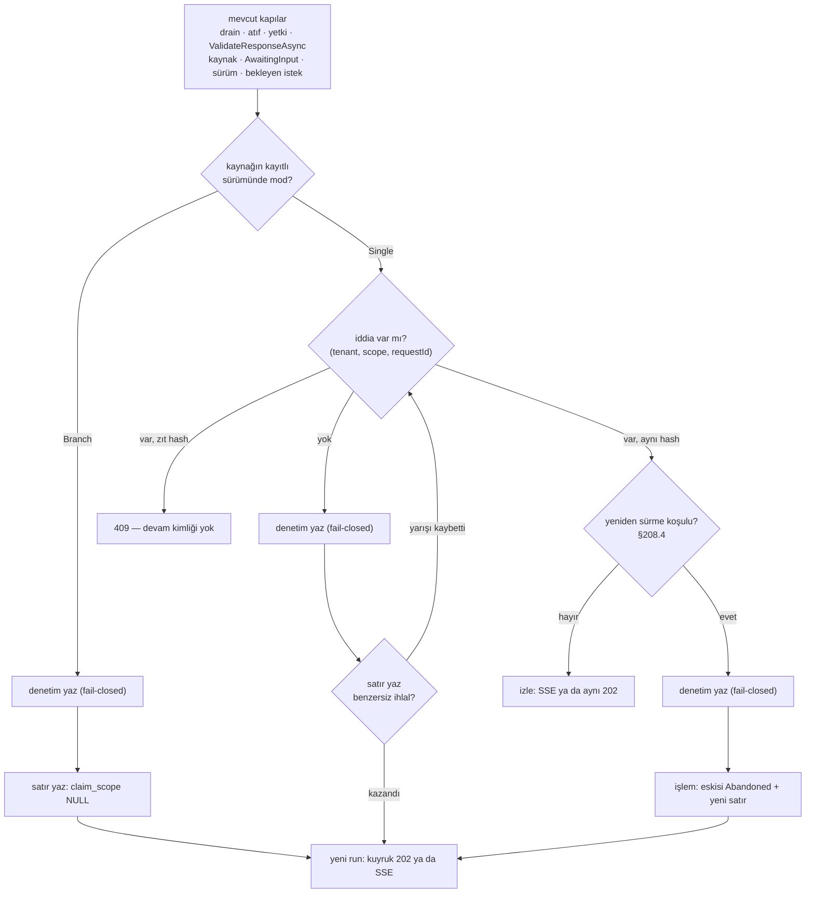

# Faz 208 — Workflow Karar Sözleşmesi: Tek Yanıt, Karar Denetimi ve Kaynak Bağı

> **Durum:** 📋 Planlandı (2026-10-14)
> **Plan onayı:** Bakımcı, 2026-10-14 — engelleyici kararlar sohbette alındı (iki faz, `workflow_responses` tablosu, her `respond` fail-closed denetim, K-130 varsayılanı korunur); Açık Sorular 1-10 plandaki önerileriyle onaylandı. Faz 205 `main`'e girdi (`42e5479f`); ilk adımın ölçümü bir öneriyi düşürürse uygulama durur ve sorar
> **Kaynak:** [ADAYLAR.md](ADAYLAR.md) · **F-319** (karar yarısı; gelen kutusu ve süre [Faz 209](209-WORKFLOW-GELEN-KUTUSU-VE-SURE.md))
> **Genellik:** Tracon HITL'ini (`RequestPort` ya da Magentic plan onayı) kullanan her host etkilenir. Kalem tek tüketici turundan geldi (video tüketicisi, 2026-10-11), bu yüzden tüketici geri bildirimi kuralı uygulanır. İkinci kanıt ilk ilkedir: (1) bugün `respond`'un HTTP yeniden denemesi ikinci bir dal açar ve yan etkili adımları iki kez koşturur; Faz 205'ten sonra her devamın bütçesi `TreeAccount` taşıdığı için kotayı da iki kez harcar; tüketici bunu engelleyemez, çünkü atomik iddia yalnız Tracon'un deposunda kurulabilir; (2) yönetişim eşitliği: tool onayı fail-closed denetlenir (`approval.decision`, K-370), aynı türden bir workflow onayı hiç denetlenmez. Ekosistem sinyali: MCP Tasks `input_required` aynı "girdi bekleyen görev" kavramını protokolde tanımlar
> **Karşı görüş:** "Onay tüketicinin ekranında ve domain'inde tutulabilir; değer yalnız Tracon HITL'ini kullanan host içindir." Cevap: ekran tüketicide kalır, ama çift `respond` sunucuda iki run açar. Tüketici kodu iki isteğin yarışını kapatamaz, denetimi de kararı uygulayan katmanda yazamaz. Mod opt-in'dir: HITL kullanmayan host `respond` çağırmaz ve hiçbir bedel ödemez. K-130 dallanmasını bilerek kullanan tüketicinin varsayılanı değişmez; o tüketici için tek yeni davranış, her `respond`'un denetime yazılmasıdır
> **Önkoşul:** [Faz 205](arsiv/fazlar/205-GEC-BITEN-HARCAMA-KOTASI.md) commit'lenmeli — `WorkflowRunner.cs` ortak dosyadır. Metin çakışması beklenmez, yalnız satır kayar (205 `RunGuardedAsync`'te bütçeye `TreeAccount` ekler ve `RecordQuotaAsync`'i değiştirir; bu faz aynı metodun `RunStartInfo` bölümüne ve `PumpAsync`'e dokunur). 205'ten sonra çift tıklama kotayı iki kez harcar; bu faz onu kapatır
> **Paketler:** `Tracon.Abstractions`, `.Core`, `.Workflows`, `.AspNetCore`, `.Sql.Shared`, `.PostgreSql`, `.SqlServer`, `.Sqlite`, `.Testing.Contracts.Xunit`, `.UI`, `Tracon.Client` (üretilen)
> **Yeni paket:** Yok · **Migration:** gerekli, üç sağlayıcı (`workflow_responses`); numara uygulama anında alınır
> **Public API:** büyüyor, `1.0.0` GA'dan (K-603) önce ucuz — ölçüldü (2026-10-14): `wc -l src/*/PublicAPI.Shipped.txt` → 17 dosya, toplam 17 satır, her biri yalnız `#nullable enable`
> **Tüketici yüzeyi:** site: `concepts/workflows.md` ("Asking a human", respond-async bölümü), `concepts/governance.md` (fail-closed tablosu `:258-268`, "six" `:390`), `guides/observability.md:142`, `capabilities.md:138`, `:204`, `getting-started/security.md:387`, `ui.md` (Workflows bölümü) · sevk edilen: `IAuditLog` XML (`six` → `seven`), `WorkflowDefinition`/`AddWorkflow` XML `<example>`, `src/Tracon.Workflows/README.md`, `CHANGELOG.md` (davranış değişikliği: her `respond` fail-closed denetlenir), TS istemcisi
> **Manuel test alanı:** `docs/manuel-test/15-WORKFLOWS.md` (`MT-WF-*`), `docs/manuel-test/13-KIRACI-VE-GUVENLIK.md` (`MT-SEC-*`)

---

## Bu Faza Başlarken

> `faz-baslangic` skill'ini uygula. Aşağıdaki liste o skill'in 2. adımıdır —
> **tamamını değil, yalnız işaret edilen bölümleri oku.**

1. Bu doküman
2. Kararlar — dosyanın tamamını **okuma**, yalnız bu kalemleri grep'le:
   ```bash
   grep -n "K-128\|K-130\|K-368\|K-370\|K-372\|K-776\|K-779\|K-908\|K-924\|K-925\|K-926\|K-929\|K-938\|K-988" docs/KARARLAR.md
   ```
   **K-128** (istek olay yükünde yaşar; bu faz istek tablosu açmaz), **K-130** (yanıtlanan run `AwaitingInput` kalır; varsayılan korunur),
   **K-368/K-370/K-372** (onay kutusu: yeni run, denetim önce, yalnız kuyruk), **K-776** (fail-closed kümesi yayımlanmış sözleşme — bu faz onu 6 → 7 yapar),
   **K-779** (denetim içeriği at-rest korumasız — ham cevap yazılmaz), **K-908/K-938** (yanıt akıştan önce denetlenir; beklemeyen run `400`),
   **K-924/K-925** (kuyruklu `respond`; `Idempotency-Key` yalnız `Prefer: respond-async` ile), **K-926** (`ContinuedFromRunId` kurtarma zinciridir),
   **K-929** (gerekçesi kodla çelişir — §208.6), **K-988** (devam kaydedilen sürümü derler)
3. Önceki fazların devri:
   ```bash
   awk '/## Sonraki Faza Devir Notu/,0' docs/arsiv/fazlar/205-*.md
   awk '/## Sonraki Faza Devir Notu/,0' docs/arsiv/fazlar/197-DAYANIKLI-WORKFLOW-YURUTMESI.md
   ```
   205: `TreeAccount` sözleşmesi (devamın bütçesi). 197: kuyruklu `respond` ve kurtarma zinciri
4. Alan hafızası (bu faz dört alana dokunuyor):
   [`hafiza/workflows.md`](hafiza/workflows.md) (respond, K-888, K-908, K-925, K-988 tuzakları) ·
   [`hafiza/http-uc-tuzaklari.md`](hafiza/http-uc-tuzaklari.md) (SSE ucunda hata akış açılmadan döner, K-938) ·
   [`hafiza/genisleme-noktalari-ve-denetim.md`](hafiza/genisleme-noktalari-ve-denetim.md) (fail-closed kopyaları, `AuditContentPolicyTests.AllowedCallSites`) ·
   [`hafiza/sql-migration.md`](hafiza/sql-migration.md) (üç sağlayıcı, kısmi indeks)
5. Gerektiğinde: [`MIMARI-GUVENLIK.md`](MIMARI-GUVENLIK.md) — denetim izi bölümü (`grep -n "denetim\|audit" docs/MIMARI-GUVENLIK.md`)

---

## Amaç

Bir workflow insan cevabı beklediğinde, bugün aynı isteğe gelen her cevap yeni bir dal açar. Çift tıklama, HTTP yeniden denemesi ve iki operatör aynı kararı iki kez uygular. Cevap hiçbir yere yazılmaz: "kim neyi onayladı" sorusunun cevabı yoktur, devam run'ı da hangi isteğe cevap olduğunu bilmez. Bu faz kararı bir **sözleşme** yapar. Opt-in workflow'da bir isteğe tek cevap düşer: aynı cevap aynı devamı izler, zıt cevap `409` alır. Her cevap, mod ne olursa olsun, run başlamadan önce fail-closed denetime yazılır. Her devam, kaynak run'a ve istek kimliğine bağlanır. Kazanan: n revizyonlu onayı host ekranından yöneten tüketici ve "kim onayladı" sorusunu soran denetçi.

- **F-319 (karar yarısı)** — workflow başına opt-in tek yanıt; aynı cevap → aynı devam; zıt cevap → `409`; `workflow.respond` fail-closed denetim kaydı; yeni run'a kaynak run bağı.

### Kapsam dışı — kapanışta aday açılır

| Kalem | Neden |
|---|---|
| Kiracı geneli bekleyen istek listesi, "yanıtlandı" işareti, istek süresi | [Faz 209](209-WORKFLOW-GELEN-KUTUSU-VE-SURE.md) — bu fazın yanıt kaydını okur (aday değil, planlı faz) |
| Cevabın kendisini (ham metin/JSON) devam run'ının olayına yazmak | İçerik koruma (K-325, K-899) ve retention kararı ister; bu faz yalnız istek kimliğini ve kaynak run'ı yazar |
| Doğrudan `IWorkflowRunner.RespondStreamingAsync` çağıranın denetimi ve tek yanıtı | Denetim ve iddia uç katmanındadır (K-079, K-370 emsali); runner seviyesinde kanca ayrı tasarımdır |
| Tek yanıtı istek portu başına seçmek | Mod workflow başınadır; port başına seçim tüketici kanıtı ister |
| `workflow.request.answered` webhook'u | Onay kararının da webhook'u yok; tüketici kanıtı yok |
| MCP Tasks `input_required` | Aday açılmaz: `McpServer/` workflow koşmaz, `AwaitingInput` `Completed`'e eşlenir (K-103, `McpTaskStatusMapping.cs:109-120`) |
| Teslimden sonra, ilk checkpoint'ten önce düşen devamın kilitlediği istek için yönetici çıkışı | Açık Soru 6; seçilen öneriye göre ya bu fazda kalır ya aday olur |

### Bugün ne çalışmıyor — doğrulanmış kanıt

`WorkflowRunner.cs` Faz 205'in commit'lenmemiş dosyasıdır; satır numarası kayar, bu yüzden sembol adıyla anılır.

| Kanıt | Gözlem |
|---|---|
| [`WorkflowEndpoints.cs:328-369`](../src/Tracon.AspNetCore/Endpoints/WorkflowEndpoints.cs), `:1116-1281` | `respond` sırası: drain → gövde → atıf → yetki (`RunAccess.Start`) → `ValidateResponseAsync` → kaynak → `AwaitingInput` → sürüm → bekleyen istek → kuyruk ya da akış. Önceki cevabı soran adım yok |
| `WorkflowRunner.ListPendingRequestsAsync` | Yanıtlanan run `AwaitingInput` kalır ve isteğini listelemeye devam eder (K-130); ikinci cevap yeni dal açar |
| `WorkflowRunner.PrepareResponseAsync` | Her çağrı yeni bir run kimliği alır (`NewRunId ?? TraconId.NewId()`); önceki devam sorulmaz |
| `WorkflowRunner.RunGuardedAsync` (`writer.StartAsync` → `RunStartInfo`) | Devam satırı `RootRunId = kendisi` yazar; `ParentRunId`, `ReplayOfRunId`, `ContinuedFromRunId` boştur. Kaynakla tek ortak alan `SessionId`'dir |
| `WorkflowRunner.PumpAsync` (`RequestInfoEvent` → `TryRespondAsync`) | Teslim edilen istek `continue` ile atlanır; cevabı ya da kaynağı yazan olay yok. [`RunEventType.cs:38-383`](../src/Tracon.Abstractions/Runs/RunEventType.cs) bir yanıt üyesi taşımaz |
| [`KARARLAR.md:980`](KARARLAR.md) (K-929) | Gerekçe "senkron uçta yanıt run olayına zaten yazılır" der — yukarıdaki satırla çelişir |
| [`IdempotencyFilter.cs:113-122`](../src/Tracon.AspNetCore/Idempotency/IdempotencyFilter.cs) · [`TraconEndpointRouteBuilderExtensions.cs:131-136`](../src/Tracon.AspNetCore/TraconEndpointRouteBuilderExtensions.cs) | `Idempotency-Key` yalnız `Prefer: respond-async` ile (K-925); SSE yolunda tekrar koruması yok |
| [`IdempotencyFilter.cs:154-165`](../src/Tracon.AspNetCore/Idempotency/IdempotencyFilter.cs), `:256` · [`TraconRetentionOptions.cs:82`](../src/Tracon.Core/Retention/TraconRetentionOptions.cs) | Parmak izi `SHA-256(method\npath\nbody)`; aynı anahtar farklı gövde `422`. `idempotency_keys` ömrü 1 gün ve `Enabled` ile kapanır: tek yanıtın kalıcı otoritesi olamaz |
| [`WorkflowEndpoints.cs:1350`](../src/Tracon.AspNetCore/Endpoints/WorkflowEndpoints.cs), `:1369` · `WorkflowRunner.RunGuardedAsync` (`RunAttributionReader.Read`) | Devam run'ının `user_id`'si cevaplayanındır; "kim" kısmen okunur, "hangi istek, hangi kaynak" okunmaz |
| [`ApprovalEndpoints.cs:187-257`](../src/Tracon.AspNetCore/Endpoints/ApprovalEndpoints.cs), `:306`, `:379` | Onay kutusu deseni: yetki durumdan önce → aynı karar devri yeniden sürer, zıt karar `409` → denetim kararı uygulamadan önce (`WriteOrThrowAsync`, `:232`) → `WHERE status = Pending` koruması; türetilmiş run kimliği |
| [`AuditWritePolicyTests.cs:46-91`](../tests/Tracon.Core.UnitTests/Architecture/AuditWritePolicyTests.cs), `:169-176` · [`IAuditLog.cs:11-30`](../src/Tracon.Abstractions/Audit/IAuditLog.cs) | Fail-closed kümesi altı işlem / dokuz çağrı yeridir ve yayımlanmış sözleşmedir (K-776) |
| [`AuditingWorkflowDefinitionStore.cs:134-165`](../src/Tracon.Core/Audit/AuditingWorkflowDefinitionStore.cs) | `workflow.rollback` best-effort'tur (`AuditRecorder.WriteAsync`); yalnız yük şekli emsalidir |
| [`WorkflowRecovery.cs:18-24`](../src/Tracon.Core/Scheduling/WorkflowRecovery.cs), `:113-149`, `:405-444` | `ContinuedFromRunId` kurtarma zinciridir: zincir ileri yürünür, son run kararı verir, zincir uzunluğu `MaxResumeAttempts`'a sayılır |
| [`RunEndpoints.cs:1256-1310`](../src/Tracon.AspNetCore/Endpoints/RunEndpoints.cs) | `RunEventStream` depodan run `Running`/`Queued` bitene kadar izler; çerçeve adları `WorkflowEventStream`'den (`WorkflowEndpoints.cs:1624`) farklıdır |
| [`TraconWorkflowsBuilderExtensions.cs:140-157`](../src/Tracon.Workflows/TraconWorkflowsBuilderExtensions.cs) | `AddWorkflow` seçenek almaz; kodda `RequestPort` kuran workflow (örnek: `samples/Tracon.Api/Program.cs:759-763`) mod seçemez |
| [`WorkflowDefinition.cs:122`](../src/Tracon.Abstractions/Workflows/WorkflowDefinition.cs) · [`WorkflowDefinitionCompiler.cs:307`](../src/Tracon.Workflows/Internal/WorkflowDefinitionCompiler.cs) | Kayıtlı tanımda tek istek kaynağı Magentic plan onayıdır |
| [`RunEventWriter.cs:295-299`](../src/Tracon.Core/Recording/RunEventWriter.cs) | `RecordToolPayloads` kapalıyken yük düşer; yalnız `WorkflowRequest` ve ayrılmış `Custom` muaftır |

> Kanıtlar 2026-10-14 tarihinde `245afe91` zemininde (worktree `faz-208`) doğrulandı.

---

## 208.1 — Mod: workflow başına opt-in, varsayılan K-130

Yeni enum `WorkflowResponseMode { Branch = 0, Single = 1 }`. Varsayılan `Branch`'tir: bugünkü K-130 davranışı birebir kalır (K1).

| Kaynak | Mod nereden gelir |
|---|---|
| Kayıtlı tanım | `WorkflowDefinition.ResponseMode`; HTTP `WorkflowSaveRequest.ResponseMode`; `WorkflowDefinitionPayload` (elle yazılan DTO — alan unutulursa **sessizce** kaybolur, `WorkflowDefinitionPayload.cs:12-18`) |
| Kod workflow'u | Yeni overload `AddWorkflow(name, factory, Action<WorkflowRegistrationOptions>)`; `CodeWorkflowRegistration` modu taşır; `WorkflowDescriptor.ResponseMode` |

Hangi sürümün modu geçerlidir: kaynak run'ın **kaydettiği** sürümün (`runs.agent_version`, K-988). Bekleyen run'ın tanımı sonradan değişirse mod değişmez. Kaynak sürüm kaydetmediyse ya da workflow koddaysa güncel tanımın modu okunur. Okuma yolu uçtadır: `IWorkflowDefinitionStore.GetVersionAsync` ya da `IWorkflowRunner.GetAsync` (betimleyici). Gerekçe: devam o sürümle derlenir; karar kuralı da o sürüme aittir.

Doğrulama: `ResponseMode` her `Kind` için geçerlidir (istek kaynağı kod workflow'unda serbest grafiktir). `WorkflowDefinitionValidator` yalnız bilinmeyen enum değerini reddeder. Sürüm geçmişi alanı kendiliğinden taşır (tam anlık kopya, K-987); `versions.tsx` fark görünümü alanı gösterir.

## 208.2 — Yanıt kaydı: `workflow_responses`

Her `respond` bir satır yazar. Satır üç işi birden yapar: iddia (opt-in), kaynak bağı, Faz 209'un "yanıtlandı" işareti.

| Sütun | Tip (PG / SQL Server / Sqlite) | Not |
|---|---|---|
| `response_run_id` | uuid / uniqueidentifier / text — **PK** | Devam run'ının kimliği |
| `tenant_id` | text / nvarchar(200) / text | |
| `source_run_id` | uuid — `runs(id)` `ON DELETE CASCADE` | K-369 emsali; veri sahibi silmesi `runs` ile gelir (ölçülmeli: `DataSubjectTargetRegistry` FK'yı kapsıyor mu) |
| `session_id` | text / nvarchar(200) | `WorkflowSessionId.MaxLength = 128` |
| `request_id` | text / nvarchar(200) | MAF `ExternalRequest.RequestId` — biçimi doğrulanmadı |
| `claim_scope` | text / nvarchar(200), **NULL** | Yalnız `Single` modda dolar (§208.3) |
| `answer_hash` | char(64) | Kanonik cevabın SHA-256'sı (§208.5) |
| `status` | smallint | `Accepted = 0`, `Delivered = 1`, `Abandoned = 2` |
| `responded_by` | text / nvarchar(200), NULL | `IAuditActorResolver` değeri; `pending_approvals.decided_by` emsali |
| `responded_at` | timestamptz / datetimeoffset / text | |

İndeksler: kısmi benzersiz `(tenant_id, claim_scope, request_id) WHERE claim_scope IS NOT NULL AND status <> 2` (atomik iddia; üç sağlayıcı da kısmi/filtreli indeks destekler, SQL Server filtreli indeksinde `<>` geçerlidir — uygulama anında üç sağlayıcıda ölçülür). İleri okuma için `(tenant_id, source_run_id)`. SQL Server anahtar boyu: 3 × nvarchar(200) = 1200 bayt < 1700.

**Neden tablo — elenen üç yol:**

| Yol | Neden olmaz |
|---|---|
| `ContinuedFromRunId`'i yeniden kullanmak | Kurtarma zinciri bu bağla ileri yürünür (`WorkflowRecovery.cs:405-444`). Zincirin son run'ı kararı verir, zincir uzunluğu `MaxResumeAttempts`'a sayılır (`:113-149`). Cevap bağı orada dursaydı, yeniden kiralanan bir kuyruk işi cevabı kesinti devamı sayar, devam sayacını tüketir ve koşan bir cevabı "kesilmiş" görüp ikinci kez sürdürebilirdi. `RunRecord.ContinuedFromRunId` "kesintiden sonraki devam" diye belgelidir (`RunRecord.cs:185`); `GET /api/runs?continuedFromRunId=` de anlamını değiştirirdi |
| `IIdempotencyStore` iddiası | 1 günlük ömür, `Enabled` anahtarı, tüketicinin kendi deposu (§ kanıt). Ertesi gün zıt cevap geçerdi |
| Kaynak run'a "cevaplandı" olayı eklemek | `(run_id, seq)` çakışmasının tipli bir sözleşmesi yok; kapanmış run'ın akışı terminal olaydan sonra büyür; retention süzgeci değişmek zorunda |

Depo: `IWorkflowResponseStore` (Abstractions). Bellek içi uygulama `TryAddTraconDefault` ile Core'da, SQL uygulaması üç sağlayıcının `ReplaceTraconDefault` kaydında (`IPendingApprovalStore` emsali, `TraconServiceCollectionExtensions.Registration.Storage.cs:71`). Kiracı davranışı `IPendingApprovalStore` ile aynıdır. Benzersiz ihlal `SqlDialect.IsUniqueViolation` ile yakalanır ve var olan satır okunur (`idempotency_keys` emsali, `SqlQueriesBase.cs:1025-1031`). Yeniden sürme (§208.4) iki yazımı tek işlemde yapar: `SqlStoreContext.ExecuteInTransactionAsync`.

K-128 bozulmaz: tablo **cevapları** tutar, istekleri değil. İstek hâlâ `WorkflowRequest` olay yükündedir.

## 208.3 — Karar akışı

İddia anahtarı (`claim_scope`) **plan varsayılanı: oturum kimliği** — `(tenant, session, requestId)`. Gerekçe: MAF bekleyen isteği checkpoint'ten aynı kimlikle yeniden yayınlar (K-128, ölçülmüş). Kaynağın düz `/resume`'u aynı isteği yeni bir run'da yeniden açar; anahtar run başına olsaydı ikinci cevap oradan geçerdi. **Uygulamanın ilk adımı bunu ölçer** (§208.7): oturum içinde iki ayrı istek aynı kimliği alıyorsa anahtar `(tenant, kaynak run, requestId)`'ye düşer ve `Single` modda cevaplanmış kaynağın `/resume`'u `400` ile reddedilir.

Yeni adımlar mevcut sıranın **sonuna**, "bekleyen istek" denetiminden sonra ve kuyruk/akış dalından önce girer. Hepsi akış açılmadan koşar (K-938 kuralı).



Kurallar:

- **Yetki `409`'dan önce gelir.** Mevcut sırada yetki kapısı zaten öndedir (`WorkflowEndpoints.cs:1168-1175`); reddedilen çağıran isteğin cevaplandığını öğrenemez (`ApprovalEndpoints.cs:185-202` emsali).
- **`409` gövdesi** devam kimliğini ve diğer cevabı **söylemez**. "Bu istek başka bir cevapla cevaplandı" der. Aynı cevabı veren meşru çağıran devam kimliğini izleme yanıtından alır.
- **İdempotency önceliği:** aynı `Idempotency-Key` ile aynı gövde → filtre saklanan `202`'yi döner (bu fazın kuralı hiç koşmaz). Aynı anahtar, farklı gövde → filtrenin `422`'si. Farklı anahtar, aynı cevap → izleme. Farklı anahtar, zıt cevap → `409`.
- **`Branch` modda** hiçbir iddia ve `409` yoktur; satır yalnız bağ ve denetim içindir. Her cevap yine yeni bir dal açar (K-130).
- **Satır yazılamazsa** iki modda da `respond` reddedilir ve run açılmaz. Gerekçe: satır `Single`'ın otoritesidir; `Branch`'te de kaynak bağının tek kaydıdır. Denetim satırdan önce yazıldıysa "denenen karar" olarak kalır (onay kutusundaki yarış emsali, `ApprovalEndpoints.cs:247-257`).

## 208.4 — Aynı cevap: izleme ve yeniden sürme

**İzleme — SSE yolu:** `200` SSE döner. Çerçeveler canlı akışla aynıdır (`run` → `event`… → `done`). İlk çerçeve **var olan** devamın kimliğini taşır. Olaylar depodan `RunEventStream`'in yoklama mantığıyla okunur. Mantık bir iç yardımcıya taşınır (`RunEventTail`) ve iki akış onu paylaşır — elle ikinci kopya yazılmaz (MEMORY: elle tekrarlanan ifade bir kusur sınıfı üretir). İzleyen bağlantı devamın sahibi değildir: bağlantı düşerse devam iptal edilmez.

**İzleme — kuyruk yolu:** ilk cevabın döndüğü `202`'nin aynısı döner: aynı `runId`, aynı `Location`, `jobId` aynı. Yeni iş kuyruğa girmez.

**Yeniden sürme (re-drive).** Aynı cevap, şu üçü birlikte doğruysa yeni bir devam açar:

1. Satırın durumu `Accepted`'tır (devam cevabı MAF'a teslim ettiğini yazmadı).
2. Devamın **kurtarma zincirinin son run'ı** yoktur ya da `Failed`/`Canceled` kapandı. Zincir `ContinuedFromRunId` ile ileri okunur. Bu okuma kurtarmanın **kendi** yazdığı bağı okur; cevap bağını oraya yazmaz.
3. CAS kazanılır: tek işlemde eski satır `Abandoned` olur (`WHERE status = 0`), yeni satır `Accepted` yazılır. Kaybeden çağıran kazananı izler.

Gerekçe: onay kutusunda aynı karar yarıda kalan devri tamamlar (`ApprovalEndpoints.cs:204-221`). Burada da cevap teslim edilmeden düşen devam (bağlantı düştü, dönüşüm hatası, süreç çöktü) isteği kilitlememelidir.

**`Delivered` yazımı:** runner, `PumpAsync` içinde `TryRespondAsync` cevabı teslim ettiği anda `IWorkflowResponseStore.MarkDeliveredAsync(execution.RunId)` çağırır. Yazım best-effort'tur: hata loglanır, run sürer ("gözlemlenebilirlik işlevselliği bozmaz"). Yazım kaybolursa satır `Accepted` kalır. Koşul 2 tamamlanmış ya da bekleyen devamı yeniden sürmez, ama teslimden sonra `Failed` olan devamı yeniden sürer — bu durumda yan etki en az bir kez koşar (`IWorkflowRunner`'ın resume için belgelediği garanti ile aynı, `IWorkflowRunner.cs` sınıf açıklaması). Risk tablosunda.

Kurtarma devamında `execution.RunId` satırın kimliği değildir; `MarkDeliveredAsync` boş geçer. Koşul 2 zinciri okuduğu için bu durum yanlış yeniden sürme üretmez.

## 208.5 — Denetim: `workflow.respond` fail-closed

Her `respond`, **mod ne olursa olsun**, yeni bir run açmadan önce `AuditRecorder.WriteOrThrowAsync` ile yazılır. Yazım düşerse cevap uygulanmaz: satır yazılmaz, run açılmaz, iş kuyruğa girmez, çağıran `500` alır (onay kutusu ile aynı). Run açmayan cevap (izleme, `409`) bir değişiklik uygulamaz ve yazmaz — aynı kararın tekrarı onay kutusunda da denetimi yeniden yazmaz.

| Alan | Değer |
|---|---|
| `action` | `workflow.respond` |
| `entity` | `workflow:{ad}` |
| `before` | `null` |
| `after` | `AuditPayload.Write` ile: `sourceRunId`, `requestId`, `responseRunId`, `answerHash`, `mode` (`Branch`/`Single`), `redrive` (bool) |
| aktör | `IAuditActorResolver.Resolve()` |

**Ham cevap yazılmaz** (K-779: denetim içeriği at-rest korumasızdır). Hash eşitlik içindir, gizlilik için değil: `approved: true` gibi düşük entropili bir cevap hash'ten çıkarılabilir (Risk).

**Kanonik biçim** (`WorkflowAnswerDigest`, Core, `internal`; AspNetCore ve Workflows `InternalsVisibleTo` ile okur — `Properties/AssemblyInfo.cs:6`, `:29`): `requestId`, `approved`, `text` ve `data`'dan oluşan bir JSON nesnesi. Özellik adları sıralanır, boşluk yazılmaz, `data` özyinelemeli olarak aynı kuralla yeniden yazılır, sayı metni korunur. `text` olduğu gibi alınır: kırpılmaz. SHA-256, küçük harf hex. `checkpointId` ve `definitionVersion` hash'e girmez (Açık Soru 3).

**Yayımlanmış sözleşme değişir (K-776):** küme 6 → 7 işlem. Değişecek yerler:

- `AuditWritePolicyTests.FailClosedOperations` yeni satır (`WorkflowEndpoints.cs`, `workflow.respond`); işlem sayısı 6 → 7; `ExpectedFailClosedCallSites` 9 → 10. Aynı satırdaki yorum K-776'nın üç tüketici yerini sayar: governance tablosu, güvenlik sayfası, yetenek listesi
- `IAuditLog.cs:11-22` ("six" → "seven", listeye "answering a workflow request")
- `AuditContentPolicyTests.AllowedCallSites` — yeni yazım yeri gözden geçirilir (`hafiza/genisleme-noktalari-ve-denetim.md`)
- Site: `concepts/governance.md:258-268` tabloya satır, `:390` "six" · `guides/observability.md:142` · `capabilities.md:138`, `:204` · `getting-started/security.md:387`. `governance.md:722`'deki "Six" üretim profili kararlarıdır; **değişmez**
- `KARARLAR.md`: K-776'yı değiştiren yeni satır (kategori: güvenlik, public-api)

Denetim uç katmanında yazılır, depo dekoratöründe değil: `respond` bir depo yazımı değildir (K-079, K-370 emsali). Kuyruk yolunda denetim `202`'den önce yazılır; aktör HTTP çağıranıdır, worker değil.

## 208.6 — Kaynak bağı ve K-929 düzeltmesi

İki yönlü bağ:

- **İleri (kaynaktan cevaplara):** `GET /api/workflows/runs/{runId}/responses` — kaynağın bütün cevap satırları, `respondedAt` sırasıyla. Yetki `/requests` ile aynıdır (`Reader` + `RunAccess.Read`; başka kiracı ve ret aynı `404`).
- **Geri (devamdan kaynağa):** devam run'ının olay akışına `RunStarted`'tan hemen sonra yeni `RunEventType.WorkflowResponseApplied` olayı yazılır. `Text` = istek kimliği; `Payload` = `{"sourceRunId": …, "requestId": …}`. Cevap ve hash yazılmaz. 🚨 Yük `RecordToolPayloads` kapalıyken de yazılmalıdır: `RunEventWriter.cs:295-299` muafiyet listesine girer; girmezse bağ sessizce kaybolur.

Yeni olay üyesinin altı yeri: `RunEventType.cs` (33), `RunEventTypeTests` (kalıcı sayı sözleşmesi), `RunEndpoints.EventName` (`workflow.response-applied`), `frontend/src/lib/run-event.ts`, `run-detail.tsx` `EVENT_STYLE`, TS istemcisi.

**K-929:** gerekçesi "senkron uçta yanıt run olayına zaten yazılır" der; kod bunu yapmaz (§ kanıt). Kapanışta K-929 satırı düzeltilir: senkron uçta cevabın kendisi yazılmaz, yalnız istek kimliği ve kaynak run (`WorkflowResponseApplied`). `jobs.payload` kuyruklu cevabın tek düz kopyasıdır.

## 208.7 — Uygulamanın ilk adımı: ölçümler

Kod yazılmadan önce, sonuçları bu dokümanın "Plandan Sapmalar" bölümüne yazılır:

| # | Ölçüm | Karar |
|---|---|---|
| 1 | MAF `RequestId` oturum içinde tekil mi? Bir oturumda iki ayrı istek yayınlayan graf (örnek: döngüde iki kez soran port; Magentic iki revizyon). `maf-api-kesfi` ile `ExternalRequest`/`RequestPort` kimlik üretimi | Tekilse `claim_scope = session_id`; değilse `source_run_id` + `Single` modda cevaplanmış kaynağın `/resume`'u `400` |
| 2 | Depodan izlenen akış canlı akışla aynı olay dizisini mi verir? `RunEventWriter.cs:204` `RunStarted`'ı, `:536-546` kapanış olayını depoya yazar; canlı akış `FirstEvent`/`LastEvent`'i ayrıca üretir | Fark varsa `RunEventTail` onu kapatır ya da fark belgelenir |
| 3 | Kısmi benzersiz indeks üç sağlayıcıda `status <> 2` koşuluyla kurulur mu | Kurulmazsa koşul `superseded_by IS NULL` sütununa döner |
| 4 | Konsol bundle'ı: `npm run build` sonrası gzip boyutu (ana ağaçtaki 2026-10-14 yapısı yalnız `.br` taşır: 173 977 bayt; gzip ölçülmedi) | §Arayüz payı |
| 5 | `DataSubjectTargetRegistry` yeni tabloyu FK zinciriyle kapsıyor mu (`pending_approvals` orada adlandırılmaz) | Kapsamıyorsa hedef eklenir (K-911 sınıfı) |

## 208.8 — Konsol

- **`workflow-detail.tsx` istek kartı:** `409`'u okunur bir notla gösterir ("bu istek başka bir cevapla cevaplandı"). İzleme yanıtında ekran devam run'ına geçer (bugünkü `respond` akışıyla aynı). Kart açılınca `GET …/responses` okunur: cevaplanmış istek "cevaplandı · devam run'ı" rozetini taşır. Kullanıcı yine cevaplayabilir: `Branch` modda dal açılır, `Single` modda aynı/zıt kuralı uygulanır.
- **`workflow-editor.tsx`:** "Bir isteğe tek cevap" anahtarı (`responseMode`). 🚨 Editör tam değiştirme (`PUT`) yapar; alan formda taşınmazsa konsoldan her kayıt modu `Branch`'e sıfırlar (`full-replace-editors.test.tsx` deseni).
- **`versions.tsx`:** sürüm farkı alanı gösterir.
- **`run-detail.tsx`:** `WorkflowResponseApplied` olayı kaynak run'a bağlantı verir.
- Metinler `locales/en/workflows.ts` + `tr/workflows.ts` (K-228).

---

## Planlanan Public API

> Taslak imzalardır. Gerçekleşen imzalar kapanışta ayrı bir bölüme yazılır.
> Her tip için: **bugün eklemek bedava, GA'dan (K-603) sonra eklemek kırıcı.**

```csharp
// Tracon.Abstractions — Workflows
[JsonConverter(typeof(JsonStringEnumConverter<WorkflowResponseMode>))]
public enum WorkflowResponseMode { Branch = 0, Single = 1 }

public sealed record WorkflowDefinition
{
    // ... mevcut üyeler
    public WorkflowResponseMode ResponseMode { get; init; }   // varsayılan Branch (K-130)
}

public sealed record WorkflowDescriptor
{
    // ... mevcut üyeler
    public WorkflowResponseMode ResponseMode { get; init; }
}

[JsonConverter(typeof(JsonStringEnumConverter<WorkflowResponseStatus>))]
public enum WorkflowResponseStatus { Accepted = 0, Delivered = 1, Abandoned = 2 }

public sealed record WorkflowResponseRecord
{
    public required Guid ResponseRunId { get; init; }
    public required Guid SourceRunId { get; init; }
    public required string SessionId { get; init; }
    public required string RequestId { get; init; }
    public required string AnswerHash { get; init; }
    public string? ClaimScope { get; init; }              // yalnız Single
    public WorkflowResponseStatus Status { get; init; }
    public string? RespondedBy { get; init; }
    public required DateTimeOffset RespondedAt { get; init; }
    [JsonIgnore] public string? TenantId { get; init; }  // yazım yönü (RunCompletion emsali)
}

public sealed record WorkflowResponseClaim
{
    public required bool Claimed { get; init; }
    public WorkflowResponseRecord? Existing { get; init; }   // Claimed = false iken dolu
}

public interface IWorkflowResponseStore
{
    ValueTask<WorkflowResponseClaim> AddAsync(WorkflowResponseRecord record, CancellationToken cancellationToken = default);
    ValueTask<WorkflowResponseRecord?> FindClaimAsync(string claimScope, string requestId, CancellationToken cancellationToken = default);
    ValueTask<bool> ReplaceAsync(Guid abandonedResponseRunId, WorkflowResponseRecord next, CancellationToken cancellationToken = default);
    ValueTask MarkDeliveredAsync(Guid responseRunId, CancellationToken cancellationToken = default);
    ValueTask<IReadOnlyList<WorkflowResponseRecord>> ListBySourceRunAsync(Guid sourceRunId, CancellationToken cancellationToken = default);
    ValueTask<WorkflowResponseRecord?> GetAsync(Guid responseRunId, CancellationToken cancellationToken = default);
}

// Tracon.Abstractions — Runs
public enum RunEventType { /* ... */ WorkflowResponseApplied = 33 }

// Tracon.Workflows
public sealed class WorkflowRegistrationOptions
{
    public string? Description { get; set; }
    public WorkflowResponseMode ResponseMode { get; set; }
}

public static ITraconBuilder AddWorkflow(
    this ITraconBuilder builder,
    string name,
    Func<IServiceProvider, Workflow> factory,
    Action<WorkflowRegistrationOptions> configure);

// Tracon.AspNetCore — Contracts
public sealed record WorkflowSaveRequest { /* ... */ public WorkflowResponseMode ResponseMode { get; init; } }
```

`IAuditLog`'un imzası değişmez; XML sözleşmesi değişir (§208.5).

### HTTP `endpoint`'leri

| Metot | Yol | Rol | Ne yapar |
|---|---|---|---|
| `POST` | `/api/workflows/runs/{runId}/respond` | Operator (değişmez) | Yeni: `Single` modda aynı cevap var olan devamı izler (`200` SSE ya da aynı `202`), zıt cevap `409`; her run başlatan cevap fail-closed denetlenir. `.ProducesProblem(409)` + açıklama |
| `GET` | `/api/workflows/runs/{runId}/responses` | Reader (`RunsRead`) | Yeni: kaynağın cevap kayıtları |
| `PUT` | `/api/workflows/{name}` | Admin (değişmez) | `responseMode` alanı |
| `GET` | `/api/workflows`, `/api/workflows/{name}` | Reader (değişmez) | Betimleyici ve tanım `responseMode` taşır |

### Arayüz payı

İstek kartı rozeti, editör anahtarı, olay stili: küçük. Bugünkü kullanım ve pay uygulama anında gzip KB olarak ölçülür (§208.7 #4). Bütçe 250 KB.

---

## Planlanan Dosya Listesi

```
src/Tracon.Abstractions/Workflows/
├── WorkflowResponseMode.cs                 (yeni)
├── IWorkflowResponseStore.cs               (yeni: arayüz + kayıt + claim + durum)
├── WorkflowDefinition.cs                   (ResponseMode)
└── WorkflowDescriptor.cs                   (ResponseMode)
src/Tracon.Abstractions/Runs/RunEventType.cs        (WorkflowResponseApplied = 33)
src/Tracon.Abstractions/Audit/IAuditLog.cs          (XML: six → seven)
src/Tracon.Core/
├── Workflows/InMemoryWorkflowResponseStore.cs      (yeni)
├── Workflows/WorkflowAnswerDigest.cs               (yeni, internal)
├── Workflows/WorkflowDefinitionValidator.cs
├── Recording/RunEventWriter.cs                     (yük muafiyeti)
└── TraconServiceCollectionExtensions.Registration.Storage.cs
src/Tracon.Workflows/
├── TraconWorkflowsBuilderExtensions.cs     (overload)
├── WorkflowRegistrationOptions.cs          (yeni)
└── Internal/{CodeWorkflowRegistration,WorkflowCatalog,WorkflowRunner}.cs
src/Tracon.AspNetCore/
├── Endpoints/WorkflowEndpoints.cs          (respond kararı, responses ucu, 409)
├── Endpoints/RunEndpoints.cs               (RunEventTail'e geçiş, EventName)
├── Internal/RunEventTail.cs                (yeni, internal)
├── Internal/WorkflowResponseGate.cs        (yeni, internal: mod, iddia, denetim)
└── Contracts/WorkflowContracts.cs
src/Tracon.Sql.Shared/
├── Stores/SqlWorkflowResponseStore.cs      (yeni)
├── Internal/SqlQueriesBase.cs (+ sağlayıcı sorgu sınıfları)
└── Internal/WorkflowDefinitionPayload.cs
src/Tracon.{PostgreSql,SqlServer,Sqlite}/Migrations/<sıradaki>_workflow_responses.sql
src/Tracon.{PostgreSql,SqlServer,Sqlite}/Tracon*BuilderExtensions.cs
src/Tracon.Testing.Contracts.Xunit/Contracts/WorkflowResponseStoreContract.cs   (yeni)
src/Tracon.UI/frontend/src/
├── screens/workflow-detail.tsx, workflow-editor.tsx, workflow-detail/versions.tsx, run-detail.tsx
├── lib/run-event.ts, lib/server-types.ts
└── locales/{en,tr}/workflows.ts
samples/Tracon.Api/Program.cs               (Single modlu ikinci kayıt — Açık Soru 7)
tests/...                                   (Hata Modları tablosundaki sınıflar)
```

---

## Hata Modları ve Testler

> Seviye kuralı: [`.agents/ortak/test-seviyeleri.md`](../.agents/ortak/test-seviyeleri.md). Sınır geçen davranış (HTTP · kiracı · akış · depo) birim testiyle kanıtlanmaz.

| Ne bozulabilir | Seviye | Test sınıfı |
|---|---|---|
| **Çift tıklama:** iki eşzamanlı aynı cevap iki run açar (`Single`) | Fonksiyonel, akışlı **ve** kuyruklu | `WorkflowSingleResponseTests` — `Task.WhenAll` ile iki `respond`; tek devam, ikinci izler. Önce kırmızı |
| İki eşzamanlı zıt cevap ikisi de geçer | Fonksiyonel | Aynı sınıf: biri devam, diğeri `409` |
| Eşzamanlı iki `AddAsync` aynı anahtarla iki satır yazar | Sözleşme (bellek + üç SQL) | `WorkflowResponseStoreContract` |
| Eşzamanlı iki yeniden sürme iki devam açar | Sözleşme + fonksiyonel | `ReplaceAsync` CAS case'i; fonksiyonel case |
| `Branch` modda ikinci cevap `409` alır ya da dal açmaz (K-130 gerilemesi) | Fonksiyonel | `WorkflowSingleResponseTests.Branch_mode_still_opens_a_branch` — bugünkü davranış sabitlenir |
| İlk SSE cevabının bağlantısı düşer: devam `Canceled`, satır `Accepted` | Fonksiyonel | Aynı cevap yeniden sürer; yeni devam teslim eder |
| İzleyen bağlantı düşünce devam iptal edilir | Fonksiyonel | İzleyen kopar; devam `Completed` biter |
| Cevap teslim edildi, `Delivered` yazımı düştü; devam `Completed` | Fonksiyonel (depo hatası enjekte) | Aynı cevap izler, yeniden sürmez |
| Kurtarma devamı (`ContinuedFromRunId` zinciri) koşarken aynı cevap yeniden sürer | Fonksiyonel | Zincirin son run'ı `Running` → izleme (`WorkflowRecoveryTests` emsali) |
| Zıt cevabın `409`'u yetkisiz çağırana "cevaplandı" bilgisini sızdırır | Fonksiyonel | Reddeden `IRunAuthorizationHandler` → `403`, gövde bilgi taşımaz |
| `409` gövdesi devam kimliğini ya da öbür cevabı taşır | Fonksiyonel | Gövde alanları sabitlenir |
| Boş/uymayan cevap denetime ya da satıra ulaşır | Fonksiyonel | Mevcut `400` (K-908) önce koşar: denetim ve satır sayısı değişmez |
| Çok büyük `text`/`data` denetim yükünü büyütür | Birim + fonksiyonel | Yük yalnız hash taşır; boy sabit |
| Kanonik biçim aynı JSON'u iki hash'e çevirir (özellik sırası, boşluk) | Birim | `WorkflowAnswerDigestTests` |
| Başka kiracının run'ına cevap / `responses` okuması | Fonksiyonel, iki kiracı | `404`, satır yazılmaz (`WorkflowParameterTenantIsolationTests` emsali) |
| İki kiracı aynı `sessionId` + `requestId` ile birbirinin iddiasını görür | Sözleşme | `TenantIsolationContract` + `WorkflowResponseStoreContract` |
| Denetim deposu düşük: cevap yine uygulanır | Fonksiyonel | `FailClosedAuditTests` yeni iki case: akışlı ve kuyruklu; satır yok, run yok, iş yok |
| Yanıt deposu düşük: run yine açılır | Fonksiyonel | `500`, run yok |
| `Single` modda kaynak `/resume` edilir, istek yeni run'da yeniden cevaplanır | Fonksiyonel | Aynı cevap ilk devamı izler, zıt `409` (anahtar oturumsa); geri dönüşte `/resume` `400` |
| Mod bekleyen run'ın tanımı düzenlenince değişir | Fonksiyonel | Kaydedilen sürümün modu geçerli (K-988 emsali) |
| Konsol kaydı modu `Branch`'e sıfırlar | Birim (vitest) | `full-replace-editors.test.tsx` yeni alan |
| `RecordToolPayloads = false` iken geri bağ kaybolur | Fonksiyonel | `WorkflowResponseApplied` yükü yazılır |
| Fail-closed kümesi sessizce büyür ya da küçülür | Mimari | `AuditWritePolicyTests` (7 işlem, 10 çağrı yeri) |
| Kod workflow'u overload'u modu taşımaz | Fonksiyonel | Örnek `Single` kayıt üzerinde iki cevap |
| Kaynak run silinir; cevap satırı yetim kalır | Sözleşme | `ON DELETE CASCADE` case'i (K-369 emsali) |

Beş soru: **iptal** (ilk cevabın ve izleyenin bağlantısı) · **eşzamanlılık** (çift tıklama, zıt cevap, yeniden sürme CAS) · **boş/aşırı girdi** (K-908 önce; hash sabit boy) · **başka kiracı** (uç `404`, depo yalıtımı) · **alt sistem hatası** (denetim deposu, yanıt deposu, `Delivered` yazımı).

Sözleşme testi `src/Tracon.Testing.Contracts.Xunit/Contracts/` altındadır; bellek içi ve üç SQL sağlayıcısında koşar.

---

## Manuel Kabul Case'leri

> Kapanışta `docs/manuel-test/15-WORKFLOWS.md` (`MT-WF-156…`) ve `13-KIRACI-VE-GUVENLIK.md` (`MT-SEC-219…`) içine eklenir.

| # | Ön koşul | Adımlar | Beklenen sonuç |
|---|---|---|---|
| 1 | Örnek uygulama; `Single` modlu HITL workflow'u (Açık Soru 7); run `AwaitingInput` | Konsolda kartta "onayla"ya hızlı iki kez bas | Tek devam run'ı; ikinci tık aynı devamı izler; `GET …/responses` tek satır · 👤 |
| 2 | Aynı | `curl` ile `approved: true`, sonra `approved: false` | İkincisi `409`; gövdede devam kimliği yok |
| 3 | Aynı; `Prefer: respond-async` | Aynı cevabı farklı `Idempotency-Key` ile iki kez gönder | İki yanıt aynı `202`, aynı `Location`; `jobs`'ta tek iş |
| 4 | `Branch` modlu `summarize-and-approve` | Aynı isteğe iki cevap | İki ayrı devam (K-130 korunur); iki satır, iki denetim kaydı |
| 5 | Denetim deposunu düşür (`SwitchableAuditLog` ya da DB izni) | `respond` | `500`; run, satır ve iş yok · 👤 |
| 6 | Herhangi bir cevap | `GET /api/audit?action=workflow.respond` | Kayıt aktörü, kaynak run'ı, `requestId`'yi ve 64 karakter hash'i taşır; ham cevap yok |
| 7 | İki kiracı (`FIX-TENANT-01`, `-02`) | Beta, alfa'nın run'ına cevap verir ve `…/responses` okur | `404`; satır yazılmaz (MT-SEC) |
| 8 | Devam run'ı açık | Run detayında olay akışı | `workflow.response-applied` kaynağa bağlantı verir · 👤 |

---

## Açık Sorular

> Plan varsayılanları bakımcı kararıdır (2026-10-14). Plan onayında her biri bozulabilir.

| # | Soru | Seçenekler | Öneri |
|---|---|---|---|
| 1 | İddia anahtarının kapsamı | A: `(tenant, session, requestId)` · B: `(tenant, kaynak run, requestId)` + `Single` modda cevaplanmış kaynağın `/resume`'u `400` | **A** (plan varsayılanı) — `/resume` ve yeniden yayın aynı isteği kapsar. §208.7 #1 tekil değil derse B |
| 2 | SSE yolunda aynı cevap | A: `200` SSE, var olan devamı depodan izler · B: `409` + `Location` · C: `303` → `/api/runs/{id}/events` | **A** (plan varsayılanı) — konsol değişmez; K-925 akışsız JSON'u yeni biçim saydı |
| 3 | "Aynı cevap" neyi kapsar | A: yalnız `approved`/`text`/`data` · B: + `checkpointId`/`definitionVersion` | **A** — karar cevaptır; farklı checkpoint/sürümle aynı cevap izler. B, operatöre gizli bir dal kapısı açar |
| 4 | Teslimden önce düşen devam | A: aynı cevap yeniden sürer (`status` sütunu) · B: iddia kesindir | **A** (plan varsayılanı) — onay kutusunun "aynı karar devri tamamlar" emsali |
| 5 | Kod workflow'u opt-in | A: `AddWorkflow` overload + `WorkflowRegistrationOptions` · B: yalnız kayıtlı tanım | **A** (plan varsayılanı) — HITL'in asıl kaynağı koddaki `RequestPort` |
| 6 | Teslimden sonra, ilk checkpoint'ten önce `Failed` olan devam isteği kilitler (devamın sürdürülecek checkpoint'i yok) | A: yeniden sürme koşuluna "devamın kendi checkpoint'i yok" eklenir · B: kilit kalır, kapanışta aday açılır | **A** — aynı noktadan aynı cevapla koşmak resume'un en-az-bir-kez garantisiyle aynıdır; B kalıcı kilit bırakır |
| 7 | Örnek uygulama | A: `summarize-and-approve` aynı kalır, `Single` modlu ikinci kayıt eklenir · B: mevcut kayıt `Single` olur | **A** — mevcut `MT-WF` case'leri dallanmaya dayanır |
| 8 | Run açmayan cevap (izleme, `409`) denetime yazılır mı | A: yazılmaz · B: "denenen cevap" olarak yazılır | **A** — değişiklik uygulamaz; onay kutusu aynı kararın tekrarını yeniden yazmaz. B her izlemeyi fail-closed yapar |
| 9 | Kaynak bağının geri yönü | A: `WorkflowResponseApplied` olayı + tablo · B: yalnız tablo + uç | **A** — devam run'ının kendi geçmişi neyin onu başlattığını söyler; bugün cevap hiçbir yerde görünmüyor |
| 10 | `GET …/responses` rolü | A: `Reader` + `RunAccess.Read` · B: `Operator` + `RunAccess.Approval` | **A** — `/requests` ve run detayı (`user_id`) Reader'dır; `respondedBy` aynı sınıf bilgidir |

---

## Bitiş Ölçütleri (DoD)

- [ ] `Single` modda iki eşzamanlı aynı cevap tek devam run'ı açar; ikinci yanıt aynı devamı izler (akışlı `200` SSE, kuyruklu aynı `202`) — `WorkflowSingleResponseTests`, önce kırmızı
- [ ] `Single` modda zıt cevap `409` alır; gövde devam kimliği ve öbür cevabı taşımaz; yetkisiz çağıran `403`'te kalır
- [ ] `Branch` modda (varsayılan) ikinci cevap hâlâ yeni dal açar; mevcut workflow testleri değiştirilmeden yeşil
- [ ] Teslimden önce düşen devamda aynı cevap yeni devam açar; tamamlanan ya da koşan devam yeniden sürülmez
- [ ] Denetim deposu düşükken `respond` `500` döner; satır, run ve iş yoktur (akışlı ve kuyruklu) — `FailClosedAuditTests`
- [ ] Denetim kaydı aktör, `sourceRunId`, `requestId`, `responseRunId`, 64 karakter hash taşır; ham cevap yok
- [ ] `AuditWritePolicyTests` 7 işlem / 10 çağrı yeri; `IAuditLog` XML ve beş site yeri "seven" der; K-776'yı değiştiren satır `KARARLAR.md`'de
- [ ] `WorkflowResponseStoreContract` bellek + üç SQL sağlayıcısında yeşil; `TenantIsolationContract` yeni depoyu kapsar
- [ ] `WorkflowResponseApplied` olayı `RecordToolPayloads = false` iken de kaynak run'ı taşır
- [ ] K-929 satırı kodla uyumlu yazıldı
- [ ] Dört doğrulama kapısı sıfır uyarı verir
- [ ] `samples/Tracon.Api` ile gerçek `run` yapıldı (manuel case 1-4), çıktı belgeye yazıldı
- [ ] `secret` taraması boş döndü
- [ ] Manuel kabul case'leri `docs/manuel-test/15-WORKFLOWS.md` ve `13-KIRACI-VE-GUVENLIK.md` içine eklendi; otomatikleştirilebilenler koşuldu
- [ ] `faz-denetim` koşuldu; 🔴 bulgu kalmadı
- [ ] `docs-site/` güncellendi (Tüketici yüzeyi satırı); `npm run check` temiz
- [ ] `en.ts` ve `tr.ts` eksiksiz; bundle payı gzip KB olarak ölçüldü ve yazıldı

### Doğrulama komutları

```bash
# Tek yanıt, yeniden sürme, fail-closed
python3 scripts/kapi.py test --proje Tracon.AspNetCore.FunctionalTests --sinif "*WorkflowSingleResponseTests" "*FailClosedAuditTests"

# Mimari kapı
python3 scripts/kapi.py test --proje Tracon.Core.UnitTests --sinif "*AuditWritePolicyTests" "*RunEventTypeTests"

# Örnek uygulamada iki cevap (ikincisi 409)
curl -s -X POST http://localhost:5081/tracon/api/workflows/runs/$RUN/respond \
  -H "Authorization: Bearer $TOKEN" -H 'Content-Type: application/json' \
  -d '{"requestId":"'$REQ'","approved":false}' -o /dev/null -w '%{http_code}\n'
```

---

## Riskler

| Risk | Önlem |
|------|-------|
| Varsayılan tüketici için davranış değişikliği: denetim deposu düşünce `respond` reddedilir | Bakımcı kararı (her `respond` fail-closed); `CHANGELOG` adıyla anar; site tablosu |
| Düşük entropili cevap hash'ten çıkarılabilir (`approved: true`) | Hash eşitlik içindir; site ve XML bunu söyler. HMAC anahtar yönetimi ister — kapsam dışı |
| `Delivered` yazımı kaybolur, devam teslimden sonra `Failed` olur: yeniden sürme yan etkiyi tekrarlar | Koşul 2 yalnız `Failed`/`Canceled` zincire bakar; en-az-bir-kez garantisi `IWorkflowRunner`'da resume için zaten belgeli; site cümlesi |
| Kaynak daha **erken** bir checkpoint'ten `/resume` edilirse MAF isteği yeni kimlikle yeniden üretebilir; iddia onu yakalamaz | Bilinçli dal kapısıdır (operatör erken checkpoint'i adıyla seçer); site cümlesi. Davranış §208.7 #1 ile ölçülür |
| İzlenen akış canlıdan farklı olay dizisi verir | §208.7 #2; `RunEventTail` tek uygulama |
| `RunEventStream` mantığı kopyalanır, iki akış ayrışır | Tek iç yardımcı (`RunEventTail`); `RunEventStream` onu kullanır |
| Kısmi benzersiz indeks bir sağlayıcıda kurulamaz | §208.7 #3; geri dönüş `superseded_by IS NULL` |
| Konsol editörü alanı taşımaz, mod sıfırlanır | `full-replace-editors.test.tsx` case'i |
| Faz 205 ile satır kayması | Plan `WorkflowRunner`'ı sembolle anar; uygulama 205 commit'lendikten sonra başlar |
| Fail-closed kümesinin site yerlerinden biri unutulur | K-776'nın üç yeri + `observability.md:142` + `IAuditLog` XML; `grep -rn -i "six fail-closed\|Six operations" docs-site/src` kapanışta boş |

---

<!-- ============================================================
     AŞAĞISI KAPANIŞTA DOLDURULUR — `faz-tamamlama` skill'i.
     Plan anında boş kalır. Başlıkları SİLME.
     ============================================================ -->

## Plandan Sapmalar

> Kapanışta doldurulur. Plan ile gerçek arasındaki fark **gizlenmez** — sonraki
> oturumun en değerli bilgisidir. §208.7'nin beş ölçümü buraya yazılır.

## Bu Fazda Verilen Kararlar

> Kapanışta doldurulur. Fazın kararları burada yazılır. Dört kategoriden birine
> giren karar (AGENTS.md) ayrıca `docs/KARARLAR.md`'ye K-NNN ve kategori
> etiketiyle girer ve numarası burada anılır; girmeyen karar yalnız burada
> kalır (`faz-tamamlama` Adım 8). Plan numara rezerve etmez.

## Gerçekleşen Public API

> Kapanışta doldurulur. Koddaki **gerçek** imzalar.

## Dosya Listesi (gerçekleşen)

> Kapanışta doldurulur.

## Süreç Ölçümü

> Kapanışta doldurulur. **Tablo olarak** — onay kutusu DEĞİL.

| Metrik | Değer |
|---|---|
| Plan revizyonu sayısı | |
| Düzeltme turu sayısı | |
| 🔴 bulgu: gerçek / gürültü / araştırılacak | |
| Fazın ürettiği regresyon | |
| Faz kapandıktan sonra bulunan kusur | |

## Denetim Bulguları

> Kapanışta doldurulur — `faz-denetim` çıktısı.

## Sonraki Faza Devir Notu

> Kapanışta doldurulur: devralınan sözleşmeler, bilinen tuzaklar (🚨), yarım
> kalan işler, sıradaki faz ([Faz 209](209-WORKFLOW-GELEN-KUTUSU-VE-SURE.md) yanıt kaydını okur).
